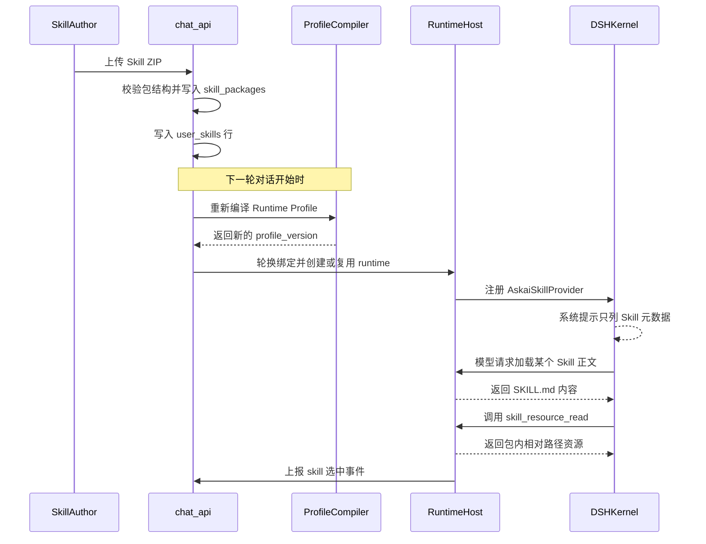

# MOVO Skill 体系

## 根因：能力包不能长在 Agent 核心里

MOVO Community Edition 的自我定位是「DSH runs the Agent; MOVO brings the Agent into enterprise production」。这句话在 Skill 体系上有一条很硬的工程含义：**Skill 是企业的可变资产，而 Agent 内核是上游的不可变依赖**——所以 Skill 的格式、校验、存储、授权必须全部落在 MOVO 侧，内核只负责"按 SKILL.md 干活"。

仓库里把这条边界写成了可执行的版本策略，而不是一句口号：
[services/chat-api/dsh/COMPATIBILITY.md:3-6]()
<!-- anchor: MOVO consumes agent runtimes through the versioned `AgentKernelContract`. DSH is … `dsh/runtime-host/`, in small adapters grouped by upstream subsystem. -->

同一张表里"DSH Core fork"一行的升级规则是明确的禁止项：
[services/chat-api/dsh/COMPATIBILITY.md:17-17]()
<!-- anchor: | DSH Core fork | none | prohibited | -->

**为什么值得这么做**：改内核换来的是"想加什么加什么"，代价是每一次上游升级都要重放一个私有 patch 集。MOVO 选了相反的极端——`dsh/runtime-host/` 里按上游子系统分组的小适配器是唯一允许写 DSH 特定代码的地方，产品服务与前端不直接消费 DSH API。
Skill 体系因此被迫把所有表达能力都收敛到两个 DSH 已经理解的词汇上：**一份 markdown 正文** 和**一个 `skill` 工具**。

代价也很直接：任何"内核不认识"的 Skill 语义，都得先在 MOVO 侧降维成 prompt、工具调用或资源文件。后面会看到，`workflow` 型 Skill 就是这么被"编译"成一段结构化 markdown 的。

### 一个词，三种东西

在 MOVO 的 Skill 数据模型里，用户看到的「Skill」其实是三类异构资产的统一外壳：平台自著的写作规范（writing_style）、导入了 ZIP 包的普通技能（ordinary）、以及从浏览器录制/工作流编辑器生成的多步流程（workflow）。它们被塞进同一个不可变定义里，只在两个字段上分流：
[services/chat-api/app/dsh_runtime/profile/skills/models.py:17-18]()
<!-- anchor: source_scope: Literal["personal", "organization"] … kind: Literal["ordinary", "workflow"] -->

`source_scope` 决定这个 Skill 属于个人还是组织（影响授权与共享），`kind` 决定它走哪条编译器。写作规范不走 `kind`，而是被单独抽成 `WritingStyleDefinition`——因为它的语义不是"做一件事"，而是"用某种风格做内容生成"，在 DSH 侧以 `writing_style_ref` 的形式挂在内容生成节点上。

## 定义格式：一份 SKILL.md，两种权威

### ZIP 才是真正的交换格式

MOVO 没有发明自己的 Skill 清单格式。**唯一的可交换单元是 ZIP**，且包结构被校验器限死：恰好一个 `SKILL.md`，位置只能在归档根或一层子目录内，且不允许有文件落在这个根之外。
[services/chat-api/app/services/skill_packages/validator.py:164-175]()
<!-- anchor: roots = [path for _, path in entries if path == "SKILL.md" or path.endswi … raise SkillPackageError("invalid_bundle_structure", "Files exist outside -->

这个"恰好一层"的约束看起来吹毛求疵，实际是为了让包根（`root_prefix`）成为一个可靠的**资源根**。运行时会把这个根当成 `skill_resource_read` 的沙箱边界（后面详述），如果允许任意深度嵌套，"包内路径"就不再是一个能一句话说清的区间。

### 必填字段与一个静态一致性检查

Frontmatter 走 YAML，硬性要求是 kebab-case 的 `name`、非空 `description` 和非空指令正文：
[services/chat-api/app/services/skill_packages/validator.py:181-190]()
<!-- anchor: name = str(meta.get("name") or meta.get("slug") or "").strip() … raise SkillPackageError("empty_skill_body", "SKILL.md has no instruction body" -->

真正的设计点在后面这一步。校验器把正文里的 fenced code block 抠出来，用正则扫形如 `tool_name(` 的调用，再和 frontmatter 的 `tools` 声明做差集，凡"用了没声明"的工具都给一条 `undeclared_tool_reference` 警告：
[services/chat-api/app/services/skill_packages/validator.py:227-234]()
<!-- anchor: code_samples = "\n".join(FENCED_CODE.findall(body)) … } for tool in undeclared) -->

**为什么是警告而不是错误**：SKILL.md 正文是给模型读的自然语言，不是可执行代码，正则必然有误报（示例代码、伪代码、被注释掉的调用）。MOVO 的选择是——能力声明与能力使用的不一致必须**可见**，但不能因此让一个可以正常工作的包装不上。
安装结果里专门带一个 `compatibility` 段回传 `declaredTools` / `referencedTools` / `warnings`，把判断权交回给人。

### 两套元数据，谁说了算

一个包可以同时带 `SKILL.md` 的 frontmatter 和分发侧写的 `_meta.json`。两者版本不一致时，MOVO 明确裁定 `_meta.json` 为准，并且把理由写进了注释：
[services/chat-api/app/services/skill_packages/validator.py:216-218]()
<!-- anchor: # _meta.json describes the distributed package, so its version is canonical … version = market_version or front_version or "1.0.0" -->

理由拆开看是两句：`_meta.json` 描述的是**被分发的包**（这份包在市场上叫什么、是第几个版本），而 SKILL.md 的 `version` 是作者写正文时顺手填的、容易忘记同步。**"安装和升级看包的版本"**——版本由 `_meta.json` 说了算，且不进入 prompt 正文；但它并不是"执行侧完全不看版本"：内核侧加载点要求 locator 里的版本与 Skill 当前版本完全一致，否则 `get()` 返回 undefined、该 Skill 加载失败。所以更准确的说法是"版本不进 prompt 内容，但它是执行侧加载点的一致性键"。这是一个刻意的解耦：版本语义归控制面，执行语义归内容哈希（后面会看到 profile 用的是内容哈希，不是语义版本）。

### 平台自著 Skill 的反向生成

不是所有 Skill 都从 ZIP 来。用户在编辑器里手搓的写作规范和 workflow 没有包，这时共享导出器会**现场合成**一份 ZIP：把控制面字段写回 frontmatter，正文取 `skill_markdown`，再补一个 `_meta.json`。
[services/chat-api/app/services/skill_sharing/exporter.py:94-106]()
<!-- anchor: slug = self._slug(str(skill.get("package_slug") or display_name), source_id) … "user-invocable": bool(skill.get("user_invocable", True)), -->

合成本身不重要，重要的是导出路径的**终点是同一个校验器**：
[services/chat-api/app/services/skill_sharing/exporter.py:33-51]()
<!-- anchor: package_id = str(skill.get("package_id") or "").strip() … return ShareSnapshot(package=package, profile=self._profile(skill)) -->

有包的走 `validate_skill_package(archive)` 重新校验一遍，没包的先生成再校验。这意味着"平台自著"这条看似更可信的来源，也要过和陌生 ZIP 完全相同的关卡——**可信来源不豁免校验**，因为导出的是历史数据快照，而不是当前编辑器里的状态。

### 三个"看起来像 Skill、其实不是"的地方

按目录名找线索很容易在这里翻车，逐条说清：

- `app/skills_specs/**` **不是 Skill 注册表**。它里面确实躺着 9 份 SKILL.md（docx / pdf / pptx /
xlsx / theme-factory / research / stock_analysis 等；其中 docx、pdf、pptx、xlsx 四个目录各带一份 Anthropic 的 LICENSE.txt，theme-factory 是 Apache-2.0，research、stock_analysis 与两份 style 目录没有第三方许可文件），但全仓对它的引用只有三种：作为 Python包被 import 使用、作为 PDF 抽取脚本的路径、以及 frontmatter 形状与 DSH 约定一致的样例。
例如它是被当库用的：
[services/chat-api/app/services/documents.py:83-83]()
<!-- anchor: from app.skills_specs.docx.markdown_to_docx import render_from_markdown -->

也就是说这些文件**不会被任何 Skill 加载路径读取**，它们只是"恰好放在 SKILL.md 习惯目录里的工具代码"。

- `app/knowledge/skill_md_parser.py` 是另一种 frontmatter 方言（`skill_id` / `default_mode` / `required_sections` / `evidence_policy` / `validator_rules`），**没有任何生产调用者**，只被 `app/knowledge/__init__.py` 重新导出：
[services/chat-api/app/knowledge/skill_md_parser.py:8-22]()
<!-- anchor: def parse_skill_md(markdown: str) -> Dict[str, Any]: … return out -->

同目录的 `skill_catalog.py` 是个纯关键词打分器（命中小写 query 累加分、别名字段权重 1.2），同样没有生产调用者：
[services/chat-api/app/knowledge/skill_catalog.py:47-63]()
<!-- anchor: def retrieve_topk(self, text: str, k: int = 3) -> List[Tuple[CatalogSkill, … return scored[: max(1, int(k))] -->

这两个文件合起来说明：MOVO 早期确实设计过"按关键词 top-k 选 Skill"的方案，后来被 Runtime Profile 方案取代了，但文件没删。**读这个仓库时不要照着它们还原当前行为。**

- `app/skills_specs/research/SKILL.md` 与 `stock_analysis/SKILL.md` 用的又是第三种形状——**没有 `---` 分隔符**的裸 YAML：
[services/chat-api/app/skills_specs/research/SKILL.md:1-3]()
<!-- anchor: name: research … description: General research skill with web search and summarization. -->

仓库里三个 frontmatter 解析器（`validator._frontmatter`、`services/skills._split_frontmatter`、`knowledge.skill_md_parser.split_frontmatter`）都要求首行是 `---`，所以这份文件**在任何路径下都解析不出元数据**。它是一份失效的样例，
不是可用资产。

## 打包与安装：三道入口，一个校验器

Skill 可以从不只一个方向进来，但出口只有一个。本地 ZIP 上传、分享链接安装、SkillHub 社区下载，三条通道在代码里都被压到同一个函数 `validate_skill_package`：
[services/chat-api/app/services/skill_packages/dispatcher.py:7-10]()
<!-- anchor: def validate_skill_package(content: bytes) -> ValidatedSkillPackage: … return validate_skill_zip(content) -->

分发器再按包形状分流：带有 `manifest.json` 且 `type == "skillhub-expert-package"`（或仅凭 `skillsets/*.md` + `skills/*.zip` 的形状）的包走专家包校验，其余走普通 SKILL.md 校验。专家包本质是**多 Skill 的合集**——外层是 manifest + 若干内层 ZIP，因此需要一套额外的目录与子包约束。
[services/chat-api/app/services/skill_packages/expert_validator.py:34-52]()
<!-- anchor: def is_expert_package(content: bytes) -> bool: … manifest = None -->

### 硬限制：把 ZIP 当成不可信输入

所有限制集中在依赖与常量上，一眼能看完：
[services/chat-api/app/services/skill_packages/validator.py:16-22]()
<!-- anchor: MAX_ARCHIVE_BYTES = 5 * 1024 * 1024 … SKILL_VERSION = re.compile(r"^[0-9]+\.[0-9]+\.[0-9]+ -->

5 MB 归档、20 MB 展开、256 个文件、单文件 10 MB、压缩比 200:1 上限。逐条检查发生在遍历 `infolist()` 时，额外拒绝符号链接与加密条目：
[services/chat-api/app/services/skill_packages/validator.py:141-158]()
<!-- anchor: for info in archive.infolist(): … entries.append((info, path)) -->

- **压缩比上限**防的是 zip bomb：单看展开后总大小会被 20 MB 卡住，但一个 1 KB 压成 500 MB 的
条目会在解压时先吃掉内存，因此必须在读内容之前用 `file_size / compress_size` 拦掉。
- **拒绝符号链接与加密条目**：解析侧（Python）与物化侧（Node）是两次独立的 ZIP 解压，中间隔着
一条 base64 + Mongo 的路径。validator 本身没有写这条规则的意图注释，但物化侧用 fflate 逐条
`writeFile`（不会落出软链），读取侧另有一次 realpath 包含性校验——**"取消 TOCTOU 时间窗"是从
这两侧实现推出的判断，不是源码自述**。

然后是文件数与总量这两道总量闸：
[services/chat-api/app/services/skill_packages/validator.py:159-168]()
<!-- anchor: if len(entries) > MAX_FILES: … raise SkillPackageError("multiple_skills", "ZIP must contain exactly one -->

### 安装：先落包，再落指向

安装器把 ZIP 的 base64 原件与文件清单存成一条独立的 `skill_packages` 文档，再在 `user_skills`（个人）或 `skills`（组织）里写一条**引用它的** Skill 记录：
[services/chat-api/app/services/skill_packages/installer.py:60-76]()
<!-- anchor: package_doc = { … await db.skill_packages.insert_one(package_doc) -->

这个"包与 Skill 分离"的结构是理解整个安装流程的钥匙：`skill_packages` 是**内容层**（不可变、按 digest 去重、可以被多个 Skill 行引用），`user_skills` / `skills` 是**控制层**（可变、可启停、带作者与可见性）。这也是为什么"安装"能同时支持覆盖升级与个人/组织两种作用域。

覆盖升级时，旧包不是删掉而是**留 5 代**：
[services/chat-api/app/services/skill_packages/installer.py:104-118]()
<!-- anchor: if current: … await db.skill_packages.delete_many({"_id": {"$in": expired}}) -->

保留 5 代的理由不是"怕用户后悔"，而是**分享出去的快照需要能追溯到具体的包**：一条历史 release 记录里存的是 digest 与 base64 快照，但排障时经常要回到"当时装的是哪个包"。超过 5 代就删，是一个明确的成本上界——不做无限历史，避免包存储随更新次数线性膨胀。

升级动作被划成五个词，而不是二值的新旧比较：
[services/chat-api/app/services/skill_packages/upgrade.py:30-40]()
<!-- anchor: if current is None: … return str(result.get("action") or "") in {"upgrade", "replace", "downgrade"} -->

`install` / `duplicate` / `upgrade` / `replace` / `downgrade` 五个动作里，**`install`（此前没有同名 Skill）与 `duplicate`（digest 完全相同）不需要确认**，`upgrade`／`replace`／`downgrade` 三种都要前端显式回传 `confirm_replace`，否则接口回 409 并把动作详情一起返回，让 UI 能显示"你正在从 1.2.0 降级到 1.1.0"（同一版本号但内容不同也会被判成 `replace`）：
[services/chat-api/app/api/endpoints/skill_package_install.py:43-51]()
<!-- anchor: package = await _validated_upload(file) … "upgrade": upgrade, -->

**为什么"同版本号但不同内容"要单独叫 `replace`**：语义版本相同而 digest 不同，通常意味着作者改完没升版本。把它和 upgrade 混在一起，UI 就只能显示"版本没变"，用户会以为点错了。区分开之后，这个动作是可疑的、需要人工确认的，而 digest 相同的重复安装则是可以静默幂等的。

## 发现与注入：可用集在编译期，选择在轮内

这一节要先把一个容易搞错的点说清楚，因为它决定了后面所有读代码的方式。

### 先纠正：`skill-turn-selection` 不是"每轮挑选 Skill 的注入器"

从文件名推测，`skill-turn-selection.mjs` 看起来像"每轮决定注入哪些 Skill 的选择器"。实际读下来，它只做一件事：**处理用户在 UI 上手动选中的那一个 Skill**。它拿 `selected_skill_id` 去当前 Runtime Profile 里按 `source_id` 查，查不到就抛错，
而不是"降级为不注入"：
[services/chat-api/dsh/runtime-host/src/skill-turn-selection.mjs:1-9]()
<!-- anchor: export function resolveSkillTurnContext(modelProfile, value) { … if (skill === undefined) throw new Error('selected Skill is unavailable in -->

查到了之后，它也不构造任何注入结构，而是把 Skill 折叠成一个斜杠调用的文本前缀：
[services/chat-api/dsh/runtime-host/src/skill-turn-selection.mjs:28-29]()
<!-- anchor: export function invokeSelectedSkill(skillName, text) { … return skillName ? `/${skillName}\n${text}` : text -->

**这个设计的意图**：手动选 Skill 不需要 MOVO 发明新的会话协议。DSH 内核本来就认识"以 `/skillName` 开头的用户消息"这种原生 Skill 调用形式，MOVO 只是复用了它。于是手动选择在内核眼里和用户在编辑器里敲 `/xxx` 完全等价——**不引入第二条 Skill 触发路径**，也就没有第二处需要维护的语义。

**那个 throw 也值得注意**：找不到就报错，而不是静默忽略。因为 profile 是不可变快照，用户选中的 Skill 不在快照里只有两种可能——它刚刚被停用/删除了，或者这个 conversation 还绑在旧 profile 上。两种情况下"静默不注入"都会让用户以为 Skill 生效了而实际没有，所以宁可让这一轮失败。

那"每轮按关键词挑 N 个 Skill 塞进 system context"的逻辑在哪？**在这个仓库里不存在。** 唯一一处形似的实现是一个 LLM 排序器（带完整的严格选择策略提示词、只输出一个 id 或空、返回幻觉 id 时降级为"未命中"）：
[services/chat-api/app/services/skill_assets/composite_task.py:266-279]()
<!-- anchor: async def rank_composite_skill_match( … return CompositeSkillMatchDecision(selected_skill_id="", reason="no candidates") -->

但全仓**没有任何调用方**——它只被定义，从未被调用。所以"自动 Skill 选择"是设计过、实现了一半、尚未接线的能力，不能当作当前行为来描述。（这一点在文末的未坐实清单里再列一次。）

### 真正的"发现点"：编译期

哪些 Skill 对某个人可见，是在**编译 Runtime Profile 时**一次性决定的。编译器把两个来源合并：个人的 `user_skills` 与组织的 `skills`：
[services/chat-api/app/dsh_runtime/profile/skills/catalog.py:18-20]()
<!-- anchor: async def list_enabled(self, tenant_id: str, user_id: str) -> list[dict[str, … organization = await organization_skill_adapter.list_runtime_skills(main_id= -->

组织侧目录先按 `enabled` 过滤，再按 `type` 分派到三个适配器（workflow / writing_style / ordinary），适配不出来的直接丢弃：
[services/chat-api/app/services/org_skill_adapter.py:797-807]()
<!-- anchor: async def list_runtime_skills(self, *, main_id: str) -> List[Dict[str, Any]]: … raw_type = _safe_text(doc.get("type"), 80).lower() -->

然后逐个编译成不可变定义。**这里有一个很值得学的容错策略**：单个 Skill 编译失败时，只记一条 warning 并跳过它，而不是让整个编译失败：
[services/chat-api/app/dsh_runtime/profile/skills/compiler.py:38-46]()
<!-- anchor: skills.append(self._compile_skill(row, tools=tools, style_refs=style_refs)) … str(row.get("name") or ""), -->

注释把理由写得很直白：一个格式坏掉的 Skill 必须 fail closed（它自己不能用），但不能让这个租户里所有**无关**的对话都不可用。只有当**全部** Skill 都编译失败时才抛出第一个异常——那时候说明是系统性问题（比如工具面整体没配好），而不是某个用户填错了字段。

编译器同时负责规范化 DSH 需要的 skill 名。DSH 的 skill 名有字符集约束（小写字母数字与连字符），而 MOVO 的 Skill 名是任意 Unicode（大量中文），所以名字要转写并拼上 `source_id` 的哈希前缀：
[services/chat-api/app/dsh_runtime/profile/skills/compiler.py:141-144]()
<!-- anchor: def _native_name(label: str, source_id: str) -> str: … return f"{ascii_label[:90].strip('-')}-{digest}" -->

**为什么必须带哈希**：把中文名转写成 ASCII 必然产生碰撞（"周报"/"周报模板"可能都转成 `zhoubao` 或直接塌成 `askai-skill`），而 DSH 侧 skill 名是会话内的唯一键。用 `source_id` 的 10 位哈希做后缀，就把"显示名可重复"和"内核名必须唯一"这两个要求同时满足了。`display_name` 则原样保留给 UI。

### 为什么不在启动时一次性注入

这是本节的核心问题。答案是：**MOVO 没有"启动时"这个概念，只有一个会不断换代的内容哈希。**

整个 Runtime Profile（模型 + 工具面 + Skill 集合 + 写作规范）被序列化成一个规范化 JSON 并取哈希，`profile_version` 直接就是哈希前缀：
[services/chat-api/app/dsh_runtime/profile/compiler.py:68-73]()
<!-- anchor: "tools": tuple(item.model_dump(mode="json") for item in tools), … item.version for item in (skill_profile.skills if skill_profile else -->
[services/chat-api/app/dsh_runtime/profile/compiler.py:77-81]()
<!-- anchor: content_hash = self.content_hash(payload) … profile_version=f"rp-{content_hash[:24]}", -->

payload 里包含 `subject_user_id`，所以哈希天然是"按用户"的：
[services/chat-api/app/dsh_runtime/profile/compiler.py:53-56]()
<!-- anchor: payload: dict[str, Any] = { … "subject_user_id": user_id, -->

Skill 集合也进了这个 payload，并且以 camelCase 的 `skillProfile` 键下发给运行时宿主：
[services/chat-api/app/dsh_runtime/profile/models.py:67-70]()
<!-- anchor: if self.skills or self.writing_styles: … "writingStyles": [style.model_dump(mode="json") for style in self.writing_styles -->

每个 conversation 绑定一个 `profile_version`。**在每一轮对话的入口**，MOVO 重新编译一次期望的 profile，和当前绑定的版本比一比；不一致才做动作：
[services/chat-api/app/dsh_runtime/profile/synchronizer.py:49-70]()
<!-- anchor: desired = await self._profiles.compile_model_profile( … disposed = await self._coordinator.dispose_restored_session(restored) -->

这个动作不是"热更新配置"，而是**换一个会话**：发布新快照 → 创建 successor binding（用旧会话已完成的事件作种子）→ 丢弃 predecessor 会话。入口调用点就在聊天服务的准备阶段：
[services/chat-api/app/dsh_runtime/chat_service.py:250-262]()
<!-- anchor: binding = (await self._profile_sync.synchronize( … )).binding -->

**为什么不在启动时注入一次，然后按需热插拔**：

1. **Skill 集合的变更不是"加一个工具"，而是改变 system prompt 的内容**。而 DSH 内核的会话是
带持久化历史的，system prompt 的变化会破坏历史消息与当前提示的一致性（prompt caching、
in-history system message 都会错位）。MOVO 的解法是把"配置变更"提升成"会话换代"，让新提示
对应新会话，历史通过 seed 完整继承。
2. **内容寻址让幂等变得免费**。同一个 profile 内容哈希相同，就不需要做任何事；而"启动时注入 +
后续打补丁"需要一套变更检测协议，那套协议本身就会成为语义漂移的来源。
3. **代价要承认**：运行时的隔离键是 `tenant + profile_version`，复用靠 discover 命中：

[services/chat-api/app/dsh_runtime/runtime_coordinator.py:19-20]()
<!-- anchor: def isolation_key(tenant_id: str, profile_version: str) -> str: … return f"tenant:{tenant_id}:profile:{profile_version}" -->

由于 profile 哈希里带了 `subject_user_id` 和完整的 Skill 集合，**同一个人的任何一次 Skill 变更都会产生一个新的 runtime 实例**，而不同用户之间也不会共享 runtime。换句话说，运行时进程数的量级是"用户 × 内容版本"，不是"租户"。这是为了不可变性与正确性付的扩容代价，
在单租户自托管（MOVO CE 的目标场景）里可接受。

### 三级按需披露

既然 Skill 正文不能一次性全塞进 system prompt（几十个 Skill 的 markdown 正文会直接吃掉上下文窗口），MOVO 在 provider 接口上把"Skill 的存在"和"Skill 的内容"拆成两次调用。

**第一级：元数据**。`list()` 只暴露名字、描述、`whenToUse`、可调用性策略、来源与排名：
[services/chat-api/dsh/runtime-host/src/askai-skill-provider.mjs:18-34]()
<!-- anchor: return this.#skills.map(skill => ({ … capabilityRefs: [...(skill.capability_refs ?? [])], -->

**第二级：正文**。`get()` 才返回 `content`（即 SKILL.md 正文），并且有一道**版本锁**：
[services/chat-api/dsh/runtime-host/src/askai-skill-provider.mjs:40-42]()
<!-- anchor: const skill = this.#byName.get(candidate?.locator?.name) … const hasBundle = Boolean(skill.bundle_archive_base64) -->

`candidate.locator.version` 必须和当前 Skill 定义的 `version` 完全一致，否则返回 `undefined`。这条判断的分量比它看起来重：内核可能持有一份**上一代 profile 产出的候选列表**（例如事件回放、或者会话刚切换时的缓存），
版本锁确保"陈旧候选"不会被加载成一个当前已经不存在的 Skill—— **不可变快照的身份必须贯穿到加载点**，而不是只在编译时成立一次。

**第三级：资源文件**。SKILL.md 里引用的 `assets/*.json`、`references/*.md` 要走一个 MOVO 自己注册的独立工具 `skill_resource_read`。**它只在有包资源时才注册**（`hasResourceBundles()` 为假就整个工具不出现），且调用时必须有"当前活跃的 Skill"：
[services/chat-api/dsh/runtime-host/src/skill-resource-tool.mjs:27-46]()
<!-- anchor: export function registerSkillResourceTool(ctx, { provider, invocations }) { … lineCount: args.line_count, -->

注册与当前活跃 Skill 的来源都在内核运行时里接线：
[services/chat-api/dsh/runtime-host/src/kernel-runtime.mjs:78-86]()
<!-- anchor: const skillProviderRegistration = registerAskaiSkillProvider( … invocations: this.#skillInvocations, -->

三级披露的好处不是"省 token"这一句能概括的：**它把"选择"变成了模型自己的动作**。system prompt 里只出现一份目录，模型读到任务后自行决定要不要调 `skill` 工具加载某个正文，加载完了再决定要不要读它的资源文件。MOVO 不需要预测模型会用哪个 Skill——它只需要保证每次加载都是**版本一致**的。

宿主侧还有一道反方向的结构校验：`skillProfile` 必须是对象、`skills`/`writingStyles` 必须是数组、每个 skill 必须有非空 `name`/`version`/`source_id`/`content`，且 skill 名不得重复：
[services/chat-api/dsh/runtime-host/src/model-profile.mjs:23-33]()
<!-- anchor: const names = new Set() … names.add(skill.name) -->

也就是说 profile 的**生产者**（chat-api）和**消费者**（runtime host）各自独立地校验同一份结构。这在跨语言边界上是必要的：Pydantic 保证不了 JSON 在 JS 侧的形状，而 profile 是安全边界（里面带着模型网关地址与短期 accessToken），宁可两边都啰嗦。

## 资源读取：把"读文件"缩到 Skill 包内

`skill_resource_read` 是 MOVO 在全仓里为 Skill 体系新加的唯一一个工具。它的存在理由很具体：一个 Skill 包除了 SKILL.md，往往还带模板、映射表、脚本示例。模型需要读到它们，但**绝不能拿到一个能读任意路径的文件读取器**。

路径约束是最严的一层：必须是非空相对路径、不含 `\0`、不是绝对路径：
[services/chat-api/dsh/runtime-host/src/skill-resource-reader.mjs:9-18]()
<!-- anchor: const raw = String(requested ?? '').trim() … return { raw, target } -->

然后对根和候选路径都做 `realpath`，再算一次相对关系——这一步才是防符号链接逃逸的关键：
[services/chat-api/dsh/runtime-host/src/skill-resource-reader.mjs:30-42]()
<!-- anchor: const root = await realpath(rootPath) … if (info.size > MAX_TEXT_BYTES) { -->

**为什么是先 resolve 再 realpath，两次都算相对关系**：第一次 containment 是对"用户写的字符串"做的纯词法检查（`../` 之类会被挡掉），但它挡不住包内已经存在的符号链接——包是别人给的 ZIP。第二次是在 `realpath` 之后对**真实路径**再算一次相对关系，符号链接指向包外时这一步会失败。
词法检查便宜但可绕过，realpath 检查昂贵但可靠，两层的顺序是"先便宜后昂贵"，而不是二选一。

文本处理上同样保守：只接受 UTF-8（`fatal: true` 的 `TextDecoder`），超过 1 MB 直接拒绝，读取按行分页（默认 200 行、上限 500 行）。**为什么按行分页而不是按字节**：SKILL.md 引用资源时用的是"第几行附近"这种人类坐标，分页单位与引用单位一致，模型续读的推理成本最低。
返回体里带 `totalLines` 与 `truncated`，让模型知道还有没有下文。

落盘侧（物化）则要解决另一组问题。同一个 Skill 包可能在多个会话、多个 runtime 里被读取，因此物化目录是**按 digest 内容寻址**的，且带一次原子切换：
[services/chat-api/dsh/runtime-host/src/skill-bundle-materializer.mjs:32-45]()
<!-- anchor: async materialize(skill) { … const entries = Object.entries(unzipSync(new Uint8Array(archive))) -->

digest 先校验（SHA-256 必须匹配），再以 digest 作为目标目录名；已存在就直接返回（幂等）。解压过程把每一项都做一次"是否在解压根内"的判断，并累计展开字节数：
[services/chat-api/dsh/runtime-host/src/skill-bundle-materializer.mjs:45-61]()
<!-- anchor: const entries = Object.entries(unzipSync(new Uint8Array(archive))) … await writeFile(target, bytes, { mode: 0o600 }) -->

几个细节连起来看，是一个完整的**不可信包物化流程**：`mkdtemp` 到临时目录 → 逐项写文件（`mode: 0o600`，不给执行位、不给他人读）→ `rename` 成最终 digest 目录（同文件系统内原子）→ `EEXIST` / `ENOTEMPTY` 视为"别人已经装好了"而不是错误。
**这也解释了为什么校验和物化要做两遍近似的事情**：校验在 Python 侧、发生在**入库前**，目的是拒绝坏包并给出可读错误；物化在 Node 侧、发生在**执行时**，目的是在真正落盘的那一刻再挡一次路径穿越——两次之间的那条 base64 + Mongo 的路径，本身就是不可信数据通路。

最后是一个容易忽略的优化：**只有包里存在 SKILL.md / `_meta.json` 之外的资源文件时，才在 profile 里挂 bundle**：
[services/chat-api/app/dsh_runtime/profile/skills/catalog.py:42-57]()
<!-- anchor: package_ids = [str(item.get("package_id") or "") for item in rows if … row["runtime_bundle_root"] = str(package.get("root_prefix") or "") -->

纯指令型 Skill（只有一份 SKILL.md）不付任何物化与 base64 传输成本，`hasResourceBundles()` 也会返回假，于是 `skill_resource_read` 这个工具**根本不注册**。工具面随内容自适应，而不是常驻一个永远会报"该 Skill 没有包资源"的工具——**减少工具面就是减少模型的误调用面**。

## 用量追踪：从事件流"观察"出 Skill 使用

Skill 使用情况（哪个 Skill 被用了、是手动选的还是模型自己挑的）如果要在内核里埋点，就得改内核——直接违反本仓库最硬的那条边界。MOVO 的做法是**只订阅事件流**：
[services/chat-api/dsh/runtime-host/src/kernel-runtime.mjs:118-122]()
<!-- anchor: ctx.on('session/event', (session, event) => { … }, { global: true }) -->

追踪器识别的判据有两条，分别对应内核的两种真实调用形态：
[services/chat-api/dsh/runtime-host/src/skill-invocation-tracker.mjs:53-60]()
<!-- anchor: if (event?.type === 'user/message' && event?.data?.source?.kind === … return args && typeof args === 'object' ? String(args.name || '') : '' -->

一条是 `user/message` 且 `source.kind === 'skill-invocation'`（内核把"斜杠调用 Skill"记录成了带来源标记的用户消息——这正是前面 `invokeSelectedSkill` 拼 `/${name}` 前缀所依赖的同一机制；**注意这条契约的产出侧在内核里，本仓库只有消费端，属于本文未坐实的部分**），另一条是 `tool/call` 且工具名为 `skill`。
整个 observe 过程还负责维护手动/自动的判定与轮内去重：
[services/chat-api/dsh/runtime-host/src/skill-invocation-tracker.mjs:22-45]()
<!-- anchor: observe(sessionId, event) { … return { ...skill, selectionMode: manual ? 'manual' : 'automatic' } -->

几个语义细节值得抄：`turn/start` 只清"已观测集合"与"当前活跃 Skill"，**刻意保留手动意图**（因为 `expectManual` 是在 `turn/start` 之前调用的，清了就永远记不上），直到 `turn/end` 或显式 `clear()` 才连手动意图一起清空；所以**"手动"这个标记的生命周期正好是一轮**——用户在某一轮手动选了 Skill，不会让下一轮的自动调用也被误记为手动；同一个 skill 在一轮内只上报一次（`observed` 集合去重），
避免模型多步重复加载刷高用量；`clear()` 在投递失败时兜底，防止状态泄漏到下一轮。

追踪结果被追加成一条 `skill/selected` 事件进事件日志，带上 `sourceId` / `displayName` / `sourceScope` / `selectionMode`。**这就是全部实现**。

**为什么这样设计**：

- 内核没有提供 skill 生命周期回调，事件流是唯一稳定的可观测面。所有适配成本落在"把事件翻译成业务事实"上，而不是"往内核加接口"。
- 记录的是**内核真实发生的调用**，而不是 MOVO 在发送前的猜测。这一点正好解释了为什么 `rank_composite_skill_match` 那个排序器没有接线——如果 MOVO 自己"预测"要用哪个 Skill，用量数据就会变成预测数据；而实际被采用的做法只承认内核真的加载了哪个 Skill。
- 代价是**只有"被执行到"的 Skill 才有数据**。想做"我给模型提供了 40 个 Skill，哪些从来没被打开过"这种覆盖率分析，需要另外的埋点（当前仓库里没有找到）。

## 生命周期与共享：草稿、发布、分发是三层

Skill 的可变性与不可变性在这里被切得很干净。**只有"平台自著"的 Skill 才有草稿态**——导入了 ZIP 包的 Skill 走的是包版本线，不走草稿线：
[services/chat-api/app/services/skill_lifecycle/service.py:209-214]()
<!-- anchor: def is_platform_skill(row: dict[str, Any]) -> bool: … return raw_type in PLATFORM_TYPES or skill_type in {"style", -->

判据是"没有 `package_id`，且类型属于写作规范 / workflow"。这个划分不是偷懒：包型 Skill 的内容由 ZIP 决定，**改它等于换一个包**，所以它的版本语义必须是包的 digest；而平台自著 Skill 的内容就是数据库里的几个字段，可以随意迭代，所以需要一套 draft/publish 来防止"编辑中状态"泄漏到运行时。

发布时，草稿快照落到 `skill_releases`，同时把 `published_version` / `published_digest` / `published_release_id` 写回主记录，并要求版本号唯一：
[services/chat-api/app/services/skill_lifecycle/service.py:110-121]()
<!-- anchor: if not self.is_platform_skill(row): … raise SkillLifecycleError("skill_version_exists", "This Skill version already -->

**为什么 release 要存整份 snapshot 而不是 diff**：因为运行时快照（Runtime Profile）本身就是不可变的，排障时需要回答"这个会话当时用的究竟是哪一版内容"。存 diff 会让这个问题变成一个需要重放历史的问题，存快照则是 O(1) 查询。代价是存储冗余，在一个 Skill 只有几 KB 文本的量级上完全可以接受。

### 分享：三道收窄

Skill 分享的设计可以概括为"**跨边界之前先降权**"，一共三步：

1. **剥掉密钥，强制私有**。导出时递归删除形如 `api_key` / `password` / `access_token` 的字段，
并把 `visibility` 硬写成 `private`：
[services/chat-api/app/services/skill_sharing/exporter.py:68-70]()
<!-- anchor: # Owner, object-store paths and mutable database identity … return profile -->

注释说得很清楚：所有者、对象存储路径、可变的数据库标识**从不跨越分享边界**。接收方拿到的是一份"内容 + 展示信息"，而不是一条可以继续以原作者身份运行的记录。

2. **分享物必须能被校验器接受**。而且注意是在**安装时再验一遍**，不是信任数据库里的 base64：

[services/chat-api/app/services/skill_sharing/service.py:127-136]()
<!-- anchor: archive = base64.b64decode(str(row.get("archive_base64") or ""), validate=True) … package_source=self._package_source(row), -->

这是"存储数据也是不可信输入"的一个正面例子。base64 可能被截断、可能来自旧版本的写入逻辑、可能被人工改过——重新走一次 `validate_skill_package` 的成本是几十毫秒，收益是**安装路径上只有一条代码能产生 Skill**。

3. **凭证只存哈希**。分享 token 以 SHA-256 存储，带过期时间与显式撤销，
并且每次取用都重新校验状态与过期：
[services/chat-api/app/services/skill_sharing/service.py:183-196]()
<!-- anchor: async def _active_share(self, *, main_id: str, token: str) -> dict[str, Any]: … return row -->

### 分发：把"分享链接"升级成"稳定受众"

一次性 token 解决不了"我把 Skill 给了 20 个同事，后来修了个 bug"这件事。`distribution` 引入了稳定受众（成员集合）与 release 序列：发布新版本时，给所有"已安装版本 digest 与新版不同"的成员各写一条待处理通知：
[services/chat-api/app/services/skill_sharing/distribution.py:228-235]()
<!-- anchor: async def _notify_members(self, *, distribution: dict[str, Any], release: dict[str, … }).to_list(length=100_000) -->

接收方安装更新时，先判"本地是否被改过"：
[services/chat-api/app/services/skill_sharing/distribution.py:211-218]()
<!-- anchor: local_modified = bool(current) and (bool(current.get("locally_modified")) … replace_existing=True, -->

本地改动 = 显式的 `locally_modified` 标记，**或**当前 digest 与"安装时记录的 digest"不一致（即用户在本地编辑过）。有改动且没有显式确认，就拒绝覆盖并回 409。**为什么这条判断必须在服务端**：接收方编辑过的 Skill 是他们自己的资产，静默覆盖是不可逆的数据丢失；
而"是否被编辑过"只有服务端能可靠判断（客户端不知道安装时的 digest）。

### SkillHub：社区安装只是多了一段下载

社区安装没有引入任何新的信任模型，只是把"用户上传"换成"从远端流式下载"，然后在同一个校验器前汇合。坐标解析先做形状约束（`@namespace/slug`，禁止 `..` 与反斜杠）：
[services/chat-api/app/services/skillhub/coordinate.py:24-42]()
<!-- anchor: def parse_skillhub_coordinate(raw: str, version: str = "") -> SkillHubCoordinate: … slug=slug.lower(), namespace=namespace.lower(), version=requested_version, -->

下载后立刻走同一个 `validate_skill_package`，失败时把校验器的结构化错误原样包进 SkillHub 错误，让 UI 能区分"网络失败"和"这个包不合法"：
[services/chat-api/app/services/skillhub/service.py:33-40]()
<!-- anchor: target = parse_skillhub_coordinate(coordinate, version) … validation=exc.detail(), coordinate=target.canonical, -->

返回体里有一个词很关键：
[services/chat-api/app/services/skillhub/service.py:56-61]()
<!-- anchor: return { … "availability": "next_turn", -->

`availability: "next_turn"` 是前面那套 Profile 轮换机制**直接泄漏到 API 契约上的结果**：安装完成的这一刻，当前绑定的 Runtime Profile 还没有变；新的 Skill 要等到下一轮对话入口重新编译时才会进入可用集。MOVO 没有掩饰这一点，而是把它写进返回体——**比假装"立即生效"要诚实得多**。

## 与内置工具的关系：Skill 是 prompt 级能力，权限是工具级

这是整个体系里最容易被误解的一点。**Skill 不携带任何执行权**。

看 workflow 型 Skill 的编译过程：节点先被映射成一个 `capability_ref`，然后这个 ref 必须**已经存在于本次编译的工具面（toolProfile）里**，找不到就直接让这个 Skill 编译失败：
[services/chat-api/app/dsh_runtime/profile/skills/workflow.py:52-58]()
<!-- anchor: if binding.runtime_shape == "tool": … tool_name = tool.name -->

工具名找到后会写进生成的正文里（`- 调用工具：\`tool_name\``）。也就是说**`capability_refs` 只是提示词里的名字，真正的执行面在工具网关**。Skill 说"你要用 `document.annotate@v1`"，但如果没有那个工具，Skill 压根编译不出来。权限收敛在工具面，Skill 只是告诉模型怎么组合它们。

workflow 与普通 Skill 共用同一套不可变定义，区别在正文的来源：workflow 的正文是由节点列表**渲染**出来的结构化 markdown（目标 / 适用场景 / 建议执行步骤 / 执行原则 / 验收）：
[services/chat-api/app/dsh_runtime/profile/skills/workflow.py:17-29]()
<!-- anchor: def workflow_nodes(row: dict[str, Any]) -> list[dict[str, Any]]: … return normalize_workflow_nodes(config) -->

生成的"执行原则"段里有一句很能说明这套设计的立场：
[services/chat-api/app/dsh_runtime/profile/skills/workflow.py:138-145]()
<!-- anchor: - 这是供 DSH Agent Loop 使用的自适应 Skill，不是固定图执行计划。 … - 所有外部写操作遵循 MOVO 审批策略。 -->

**"自适应 Skill，不是固定图执行计划"**：MOVO 有完整的 workflow 编辑器（节点、连线、绑定写作规范、绑定知识文档），但编译的产物不是一张给图执行引擎的 DAG，而是**一段给 Agent Loop 读的建议步骤**。节点顺序变成文本序号，节点间的依赖由模型自己理解，运行期允许跳过、重复或并行。放弃的是"确定性执行保证"，
换来的是"不需要在 MOVO 侧再实现一个执行引擎"——因为内核已经有 Agent Loop 了，而重复实现一个只会和内核的循环产生两套并行的控制流。

至于 Skill 本身怎么被模型调用：`skill` 是内核的内置工具名，在运行时宿主维护的"原生工具名保留集"里与 `read_image`、`web_search`、`bash` 等并列：
[services/chat-api/dsh/runtime-host/src/official-host/tool-name-policy.mjs:6-9]()
<!-- anchor: export const DSH_CODE_RESERVED_TOOL_NAMES = Object.freeze(new Set([ … 'skill', 'ask_user_question', 'web_search', 'web_fetch', 'read_image', 'present', 'todo_write', -->

而 `skill_resource_read` 才是 MOVO 注册的。所以 Skill 体系在工具面上只有**一个自建工具**，其余全部复用内核能力。

## 多租户与治理：一个需要打折的设计目标

手动选 Skill 这条路径的治理是完整的。**即使是用户自己在 UI 上点的 Skill，也要过一遍策略检查**，拒绝时写审计事件，通过时也写一条"使用"事件：
[services/chat-api/app/dsh_runtime/turn_admission.py:24-53]()
<!-- anchor: selected = str(selected_skill_id or "").strip() … return TurnSkillSelection(selected_skill_id=selected) -->

注意它把 `org_skill:` 前缀剥掉之后再查权限，并且区分了 `writing_style` 与普通 skill 两种返回（前者走 `selected_writing_skill_id`，后者走 `selected_skill_id`）——这两者在运行时宿主里被 `resolveSkillTurnContext` 分别处理，
写作规范变成 `writing_style` 上下文对象，普通 Skill 变成斜杠调用。

**但组织级 Skill 的可见性在社区版是"全开"的**，这一点必须说清楚。目录侧确实调用了一个看起来很像 ACL 的函数：
[services/chat-api/app/product/resource_access.py:18-37]()
<!-- anchor: """Apply the distribution-owned audience policy to organization assets. … return ids.intersection({str(item) for item in allowed}) -->

可它的 docstring 自己承认了：社区版没有人员级的资源 ACL，凡是送到这个边界的组织资产都保持可用；只有商业扩展注入 `resource_access_policy` 时才会真正收窄集合。**所以「多租户与治理内建」这个论断要按作用域打折**（本文只就「同租户内按人授权」这一窄命题发言；租户级隔离与轮次治理本身成立，见 `session-and-turn-lifecycle.md`）：租户隔离（`main_id` 贯穿数据与运行时）是**真的**、可验证的；
按人授权（"这个组织 Skill 只给这个岗位"）是**扩展点**，不是社区版的实现。读代码时看到 `filter_allowed_resource_ids` 这个名字而推断出 ACL 已存在，会得到一个与事实相反的结论。

## 可迁移的模式

1. **能力包用"文件格式 + 单一校验器"做交换格式**，本地/分享/社区三条通道全部汇入同一个函数。
校验不是一处调用，而是一条**唯一路径**——任何绕开它的新入口都会立刻在代码评审里显形。
2. **可用集在编译期确定，用内容哈希版本化，在轮边界整体换代**。不做每轮挑选、不做热插拔：
把"配置变更"提升成"会话换代"，用 seed 继承历史。换来的是一次编译、处处一致的语义，
代价是运行时按"用户 × 内容版本"扩容。
3. **三级按需披露 + 版本锁**：元数据进提示词、正文靠工具调用加载、资源再单独一层；每一层
加载点都校验版本，让"陈旧候选"无法加载成不存在的 Skill。
4. **沙箱边界放在内容寻址的物化目录上**：digest 做目录名、临时目录 + 原子 rename、写文件
0600、词法检查 + realpath 检查两层。校验与物化**故意做两遍**，因为中间隔着一条不可信数据通路。
5. **用量与可观测做成事件流观察者**，而不是往内核加钩子。记录"真实发生的事"，不做预测；
状态严格按轮清理，避免跨轮污染。
6. **prompt 级能力不携带执行权**：Skill 引用的能力必须在工具面里已授权，否则 Skill 自身
编译失败。权限只在一个地方判，Skill 只负责"怎么用"。
7. **跨边界前先降权**：分享导出递归剥密钥 + 强制 visibility，安装侧再校验一次入库数据。
不信任自己的数据库快照，因为快照来自历史版本的写入逻辑。

## 未坐实与存疑

- **DSH 内核如何排序与裁剪 Skill 列表**：`@deepseek-ai/dsh-tool-skill` 的具体实现不在本仓库内
（`runtime-host/node_modules` 未安装，仓库只声明 `@deepseek-ai/dsh@0.1.6-alpha.1` 依赖与
一份 `versions.lock`）。因此"系统提示里到底怎么排布 Skill 目录、有没有 token 预算裁剪"
未在源码中定位到；本文只描述了 MOVO 侧可验证的 provider 契约（`list` / `get`）
与 `invocation.modelInvocable` 策略字段。
- **自动 Skill 选择是否会启用**：`rank_composite_skill_match` 在设计上是一个 LLM 排序器，
但全仓无调用方。它是否会在后续版本接线、或者是否被 MOVO 的闭源企业版使用，**未在源码中
定位到**。
- **`app/knowledge/skill_md_parser.py` 与 `skill_catalog.py` 是否为遗留**：两者无生产调用者
（只有包内 re-export）。我判断它们是"被 Runtime Profile 方案取代的早期设计"，但**没有找到
明确的删除计划或迁移说明**，这个判断来自"无调用方"这一事实，而非文档。
- **专家包内层子 Skill 的完整校验链**：我读到 `is_expert_package` 的分流判据与外层 manifest 约束，但 `validate_expert_package` 内部对 `children` 的逐项处理只做了抽样阅读（313 行中约前 80 行），内层 ZIP 的嵌套沙箱约束可能还有本文未覆盖的规则。
- **`skill_assets/publish_channels`**：它被 `services/skills.py` 与浏览器执行器引用，看起来是"内容发布渠道策略"而非 Skill 加载路径；我按"不属于 Skill 定义/打包/发现/注入链路"处理，未深入。
