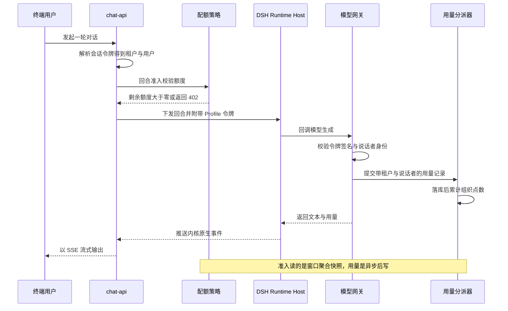

# MOVO 多租户、配额计费与任务调度

## 根因

MOVO 的架构前提是「内核不归自己管」：DSH 作为 npm 依赖跑在独立的 Node 进程里，MOVO 既不 fork 内核，也不往内核里写业务逻辑。这条前提一旦成立，「谁在用、能用多少、这笔账算谁的」这三个问题就没有任何框架层可以代劳——内核不知道租户是什么，也不知道额度是什么。它们必须由 chat-api 这一侧的 Python 代码独立承担。
所以本关注面的主线不是「MOVO 怎么实现 RBAC」，而是**当 Agent 内核是外部黑盒时，租户与额度这两件横切关注点被放在链路的哪一层**。答案在源码里相当明确，而且和多数人的直觉不同：MOVO 没有选择中间件式的全局过滤，而是选择了「显式函数传参 + 查询构造器收敛 + 网关侧凭据签发」三条腿并行的方案。下面的每一节都在回答同一件事：这条腿为什么这样站，代价落在哪里。

## 多租户：显式传参而不是框架魔法

### 租户标识的形态

MOVO 的租户键叫 `main_id`（内部字段与查询条件），对外 API 参数叫 `mainId`。它有一个全局默认值 `"default"`，以及一个把空值折叠到默认值的解析函数：

[services/chat-api/app/core/tenant.py:6-11]()
<!-- anchor: DEFAULT_MAIN_ID = "default" … return main_id or DEFAULT_MAIN_ID -->

真正承载隔离语义的是紧邻的查询构造器 `main_scope_filter`。它有一个容易被忽略但很关键的分支：当租户是默认桶时，**除了 `main_id == "default"` 之外，还把 `main_id` 字段不存在、为空串、为 null 的文档一并纳入可见范围**：

[services/chat-api/app/core/tenant.py:14-25]()
<!-- anchor: def main_scope_filter(main_id: Any = None) -> Dict[str, Any]: … return {"main_id": resolved} -->

这行代码是 MOVO 开源化过程中的一个务实妥协。它不是安全设计，而是数据迁移设计：早期数据没有 `main_id` 字段，开源版把它归入默认租户，从而避免写一条全量 backfill 脚本。代价是「缺失租户字段」这一状态在语义上等价于「默认租户可见」——如果将来有任何写入路径漏掉了 `main_id`，那条记录不会因为缺字段而变成孤儿，而是会自动掉进默认桶被所有人看到。默认桶因此既是兼容层，也是一个静默的泄漏面。查询构造器 `add_main_scope` 负责把这个 scope 与业务条件合并且处理 `$or` 冲突（用 `$and` 包住）：

[services/chat-api/app/core/tenant.py:28-36]()
<!-- anchor: def add_main_scope(query: Dict[str, Any], main_id: Any = None) -> Dict[str, Any] … return base -->

这两个函数里承担合并职责的 `add_main_scope` 在整个 chat-api 里有 77 处调用点，覆盖面很广，但没有一处是框架强制的。用 `grep -rn "add_main_scope" app/ | wc -l` 得到 99 行命中，其中 21 行是 `import`、1 行是 `app/core/tenant.py:28` 的定义，去掉后是 77 处真实调用；这个数字本身就是设计证据：租户隔离是**靠每条查询自己记得加**实现的。

### 租户标识从哪来

租户 ID 基本不接受客户端直接声明，服务端身份解析只有两个来源（本节末尾会给出一个明确例外）。

其一是**端用户会话**。登录后签发的会话令牌形如 `u.<token_id>.<hmac_sha256>`，服务端用 HMAC 校验签名并只从令牌里取 `token_id`，然后用 `token_id` 反查服务端的会话文档；`main_id` 与 `user_id` 全部来自这条文档，而不是令牌自带的 payload：

[services/chat-api/app/core/end_user_auth.py:24-46]()
<!-- anchor: def build_session_token(secret: str, token_id: str) -> str: … return token_id -->

[services/chat-api/app/services/end_user_session.py:25-58]()
<!-- anchor: async def resolve_session_user(authorization: str | None) -> dict: … raise HTTPException(status_code=401, detail="user_not_found") -->

这是有状态会话而非自包含 JWT。代价是每次请求都要多打一次 Mongo（会话 + 用户两步查询），收益是吊销即时生效、租户归属不可被令牌篡改——对多租户系统来说这个取舍很划算，因为「租户归属」一旦进入客户端可持有的载荷，签名密钥泄漏的爆炸半径就从「伪造一个会话」变成「伪造任意租户的会话」。

其二是**服务间令牌**。`ApiPrincipal` 是一个只有三种字段的冻结数据类（`kind` / `main_id` / `user_id`），由 `require_api_principal` 统一裁决：要么走 `X-MOVO-Service-Token` 分支成为 `admin_service`，要么走 Bearer 会话成为 `end_user`：

[services/chat-api/app/api/principal.py:61-81]()
<!-- anchor: async def require_api_principal( … return principal -->

注意服务令牌分支的 main_id 来源：`request.query_params.get("mainId") or request.query_params.get("main_id")`——也就是**由调用方声明租户**，且 `user_id` 留空。这是一个刻意的信任边界：chat-api 只验证「你是不是那个内部服务」，不验证「你声称的租户是否属于你」。租户范围的正确性被完全委托给上游 admin-api。在写这条信任链的时候必须记住：`X-MOVO-Service-Token` 是一个跨租户的超权凭据，不是租户内凭据。与它互补，
对端用户身份这一侧还存在一层「自证一致性」检查：请求的 query、JSON body、form 里如果出现 `userId` / `user_id` / `mainId` / `main_id`，必须与令牌解析出的身份一致，否则 403：

[services/chat-api/app/api/principal.py:25-58]()
<!-- anchor: async def _assert_end_user_scope(request: Request, principal: ApiPrincipal) -> N … raise HTTPException(status_code=403, detail="tenant_scope_mismatch") -->

这解决了老前端普遍把 `userId` / `mainId` 塞进请求体这一历史包袱：既不改前端，又让「客户端自称的身份」退化为一个必须与真实身份相等的冗余断言。代价是它在 decode 失败时静默跳过（源码注释明确写了 "Scope checks are applied whenever identity fields can be decoded safely"），所以它是纵深防御的一层，不能当成隔离的主依赖。

这个「不由客户端声明」的规则有一个明确例外：用量列表端点 `GET /token-usage` 没有任何 principal 依赖，它接受 `mainId` 查询参数并让 query 值覆盖会话解析出的租户，只有 `userId` 会被当前会话用户覆盖：

[services/chat-api/app/api/endpoints/token_usage.py:21-34]()
<!-- anchor: @router.get("/token-usage", response_model=ApiResponse) … scoped_main_id = resolve_main_id(main_id or resolved.get("main_id")) -->

也就是说，这个端点的租户范围可以由客户端自行声明（用户范围不能）。

### 隔离到底在哪一层强制

结论是：**绝大多数在应用查询层，数据库层只有几条局部唯一索引兜底，而且它们都不是为租户可见性设计的**。

应用查询层的证据是 `add_main_scope` 的 77 处调用；反对「有全局中间件」的证据有两条。第一，`app/main.py` 里唯一的 HTTP 中间件是日志与请求上下文，它注入的字段只有 `http_request_id` / `method` / `path`，不含租户：

[services/chat-api/app/infrastructure/request_context.py:10-13]()
<!-- anchor: def set_request_context(payload: Dict[str, Any] | None) -> Dict[str, Any]: … return previous -->
第二条反证在数据访问入口：`get_db()`（services/chat-api/app/core/db.py）只是一个「未初始化就初始化、然后返回句柄」的薄函数，没有包装层、没有注入式过滤器、没有任何按租户改写查询的钩子——函数体只有空值检查与 `return _db` 三行。

数据库层的租户强约束不止一处，最典型的是「会话与内核绑定」这张表上的一个部分唯一索引，保证同一租户下同一会话只有一个 current 绑定：

[services/chat-api/app/dsh_runtime/bindings/repository.py:25-29]()
<!-- anchor: await self._collection.create_index( … name="one_current_kernel_binding_per_conversation", -->

这条索引的存在说明作者非常清楚「并发写坏绑定」是真实故障模式。租户维度的唯一索引并不止这一条：消息集合上有 `(main_id, session_id, seq)` 的部分唯一索引，其索引契约定义在一个独立模块里：

[services/chat-api/app/migrations/sequence_index.py:3-9]()
<!-- anchor: UNIQUE_MESSAGE_SEQ_INDEX_NAME = "unique_main_session_seq" … MESSAGE_SEQ_INDEX_KEYS = [("main_id", 1), ("session_id", 1), ("seq", 1)] -->

由会话与消息仓储负责创建（并复用既有的同名强约束索引）：

[services/chat-api/app/dsh_runtime/conversation/repository.py:98-102]()
<!-- anchor: await self._messages.create_index( … name=UNIQUE_MESSAGE_SEQ_INDEX_NAME, -->

会话集合上有 `(main_id, share_token_hash)` 唯一索引：

[services/chat-api/app/dsh_runtime/conversation/repository.py:79-82]()
<!-- anchor: [("main_id", 1), ("share_token_hash", 1)], … name="unique_main_share_token_hash", -->

桌面项目集合上也有 `(main_id, user_id, workspace_id)` 唯一索引：

[services/chat-api/app/main.py:310-310]()
<!-- anchor: await db.desktop_projects.create_index([("main_id", 1), ("user_id", 1) -->

这些索引都带 `main_id`，但约束的是各集合内部的局部不变式（绑定唯一、消息序号唯一、共享令牌唯一、用户-工作区唯一），并不构成「任何查询都自动带上租户条件」的通用兜底；用量、定时任务等集合上仍然没有租户唯一约束，租户可见性整体上仍由应用层负责。

### 运行时为什么完全没有租户概念

这是本关注面里最有信息量的一个事实。DSH Runtime Host 是一个独立的 Node 进程，它承载内核、管理运行时生命周期、执行业务不可见的 Agent 循环——但**它的源码里根本没有 `tenant` 这个概念**。对 `services/chat-api/dsh/runtime-host/src` 全目录做大小写不敏感检索，唯一命中是一条注释文本，不构成任何运行时字段或校验逻辑。

该进程对外的 HTTP 面只认一个共享 Bearer 令牌，用定时安全比较校验，长度不足 32 字符时直接拒绝在非回环地址上启动：

[services/chat-api/dsh/runtime-host/src/host-auth.mjs:16-21]()
<!-- anchor: export function validBearerToken(header, expectedToken) { … return actual.length === expected.length && timingSafeEqual(actual, expected) -->

[services/chat-api/dsh/runtime-host/src/runtime-http-server.mjs:23-25]()
<!-- anchor: if (!validBearerToken(request.headers.authorization, this.authToken)) { … sendJson(response, 401, { error: { code: 'unauthorized', message: 'valid runtime -->

这看起来危险，但边界是靠网络拓扑而不是靠令牌粒度划的：`dsh-runtime-host` 只挂在 `backend` 网络上，而 `backend` 被声明为 `internal: true`（不接外网、不可从宿主机直连），chat-api 同时挂 `public` 与 `backend`，gateway 是唯一对外入口：

[docker-compose.yml:332-335]()
<!-- anchor: networks: … internal: true -->

这个设计的收益很明确：内核进程不需要理解租户，因此内核升级、内核被替换、甚至未来换成另一个 Agent 内核，都不会牵动租户模型。代价是**进程级隔离退化为网络级隔离**——一旦攻击者拿到 `backend` 网络的立足点或那个共享令牌，就可以对任意 runtimeId 发指令，因为 host 无从判断这个 runtimeId 属于哪个租户。租户归属的判定因此完全落在 chat-api 的绑定记录与 profile 签发上，这直接把责任推给了下一节要讲的「网关凭据」。
对深链路（企业能力、工具执行、外部检索）里那些无法把 `tenant_id` 一路当参数传下去的位置，MOVO 用 `ContextVar` 兜底，把租户与用户塞进请求上下文，用 `reset` 复原：

[services/chat-api/app/enterprise_capabilities/runtime/adapters.py:224-224]()
<!-- anchor: previous = set_request_context({"main_id": context.tenant_id, "user_id": context -->

这是「显式传参」原则的受控例外：只在能力执行边界写一次、在 `finally` 里复位，避免 ContextVar 在异步任务间串味。反过来说，任何绕过这个边界、直接在协程里读写上下文的代码都会失去租户保障，这类代码在读写上下文时没有编译期检查。

### 代价小结

三句话概括代价：77 处显式过滤就是 77 个可能漏掉的机会，没有中间件做兜底网；默认租户把「缺字段」当可见，兼容层与泄漏面是同一个机制；数据库层的租户约束只是绑定、消息序号、共享令牌、用户-工作区这几条局部唯一索引，都不是针对租户可见性的通用兜底，而内核进程本身无租户概念，进程隔离只能靠 `backend` 网络加单一共享 Bearer。此外，服务令牌是跨租户凭据，其租户范围由 admin-api 的鉴权负责，chat-api 不做二次确认。

## 端用户鉴权与服务间令牌的边界

服务间调用在配置层是一串显式的、成对出现的令牌与地址：

[services/chat-api/app/core/config.py:116-124]()
<!-- anchor: ASKAI_ADMIN_JWT_SECRET: str = "" … DSH_RUNTIME_HTTP_TIMEOUT_SECONDS: float = 5.0 -->

这里的组织方式值得抄：**所有跨进程凭据都声明为「空字符串默认值」**。源码注释明确解释了理由——模型凭据在自托管控制面可用之后才配置，所以空 key 不允许阻止 API 容器启动。这是自托管产品的必需品：容器必须先起来，用户才能进初始化向导去填这些东西。代价是「未配置」与「配错」在运行期长得一样，只能靠调用点各自的失败语义区分（例如模型网关用 `DSH_MODEL_GATEWAY_SIGNING_SECRET` 回退到 `ASKAI_ADMIN_JWT_SECRET`，两者都空时 `ModelGatewayTokenService` 会因密钥长度不足 16 而在构造期抛错，而不是静默放行）。

admin-api 侧的对称实现在凭据解析上做了一次「canonical 优先」的收敛：规范名 `ADMIN_BACKEND_SERVICE_TOKEN` 胜过带前缀的兼容别名，避免同一部署里两个环境变量共存时行为不确定。admin-api 调 chat-api 时的形态是「服务令牌放头部 + `mainId` 放查询参数」，而 `mainId` 来自 admin 会话里的 `current_user["main_id"]`，因此租户范围的正确性依赖 admin-api 自身的登录鉴权。

两条链路的边界可以一句话概括：`X-MOVO-Service-Token` 是**跨租户**管理通道（无 user_id），Bearer 会话令牌是**租户内**用户通道（main_id 与 user_id 都来自服务端会话）。任何把服务令牌用于终端用户流量的做法，都会同时丢掉租户范围和用户归属。

## Community Edition：同一份源码加一个开关

### 开关的表达方式

版本差异没有做成代码分支，而是做成三个纯函数加一份默认值字典。核心判定只有一条：组织的 `edition` 或 `tier` 字段等于 `"community"`：

[services/chat-api/app/core/product_edition.py:15-27]()
<!-- anchor: def billing_enabled(org: dict[str, Any] | None) -> bool: … return max(0, int(raw_limit)) -->

对外投影时把三件事打包成前端可直接消费的字段：

[services/chat-api/app/core/product_edition.py:31-35]()
<!-- anchor: community = is_community_organization(org) … "memberLimit": member_limit(org), -->

默认值的来源是代码里内置的社区扩展，它在组织初始化时写入 `edition` / `tier` / `billing_enabled` / `user_limit` / `total_points` / `used_points` / `is_own_model` 七个字段：

[services/chat-api/app/product/extensions.py:53-65]()
<!-- anchor: def community_extension() -> ProductExtension: … "is_own_model": True, -->

私有产品扩展通过环境变量加载，并有一条硬性护栏：**私有扩展不允许把 edition 标成 community**，否则启动即抛错：

[services/chat-api/app/product/extensions.py:80-90]()
<!-- anchor: @lru_cache(maxsize=1) … return extension -->

这条护栏是这套「同一份源码 + 开关」策略能成立的关键。它的作用不是防止技术错误，而是防止商业模式被无声地绕过：如果企业版能把 edition 伪装成 community，就等于免费拿到企业能力；反过来，如果社区版忘了降级，也会被用户当成 bug 报上来。把「版本自述」做成启动期不变式，比在运行时到处判断要可靠得多。

`@lru_cache(maxsize=1)` 还隐含一个运维约定：扩展模块只在进程首次调用时导入一次。改扩展模块必须重启进程，热切换不支持——对一个在启动期就固化产品身份的字段来说，这是正确的选择。

### 开关到底关掉了什么

社区版的落地在 admin-api 侧也有一份对称实现，并且带了更完整的初始化语义：`community_organization_fields` 一次性写入社区版的十个组织字段，既包括 `main_id` / `org_name` / `owner_user_id` / `updated_at` 等归属与审计字段，也包括 `billing_enabled: False`、`user_limit: None`、`is_own_model: True` 这些版本语义：

[services/admin-api/app/core/product_edition.py:42-52]()
<!-- anchor: return { … "updated_at": datetime.now(timezone.utc), -->

成员上限的**真正**强制点在 admin-api，它由 `assert_member_capacity` 在创建用户与邀请落地时调用；社区版 `limit is None` 直接 return：

[services/admin-api/app/core/product_edition.py:95-105]()
<!-- anchor: async def assert_member_capacity(main_id: str) -> None: … detail=f"当前版本最多允许 {limit} 名成员", -->

发布清单里这一条被显式核验过，可作为产品意图的一手证据：

[docs/open-source-productization/release-checklist.md:31-31]()
<!-- anchor: - [x] The setup organization is community, billing is disabled and member limit  -->

### 关键反转：关掉的是计费，不是配额

README 与清单的措辞是 "billing and commercial plan enforcement are disabled"，很容易被读成「社区版没有额度限制」。源码不支持这个读法。**社区版仍然强制 Token 配额**，只是配额不再与钱挂钩：

- 初始化流程强制要求组织总 Token 与员工默认 Token 均为正数，且员工默认不得超过组织总额：

[services/admin-api/app/services/setup_quota.py:23-28]()
<!-- anchor: if total_tokens <= 0: … raise ValueError("员工默认 Token 不能超过企业总 Token") -->

- 这两个值被写进 `org_quota_policies` 与 `user_quota_policies`，成为准入判定的输入。
- 准入判定本身完全不看 edition：`assert_quota_available` 没有任何 edition 分支，它只看策略状态与剩余额度。

也就是说，`billing_enabled` 这个字段在服务端**没有任何逻辑读取它来决定记账**——它在全仓只出现在投影与前端：chat-api 的 `billing_enabled()` 只把它折进对外返回体，admin-api 的各返回体与 `apps/user-web/src/composables/useEnterpriseAccessPolicy.ts` 再消费它：

[services/chat-api/app/core/product_edition.py:15-18]()
<!-- anchor: def billing_enabled(org: dict[str, Any] | None) -> bool: … return bool((org or {}).get("billing_enabled", True)) -->

真正决定旧点数账本是否停写的是 `app/core/billing.py:83` 的 `tier == "free" or not is_own_model`（`organizations.used_points` / `total_points` 那套按请求累计扣减的逻辑）；而**策略式配额**（按周期窗口聚合 `token_usage_logs`）与 edition 无关。这个区分必须写清楚，否则自托管用户会以为「社区版不会因为额度被拦」，然后在生产里撞到 402。

### 这套写法的代价

第一是**实现漂移**。`product_edition.py` 在 chat-api 与 admin-api 各有一份几乎相同的实现（`is_community_organization` / `billing_enabled` / `member_limit` 三件套逐行重复），差异只在 admin-api 多带了数据写入与 HTTP 异常。两份代码没有共享包、没有契约测试约束一致性。一旦默认值或字段名在一边改动，症状会非常隐蔽：例如 chat-api 认 `edition` 而 admin-api 只写 `tier` 时，前端拿到的 `billingEnabled` 与后端实际行为就会分叉。

第二是**遗留死代码**。chat-api 的 `billing.py` 里两个函数在当前代码里没有任何调用点：`check_quota_before_request`（按组织点数前置拦截）和 `check_member_limit`（按成员上限前置拦截）。仓库范围内检索它们的名字，只命中定义处本身：

[services/chat-api/app/core/billing.py:61-67]()
<!-- anchor: if is_shared_model and not org.get("is_own_model", False): … f"您的组织/空间额度已耗尽 (当前已使用: {used}/{total} Tokens)。" -->

这不是纯技术债：它意味着「前置拦截」这条设计路线被**换掉过**——从「请求前读一个计数器」换成了「请求前聚合一段窗口」。旧函数被保留下来，读代码的人极易误以为它们是生效的检查点。判断一个检查点是否生效，唯一可靠的方法是 grep 调用点，而不是 grep 函数名。

## 配额策略的表达与检查点位置

### 策略模型

配额不是单一字段，而是四张集合组合出的分层策略：组织策略、组织级默认用户策略（`scope_type: "all"`）、按用户的覆盖策略（`scope_type: "user"`）、以及可过期叠加的临时额度：

[services/chat-api/app/core/quota_policy.py:10-19]()
<!-- anchor: ORG_COLLECTION = "organizations" … VALID_PERIODS = {"monthly", "daily", "hourly"} -->

周期表达支持 `monthly` / `daily` / `hourly`，并且**窗口按组织配置的时区切分**，再转成朴素 UTC 参与比较——这解决了「月度额度在 UTC 月初重置，但客户在 UTC+8 的月初被提前扣完」这类真实投诉：

[services/chat-api/app/core/quota_policy.py:45-63]()
<!-- anchor: def period_window(period: str, tz_name: str = DEFAULT_TIMEZONE, now: datetime |  … end_local = start_local.replace(month=start_local.month + 1) -->

解析优先级是「用户专属策略 → 组织周期 → 组织级默认策略」，找不到专属策略时不是报错，而是用组织的周期补一个默认策略出来：

[services/chat-api/app/core/quota_policy.py:131-142]()
<!-- anchor: async def resolve_user_policy(main_id: str, user_id: str) -> dict[str, Any]: … return default_policy -->

临时额度用 `expires_at` 做时间窗过滤，只累加 `status: "active"` 且未过期的部分：

[services/chat-api/app/core/quota_policy.py:145-161]()
<!-- anchor: async def sum_active_overrides(main_id: str, user_id: str, now: datetime | None  … return int(rows[0].get("tokens") or 0) if rows else 0 -->

这里有一个值得注意的实现状态：`user_quota_overrides` 这张集合在 chat-api 与 admin-api 里都只被**读取**和**清理**（删除用户时 `delete_many`），全仓库找不到任何插入点。也就是说临时加额度这条路径目前只有读侧与清理侧，写侧 API 未在这个基线里出现。文档或运维脚本若假设「管理员可以给某人临时加额度」，需要先确认这一层是否已经落地。

### 双约束：个人额度不能突破组织总额

`get_quota_summary` 是整条链路的策略求值中心。它对两种空间形态分开处理：个人空间走「注册赠送 + 终身有效」的旧账本（`organizations.total_points` / `used_points`），企业空间走策略式配额。需要留意空间类型的判定方式——先看用户显式的 `space_type`，缺失时**用组织名是否等于「个人空间」这个字符串来猜**：

[services/chat-api/app/core/quota_policy.py:167-170]()
<!-- anchor: space_type = str(user.get("space_type") or "").strip().lower() … org = await db[ORG_COLLECTION].find_one({"main_id": main_id}) or {} -->

因为社区版初始化的组织名由用户自填（默认「MOVO 社区组织」），社区版租户会被判为 `enterprise`，从而走策略式配额——这与上一节的结论互相印证。用组织名做类型推断是脆弱设计（改个组织名就可能切换到另一套配额语义），但显式 `space_type` 优先的顺序使它只在历史数据上生效。

企业分支的余额是**两个约束取最小值**，这是本模块最核心的一行业务逻辑：个人剩余额度与组织剩余额度都不能为负，取更紧的那个：

[services/chat-api/app/core/quota_policy.py:189-200]()
<!-- anchor: org_policy = await ensure_org_quota_policy(main_id, org_total_points=int(org.get … remaining = max(0, min(user_total - user_used, org_total - org_used)) -->

[services/chat-api/app/core/quota_policy.py:205-215]()
<!-- anchor: "spaceType": "enterprise", … "orgRemainingPoints": max(0, org_total - org_used), -->

这种「min of two budgets」的表达比「先扣组织再扣个人」更简单也更难被绕过，但它把策略求值的复杂度压在了每次读取上（要算两个窗口的聚合，见下）。

### 检查点：准入拦截加事后记账

判定函数本身很短，语义清晰：策略未启用或剩余额度为 0 就抛 `QuotaExceededError`，并按空间类型给出不同的用户提示：

[services/chat-api/app/core/quota_policy.py:219-227]()
<!-- anchor: async def assert_quota_available(main_id: str, user: dict[str, Any]) -> dict[str … return summary -->

它的调用点共四处，全部是**回合准入**而非逐次调用：

1. `chat/completions` 对话回合的准入关卡，`QuotaExceededError` 直接映射为 HTTP 402：

[services/chat-api/app/api/endpoints/dsh_chat.py:186-190]()
<!-- anchor: tenant_id, user_id, user = await _identity(authorization) … raise HTTPException(status_code=402, detail=str(exc)) from exc -->

2. 桌面运行时的准入关卡。它在同一个 `try` 里调用，但异常被紧随其后的 `except (LookupError, ValueError)` 捕获，因此配额超限在这条路径上返回的是 **400** 而不是 402——同一个判定函数在两条准入路径上有不同的状态码：

[services/chat-api/app/api/endpoints/dsh_chat.py:281-293]()
<!-- anchor: await assert_quota_available(tenant_id, user) … raise HTTPException(status_code=400, detail=str(exc)) from exc -->

3. 定时任务启动前（见定时任务一节）。

4. `get_llm_client_by_model_id` 里的逐次调用检查：

[services/chat-api/app/llm/configured_models.py:329-336]()
<!-- anchor: user_id = str((output_spec or {}).get("user_id") or "").strip() … await assert_quota_available(main_id, user_doc) -->

第 4 处需要额外说明，因为**它在当前代码里不会真正触发**：该函数要求 `output_spec` 里带一个合法的 `user_id` 才进入校验分支，而它的调用方只有模型连通性测试端点，传的 `output_spec` 不含 `user_id`；DSH 的模型网关路径走的是另一个构造函数 `build_llm_client_from_config`，完全绕开了这个检查。因此实际生效的只有回合准入这两处（`chat/completions` 与桌面运行时）。

这带来一个必须写明的后果：**一轮 Agent 回合内的所有模型调用只在回合开始时校验一次额度**。一个多轮工具调用的任务是按「准入时的余额」放行的，中途余额被其他并发请求耗光不会中断它。这是有意的宽松——在 Agent 场景里中途掐断一个已经跑了十分钟、产出了中间产物的回合，成本高于超额本身。

事后记账发生在用量落库之后，并且只对旧点数账本生效：只有组织是 `free` 或未启用自有模型时才累加 `used_points`：

[services/chat-api/app/core/billing.py:83-87]()
<!-- anchor: if org.get("tier") == "free" or not org.get("is_own_model", False): … "$inc": {"used_points": total_tokens}, -->

社区版组织的 `tier` 是 `community` 且 `is_own_model: True`，两个条件都不满足，因此**社区版永远不写 `used_points`**。这一点与上一节的结论合起来构成一个清晰的结论：社区版有配额、没有计费；企业云版两者都有；旧点数账本在社区版是被冻结的。

### 快照式配额的两个真实缺口

`sum_usage` 的语义是「在时间窗内聚合用量日志」，并且排除 `status: "failed"` 的记录：

[services/chat-api/app/core/quota_policy.py:116-128]()
<!-- anchor: async def sum_usage(main_id: str, *, user_id: str = "", start_at: datetime, … return int(rows[0].get("tokens") or 0) if rows else 0 -->

因为用量是**异步后写**的，这个聚合在并发下必然滞后，于是有两个缺口。

缺口一：**并发突发可超额**。N 个请求几乎同时通过准入检查时，它们看到的都是同一个尚未更新的窗口和；已经落库的用量要等异步写入器处理完才会被算进去。这是「快照读 + 事后写」模型的固有性质，不是 bug；要消除它需要预留额度（reserve）与结算（settle）两阶段，MOVO 明确没有走这条路。

缺口二：**队列满即丢，且不可恢复**。用量通过一个有界内存队列投递，队列满时 `submit` 返回 False 并只打一条 warning：

[services/chat-api/app/token_usage/dispatcher.py:43-55]()
<!-- anchor: def submit(self, record: TokenUsageRecord) -> bool: … return False -->
调用方收到 False 之后的处理也只是记日志。这意味着在高负载下，被丢弃的那条记录是**永久性少记**——既不会进配额窗口，也不会进账单。对账时这类差异会表现为「上游供应商账单高于平台统计」，而且因为日志级别是 warning、不带重试标记，很难被及时发现。这是一个值得在自建部署里替换的组件（例如改为本地磁盘队列或直写 Mongo + 后台补推）。

## 用量归因：按说话者归属

### 采集位置与身份来源

所有 LLM 调用都被一个装饰器式的客户端包住，用量记录在 `finally` 里强制提交，因此异常路径同样计费（`status` 记为 failed，因而被配额聚合排除）：

[services/chat-api/app/llm/instrumented_client.py:170-192]()
<!-- anchor: record = TokenUsageRecord( … completion_tokens=int(usage.get("completion_tokens") or 0), -->

这里的身份字段（`main_id` / `user_id` / `session_id`）全部来自 `output_spec`，而 `output_spec` 在 `get_llm_client` 里会与 `request_context` 合并——所以归属身份有两条注入路径：显式参数，或能力执行边界写入的上下文。设计上「谁发起了这次调用」等价于「这次调用的账算谁的」。
`user_request_id` 的取值揭示了归因的粒度：它优先取 `message_id`，退化取 `request_id`。也就是说一条助手消息对应的**多次内部 LLM 调用会被归到同一条用户请求下**，而不是各算一次：

[services/chat-api/app/services/token_usage_service.py:355-365]()
<!-- anchor: def _request_group_id_expr() -> Dict[str, Any]: … "$request_id", -->

这个表达式让「列表」页能按用户请求聚合成一行、把多次调用的 token 求和展示，同时保留原始调用数（`calls` 字段）。对用户来说这是正确的心智模型：他关心「我问了这句话花了多少」，而不是「系统内部调了几次模型」。

### DSH 路径的特殊之处：身份跟着凭据走

内核里的模型调用不经过 Python 的 LLM 客户端构造流程，而是通过 HTTP 回调到 chat-api 的模型网关。因此身份必须通过凭据传递。MOVO 的做法是签发一个**短期、作用域受限、内含说话者身份**的令牌：

[services/chat-api/app/dsh_runtime/model_gateway/token.py:33-47]()
<!-- anchor: def issue(self, *, tenant_id: str, profile_version: str, model_instance_id: str, … return f"{encoded}.{signature}" -->

令牌的载荷是一段 base64 的 JSON 加 HMAC 签名（不是标准 JWT），包含 `aud` / `tenant_id` / `profile_version` / `model_instance_id` / `user_id` / `iat` / `exp` / `jti`。校验时除了签名与过期，还强制比对 `aud` 必须是 `askai-model-gateway`。默认 TTL 是 900 秒，密钥要求至少 16 字符。

签发点是 Runtime Profile 解析器，它在签发之前先做一次**跨租户拒绝**，然后才把租户、profile、模型实例与说话者身份一起写进令牌：

[services/chat-api/app/dsh_runtime/profile/resolver.py:29-46]()
<!-- anchor: if tenant_id is not None and snapshot.tenant_id != tenant_id: … scopes=sorted({scope for tool in snapshot.tools for scope in tool.required_scope -->

网关消费这个令牌时，把身份直接翻译成用量记录的字段，并固定 stage 为 `dsh_agent_turn`：

[services/chat-api/app/dsh_runtime/model_gateway/service.py:168-184]()
<!-- anchor: async def _configured_client( … "user_id": user_id, -->

这是本关注面里最值得迁移的一个模式：**当执行体（内核）不能理解租户时，就让租户身份成为凭据的一部分，并在每个回调边界重新校验。** 它把「谁在用」从「进程状态」变成了「每次请求可验证的断言」，代价是每次说话者切换都要重新签发 Profile（源码文档明确说明这个轮换是预期行为，不是故障）。

令牌校验之后，网关还会做三重作用域比对（profile 版本、模型实例、provider 名），三者任一不匹配即拒绝。这意味着即使令牌被另一个 runtime 拿到，它也只能用于其被签发时的那一组作用域。

### 归因的盲区：参与者看不到自己的用量

这是本关注面里最重要的一个「实现与预期不一致」的发现，而且项目自己已经把它写成了 ADR 中的已知限制。

用量列表的可见范围由「调用者拥有的会话」决定：`_load_visible_session_ids` 只按 `chat_sessions.user_id` 查会话，**完全不查会话参与者表**：

[services/chat-api/app/services/token_usage_service.py:151-152]()
<!-- anchor: match = add_main_scope({"user_id": str(user_id or "").strip()}, resolve_main_id( … rows = await db.chat_sessions.find(match, {"_id": 1}).to_list(length=5000) -->

而最终的查询条件要求 `user_id` 与「可见会话 ID 集合」同时命中：

[services/chat-api/app/services/token_usage_service.py:110-126]()
<!-- anchor: def _build_match( … match = add_main_scope(base, resolve_main_id(main_id)) -->

会话共享功能上线后，这两条约束组合出了一个反直觉的结果：参与者在自己参与的共享会话里产生的用量记录，`user_id` 是参与者本人（归因正确），但那个 `session_id` 不在他「拥有」的会话集合里，于是**他自己的用量对他自己不可见**：

[docs/adr/0001-session-sharing-full-fidelity-history.md:41-41]()
<!-- anchor: (b) A participant's own token-usage rows become invisible to them. The usage vie -->

这个盲区值得单独拿出来讲，因为它不是编码疏忽，而是**两个正确的局部决策叠加出的错误全局行为**：用量按说话者归属（正确，保证了配额与部门报表准确），可见性按会话所有权收敛（正确，保证了不越权读取他人数据），两者的交集却把参与者自己的数据也被过滤掉了。ADR 明确把它列为「已知且接受」的限制，并说明回归测试冻结了该边界——也就是说这是一个有意识的产品取舍，不是待修的 bug。如果要在自建版本里修，正确方向是让可见会话集合取「拥有的会话 ∪ 参与中的会话」，而不是放宽 `user_id` 条件。
端点层还叠了最后一道：接口签名接受 `userId` 查询参数，但实现用「会话解析出的当前用户」覆盖它，客户端无法自称查询对象：

[services/chat-api/app/api/endpoints/token_usage.py:32-36]()
<!-- anchor: resolved = await _resolve_session_user(authorization) … user_id=current_user_id or str(user_id or ""), -->

配额自查端点同样不接收任何用户或租户参数，完全由会话决定：

[services/chat-api/app/api/endpoints/quota.py:20-24]()
<!-- anchor: @router.get("/quota/me", response_model=ApiResponse) … return ApiResponse(code=0, message="success", data=data) -->

也就是说，从数据归因到查询接口，「谁能看谁的用量」这条线上只有一处闸门（可见会话集合），它如今成了共享会话场景下的单点缺陷。这也解释了为什么 ADR 会专门为它写一节。

### 用量分派器的实现要点

分派器是「采集」与「持久化」之间的唯一缓冲，负责三件事：落库、累计旧点数、可选的外部推送，且推送结果会回写到记录上（`push_status` / `push_error`）：

[services/chat-api/app/token_usage/dispatcher.py:59-69]()
<!-- anchor: record = await self._queue.get()  # type: ignore[union-attr] … logger.error(f"Failed to process billing for record {record.request_id}: {b_err} -->

值得注意的是它把「计费扣减」放在了「落库」之后、且用独立 try 包住——即计费失败不影响用量记录已落库这一事实。这个顺序是对的（账单是可重算的派生数据，原始用量不是），但它也意味着两个账本之间没有任何事务或补偿机制，长期不一致只能靠对账脚本发现。配置项里的 `TOKEN_USAGE_PUSH_ENABLED` 默认关闭（compose 里显式设为 `"false"`），说明外部计量推送在自托管形态下是可选能力而非默认路径。

## 定时任务：执行用户、租约与静默失败

### 调度循环

调度器是一个单进程内的 asyncio 循环，每轮先恢复未完成的运行、再最多认领 20 个到期任务，然后固定休眠 5 秒：

[services/chat-api/app/scheduled_tasks/scheduler.py:78-88]()
<!-- anchor: while not self._stopping.is_set(): … await self._claim_and_execute(job, run) -->

每轮上限 20 是个简单的背压：避免一次宕机恢复后把积压任务一次性全推进内核，把 DSH Runtime Host 打满。

### 认领是全局的，租户在更后面才出现

工具方法 `claim_due_job` 用 `find_one_and_update` 做原子认领，条件只有「已启用 + 到期 + 租约空闲」，写一个 2 分钟的租约。**它的查询条件里没有 `main_id`**：

[services/chat-api/app/scheduled_tasks/repository.py:157-167]()
<!-- anchor: async def claim_due_job(self, *, worker_id: str) -> Dict[str, Any] | None: … return job -->

这是有意的：调度器是平台级组件，属于基础设施而不属于某个租户，它的工作是「谁到期就叫醒谁」。租户维度在下一步才进入——任务文档自带 `main_id`，执行时用它构造查询与调用参数。这种「调度无租户、执行强租户」的分层是合理的，但意味着**任何在调度层新增的查询都必须小心不要跨租户泄漏数据**；`get_job_for_run` 也按 `job_id` 直查、不带租户条件，属于同一类需要人工审查的位置。

幂等靠 `(job_id, scheduled_for)` 的唯一索引保证：同一时间点重复触发会插入失败并返回 None，调度器随后改为查询已存在的运行记录来决定是接管还是释放。追补策略是「最多补一次」，源码注释写得很直白：

[services/chat-api/app/scheduled_tasks/repository.py:234-235]()
<!-- anchor: # A recurring task catches up at most once after downtime. … after_utc=max(scheduled_for, now), -->

这是在「停机三天的日报任务恢复后连发三份」与「完全不补发」之间的折中，选择合理。

### 执行用户：字段存在，但入口还没开

每个任务有两个用户字段：`owner_user_id`（创建者，也是显式列表/修改/删除的过滤条件）与 `run_as_user_id`（执行身份）。执行身份解析有回退，且强校验用户必须是同租户的 active 用户：

[services/chat-api/app/scheduled_tasks/runner.py:25-37]()
<!-- anchor: tenant_id = resolve_main_id(job.get("main_id")) … await assert_quota_available(tenant_id, user) -->

注意这里把配额检查放在了定时执行路径上——定时任务消耗的额度算在执行用户名下，因此它也走同一套准入判定。这是必要的：否则定时任务会成为绕过配额的旁路。

但 `run_as_user_id` 目前**无法被设置为非创建者**。创建任务时它被硬写为当前用户；对外的创建/更新模型里根本没有这个字段：

[services/chat-api/app/scheduled_tasks/repository.py:93-96]()
<!-- anchor: "main_id": resolve_main_id(main_id), … "created_by": str(user_id), -->

[services/chat-api/app/scheduled_tasks/models.py:13-24]()
<!-- anchor: class ScheduledJobCreate(BaseModel): … output_spec: Dict[str, Any] = Field(default_factory=dict) -->

这个细节改变了下面那个「已知限制」的性质：ADR 里描述的「定时任务以非 owner 身份对共享会话执行会静默失败」在当前 HTTP 入口下**不可达**，因为 `run_as_user_id` 永远等于 `owner_user_id`。它真正防范的是历史数据或未来委派能力——字段与回退逻辑先行，入口后开。把它当成一个已经发生的故障来读会误判风险等级。

### 固定会话目标解析失败的静默性

当任务是 `fixed` 模式时，目标会话必须在执行用户的命名空间内存在，查询条件是 `_id` + `user_id` + 租户 scope 三者同时命中：

[services/chat-api/app/scheduled_tasks/runner.py:64-76]()
<!-- anchor: if str(job.get("session_mode") or "fixed") == "fixed": … return session_id, None -->

这解释了为什么「以非 owner 身份对共享会话执行」会失败：参与者对那条会话没有 `chat_sessions.user_id` 关系，查询必然 miss，抛出 `LookupError("目标会话不存在或无权访问")`。
失败被捕获后进入 `_fail_before_start`，它只做两件事：把运行记录与任务记录标成 failed 并写入错误文本，其余交给日志：

[services/chat-api/app/scheduled_tasks/runner.py:93-97]()
<!-- anchor: async def _fail_before_start( … tenant_id = resolve_main_id(job.get("main_id")) -->

[services/chat-api/app/scheduled_tasks/runner.py:101-104]()
<!-- anchor: "status": "failed", … "updated_at": now, -->

问题的「静默」体现在**通知面**而不是**记录面**：数据是写全了的，但全部写在调度域自己的集合里，会话线程里没有任何信号。用户看到的现象是「定了时，什么都没发生」，而唯一的排查入口是日志与运行列表接口。ADR 对这一点的措辞很准确——运行失败落入「调度器自己的运行与任务行以及服务日志」，共享会话里什么都不出现，参与者收不到任何提示：

[docs/adr/0001-session-sharing-full-fidelity-history.md:43-43]()
<!-- anchor: (c) A scheduled job run as a non-owner against an owner's shared session silentl -->

这是一个可以低成本修好的可用性缺陷（失败时向 `owner_user_id` 发一条系统消息，或至少把 run 的失败投影到会话的未读计数上），但前提是先有人意识到「失败记录存在」不等于「用户被告知」。

### 定时路径为什么不动消息序号

定时执行会往既有消息上补三项元数据（触发来源、任务 ID、运行 ID），这是个 `update_one`，不插入新消息、不做 `$inc`：

[services/chat-api/app/scheduled_tasks/dsh_execution.py:169-179]()
<!-- anchor: schedule_fields = { … {"$set": schedule_fields}, -->

这与 ADR 的说明一致：该写入是 metadata-only，因此不可能影响 `(main_id, session_id, seq)` 那条唯一索引。对定时任务这种「由系统而非用户发起、可能并发触发」的写入路径来说，把「创建消息」的责任完全留给 DSH 的正式回合边界（`prepare_turn`）是正确取舍——它保证序号分配只有一个权威写入者，代价是定时任务的审计信息依附在消息上而非独立成行。
同理，会话标题更新与未读标记更新都被限定在执行用户的 `user_id` 上，因此对非 owner 执行身份会静默 no-op——这是同一个「按所有权收敛」模式的又一次体现，也是盲区产生的同源机制。

## 一轮对话中的配额与归因

关键的时序性质在图末被点出：**准入读的是「尚未包含本轮及并发请求」的窗口聚合快照**，真正的扣减发生在落库之后。这让整条链路在并发下天然允许有限超额，也是「队列满即丢」会同时影响配额与账单的原因。

## 可迁移的模式

### 模式一：内核无租户，租户进凭据

MOVO 里最干净的一条设计是：**执行内核不理解租户，但每次回调都携带一个内含租户与说话者的短期可验证凭据**。Profile 令牌用 HMAC 签名而不是 JWT，强制校验 `aud`，默认 TTL 15 分钟，并且在签发点做跨租户拒绝。这样租户归属从「进程状态」变成了「每次请求的断言」，内核可以被替换、可以被多路复用、可以完全无状态化而不动摇隔离模型。代价是说话者切换要重新签发并重建内核会话（源码文档明确说这是预期行为）；如果 Agent 会话本来就以「一个人一个线程」为主，这就是纯收益，反之会变成可观测的延迟。

### 模式二：显式传参 + 查询构造器，而不是中间件魔法

没有全局 Mongo 过滤器、没有租户中间件，只有 77 处自觉调用 `add_main_scope`。这在工程上是「用纪律换可读性」：租户语义一眼可见、可被单测覆盖、没有隐式行为。代价是没有兜底网，新写的查询漏掉租户条件时通常表现为「能跑通、结果偏多」，不会在测试里立刻暴露。要吸收这个模式，配套措施几乎是必需的：把 `add_main_scope` 收成仓储层的唯一入口，或用静态检查拦住裸集合访问。

### 模式三：准入拦截加事后记账，而不是预留与结算

配额检查发生在回合准入，扣减发生在异步落库之后，两个账本之间没有事务。这换来了链路的简单与低延迟，代价是并发突发可超额、队列满即丢账。对 Agent 产品来说这个取舍相当合理：Agent 回合本身昂贵且长，用户对「略超一点额度」的容忍度远高于对「中途被掐断」的容忍度。真正需要留意的是队列丢弃——那是**不可恢复**的丢失，值得在自建部署里替换成至少一次投递的通道。

### 模式四：产品版本做成策略函数，而不是代码分支

社区版与企业版的差异被压缩成三个纯函数与一份默认值字典，并由「私有扩展不得自称 community」这条启动期护栏封口。好处是同一份源码可发布两个产品，前端只需要读三个布尔/数值字段即可决定界面。代价有两处值得警惕：一是同一逻辑在两个服务里各存一份，没有共享包也没有一致性测试；二是路线切换会留下死代码（旧的前置拦截函数仍在仓库里，且没有调用点）。迁移时建议至少做到：把 edition 判定收敛到单一模块、为两份实现加一组跨服务契约测试、并在切换检查点位置时**删掉旧函数**而不是留着。

### 模式五：定时任务的执行身份必须与权限主体绑定，失败必须投影回业务面

`scheduled_jobs` 同时持有 `owner_user_id`（所有权与列表可见性）与 `run_as_user_id`（执行身份），配额与内核调用都按执行身份计算。这个分离是对的，也解释了一个容易踩的坑：以非所有者身份对别人的共享会话执行，会在「按 user_id 收敛的会话查询」上必然 miss。失败本身被完整记录，但只落在调度域的集合里，业务面（会话线程）没有任何信号——可迁移的结论因此有两条：任何「代表某人执行」的调度都需要明确「执行身份是否等于权限主体」；调度失败必须有一条通往用户可见面的投影路径，否则「记录完整」会被误当成「用户已知情」。

## 结论与未覆盖部分

本关注面的设计哲学验证结果如下：**多租户与治理内建**完全成立，但实现路径与常见预期不同——隔离在应用查询层靠显式传参实现，数据库层只有绑定、消息序号、共享令牌、用户-工作区这几条局部唯一索引，且都不针对租户可见性，运行时进程则完全无租户概念，靠网络边界与网关凭据补位。**凭据不下发**在多租户维度上得到强化：租户与说话者身份随短期令牌下发，而不是随会话或连接下发。
需要明确标注为本解读未在源码中坐实或存在边界模糊的部分：

- 我未能定位到任何在 HTTP 层把 `main_id` 写入 `request_context` 的中间件；租户进入上下文只发生在企业能力的执行边界。因此「哪些深链路路径完全依赖参数传递、哪些依赖上下文」这一分层没有一张权威清单，只能靠逐点阅读。
- `user_quota_overrides` 集合只有读取侧与用户删除时的清理侧，我未能定位到任何写入端点。临时加额度是否已可用，需要另行确认。
- 逐次调用的配额检查（`get_llm_client_by_model_id` 内）在当前调用图下不可达，这是我的静态推断结论；由于它依赖「所有调用方都不传 `user_id`」这一事实，未来若新增调用方，该结论即失效。
- ADR 中「定时任务以非 owner 身份执行会静默失败」在当前 HTTP 入口下不可达，因为 `run_as_user_id` 在创建时恒等于 `owner_user_id` 且未暴露给创建/更新模型。这是字段先行、入口未开的状态，不是已发生的线上故障；但如果存在直接写库的运维脚本，该路径会立刻变成真实风险。
- 用量队列「满即丢」的丢失率没有在源码中给出观测指标或补偿任务，我无法判断生产环境下的实际丢单量级。
- 我未逐一核对 admin-api 侧 `product_edition.py` 与 chat-api 侧实现的字段级一致性（只在阅读中确认了三个判定函数逐行一致、差异在于 admin-api 额外承担写库与抛 HTTP 异常），也没有找到约束两者一致性的测试。

