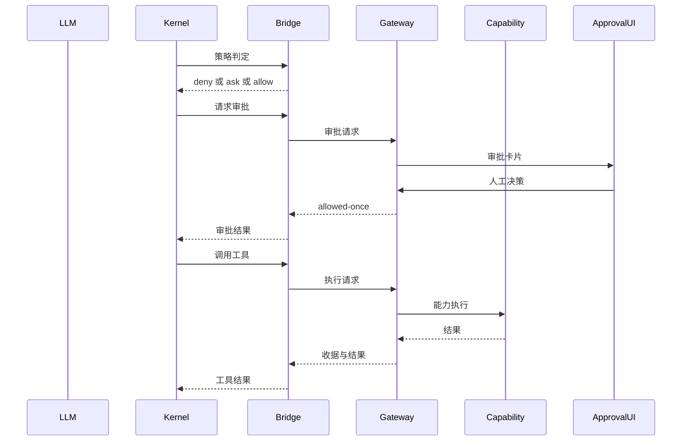
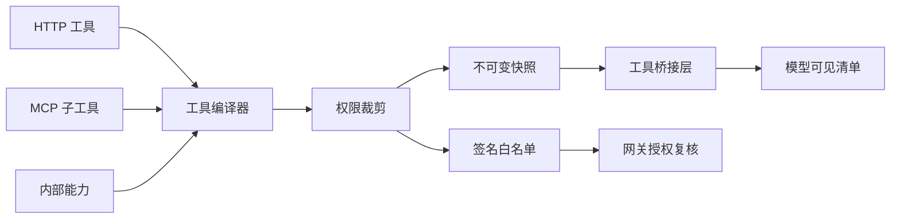

# MOVO 工具网关、MCP 接入与审批审计

MOVO 把 DeepSeek Harness（下称 DSH）当作一个**内核依赖**装进独立 Node 进程，自己则在 FastAPI 侧承载全部工具实现。于是「工具」这个最容易被内核绑死的关注面，在 MOVO 里被切成三段：内核里的工具描述符与调用钩子、HTTP 上的工具网关、MongoDB 里的审批与审计事实。本文只解读这三段以及它们之间的契约，重点回答「为什么要把工具执行挪出内核」「schema 落差怎么处理」「审批为什么不靠 suspend/resume」这几个问题。

## 根因：内核不持能力，也不持凭据

多数 Agent 平台的做法是把工具注册表和工具实现都放进进程内，改一个工具就要重启内核、甚至 fork 内核。MOVO 反着来：DSH 以 npm 依赖形式被加载，运行在 `dsh-runtime-host` 这个独立 Node 进程里；chat-api 通过 `ToolProfileDefinition` 把「工具长什么样」编译成不可变快照下发，而「工具怎么执行」完全留在 chat-api。内核看到的每一个 MOVO 工具，都是一个注册进 DSH 工具注册表的描述符，其 `execute` 只是把参数 POST 回 chat-api。

这个注册动作集中在 Tool Bridge 的构造过程里：它按描述符逐个 `ctx.tools.register`，把 `input_schema` 直接当 DSH 的参数契约，并用 `descriptor.timeout_ms + 30_000` 作为自己的超时上界。 [services/chat-api/dsh/runtime-host/src/askai-tool-bridge-plugin.mjs:35-47]()
<!-- anchor: this.#disposers.push(ctx.tools.register({ … isConcurrencySafe: () => descriptor.risk_level === 'read', -->

两个常量值得单独看一眼，因为它们把「谁拥有超时」这件事写成了代码：审批等待 240 秒，工具网关截止时间比内核多留 30 秒。注释里写明了理由——能力的真实截止时间与最终 receipt 由 chat-api 拥有，内核只是留一个清理窗口，避免两层在同一条截止线上竞争。代价是这 30 秒只是一个窗口，并不能真正消除双截止线竞态。 [services/chat-api/dsh/runtime-host/src/askai-tool-bridge-plugin.mjs:5-6]()
<!-- anchor: const APPROVAL_WAIT_SECONDS = 240 … const TOOL_GATEWAY_DEADLINE_GRACE_MS = 30_000 -->

这段理由就写在注册处上方：[services/chat-api/dsh/runtime-host/src/askai-tool-bridge-plugin.mjs:43-45]()
<!-- anchor: // ASKAI's gateway owns the capability deadline and persists the final … // bridge so both layers cannot race at the exact same deadline. -->

值得注意的是 HTTP 客户端也被特意换掉了：`postGatewayJson` 不用 Undici，而用 `node:http` 手写，原因写在模块注释里——Undici 隐式的响应头超时会与 chat-api 自有的总时长/静默截止线打架。 [services/chat-api/dsh/runtime-host/src/gateway-http-client.mjs:12-14]()
<!-- anchor: * POST JSON to the ASKAI gateway without Undici's implicit response-header … * transport only follows the DSH cancellation signal. -->

一切取消都通过 DSH 的 `signal` 传导：请求 aborted 时 `request.destroy` 抛 AbortError，chat-api 侧看到调用方断开就把执行任务 cancel 掉（下文详述）。这条链路是「内核不持凭据」的必然结果——如果工具执行在内核内，凭据就必须进内核；而 MOVO 让内核只拿短期网关令牌（模型网关与工具网关各一枚，TTL 900 秒，随 Runtime Profile 下发并在刷新时替换），真正的 provider 密钥、MCP 凭据、企业密钥都留在 chat-api。

## 工具调用回路

### 一次企业工具调用的完整时序

### 策略判定为什么放在 pre-execute

参数校验与审批判定发生在工具真正执行之前，而不是执行函数内部。`tools/pre-execute` 钩子做三件事：按描述符再校验一次参数、命中审批条件就返回 `ask`、否则返回 `allow`；参数不合规则直接 `deny`。 [services/chat-api/dsh/runtime-host/src/askai-tool-bridge-plugin.mjs:69-85]()
<!-- anchor: const descriptor = this.#config.tools.find(item => item.name === exec.name) … return { kind: 'allow' } -->

这里的审批条件是「静态开关 + 动态值」的组合：`approval_required` 为真，或者 `approval_argument` 指定的那个参数落在了 `approval_values` 里。这条规则把「读操作免审批、写操作审批、危险动作按参数细化」做成了声明式配置，而不是让每个能力自己写审批逻辑。对照内部能力目录可以看清它的用法：`browser_task` 不整体要求审批，只在 `operation` 取 `submit / modify / delete / file_transfer / publish` 时才要求。 [services/chat-api/app/enterprise_capabilities/runtime/catalog.py:357-359]()
<!-- anchor: }, ("objective", "operation")), risk_level="dangerous", approval_required=False, … timeout_ms=300_000, idempotent=False, -->

而 `run_script` 走更保守的路线：整体标记为危险并要求审批，不必看参数取值。 [services/chat-api/app/enterprise_capabilities/runtime/catalog.py:362-370]()
<!-- anchor: capability_ref="data.run_script@v1", tool_name="run_script", domain="data", … timeout_ms=90_000, idempotent=False, -->

服务端并不信任内核传来的判定结果，`_approval_required` 会用同一套规则在 chat-api 内重算一次。这看起来是重复，实际上是必需的：内核只是策略的**执行点**，不是策略的**权威**。 [services/chat-api/app/enterprise_capabilities/tools/service.py:521-530]()
<!-- anchor: def _approval_outcome(status: str) -> str: … return str(arguments.get(tool.approval_argument) or "") in set(tool.approval_val -->

### 审批请求为什么要带参数

DSH 的 `approval/request` 事件不带工具参数，而审批人必须看到「到底要提交什么」。桥接层的解法是在 pre-execute 阶段把参数按 `sessionId:callId` 暂存，等到审批回调时再取出来一起 POST 给 chat-api。 [services/chat-api/dsh/runtime-host/src/askai-tool-bridge-plugin.mjs:88-102]()
<!-- anchor: const descriptor = this.#config.tools.find(item => item.name === request.toolNam … return payload.outcome -->

这次调用的返回值直接就是 DSH 的审批结论（`allowed-once` / `rejected` / `cancelled`），也就是说 DSH 的审批协议被原样透传，桥接层没有引入自己的第二套语义。参数缓存在 `finally` 里清理，避免会话内长期驻留。

### 执行与错误传播

执行函数在发起 HTTP 前**再**校验一次参数（防止 pre-execute 与 execute 之间参数被替换），然后按 `sessionId:callId` 生成幂等键。 [services/chat-api/dsh/runtime-host/src/askai-tool-bridge-plugin.mjs:119-124]()
<!-- anchor: async #post(path, body, signal) { … return unwrapGatewayResponse(response) -->

错误传播走的是「非 2xx → 抛 Error」这一条窄路径：`unwrapGatewayResponse` 优先取 `detail` 字符串，其次取 `detail.message`，都没有才用 HTTP 状态码兜底。这意味着 chat-api 的 `detail` 措辞会**直接变成模型看到的工具错误信息**，所以那里的文案（例如「当前岗位未开通该能力，本次任务未执行」）本身就是提示词工程的一部分。

chat-api 侧把 receipt 状态映射成三种 HTTP 语义：成功返回 `{ok, receipt, result}`；失败统一 502 并把结构化 receipt 塞进 `detail`；超时单独映射成 408；策略拒绝映射成 403。 [services/chat-api/app/api/endpoints/dsh_tool_gateway.py:87-100]()
<!-- anchor: logger.warning( … detail={"code": f"tool_{receipt.status}", "message": receipt.error, "receipt": r -->

超时本身是分层的。内核侧只有一个总时长上界（描述符 `timeout_ms` 加宽限），chat-api 侧则用一个显式的策略对象承载「总时长 + 静默时长」，并区分 `fixed` 与 `activity` 两种模式。`presentation_create`、`content_production`、`generate_images` 用的是 activity 模式：只要能力还在通过 progress sink 上报进度就不算超时。 [services/chat-api/app/enterprise_capabilities/tools/service.py:403-412]()
<!-- anchor: result = await execute_with_timeout( … activity=activity, -->

这套组合拳的取舍很清楚：内核的超时是「防止 HTTP 桥永远挂着」的兜底，业务意义上的截止（尤其是几分钟级的 PPT/长文生成）必须由一个知道进度含义的层来决定。放弃的替代方案是让内核直接拿一个大 timeout——那样既无法区分「卡死」和「慢但在推进」，也没法在超时后给出可续跑的 continuation。

失败收尾覆盖了四种终态：超时、取消、异常、正常。超时时除了记 `timed_out`，还会为 `presentation.create@v1` 取一份 continuation，使超时不是彻底的失败而是「可以去取结果」。 [services/chat-api/app/enterprise_capabilities/tools/service.py:447-457]()
<!-- anchor: except ExecutionDeadlineExceeded as exc: … error=exc.reason, -->

取消路径会先 set 业务侧的 cancel event（让能力实现有机会自己收尾），再落 `cancelled` receipt 并把 `CancelledError` 重新抛出，保证 asyncio 语义不被吞掉。 [services/chat-api/app/enterprise_capabilities/tools/service.py:459-465]()
<!-- anchor: except asyncio.CancelledError: … await self._repository.finish_receipt(request.actionId, status="cancelled", erro -->

任意异常统一降级为 `failed` receipt，而不是把异常栈直接抛给模型；错误文本先截断到 2000 字符，再做脱敏（`sk-*`、`api_key`、`authorization`、`bearer`、`token` 一律 REDACTED）——顺序是先截断后清洗。 [services/chat-api/app/enterprise_capabilities/tools/service.py:467-475]()
<!-- anchor: except Exception as exc: … event=f"tool.{receipt.status}", details={"tool_name": tool.name, "error": receip -->

结果大小则由 `_bounded_result` 统一收口，默认上限 64 KB。 [services/chat-api/app/enterprise_capabilities/tools/service.py:533-544]()
<!-- anchor: def _bounded_result(result: dict[str, Any], max_bytes: int = 64 * 1024) -> dict[ … ) or "tool execution failed" -->

结果大小也被硬性约束在 64 KB：超限时依次降级（字符串截断、数组裁剪、深度限制），优先丢弃 `screenshot` / `raw_html` / `accessibility_tree` 这类重字段，并保证 `_SUMMARY_KEYS` 里的摘要字段一定留下。这是为浏览器类工具准备的安全阀——没有它，一张截图就能同时炸掉模型上下文和 Mongo 文档。 [services/chat-api/app/enterprise_capabilities/tools/result_compaction.py:74-79]()
<!-- anchor: def compact_tool_result(result: dict[str, Any], *, max_bytes: int = 64 * 1024) - … return normalized -->

### 幂等：把重试变成查询

内核侧用 `sessionId:callId` 作为幂等键，chat-api 侧先查 receipt，命中且 action/tool 一致就直接返回旧结果，不一致则直接拒绝（防止同一个幂等键被嫁接到另一个动作上）。这一层是必需的，因为 DSH 在网络抖动、超时边界或 turn 恢复时完全可能重发同一个 tool call。 [services/chat-api/app/enterprise_capabilities/tools/service.py:244-250]()
<!-- anchor: async def execute(self, request: ToolExecuteRequest, claims: ToolGatewayClaims)  … return existing -->

写 receipt 用的是 insert + 唯一索引，冲突时回查已有行（`start_receipt` 的 except 分支）。**这条防护有缺口**：只有回查到的行已经**不是 `running`** 时才会提前返回；如果并发赢家刚插入、状态仍是 `running`，落败的那个请求会继续往下执行能力（并覆盖对方的 `finish_receipt`）。所以准确说法是「非真竞态场景下能退化为一个执行、一个读取」，而不是严格的一次执行保证。 [services/chat-api/app/enterprise_capabilities/tools/service.py:264-277]()
<!-- anchor: receipt = EnterpriseActionReceipt( … return receipt -->

## 工具清单从哪里来

### 三条来源线汇入同一个编译器

模型能看到的工具全部由 `ToolProfileCompiler.compile` 产出，来源有三条：管理端配置的 HTTP 工具、MCP 服务发现的子工具、以及 MOVO 自己的内部能力目录。三者的差异被压缩到同一个 `ToolProfileDefinition` 契约里（`source_type` 取 `http | mcp | internal`），之后无论注册、审批、超时还是审计都只认这个契约。

### 编译期裁剪：越权工具根本不进快照

第一条来源线在编译期就被资源权限过滤：先取所有启用工具，再用 `filter_allowed_resource_ids` 按租户+用户算白名单，把不在白名单里的行整个丢掉。 [services/chat-api/app/dsh_runtime/profile/tools.py:85-93]()
<!-- anchor: rows = await self._catalog.list_enabled(tenant_id, user_id) … rows = [row for row in rows if str(row.get("id") or "") in allowed_external_ids] -->

内部能力则再过一层岗位策略：`InternalCapabilityCatalog.list_enabled` 的签名收 tenant/user 却在实现里 `del` 掉、直接返回全量清单，所以真正的裁剪发生在这里——策略不允许的 capability_ref 直接跳过，不进入 definitions。 [services/chat-api/app/dsh_runtime/profile/tools.py:100-104]()
<!-- anchor: if self._internal_catalog is not None: … definitions.append(ToolProfileDefinition( -->

这是刻意的分工：能力目录是全局产品清单，租户与用户维度的裁剪交给编译器与授权层。 [services/chat-api/app/enterprise_capabilities/runtime/catalog.py:374-376]()
<!-- anchor: async def list_enabled(self, tenant_id: str, user_id: str) -> list[CapabilityDef … return list(self._definitions) -->

编译末尾有一道显式的不变量检查：工具名不允许重复，重复就抛错。这里选择 fail-fast 而不是「后者覆盖前者」，因为静默覆盖会让模型看到一个来源不明、语义被替换的工具——这是最难排查的线上问题之一。 [services/chat-api/app/dsh_runtime/profile/tools.py:128-131]()
<!-- anchor: names = [item.name for item in definitions] … return tuple(sorted(definitions, key=lambda item: item.name)) -->

### 不可变快照与签名白名单

整份 profile 会被规范化 JSON 后取 SHA-256，`profile_version` 就是 `rp-<hash[:24]>`。任何工具定义的变化都会改变 profile 版本，而工具访问令牌是绑定到 `profile_version` 的，因此「改了工具定义但没有重新签发令牌」这种错配在协议层就不成立。 [services/chat-api/app/dsh_runtime/profile/compiler.py:77-81]()
<!-- anchor: content_hash = self.content_hash(payload) … profile_version=f"rp-{content_hash[:24]}", -->

下行到 host 的载荷里，工具面的凭据与网关地址是单独一段 `toolProfile`，其中还包括一个 `nativeReplacements` 列表——用于声明哪些 MOVO 工具其实是「替换掉某个 DSH 原生能力」而不是新增工具。 [services/chat-api/app/dsh_runtime/profile/models.py:57-65]()
<!-- anchor: if self.tools: … "nativeReplacements": native_replacements, -->

目前 `nativeReplacements` 只包含 `external_search`：它不是给模型看的第二个搜索工具，而是通过 `ctx.web.registerSearchProvider` 注册成 DSH 原生 `web_search` 背后的 provider。这样模型侧只存在一个搜索工具，避免了「内建 web_search 与企业搜索工具同时出现」的经典歧义。 [services/chat-api/dsh/runtime-host/src/kernel-runtime.mjs:89-93]()
<!-- anchor: this.#webSearchProvider = new AskaiWebSearchProvider(ctx, { … this.#webSearchDispose = ctx.web.registerSearchProvider(this.#webSearchProvider) -->

而工具名白名单也随令牌一起签发：`RuntimeProfileResolver` 在签发工具令牌时，把 `tool_names` 与 `scopes` 直接从快照里算出来。这是一种「能力信封」做法——令牌本身就限定了它能调用哪些工具，服务端只需校验而不是查询。 [services/chat-api/app/dsh_runtime/profile/resolver.py:41-46]()
<!-- anchor: tool_token = self._tool_tokens.issue( … scopes=sorted({scope for tool in snapshot.tools for scope in tool.required_scope -->

### 授权在服务端被重新推导

令牌只提供「候选集」，最终放行由 `_authorize` 完成：profile 版本必须等于令牌里的版本、工具名必须在签名集合内、profile 的租户与主体必须与令牌一致、工具所需 scopes 必须是令牌 scopes 的子集、岗位策略或资源权限必须放行、最后还要校验内核会话绑定（tenant/user/profile 三者一致）。任何一条不满足都抛 `ToolPolicyDenied`。 [services/chat-api/app/enterprise_capabilities/tools/service.py:479-489]()
<!-- anchor: async def _authorize( … raise ToolPolicyDenied("required tool scope is missing") -->

企业能力的第二道闸是岗位策略：内部能力走 `allows_internal(capability_ref)`，外部工具走 `resource_is_allowed`。被拒时不仅抛错，还先写一条 `capability.denied` 审计。 [services/chat-api/app/enterprise_capabilities/tools/service.py:490-510]()
<!-- anchor: if self._employee_policy is not None: … raise ToolPolicyDenied("当前岗位未开通该能力，本次任务未执行") -->

会话绑定校验把「工具调用」钉死在一次具体的内核会话上：即使令牌被复制到另一个会话，`agent_kernel_bindings` 里的 tenant/user/profile 对不上就拒绝。 [services/chat-api/app/enterprise_capabilities/tools/service.py:511-518]()
<!-- anchor: binding = await self._repository.session_binding(session_id) … return tool, binding -->

岗位能力映射本身是一张显式表，把 capability_ref 归到粗粒度能力开关上；表里没有的能力默认放行（`required is None or ...`），这是为了让新增能力不必先改策略表——代价是「忘记登记」等于「默认开通」。 [services/chat-api/app/governance/position_policy.py:20-26]()
<!-- anchor: "content.produce@v1": "content_generation", … "knowledge.read_document@v1": "internal_knowledge", -->

`allows_internal` 就是这张表的消费点：查得到要求就按能力开关判定，查不到就放行。 [services/chat-api/app/governance/position_policy.py:43-45]()
<!-- anchor: def allows_internal(self, capability_ref: str) -> bool: … return required is None or self.allows_capability(required) -->

策略解析还有一个刻意的迁移兼容分支：如果用户既没有角色也没有历史角色分配，且迁移未完成，就授予全量能力（`legacy-full-access`）；迁移完成后同样情形则返回全 False。这让灰度迁移期间老用户不会被突然断能力，但一旦标记 complete，行为立刻收紧。 [services/chat-api/app/governance/position_policy.py:99-113]()
<!-- anchor: if not roles and not assigned_role_ids: … version="legacy-full-access", -->

### 一个名不副实的裁剪钩子

模型网关每轮都会调用 `visible_tools`，其 docstring 声称「隐藏当前 turn 不可用的工具」。但当前实现是空转：把 session_id / tenant_id 直接 `del` 掉后原样返回列表。也就是说本轮不存在「按 turn 动态隐藏」的行为，真正的裁剪全部发生在编译期与 `_authorize` 两处。这是一个诚实的落差——钩子留好了，策略还没接上。 [services/chat-api/app/dsh_runtime/model_gateway/tool_visibility.py:20-23]()
<!-- anchor: if not tools: … return list(tools) -->

## MCP 接入

### 传输：一次性会话的 Streamable HTTP

MCP 侧没有用官方 SDK，而是自己写了一个 `StreamableHttpMcpClient`，原因从代码结构可以读出来：它要精确控制协议版本、会话头与响应解析的边界。每次 `call` 都在一个新建的 `httpx.AsyncClient` 里完成「initialize → 取 Mcp-Session-Id 与协商版本 → notifications/initialized → 真正请求」四步。 [services/chat-api/app/services/mcp_streamable_http.py:34-54]()
<!-- anchor: async def call(self, method: str, params: Dict[str, Any] | None = None) -> Dict[ … return await self._request(client, method, params or {}, session_headers) -->

initialize 的容错写得比较完整：HTTP 400/404/405 或 JSON-RPC `-32601`（方法不存在）都视为「服务端不支持 initialize」，退回到不做握手的裸请求。 [services/chat-api/app/services/mcp_streamable_http.py:56-86]()
<!-- anchor: async def _initialize(self, client: httpx.AsyncClient) -> tuple[str, str] | None … return response.headers.get("Mcp-Session-Id", "").strip(), negotiated_version -->

响应解析要同时接受三种形态：单个 JSON 对象、JSON 数组、以及 SSE（逐行 `data:`，忽略 `[DONE]` 与注释行），并且优先按 JSON-RPC `id` 匹配当前请求——这对 SSE 尤其关键，因为一个响应体里可能夹带多条消息。凭据类头部（`Authorization` 等由配置注入的）在与协议保留头合并时，保留头会被显式排除，防止管理员配的 header 覆盖 `Accept` / `Mcp-Session-Id`。 [services/chat-api/app/services/mcp_streamable_http.py:116-121]()
<!-- anchor: def _base_headers(self) -> Dict[str, str]: … return headers -->

代价必须说清楚：**每次 JSON-RPC 调用都重新 initialize**，包括每次 `tools/call`。换来的好处是 chat-api 不持有任何跨请求的 MCP 会话状态——没有会话亲和性要求、没有连接泄漏、多副本部署天然正确。放弃的替代方案是进程内连接池 + 会话复用，那会把「MCP 服务重启」变成 chat-api 的状态管理问题。

### 发现不等于暴露

`tools/list` 的结果被裁剪成 `{name, description, inputSchema, outputSchema, annotations}` 后落库为 `discovered_tools`；如果发现数量超过 50，工具直接保持禁用状态并给出中文提示，而不是部分启用。 [services/chat-api/app/services/external_tools.py:408-421]()
<!-- anchor: async def discover_mcp_tools( … result = await self._mcp_jsonrpc(tool, "tools/list", {}) -->

超过上限时不仅给出提示，还会把工具状态直接写回 `disabled`，避免管理员误以为配置已生效。 [services/chat-api/app/services/external_tools.py:437-449]()
<!-- anchor: update_fields: Dict[str, Any] = {"discovered_tools": _mongo_safe_value(normalize … message += f"，超过 {MCP_ENABLED_TOOL_LIMIT} 个，已保持禁用；请选择不超过 {MCP_ENABLED_TOOL_LIMIT -->

运行时还有第二道白名单：必须是管理员勾选进 `enabledToolNames` 的子工具才允许调用。也就是说 MCP 服务端的 `tools/list` 只是候选池，暴露面由管理员逐个勾选决定。 [services/chat-api/app/services/external_tools.py:486-497]()
<!-- anchor: if tool["type"] == "mcp": … raise ValueError(f"MCP 工具未启用：{tool_name}") -->

这个 50 的上限与「至少勾选一个」的约束在启用动作时就被校验，属于配置期错误而不是运行期错误。 [services/chat-api/app/services/external_tool_limits.py:30-39]()
<!-- anchor: def validate_mcp_activation(*, tool_type: str, status: str, config: Mapping[str, … raise ValueError(f"MCP 已选择 {len(names)} 个工具，超过上限 {MCP_ENABLED_TOOL_LIMIT} 个，请减少后 -->

`enabledToolNames` 的读取还做了去重与去空，避免配置里残留的重复项导致同一子工具被编译两次（那会直接撞上编译器的重名检查）。 [services/chat-api/app/services/external_tool_limits.py:17-23]()
<!-- anchor: def enabled_mcp_tool_names(config: Mapping[str, Any] | None) -> list[str]: … return names -->

### 登记表只放行已勾选的子工具

从工具文档到 profile 描述符之间隔着一个 registry：遇到 MCP 工具时，它会跳过「一个都没勾」或「超过 50 个」的服务器，并只把勾选集合内的 `discoveredTools` 交给编译器。结果是每个被勾选的 MCP 子工具都会变成一个独立命名的 DSH 工具，各自有独立的 schema、风险级别与超时。 [services/chat-api/app/services/external_tools.py:988-1000]()
<!-- anchor: enabled = enabled_mcp_tool_names(config) … if isinstance(item, dict) and str(item.get("name") or "").strip() in enabled_set -->

### MCP 子工具的编译与风险推断

MCP 子工具的风险级别从 MCP 注解推断：`destructiveHint` 为真即 `dangerous`，`readOnlyHint` 为真即 `read`，两者皆无则 `write`；审批开关默认是「非 read 即需审批」。这是把 MCP 规范里可选的注解当成了策略输入——注解缺失时保守地按 write 处理，是一个明确的「默认更严」选择。 [services/chat-api/app/dsh_runtime/profile/tools.py:165-179]()
<!-- anchor: def _compile_mcp(self, row: dict[str, Any]) -> list[ToolProfileDefinition]: … approval = bool(config.get("approvalRequired", config.get("approval_required", r -->

与 HTTP 工具最大的差别是输出校验口径：MCP 的 `outputSchema` 是协议作者写的 JSON Schema 契约，因此一律 `strict`；而管理端 HTTP 工具的输出节点原本描述的是「投影/展示」，历史运行时从未把它当强契约，所以默认 `none`，只有显式打开 `strictOutputValidation` 才会让 DSH 拒绝一个 HTTP 200 响应。这条注释本身就是一次向后兼容的决策记录。 [services/chat-api/app/dsh_runtime/profile/tools.py:199-212]()
<!-- anchor: payload = { … "timeout_ms": self._timeout_ms(config), -->

HTTP 工具的风险级别则从 HTTP 方法推断（`GET/HEAD/OPTIONS` 为 read，其余为 write），审批默认同样是「非 read 即需审批」。 [services/chat-api/app/dsh_runtime/profile/tools.py:136-140]()
<!-- anchor: explicit_risk = str(config.get("riskLevel") or config.get("risk_level") or "").l … approval = bool(config.get("approvalRequired", config.get("approval_required", r -->

### 命名冲突：两层防护

第一层是确定性命名的哈希后缀：工具名由 `askai_{kind}_{清洗后的标签}_{sha256(kind:id:label)[:10]}` 组成。同一个 MCP 服务器里两个同名子工具、或两个服务器里同名的子工具，都会因为 `tool_id` 参与哈希而得到不同名字。 [services/chat-api/app/dsh_runtime/profile/tools.py:228-236]()
<!-- anchor: def _name(kind: str, tool_id: str, label: str) -> str: … return f"tool-{hashlib.sha256(value.encode()).hexdigest()[:24]}" -->

第二层在 Node 侧：桥接层构造时会断言没有任何 MOVO 工具名落在 DSH Code 的保留名集合里，一旦命中直接抛错。保留集是显式冻结的常量，注释里说明了用意——MOVO 的企业工具绝不能遮蔽 DSH 原生工具语义，而测试会盘点同一份表面。 [services/chat-api/dsh/runtime-host/src/official-host/tool-name-policy.mjs:4-8]()
<!-- anchor: // The pinned-preset compatibility test inventories this same surface. ASKAI … 'job_output', 'job_list', 'job_kill', -->

这两层正交：哈希解决「MCP 世界内部的重名」，保留名断言解决「MOVO 与内核之间的重名」。缺任何一层都会出现难以定位的工具遮蔽。

### schema 落差：删掉能力之外的约束，只拒绝对不齐的结构

MCP 服务端可以发布完整 JSON Schema 加厂商扩展，DSH 只实现一个很小且确定的子集。`mcp_schema.py` 就是这条边界的所有者，它的策略写在模块 docstring 里：无害元数据删除，可兼容结构投影，无法安全表达的结构按 MCP 子工具粒度拒收。 [services/chat-api/app/dsh_runtime/profile/mcp_schema.py:1-6]()
<!-- anchor: """Normalize protocol-authored MCP schemas for the DSH JSON Schema subset. … and schemas that cannot be represented safely are rejected per MCP child tool. -->

具体做法分三类。**可删的**：`x-*` 扩展、`$schema/$id/$comment/deprecated` 等元数据、以及 `format/pattern/minLength/maximum/uniqueItems` 这类「服务端仍会强制、但 DSH 无法表达」的约束——删掉并把路径记进 `removed_paths` 上报日志，权威性留给 MCP 服务端。**可投影的**：`allOf` 只有一个分支时直接内联；`anyOf` 只有在各分支类型可证明互斥时才转成精确语义的 `oneOf`，否则报错。 [services/chat-api/app/dsh_runtime/profile/mcp_schema.py:100-108]()
<!-- anchor: if key.startswith("x-") or canonical_key in IGNORABLE_METADATA or key in SERVER_ … return {**base, **annotations} -->

联合类型的转写集中在同一段，并且顺手拒绝了三类结构：分支不足两个、`anyOf` 分支语义重叠、以及与联合类型并存的未知兄弟关键字。`type` 写成数组时同样被展开成分支，因此 DSH 侧只存在 `oneOf` 这一种联合表达。 [services/chat-api/app/dsh_runtime/profile/mcp_schema.py:110-137]()
<!-- anchor: union_key = "oneOf" if "oneOf" in node else "anyOf" if "anyOf" in node else "" … return {**annotations, "oneOf": branches} -->

**会拒收的**：多分支 `allOf` 无法在 DSH 子集里表达，深度超过 64 的 schema 也直接拒收。 [services/chat-api/app/dsh_runtime/profile/mcp_schema.py:103-107]()
<!-- anchor: if "allOf" in node: … base = _normalize_node(branches[0], root=root, path=f"{path}.allOf[0]", refs=ref -->

有一处降级容易被误读成拒收，其实相反：`additionalProperties` 写成 schema 时不是报错，而是降级为 `true` 并把路径记进 `removed_paths`——DSH 只接受布尔值，取值校验的权威仍在 MCP 服务端。 [services/chat-api/app/dsh_runtime/profile/mcp_schema.py:171-181]()
<!-- anchor: additional = node.get("additionalProperties") … raise McpSchemaCompatibilityError(f"{path}.additionalProperties must be boolean  -->

拒收的粒度才是这里的关键：**单个子工具**。`_compile_mcp` 捕获异常后记一条 warning 并 `continue`，同一个服务器里其他 schema 正常的工具照常可用。

`$ref` 只允许本地引用，并且显式检测循环引用。 [services/chat-api/app/dsh_runtime/profile/mcp_schema.py:76-83]()
<!-- anchor: if "$ref" in node: … raise McpSchemaCompatibilityError(f"{path} contains a circular $ref") -->

元组式 `items` 校验直接不支持，因为 DSH 子集没有对应的表达。 [services/chat-api/app/dsh_runtime/profile/mcp_schema.py:187-189]()
<!-- anchor: if items is not None: … raise McpSchemaCompatibilityError(f"{path}.items tuple validation is unsupported -->

这是整块 MCP 工作里最值得迁移的判断：**schema 兼容性问题必须按工具隔离，不能按服务器失败**。一个服务器里 20 个工具，1 个用了元组校验，应该损失 1 个工具而不是整个服务器。同时它承认了一个事实——DSH 不是 JSON Schema 的完整实现者，所以边界要显式命名、显式记录、显式降级，而不是靠「尽量透传」蒙混。

### MCP 凭据与身份头

MCP 的鉴权配置（`authType` = bearer/api_key、`authToken`、自定义 header、`apiKeyHeader`）保存在工具文档的 config 里，只在 chat-api 构造请求头时使用，永远不下发到 host、更不会出现在模型可见的 schema 中。 [services/chat-api/app/services/external_tools.py:949-960]()
<!-- anchor: headers = { … headers[key_name] = token -->

执行期注入的身份头是另一回事：`X-MOVO-Main-ID` / `X-MOVO-User-ID`（以及兼容用的 `X-AskAI-*`）在配置头之后才合并，注释明确写了原因——运行期身份是受信的平台上下文，不是模型可编辑的工具参数，放在最后是为了让配置的 header 无法伪造调用者。 [services/chat-api/app/services/external_tools.py:961-967]()
<!-- anchor: # Runtime identity is trusted platform context, not an LLM-editable tool … if str(key).strip() and str(value).strip() -->

需要指出一个我在源码里观察到的**不对称**：这只是 MCP 路径的行为。HTTP 工具走的是另一条装配逻辑——把模型参数按 `location` 分配到 query/body/header/path。也就是说若管理员把某个输入声明为 header，模型提供的值会成为出站点请求头；HTTP 工具路径没有 MCP 那样的「身份头后置覆盖」保护。 [services/chat-api/app/services/external_tools.py:600-608]()
<!-- anchor: def _build_http_runtime_input(self, tool: Dict[str, Any], arguments: Dict[str, A … return {"query": dict(arguments or {}), "body": {}, "headers": {}, "path": {}} -->

## 审批

### 两条互不重叠的审批轨道

MOVO 里同时存在两套审批实现，它们服务的对象完全不同：

- **企业工具审批**（本文主线）：`AskaiToolBridge` 把 DSH 的 `approval/request` 转成 HTTP 调到 chat-api，事实落在 MongoDB 的 `enterprise_tool_approvals`，前端通过 V3 事件与 `/api/dsh/tool-approvals` 读取。
- **桌面本地审批**：由运行在 host 进程内的 `DesktopApprovalBroker` 负责，只处理 DSH Code 会话里的原生工具（bash、write 等），待办列表只经 loopback 的 Runtime Host HTTP 暴露给桌面客户端。

两者不会抢同一个工具，因为 broker 在构造时就排除了全部企业工具名。 [services/chat-api/dsh/runtime-host/src/kernel-runtime.mjs:95-96]()
<!-- anchor: this.#desktopApprovals = new DesktopApprovalBroker(ctx, { … excludedTools: enterpriseToolNames(this.modelProfile), -->

这种「按工具归属分轨」而不是「一套通用审批」的设计，代价是实现分散；收益是两条轨道的信任边界可以完全不同——企业审批走用户会话令牌 + 服务端事实存储，本地审批走宿主令牌 + 进程内 promise，各自不必为对方的威胁模型买单。

### 桌面审批代理：把审批弹到本地

`DesktopApprovalBroker` 的工作方式是「事件配对 + promise 挂起」：它订阅全局 `session/event`，把 `approval/asked` 记成待匹配事件，`approval/decided` 时移除；当 `approval/request` 到来时，按 `toolName + callId` 反向找最近的 `asked` 事件，拿到 approvalId，然后返回一个直到有人 `decide` 才 resolve 的 promise。 [services/chat-api/dsh/runtime-host/src/desktop-approval-broker.mjs:12-21]()
<!-- anchor: this.#disposeEvents = ctx.on('session/event', (session, event) => { … }, { global: true }) -->

找不到配对事件时它选择抛错而不是放行——宁可让这一次调用失败，也不产生一个没有审批依据的执行。 [services/chat-api/dsh/runtime-host/src/desktop-approval-broker.mjs:22-30]()
<!-- anchor: this.#disposeApproval = ctx.on('approval/request', async (request, next) => { … if (asked === undefined) throw new Error('DSH approval request has no matching a -->

promise 的清理路径有三条：正常决策、请求 signal abort（直接 resolve 成 `cancelled`）、以及会话销毁时批量 cancel。这就是为什么「审批与 turn 挂起」在这里不是一个持久化状态机——**挂起就是一次未完成的 HTTP/函数调用**。 [services/chat-api/dsh/runtime-host/src/desktop-approval-broker.mjs:33-48]()
<!-- anchor: const finish = outcome => { … request.signal?.addEventListener('abort', abort, { once: true }) -->

桌面侧的「本会话内始终允许」是一个进程内 Set，按 `sessionId → toolName` 记录；它只在 runtime 存活期间有效，与 chat-api 侧基于 MongoDB 的 session grant 是两套独立机制。 [services/chat-api/dsh/runtime-host/src/desktop-approval-broker.mjs:59-70]()
<!-- anchor: decide(sessionId, approvalId, outcome, grantScope = 'once') { … return { decided: true, approvalId, outcome, grantScope } -->

待办列表与决策入口挂在 Runtime Host 的会话路由上，路径形如 `/v1/runtimes/{id}/sessions/{id}/approvals` 与 `.../approvals/{approvalId}/decision`。 [services/chat-api/dsh/runtime-host/src/runtime-http-server.mjs:151-154]()
<!-- anchor: if (request.method === 'POST' && parts[5] === 'approvals' && parts[6] !== undefi … sessionId, decodeURIComponent(parts[6]), body.outcome, body.grantScope ?? 'once' -->

Web 端访问这个能力时拿到的是显式失败而不是静默降级——`web.ts` 里直接抛「local Code approvals are only available in the desktop app」。这一条也顺带说明了 host 的审批面是桌面专属通道，不是通用 API。 [apps/user-web/src/platform/web.ts:105-105]()
<!-- anchor: export async function decideDshCodeApproval(_sessionId: string, _approvalId: str -->

### 企业审批：状态机与「一次 vs 会话」

企业审批的持久化模型很小：`action_id` 主键、状态枚举 `pending / approved / rejected / cancelled / expired`、以及 `scope_key` / `scope_label` / `grant_scope`。 [services/chat-api/app/enterprise_capabilities/tools/contracts.py:56-74]()
<!-- anchor: class EnterpriseApproval(BaseModel): … updated_at: datetime = Field(default_factory=utc_now) -->

决策走的是原子条件更新（`status: pending` 才更新），因此并发双击不会产生两个决策；若行已被改成同一决策则幂等返回，若已改成别的状态则返回 409。`decide` 的组合逻辑可以概括为「先做主体校验、再做原子更新、最后广播事件」，其入口是先读一次当前审批行。 [services/chat-api/app/enterprise_capabilities/tools/service.py:191-205]()
<!-- anchor: current = await self._repository.approval(action_id) … row = existing -->

审批的「粒度」由 scope 决定，这是本模块最精巧的一处设计。`approval_scope` 把 `tool_version + tool_name + approval_argument 的取值` 规范化后取 SHA-256 作为 key，label 则拼成人能读的 `工具名 (参数=值)`。也就是说「允许 browser_task 的 submit」与「允许 browser_task 的 read」是两个不同 scope，前者的会话级授权不会顺手放行后者。 [services/chat-api/app/enterprise_capabilities/tools/approval_scope.py:24-32]()
<!-- anchor: canonical = { … key=hashlib.sha256(encoded.encode("utf-8")).hexdigest(), -->

会话级 grant 的存储键是 `(tenant, user, conversation, profile_version, scope_key)` 五元组，`profile_version` 参与寻址意味着工具定义一变、旧 grant 自动失效——不需要额外的失效逻辑。 [services/chat-api/app/enterprise_capabilities/tools/repository.py:139-156]()
<!-- anchor: async def active_session_grant( … return EnterpriseSessionApprovalGrant.model_validate(self._clean(row)) if row el -->

grant_id 由同一组字段拼接后哈希而来，天然幂等：同一会话同一 scope 的重复授权只会得到同一行。 [services/chat-api/app/enterprise_capabilities/tools/repository.py:164-181]()
<!-- anchor: grant_id_source = "\x1f".join(( … source_action_id=approval.action_id, -->

### 审批的等待、超时与断连

`request_approval` 的第一件事是查会话级 grant：命中就写一条 `approval.session_grant.used` 审计并直接返回 `allowed-once`，连审批行都不创建。这让「会话内记住这个决定」既省存储也留下可追溯的痕迹。 [services/chat-api/app/enterprise_capabilities/tools/service.py:113-121]()
<!-- anchor: if grant is not None: … return "allowed-once" -->

未命中才创建 pending 行，并在创建前后各写一条审计（`approval.requested`）。 [services/chat-api/app/enterprise_capabilities/tools/service.py:122-134]()
<!-- anchor: approval = await self._repository.ensure_approval(EnterpriseApproval( … scope_label=scope.label, -->

这条审计记的是 `approval.requested`，并带上工具名与风险级别。 [services/chat-api/app/enterprise_capabilities/tools/service.py:136-138]()
<!-- anchor: await self._repository.audit( … event="approval.requested", details={"tool_name": tool.name, "risk_level": tool. -->

等待循环是一个「DB 轮询 + 进程内 Event 加速」的混合体：上限 `min(remaining, 0.5)` 秒，但每轮开头都重新读一次库。这么写不是偷懒，而是因为决策请求可能落在另一个 chat-api 副本上——进程内的 `asyncio.Event` 只在单进程内有效，DB 才是正确性来源，Event 只是把同进程的延迟压到毫秒级。 [services/chat-api/app/enterprise_capabilities/tools/service.py:151-163]()
<!-- anchor: deadline = asyncio.get_running_loop().time() + request.timeoutSeconds … if expired is not None: -->

超时返回的是字符串 `"unavailable"`，而不是把审批置为拒绝；对应地，HTTP 端点把「调用方断连」和「审批超时」分开处理：断连时 cancel 掉等待任务，服务端借 `CancelledError` 分支把审批落成 `cancelled`（actor 记为 `kernel-cancel`），再抛 499。 [services/chat-api/app/api/endpoints/dsh_tool_gateway.py:48-59]()
<!-- anchor: approval = asyncio.create_task( … raise HTTPException(status_code=499, detail="DSH approval caller disconnected") -->

这里有一个我在源码中确认到的**参数不一致**：桥接层写死 `APPROVAL_WAIT_SECONDS = 240`，而 `ApprovalAskRequest.timeoutSeconds` 的契约允许到 900。由于桥接层始终发 240，服务端实际不会等满 900；如果未来有人只改 host 常量、不改服务端上限，行为仍然自洽，但反之若把 host 调大，DSH 原生审批的响应窗口可能先到期。这是一处值得收敛的常量重复。

### 审批事件为什么不走内核事件

DSH 原生的 `approval/asked` / `approval/decided` 会被映射成 `tool.approval.requested` / `tool.approval.decided`，映射表里可以直接读到名字。 [services/chat-api/app/dsh_runtime/event_mapper.py:12-21]()
<!-- anchor: NATIVE_EVENT_TYPES: dict[str, str] = { … "approval/decided": "tool.approval.decided", -->

但投影层对这两类事件直接返回 `None`——不生成任何给 UI 的 item。 [services/chat-api/app/dsh_runtime/events/projection.py:141-145]()
<!-- anchor: elif event_type in {"tool.approval.requested", "tool.approval.decided"}: … return None -->

理由写在紧邻的注释里：MOVO 自己的 `EnterpriseApproval` 才是 UI 的唯一权威，内核审批事件只留在内核收件箱里做审计；更深一层的原因是内核的 `decided` 事件不带 `callId`，无法安全地驱动 UI 状态。

真正驱动 UI 的是 MOVO 自己造的事件：`approval_requested_event` 生成 `event_type=item.started`、`item_kind=approval`、`revision=1`、payload 里带 `status=pending` 与完整的 `args`；解决时生成 `item.completed` 或 `item.failed`、`revision=2`。 [services/chat-api/app/enterprise_capabilities/tools/approval_events.py:18-33]()
<!-- anchor: return _event( … "status": "pending", -->

事件 id 形如 `askai-approval:{action_id}:{revision}`，所以同一次审批的请求与结果是同一序列的两个修订。 [services/chat-api/app/enterprise_capabilities/tools/approval_events.py:62-71]()
<!-- anchor: now_ms = int(datetime.now(timezone.utc).timestamp() * 1000) … "revision": revision, -->

发布通道也特殊：审批卡的 request id 来自 DSH 审批协议，与模型工具调用 id 不同，所以它不能当工具进度来排队，必须走 `publish_standalone` —— 立刻进 live stream 与 durable writer，而不是等父工具项先落库。 [services/chat-api/app/dsh_runtime/events/turn_channel.py:62-68]()
<!-- anchor: async def publish_standalone(self, row: dict[str, Any]) -> None: … items are first-class timeline items and can be persisted immediately. -->

前端的恢复策略与这套事件配合：收到 `item_kind === 'approval'` 的事件就重新拉一次待办列表，而不是试图从事件流里自行重建审批状态——服务端事实为准，事件只是失效通知。 [apps/user-web/src/composables/code/useDshCodeRuntime.ts:59-67]()
<!-- anchor: const eventDispose = capabilities.codeExecution … if (event.item_kind === 'approval') void refreshApprovals(entry) -->

列表接口本身是普通的带令牌 REST 调用，而不是事件流，因此断线重连后的恢复不依赖事件回放。 [apps/user-web/src/api/toolApprovals.ts:22-27]()
<!-- anchor: const response = await fetch(`/askai-api/api/dsh/tool-approvals${query.size ? `? … return Array.isArray(payload?.data) ? payload.data : [] -->

### 审批与 turn 的关系：不是 suspend/resume

MOVO 里确实有一套 `SuspensionService`，但它的调用方是浏览器代理的人机介入流程（`browser/engine/auth_suspension.py`、`intervention_suspension.py`），不是 DSH 工具审批。`claim_resume` 校验的是「用户 + READY 状态 + resume_token 哈希」，是任务级续跑的准入控制。 [services/chat-api/app/governance/suspensions/service.py:71-91]()
<!-- anchor: current = await self.store.get(suspension_id) … to_status=SuspensionStatus.RESUMING, -->

与之配套的 `trusted_resume_admission` 用 ContextVar 开一个「只有 resume 端点能开的信任窗口」，因为 `output_spec` 来自客户端、本身不是信任边界。这是另一条关注面的细节，此处只需确认一件事：**企业工具审批没有走这条路径**——它靠的是把 HTTP 调用挂住，而不是把 turn 持久化挂起。这个选择的代价是审批期间会长期占用一个 HTTP 连接与一个 asyncio 任务（默认 240 秒），收益是不需要设计「内核 turn 的持久化挂起点与恢复点」这套复杂机制。 [services/chat-api/app/governance/suspensions/resume_admission.py:31-34]()
<!-- anchor: return bool( … and output_spec.get("_runtime_resume_only") is True -->

顺带记一处**死代码**：`governance/approval_runtime.py` 实现了一个内存版一次性审批票据（签发 + 校验消费 + 拒绝），但在全仓库（含测试）里没有任何调用方。它更像是 suspend/resume 方案的遗留物，而不是当前审批链路的一部分。 [services/chat-api/app/governance/approval_runtime.py:25-30]()
<!-- anchor: class ApprovalRuntime: … self._tickets: Dict[str, ApprovalTicket] = {} -->

## 审计与信任边界

### 四本账

企业工具链路把事实写进四个集合，名字就在 repository 顶部常量里：收据、审批、审计、会话授权。 [services/chat-api/app/enterprise_capabilities/tools/repository.py:20-23]()
<!-- anchor: RECEIPTS = "enterprise_action_receipts" … SESSION_GRANTS = "enterprise_session_approval_grants" -->

收据模型带 `schema_version`、`action_id`、`idempotency_key`、租户/用户/会话/profile、工具名与状态枚举，一次工具调用的完整生命周期都能从一行读出来。 [services/chat-api/app/enterprise_capabilities/tools/contracts.py:39-53]()
<!-- anchor: class EnterpriseActionReceipt(BaseModel): … updated_at: datetime = Field(default_factory=utc_now) -->

审计是独立追加写集合，`audit()` 只做 insert，不更新不删除。事件名是稳定字符串，便于后续按 event 做统计：`tool.started`、`tool.<status>`、`approval.requested`、`approval.<decision>`、`approval.session_grant.used`、`capability.denied`、`content.delivery.reused`、`content.contract.recovered`。 [services/chat-api/app/enterprise_capabilities/tools/repository.py:192-198]()
<!-- anchor: await get_db()[self.AUDIT].insert_one({ … "occurred_at": utc_now(), -->

索引也按查询模式建好了：审批有按会话查 pending 的复合索引，grant 有按五元组查 active 的复合索引。这类索引的存在说明「查 pending 审批」和「查有效 grant」是被当作热路径设计的，而不是事后补的。 [services/chat-api/app/enterprise_capabilities/tools/repository.py:30-34]()
<!-- anchor: await db[self.APPROVALS].create_index("action_id", unique=True) … name="pending_approval_by_conversation", -->

### 另一本账：浏览器动作收据

系统里还有第二套收据（`ActionReceiptStore`，集合 `runtime_action_receipts`），服务的是浏览器代理自己的一次次 UI 动作，粒度比工具调用细得多。它带一个企业收据没有的能力：崩溃后自愈——扫描超时仍为 `running` 的行，凭「可信证据」（截图哈希 + URL、或 DOM 摘要哈希 + URL、或 receipt_id）判定为 `succeeded`，否则标记 `abandoned`，再由 `reconcile_abandoned` 二次收敛。 [services/chat-api/app/governance/action_receipt_store.py:136-166]()
<!-- anchor: async def recover_stale_running(self) -> int: … return changed -->

「可信证据」被抽成一个独立小函数，集中三条等价条件，便于审计时解释为什么把 running 判成成功。 [services/chat-api/app/governance/action_receipt_store.py:182-190]()
<!-- anchor: def _has_trustworthy_evidence(self, evidence: dict | None) -> bool: … return False -->

两套收据并存的代价是语义重叠：同一件事（Agent 做了一次写操作）会同时在企业收据与浏览器收据里留痕。可以理解的分工是「企业收据面向工具调用与幂等，浏览器收据面向副作用与证据」，但源码里没有一处把二者对账，这是我在阅读中确认到的**没有交叉验证**的空白。

### 凭据租赁：让长工具调用不因令牌过期而中断

工具令牌 TTL 是 900 秒，而 PPT/长文生成这类能力的总时长上限远大于此（例如 `presentation.create@v1` 走 activity 模式）。解法是一个租约：turn 开始前先刷新一次（让长寿命 Runtime 用当前发言者的凭据做用量归因），turn 进行中每 240 秒刷新一次，并且**在收到 `tool.approval.requested` 事件时额外刷新一次**。 [services/chat-api/app/dsh_runtime/turn_runner.py:120-122]()
<!-- anchor: # Refresh before the first model call so a long-lived Runtime uses … await credential_lease.refresh_now() -->

在事件循环里，这条额外刷新由 `tool.approval.requested` 触发，与周期租约互补：周期租约覆盖长任务，事件触发覆盖审批通过后的即刻执行。 [services/chat-api/app/dsh_runtime/turn_runner.py:138-139]()
<!-- anchor: if event.type == "tool.approval.requested": … await credential_lease.refresh_now() -->

那条「审批时刷新」最能说明这条链路的时序约束：审批可能让 turn 停 4 分钟，而审批通过后紧接着就是工具执行——如果不在审批事件上补一次刷新，工具调用很可能拿着一个正好过期的令牌上路。

刷新是推送到 host 的，不是拉取：chat-api 重新解析 profile 后，把模型凭据和工具凭据分别 PUT 给 Runtime Host。 [services/chat-api/app/dsh_runtime/gateway.py:381-386]()
<!-- anchor: tool_profile = model_profile.get("toolProfile") … json={"accessToken": tool_profile.get("accessToken")}, -->

host 侧收到后就地替换内存里的配置：模型适配器换 token，工具桥接换 token，搜索 provider 也跟着换——三者必须同步，否则会出现「模型能调、工具被 401」的半失效状态。 [services/chat-api/dsh/runtime-host/src/kernel-runtime.mjs:251-255]()
<!-- anchor: refreshToolCredential(credential) { … return { refreshed: true } -->

### 工具网关令牌：能力信封

工具令牌是自签的紧凑令牌：payload 里带 `aud=askai-tool-gateway`、租户、用户、profile 版本、**排好序的工具名集合**、scopes 集合、iat/exp 与 jti；签名是 HMAC-SHA256，密钥由部署 secret 加上 `"tool:"` 前缀派生（域分离），base64url 无填充。 [services/chat-api/app/dsh_runtime/tool_gateway/token.py:41-55]()
<!-- anchor: now = int(time.time()) … return f"{encoded}.{signature}" -->

校验时先 `compare_digest` 比签名，再验 `aud` 与 `exp`，任何 KeyError/JSON 错误都统一收敛成「令牌无效或过期」——不向调用方泄漏具体失败原因。 [services/chat-api/app/dsh_runtime/tool_gateway/token.py:57-76]()
<!-- anchor: def verify(self, token: str) -> ToolGatewayClaims: … raise ValueError("Tool Gateway token is invalid or expired") from exc -->

每个内部端点进来都先过这一层：`_claims` 要求 `Bearer ` 前缀，验签失败一律 401，detail 直接复用异常文本，因此它同时也是这段校验的唯一入口。 [services/chat-api/app/api/endpoints/dsh_tool_gateway.py:32-38]()
<!-- anchor: def _claims(authorization: str): … raise HTTPException(status_code=401, detail=str(exc)) from exc -->

[services/chat-api/app/api/endpoints/dsh_tool_gateway.py:41-62]() 展示了它与审批等待的耦合——等待期间还要并行监听 `request.is_disconnected()`，因此审批端点不是一个简单的 await。
<!-- anchor: @internal_router.post("/approval/request") … return {"outcome": outcome} -->

### 信任边界盘点

把散落各处的边界收拢，本关注面实际有四条：

- **工具网关**（`/internal/dsh/tools/*`）：挂在应用根路径、无额外网络 ACL，唯一门禁就是 HMAC 令牌；因此令牌的 TTL、工具名白名单与 `_authorize` 的数据库复核构成纵深。
- **审批公开面**（`/api/dsh/tool-approvals`）：用终端用户会话令牌，`_identity` 解析出 tenant/user 后才查询或决策；决策再叠加一层「主体必须等于审批行上的 user」校验，防止同一租户内他人代批。
- **Runtime Host**：默认绑定 `127.0.0.1`；`assertSecureHost` 对 loopback 直接放行，非 loopback 绑定才要求长度 ≥32 的鉴权令牌，Bearer 比对用 `timingSafeEqual`（另有一个更严格的 `assertLoopbackHost`，但全仓没有任何调用点）。
- **原生插件加载**：只允许 `@deepseek-ai/cordis-plugin-timer` 一个 specifier，其余直接抛「native plugin is not admitted」。

[services/chat-api/dsh/runtime-host/src/host-auth.mjs:3-21]() 一段集中体现了前三条里与 host 相关的部分。
<!-- anchor: export function assertLoopbackHost(host) { … return actual.length === expected.length && timingSafeEqual(actual, expected) -->

插件加载面同样收在一张显式允许清单里，不在清单内的 specifier 一律拒绝。 [services/chat-api/dsh/runtime-host/src/native-plugin-registry.mjs:16-17]()
<!-- anchor: if (!ALLOWED_NATIVE_PLUGINS.has(specifier)) { … throw new Error(`native plugin is not admitted: ${specifier}`) -->

值得注意的角色定位：Runtime Host 是一个**不判断业务权限**的执行器。它只验宿主令牌、只做「这个 runtime 有没有这个 session」的存在性检查，所有「能不能调这个工具」的判断都在 chat-api。这跟「内核保持纯净」是同一条哲学的两个侧面。

## 可迁移的模式

### 决策一：把工具契约与工具实现分开跨越进程边界

`ToolProfileDefinition` 是纯数据契约（含 schema、风险、审批条件、超时模式），实现全部留在 chat-api。收益是内核升级与业务能力演进解耦，代价是每次工具调用多一次本机 HTTP 往返，且所有本来可以在进程内传的对象都要序列化。

### 决策二：能力信封 + 服务端再推导

签发的令牌直接携带 `tool_names` 与 `scopes`，但服务端不用令牌替代授权判断，而是从数据库重新推导（profile 主体、会话绑定、岗位策略、资源权限）。这让令牌泄漏的最坏后果被限制在一个用户、一个 profile、一组工具、15 分钟之内。

### 决策三：schema 兼容性按子工具隔离而不是按服务器

MCP schema 归一化把「能删的元数据」与「不能表达的结构」明确分类，前者删除并记录，后者只拒收受影响的那一个子工具。这条原则可以直接搬到任何「外部契约进入自家受限 schema 世界」的场景。

### 决策四：审批粒度绑定到参数值

`scope_key = hash(tool_version + tool_name + approval_argument 取值)`，让「会话内始终允许」不会从 `submit` 溢出到 `delete`。这是把最小权限原则落到审批记忆上，而不是只落到角色权限上。

### 决策五：幂等键由内核侧生成并贯穿到收据

`sessionId:callId` 同时是幂等键与跨层关联键：桥接层用它缓存审批参数，服务端用它查收据，审计用它串联事件。这让「重试」与「重放」在协议层就等价于「查询」。

### 决策六：内核侧超时只做兜底，业务截止线归能力层

内核拿到的是「描述符超时 + 30 秒宽限」，真正的截止判断由 `execute_with_timeout` 做，并且区分固定时长与静默时长两种模式。对长任务型能力，静默超时 + progress sink 是比调大 timeout 更可靠的方案。

## 未坐实与遗留问题

- 运行期注入 `X-MOVO-Main-ID` 等身份头只在 MCP 路径实现；HTTP 工具路径没有等价的覆盖保护，我确认了行为差异，但没有找到解释该差异的设计文档或注释。
- `tool_visibility.visible_tools` 是空实现（保留入参后原样返回），因此「按 turn 隐藏工具」目前不成立；编译期与授权期才是实际裁剪点。
- `governance/approval_runtime.py` 的 `ApprovalRuntime` 在全仓库（含测试）无调用方，我判定为遗留死代码，但无法确认它是有意保留的接口草案还是漏删。
- 审批等待常量 240 秒（host 侧）与契约上限 900 秒（`ApprovalAskRequest.timeoutSeconds`）不一致；源码中没有注释说明该差异是否有意。
- 企业收据（`enterprise_action_receipts`）与浏览器收据（`runtime_action_receipts`）之间没有对账逻辑，我只能描述两者分工，无法断言是否存在一致性风险。
- 内核对同一 deadline 的竞态：桥接层用 30 秒宽限让 chat-api 先收尾，但这是时间窗口而非机制保证；我没有在源码中找到对该竞态的显式检测或补偿。
- 桌面审批的最终 outcome 映射（用户点「允许」如何变成 `allowed-once`）发生在 Electron 主进程，该进程不在本仓库内，因此这条链路的最后一跳未在源码中定位到。

