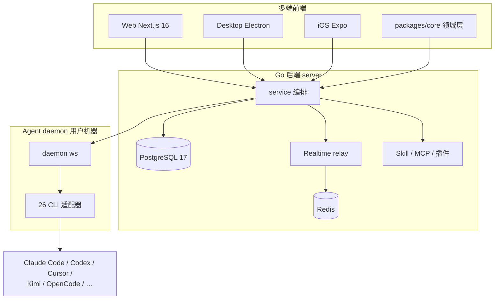
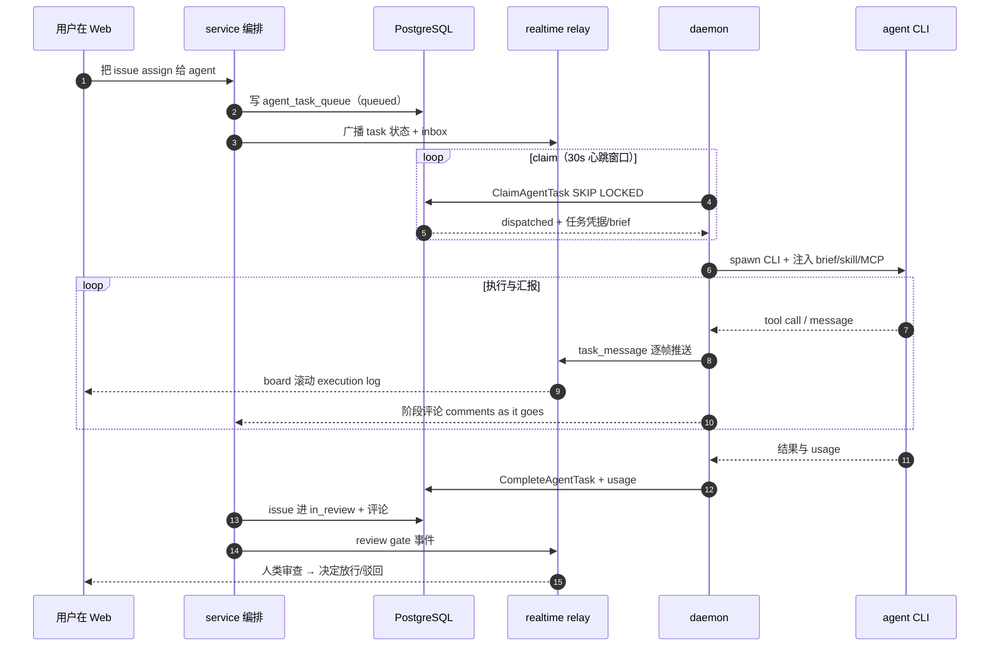

# Multica

> 让 AI 从"各自终端里的又一个 agent"，变成"跟人类一起在同一个看板上干活、可分配可追踪可审查的同事"——一套把 AI 编码 Agent 组织成共享团队的协作工作区。

> 本解读按 **ai-agent 类规格**产出（覆盖任务状态机 / Skill 体系 / MCP 接入 / Runtime 运行时 / 通信机制等关注面），叠加多关注面大型仓库并行解读流程。源码对象为本地仓库 `multica`（upstream `multica-ai/multica`），Go 后端约 30 万行有效代码（+35 万行测试）、PostgreSQL 445+ 迁移、TS 前端 monorepo。定位是**编排层而非 agent 本体**：Multica 不运行 LLM 循环，它驱动用户机器上已安装的 26 种 agent CLI。

## 子文档索引

- [`data-model.md`](data-model.md) — 数据模型：PostgreSQL + sqlc 如何用 445+ 迁移把多租户看板、高写任务队列、分析型用量报表压进同一库
- [`task-orchestration.md`](task-orchestration.md) — 任务生命周期编排：agent_task_queue 状态机、纯 SQL claim/lease 与"一个任务只执行一次"的并发保证
- [`runtime.md`](runtime.md) — Agent 运行时：一个 daemon 如何无差别驱动 26 种 CLI、进程组归属与 GC 的可靠性工程
- [`acp.md`](acp.md) — ACP 协议层：作为 Agent Client Protocol client 的协议实现与语义缺口启发式补齐
- [`realtime.md`](realtime.md) — 实时协作层：从单实例 hub 到分片 Redis Streams relay 的事件投递演进
- [`skill-system.md`](skill-system.md) — Skill 体系：把"解决过的问题"打包成每个 agent 复用的 playbook
- [`mcp.md`](mcp.md) — MCP 接入：为 CLI 会话注入外部能力的双通道（配置注入 + remote broker 代理）
- [`plugin-system.md`](plugin-system.md) — 插件系统：把平台能力以受控方式开放给第三方的 v1→v2 引擎
- [`channels.md`](channels.md) — 渠道接入：IM（Slack/Lark/DingTalk/WeCom/Telegram）与 VCS 双向对接
- [`frontend.md`](frontend.md) — 前端架构：三端共享领域层，Web 薄壳 + Electron 壳 + 移动端镜像
- [`deployment.md`](deployment.md) — 部署与自托管：docker-compose / Helm / 一键安装三轨交付
- [`supporting-layers.md`](supporting-layers.md) — 次要支撑层：认证授权、计量计费、遥测、issue 支撑与横切基础设施

## 根因：Agent 不该再是又一个需要 babysit 的终端

Multica 要解决的根本问题，是项目 README 开篇第一句点破的日常：你已经同时在跑 Claude Code、Codex 和另外三个 agent，每一个都活在各自的终端标签里、会话结束即忘、你每天要第四次重复解释同一段上下文 [README.md:40-42]()<!-- anchor: You already run Claude Code, Codex, and three other agents. Each one lives in its own terminal … the fourth time today. The more agents you add, the more of your day goes to babysitt -->。agent 加得越多，人类花在"照看它们"上的时间越多——**多 agent 非但没有解放人，反而把人的一天切成了更多碎片**。

Multica 的答案不是"更好的 agent"，而是**把 agent 当成同事实排进工作区**：给它分配一个 issue，它自己认领、在你的机器上执行、边跑边汇报、把结果交回审查。`issue` 就是劳动单元，`agent_task_queue` 就是劳动账本——**intent、run、decisions、diff 全部连到同一条 issue**，没有人的确认就不进 main。

这是名字里的哲学（Multica = Multiplexed Information and Computing Agent，向 Multics 时间共享致敬）：软件团队单线程几十年——一人一任务一上下文切换；agent 让"时间共享"重新变得有意义，只是这次系统上复用的人既有人类也有机器。核心承诺是：*"Your next 10 hires won't be human."*

## 概览

Multica 是一个**托管/自托管的 AI Agent 协作工作区**：26 种 agent CLI 与你的同事出现在同一个看板上，你可以像分配工作给同事一样把 issue 分配给 agent。它是多 Agent 团队管理的"操作系统层"——**不碰模型、不跑 LLM 循环、不捆绑任何 CLI**，只负责把 26 种异构 agent CLI 收敛成一种可编排的"同事"语义，并提供任务、进度、审查、成本、渠道的完整配套。

### 核心能力清单

| 能力 | 说明 | 深读 |
|------|------|------|
| 26 agent CLI 运行时 | Claude Code / Codex / Cursor / Copilot / Kimi / OpenCode / Qwen 等，全部经用户机器上的 daemon 驱动，代码不出机器 | [`runtime.md`](runtime.md) |
| Agent 作为一等公民 | 每个 agent 有名字、provider、runtime，出现在 board 上像人一样被指派、汇报、阻塞、交回审查 | [`data-model.md`](data-model.md) |
| Issue 驱动的任务生命周期 | issue → 任务队列 → daemon 认领 → CLI 执行 → 评论汇报 → review gate 决定是否落地 | [`task-orchestration.md`](task-orchestration.md) |
| Squads（小队） | agent 与人组成一支队伍，leader 路由工作；leader 也可以是 agent | [`task-orchestration.md`](task-orchestration.md) |
| Skills（技能） | 把解决过的问题打包成 `SKILL.md` playbook，注入各 CLI 的原生 skill 目录复用 | [`skill-system.md`](skill-system.md) |
| Autopilots | 按 cron 运行 standups/audit/报告，无人值守；数据库即分布式锁保证"恰好一次" | [`task-orchestration.md`](task-orchestration.md) |
| MCP 接入 | 给 CLI 会话注入外部 MCP server（含 remote broker 代理 + OAuth 凭据 + schema-digest 审批） | [`mcp.md`](mcp.md) |
| 插件系统 | hook / 事件桥 / 定时 / 存储 / secret 五类能力以声明式 manifest 开放给第三方 | [`plugin-system.md`](plugin-system.md) |
| 实时协作 | hub + 分片 Redis Streams 把任务/评论/通知实时推到浏览器、桌面与 daemon | [`realtime.md`](realtime.md) |
| Execution log / Token 用量 | 每个 tool call 可回放、每次 run 的成本按 agent/issue 聚合（四级 rollup 管道） | [`data-model.md`](data-model.md) |
| 渠道接入 | Slack / Lark / DingTalk / WeCom / Telegram 触发与追踪 agent 工作；GitHub/GitLab/Gitea/Forgejo 镜像 PR 与 CI | [`channels.md`](channels.md) |
| 多租户 + 安全 | workspace 隔离、owner/admin/member 角色、attribution 双列审计、SSRF 防护、fail-closed 默认 | [`supporting-layers.md`](supporting-layers.md) |
| 自托管三轨 | docker-compose 单机 / Helm 上 K8s / 一键安装脚本；配置项留空即关闭 | [`deployment.md`](deployment.md) |

### 技术栈一览

| 类别 | 技术 |
|------|------|
| Web | Next.js 16（App Router） |
| Desktop / Mobile | Electron（复用 web UI 包）/ Expo React Native（iOS） |
| 后端 | Go（Chi 路由、sqlc 生成查询、gorilla/websocket、pgx） |
| 主数据库 | PostgreSQL 17（`pgcrypto` + `pg_trgm`，sqlc，445+ 对迁移文件） |
| 协调 / 实时 | Redis（realtime Streams relay、channel lease、LivenessStore） |
| Agent runtime | 本地 daemon 执行 26 种 agent CLI（ACP / stdin / 参数三形态） |
| 领域共享层 | pnpm + turbo monorepo，`packages/core` 承载前后端对齐的类型与查询 |
| 部署 | Docker Compose（含 selfhost.build 轨）、Helm chart、一键安装脚本 |

## 架构总览

架构的骨架一句话：**人机看板（多端前端）↔ 服务端事实层（Go + PostgreSQL + Redis）↔ 分散在用户机器的执行层（daemon + 26 CLI）**。服务端是"判官"（谁认领了哪条 issue、该不该重试、花了多少钱），daemon 是"双手"（真正在用户机器上跑 agent），二者之间只隔一条 WebSocket。



**模块职责映射**（目录树 ↔ 关注面）：

```
server/
├── cmd/server/             # 启动装配：listeners、scheduler、realtime relay 注册
├── cmd/migrate/            # 迁移运行器（advisory lock 串行化、CONCURRENTLY 清理钩子）
├── internal/
│   ├── service/            # 业务编排核心（task.go/issue.go/autopilot.go/plugin_*.go）
│   ├── scheduler/          # DB-backed 调度器（pgcron 语义 + 表即分布式锁）
│   ├── daemon/  daemonws/  # daemon 进程引擎 + 服务端 WS 连接管理   → runtime.md
│   ├── realtime/           # hub + Redis relay + 分片 Streams        → realtime.md
│   ├── integrations/       # slack/lark/dingtalk/wecom/telegram/vcs → channels.md
│   ├── skill/  handler/skill*.go                                    → skill-system.md
│   ├── auth/  cli/  entitlement/  seatcapacity/  analytics/ …       → supporting-layers.md
├── migrations/             # 445+ 对 up/down SQL                      → data-model.md
└── pkg/
    ├── agent/              # 26 CLI 适配器 + ACP client + launch      → runtime.md / acp.md
    ├── db/generated/       # sqlc 生成查询层                          → data-model.md
    ├── remotemcp/  plugincontract/  skillbundle/  protocol/          → mcp/plugin/skill/acp
apps/   # web / desktop / mobile                                         → frontend.md
packages/  # core（领域层）/ views / ui / plugin-sdk                    → frontend.md / plugin-system.md
deploy/helm/  docker-compose*.yml  scripts/install.sh                  → deployment.md
```

## 一条请求链路：给一个 agent 指派 issue，直到它交回审查

这是贯穿全篇的主链路——从人指派工作，到 agent 在用户机器执行、实时汇报、最终进入 review：



## 核心模块导读

| 模块 | 角色 | 一句话定位 | 深读 |
|------|------|-----------|------|
| 数据模型 | 事实底座 | PostgreSQL + sqlc 的 445+ 迁移体系，JSONB 袋 + 提升列 + 目录表的三层字段演化 | [`data-model.md`](data-model.md) |
| 任务编排 | 业务循环心脏 | 纯 SQL 状态机 + claim/lease 回答"多 daemon 下怎么保证一个任务只执行一次" | [`task-orchestration.md`](task-orchestration.md) |
| Agent 运行时 | 执行引擎 | 统一抽象 26 种 CLI + 进程组归属/GC/自更新的可靠性工程 | [`runtime.md`](runtime.md) |
| ACP 协议层 | 与 CLI 的契约 | 标准 JSON-RPC 之上的语义适配与协议缺口启发式补齐 | [`acp.md`](acp.md) |
| 实时协作 | 协作现场 | hub → Redis relay → 分片 Streams，事件可靠到达每个订阅者 | [`realtime.md`](realtime.md) |
| Skill 体系 | 复用知识 | 把解决过的问题打包成 `SKILL.md`，经内容寻址缓存落到 CLI 原生 skill 目录 | [`skill-system.md`](skill-system.md) |
| MCP 接入 | 外部能力 | 配置注入 + remote broker 双通道，凭据 JIT、schema-digest 审批 | [`mcp.md`](mcp.md) |
| 插件系统 | 平台开口 | v1→v2 重置后以"consent 快照"承载 hook/事件/调度/存储/secret | [`plugin-system.md`](plugin-system.md) |
| 渠道接入 | 对外双口 | 入站翻译成建 issue/触发 agent，出站把进度投回 IM/VCS | [`channels.md`](channels.md) |
| 前端架构 | 人机界面 | packages/core 领域层一盏灯、三端各一个投影仪 | [`frontend.md`](frontend.md) |
| 部署自托管 | 交付出口 | compose 三容器 + Helm + 一键脚本，127.0.0.1 安全默认 | [`deployment.md`](deployment.md) |
| 次要支撑层 | 治理底座 | 认证授权、计量计费、遥测、issue 支撑、横切基础设施 | [`supporting-layers.md`](supporting-layers.md) |

## 同领域定位对比

| 项目 | 定位 | 与 Multica 的差异 |
|------|------|------------------|
| **Multica（本项目）** | 多 Agent 协作工作区，Agent 作为一等公民的 issue 驱动团队管理 | 完全不跑 LLM，26 种 CLI 全外包执行；daemon 分散在用户机器；board + review gate 是核心心智 |
| **Lework** | 企业级 AI 工作协作（AI 劳动力管理） | Lework 自带 native Eino runtime + 封装外部 CLI，多模型自调度；Multica 不碰模型、纯驱动外部 CLI |
| **OpenWorker** | 开源 AI 同事桌面平台（Andrew Ng） | OpenWorker 是 sidecar 自带 Agent 循环的桌面应用；Multica 是服务端编排 + 用户机器 daemon |
| **Codeg** | 多 Agent 编码工作台（单用户） | Codeg 以 git worktree 异步任务 + ACP 会话聚焦个人编码；Multica 面向团队看板、issue 为劳动单元、多人多 agent 协作 |
| **AionUi** | 多 Agent 桌面 Cowork 平台 | AionUi 桌面优先、自研 aioncore 引擎（ACP 收敛 CLI）；Multica Web/桌面/云全形态、无自研引擎 |
| **Tutti** | 多智能体实时共享协作空间 | Tutti 本地优先、Checkpoint 模式仲裁同机多 agent；Multica 是托管/自托管的工作区，agent 各在用户机器执行 |

一句话概括差异：**同为"把多个 agent 组织起来"的赛道，Multica 是唯一把"模型/执行"完全外包（26 种 CLI、daemon 分散）、把"编排与审查"做重（issue 状态机、board、渠道、成本、自托管）的一方**——它卖的不是 agent，是"让多个异质 agent 像一支队伍那样协作"的调度与治理层。

## 设计亮点

1. **"至多一次 + 至少一次"用纯 SQL 而非分布式锁**：认领是 `UPDATE … WHERE id=(子查询) FOR UPDATE SKIP LOCKED`，PostgreSQL 行锁是唯一仲裁者；`dispatched` 状态闸 + 45s 可续 prepare lease + 版本戳 CAS 三层防重，Redis 只是性能缓存、不是正确性来源（[`task-orchestration.md`](task-orchestration.md)）。
2. **进程组归属做成构造进程时的默认而非 opt-in**：`newRuntimeCmd` 是包内唯一进程构造出口，统一施加 `Setpgid` + SIGKILL 取消——历史教训是 opt-in 时 27 处只有 8 处记得建组、被取消的 agent 在 Windows 上多活了 40 分钟（[`runtime.md`](runtime.md)）。
3. **协议缺口全部用启发式补齐而非等协议演进**：ACP 的 deliverable 边界以最后一次 tool call 为界、usage 用 `totalTokens` 守恒再分桶防重复计费、effort 用读回验证防假确认（[`acp.md`](acp.md)）。
4. **"schema 演进纪律"写进了代码**：迁移即单隐式事务、CONCURRENTLY 建索引强制登记清理钩子（有测试兜底）、NOT VALID + VALIDATE 弱锁拆分——事故被沉淀成可读的迁移注释（[`data-model.md`](data-model.md)）。
5. **scheduler 把表当分布式锁 + 审计日志**：`sys_cron_executions` 让 autopilot/插件的 cron 在 DB 层实现"恰好一次"，跨实例不重复触发（[`task-orchestration.md`](task-orchestration.md)）。
6. **frontmatter 式 Skill 落到 CLI 原生 skill 目录**：daemon 按 `(workspace, source, id, hash)` 内容寻址缓存，物化到 `.claude/skills` 等各 CLI 自己的发现目录，改一处全 agent 生效（[`skill-system.md`](skill-system.md)）。

## 不足与风险

1. **"26 种 agent CLI" 的能力差异被抽象层压平，但语义深度参差**：Effort 调节只对部分后端生效（Kimi/Hermes 是假确认反例）、ACP 走统一直觉但各 CLI 对 `session/set_config_option` 的兑现不可控——宣传的"统一"在细节上有保留（[`acp.md`](acp.md)）。
2. **review gate 是"约定"而非任务模块强制**：任务完成时不改 issue 状态，`in_review` 靠 agent CLI 行为约定 + issue 状态机语义，README 承诺与模块能力之间存在落差（[`task-orchestration.md`](task-orchestration.md)）。
3. **realtime 的细粒度房间是"服务端就绪、客户端未启用"的前瞻能力**：当前 task/chat 事件仍走整个 workspace 广播，代码注释明示"现在切过去会丢消息"——大 workspace 下带宽与无效处理是可见成本（[`realtime.md`](realtime.md)）。
4. **渠道成熟度不齐**：DingTalk/WeCom/Telegram 社区维护；部分接线（如 Composio 的 Stage 3 接入 task dispatch）基础设施已备、尚未接通（[`channels.md`](channels.md)）。
5. **"应用层关系替代外键"的双刃剑**：新表一律无 FK，workspace teardown 靠 692 行 CTE 清单逐表清理，漏一张就是孤儿数据，依赖团队纪律兜底（[`data-model.md`](data-model.md)）。
6. **营销与机制落差**：README 的 "Turn a solved problem into a playbook" 暗示自动化沉淀，实际 skill 来源以人工创建/导入/快照复制为主（[`skill-system.md`](skill-system.md)）。

## 可借鉴的设计

- **"外包执行、自营编排"的边界切法**：把 26 个异质 agent CLI 收敛成统一 `Backend` 契约（`SupportedTypes` 白名单 + `pkg/protocol` 双处锁定），抽象价值在于"协议差异被锁在适配器里，调度层对 provider 无感"——任何需要接多个同质产品的系统都值得学（[`runtime.md`](runtime.md)）。
- **纯 SQL 状态机替代分布式协调**：`FOR UPDATE SKIP LOCKED` + 状态 CAS + 版本戳租约，把"只执行一次"从运维纪律变成 SQL 原子性——比引入任务中间件（Celery/BullMQ 之类的集中 broker）更少组件、更强一致（[`task-orchestration.md`](task-orchestration.md)）。
- **表即分布式锁 + 审计日志**：用一张执行记录表替代内存 cron，天然支持多副本、可回放、可审计（[`task-orchestration.md`](task-orchestration.md)）。
- **启发式补齐协议缺口的三步法**：发现（`configOptions`）→ 应用（`set_config_option`）→ **读回验证**，不接受"调用成功"当"生效"——对任何基于协议假定的自动化都适用（[`acp.md`](acp.md)）。
- **迁移承载"演进三件套"**：CONCURRENTLY / NOT VALID+VALIDATE / 应用层删除，把零停机 schema 演进的约束固化成迁移形态而非临时操作（[`data-model.md`](data-model.md)）。
- **内容寻址缓存 + 原生目录物化**：以 hash 为键让"改一处全端生效 + 损坏即当 miss"，skill 分发不用等各 CLI 统一接口（[`skill-system.md`](skill-system.md)）。

## 总结

回到开篇锚点：Multica 解决的不是"怎么造一个更好的 agent"，而是 **"当你的 agent 已经多到照看不过来时，怎么让它们像一支团队那样自己运转"**。它把三件事做成了系统的骨架——**用 issue 把一切工作串起来**（intent → run → decisions → diff 全程关联同一劳动单元）、**把执行外包给 26 种成熟 CLI**（drives them, doesn't ship them，代码永远留在用户机器）、**把编排与审查做重**（纯 SQL 状态机保证可靠、board/渠道/成本让协作可见、review gate 让人留在环上）。像 Multics 当年让几个人共享一台机器，Multica 想让人和一群 agent 共享一个团队——**a small team shouldn't feel small**。它最值得学的地方不在某个模块，而在"把异质执行收敛成统一同事语义 + 把人的确认焊死在发布路径上"这套完整的编排层设计哲学。
