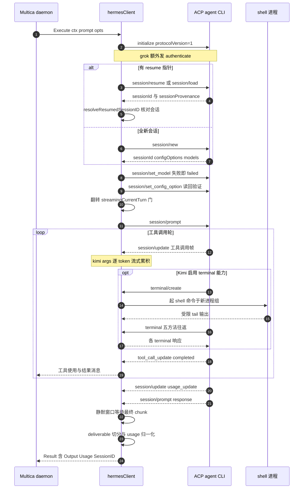

# ACP 协议层：统一协议驱动的可靠性工程

## 模块定位：ACP client 在 26 运行时抽象中的角色

Multica 的运行时抽象层（runtime 模块）负责 spawn 26 种 agent CLI；ACP 协议层则是其中「按 ACP 传输」那一族运行时共用的协议引擎。它的承载物是 `server/pkg/agent/hermesClient`——一个 JSON-RPC 2.0 over stdio 的 ACP client，被 13 个后端复用：hermes、kimi、kiro、mcode、qoder/qoderclicn、qwenpaw、reasonix、traecli、zeroclaw、grok、dim。

运行时注册表把每家的启动形态写死，一眼可见哪些 CLI 走 ACP：

```
"hermes":      "hermes acp",
"kimi":        "kimi acp",
"reasonix":    "reasonix acp",
"kiro":        "kiro-cli acp",
"qoder":       "qodercli --acp",
"traecli":     "traecli acp serve",
"grok":        "grok agent stdio",
"qwenpaw":     "qwenpaw acp",
"dim":         "dim acp",
"mcode":       "mcode acp",
"zeroclaw":    "zeroclaw acp",
```

[server/pkg/agent/agent.go:473-488]()
<!-- anchor: "hermes":      "hermes acp", … "mcode":       "mcode acp", -->

其中 `acp` / `--acp` 子命令是 daemon 强占的协议标识：`hermesBlockedArgs` 把 custom_args 里的裸 `acp` 视为「用户想重发后端自己的子命令」直接拦截，`hermesCLIArgsFrom` 则保证后端 argv 里 `acp` 永远位于前缀与 custom_args 之间，参与 Hermes 自己的 profile 扫描。

[server/pkg/agent/hermes.go:34-36]()
<!-- anchor: var hermesBlockedArgs = map[string]blockedArgMode{ … "acp": blockedStandalone, -->

去掉 ACP 路径后，这 13 个 CLI 的模型下拉、执行、成本计量、Effort 调节会一起失效——它们不像 Claude Code（stream-json）、Codex（app-server）、DSH（自有 stdio 协议）那样有独立的流协议兜底，`agent.go:473-489` 的 argv 表里 ACP 族占了接近一半的条目。README 宣传的「Execution log → Replay every tool call」「Token usage → See what each run cost」对这批运行时全部依赖 ACP 的通知通道（详见文末「README 宣传核对」）。

## 根因：为什么在 CLI 私有交互之外还要做 ACP client

Multica 的策略基线是「CLI 支持 ACP 就走 ACP，否则回退 CLI 自身的 stdin 交互 / 输出解析」。这个策略的根因是一个工程经济问题：**26 个 CLI 各自私有协议的解析成本是 O(N) 且随版本漂移，而 ACP 把「会话、工具、权限、计量」抽象成统一的 JSON-RPC 原语，接入成本降到 O(1) 起。**

代码注释把这种权衡讲得很直白：CodeBuddy 的模型发现历史上靠 `codebuddy --help` 抓 `--model` 行（MUL-5549），标签靠猜、默认模型靠「首条获胜」、Effort 目录还得对同一份输出做第二次正则，而 `--acp` 握手（initialize + session/new）更快、且一次返回结构化目录：

[server/pkg/agent/models.go:2767-2775]()
<!-- anchor-base64:Ly8gVGhpcyByZXBsYWNlcyBzY3JhcGluZyB0aGUgYC0tbW9kZWxgIGxpbmUgb3V0IG9mIGBjb2RlYnVkZHkgLS1oZWxwYCAoTVVMLTU1NDkpLiDigKYgLy8gdGhlIHRpbWVvdXRzIGJlaGluZCAjNjE4MC4= -->

但「统一协议」不是免费的——它把代价转移到了协议边界之外。ACP 协议标准化的是调用形状（session/new、terminal/*、usage_update），**不标准化的是语义**：没有「这个 configOption 就是 reasoning effort」的标记、没有「usage 的 inputTokens 是否已含缓存读取」的约定、没有「哪一段文本是最终答复」的字段。于是 Multica 的 ACP 层有大量工作是**协议缺口启发式补齐**，这也是本模块最值得读的部分：

- effort 选择器靠 id/category 白名单猜（`effort`/`thought_level`），词表 verbatim 直传；
- usage 的 cache-read 是否内嵌在 inputTokens 里靠 `totalTokens` 守恒反推再分桶；
- 最终答复 vs 完整 transcript 靠「最后一次 tool call」为界切分；
- 「set_config_option 是否真的生效」靠读回 currentValue 验证（且只验证到会话报告层）。

[server/pkg/agent/acp_effort.go:10-30]()
<!-- anchor: // acp_effort.go holds the provider-neutral half of ACP reasoning-effort … //     and why a runtime only reaches this path once its Execute opts in. -->

一句话根因：**ACP 把「如何跟一个 agent 会话说话」标准化了，但没把「会话说的东西什么意思」标准化；Multica 在标准协议之上补了一层每家的语义适配，换来了 13 个后端的复用，代价是这些语义适配必须随真实二进制逐版本验证。**

## 设计思路：hermesClient 复用与协议能力地图

### ACP client 的生命周期

所有 ACP 后端的 Execute 走同一条骨架（hermes.go:265-789 的 hermesBackend.Execute 是最完整的实现，其余后端是它的参数化变体）：

1. **握手**：`initialize`（protocolVersion=1、clientInfo=`multica-agent-sdk`、clientCapabilities）。只有 Kimi 在 capabilities 里声明 `terminal: true`，与它开启 `terminalEnabled` 呼应。
2. **鉴权**（仅 Grok）：读 `initialize.authMethods`，按环境里有无 `XAI_API_KEY` 选 `xai.api_key` 或 `cached_token`，发 `authenticate`。
3. **建会话**：无 resume 指针走 `session/new`；有则走 `session/resume`（hermes/reasonix/kimi）或 `session/load`（grok/kiro/mcode/qwenpaw/dim）。两个响应都持有 `sessionResult`（承载 configOptions），并解析出 `sessionID` 与 `currentModelId`。
4. **调模型**：用户显式选模型时发 `session/set_model`——这步失败必须 `failed`，因为「静默回退默认模型」会让用户以为自己的选择被尊重。
5. **调 effort**：经 `session/set_config_option` 应用持久化的 reasoning-effort，失败不阻塞任务。
6. **发提示**：翻 `streamingCurrentTurn` 门后才发 `session/prompt`；之后所有 `session/update` 通知才被接受。
7. **收尾**：等待通知静默窗口 → `stdin.Close()` 让子进程 EOF 退出 → 等 stdout/stderr 排干 → 从 deliverable tracker 取最终答复 → provider-error 嗅探器做 failed 提升 → 汇总 usage → 发 `Result`。

这个骨架的每个步骤都对应 ACP 的一个原语，但「何时进行下一步」几乎全靠启发式，见下文。

### 协议能力地图

Multica 只实现了让「无头跑一轮任务」成立的子集，其余能力要么不回、要么显式拒绝：

| 方向 | 方法 | 状态 | 用途与关键行为 |
|---|---|---|---|
| client→agent | `initialize` | 实现 | capabilities 除 Kimi 外留空，remote MCP 能力随后单独解析 |
| client→agent | `authenticate` | 仅 Grok | `selectGrokAuthMethod` 按环境选 API key / 缓存 token |
| client→agent | `session/new` / `session/resume` / `session/load` | 实现 | resume 后必须读回实际 sessionId（见决策一） |
| client→agent | `session/set_model` | 实现 | 失败即 failed；resumed 死号在此提前暴露 |
| client→agent | `session/set_config_option` | 实现 | effort（reasonix/jcode/dim/kimi）+ dim 的 permission/mode |
| client→agent | `session/prompt` | 实现 | 唯一进入「本轮」的门 |
| client→agent | `session/close` | 仅 dim | 半配置会话失败时最佳努力关闭 |
| agent→client | `session/request_permission` | 实现 | 无头自动应答，见下 |
| agent→client | `terminal/create` | 实现 | 仅 `terminalEnabled`（kimi）；否则 -32601 |
| agent→client | `terminal/output` / `wait_for_exit` / `kill` / `release` | 实现 | 进程组语义的 daemon 侧 shell 工具 |
| agent→client | 未知方法 | 回 -32601 | 显式「method not found」，不沉默 |
| 通知 | `session/update` / `session/notification` | 实现 | 六种子类型，见下 |
| 通知 | `config_option_update` | **丢弃** | 共享 client 按 id 配响应、丢通知（见决策二） |

terminal 能力的开与关是**逐后端 opt-in**：`terminalEnabled` 只在 kimi 后端置真，其余 ACP 运行时收到 `terminal/create` 会得到 `-32601 terminal capability is not enabled`——因为 Multica 只为已在自己进程里实现过终端语义的运行时做广告。

[server/pkg/agent/hermes.go:930-939]()
<!-- anchor: 	// terminalEnabled is only set for ACP runtimes whose client-side terminal … 	nextTerminalID  int -->

通知子类型经 `normalizeACPUpdate` 归一：`agent_message_chunk`/`agent_thought_chunk` 直接转发为 `MessageText`/`MessageThinking`；`tool_call`/`tool_call_update` 汇入工具流（Kimi 的 args 逐 token 流式累积）；`usage_update` 汇入 usage 累加器；`turn_end` 当作一次 prompt 结果解析。

[server/pkg/agent/hermes.go:1565-1578]()
<!-- anchor: 	switch updateType { … 		c.extractPromptResult(updateData) -->

### 无头权限自动应答

daemon 无法弹窗问用户，所以 `session/request_permission` 必须自己答。策略是「只选 agent 确实给过的 optionId」+ fail closed：优先已知的 session 级授权 id（`allow_session`/`approve_for_session`），其次任何 `allow_once` 单项授权，再退到 `reject_once` 拒掉单次动作，绝不自动选持久化的 `allow_always`（会写入运行时所有者的磁盘 allowlist，越权到任务之外）；什么都没有就回协议错误而不是编造 id。

[server/pkg/agent/hermes.go:1280-1315]()
<!-- anchor: func selectACPPermissionOption(params json.RawMessage) (optionID string, grant bool, ok bool) { … 	return "", false, false -->

这条策略踩过的坑刻在注释里（GitHub multica#5300）：Hermes 的编辑审批只给 `["allow_once","deny"]`，且拒绝任何非 `allow_once` 的 id——此前硬编码的 `approve_for_session` 让 Hermes 上每次文件写入都被静默拒绝。

Reasonix 是这个共享策略上的一个例外：它把「用户问题」和「fresh-human 决策」这两类请求标记出来（toolCallId 前缀 `ask-`、option 后缀 `:cancel`、`_meta.reasonix.io` 的 fresh 标记），共享的「allow_once 安全即授权」规则会放过它们，而 Reasonix 的语义是「当前会话没有人在场时问用户 = 死等」。`selectReasonixPermissionOption` 在共享规则之前拦截，有 reject_once 就拒掉该动作，没有就回协议错误——问题标题被裁剪到 240 rune 存进 task 错误，让用户看到「Reasonix 想问你什么」。

[server/pkg/agent/reasonix.go:580-608]()
<!-- anchor: // selectReasonixPermissionOption prevents two Reasonix-specific request … 		return "", false, false, reason -->

### 协议缺口的启发式补齐

| 缺口 | ACP 没给什么 | Multica 的启发式 | 位置 |
|---|---|---|---|
| 最终答复 vs 完整 transcript | 没有「最终答复」标记 | 以最后一次 tool call 为界，界后文本即答复 | `acp_deliverable.go:41-54` |
| effort 词表 | 没有 effort 的语义标记 | id/category 白名单 + 词表 verbatim 直传 | `acp_effort.go:36-39` |
| effort 是否真生效 | 「MAY set」≠「must act」 | 读回 currentValue 验证 | `acp_effort.go:287-299` |
| usage 的 cache 归属 | inputTokens 是否含 cacheRead 未定 | `totalTokens` 守恒反推再分桶 | `acp_usage.go:250-259` |
| 一轮何时结束 | response 返回≠通知流结束 | 静默窗口 + 硬上限双闸 | `hermes.go:814-837` |
| resume 历史回放 | resume 会先冲积历史 chunk | `streamingCurrentTurn` 门 | `hermes.go:637-641` |
| 会话是否真没了 | resume 可能静默新建会话 | 读回 sessionId + turnActivity=0 判定 | `hermes.go:2156-2162`、`1417-1419` |
| 上游 API 失败 | stopReason=end_turn 掩盖 4xx | stderr 嗅探器 + 终局标记提升 | `hermes.go:3010-3029` |

「什么时候发 prompt」以外的边界几乎全是猜的，这让本模块的代码注释密度远超平均水平——每一处启发式都在记录它对抗过的真实二进制行为。

### 协议缺口的两条旁路：vendor 专属通道与进程级兜底

当标准协议彻底不够用时，Multica 会降级到两档旁路：

1. **vendor 专属通知通道**：reasonix 不通过标准 `usage_update` 报计量，而是发 `_reasonix.io/session/status_update`（vendor 命名空间通知，schemaVersion 门控），Multica 用 `reasonixStatusUsageTracker` 按 sequence 序号取最新快照，并把它与标准 usage 累加器合并——status 报告缺失时打警告但不 fail，因为计量缺失只影响账单不影响执行。

[server/pkg/agent/reasonix.go:726-735]()
<!-- anchor: type reasonixStatusUsageTracker struct { … func (t *reasonixStatusUsageTracker) observe(method string, params json.RawMessage) { -->

2. **版本号 fail-closed**：dim 的跨进程 resume 依赖 `session/load`，而 0.3.10 之前的版本把会话永久绑定在创建进程上。Multica 从 `initialize.agentInfo.version` 读出版本，低于 `0.3.10` 直接 `failed`——宁可拒绝续会话，也不让用户以为 resume 成功了其实每次都在新建。

[server/pkg/agent/dim.go:354-371]()
<!-- anchor: 		// Require dim >= 0.3.10 (fail-closed): earlier builds bind sessions to … 			return -->

另一个值得单列的实现是 dim 的进程组清理顺序：先 SIGKILL 整个进程组、再 cancel、再关 stdin、最后才 Wait——如果先关 stdin，shell 会在 EOF 时退出、进程组先解散，后代进程被孤儿化（PPID=1）而逃过清理。这套顺序与 acpTerminal.kill 的「先清组、后确认」是同一条纪律。

[server/pkg/agent/dim.go:307-327]()
<!-- anchor: 		defer func() { … 			releaseProcessGroup(cmd) -->

## 关键数据结构

三个状态机承载了协议缺口补齐的绝大部分工作，共同点是**字段级地保留「缺省 vs 显式零」的区别**——这是对抗协议含糊的唯一手段。

`acpTerminal` 是 daemon 侧 shell 工具的进程句柄：`output` 是受限 tail（默认 50KB），`truncated` 标记是否裁过，`exitStatus` 由退出协程填写。输出写入时按 UTF-8 rune 边界截断，绝不切开多字节字符；快照时再剔除 pipe 跨 write 拆出的不完整后缀。

[server/pkg/agent/acp_terminal.go:26-33]()
<!-- anchor: type acpTerminal struct { … 	exitStatus *acpTerminalExitStatus -->

`acpUsageAccumulator` 调和 usage_update 与 prompt usage 两条计量路径：`fields` 位掩码逐桶记录「此桶出现过」，input 又单独分成 `ambiguousInput`（未归一化候选）与 `normalizedInput`（带 totalTokens、可归一化候选）两组，合并时按累计量取 max 去重，最后从全体观测集中解出 input 归属。

[server/pkg/agent/acp_usage.go:44-52]()
<!-- anchor: type acpUsageAccumulator struct { … 	hasNormalized     bool -->

`acpDeliverableTracker` 用两个 strings.Builder 同时维护「完整 transcript」与「最后一次 tool call 之后的文本」：tool use 把当前 deliverable 位移到 `lastTextBlock` 并重置，text 追加进两者——这样「转述中间过程 + 工具调用 + 最终答复」的流能被切成答复与全文两份，而失败检测仍能扫全文。

[server/pkg/agent/acp_deliverable.go:27-35]()
<!-- anchor: type acpDeliverableTracker struct { … 	lastTextBlock string -->

`hermesClient` 是协议的传输与状态载体：`pending`（id→rpcResult 的请求表）、`pendingTools`（流式工具 args 缓冲）、`usage`（累计器）、`terminals`（终端句柄表）+ 四个可插拔回调（onMessage / onPromptDone / onActivity / acceptNotification），把协议行为参数化给各后端。

[server/pkg/agent/hermes.go:871-878]()
<!-- anchor: type hermesClient struct { … 	sessionID    string -->

## 核心流程：一次 ACP 会话的完整生命周期

下图以 hermes 后端为蓝本（最完整），标注了 ACP 方法与实现位置；grok 在 initialize 与 session 之间多一次 authenticate，kimi 会多出 terminal 工具的往返。



读图的三个要点：

1. **prompt 前的每步都可能中途改判失败**。set_model 失败直接 `failed`；set_config_option 失败则降级为警告继续发 prompt——前者改变用户可见的行为（模型），后者只是 UI 上标出的等级可能不生效，两套失败策略刻意不同。
2. **resume 的可信度问题贯穿全程**。会话指针来自 daemon 的持久化存储，但 ACP 的 `session/resume` 响应没有 sessionId 字段（ResumeSessionResponse schema 与 NewSessionResponse 不同），Hermes 对已丢失会话还会静默新建。Multica 用三重防御：resume 响应读回（`resolveHermesResumedSessionID` 读 `_meta.hermes.sessionProvenance`）、prompt 时报错时清空 id、以及「resume 成功但零活动（无文本/无 thought/无工具调用）且 stopReason=refusal」判为会话已死。

[server/pkg/agent/hermes.go:1417-1419]()
<!-- anchor: func hermesResumeSessionLost(resumeSessionID, stopReason string, turnActivity int64) bool { … 	return resumeSessionID != "" && stopReason == "refusal" && turnActivity == 0 -->

3. **终局判定绕开 ACP 的谎言**。hermes/kimi/grok 的 `session/prompt` 在上游 HTTP 4xx/5xx 时仍报 `stopReason=end_turn`，Multica 用 stderr 嗅探器捕获终局失败标记（`after N retries` / `Non-retryable` / 4xx 类）把 `completed` 提升为 `failed`。

[server/pkg/agent/hermes.go:3010-3029]()
<!-- anchor: func promoteACPResultOnProviderError(finalStatus, finalError, finalOutput string, sniffer *acpProviderErrorSniffer) (string, string) { … 	return finalStatus, finalError -->

关于「terminated by tool call 时 deliverable 为空」的坑：一轮在工具调用后没有文本时，`deliverable` 是空的，tracker 回退到 `lastTextBlock`——被最后一个工具调用顶掉的最新一段非空文本，保证答复不为空。

[server/pkg/agent/acp_deliverable.go:60-67]()
<!-- anchor: func (t *acpDeliverableTracker) result() (deliverable, full string) { … 	return deliverable, t.full.String() -->

## 与其他模块的协同

- **runtime/daemon（宿主）**：ACP 层把「这一轮算不算数、能不能续」压缩成 `Result` 的两个字段——`SessionID`（空表示会话已死，可重试）与 `ResumeRejected`（只对该状态为真：运行时拒绝了我们请求续的会话）。daemon 的 resume 门据此决定下次 dispatch 是续旧会话还是开新会话。daemon 侧消费 `ResumeRejected` 的 fallback 逻辑（internal/daemon 模块）不在本模块范围内。
- **execution log / replay**：`Message` 流（`MessageText`/`MessageToolUse`/`MessageToolResult`/`MessageThinking`）就是 README 宣传的「Replay every tool call」的数据源，而 ACP 层的 `handleToolCallStart`/`handleToolCallUpdate` 正是这些 Message 的唯一生产者。execution log 的落库与回放实现属于 telemetry/daemon 模块。
- **taskfailure**：ACP 层的结构化错误（`acpRPCError{Code,Message,Data}`）分两层消费——`isACPSessionNotFound` 等谓词在适配器内直接判断；其余错误文本随 `Result.Error` 交给 `taskfailure.Classify` 做 14 分类（上下文耗尽、provider 5xx、网络断开等）。

[server/pkg/taskfailure/classify.go:62-71]()
<!-- anchor: func Classify(rawError string) Reason { … 	lower := strings.ToLower(trimmed) -->

- **taskfailure/resume 守卫**：`UnresumableHistory` 与 `AuthMethodUnresolved` 判定「resume 也无法治愈的失败」——空内容的消息会每次复读同一拒绝，未解析的认证方法在重建的会话里是确定性的。注释明确点名这类失败会经由 `session/resume`/`session/set_model`/`session/prompt` 三个 ACP 路径到达。

[server/pkg/taskfailure/resume.go:38-43]()
<!-- anchor: func UnresumableHistory(errText string) bool { … 	return emptyContentRe.MatchString(errText) && historyMessageLocatorRe.MatchString(errText) -->

[server/pkg/taskfailure/resume.go:64-69]()
<!-- anchor: func AuthMethodUnresolved(errText string) bool { … 	return strings.Contains(strings.ToLower(errText), authMethodUnresolvedPhrase) -->

- **thinking.go（Effort 能力门控）**：`acpCatalogThinkingProviders` 是「谁真的会 applyACPEffortOption + 谁真的会把 effort 带进 provider 请求」的双重证据清单——只读会话广告不足以入选，Hermes 接受 set_config_option 却忽略它、Kimi ≤0.28.1 确认「on」却收到「max」，都是被这个门拦下的反例。

[server/pkg/agent/thinking.go:865-894]()
<!-- anchor: var acpCatalogThinkingProviders = map[string]bool{ … 	"dim": true, -->

- **models.go（模型发现）**：`discoverACPModels` 为 12 个 provider 跑同一套 initialize →（可选 authenticate）→ session/new 握手并解析 models 目录，是 ACP client 在「执行」之外的第二消费场景；CodeBuddy/Copilot 只消费发现、不消费执行（执行走 CLI），Grok 发现与执行都走 ACP。

[server/pkg/agent/models.go:2006-2047]()
<!-- anchor: 	initResult, err := requestACP("initialize", map[string]any{ … 	models := parseACPSessionNewModels(sessionResult) -->

- **launch.go**：ACP 的 argv 组装与 blocked 列表在 launch.go 的 `filterLaunchPrefix` 里与普通 CLI 统一处理——前缀里的 `acp` 是命令身份的一部分（不拦），custom_args 里的才是协议劫持（拦），这套区分只对 ACP 族有意义。

[server/pkg/agent/launch.go:500-536]()
<!-- anchor: func filterLaunchPrefix(prefix []string, agentType string, logger *slog.Logger) []string { … 	return filtered -->

## 关键设计决策

### 决策一：resume 会话 id 永远不信第一个答案，读回验证

ACP 的 ResumeSessionResponse 没有 sessionId 字段，且多个运行时对「不存在的会话」的反应是**静默新建**（Hermes 的 state.db 清空后 resume_session 会 "not found, creating new"，Kiro 在 -32603 的 data 里说 "No session found"，kimi 报 invalid_params）。Multica 的对策是读回响应里的实际会话 id：Hermes 从 `_meta.hermes.sessionProvenance.acpSessionId` 取，其余从 sessionId 字段取，二者都没有才回退到请求 id（宁可保持旧行为，也不把每轮的对话历史都宣告丢失）。

[server/pkg/agent/hermes.go:2188-2197]()
<!-- anchor: func resolveHermesResumedSessionID(requested string, response json.RawMessage) (string, bool) { … 	return got, got == requested -->

替代方案的代价是直接可见的：不核对的话，daemon 每轮都往同一个死 id 发 prompt，用户看到「对话从零开始」且没有任何报错（GH #6806）；而死号的最终判罚（`isACPSessionNotFound`）需要同时匹配 -32603/-32602/-32002/-32000 四种错误码和三套措辞，因为不同运行时用不同的码表示同一件事。

[server/pkg/agent/hermes.go:1361-1373]()
<!-- anchor: func isACPSessionNotFound(err error) bool { … 		strings.Contains(text, "unknown session") -->

### 决策二：usage 双路径归一化防重复计费

ACP 的标准 usage 字段、vendor `_meta.usage`、`usage_update` 通知三者会从不同通道报告同一轮消耗。Multica 用两层去重：

1. **合并层（accumulator）**：逐桶 max 合并，cost 取累计最大值——「晚到但更全的报告」覆盖「早到的部分报告」，但同样的快照重复出现不会累加。input 特殊：带 totalTokens 的归一化候选与不带的不归并，留到最后从全局解出。
2. **归一化层（normalizeACPTokenUsage）**：当且仅当 `totalTokens == inputTokens + outputTokens` 时判定 inputTokens **包含** cacheReadTokens，然后从 input 里扣出缓存桶——这样持久化的五个桶互斥，dashboard 的成本算式不会把缓存前缀计费两次。只对守恒的形态生效，报互斥桶或不报 totalTokens 的运行时原样保留。

[server/pkg/agent/acp_usage.go:250-259]()
<!-- anchor: func normalizeACPTokenUsage(usage TokenUsage, totalTokens int64) (TokenUsage, bool) { … 	usage.InputTokens -= usage.CacheReadTokens -->

Grok Build 是驱动这条路径的样本：它把缓存读计进 inputTokens，`totalTokens == input + output` 恒成立；若不加归一化，成本算式里缓存前缀会被计入 input 又计入 cache-read。

### 决策三：effort 读回验证防「假确认」

ACP 只承诺 client MAY set 一个 option，不承诺 agent 会照做。`applyACPEffortOption` 发出 `session/set_config_option` 后读回响应的 currentValue：与请求值一致才记 confirmed，否则降级为警告继续发 prompt。这个读回证明的仅是「会话现在报告这个值」——**不是**「provider 请求真的带了 reasoning.effort」。

[server/pkg/agent/acp_effort.go:287-292]()
<!-- anchor: 	effectiveLevel, confirmed := acpConfigOptionCurrentValue(result, option.ConfigID) … 			effectiveLevel = "unknown" -->

必要性来自两个实测反例：Kimi ≤0.28.1 的 ACP 只实现 on/off 拨档，`set_config_option("max")` 返回成功却确认「on」；Hermes Agent 接受 set_config_option 后完全不理会。这类运行时只能靠版本号或「该 binary 是否被线下验证过真把 effort 带进请求」来排除（`acpCatalogThinkingProviders` 的入选条件），读回验证是运行时诊断，不是能力证明。

[server/pkg/agent/models.go:1487-1491]()
<!-- anchor: // exactly like 0.33.0 does, but its ACP only implements the on/off toggle, so … // response already carries it, so this costs no extra process. -->

### 决策四（启发式的边界诚实）：deliverable 是近似，不是语义

「最后一次 tool call 之后的所有文本」这个边界会把**中途转述**排除在答复外（#6006 的目标），但 ACP 运行时的最终答复与中间叙述是同一个 `agent_message_chunk` 类型，所以这是直到运行时显式标记前能拿到的最好近似；它也有明确的已知坑——工具调用后追加的叙述会被当作答复的一部分，而 provider 的「give-up」turn 文本如果落在最后一次工具调用之前，会被正确地从答复剔除但保留在全文里供失败检测使用。

## 亮点与问题

**亮点**

1. **并发模型的纪律**：`acpDeliverableTracker`/`acpTerminal`/`hermesClient` 全部以「reader 协程写、session 协程读」的并发姿态设计并有 -race 测试覆盖；`writeLine` 串行化跨协程的 stdin 写，避免主协程 request 与 reader 协程应答请求交插帧。
2. **失败提升的区分度**：stderr 嗅探器严格区分「单次重试警告」与「终局失败标记」，`terminalMessage()` 只在 `after N retries` / `Non-retryable` / 4xx 类出现时非空——否则一次成功重试后跟着的早期警告会把整个任务误标 failed（GitHub multica#1952）。
3. **进程组语义的完整闭环**：terminal 的 kill 先 SIGKILL 整个进程组，再等 `waitProcessGroupGone` 确认组内全部消失才返回成功——防止后台子进程占着管道让 wait_for_exit 假报成功；release 只在清理确认后才删 map 条目，失败可重试。
4. **模型的版本证据纪律**：所有启发式都记录「对哪个真实二进制版本验证过」（jcode v0.71.1/v0.73.0、Kimi 0.29.0、Hermes v0.20.0、dim 0.3.10+），并把「未验证的自定义 runtime」fail closed（`acpToleratesOmittedMcpCapabilities` 需 `Config.BuiltinRuntime` 且白名单命中）。

**问题 / hack**

1. **`stateIsCurrent` 语义脆弱**：applyACPEffortOption 在模型切换后把词汇表检查跳过，是因为 reasonix 的 set_model 返回空、刷新后的 option 只能从被丢弃的 `config_option_update` 通知读到——于是「信运行时的回答」变成了唯一的兜底，而那正是该函数最想防的假确认路径。
2. **静默窗口是拿时间换完整性**：prompt 响应后要等 250ms 无活动（硬上限 2s）才能确定没有最终 chunk，这个启发式在慢回答的运行时上会冻结 `turnActivity` 判定（注释里明确记录了一次误判会丢弃健康会话并重跑整轮）。
3. **Kimi 的用量只能挖 wire log**：kimi-code 0.33.0 的 ACP 表面不导出任何 token 计数，usage_update 只带上下文占用 `{used,size}`，Multica 不得不扫描 Kimi 的会话日志文件来补计量（`scanKimiSessionUsage`）——这已经是「协议之外」的旁路，且与 codex.go 的 rollout 回退共享同一设计。
4. **terminal 能力只有 Kimi 启用**：其他 ACP 后端即使运行时支持 terminal 语义，Multica 也不声明，因为只实现过一家的进程管理，怕其余运行时行为不一致——这是刻意的保守，但意味着 terminal 工具在这些 CLI 上是缺口。

## README 宣传核对

README 未直接点名 ACP（协议层是内部实现），但三条宣传都落到本模块：

| README 宣传 | ACP 层对应 | 核实结果 |
|---|---|---|
| Execution log → Replay every tool call | `handleToolCallStart`/`handleToolCallUpdate` 把 tool_call 流翻译成 `MessageToolUse`/`MessageToolResult`，含 Kimi 流式 args 缓冲与 `rawOutput` 对象形态容错 | 属实（hermes.go:1656-1835） |
| Token usage → per run per agent | usage_update + prompt usage 双路径累积、cache 再分桶、`_meta.modelId` 归因（grok 用 result._meta 计 tier 加价） | 属实（acp_usage.go:55-88；grok.go:446-458） |
| 不卖模型、驱动已装 CLI | ACP client 只做协议翻译，模型/推理全在用户已装的 CLI 里 | 属实（README.md:149 的自我定位与 hermes.go 的 argv 组装一致） |
| 26 agent CLIs | 其中 13 个靠 ACP 驱动，其余靠 stream-json / json / 自有 stdio | 属实（agent.go:465-490 的 argv 表） |

[README.md:74-75]()
<!-- anchor: - **[Execution log](https://multica.ai/docs/tasks) →** Replay every tool call, command, and error, timestamped. … - **Token usage →** See what each run cost, per agent and per issue. -->

一处与宣传的偏差值得记录：Effort 调节（thinking_level）不是所有 ACP 后端都能用——`acpCatalogThinkingProviders` 只有 reasonix/hermes(jcode)/dim 三族入选，Kimi 按版本门控（≥0.29.0），Copilot 因执行走 CLI 而整个隐藏拨档。宣传口径上的「统一」在 Effort 上并不成立，这是协议语义缺口的直接后果。

