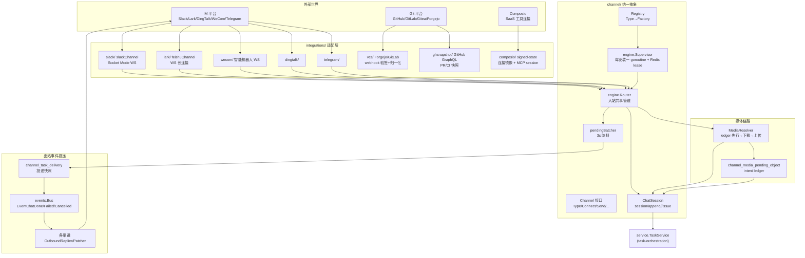
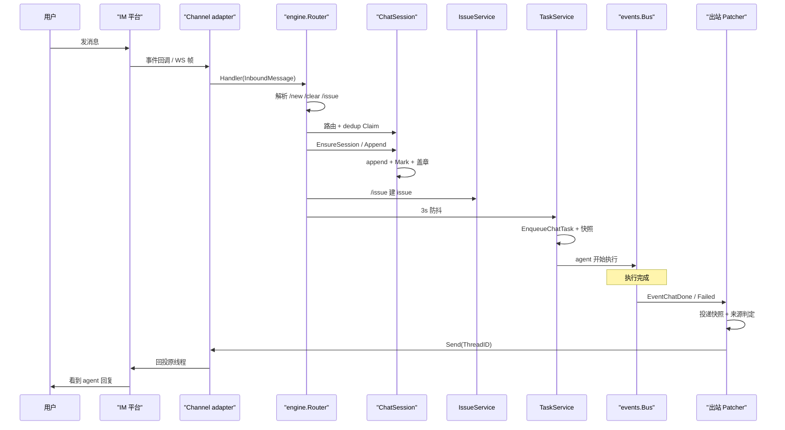
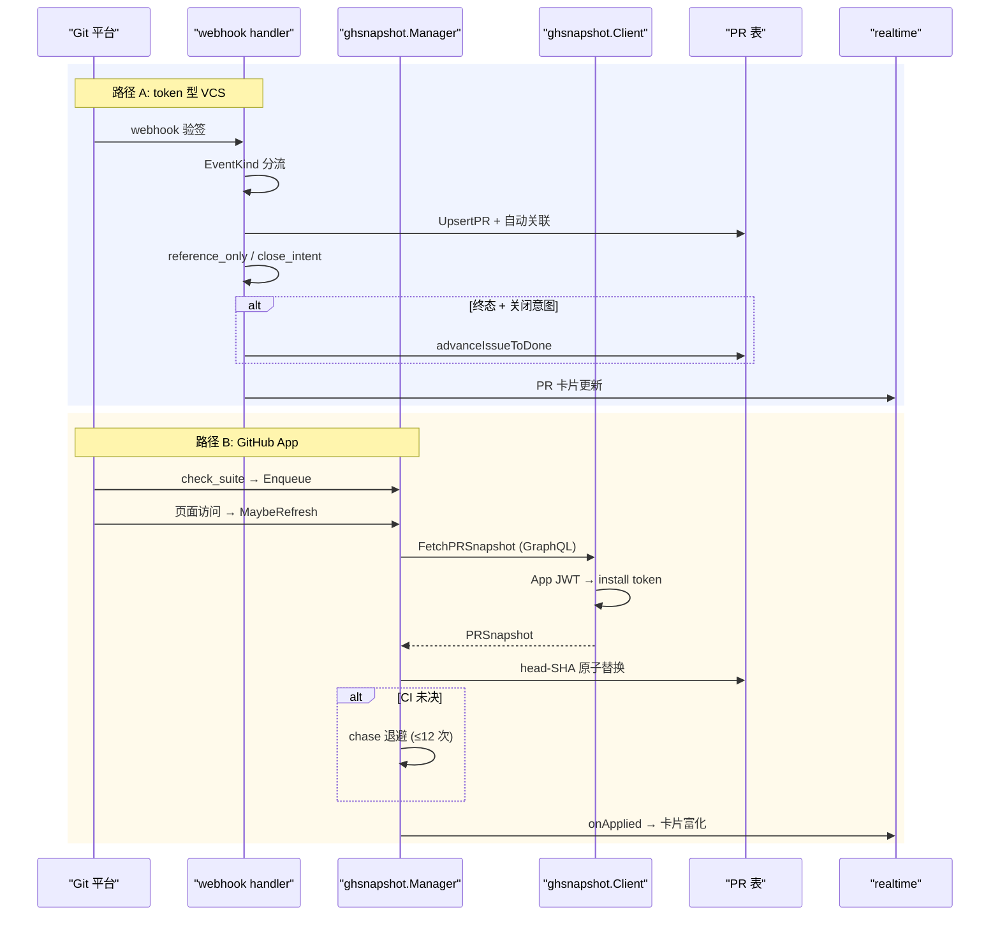

# Multica 渠道接入：外部世界与 Agent 工作区的双向对接

> 本解读覆盖 `server/internal/integrations/channel/`（统一渠道抽象）→ 各 IM adapter（slack/lark/dingtalk/wecom/telegram）→ `vcs/` + `ghsnapshot/`（Git 托管平台镜像）→ `composio/`（业务连接）→ `channelmedia/`（媒体渲染），以及它们背后的迁移与 handler。

## 模块一句话定位

渠道接入层是 Multica 的"对外双口"：**入站**把 IM / Git 平台的事件翻译成平台无关的内部指令（建 issue、进 session、触发 agent），**出站**把 agent 的进度与结果投递回用户所在的外部世界——而这一切收敛在 `channel.Channel` 这一个 5 方法接口与 `engine.Router` 的共享管道上。

## 在项目中的角色

去掉渠道系统，Multica 仍是一个完整的多 Agent 工作区：web/桌面端建 issue、派 task、agent 执行、realtime 推送。渠道层不是平台的内脏，而是**把平台的价值延伸到人们已存在的地方**。这个定位直接来自 VISION 的根因：*"Work can begin wherever people already are: a customer conversation, a Slack thread..."*。README 的三句宣传正好对应本模块的三块能力：

- *"Trigger and follow agent work where your team already talks"* —— IM 渠道（本模块主体）
- *"Any Git host → GitHub, GitLab, Gitea, or Forgejo"* —— VCS/ghsnapshot
- *"An agent turns that intent into visible, structured work"* —— 渠道建 issue → task 编排

因此渠道层承担了与其余模块截然不同的职责：**它是唯一同时面对"外部信任边界"和"内部一致性"的模块**。对外，它要校验 webhook 签名、防 SSRF、加密保管 secret；对内，它要在多副本环境下保证"每个安装至多一个活动连接、每条消息只处理一次、agent 的回复一定回投到正确线程"。这两组压力在本模块内互相交织，是理解其设计的主线。

渠道的边界划分是：`integrations/` 下的 adapter 各自封装平台 SDK 与协议细节；`channel/` 是平台无关的抽象与共享管道；`service/task.go` 负责把管道产物变成 task；`handler/` 提供安装/吊销/webhook 的 HTTP 入口。`composio` 是平行的一条线——不是消息渠道而是**工具级连接**（MCP overlay），其所有权语义独立。

## 根因：为什么非要做统一抽象

如果只支持飞书（历史事实：Lark 适配器是第一且最初的实现），整个管道可以写成飞书专用。但产品意图是 5 个 IM + 多 Git 平台，于是出现一个递归问题：**每加一个平台，是把平台的差异塞进核心，还是把核心的差异塞进平台？**

这个问题的答案体现在两处设计选择。其一，`channel.Channel` 接口刻意把**入站排除在接口之外**——Channel 只承诺 `Type/Connect/Disconnect/Send/Capabilities`，入站消息由 adapter 自己跑接收循环、调用注入的 `InboundHandler` 推给核心，核心从不轮询 Channel（[server/internal/integrations/channel/channel.go:34-75]()
<!-- anchor:  type Channel interface { … 	Capabilities() Capability -->）。

这避免了接口腐烂：若把入站建模成接口方法，平台差异（长连接 vs webhook、事件格式）就会以"回调参数膨胀"的形式污染核心。其二，核心唯一的平台感知是 `Type` 字符串 + `Registry` 的 `Factory` 映射——"加一个平台 = 注册一个 Factory"，而不是改核心（[server/internal/integrations/channel/registry.go:14-23]()
<!-- anchor:  // Registry maps a channel Type to the Factory that builds it. Adding a … type Registry struct { -->）。

但统一抽象真正的代价在**语义层**而非接口层：各平台对"会话""线程""@机器人""媒体"的建模完全不同（Slack 有 thread_ts、飞书有 open_id/union_id、企业微信的智能机器人是 WS 长连接）。泛化这些语义才是难点，接口设计只是表象。这解释了为什么 `InboundMessage` 里既有 `EventID` 又有 `MessageID`、既有 `SenderID` 又有 `SenderStableID`、既有 `AddressedToBot` 布尔又有 `Raw` 原始负载——**跨平台为真的字段留下，平台特有的全部塞进 `Raw` 由 adapter 独占**（[server/internal/integrations/channel/message.go:119-187]()
<!-- anchor:  // InboundMessage is the single normalized shape the core consumes. Every … 	Raw json.RawMessage -->）。这条边界（MUL-3515 §2）是"让程序验证，不让模型自证"在数据层上的对应物：核心只读它认识的字段，永远不碰 `Raw`。

## 双向链路的设计：入站与出站为什么不对称

渠道的入站和出站在架构上是**刻意不对称**的，这是本模块最值得展开的设计洞察：

- **入站走"推"**：adapter 的接收循环 → `Router.Handle` 同步跑完一个有序管道（路由→dedup→群过滤→身份→建 session→append→/issue→debounced run trigger）。连接生命周期由 `engine.Supervisor` 以"每安装一个 goroutine + Redis token-fenced lease"托管（[server/internal/integrations/channel/engine/supervisor.go:638-744]()
<!-- anchor:  // supervise owns one installation's connection lifecycle. It loops: … 		backoff = nextBackoff(backoff, s.cfg.MaxBackoff) -->）。消息只要被连接收到，就有确定的处理次序与幂等保证。

- **出站走"事件订阅"**：agent 的回复不是由入站同步返回，而是 task 生命周期事件（`EventChatDone` / `EventTaskFailed` / `EventTaskCancelled`）被各渠道的 patcher 订阅后投递（[server/internal/integrations/lark/outbound.go:285-288]()
<!-- anchor:  func (p *Patcher) Register(bus *events.Bus) { … 	bus.Subscribe(protocol.EventTaskCancelled, p.handleEvent) -->）。这是刻意的解耦：agent 执行可能持续很久，出站必须与入站的 ACK 关键路径无关。

这个不对称的关键产物是一个**投递快照表** `channel_task_delivery`：task 在 enqueue 时就快照了"这个 run 结束该回投到哪个渠道的哪个会话"（[server/internal/service/task.go:2034-2039]()
<!-- anchor:  		if _, err := qtx.CreateChannelTaskDeliveryFromSession( … 			return db.AgentTaskQueue{}, fmt.Errorf("snapshot channel task delivery: %w", err) -->），出站 patcher 以此为准而不是事后查当前 binding。为什么需要快照？因为会话路由是**代际化的**（/new 会轮转 route，见下）——run 开始时在 A 线程，结束时用户已切到 B 线程，回复必须回到发起 run 的那一代。这同时回答了 README 宣传的"结果回投到 IM"在实现上靠什么保证。

另一个决定"回复是否属于外部观众"的判别是 **provenance**：`engine.TaskInputIsChannelIngested` 检查 task 的输入批是否带不可变的 `channel_ingested` 印记（[server/internal/integrations/channel/engine/provenance.go:22-33]()
<!-- anchor:  // chat_input_task_id alone cannot discriminate: sealed channel tasks own an … 	return q.TaskHasChannelIngestedMessages(ctx, task.ChatInputTaskID) -->，[server/internal/integrations/channel/engine/session.go:694-704]()
<!-- anchor:  	// channel_ingested is the immutable provenance the cancel path gates on: … 		ChannelIngested:         pgtype.Bool{Bool: true, Valid: true}, --> 在同一事务内盖章）。web 端发的消息即便复用了渠道建过的 session，回复也只在 Multica 内部——这个判别必须基于不可变数据，因为 task 可能被 auto-retry 克隆，克隆体继承 `chat_input_task_id` 而消息仍标在父 task 下（provenance 注释说明用**批 owner id** 而非 task id 的原因）。

## 架构总览



## 关键数据结构（精简片段）

渠道层的语义核心不是接口而是这条**两端小、中间大**的消息契约：入站 `InboundMessage` 是"核心唯一消费的形状"，出站 `OutboundMessage` 是"核心唯一能要求的投递"。中间的平台差异全部藏在 `Raw` 与 adapter 内部（[server/internal/integrations/channel/message.go:119-187]()
<!-- anchor:  // InboundMessage is the single normalized shape the core consumes. Every … 	Raw json.RawMessage -->）。

```go
// channel/message.go —— 跨平台为真的最小公分母（精简）
type InboundMessage struct {
    EventID   string            // 平台事件标识 + MessageID 一起支撑幂等
    MessageID string
    Source    Source            // ChannelType/ChatID/SenderID/ThreadID…
    Type      MsgType           // text | image | file | audio | video
    Text      string            // adapter 摊平的 agent 可读正文
    MediaRefs []MediaRef        // 已落对象存储的引用，核心不碰原始字节
    Raw       json.RawMessage   // 平台特有负载，仅 adapter 可读（MUL-3515 §2）
}
```

与平台各自为政的方案比，这套契约的代价是**损失了富能力**（卡片、流式编辑、回复回调都不在跨平台信封上）；收益是核心管道可以写成"写一次、五个平台复用"。真正承载设计的是包在一头的三样东西：

- `MediaRef.InlinePlaceholder`——让异步媒体绑定能回填到正文的稳定位置（[server/internal/integrations/channel/message.go:100-106]()
<!-- anchor:  	// InlinePlaceholder is an optional exact marker in the durable message … 	InlineIndex       int -->）；

- `SkipAgentRun`——adapter 声明"这条纯控制消息别触发 agent"，企业微信用它处理独立 `/issue`（[server/internal/integrations/channel/message.go:172-181]()
<!-- anchor:  	// SkipAgentRun asks the core to persist this message + create any … 	SkipAgentRun bool -->）；

- `AddressedToBot`——群聊是否指向 bot 的归一化裁决（[server/internal/integrations/channel/message.go:159-165]()
<!-- anchor:  	// AddressedToBot is the adapter's normalized verdict on whether a … 	AddressedToBot bool -->）。

`engine.ResolverSet` 是第二个关键结构：每个平台注册一个**解析器束**，Router 的七步管道就是依次穿过这些可插拔缝（[server/internal/integrations/channel/engine/resolvers.go:393-406]()
<!-- anchor:  // ResolverSet is the per-platform bundle the Router runs the pipeline through. … 	OriginType   string -->）。平台新增 = 注册一个 ResolverSet，Router 自身保持平台无关。

## 入站管道：Router 的七步有序管线

`Router.Handle` 是每个渠道共享的唯一入站入口（[server/internal/integrations/channel/engine/router.go:189-268]()
<!-- anchor:  // Handle is the shared channel.InboundHandler. It runs the pipeline and then … 	return nil -->）。

在它之前，`Handle` 先做一件看似琐碎实则关键的事：**把 `/new`、`/clear`、`/issue` 的控制语义收敛到共享解析器**——`ParseControlCommand`（[server/internal/integrations/channel/engine/fresh_command.go:25-35]()
<!-- anchor:  // ParseControlCommand classifies /clear and /new through one parser. Their … 	return ControlCommand{}, false -->）与 `ParseIssueCommand`（[server/internal/integrations/channel/engine/issue_command.go:26-57]()
<!-- anchor:  func ParseIssueCommand(body string) (*IssueCommand, bool) { … 	return &IssueCommand{Title: title, Description: description}, true -->）。这样每条入站消息只有一个控制面含义，adapter 只归一化传输细节、不复制命令语义。

管线本身（[server/internal/integrations/channel/engine/router.go:332-669]()
<!-- anchor:  // processClaimed runs the post-dedup pipeline. Mirrors … 	return res, postAppendFinalize, nil --> 的 `processClaimed`）按序执行：

1. **路由到安装**（`InstallationResolver.ResolveInstallation`）：adapter 把平台路由键（Slack 的 team_id/api_app_id、飞书的 app_id）映射到 `channel_installation` 行。找不到 → `invalid_event` drop 审计。
2. **两阶段 dedup + owner fencing**（`Deduper.Claim`/`Mark`/`Release`，[server/internal/integrations/channel/engine/resolvers.go:271-277]()
<!-- anchor:  // Deduper is the two-phase idempotency seam. Claim mints an owner-fence token … 	Release(ctx context.Context, installationID pgtype.UUID, messageID string, claimToken pgtype.UUID) error -->）：以 `(installation_id, message_id)` 为键 Claim 一个随机 token，随后所有落库操作都被该 token 围栏（fence）；token 被并发抢走 → `ErrClaimLost` → 按重复 drop。这防的是平台在重连后**重投同一条事件**。dedup 的 Mark 发生在 **append 的同一事务内**，保证"消息落库 ⇔ dedup 标记"原子提交（[server/internal/integrations/channel/engine/session.go:730-749]()
<!-- anchor:  	markedInTx := false … 		markedInTx = true -->）。

3. **群消息 @机器人过滤**：p2p 全收，group 只收明确指向 bot 的（`AddressedToBot`），否则静默 drop——避免未绑定用户闲聊刷出绑定卡片（[server/internal/integrations/channel/engine/router.go:335-338]()
<!-- anchor:  	// 3. Group-mention filter (group chats only), before identity so an … 		return r.drop(ctx, set, msg, inst.ID, DropReasonNotAddressedInGroup), finalizeMark, nil -->）。

4. **身份解析**（`IdentityResolver.ResolveSender`）：把平台 sender 映射到 Multica 用户并**重新校验 workspace 成员资格**。这是无外键设计的补偿：`channel_*` 表刻意没有 FK，绑定行存在 ≠ 用户仍是成员（见 124 迁移）。

5-6. **session 路由与 append**：`EnsureSession`（普通消息，按 `(installation_id, channel_chat_id)` 找/建 session）或 `StartSession`（/new 轮转 route，见下）。append 时记录回复目标 `last_message_id`/`last_thread_id`（出站 thread 回投的依据）。

7. **/issue 命令**：`IssueService.Create` 以 `OriginType`（如 `lark_chat`）标注来源、`OriginID=chat_session_id` 保持渠道来源（[server/internal/integrations/channel/engine/router.go:1051-1085]()
<!-- anchor:  func (r *Router) createIssue(ctx context.Context, inst ResolvedInstallation, originType string, creatorUserID, sessionID pgtype.UUID, cmd IssueCommand, issuePrefix string, assignedRunFireAt time.Time) (service.IssueCreateResult, error) { … 	return r.issues.Create(ctx, params, opts) -->）。

最后触发 run：**防抖**——`pendingBatcher` 以 `(chat_session_id, context_revision)` 为键、(re)arm 3 秒静默窗（[server/internal/integrations/channel/engine/batcher.go:8-12]()
<!-- anchor:  // DefaultChatRunBatchWindow is the silence window the inbound debouncer waits … const DefaultChatRunBatchWindow = 3 * time.Second -->），窗内最新消息胜出，`flushChatRun` 重载 session、`EnqueueChannelChatTask` 恰入队一个 task（[server/internal/integrations/channel/engine/router.go:937-966]()
<!-- anchor:  // flushChatRun is the debounced run-trigger: reload session, enqueue exactly … 		r.clearTyping(ctx, set, sessionID) -->）。防抖解决的是"转发一串历史再补一句说明"这类突发被拆成多个 run 的问题；`/clear` 推进 context generation，成为硬批边界（batch key 含 revision，`/clear` 前的 pending flush 不会被后来的消息替换）。

`/new` 的 route 轮转是渠道特有的会话语义：`StartSession` 在一个事务里"退役当前 binding 代 + 建新 session + 装下一代 binding + 可选写入命令体作为首条消息"（[server/internal/integrations/channel/engine/session.go:411-562]()
<!-- anchor:  // StartSession atomically retires the current route generation, creates an … 		slog.Info("channel chat route started", -->），`RouteRevision` 单调递增。这就是 `channel_chat_session_binding.route_revision` + `channel_chat_route_history` 两张迁移表（420/422）的由来：路由是**历史化的**，出站投递快照正是靠它锁定发起 run 的那一代。

## 核心流程一：一条 IM 消息的完整双向链路

这是本模块的主链路，覆盖"入口也是出口"的根因：入站在 ACK 关键路径上只做"落库 + 排队"，出站完全交给事件订阅；两个异步扇出（防抖 run、媒体）都通过持久化状态而非内存回调保证不丢失。



这条链路里值得单独点出的两个异步细节（图中折叠）：

- **回复与输入都脱离 ACK 路径**：入站 `scheduleReply` 用 detached goroutine + `ReplyTimeout`（默认 2.5s，必须低于平台 ACK 时限如飞书 3s，[server/internal/integrations/channel/engine/router.go:63-77]()
<!-- anchor:  	// ReplyTimeout caps a single detached OutboundReplier.Reply / typing … 	MediaConcurrency int -->）；媒体用 `enqueueMedia` 的按 session 排队 + 全局信号量（[server/internal/integrations/channel/engine/router.go:689-774]()
<!-- anchor:  // enqueueMedia detaches remote media I/O from Handle while preserving message … 		r.resolveAndBindMedia(set, inst, identity, chatMessageID, msg, sessionID, issue, issueDescriptionBase, issueCommandText, issueTaskID, resolveRemote, deadline) -->）。

- **媒体延期与 run 触发解耦**：带媒体的消息持久化 `channel_media_pending` 期限，task 先被 `DeferChatTaskForSealedPendingMedia` 延后，媒体绑定完成后 `PromoteChannelChatTasksIfMediaReady` 提前 promote（[server/internal/integrations/channel/engine/router.go:840-850]()
<!-- anchor:  	if issueTaskID.Valid { … 	if err := r.tasks.PromoteChannelChatTasksIfMediaReady(finalizeCtx, sessionID); err != nil { -->）；期限到期兜底触发，避免媒体解析挂了卡死 run。

## 出站投递：事件订阅 + 投递快照

出站侧以 `lark/outbound.go` 为范本（Feishu 是第一个实现）：`Patcher.Register` 订阅 `EventTaskFailed` / `EventChatDone` / `EventTaskCancelled` 三个事件（[server/internal/integrations/lark/outbound.go:285-288]()
<!-- anchor:  func (p *Patcher) Register(bus *events.Bus) { … 	bus.Subscribe(protocol.EventTaskCancelled, p.handleEvent) -->）。

`processEvent` 依次做四件事：读 `channel_task_delivery` 投递快照过滤非本平台（[server/internal/integrations/lark/outbound.go:307-349]()
<!-- anchor:  func (p *Patcher) processEvent(ctx context.Context, e events.Event) error { … 		return fmt.Errorf("lookup lark task delivery: %w", err) -->）；

然后 `TaskInputIsChannelIngested` 判定输入确来自渠道（web 回复留在 Multica）；查安装、清 typing 徽标；按正文是否含 Markdown 选 **纯文本消息** 还是 **markdown 卡片** 并回投原线程（[server/internal/integrations/lark/outbound.go:435-449]()
<!-- anchor:  func (p *Patcher) sendChatReply(ctx context.Context, creds InstallationCredentials, binding ChatSessionBinding, payload any) error { … 			return err -->）。

值得一提的取舍：早期是"thinking → running → final"的卡片生命周期，后来因为卡片让回复像系统通知而**主动降级为纯文本**，只有失败路径保留错误卡片（[server/internal/integrations/lark/outbound.go:189-204]()
<!-- anchor:  // Patcher reacts to task-lifecycle events on the event bus and forwards … //   - Each EventChatDone yields one Lark text message; there is no --> 注释记录了这次产品回归）。这说明渠道出站的"富渲染"能力不是越多越好——capability 位掩码（[server/internal/integrations/channel/capability.go:16-32]()
<!-- anchor:  	CapText Capability = 1 << iota … 	CapMessageEdit -->）只声明能力、不做降级，把"降不降级"的决定留给调用方。

## 连接生命周期：Supervisor 与 token-fenced lease

多副本部署下"每个安装至多一个活动连接"是渠道正确性的基石：两个副本同时连同一个飞书 bot 会双处理事件。`engine.Supervisor` 用 **Redis token-fenced lease** 实现这个不变量（[server/internal/integrations/channel/engine/supervisor.go:271-321]()
<!-- anchor:  // Supervisor owns the per-installation supervisor goroutines that keep a … 	stopChan      chan struct{} -->、[server/internal/integrations/channel/engine/redis_lease_store.go:44-47]()
<!-- anchor:  // RedisLeaseStore implements token-fenced channel leases in a dedicated Redis … type RedisLeaseStore struct { -->）。

- 每轮 sweep 枚举所有活动安装，`TryAcquireWSLease` 用 **Lua 原子脚本**做 CAS（[server/internal/integrations/channel/engine/redis_lease_store.go:17-31]()
<!-- anchor:  const redisTryAcquireLeaseSource = ` …   return 0 -->），token = `nodeID + "-g" + gen`（[server/internal/integrations/channel/engine/supervisor.go:634-635]()
<!-- anchor:  func leaseToken(nodeID string, gen uint64) string { … 	return nodeID + "-g" + strconv.FormatUint(gen, 10) -->），同进程内连续两代 supervisor 的 token 不同，防止旧 supervisor 的延迟 release 误删继任者的租约；

- 持有期间 `renewLeaseUntil` 以紧密节奏续租，**租约丢失立即 cancel run context**——这是"两个副本同时消费同一安装"的最后一道闸：即使 socket 静默，`Connect` 也会在有界时间内退出（[server/internal/integrations/channel/engine/supervisor.go:770-826]()
<!-- anchor:  // renewLeaseUntil re-acquires the lease on a tight cadence so a single … 		nextDelay = renewalJitter(s.cfg.LeaseRenewInterval) -->）；

- lease 参数有严格时序约束 `poll <= renew < ttl` 与安全余量（[server/internal/integrations/channel/engine/supervisor.go:252-257]()
<!-- anchor:  func (c Config) Validate() error { … 		return fmt.Errorf("channel engine: require poll <= renew < ttl (poll=%s renew=%s ttl=%s)", c.PollInterval, c.LeaseRenewInterval, c.LeaseTTL) -->），用注释明确这是 fail-closed 的时序不变量。

sweep 还处理了**凭据轮转**：`Installation.Fingerprint` 是凭据的哈希，指纹漂移（重装 app）→ cancel 旧 supervisor → 同一轮 sweep 内等它释放租约 → 用新凭据重建（[server/internal/integrations/channel/engine/supervisor.go:534-554]()
<!-- anchor:  // cancelOnRotation cancels an existing supervisor when its fingerprint differs … 	return entry.done, true -->）。Slack 在这种模型下是特例：每个安装自带 app-level token（xapp-），所以每个安装也有自己的 Socket Mode 连接（[server/internal/integrations/slack/slack_channel.go:19-40]()
<!-- anchor:  // slackChannel is ONE installation's Socket Mode connection. Under the … 	logger    *slog.Logger -->），与飞书/企业微信一致；而 `wecom` 的智能机器人协议本身只允许每个 bot 一条活动连接，这个平台约束恰好与 supervisor 的 lease 模型重合（[server/internal/integrations/wecom/types.go:13-18]()
<!-- anchor:  // One installation = one bot = one WebSocket. WeCom allows only one active … // wecom-specific code. -->）。

## 媒体摄取：ledger 先行的两系统原子性

渠道媒体（图片/文件/语音）入站是"先下载再绑定"，而下载/上传必须避开连接 ACK 的 3 秒时限，所以 `Router` 把媒体处理**移出关键路径**：`HasMedia`（纯内存检查）在 ACK 路径上决定是否持久化一个媒体期限并排队，真正的下载/上传在 goroutine 里做（[server/internal/integrations/channel/engine/router.go:689-774]()
<!-- anchor:  // enqueueMedia detaches remote media I/O from Handle while preserving message … 		r.resolveAndBindMedia(set, inst, identity, chatMessageID, msg, sessionID, issue, issueDescriptionBase, issueCommandText, issueTaskID, resolveRemote, deadline) -->）。

其正确性核心是 **intent ledger 先行**（`channel_media_pending_object` 表，迁移 227）：

- 上传**之前**先写 `RecordPendingMediaObject` 意向行（[server/internal/integrations/channel/engine/resolvers.go:314-324]()
<!-- anchor:  // MediaIntentLedger persists upload intent BEFORE the object is written. The … 	RecordPendingMediaObject(ctx context.Context, p RecordPendingMediaObjectParams) (ok bool, err error) -->、[server/internal/integrations/lark/media_ingest.go:92-108]()
<!-- anchor:  		// Persist the upload intent BEFORE any write can happen. Every … 		if !ok { -->）；
- 任何失败路径（下载错、上传错、超时、崩溃）都不删除，只留下意向行给异步 reconciler；
- 绑定 attachment 的**同一事务内** claim 意向行（[server/internal/integrations/channel/engine/session.go:916-926]()
<!-- anchor:  	// Claim the intent-ledger rows inside this same transaction: commit … 		return fmt.Errorf("claim media intents: %w", err) -->），于是"提交落地 ⇔ 意向行消失"原子成立——**两系统（对象存储 + Postgres）的原子性不再需要分布式事务**，`COMMIT` 的二义性由"意向行状态"裁决。

对象键派生自 chat_message id（而非平台消息 id），因为同一平台消息可能被二次摄取（dedup 行 60 秒后可被重新 claim），共享键会撞上第一次的意向行（[server/internal/integrations/lark/media_ingest.go:148-164]()
<!-- anchor:  // mediaObjectKey derives the object key from the CHAT message the object will … 		hex.EncodeToString(sum[:]), -->）。reconciler 用 `tombstone` 状态处理 PUT/DELETE 竞态（迁移 227 注释详述），保证孤儿对象最终被回收而活对象绝不被误删。

## 媒体摄取的安全面：SSRF 防护的设计哲学

企业微信的媒体 URL 是**预签名 COS 地址**，由回调里的字符串给出、我们主动去 GET——这是典型的 SSRF 注入点。`wecom/media_guard.go` 的设计是整个模块安全意识的代表，其核心主张是：**守卫要放在连接上，而不是 URL 上**（[server/internal/integrations/wecom/media_guard.go:3-28]()
<!-- anchor:  // media_guard.go — the media fetcher is pointed at an address by somebody else. … // argued about. -->）。理由：检查 hostname 在重定向面前毫无意义（一个 302 到 169.254.169.254 只需一行攻击者可控的响应），且 hostname 解析结果随时可变。因此实现了一个自定义 `DialContext`，在**每一次跳转的每一跳**都自行解析目标并对**实际将要连接的地址**逐个校验（[server/internal/integrations/wecom/media_guard.go:235-272]()
<!-- anchor:  // dial resolves the destination itself and connects to a checked address — … 	return nil, lastErr -->），DNS rebinding 窗口被"解析一次、连解析出的字面量"封死。

地址策略是三层：标准库谓词（loopback/private/link-local）→ `reservedMediaPrefixes`（IANA 特殊用途注册表减去 netip 已覆盖项，最关键是 **100.64.0.0/10 CGNAT**——Tailscale 尾网就住在这里，任何标准谓词都不认为它是私有的，[server/internal/integrations/wecom/media_guard.go:74-104]()
<!-- anchor:  var reservedMediaPrefixes = []netip.Prefix{ … 	netip.MustParsePrefix("fec0::/10"), -->）→ `translationMediaPrefixes`（NAT64/6to4 这类"穿 IPv6 外衣的 IPv4 目的地"，**任何配置都不可重开**，[server/internal/integrations/wecom/media_guard.go:107-129]()
<!-- anchor:  // translationMediaPrefixes is TRANSLATION space, and no configuration reopens … 	netip.MustParsePrefix("2002::/16"),      // 6to4 — the last 112 bits open with an IPv4 address -->）。operator 可用 `MULTICA_WECOM_MEDIA_ALLOW_CIDRS` 放开保留区（唯一真实用例是 fake-IP 代理的 198.18.0.0/15），但翻译空间是硬封锁——这是"operator 永远不可能用 CIDR 拼法打穿到 metadata endpoint"的兜底。`CheckRedirect` 另拒非 http(s) scheme（[server/internal/integrations/wecom/media_guard.go:282-301]()
<!-- anchor:  // newMediaHTTPClient builds the client every media download goes through. … 			return fmt.Errorf("wecom: media redirect to scheme %q refused", req.URL.Scheme) -->），因为 `file://`/`gopher://` 根本不会走到 dialer。

配套的还有两层防护：100 MiB 上限（[server/internal/integrations/wecom/media_download.go:35-35]()
<!-- anchor:  const maxMediaBytes = 100 << 20 -->，与流式路径共用，防磁盘/内存跑飞）；**错误信息里剥掉 URL**（`stripURL`，[server/internal/integrations/wecom/media_download.go:131-167]()
<!-- anchor:  // stripURL removes the request URL from a transport error before it can be … 	return err -->）——预签名链接是 5 分钟有效的承载凭据，一个 DNS 报错把 URL 写进日志等于把同事的私有附件泄给日志链路上的所有人。这类"日志泄密钥"的敏感度贯穿全模块（ghsnapshot 的 lease token 命名、composio 的 header redact）。

## VCS：token 型 Git 平台与 PR 镜像

`vcs/` 是 **token 型** Git 提供商（Forgejo/Gitea/GitLab）的抽象，与 GitHub 刻意分家：GitHub 的 App/installation 模型和 check_suite CI 差异太大，走独立 handler（[server/internal/integrations/vcs/vcs.go:1-10]()
<!-- anchor:  // Package vcs is the provider abstraction for token-based Git providers that … // storage, issue auto-link / auto-close, and broadcast logic live once in the -->）。每个 provider 只贡献真正有差异的三件事：webhook 验签、事件/payload 归一化、token 校验（[server/internal/integrations/vcs/vcs.go:115-131]()
<!-- anchor:  // Provider is the per-provider adapter. Implementations are stateless and cheap … 	ValidateToken(ctx context.Context, instanceURL, token string) (Account, error) -->）；共享的存储、issue 自动关联/自动关闭、广播逻辑全在 handler 层消费归一化类型。

webhook 流程（[server/internal/handler/vcs_webhook.go:86-155]()
<!-- anchor:  // HandleVCSWebhook (POST /api/webhooks/vcs/{connectionId}) authenticates and … 	w.WriteHeader(http.StatusAccepted) -->）：路径 `connectionId` 选出 workspace/provider/解密 secret → `VerifySignature`（Forgejo/Gitea 是 HMAC-SHA256 的 `X-Gitea-Signature`，GitLab 是明文 token 比较）→ 按 `EventKind` 分流。`mirrorVCSPullRequest`（[server/internal/handler/vcs_webhook.go:158-281]()
<!-- anchor:  func (h *Handler) mirrorVCSPullRequest(ctx context.Context, conn db.VcsConnection, ev vcs.PullRequestEvent) { … 		"linked_issue_ids": linkedIssueIDs, -->）的精华在于 **issue 自动关联的判定细节**：

- 从 title/body/branch 提取 issue 标识符（`MUL-42` 形式），标题前缀/branch 引用/关闭关键词是"合格关联"；**仅正文裸提及是 `reference_only`**——链接（出现在历史里）但不进 PR 列表、不计入关闭聚合，一句顺带"Related MUL-1"既不冒充工作 PR 也不阻塞真正的 Closes 兄弟（[server/internal/handler/vcs_webhook.go:218-230]()
<!-- anchor:  	// qualifyingIdents genuinely tie this PR to an issue: a title prefix, a … 	for c := range closingIdents { -->，MUL-3739）；
- **`close_intent` 在终态事件后冻结**：merge/close 事件到达后，后续乱序的重投递不得改写已冻结的关闭意图（[server/internal/handler/vcs_webhook.go:233-234]()
<!-- anchor:  	// Freeze close_intent once the terminal merge/close event has arrived. … 	preserveCloseIntent := !ev.Terminal() && (ev.State == "merged" || ev.State == "closed") --> + out-of-order guard [server/internal/handler/vcs_webhook.go:201-202]()
<!-- anchor:  	evUpdatedAt := parseGHTimeRequired(ev.UpdatedAt) … 	if pr.PrUpdatedAt.Valid && evUpdatedAt.Valid && pr.PrUpdatedAt.Time.After(evUpdatedAt.Time) { -->）；
- 关闭判定：所有关联 PR 无 open、且有 merged+close_intent → `advanceIssueToDone`（[server/internal/handler/vcs_webhook.go:262-274]()
<!-- anchor:  	if ev.State == "merged" || ev.State == "closed" { … 				h.advanceIssueToDone(ctx, issue, workspaceID) -->）。CI 状态走 `mirrorVCSCIStatus`，用 provider 自身时间戳喂**单调守卫**，防乱序重投递把状态倒退回旧值（[server/internal/handler/vcs_webhook.go:285-300]()
<!-- anchor:  func (h *Handler) mirrorVCSCIStatus(ctx context.Context, conn db.VcsConnection, ev vcs.CIStatusEvent) { … 		UpdatedAt:    parseGHTimeRequired(ev.UpdatedAt), -->）。

连接与 secret 模型：`vcs_connection` 存 `access_token_encrypted`/`webhook_secret_encrypted`（secretbox 密文，`MULTICA_VCS_SECRET_KEY` 加密，迁移 216），webhook secret 在创建时**一次性明文返回**后不可再取（[server/internal/handler/vcs.go:37-42]()
<!-- anchor:  // VCSConnectResponse embeds the stored connection plus the one-time plaintext … 	WebhookSecret string `json:"webhook_secret"` -->）；集成是 **self-host 专属产品边界**（`isVCSAvailable`，[server/internal/handler/vcs.go:47-54]()
<!-- anchor:  // isVCSAvailable reports whether this deployment offers the self-hosted Git … func (h *Handler) isVCSConfigured() bool { return h.VCSSecretBox != nil } -->），托管云直接 404。

Forgejo 与 Gitea 是 wire-identical（同一套 REST + HMAC 验签），一个 struct 注册两个 Kind（[server/internal/integrations/vcs/forgejo.go:18-30]()
<!-- anchor:  // forgejoProvider implements Provider for Forgejo and its upstream Gitea, which … func (p forgejoProvider) Kind() Kind { return p.kind } -->）；验签拒绝空 secret——空 HMAC key 可被伪造（[server/internal/integrations/vcs/forgejo.go:49-64]()
<!-- anchor:  func (p forgejoProvider) VerifySignature(secret string, h http.Header, body []byte) bool { … 	return hmac.Equal(mac.Sum(nil), want) -->）。

## ghsnapshot：GitHub 的 API 快照（Plan C）

对 GitHub 而言 webhook 是**触发器而非真源**：`ghsnapshot` 把"一次 GraphQL 查询返回的 PR 快照"当作 PR 卡片的唯一事实（[server/internal/integrations/ghsnapshot/client.go:1-15]()
<!-- anchor:  // Package ghsnapshot fetches a GitHub pull request's CI + mergeability state … // Credential hygiene (acceptance criterion 6): the App private key and every -->，MUL-5265 Plan C）。理由很实际——webhook 事件流推断状态是增量式、易漏；API 快照是整体式、天然自洽。代价是需要 App 鉴权（[server/internal/integrations/ghsnapshot/client.go:111-125]()
<!-- anchor:  // signAppJWT mints the short-lived RS256 JWT GitHub requires for … 	return signed, nil --> 的 App JWT + [server/internal/integrations/ghsnapshot/client.go:160-209]()
<!-- anchor:  // mintInstallationToken exchanges the App JWT for a fresh installation token and … 	return parsed.Token, nil --> 的安装 token，token 缓存 + singleflight + 提前 5 分钟续期），以及对付 rate limit（[server/internal/integrations/ghsnapshot/refresh.go:281-301]()
<!-- anchor:  func (m *Manager) rateLimitPause(installationID int64) time.Duration { … 		m.rateUntil[installationID] = until --> 的按安装隔离限速，一个租户不能拖垮所有安装）。

单条 GraphQL 查询一次拿回 headRefOid + mergeable + mergeStateStatus + statusCheckRollup（查询入口 [server/internal/integrations/ghsnapshot/snapshot.go:21-23]()
<!-- anchor:  const prSnapshotQuery = `query($owner:String!,$repo:String!,$number:Int!,$cursor:String){ …   pullRequest(number:$number){ -->，分页到 10k 上下文上限 [server/internal/integrations/ghsnapshot/snapshot.go:136-203]()
<!-- anchor:  // FetchPRSnapshot runs prSnapshotQuery, paginating statusCheckRollup.contexts … 	return nil, errors.New("ghsnapshot: check-context pagination exceeds page limit") -->），分页期间若 head 变化则整体作废（[server/internal/integrations/ghsnapshot/snapshot.go:170-174]()
<!-- anchor:  	} else if pr.HeadRefOid != snap.HeadSHA { … 		return nil, errors.New("ghsnapshot: pull request head changed during pagination") -->）。写入是 **head-SHA 守护的原子批量替换**：`UPDATE` 快照列带 head 条件，被新 head 抢占则整批丢弃（[server/internal/integrations/ghsnapshot/refresh.go:360-413]()
<!-- anchor:  // applySnapshot performs the head-SHA-guarded atomic batch replace for one PR … 	return true, nil -->）；check 行 delete-all + insert，无增量推断。`Decided()` 判定"已结算"（CI 完成 + mergeability 已知，[server/internal/integrations/ghsnapshot/snapshot.go:76-94]()
<!-- anchor:  // Decided reports whether the snapshot has settled: no check is still running … 	return true -->），未决 PR 走 **chase-window**（30s→5m 阶梯退避，最多 12 次，[server/internal/integrations/ghsnapshot/refresh.go:416-434]()
<!-- anchor:  // scheduleChase re-enqueues the address after the current backoff step. Bounded … 	m.scheduleRetry(addr, delay) -->）+ TTL sweep（10 分钟，游标防饿死，[server/internal/integrations/ghsnapshot/refresh.go:449-495]()
<!-- anchor:  func (m *Manager) sweepLoop(ctx context.Context) { … 		m.Enqueue(r.InstallationID, r.RepoOwner, r.RepoName, r.PrNumber) -->）兜底——chase 有界退出、由 sweep 接力，webhook 丢失也不至于永久陈旧。

## 核心流程二：VCS PR 事件 → 卡片镜像 → CI 快照富化

GitHub 与 token 型 VCS 走两条路径但最终汇入同一张 PR 卡片：webhook 只负责把"有新事件"这个提示送进来，状态本体由 ghsnapshot 的 API 快照决定。下面把两条路径画在一起，标注它们的触发边界。



这条"双轨汇入一张卡片"的结构回答了模块宣传口径（"PR/CI 状态镜像成卡片"）在实现上的分裂：**token 型 VCS 的状态来自 webhook 镜像**（简单、无需出网回调），**GitHub 的状态来自 API 快照**（贵、需 App 凭据，但整体自洽）。两种机制的触发语义不同——前者是"事件即状态"，后者是"事件只是刷新信号"——因此 GitHub 专门在响应体上做 `SnapshotAvailable` 判别（快照存在且 head 一致才显示 CI/冲突区域，[server/internal/handler/github.go:188-210]()
<!-- anchor:  func githubPullRequestToResponse(p db.GithubPullRequest, snapshotEnabled bool) GitHubPullRequestResponse { … 		SnapshotAvailable: &snapshotAvailable, -->），避免把"还没抓"渲染成"没有检查"。

## Composio：工具级连接，与渠道平行

Composio 不是消息渠道而是**用户业务工具连接**（OAuth 第三方账号）：MVP 目标是让 toolkit 在 Composio dashboard 启用 auth config 后**无需发版即可被连接**（[server/internal/integrations/composio/service.go:9-12]()
<!-- anchor:  // MVP scope (MUL-3720): toolkits are discovered dynamically. The … // moment an auth config is enabled for it in the Composio dashboard — no env -->）。连接握手用**签名 state**（HMAC-SHA256 的 `<payload>.<sig>`，[server/internal/integrations/composio/state.go:27-43]()
<!-- anchor:  // stateClaims is the payload embedded in the signed connect-state. It carries … 	Exp          int64  `json:"e"` -->），回调处做三重校验：签名、过期、以及 **verifyAccountOwnership**——向 Composio 反查 connected_account_id 确属签名 state 里的用户与 auth config，否则 fail closed（[server/internal/integrations/composio/service.go:661-701]()
<!-- anchor:  // verifyAccountOwnership confirms with Composio that connectedAccountID really … 	return nil -->）。这里防的是"用有效 state 配别人的 account id"的跨账户走私。

它的产出是**每用户的 MCP session**（`CreateMCPSession`，[server/internal/integrations/composio/service.go:400-450]()
<!-- anchor:  // CreateMCPSession opens a Composio tool-router (MCP) session scoped to the … 	}, nil -->），在 task 入队时以 `runtime_mcp_overlay` 形式按 agent 调用权限注入 daemon（[server/internal/integrations/composio/dispatch.go:53-59]()
<!-- anchor:  // BuildTaskOverlay returns the overlay payload to write for a task dispatching … // canInvokeAgent decides who may enqueue a run for this agent at all — so any -->，MUL-3963 让 overlay 跟随 canInvokeAgent 权限而不是强制 originator==owner）。注意注释明确标注 **Stage 3 尚未把 MCP session 接入 task dispatch**——这是本模块少数"基础设施已备、接线未完成"的点，值得确认。

## 关键设计决策

### 决策一：多渠道收敛到一个 5 方法接口 + 共享管道，而不是各自为政

- **选择**：`channel.Channel`（5 方法）+ `Registry`（Type→Factory）+ `engine.Router` 共享入站管道 + `engine.ChatSession` 共享会话服务（[server/internal/integrations/channel/engine/session.go:22-30]()
<!-- anchor:  // This file is the SHARED, channel-agnostic chat-session service every IM … // discriminator through the generalized channel_* tables. --> 明确说明它从 lark 专用服务抽取，就是为了"加 IM 不再重实现 session/append//issue"）。

- **没选什么**：让每个渠道维护自己的调度器、会话表、命令解析。
- **代价**：平台语义必须被强制压扁成跨平台为真的子集。最尖锐的案例是 **Slack 的会话隔离**——同一个 Slack 频道里的两个 @bot 线程不能共享一份 transcript，所以 adapter 把 session 隔离键构造成 `channel_id + thread_root` 的复合（[server/internal/integrations/channel/engine/session.go:257-282]()
<!-- anchor:  // EnsureSessionInput is the channel-agnostic input for EnsureSession. … 	ChatType       channel.ChatType --> 的 EnsureSessionInput 注释），`channel_chat_id` 是**构造键**而非原始平台 chat id。

这是"统一抽象"里最容易被新平台踩爆的暗角：抽象吃掉了平台特异性，代价是把特异性转移到 adapter 的"键构造"职责上。若不统一，5 个渠道各写一套 pipeline 的维护成本会随平台数量线性膨胀，且 `/issue`、`/clear` 等跨平台语义会在各实现里漂移（这正是 `fresh_command.go`/`issue_command.go` 把命令解析收进共享引擎的原因）。

### 决策二：媒体摄取的正确性建立在"意向 ledger + 异步 reconciler"而非分布式事务上

- **选择**：上传前写 `channel_media_pending_object`，绑定在**同一 DB 事务**内 claim 意向行；一切失败只留意向行，reconciler 异步结算（迁移 227、[server/internal/integrations/channel/engine/session.go:916-926]()
<!-- anchor:  	// Claim the intent-ledger rows inside this same transaction: commit … 		return fmt.Errorf("claim media intents: %w", err) -->）。

- **没选什么**：对象存储 + Postgres 的分布式事务 / outbox 消息 / 立即删除回滚。
- **代价与收益**：收益是"我的副作用发生了吗"永远无需在线裁决——无论上传中途崩溃、`COMMIT` 二义、还是 reconciler 与绑定竞态，都有确定语义。代价是对象存储里可能有短暂孤儿对象 + reconciler 的沉降延迟（`DefaultMediaTimeout=45s` 的设定就是让 reconciler 的 settle delay 远超所有管道预算，[server/internal/integrations/channel/engine/router.go:116-119]()
<!-- anchor:  // DefaultMediaTimeout is the default RouterConfig.MediaTimeout. Exported so … const DefaultMediaTimeout = 45 * time.Second -->）。与"绑定失败即删"的方案比，后者在 PUT/DELETE 与 COMMIT 交错的竞态下会**误删已落库附件的对象**（这正是 tombstone 机制要解决的）。

### 决策三：入站/出站刻意不对称——出站不依赖入站的 ACK 路径

- **选择**：入站同步跑管道但**每个可能阻塞的步骤都被移出关键路径**：reply 用 detached goroutine + 2.5s 超时（必须低于平台 ACK 时限，如飞书 3s，[server/internal/integrations/channel/engine/router.go:63-77]()
<!-- anchor:  	// ReplyTimeout caps a single detached OutboundReplier.Reply / typing … 	MediaConcurrency int -->）、媒体用排队 + 45s 预算、run 触发用防抖窗。出站完全走事件总线。

- **没选什么**：让 webhook/WS 处理器同步等待 agent 完成并当场回复。
- **代价**：出站无法拿到 agent 的"即时"结果，必须依赖投递快照（`channel_task_delivery`）在 run 期间锁定目标；引入了防抖窗（3s）这类用户可感知的延迟。但换来的是**ACK 路径永不背时**：平台重试机制会重放慢处理的事件，任何在 ACK 路径上的阻塞都会转化为重复事件风暴。这也是"渠道正确性优先于即时反馈"的整体倾向——连接 lease 不变量、dedup owner fencing、投递快照三者共同保证"at most once"语义在多副本 + 平台重投下成立。

## 与其他模块的协同

- **task-orchestration（issue→task）**：渠道是 task 的另一个来源。`/issue` 走 `IssueService.Create`（[server/internal/integrations/channel/engine/router.go:1051-1085]()
<!-- anchor:  func (r *Router) createIssue(ctx context.Context, inst ResolvedInstallation, originType string, creatorUserID, sessionID pgtype.UUID, cmd IssueCommand, issuePrefix string, assignedRunFireAt time.Time) (service.IssueCreateResult, error) { … 	return r.issues.Create(ctx, params, opts) -->，`OriginType`/`OriginID` 保留渠道来源），普通 chat turn 走 `EnqueueChannelChatTask`（task 入队时快照 `channel_task_delivery`，[server/internal/service/task.go:2034-2039]()
<!-- anchor:  		if _, err := qtx.CreateChannelTaskDeliveryFromSession( … 			return db.AgentTaskQueue{}, fmt.Errorf("snapshot channel task delivery: %w", err) -->）。反向地，`task.go` 的 seal/媒体延期逻辑是渠道入站管道的下游（`PromoteDeferredChannelIssueTask`/`PromoteChannelChatTasksIfMediaReady`，[server/internal/integrations/channel/engine/router.go:840-850]()
<!-- anchor:  	if issueTaskID.Valid { … 	if err := r.tasks.PromoteChannelChatTasksIfMediaReady(finalizeCtx, sessionID); err != nil { -->）。

- **realtime（事件投递）**：渠道是 realtime 的另一类 producer/consumer。入站侧 `Router` 通过 `ChannelChatLifecycle` 桥接 realtime 的 Chat 创建/标题事件（[server/internal/integrations/channel/engine/resolvers.go:179-198]()
<!-- anchor:  // ChannelChatLifecycle bridges committed channel Chat changes to the server's … 	Title          string -->）；出站侧 task 生命周期事件（`EventChatDone` 等）由 `events.Bus` 广播、渠道 patcher 订阅——**渠道是 bus 的消费者**，这与 realtime 把事件推给 web 客户端是同一条总线上的不同听众。daemon 侧 claim 阶段读投递快照决定"这个 run 是否为外部观众服务"（[server/internal/handler/daemon.go:2638-2644]()
<!-- anchor:  		delivery, deliveryErr := h.Queries.GetChannelTaskDelivery(r.Context(), task.ID) … 				resp.ChatInThread = delivery.ChannelThreadID.Valid && -->），是渠道状态进入任务执行上下文的入口。

- **deployment（配置与安全上下文）**：渠道为 deployment 提供了一整类部署决策输入：
  - **secret key 体系**：`MULTICA_LARK_SECRET_KEY`、`MULTICA_SLACK_SECRET_KEY`、`MULTICA_WECOM_SECRET_KEY`、`MULTICA_VCS_SECRET_KEY`（docker-compose.selfhost.yml 各配注释说明）分别驱动渠道安装的 secret 加密；`GITHUB_APP_ID`/`GITHUB_APP_PRIVATE_KEY` 驱动 ghsnapshot；
  - **SSRF 与代理**：`MULTICA_WECOM_MEDIA_ALLOW_CIDRS` 是媒体守卫的唯一 operator 可开孔（[server/internal/integrations/wecom/media_guard.go:158-179]()
<!-- anchor:  // SetMediaAllowedPrefixes declares ranges the media guard may dial. Called at … 	return errs -->），`MULTICA_TRUSTED_PROXIES` 影响渠道 webhook 的原始 IP 还原；
  - **区域自动探测**：飞书/国际版 Lark 的 region 是**每安装配置**而非独立 Type（[server/internal/integrations/channel/channel.go:17-21]()
<!-- anchor:  	// TypeFeishu is the Feishu / Lark adapter — the only implementation … 	TypeFeishu Type = "feishu" -->），`BackfillRegionFromLegacyOverride`（[server/internal/integrations/lark/region_backfill.go:31-52]()
<!-- anchor:  // Callers should fire this from a goroutine at boot, like … 		"rows", n -->）在自托管升级时把 legacy 部署-wide override 的安装重新标记为 `lark` 区域，只有 override 指向 `open.larksuite.com` 才触发（安全门控）。

渠道模块对 deployment 的提示是：**这些 key 是"门"而非"开关"**——例如 `MULTICA_SLACK_SECRET_KEY` unset 时 Slack 集成整体不可用（docker-compose 注释：unset = 集成关闭），而 `GITHUB_APP_*` unset 时 ghsnapshot 优雅降级为关闭（[server/internal/integrations/ghsnapshot/client.go:82-105]()
<!-- anchor:  // NewClientFromEnv builds a Client from GITHUB_APP_ID and GITHUB_APP_PRIVATE_KEY. … 	}, nil -->）。两类失效模式不同：前者是硬门，后者是软降级。

## 亮点与问题

### 亮点

- **"守卫连接而非守卫 URL"的 SSRF 方案**（[server/internal/integrations/wecom/media_guard.go:235-272]()
<!-- anchor:  // dial resolves the destination itself and connects to a checked address — … 	return nil, lastErr -->）：在每一跳用自解析 + 逐地址校验 + 翻译空间硬封锁，是少见的把 DNS rebinding 与重定向两个经典绕过都封死的实现；三层地址策略（标准谓词/保留区/翻译区）的划分本身就是在叙述安全推理。

- **意图 ledger 把分布式副作用问题变成本地可裁决问题**：媒体上传/绑定/回收的三态机 + tombstone 处理 PUT/DELETE 竞态，是可迁移到任何"外部存储 + 关系库"场景的模式（迁移 227、[server/internal/integrations/channel/engine/session.go:916-926]()
<!-- anchor:  	// Claim the intent-ledger rows inside this same transaction: commit … 		return fmt.Errorf("claim media intents: %w", err) -->）。

- **lease 时序不变量作为显式代码契约**（[server/internal/integrations/channel/engine/supervisor.go:252-257]()
<!-- anchor:  func (c Config) Validate() error { … 		return fmt.Errorf("channel engine: require poll <= renew < ttl (poll=%s renew=%s ttl=%s)", c.PollInterval, c.LeaseRenewInterval, c.LeaseTTL) --> 的 `Validate`）：poll <= renew < ttl + 安全余量被写进启动校验，跨副本正确性不是"配置时小心"，而是"配置错了启动失败"。

- **出站投递快照 + provenance 判别**：`channel_task_delivery` 与 `channel_ingested` 把"这个回复该不该回外部、回哪个线程"从运行态猜测变成事务内快照的事实，是跨模块可复用的"路由冻结"手法。
- **文档即设计**：这些文件的注释密度极高且多数在记录"为什么不这么设计"（如 `media_download.go` 对 form-encoded filename 的整页论证、`outbound.go` 对卡片生命周期回归的记录），对理解项目历史取舍极有价值。

### 问题

- **统一抽象的语义漂移风险集中在 adapter 的"键构造"上**：`channel_chat_id` 的复合构造（Slack 的 channel+thread，[server/internal/integrations/channel/engine/session.go:257-282]()
<!-- anchor:  // EnsureSessionInput is the channel-agnostic input for EnsureSession. … 	ChatType       channel.ChatType -->）是平台特有知识，误用会静默把两个线程合并成一个会话。该知识目前只在注释里，没有编译期或测试期强制——这是抽象泄漏给未来 adapter 作者的最大陷阱。

- **防抖与 dedup 的崩溃语义有断层**：`pendingBatcher` 是进程内状态，窗口内硬崩溃会丢 pending run（消息已落库、只是不触发 run，[server/internal/integrations/channel/engine/batcher.go:27-34]()
<!-- anchor:  // State is in-process, keyed by chat_session_id plus context revision. The … // restart. Goroutine-safe; one instance is shared across supervisors. --> 注释承认这一点）。`PendingContexts` 的 crash 恢复机制（[server/internal/integrations/channel/engine/session.go:710-712]()
<!-- anchor:  	pendingContexts, err := qtx.ListUnownedChannelChatContextRevisions(ctx, in.SessionID) … 		return AppendResult{}, fmt.Errorf("list pending channel contexts: %w", err) --> 的 `ListUnownedChannelChatContextRevisions` + `ScheduleIfAbsent`）试图补上，但"重启后恢复窗口内消息"依赖持久状态，属于"尽力而为"而非强保证。

- **ghsnapshot 的 chase 有界退出依赖 sweep 接力**：`maxChaseAttempts=12` + 5m 封顶（[server/internal/integrations/ghsnapshot/refresh.go:416-434]()
<!-- anchor:  // scheduleChase re-enqueues the address after the current backoff step. Bounded … 	m.scheduleRetry(addr, delay) -->）意味着持续 pending 的 CI 最多追 12 次就停，此后只有 TTL sweep（10 分钟粒度）与页面访问兜底。对"CI 卡在 pending 数小时"的长尾场景，卡片会停在陈旧状态直到 sweep——这是"有界退避"与"状态新鲜度"之间的明确取舍。

- **Composio 的 Stage 3 接线未完成**：`CreateMCPSession` 注释明确"未接入 task dispatch"，overlay 注入已按权限接线（[server/internal/integrations/composio/dispatch.go:53-59]()
<!-- anchor:  // BuildTaskOverlay returns the overlay payload to write for a task dispatching … // canInvokeAgent decides who may enqueue a run for this agent at all — so any -->），但 MCP session 的创建时机与失败语义需要确认现状。

## 迁移侧影：数据模型如何支撑"通用渠道"

渠道抽象不是只活在 Go 接口里，`channel_*` 表的迁移史记录了两次泛化。`124_channel_generalization` 把 lark 专用表改造成带 `channel_type` 判别列的通用表，并把平台配置收进 JSONB `config`（如飞书的 `app_id`/`app_secret_encrypted`/`region`），同时**明确移除所有外键与级联**（[server/migrations/124_channel_generalization.up.sql:62-87]()
<!-- anchor:  CREATE TABLE channel_installation ( …     UNIQUE (workspace_id, agent_id, channel_type) -->）——完整性改由应用层校验（这就是 Router 身份步骤里"重新校验成员资格"的根源）。安装表的唯一键是 `(workspace_id, agent_id, channel_type)`（一个 agent 可以同时接飞书 + Slack，但每种只能一个）。

后续迁移继续分层演化：`channel_chat_context_generation`（377，`context_revision` 代际化）、`channel_media_pending_object`（227，intent ledger）、`channel_task_delivery`/`channel_outbound_message`（423-430，投递快照与出站记录）、`github_pr_api_snapshot`（222，快照列与 per-check 表）、`vcs_*`（216-221，token 型连接）。这批迁移的共性：**新表几乎都用"追加列 + 可空默认值"演进**，让"快照未到/功能未开"与"真实失败"在数据层可区分（[server/migrations/222_github_pr_api_snapshot.up.sql:14-17]()
<!-- anchor:  ALTER TABLE github_pull_request …     ADD COLUMN api_mergeable TEXT, --> 的可空 `api_mergeable` 就是代表）。

