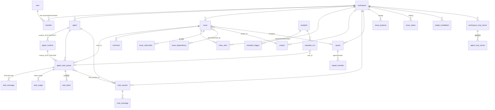
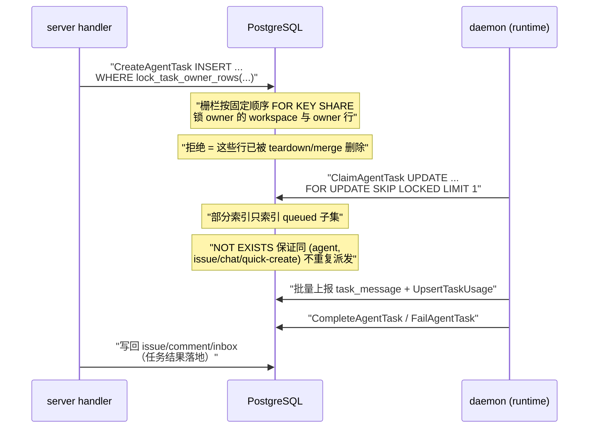

# Multica 数据模型模块解读

## 模块一句话定位

Multica 的数据模型是整套系统的唯一事实底座：445+ 个编号的迁移把「workspace 里谁是谁、哪个 agent 认领了哪个 issue、跑到什么状态、花了多少 token、留了什么审计轨迹」全部落成 PostgreSQL 表与约束，sqlc 直接在迁移目录上生成类型安全的 Go 查询层；JSONB、部分索引、advisory lock 与触发器一起，把「多租户看板 + 高写任务队列 + 分析型用量报表」三类负载差异巨大的需求压进同一个数据库。

## 在项目中的角色：去掉数据层系统会怎样

去掉数据层，Multica 就剩一组无状态 HTTP 路由和 websocket 连接，所有「工作已认领 / 进行中 / 待审查」的中间状态都会消失。三个事实必须由数据层独自承担：

- **中间状态只存在于队列表**。`agent_task_queue` 的 `queued → dispatched → running → completed/failed` 状态机是任务编排与 daemon 协调的唯一交接点 [server/migrations/001_init.up.sql:127-139]()<!-- anchor-base64:Q1JFQVRFIFRBQkxFIGFnZW50X3Rhc2tfcXVldWUgKCDigKYgICAgIGVycm9yIFRFWFQs -->。
- **执行记录不可丢**。README 宣传的 Execution log（每个 tool call / command / error，带时间戳）落地为 `task_message`，由 daemon 批量上报、按 `(task_id, seq)` 顺序回放 [server/migrations/026_task_messages.up.sql:1-11]()<!-- anchor-base64:Q1JFQVRFIFRBQkxFIHRhc2tfbWVzc2FnZSAoIOKApiAgICAgY3JlYXRlZF9hdCBUSU1FU1RBTVBUWiBOT1QgTlVMTCBERUZBVUxUIG5vdygp -->。
- **多租户隔离靠查询层强制**。行级归属不是靠文档库的嵌套边界，而是靠每条 SQL 里的 `workspace_id` 谓词与「应用层关系」（见「关键设计决策」）。没有这层，一个 handler 漏写谓词就是跨租户泄漏——`DeleteIssue` 的注释就记载了 incident #1661 的教训 [server/pkg/db/queries/issue.sql:322-345]()<!-- anchor-base64:LS0gbmFtZTogRGVsZXRlSXNzdWUgOmV4ZWMg4oCmIERFTEVURSBGUk9NIGlzc3VlIFdIRVJFIGlzc3VlLmlkIElOIChTRUxFQ1QgdGFyZ2V0LmlkIEZST00gdGFyZ2V0KTs= -->。

一句话：**task-orchestration 决定「任务怎么产生」，runtime 决定「任务怎么执行」，数据模型决定「这些事情的记录如何在多租户下不串、不丢、可审计」**。

## 解决的根本问题（Why）

### 根因一：三种负载性质完全不同，却必须共用一个事实源

- **事务型**：`agent_task_queue` 是热写表——daemon 每 30 秒轮询 claim、每 tick 大批量上报 task_message；`chat_message` 是高频追加流。
- **队列/租赁型**：claim 要防并发重复派发，deferred task 要按到期时间晋升，channel media 清理要抢 lease。
- **分析型**：token 用量要按 workspace/agent/project/model 聚合出日报表，dashboard 上还要按查看者时区切片。

把三种负载放进同一库，PostgreSQL 提供了四个别的存储给不全的组合：**部分索引**（只索引正在排队的行 [server/migrations/067_task_queue_claim_candidate_index.up.sql:1-11]()<!-- anchor-base64:LS0gUGFydGlhbCBpbmRleCB0aGF0IGJhY2tzIExpc3RRdWV1ZWRDbGFpbUNhbmRpZGF0ZXNCeVJ1bnRpbWUuIERhZW1vbnMgcG9sbCDigKYgICAgIFdIRVJFIHN0YXR1cyA9ICdxdWV1ZWQnOw== -->）、**CONCURRENTLY 建索引**（热表上加索引不锁写）、**advisory lock**（串行化 rollup 与 workspace 删除）、**触发器 + 脏队列**（让明细表的任何变更都能反哺聚合表）。选 Mongo 或纯 Redis 都无法同时覆盖「声明式约束」与「联表审计」。

### 根因二：为什么 PostgreSQL + sqlc 而不是 ORM / 文档库

sqlc 的选择要点不是「ORM 不好」，而是**让迁移目录成为唯一 schema 真相，避免模型与迁移双份漂移**。`sqlc.yaml` 直接把 schema 指向 `migrations/` 目录 [server/sqlc.yaml:1-12]()<!-- anchor-base64:dmVyc2lvbjogIjIiIOKApiAgICAgICAgIGVtaXRfZW1wdHlfc2xpY2VzOiB0cnVl -->，每一条查询用 `-- name: Xxx :one/:many` 声明，生成的是手写 SQL 同形的 `pgx` 调用 [server/pkg/db/generated/issue.sql.go:1-4]()<!-- anchor-base64:Ly8gQ29kZSBnZW5lcmF0ZWQgYnkgc3FsYy4gRE8gTk9UIEVESVQuIOKApiAvLyBzb3VyY2U6IGlzc3VlLnNxbA== -->。代价是团队必须维护一条巨大的 `agent.sql`（2692 行手写查询），换来的是：

- 查询面完全暴露在 review 里，`WHERE workspace_id = $1` 的租户守卫是可见约定而非 ORM 黑盒；
- 复杂 SQL（`UpdateIssue` 的候选值合并、`ListIssues` 的 involves_user_id 四分支、rollup 的 CTE 流水线）无需被 ORM 的表达式 API 扭曲。

### 根因三：JSONB 与提升列的取舍——「能约束的才值得当列」

多态字段（`runtime_config`、`settings`、`metadata`、`properties`、`context_refs`、`acceptance_criteria`、`result`、`details`）默认存 JSONB；一旦字段需要**约束、唯一、范围过滤或高频排序**，就提升为列。`issue.metadata` 是典型：先做 8KB 上限 CHECK + `jsonb_path_ops` GIN 索引的 JSONB 袋 [server/migrations/105_issue_metadata.up.sql:1-19]()<!-- anchor-base64:LS0gUGVyLWlzc3VlIGN1c3RvbSBtZXRhZGF0YTogYSBzbWFsbCBKU09OQiBLViBtYXAgYWdlbnRzIHVzZSB0byByZWNvcmQg4oCmIENSRUFURSBJTkRFWCBpZHhfaXNzdWVfbWV0YWRhdGFfZ2luIE9OIGlzc3VlIFVTSU5HIEdJTiAobWV0YWRhdGEganNvbmJfcGF0aF9vcHMpOw== -->，让 agent 往 issue 上记 PR number、pipeline_status 等自由键；而需要排序的 `position`、需要唯一约束的 `number`、需要范围查询的 `start_date/due_date` 全部是列。`due_date` 甚至做过一次「TIMESTAMPTZ → DATE」的类型修复，因为用户选「某一天」是日历语义、时区无关 [server/migrations/112_issue_dates_to_date.up.sql:1-16]()<!-- anchor-base64:LS0gSXNzdWUgc3RhcnRfZGF0ZSAvIGR1ZV9kYXRlIGFyZSBjYWxlbmRhciBkYXlzOiBhIHVzZXIgcGlja3MgYSBkYXkgKHRoZSDigKYgICAgIEFMVEVSIENPTFVNTiBkdWVfZGF0ZSBUWVBFIERBVEUgVVNJTkcgKGR1ZV9kYXRlIEFUIFRJTUUgWk9ORSAnVVRDJyk6OmRhdGU7 -->。

## 核心实体关系

### 实体关系总览

以下 ER 图只画最核心的实体。注意三处刻意的不对称：`agent_task_queue` **没有** `workspace_id` 列（靠 agent/issue/runtime 三条归属线间接定租户）；`issue_subscriber`、`squad_member` 是复合键多对多；`task_usage` 挂在 task 上、再经 task 汇到 issue——token 用量不是 issue 的直接子表。

### 实体职责与关联（核心表字段表）

表名后括号内为定义所在迁移，字段表按设计要点排序而非建表语句顺序。

#### workspace——租户根

职责：租户根，所有业务表的顶层归属；`settings` 是自由 JSONB 配置袋。定义见 [server/migrations/001_init.up.sql:15-22]()<!-- anchor-base64:Q1JFQVRFIFRBQkxFIHdvcmtzcGFjZSAoIOKApiAgICAgdXBkYXRlZF9hdCBUSU1FU1RBTVBUWiBOT1QgTlVMTCBERUZBVUxUIG5vdygp -->。

| 字段 | 类型 | 约束 | 说明 |
|------|------|------|------|
| id | uuid | PK | 租户标识 |
| slug | text | UNIQUE | 路由用，曾做过保留名审计（043-049） |
| settings | jsonb | 默认 `{}` | 团队级配置袋，含 `attribution_fail_closed` 等策略项 |
| issue_prefix / issue_counter | text / int | 020 起 | 给 issue 发人类可读编号（`MUL-123`）；counter 在行锁下自增 |
| mcp_config | jsonb | 314 加、318 删 | 「继承式 MCP 文档」被 315 的显式绑定模型取代 |

#### member——用户与租户的桥

职责：`user ↔ workspace` 的成员关系，角色即权限上限。定义见 [server/migrations/001_init.up.sql:26-32]()<!-- anchor-base64:Q1JFQVRFIFRBQkxFIG1lbWJlciAoIOKApiAgICAgVU5JUVVFKHdvcmtzcGFjZV9pZCwgdXNlcl9pZCk= -->。

| 字段 | 类型 | 约束 | 说明 |
|------|------|------|------|
| workspace_id | uuid | FK ON DELETE CASCADE | 租户 |
| user_id | uuid | FK ON DELETE CASCADE | 用户 |
| role | text | CHECK owner/admin/member | README 的 Roles 卖点即此列；access scopes 另在 agent/runtime 可见性列上 |
| 复合 | — | UNIQUE(workspace_id, user_id) | 一人一租户一条 |

#### agent / agent_runtime——agent 一等公民的二元载体

`agent` 是「teammate 身份」（名字、模型、可见性、并发上限），`agent_runtime` 是「执行机器」（daemon 注册、在线状态、设备），两者通过 `agent.runtime_id` 绑定。定义见 [server/migrations/001_init.up.sql:36-48]()<!-- anchor-base64:Q1JFQVRFIFRBQkxFIGFnZW50ICgg4oCmICAgICB1cGRhdGVkX2F0IFRJTUVTVEFNUFRaIE5PVCBOVUxMIERFRkFVTFQgbm93KCk= --> 与 [server/migrations/004_agent_runtime_loop.up.sql:1-15]()<!-- anchor-base64:Q1JFQVRFIFRBQkxFIGFnZW50X3J1bnRpbWUgKCDigKYgICAgIFVOSVFVRSAod29ya3NwYWNlX2lkLCBkYWVtb25faWQsIHByb3ZpZGVyKQ== -->。

| 表 | 字段 | 类型 | 约束 | 说明 |
|----|------|------|------|------|
| agent | status | text | CHECK idle/working/blocked/error/offline | 展示态；真实可执行性看所绑 runtime |
| agent | visibility | text | CHECK workspace/private | 谁能把任务派给它（access scopes 的数据基座） |
| agent | max_concurrent_tasks | int | 默认 1 | 一个 agent 同时能跑的任务上限 |
| agent | owner_id | uuid | FK→user | 归属人，`canInvokeAgent` 权限的锚点 |
| agent | runtime_id | uuid | FK ON DELETE RESTRICT | 004 引入；RESTRICT 让「删 runtime 前必须解绑 agent」成为硬约束 |
| agent | mcp_config | jsonb | 单列迁移 046 | 46 号迁移单独为一列 JSONB |
| agent_runtime | daemon_id | text | UNIQUE(workspace_id, daemon_id, provider) | 004 是 hostname，048 起改持久 daemon UUID |
| agent_runtime | status | text | CHECK online/offline | 由心跳驱动；438/439 用部分索引只索引在线/离线各自子集 |
| agent_runtime | visibility | text | 083 起默认 private | 私有机器的 agent 只给 owner 用 |

`profile_id` 让一台 daemon 能同时宿主「内置协议族 + 任意多个同协议自定义 profile」：内置的唯一约束被 121 收窄成 `WHERE profile_id IS NULL` 的部分唯一索引 [server/migrations/121_agent_runtime_provider_partial_unique.up.sql:23-28]()<!-- anchor-base64:QUxURVIgVEFCTEUgYWdlbnRfcnVudGltZSDigKYgICAgIFdIRVJFIHByb2ZpbGVfaWQgSVMgTlVMTDs= -->。

#### issue——看板主实体

职责：工作单元本身。001 定义骨架（title/status/priority/assignee/acceptance_criteria/context_refs/position），后续 16 个迁移逐列补齐语义。定义见 [server/migrations/001_init.up.sql:52-71]()<!-- anchor-base64:Q1JFQVRFIFRBQkxFIGlzc3VlICgg4oCmICAgICB1cGRhdGVkX2F0IFRJTUVTVEFNUFRaIE5PVCBOVUxMIERFRkFVTFQgbm93KCk= --> 与 [server/migrations/020_issue_number.up.sql:1-36]()<!-- anchor-base64:LS0gQWRkIGlzc3VlX3ByZWZpeCBhbmQgaXNzdWVfY291bnRlciB0byB3b3Jrc3BhY2UgZm9yIGh1bWFuLXJlYWRhYmxlIGlzc3VlIElEcy4g4oCmIENSRUFURSBJTkRFWCBpZHhfaXNzdWVfd29ya3NwYWNlX251bWJlciBPTiBpc3N1ZSh3b3Jrc3BhY2VfaWQsIG51bWJlcik7 -->；最终形态见 [server/pkg/db/generated/models.go:751-779]()<!-- anchor-base64:dHlwZSBJc3N1ZSBzdHJ1Y3QgeyDigKYgCUxhc3RBY3Rpdml0eUF0ICAgICBwZ3R5cGUuVGltZXN0YW1wdHogYGpzb246Imxhc3RfYWN0aXZpdHlfYXQiYA== -->。

| 字段 | 类型 | 约束 | 说明 |
|------|------|------|------|
| number | int | UNIQUE(workspace_id, number) | 020 用窗口函数回填 `ROW_NUMBER()`，此后由 workspace 计数器自增 |
| status | text | 332 起为目录键（格式 CHECK） | 001 是 7 值 CHECK；337 放开列值，`issue_status` 目录接管语义（见「决策三」） |
| position | float | 默认 0 | 手工排序，列内（workspace,status）排序；跨列移动自动置顶（见「读写路径」） |
| assignee_type / assignee_id | text / uuid | CHECK member/agent/squad | 001 是 member/agent，084 扩 squad；assignee 就是「像同事一样分配」的实现 |
| parent_issue_id | uuid | FK SET NULL | 子任务树；`stage`（123）按序分组，`ChildIssueProgress` 聚合进度 |
| acceptance_criteria / context_refs | jsonb | 默认 `[]` | README 宣传的丰富字段，001 即就位 |
| metadata / properties | jsonb | 8KB / 16KB CHECK + GIN | 105/191 提升列：自由键袋 vs 目录化属性袋 |
| revision | bigint | 默认 1 | 乐观并发 CAS 位，`UpdateIssue` 在 `expected_revision` 上做 EvalPlanQual 重查 |
| last_activity_at | timestamptz | 360 起 | 列表排序基准，评论/状态变更/元数据写都会 bump |
| origin_type / origin_id | text / uuid | 042 起，CHECK 逐步放宽 | 「这条 issue 从哪来」——autopilot/quick_create/lark/slack/dingtalk/wecom/agent_create |
| start_date / due_date | date | 112 把 TIMESTAMPTZ 改 DATE | 日历日语义，时区无关 |

#### agent_task_queue——系统的任务总线

职责：整个系统的核心中间状态表，一条「认领了哪个 issue 的任务」的记录。001 定义骨架，之后 20+ 个迁移逐列加语义，最终 66 个字段 [server/pkg/db/generated/models.go:109-175]()<!-- anchor-base64:dHlwZSBBZ2VudFRhc2tRdWV1ZSBzdHJ1Y3QgeyDigKYgCUNoYW5uZWxDb250ZXh0UmV2aXNpb24gICAgcGd0eXBlLkludDggYGpzb246ImNoYW5uZWxfY29udGV4dF9yZXZpc2lvbiJg -->。定义见 [server/migrations/001_init.up.sql:127-139]()<!-- anchor-base64:Q1JFQVRFIFRBQkxFIGFnZW50X3Rhc2tfcXVldWUgKCDigKYgICAgIGVycm9yIFRFWFQs --> 与 [server/migrations/055_task_lease_and_retry.up.sql:19-24]()<!-- anchor-base64:QUxURVIgVEFCTEUgYWdlbnRfdGFza19xdWV1ZSDigKYgICBBREQgQ09MVU1OIGxhc3RfaGVhcnRiZWF0X2F0IFRJTUVTVEFNUFRaOw== -->。

| 字段 | 类型 | 约束 | 说明 |
|------|------|------|------|
| status | text | CHECK queued/dispatched/running/completed/failed/cancelled | 状态机；022 的部分唯一索引保证「同 issue 同时最多一个 pending 任务」 |
| agent_id / issue_id / runtime_id | uuid | FK | 三条归属线；**没有 workspace_id**——归属由这三行间接决定，成为删除/合并/认领并发问题的根源（见「决策一」） |
| chat_session_id | uuid | 033 起可空 | chat 任务不需要 issue |
| squad_id | uuid | 127，故意无 FK | leader 任务归属的 squad 快照 |
| attempt / max_attempts / parent_task_id / failure_reason | int/int/uuid/text | 055 | 自动重试与「失败原因分类」的簿记 |
| delivered_comment_ids / coalesced_comment_ids | uuid[] | — | 任务「消费了哪些评论」的收据，防重复处理 |
| prepare_lease_expires_at | timestamptz | — | claim 后到「token 回执」之间的租约窗 |
| originator_user_id / accountable_user_id | uuid | 184/185，跨列 CHECK | 授权人 vs 审计人双轨（见「决策二」） |
| session_id / work_dir | text | 020 | 用 `--resume` 跨任务续 Claude Code 会话 |
| trigger_evidence_kind / ref_id | text/uuid | 184 | 触发证据链：这条 run 到底是哪个评论/规则/任务引起的 |

#### comment / inbox_item / chat_session——三套人机沟通载体

- `comment`：issue 下的时间线，作者可为 member/agent/system，`type` 区分 comment/status_change/progress_update/system；`source_task_id` 把「系统失败恢复信号」指回触发它的任务 [server/migrations/444_comment_recovery_settled_at.up.sql:1-23]()<!-- anchor-base64:LS0gRHVyYWJsZSAidGhpcyBkZWxlZ2F0ZWQtZmFpbHVyZSByZWNvdmVyeSBpcyBmaW5pc2hlZCIgbWFya2VyLiDigKYgQUxURVIgVEFCTEUgY29tbWVudCBBREQgQ09MVU1OIElGIE5PVCBFWElTVFMgcmVjb3Zlcnlfc2V0dGxlZF9hdCBUSU1FU1RBTVBUWjs= -->。
- `inbox_item`：给收件人的通知，按 recipient_type/recipient_id 定向，`read/archived` 双布尔，`details` 承载去重所需数据 [server/migrations/001_init.up.sql:110-123]()<!-- anchor-base64:Q1JFQVRFIFRBQkxFIGluYm94X2l0ZW0gKCDigKYgICAgIGNyZWF0ZWRfYXQgVElNRVNUQU1QVFogTk9UIE5VTEwgREVGQVVMVCBub3coKQ== -->。
- `chat_session/chat_message`：用户与 agent 的持久对话；`chat_session.last_read_at` 是 IM 式已读游标，未读数 = 游标之后 assistant 消息数 [server/migrations/151_chat_read_cursor.up.sql:1-14]()<!-- anchor-base64:LS0gSU0tc3R5bGUgdW5yZWFkOiBrZWVwIHRoZSBvbGQgYHVucmVhZF9zaW5jZWAgZmxhZyBmb3Igcm9sbGluZyBkZXBsb3kgLyDigKYgIFdIRVJFIHVucmVhZF9zaW5jZSBJUyBOT1QgTlVMTDs= -->。

#### task_usage / task_message / task_token——run 的三本账

`task_usage` 是「花多少钱」：按 (task_id, provider, model) 唯一，provider 报告的成本以 1e-10 美元 tick 存 [server/pkg/db/generated/models.go:1330-1343]()<!-- anchor-base64:dHlwZSBUYXNrVXNhZ2Ugc3RydWN0IHsg4oCmIAlDb3N0VXNkVGlja3MgcGd0eXBlLkludDggYGpzb246ImNvc3RfdXNkX3RpY2tzImA= -->。`task_message` 是「干了什么」：Execution log，daemon 批量插入、`(task_id, seq)` 排序回放 [server/pkg/db/queries/task_message.sql:6-74]()<!-- anchor-base64:LS0gbmFtZTogQ3JlYXRlVGFza01lc3NhZ2VzIDptYW55IOKApiBTRUxFQ1QgKiBGUk9NIGluc2VydGVkIE9SREVSIEJZIHNlcSBBU0M7 -->。`task_token` 是「谁有权认领」：认领凭证，一任务一 token，过 lease 即作废。

#### 附属表群（compact）

| 表 | 职责 | 关键设计 |
|----|------|---------|
| issue_property / issue_status | 目录表 | 属性/状态目录化，`archived_at` 软删而非硬删，见「决策三」 |
| autopilot / autopilot_trigger / autopilot_run | 自动化 | 三层：定义 / 触发（schedule/webhook/api）/ 执行记录 |
| squad / squad_member | 团队 | leader 是 agent，成员混合 agent/member |
| plugin_identity/release/contribution/installation/grant/binding | 插件 | release 不可变、grant/binding 追加式修订日志 |
| attachment | 附件 | 一个表四条归属线（issue/comment/chat/task），task_id 只是瞬态句柄 |
| github_installation / vcs_connection 等 | Git 集成 | GitHub App 模型 vs 自建 Git 令牌模型分开建表 |
| personal_access_token / verification_code | 凭证 | token_hash 唯一索引；验证码带 attempts 限流 |
| channel_media_pending_object | 两系统记账 | 「先写意图再上传」的可靠删除账本 |

## 存储选型与 Schema 演进策略

### 为什么不是 ORM：迁移目录即 schema 真相

`sqlc.yaml` 的 `schema: "migrations/"` 让 sqlc 从 474 个迁移文件重建当前 schema [server/sqlc.yaml:1-12]()<!-- anchor-base64:dmVyc2lvbjogIjIiIOKApiAgICAgICAgIGVtaXRfZW1wdHlfc2xpY2VzOiB0cnVl -->，`models.go` 是生成的、不是维护的——ORM 的经典双份真相（迁移 + 模型注解）在这里不存在。这是把「schema 演进」当一等公民的做法：改表必须先写迁移，生成代码跟着变，SQL 写错时编译期就报错。

### 445+ 迁移怎么组织：编号制 + 单迁移文件 = 单隐式事务

迁移命名是 `NNN_描述.up.sql / .down.sql` 成对，编号 001 到 445（948 个文件、474 个迁移版本），中间有 8 处跳号（070/071、098/099、145-148、279/280、371-374、379-381、404-406、432-436 等），且**同编号可有多对迁移**（020_issue_number 与 020_task_session、029_attachment 与 029_daemon_token 等）——说明跳号是「撤销/重构了迁移」而不是重排，历史编号保持不可变。

运行器 `cmd/migrate` 的关键约定：**每个迁移文件用单个 `conn.Exec` 执行，多语句文件共享一个隐式事务**。这个看似内部的细节决定了整个迁移体系的形态——`CREATE INDEX CONCURRENTLY` 不能在事务里跑，所以每个并发建索引都必须拆成自己的单语句迁移文件；`NOT VALID` 加约束与后续 `VALIDATE` 必须分成两个迁移，否则强锁会穿过校验扫描 [server/migrations/259_issue_origin_dingtalk_chat.up.sql:1-22]()<!-- anchor-base64:LS0gRXh0ZW5kIGlzc3VlLm9yaWdpbl90eXBlIGZvciBpc3N1ZXMgY3JlYXRlZCB0aHJvdWdoIERpbmdUYWxrJ3MgL2lzc3VlIOKApiAgICAgTk9UIFZBTElEOw== -->。运行器还支持按条件跳过迁移（`migrationCondition`）[server/cmd/migrate/main.go:35-40]()<!-- anchor-base64:Ly8gbWlncmF0aW9uQ29uZGl0aW9uIGRlY2lkZXMgd2hldGhlciBhIHBlbmRpbmcgbWlncmF0aW9uJ3MgU1FMIHNob3VsZCBleGVjdXRlLiDigKYgdHlwZSBtaWdyYXRpb25Db25kaXRpb24gZnVuYyhjdHggY29udGV4dC5Db250ZXh0LCBjb25uICpwZ3hwb29sLkNvbm4pIChhcHBseSBib29sLCByZWFzb24gc3RyaW5nLCBlcnIgZXJyb3Ip -->，让 pg_bigm 这种「环境有就建、没有就跳过」的差异 DDL 能进同一个迁移序列而不阻塞其他版本。

整个循环用一把稳定 advisory lock（7244554146635925501）在并发 runner（多副本启动、缩容、手动 migrate 与 pod 启动重叠）间串行化，且锁必须 pin 在单一 pgx 连接上——`pg_advisory_lock` 是 session 级，池若把连接随便发出去锁就失效 [server/cmd/migrate/main.go:575-581]()<!-- anchor-base64:Ly8gbWlncmF0aW9uQWR2aXNvcnlMb2NrS2V5IGlzIHRoZSBpbnQ2NCBpZGVudGlmaWVyIHVzZWQgd2l0aCBQb3N0Z3JlcyDigKYgY29uc3QgbWlncmF0aW9uQWR2aXNvcnlMb2NrS2V5IGludDY0ID0gNzI0NDU1NDE0NjYzNTkyNTUwMQ== -->。`preMigrationHooks` 把「部署前置数据修复」挂进迁移：103 前跑 hourly backfill、198 前跑 attribution 对账、431 前跑 chat origin 回填，外加给每个并发建索引迁移登记 INVALID 索引清理钩子 [server/cmd/migrate/main.go:304-311]()<!-- anchor-base64:dmFyIHByZU1pZ3JhdGlvbkhvb2tzID0gZnVuYygpIG1hcFtzdHJpbmddcHJlTWlncmF0aW9uSG9vayB7IOKApiAJCWhvb2tzW3ZlcnNpb25dID0gY2xlYW51cEludmFsaWRDb25jdXJyZW50SW5kZXhIb29rKGluZGV4KQ== -->——这印证了「迁移承载了数据修复职责」的判断。

### 演进三件套：CONCURRENTLY / NOT VALID+VALIDATE / 应用层删除

1. **CONCURRENTLY 建索引，且必须在 `concurrentIndexCleanups` 注册**：`cmd/migrate/main.go` 维护一张「迁移版本 → 并发建的索引名」总表，并有测试强制新迁移必须登记；否则一次被打断的并发建索引会留下 INVALID 索引，`IF NOT EXISTS` 会误判为成功而跳过重建 [server/cmd/migrate/main.go:95-116]()<!-- anchor-base64:Ly8gY29uY3VycmVudEluZGV4Q2xlYW51cHMgbWFwcyBhIG1pZ3JhdGlvbiB2ZXJzaW9uIHRvIHRoZSBpbmRleCBpdCBidWlsZHMgd2l0aCDigKYgLy8gYWRkZWQgd2l0aG91dCBpdHMgZW50cnkuIFJlZ2lzdGVyaW5nIHRoZSBhbHJlYWR5LWFwcGxpZWQgaGlzdG9yaWNhbA== -->。
2. **NOT VALID + 后续 VALIDATE 弱锁扫描**：在热表 `issue` 上加 CHECK 先 `NOT VALID`（只拿瞬时 ACCESS EXCLUSIVE），VALIDATE 在单独迁移里以 SHARE UPDATE EXCLUSIVE 跑（337→338、259→260、197→198 都是这个 pattern）。
3. **应用层删除替代 FK 级联**：新表一律不带 FK [server/migrations/216_vcs_integration.up.sql:14-21]()<!-- anchor-base64:LS0gUGVyIHRoZSBwcm9qZWN0IG1pZ3JhdGlvbiBydWxlcyB0aGVzZSB0YWJsZXMgY2FycnkgTk8gZm9yZWlnbiBrZXlzIG9yIOKApiAtLSBDT05DVVJSRU5UTFkgbWlncmF0aW9ucyAoMjE3LTIyMSksIHdoaWNoIGNhbm5vdCBzaGFyZSBhIGZpbGUgd2l0aCB0aGVzZQ== -->，workspace 删除靠 `workspace_delete.sql` 里一张 692 行的自底向上 CTE 清单逐表清——先加写栅栏 [server/pkg/db/queries/workspace_delete.sql:19-37]()<!-- anchor-base64:LS0gbmFtZTogTG9ja1dvcmtzcGFjZVRhc2tPd25lckFnZW50cyA6ZXhlYyDigKYgU0VMRUNUIDEgRlJPTSBhZ2VudCBXSEVSRSBhZ2VudC53b3Jrc3BhY2VfaWQgPSAkMSBGT1IgVVBEQVRFOw== -->，再按键集分页 FOR UPDATE 扫 task [server/pkg/db/queries/workspace_delete.sql:109-137]()<!-- anchor-base64:LS0gT25lIG93bmVyIGtleSBwZXIgY2FsbCwgb25lIGtleXNldC1wYWdlZCBjaHVuayBwZXIgY2FsbC4g4oCmIEZPUiBVUERBVEU7 -->。代价是 teardown 必须列出每一张表，换来的是删除顺序可控、不受 FK 传导顺序摆布。

### backfill 迁移的形态

- **窗口函数回填**：020 用 `ROW_NUMBER() OVER (PARTITION BY workspace_id ...)` 给存量 issue 发序号 [server/migrations/020_issue_number.up.sql:18-25]()<!-- anchor-base64:LS0gQmFja2ZpbGw6IGFzc2lnbiBzZXF1ZW50aWFsIG51bWJlcnMgdG8gZXhpc3RpbmcgaXNzdWVzIHBlciB3b3Jrc3BhY2UuIOKApiBGUk9NIG51bWJlcmVkIFdIRVJFIGlzc3VlLmlkID0gbnVtYmVyZWQuaWQ7 -->。
- **幂等回填**：339 给每个存量 workspace 播种 7 条内置状态，`ON CONFLICT DO NOTHING` 保证重跑/并发都是 no-op [server/migrations/339_seed_issue_status_catalog.up.sql:1-24]()<!-- anchor-base64:LS0gU2VlZCB0aGUgNyBidWlsdC1pbiBzdGF0dXNlcyBmb3IgZXZlcnkgRVhJU1RJTkcgd29ya3NwYWNlIChNVUwtNjI0MykuIOKApiBPTiBDT05GTElDVCBETyBOT1RISU5HOw== -->；427 的 channel 交付回填同样 `ON CONFLICT (task_id) DO NOTHING` [server/migrations/427_channel_task_delivery_backfill.up.sql:1-20]()<!-- anchor-base64:LS0gQ2hhbm5lbCBDaGF0IHJvdXRlIG1pZ3JhdGlvbi4g4oCmIE9OIENPTkZMSUNUICh0YXNrX2lkKSBETyBOT1RISU5HOw== -->。
- **fail-closed 回填守卫**：103 在删旧 rollup 前检查 hourly watermark 是否追平了最新事件，追不平就 `RAISE EXCEPTION` 拒删——把「自托管用户跳过文档化 backfill 步骤」从静默归零变成清晰的迁移报错 [server/migrations/103_drop_legacy_daily_rollups.up.sql:23-30]()<!-- anchor-base64:LS0gRmFpbC1jbG9zZWQgZ3VhcmQ6IHJlZnVzZSB0byBkcm9wIHRoZSBsZWdhY3kgZGFpbHkgcGlwZWxpbmVzIHVubGVzcyB0aGUg4oCmIC0tIG9ubHkgdGhpbmcgdGhhdCB0dXJucyBhbiB1bmRldGVjdGVkIG91dGFnZSBpbnRvIGEgY2xlYXIgbWlncmF0aW9uIGVycm9yLg== -->。
- **条件修复迁移**：442 用 `ADD COLUMN IF NOT EXISTS` 修补「早期 VCS 集成在 reference_only 字段出现前就建过表」的损坏实例——`CREATE TABLE IF NOT EXISTS` 已记录版本号，重跑建表语句救不回来，只能单独补列 [server/migrations/442_vcs_reference_only_repair.up.sql:1-6]()<!-- anchor-base64:LS0gUmVwYWlyIGluc3RhbGxhdGlvbnMgd2hlcmUgaXNzdWVfdmNzX3B1bGxfcmVxdWVzdCB3YXMgY3JlYXRlZCBieSBhbiBlYXJseSDigKYgICAgIEFERCBDT0xVTU4gSUYgTk9UIEVYSVNUUyByZWZlcmVuY2Vfb25seSBCT09MRUFOIE5PVCBOVUxMIERFRkFVTFQgRkFMU0U7 -->。

## 读写路径

### issue 写路径：编号、排序与乐观并发三件套

创建一条 issue 会同时命中三套机制，都在 `issue.sql` 与 `workspace.sql` 里：

1. **人类可读编号**：先 `IncrementIssueCounter` 拿 workspace 行锁下的自增值 [server/pkg/db/queries/workspace.sql:60-63]()<!-- anchor-base64:LS0gbmFtZTogSW5jcmVtZW50SXNzdWVDb3VudGVyIDpvbmUg4oCmIFJFVFVSTklORyBpc3N1ZV9jb3VudGVyOw== -->，再插入时带上 `number`，`UNIQUE(workspace_id, number)` 兜底并发。这条锁是「创建时唯一能定死位置」的地方。
2. **列内排序**：新 issue 的 `position` 由 `NextTopPosition` 计算为「当前列最小 position − 1」[server/internal/issueposition/position.go:15-30]()<!-- anchor-base64:Ly8gTmV4dFRvcFBvc2l0aW9uIHJldHVybnMgYSBwb3NpdGlvbiB0aGF0IHNvcnRzIGJlZm9yZSBldmVyeSBleGlzdGluZyBpc3N1ZSBpbiDigKYgCXJldHVybiBtaW5Qb3MgLSAxLCBuaWw= -->，读取端按 `position ASC, created_at DESC` 排序 [server/pkg/db/queries/issue.sql:62-63]()<!-- anchor-base64:T1JERVIgQlkgaS5wb3NpdGlvbiBBU0MsIGkuY3JlYXRlZF9hdCBERVNDIOKApiBMSU1JVCAkMiBPRkZTRVQgJDM7 -->。跨列移动（拖到别的状态列）由 `UpdateIssue`/`UpdateIssueStatus` 里内联的同一个 `MIN(target.position)-1` 策略重排到目标列顶部——注释明确说明：position 只在 (workspace, status) 列内有意义，换列后旧值必须丢弃 [server/pkg/db/queries/issue.sql:159-196]()<!-- anchor-base64:LS0gbmFtZTogVXBkYXRlSXNzdWUgOm9uZSDigKYgICAgICAgICBFTkQgQVMgbmV4dF9wb3NpdGlvbiw= -->。
3. **乐观并发**：`issue.revision` 是 CAS 位，`UpdateIssue` 在 CTE 里比对 `expected_revision`，并在 UPDATE 的 WHERE 里对锁定的行版本重查一遍——注释点破 READ COMMITTED 下两个并发写可能读同一快照，EvalPlanQual 会在等完第一个写者后把陈旧的写者判定为 0 行 [server/pkg/db/queries/issue.sql:159-196]()<!-- anchor-base64:LS0gbmFtZTogVXBkYXRlSXNzdWUgOm9uZSDigKYgICAgICAgICBFTkQgQVMgbmV4dF9wb3NpdGlvbiw= -->。

删除路径则演示了「租户守卫是 SQL 层保证」：`DeleteIssue` 的 WHERE 带 `workspace_id`，且顺手在**同一语句**里按 workspace 校验过的目标清掉 `issue_vcs_pull_request` 链接行——因为这些表没有 FK，不显式清就会跨租户泄漏 [server/pkg/db/queries/issue.sql:322-345]()<!-- anchor-base64:LS0gbmFtZTogRGVsZXRlSXNzdWUgOmV4ZWMg4oCmIERFTEVURSBGUk9NIGlzc3VlIFdIRVJFIGlzc3VlLmlkIElOIChTRUxFQ1QgdGFyZ2V0LmlkIEZST00gdGFyZ2V0KTs= -->。重复创建防抖用 `pg_advisory_xact_lock(hashtextextended(...))` 按规范化标题串行化 [server/pkg/db/queries/issue.sql:288-289]()<!-- anchor-base64:LS0gbmFtZTogTG9ja0lzc3VlRHVwbGljYXRlS2V5IDpleGVjIOKApiBTRUxFQ1QgcGdfYWR2aXNvcnlfeGFjdF9sb2NrKGhhc2h0ZXh0ZXh0ZW5kZWQoJDE6OnRleHQsIDApKTs= -->。

评论与删除同一套「先父后子」的显式锁序：`UpdateComment`/`DeleteComment` 用 MATERIALIZED CTE 先 `FOR UPDATE` 锁 issue、再锁 comment，避免与 issue teardown 死锁，同时带 `expected_revision` CAS [server/pkg/db/queries/comment.sql:485-495]()<!-- anchor-base64:LS0gbmFtZTogVXBkYXRlQ29tbWVudCA6b25lIOKApiAgICAgRk9SIFVQREFURSBPRiBpc3N1ZQ== -->；`CreateComment` 则在一个语句里同步 bump issue 的 `revision` 与 `last_activity_at`，让「评论即活动」原子生效 [server/pkg/db/queries/comment.sql:440-451]()<!-- anchor-base64:V0lUSCB0b3VjaGVkX2lzc3VlIEFTICgg4oCmICAgICBSRVRVUk5JTkcgKg== -->。

### 任务总线 claim 路径：从 enqueue 到 daemon 认领

这是整个数据模型里并发最复杂的一条链路，读两个查询即可看到全貌：

- **enqueue 侧**：所有写 `agent_task_queue` 归属的语句都必须在自己 WHERE 里调 `lock_task_owner_rows(...)` [server/migrations/284_task_owner_row_fence.up.sql:73-80]()<!-- anchor-base64:Q1JFQVRFIE9SIFJFUExBQ0UgRlVOQ1RJT04gbG9ja190YXNrX293bmVyX3Jvd3MoIOKApiBMQU5HVUFHRSBwbHBnc3Fs -->。它按「workspace → agent → issue → runtime」的固定顺序 `FOR KEY SHARE`，与 workspace teardown 的 `FOR UPDATE` 冲突——注释给出了选「谓词函数而非触发器/裸 FK」的理由：行触发器是在调用方背后协调数据库行为，而 FK 的锁只是顺带行为、将来 contract 会拆掉 [server/migrations/284_task_owner_row_fence.up.sql:44-60]()<!-- anchor-base64:LS0gV0hZIEEgQ0FMTEVEIFBSRURJQ0FURSBSQVRIRVIgVEhBTiBBIFRSSUdHRVIgT1IgVEhFIEZPUkVJR04gS0VZUyDigKYgLS0gICAgIGluLXRyYW5zYWN0aW9uIGJ5IGNvbnN0cnVjdGlvbi4= -->。`CreateAgentTask` 把该谓词写进 INSERT 的 WHERE [server/pkg/db/queries/agent.sql:312-363]()<!-- anchor-base64:LS0gbmFtZTogQ3JlYXRlQWdlbnRUYXNrIDpvbmUg4oCmIFJFVFVSTklORyAqOw== -->。
- **claim 侧**：`ClaimAgentTask` 是单条 UPDATE + 内联子查询——`WHERE id = (SELECT ... ORDER BY priority DESC, created_at ASC, id ASC LIMIT 1 FOR UPDATE SKIP LOCKED)`，`FOR UPDATE SKIP LOCKED` 让并发 daemon 各自拿走不同任务；子查询里同时校验 runtime 在线/未过期/可见性匹配，并用三个 NOT EXISTS 分支保证「同 (agent, issue)、同 (agent, chat_session)、同 (agent, 无任何 FK 的 quick-create)」各自串行 [server/pkg/db/queries/agent.sql:769-837]()<!-- anchor-base64:LS0gbmFtZTogQ2xhaW1BZ2VudFRhc2sgOm9uZSDigKYgUkVUVVJOSU5HICo7 -->。支撑它的部分索引只含 `status='queued'` 行，终态任务积压再多也不进索引 [server/migrations/067_task_queue_claim_candidate_index.up.sql:1-11]()<!-- anchor-base64:LS0gUGFydGlhbCBpbmRleCB0aGF0IGJhY2tzIExpc3RRdWV1ZWRDbGFpbUNhbmRpZGF0ZXNCeVJ1bnRpbWUuIERhZW1vbnMgcG9sbCDigKYgICAgIFdIRVJFIHN0YXR1cyA9ICdxdWV1ZWQnOw== -->。

### task_usage：明细写 → 脏队列 → 每小时 rollup 的分析管道

README 的「Token usage per agent and per issue」不是查明细表出来的，而是一条四级管道：

1. **明细写**：daemon 上报 `UpsertTaskUsage`，按 (task_id, provider, model) 冲突更新，且**冲突侧也 bump `updated_at`**——这是让 rollup 发现「历史数据被修正」的脏标记，注释明言不 bump 则历史 token 修正永远不会传播到聚合表 [server/pkg/db/queries/task_usage.sql:1-18]()<!-- anchor-base64:LS0gbmFtZTogVXBzZXJ0VGFza1VzYWdlIDpleGVjIOKApiAgICAgdXBkYXRlZF9hdCA9IG5vdygpOw== -->。
2. **脏键发现**：两路信号。一路是 `updated_at` watermark 窗口扫描（发现新写/改写）；另一路是触发器维护的 `task_usage_hourly_dirty` 队列——专补 watermark 看不见的变更：`task_usage` 被 DELETE（没行了）、task 的 `runtime_id`/`issue_id` 被改（要搬桶）、issue 的 `project_id` 被改（两个桶一增一减）。四个触发器分别挂在 `agent_task_queue`、`issue`（delete / project_id update）、`task_usage` 上 [server/migrations/102_task_usage_hourly_pipeline.up.sql:39-50]()<!-- anchor-base64:LS0gVHJpZ2dlciAxOiBhZ2VudF90YXNrX3F1ZXVlIEJFRk9SRSBVUERBVEUgT0YgcnVudGltZV9pZCAvIGlzc3VlX2lkIE9SIERFTEVURS4g4oCmIENSRUFURSBPUiBSRVBMQUNFIEZVTkNUSU9OIGVucXVldWVfdGFza191c2FnZV9ob3VybHlfZGlydHlfZm9yX2F0cSgp -->。
3. **rollup 幂等替换**：`rollup_task_usage_hourly_window` 对每个脏键**整桶重算**而非增量累加，`ON CONFLICT` upsert 后把重算为空的桶删除；「cron + 离线 backfill 并发跑也收敛」靠的就是这个替换而非 delta 的幂等契约 [server/migrations/102_task_usage_hourly_pipeline.up.sql:274-398]()<!-- anchor-base64:Q1JFQVRFIE9SIFJFUExBQ0UgRlVOQ1RJT04gcm9sbHVwX3Rhc2tfdXNhZ2VfaG91cmx5X3dpbmRvdygg4oCmICAgICBERUxFVEUgRlJPTSB0YXNrX3VzYWdlX2hvdXJseV9kaXJ0eSBXSEVSRSBlbnF1ZXVlZF9hdCA8IHBfdG87 -->。
4. **UTC 小时桶 + 查看者时区**：`task_usage_hour_bucket` 用双重 `AT TIME ZONE 'UTC'` 掐小时界，保证不随会话时区漂移 [server/migrations/102_task_usage_hourly_pipeline.up.sql:31-37]()<!-- anchor-base64:Q1JFQVRFIE9SIFJFUExBQ0UgRlVOQ1RJT04gdGFza191c2FnZV9ob3VyX2J1Y2tldCh0cyBUSU1FU1RBTVBUWikg4oCmICAgICBTRUxFQ1QgKGRhdGVfdHJ1bmMoJ2hvdXInLCB0cyBBVCBUSU1FIFpPTkUgJ1VUQycpKSBBVCBUSU1FIFpPTkUgJ1VUQyc7 -->；读时 `DATE(bucket_hour AT TIME ZONE @tz)` 按查看者时区切天，上海与洛杉矶用户看到各自的「今天」[server/pkg/db/queries/task_usage.sql:68-105]()<!-- anchor-base64:LS0gRGFpbHkgcGVyLShkYXRlLCBwcm92aWRlciwgbW9kZWwpIHRva2VuIGFnZ3JlZ2F0ZXMgZm9yIHRoZSB3b3Jrc3BhY2UsIHNlcnZlZCDigKYgT1JERVIgQlkgREFURShidWNrZXRfaG91ciBBVCBUSU1FIFpPTkUgc3FsYy5hcmcoJ3R6Jyk6OnRleHQpIERFU0MsIExPV0VSKHByb3ZpZGVyKSwgbW9kZWw7 -->。

这条管道踩过一个经典坑并被 272 修掉：102 用**会话级** advisory lock 且只在成功/`OTHERS` 路径显式释放，但 `query_canceled` 不属于 OTHERS，被取消的 tick 跳过释放、锁随 pgxpool 连接留在池里——之后每个 tick 都 `pg_try_advisory_lock` 失败返回 0，聚合静默停摆，且 DeleteWorkspace 会无限阻塞。272 换成 `pg_try_advisory_xact_lock`，事务结束（含回滚）必释放 [server/migrations/272_rollup_task_usage_hourly_xact_lock.up.sql:1-22]()<!-- anchor-base64:LS0gTWFrZSB0aGUgaG91cmx5IHJvbGx1cCdzIGFkdmlzb3J5IGxvY2sgdHJhbnNhY3Rpb24tc2NvcGVkLiDigKYgLS0gZGVsZXRpbmcgYSB3b3Jrc3BhY2UgYXBwZWFycyB0byBkbyBub3RoaW5nIGF0IGFsbCAoTVVMLTU5ODMpLg== -->。读路径还有一层 fail-safe：`cost_usd_ticks` 为 NULL 的桶在 SQL 里单独聚合，客户端用静态按模型计价表补价——模型维度永远不预折叠，因为折叠后没法再定价 [server/pkg/db/queries/task_usage.sql:68-105]()<!-- anchor-base64:LS0gRGFpbHkgcGVyLShkYXRlLCBwcm92aWRlciwgbW9kZWwpIHRva2VuIGFnZ3JlZ2F0ZXMgZm9yIHRoZSB3b3Jrc3BhY2UsIHNlcnZlZCDigKYgT1JERVIgQlkgREFURShidWNrZXRfaG91ciBBVCBUSU1FIFpPTkUgc3FsYy5hcmcoJ3R6Jyk6OnRleHQpIERFU0MsIExPV0VSKHByb3ZpZGVyKSwgbW9kZWw7 -->。

### 读路径：keyset 分页与 inbox 去重

- **时间线 keyset**：`(issue_id, created_at DESC, id DESC)` 复合索引让 `WHERE issue_id=$1 AND (created_at,id) < ($2,$3)` 走 index-only scan，顺手替代两个旧单列索引 [server/migrations/068_timeline_keyset_index.up.sql:1-21]()<!-- anchor-base64:LS0gQ29tcG9zaXRlIGluZGV4ZXMgdGhhdCBiYWNrIHRoZSBjdXJzb3ItcGFnaW5hdGVkIHRpbWVsaW5lIGVuZHBvaW50LiDigKYgRFJPUCBJTkRFWCBJRiBFWElTVFMgaWR4X2FjdGl2aXR5X2xvZ19pc3N1ZTs= -->。
- **inbox 按 issue 分组去重**：未读数按「每组最新一条」计，`DISTINCT ON (COALESCE(issue_id, id))` 保证一条 issue 只亮一个点；归档列表对 200 行 LIMIT 施加在 **issue 组** 而非原始通知行上，防止一个吵的 issue 把其他问题挤出第一页 [server/pkg/db/queries/inbox.sql:1-8]()<!-- anchor-base64:LS0gbmFtZTogTGlzdEluYm94SXRlbXMgOm1hbnkg4oCmIE9SREVSIEJZIGkuY3JlYXRlZF9hdCBERVNDOw== -->。
- **ListIssues 的 involves_user_id 四分支**：一个 SQL 里把「assignee 是我拥有的 agent / 我是 squad 成员 / squad leader 是我的 agent / squad 里有我的 agent」四种间接归属全部展开，直接排除「直接指派给我」以避免与 assignee 标签重复 [server/pkg/db/queries/issue.sql:1-63]()<!-- anchor-base64:LS0gbmFtZTogTGlzdElzc3VlcyA6bWFueSDigKYgTElNSVQgJDIgT0ZGU0VUICQzOw== -->。

## 关键设计决策

### 决策一：agent_task_queue 的冗余 + 「应用层关系」替代外键

这是全库最反直觉、也最值得学的决策。核心事实：**agent_task_queue 没有 workspace_id，且新表一律不建外键**（vcs、plugin、issue_property、channel、workspace_mcp_server 全部如此）。为什么能这样设计？

- **没有 workspace_id**：任务属于 workspace 是经由 agent_id / issue_id / runtime_id 三条归属线**间接**确定的 [server/pkg/db/queries/workspace_delete.sql:19-37]()<!-- anchor-base64:LS0gbmFtZTogTG9ja1dvcmtzcGFjZVRhc2tPd25lckFnZW50cyA6ZXhlYyDigKYgU0VMRUNUIDEgRlJPTSBhZ2VudCBXSEVSRSBhZ2VudC53b3Jrc3BhY2VfaWQgPSAkMSBGT1IgVVBEQVRFOw== -->。代价是「任务属于哪个租户」无法单表判定，于是有了 284 的 `lock_task_owner_rows` 谓词和 teardown 的三条 owner 扫描线。
- **无外键的代价与对策**：FK 的 `FOR KEY SHARE` 锁顺带挡掉了大部分竞态，但这是「顺带」，contract 一旦被拆就裸奔；行触发器又在调用方背后协调数据库行为。所以新表的删除全走应用层：workspace 删除是一张 692 行的 CTE 清单 [server/pkg/db/queries/workspace_delete.sql:19-37]()<!-- anchor-base64:LS0gbmFtZTogTG9ja1dvcmtzcGFjZVRhc2tPd25lckFnZW50cyA6ZXhlYyDigKYgU0VMRUNUIDEgRlJPTSBhZ2VudCBXSEVSRSBhZ2VudC53b3Jrc3BhY2VfaWQgPSAkMSBGT1IgVVBEQVRFOw== -->，任务删除是按键集分页 `FOR UPDATE` 的批量扫描 [server/pkg/db/queries/workspace_delete.sql:109-137]()<!-- anchor-base64:LS0gT25lIG93bmVyIGtleSBwZXIgY2FsbCwgb25lIGtleXNldC1wYWdlZCBjaHVuayBwZXIgY2FsbC4g4oCmIEZPUiBVUERBVEU7 -->。
- **不选这条路的替代方案**：给所有表补 FK + ON DELETE CASCADE。代价是删除语义被 FK 传导顺序绑架（teardown 顺序不可控）、热表每次 INSERT 都多一次父行锁校验、以及「删 runtime 时历史任务被级联删除」这类隐蔽数据丢失。Multica 选择把关系显式写进查询，换来的是**每个写路径自己声明它需要的并发保证**（fence 谓词、FOR UPDATE SKIP LOCKED、键集 FOR UPDATE）。

### 决策二：attribution 双列 + 跨列 CHECK——授权与审计的硬分离

MUL-4302 的核心争论：`originator_user_id` 同时被授权（canInvokeAgent 的 A2A 门）和审计（"谁负责这条 run"）两个系统读。合并在一列上有潜伏危险——它是授权的唯一输入，必须保持不可伪造（NULL 时表示「没有人类授权」，若有人把 owner 伪造进来会让未解析的 run 变成全权限，fail-open）。于是 184 先加 provenance 列（originator_source、trigger_evidence、lineage）[server/migrations/184_agent_task_attribution.up.sql:25-33]()<!-- anchor-base64:LS0gb3JpZ2luYXRvcl9zb3VyY2U6IHdoaWNoIHdhdGVyZmFsbCBsZXZlbCByZXNvbHZlZCBvcmlnaW5hdG9yX3VzZXJfaWQgZm9yIHRoaXMg4oCmIENPTU1FTlQgT04gQ09MVU1OIGFnZW50X3Rhc2tfcXVldWUub3JpZ2luYXRvcl9zb3VyY2UgSVM= -->，185 再单独拆出 `accountable_user_id` [server/migrations/185_agent_task_accountable_user.up.sql:49-53]()<!-- anchor-base64:QUxURVIgVEFCTEUgYWdlbnRfdGFza19xdWV1ZSDigKYgQ09NTUVOVCBPTiBDT0xVTU4gYWdlbnRfdGFza19xdWV1ZS5hY2NvdW50YWJsZV91c2VyX2lkIElT -->，并立下单向不变量：

> `originator_user_id IS NOT NULL ⟹ accountable_user_id = originator_user_id`

这个不变量被 190 以跨列 CHECK 落在 DB 层 [server/migrations/190_agent_task_attribution_invariant_check.up.sql:51-58]()<!-- anchor-base64:QUxURVIgVEFCTEUgYWdlbnRfdGFza19xdWV1ZSDigKYgICAgIE5PVCBWQUxJRDs= -->，动机是一次真实事故：#5192 的评论合并功能绕过了应用的 `finalizeAttribution` 单一 chokepoint，产生了 originator=B、accountable=A 的错配——CHECK 正是防这类「别的功能悄悄绕过收敛点」。rollout 是三阶段：190 先带 `originator_source IS NULL` 豁免 + NOT VALID（滚动部署期间旧 writer 还能写），197 装严格版 shadow 约束，198 VALIDATE，199 原子地换掉豁免版 [server/migrations/197_agent_task_attribution_strict_constraint.up.sql:1-23]()<!-- anchor-base64:LS0gSHVtYW4gQXR0cmlidXRpb24gcm9sbG91dCwgcGhhc2UgMjogaW5zdGFsbCB0aGUgc3RyaWN0IG9uZS13YXkgaW52YXJpYW50IOKApiAgICAgTk9UIFZBTElEOw== -->。放弃 CHECK 的替代方案（纯应用层保证）被 #5192 证明不可靠。

### 决策三：issue_status 目录化 vs 固定枚举；issue_property 动态列 vs 固定列

两个目录化决策共享同一哲学：**把「枚举值」从表列里抠出来，变成每个 workspace 自己的一张目录表，列值引用目录键**。

- **issue_status**（332-340，MUL-6243）：`issue.status` 从 001 的 7 值 CHECK 改成目录键——337 放开列值、只留格式 CHECK [server/migrations/337_issue_status_open_check.up.sql:1-17]()<!-- anchor-base64:LS0gT3BlbiBgaXNzdWUuc3RhdHVzYCB0byBjYXRhbG9nIGtleXMgKE1VTC02MjQzKS4g4oCmICAgICBOT1QgVkFMSUQ7 -->。关键设计是「7 个内置类别 ↔ 7 个内置状态键一对一」：目录行的 `category` 就是内置键，自定义状态只是给某个类别换个名字，**没有第二个 behaves_as 概念**，因此所有现有 `WHERE status='todo'` 与 `issue.Status=="backlog"` 一行不改就继续正确——因为内置键永不变化 [server/migrations/332_issue_status.up.sql:23-61]()<!-- anchor-base64:Q1JFQVRFIFRBQkxFIGlzc3VlX3N0YXR1cyAoIOKApiAgICAgICAgIENIRUNLIChOT1QgaXNfc3lzdGVtIE9SIGFyY2hpdmVkX2F0IElTIE5VTEwp -->。`issue_effective_status` 函数是 Go 解析器 `Effective` 的 SQL 镜像，内置键走快速路径短路、自定义键单点查目录，让「这是不是终态」的判断在 SQL 侧也能算 [server/migrations/340_issue_effective_status_fn.up.sql:20-33]()<!-- anchor-base64:Q1JFQVRFIEZVTkNUSU9OIGlzc3VlX2VmZmVjdGl2ZV9zdGF0dXMocF93b3Jrc3BhY2VfaWQgVVVJRCwgcF9zdGF0dXMgVEVYVCkg4oCmICAgICAgICAgICAgICAgICBBTkQgcy5rZXkgPSBwX3N0YXR1cw== -->。为现有 workspace 播种内置目录用幂等 `ON CONFLICT DO NOTHING` [server/migrations/339_seed_issue_status_catalog.up.sql:1-24]()<!-- anchor-base64:LS0gU2VlZCB0aGUgNyBidWlsdC1pbiBzdGF0dXNlcyBmb3IgZXZlcnkgRVhJU1RJTkcgd29ya3NwYWNlIChNVUwtNjI0MykuIOKApiBPTiBDT05GTElDVCBETyBOT1RISU5HOw== -->。
- **issue_property**（191-196，MUL-4463）：属性**定义**在 `issue_property` 目录表（name/type/config/position/archived_at），值存在 `issue.properties` JSONB 袋里，键是属性定义 UUID——所以定义改名不需要迁移任何值 [server/migrations/191_issue_properties.up.sql:15-26]()<!-- anchor-base64:Q1JFQVRFIFRBQkxFIGlzc3VlX3Byb3BlcnR5ICgg4oCmICAgICB1cGRhdGVkX2F0IFRJTUVTVEFNUFRaIE5PVCBOVUxMIERFRkFVTFQgbm93KCk= -->。定义只归档不删除，历史值永远可解析；袋子上有 16KB 上限 CHECK 和 `jsonb_path_ops` GIN 包含索引 [server/migrations/192_issue_properties_gin_index.up.sql:1-6]()<!-- anchor-base64:LS0gQ29udGFpbm1lbnQgaW5kZXggZm9yIGN1c3RvbS1wcm9wZXJ0eSB2YWx1ZSBmaWx0ZXJpbmcgKE1VTC00NDYzKS4g4oCmICAgICBPTiBpc3N1ZSBVU0lORyBHSU4gKHByb3BlcnRpZXMganNvbmJfcGF0aF9vcHMpOw== -->。`ListOpenIssues` 里那段 JSONB 过滤把「无值 / 包含 / 标量算子（contains/gt/gte/lt/lte/before/after）」全编译进 SQL [server/pkg/db/queries/issue.sql:378-411]()<!-- anchor-base64:ICAgIHNxbGMubmFyZygncHJvcGVydGllc19maWx0ZXInKTo6anNvbmIgSVMgTlVMTCDigKYgICAgICAgICAgICAgICAgICAgIEFORCBpLnByb3BlcnRpZXMgLT4+IChhbHQucGF0dGVybiAtPj4gJ2RlZicpID4gKGFsdC5wYXR0ZXJuIC0+PiAndmFsdWUnKSk= -->。

两者的代价对比：固定列（如 priority）读得快、能加约束，但加一个字段 = 一次迁移 + 一次 hot-table 锁窗口；目录化 JSONB 加字段零迁移，但查询要过 GIN 包含索引、类型校验只能留在 handler。Multica 的答案是**按「是否参与过滤/约束」分档**：要排序/唯一/范围过滤的提升为列，否则进 JSONB 袋。

## 与其他模块的协同

数据模型不是孤立的表清单，每条读写在服务另一个模块：

- **task-orchestration**：业务循环的「分配、触发、重试」全部落在 `agent_task_queue` 上——attribution 列（决策二）就是编排在 enqueue 时盖章的证据链；`lock_task_owner_rows` 栅栏（284）是编排写任务与 teardown/merge 并发冲突的交界。
- **runtime**：daemon 的 claim/heartbeat 直接写 `agent_runtime` 与 `agent_task_queue`；`runtime.sql` 里大量「sweeper 候选 → LivenessStore（Redis）过滤 → 批量翻转」的读写路径说明 DB 与 Redis 是分工而非替代关系——DB 持真相，Redis 持亚秒级活跃度。runtime 离线超限时甚至有一条直接批量 `fail` 任务的守卫查询 [server/pkg/db/queries/runtime.sql:253-281]()<!-- anchor-base64:LS0gbmFtZTogRmFpbFRhc2tzRm9yT2ZmbGluZVJ1bnRpbWVzIDptYW55IOKApiBSRVRVUk5JTkcgdGFzay4qOw== -->。
- **channels**：`origin_type`/`origin_id` 是渠道进来的 issue 的溯源标签，CHECK 随渠道逐个放宽 [server/migrations/263_issue_origin_wecom_chat.up.sql:1-30]()<!-- anchor-base64:LS0gRXh0ZW5kIGlzc3VlLm9yaWdpbl90eXBlIHRvIGFsbG93IHRoZSBXZUNvbSBzbWFydC1ib3QgKGFpYm90KSBgL2lzc3VlYCDigKYgICAgIE5PVCBWQUxJRDs= -->；`channel_task_delivery`/`channel_outbound_message` 与 `channel_media_pending_object`（227）证明渠道层也依赖同样的「先记账后动作」数据库模式。
- **plugins**：插件生命周期（285）的「无 FK + 应用层删除 + append-only 修订」与 workspace teardown 完全同构，是同一套数据哲学的复用 [server/migrations/285_plugin_lifecycle_v1.up.sql:105-128]()<!-- anchor-base64:LS0gR3JhbnRzIGFuZCBiaW5kaW5ncyBhcmUgYXBwZW5kLW9ubHkgcmV2aXNpb24gbG9ncy4gQSBuZXcgZGVjaXNpb24gaW5zZXJ0cyBhIOKApiAgICAgY3JlYXRlZF9hdCBUSU1FU1RBTVBUWiBOT1QgTlVMTCBERUZBVUxUIG5vdygp -->。
- **autopilot**：`autopilot_run` 引用 issue 与 task 的方式 [server/migrations/042_autopilot.up.sql:50-64]()<!-- anchor-base64:Q1JFQVRFIFRBQkxFIElGIE5PVCBFWElTVFMgYXV0b3BpbG90X3J1biAoIOKApiAgICAgY3JlYXRlZF9hdCBUSU1FU1RBTVBUWiBOT1QgTlVMTCBERUZBVUxUIG5vdygp --> 让自动化执行的每一步都能回溯到产物；quota 表（352）则把「授权额度」做成独立的、策略无关的记账表 [server/migrations/352_autopilot_quota_execution.up.sql:17-31]()<!-- anchor-base64:Q1JFQVRFIFRBQkxFIGF1dG9waWxvdF9xdW90YV9yZXNlcnZhdGlvbiAoIOKApiAgICAgQ0hFQ0sgKHBlcmlvZF9zdGFydCA8IHBlcmlvZF9lbmQp -->，Cloud 在运行时喂限额。

## 亮点与问题

### 亮点

- **演进纪律是写进代码的**：`TestEveryConcurrentUpBuildHasCleanup` 强制每个并发建索引迁移登记清理钩子 [server/cmd/migrate/main.go:95-116]()<!-- anchor-base64:Ly8gY29uY3VycmVudEluZGV4Q2xlYW51cHMgbWFwcyBhIG1pZ3JhdGlvbiB2ZXJzaW9uIHRvIHRoZSBpbmRleCBpdCBidWlsZHMgd2l0aCDigKYgLy8gYWRkZWQgd2l0aG91dCBpdHMgZW50cnkuIFJlZ2lzdGVyaW5nIHRoZSBhbHJlYWR5LWFwcGxpZWQgaGlzdG9yaWNhbA== -->；迁移文件里大段的「为什么」注释（284 的栅栏、102 的管道、103 的 fail-closed）把操作事故沉淀成可读的决策记录。
- **三种负载一套库**：部分索引、advisory lock、触发器脏队列、物化 rollup 的组合，展示了「一个 PostgreSQL 同时当好事务库/队列库/分析库」的完整打法。
- **JSONB 袋 + 提升列 + 目录表**的三层字段演化阶梯：按「是否需要约束/过滤」自动分档，新增字段的成本被压低到 handler 层。
- **幂等 backfill + fail-closed 守卫**：任何「数据迁移」都自带可重跑语义和「做不完就大声失败」的护栏 [server/migrations/103_drop_legacy_daily_rollups.up.sql:23-30]()<!-- anchor-base64:LS0gRmFpbC1jbG9zZWQgZ3VhcmQ6IHJlZnVzZSB0byBkcm9wIHRoZSBsZWdhY3kgZGFpbHkgcGlwZWxpbmVzIHVubGVzcyB0aGUg4oCmIC0tIG9ubHkgdGhpbmcgdGhhdCB0dXJucyBhbiB1bmRldGVjdGVkIG91dGFnZSBpbnRvIGEgY2xlYXIgbWlncmF0aW9uIGVycm9yLg== -->。

### 问题

- **应用层关系是双刃剑**：teardown 必须列出每一张表（692 行 CTE），漏一张就是孤儿数据；「无 FK」需要团队纪律来兜底，新人不读注释就会漏。所有业务表都带 workspace_id 而 task 表不带，认知成本不低。
- **迁移与运行的耦合**：`migrate up` 里挂着 backfill 钩子和 fail-closed 断言，说明 schema 演进不再纯粹是 DDL，而承担了「部署前置数据修复」职责——自托管用户跳过 backfill 会被 103 这类迁移卡住，这是有意的，但也让「加个列」的路径复杂。
- **JSONB 过滤可读性**：`ListOpenIssues` 那段 JSONB 算子过滤几乎是领域语言，靠注释维护，改动风险集中在查询而非应用代码 [server/pkg/db/queries/issue.sql:378-411]()<!-- anchor-base64:ICAgIHNxbGMubmFyZygncHJvcGVydGllc19maWx0ZXInKTo6anNvbmIgSVMgTlVMTCDigKYgICAgICAgICAgICAgICAgICAgIEFORCBpLnByb3BlcnRpZXMgLT4+IChhbHQucGF0dGVybiAtPj4gJ2RlZicpID4gKGFsdC5wYXR0ZXJuIC0+PiAndmFsdWUnKSk= -->。
- **遗留表的历史包袱**：早期 `daemon_connection`（001）与后来的 `agent_runtime` 职责重叠但未清理（029 曾 drop_daemon_pairing 后另起 daemon_token），历史痕迹以「保留兼容」形式存在。

