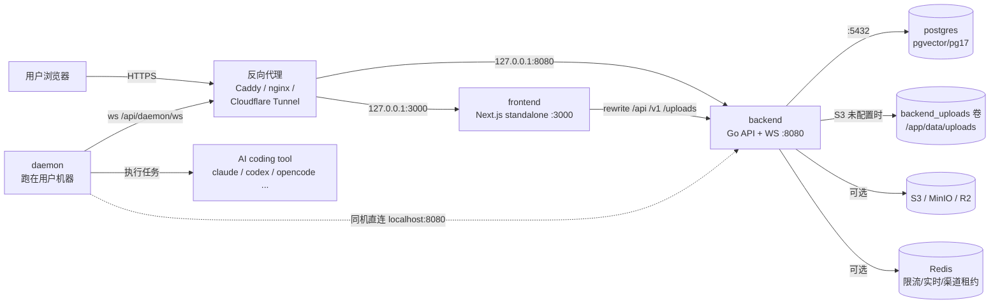
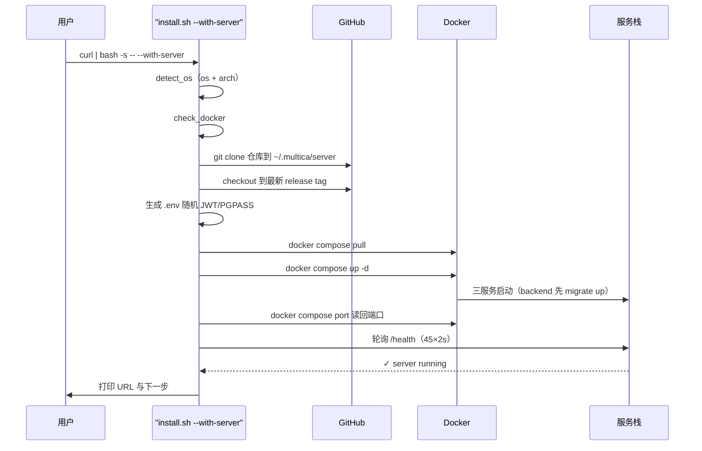

# 部署与自托管：多 Agent 工作区的"出口"

## 一句话定位

本模块回答"Multica 怎么交付给想私有化的用户"：`docker-compose.selfhost.yml` 用三个容器（postgres / backend / frontend）把一个单机实例拉起来，Helm chart 把它搬到 K8s，`install.sh --with-server` 把前者封装成一行命令——而 daemon 永远留在用户自己的机器上，与服务器之间只隔一条 WebSocket。

## 在项目中的角色

去掉自托管，Multica 就退化为一个纯 SaaS（官方云 + CLI/daemon 双端）；加上它，产品叙事从"用我们的云"变成"软件本身"。自托管不是旁路，而是产品形态的一部分：

- **代码执行永远在用户机器**（daemon 跑 agent CLI），服务器只是编排面。所以"服务器能不能自己托管"是用户唯一需要决策的分界点，`SELF_HOSTING.md` 开篇就用一张表把"Multica service"和"Computer"两部分的运行位置分得清清楚楚[^quickstart]。
- **自托管还是若干功能唯一出现的舞台**：Forgejo/Gitea/GitLab 自建 Git 集成标注为 "self-host-only feature"，compose 默认开启而托管云默认关闭[^vcs]。
- **部署代码是仓库的一等公民**：`docker-compose.selfhost.yml` 顶部 31 行注释本身就是设计文档（安全绑定理由、端口别名语义、`docker compose port` 作为唯一权威），CI 里有专门的 `selfhost-config.test.sh` 守护 compose 与 `.env.example` 的派生一致性[^ci]。

[^quickstart]: [apps/docs/content/docs/self-host-quickstart.mdx:10-15]()，把"Multica service"（Web/API/PostgreSQL）与"Computer"（daemon + AI 工具）两部分的部署位置分离。

<!-- anchor: | **Multica service** | Web, API, and PostgreSQL | One machine with Docker installed | -->
<!-- anchor: They can be the same machine or separate ones. Self-hosting replaces only the Multica Cloud part. -->

[^vcs]: [docker-compose.selfhost.yml:173-177]()，VCS 集成是 self-host-only 特性，compose 文件默认开启。

<!-- anchor: # Self-hosted Git provider integration (Forgejo / Gitea / GitLab). This -->
<!-- anchor:       MULTICA_VCS_INTEGRATION_ENABLED: ${MULTICA_VCS_INTEGRATION_ENABLED:-true} -->

[^ci]: [.github/workflows/ci.yml:254-256]()，frontend 变更时运行 `scripts/selfhost-config.test.sh` 守护自托管环境派生。

<!-- anchor:       - name: Test self-host env derivation -->
<!-- anchor:         run: bash scripts/selfhost-config.test.sh -->

> **依赖关系**：本模块本身不带业务逻辑，它把所有其他模块的配置项收拢成运维视角。渠道 secret 加密密钥、附件 S3 下载模式、插件 surface origin、服务端 LLM 层，这些在其他模块里是功能开关，在这里统一变成 `.env` / values.yaml 里的一组"留空=关闭、设置=开启"的安全默认。

## 解决什么问题、根因

### 为什么官方云之外还要做自托管

Multica 的架构天然是"服务端可托管"的：agent 代码在用户机器上跑，服务器只做任务编排、状态存储、渠道桥接。那么把服务器也搬到自己基础设施里，用户就获得了三件云版给不了的东西：

1. **数据主权**——所有 issue、chat、渠道 token、附件都留在自己手里，`.env` 里的密钥不进第三方数据库；
2. **私有网络集成**——自建 Git（Forgejo/Gitea/GitLab）在托管云上明确不做，只在自托管里提供[^vcs]；
3. **无账号墙**——`ALLOW_SIGNUP` / `DISABLE_WORKSPACE_CREATION` 这套注册控制把实例锁成一个"邀请制私有团队"[^signup]。

同时它维护了双轨的同一性：`multica setup` 一句命令在"官方云"和"自托管服务器"之间切换[^switch]，说明云和自托管共享同一个 CLI 协议面，自托管不是分叉产品。

[^signup]: [SELF_HOSTING_ADVANCED.md:65-85]()，注册控制与"先以管理员建共享 workspace、再翻转 `DISABLE_WORKSPACE_CREATION=true`"的引导序列。

<!-- anchor: ### Signup Controls (Optional) -->
<!-- anchor: > Note: setting `ALLOW_SIGNUP=false` blocks **all** new account creation, including users who already have a pending invitation. -->

[^switch]: [SELF_HOSTING.md:447-457]()，"Switching to Multica Cloud"——`multica setup` 重配 CLI 指向多趣云。

<!-- anchor: ## Switching to Multica Cloud -->
<!-- anchor: > Your local Docker services are unaffected. Stop them separately if you no longer need them. -->

### Docker Compose 与 Helm 各覆盖什么规模

规模分档在实现上非常清晰：

| 部署形态 | 面向规模 | 交付物 | 运维模型 |
|---|---|---|---|
| `make selfhost` / `install.sh --with-server` | 单机（一台开发机/小服务器） | 官方 GHCR 镜像 + compose 文件 | 绑定 127.0.0.1，反向代理负责 TLS |
| `make selfhost-build` | 单机 + 改源码 | 本地构建的 `multica-backend:dev` / `multica-web:dev` | 同左，但镜像来自当前 checkout |
| Helm chart | K8s（k3s / 单节点到多节点） | OCI chart（`oci://ghcr.io/multica-ai/charts/multica`）或源码路径[^helm][^helmk8s] | Ingress + PVC + Secret 外置 |

[^helm]: [deploy/helm/multica/Chart.yaml:1-8]()，chart 元数据。

<!-- anchor: apiVersion: v2 -->
<!-- anchor: appVersion: "latest" -->

[^helmk8s]: [SELF_HOSTING.md:172-174]()，发布为 OCI chart 并面向典型 k3s 场景。

<!-- anchor: If you already run a Kubernetes cluster, you can deploy Multica there instead of Docker Compose using t -->
<!-- anchor: The chart creates the following resources in the target namespace: -->

Compose 与 Helm 不是同一份清单的两份翻译，而是同一配置模型的两个消费者：两边都接受同一批环境变量（`DATABASE_URL`、`JWT_SECRET`、`MULTICA_*`），只是注入方式不同——compose 从 `.env` 插值，Helm 从 `values.yaml` + 外置 Secret 渲染。跨形态一致性的另一个证据：`scripts/helm-config.test.sh` 断言 chart 渲染出的 ConfigMap 与 compose 派生出的环境变量值一致（如 `MULTICA_VCS_INTEGRATION_ENABLED: "true"`、`MULTICA_DATABASE_STARTUP_TIMEOUT: "3m"`）[^helmtest]。

[^helmtest]: [scripts/helm-config.test.sh:31-38]()，helm template 渲染 ConfigMap 后断言 VCS / Cloud / 超时等值。

<!-- anchor: default_config="$( -->
<!-- anchor: require_rendered_value "$default_config" 'MULTICA_DATABASE_CONNECT_TIMEOUT: "5s"' -->

## 设计思路

### 部署拓扑：三服务 + 一个永不进容器的 daemon

compose 栈只有三个服务，没有任何 sidecar：

- `postgres` 用 `pgvector/pgvector:pg17` 镜像——但这是个历史命名，项目明确不依赖 pgvector，迁移只硬性要求 `pgcrypto` 和 `pg_trgm`，这两个随标准 PostgreSQL 17 自带[^pgvectormyth]；
- `backend` 是 Go 单二进制（API + WS），带 `backend_uploads` 卷（S3 未配置时的本地附件落盘）[^uploadsvol]；
- `frontend` 是 Next.js standalone server，只通过 `REMOTE_API_URL` 指回 backend，浏览器侧则通过 `/api`、`/v1`、`/ws` 的 rewrite 保持同源[^rewrite]。

daemon 是第四个"服务"，但**永远不进入 compose**：`SELF_HOSTING.md` 明说 daemon 跑在用户本机（不在 Docker 里），它检测本机的 agent CLI、注册为 runtime、领任务执行[^daemon]。所以"自托管服务器"再大也只是一台编排机器，执行面始终是用户的机器。

[^pgvectormyth]: [SELF_HOSTING_ADVANCED.md:238-255]()，PostgreSQL 17 即可，pgvector 是历史命名；`pg_bigm`/`pg_cron` 条件安装、可选。

<!-- anchor: Multica requires PostgreSQL 17. It does **not** use pgvector — no migration -->
<!-- anchor: `pgcrypto` and `pg_trgm` ship with every standard PostgreSQL 17 build -->

[^uploadsvol]: [docker-compose.selfhost.yml:62-63]()，backend 挂 `backend_uploads` 卷到 `/app/data/uploads`。

<!-- anchor:     volumes: -->
<!-- anchor:       - backend_uploads:/app/data/uploads -->

[^rewrite]: [docker-compose.selfhost.yml:199-211]()，frontend 服务只注入 `REMOTE_API_URL` 与两个 `NEXT_PUBLIC_*` 覆盖项。

<!-- anchor:   frontend: -->
<!-- anchor:     restart: unless-stopped -->

[^daemon]: [SELF_HOSTING.md:99-102]()，daemon 运行位置与职责。

<!-- anchor: ### Step 3 — Install CLI & Start Daemon -->
<!-- anchor: The daemon runs on your local machine (not inside Docker). It detects installed AI agent CLIs, registers them with the server, and executes tasks when agents are assigned work. -->

### 镜像构建：一个多阶段 Dockerfile 出五个二进制

`Dockerfile` 的构建阶段在同一份 `go.mod` 缓存下连续 `go build` 出 **server、multica（CLI）、migrate、backfill_task_usage_hourly、backfill_codex_usage_cache** 五个产物[^multibin]，全部 `CGO_ENABLED=0`[^cgo]——这既是静态链接安全性的选择，也是 `alpine:3.21` 运行时只需要 `ca-certificates` + `tzdata` 就能跑的原因[^runtime]。运行时阶段 `COPY server/migrations/`，配合 `docker/entrypoint.sh`：容器启动先同步跑 `./migrate up`，成功后才 `exec ./server`[^entry]。迁移失败 = 容器退出，健康检查接不住；迁移慢 = 靠重试预算兜底，见下文 K8s 的 startupProbe 部分。

这个设计把"升级即迁移"落成了一条不可绕过的路径：**拉新镜像 + 起新容器 = 跑新迁移**，没有需要手动执行的 `migrate` 步骤[^migauto]。

[^multibin]: [Dockerfile:19-23]()，同一构建上下文连出五个二进制。

<!-- anchor: RUN cd server && CGO_ENABLED=0 go build -ldflags "-s -w -X main.version=${VERSION} -X main.commit=${COMMIT}" -o bin/server ./cmd/server -->
<!-- anchor: RUN cd server && CGO_ENABLED=0 go build -ldflags "-s -w" -o bin/backfill_codex_usage_cache ./cmd/backfill_codex_usage_cache -->

[^cgo]: [Dockerfile:19-19]() 首个构建行即 `CGO_ENABLED=0`。

<!-- anchor: RUN cd server && CGO_ENABLED=0 go build -ldflags "-s -w -X main.version=${VERSION} -X main.commit=${COMMIT}" -o bin/server ./cmd/server -->
<!-- anchor: RUN cd server && CGO_ENABLED=0 go build -ldflags "-s -w -X main.version=${VERSION} -X main.commit=${COMMIT}" -o bin/server ./cmd/server -->

[^runtime]: [Dockerfile:25-28]()，运行时阶段为 alpine:3.21 + ca-certificates + tzdata。

<!-- anchor-base64:IyAtLS0gUnVudGltZSBzdGFnZSAtLS0= -->
<!-- anchor-base64:UlVOIGFwayBhZGQgLS1uby1jYWNoZSBjYS1jZXJ0aWZpY2F0ZXMgdHpkYXRh -->

[^entry]: [docker/entrypoint.sh:26-41]()，先迁移、后启动，两个进程共享一个容器级启动时间戳做重试预算。

<!-- anchor: echo "Running database migrations..." -->
<!-- anchor: exec ./server -->

[^migauto]: [apps/docs/content/docs/self-host-quickstart.mdx:345-347]()，"Migrations run themselves"。

<!-- anchor: ### Migrations run themselves -->
<!-- anchor: Migrations run automatically when the backend starts; migrations that backfill historical data -->

`Dockerfile.web` 是另一条轨道：pnpm 工作区里只把 `apps/web` 与 `packages/*` 拷进构建上下文（`.dockerignore` 默认排除其他 app 工作区[^dockerignore]），产出 Next.js **standalone** 目录——自带被裁剪过的 `node_modules`，运行时 `USER nextjs` 非 root[^webuser]。注意一个易踩点：`NEXT_PUBLIC_WS_URL` 是**构建时**变量，改它必须走 `selfhost.build.yml` 重建镜像，改运行环境变量无效[^wsbuild]。

[^dockerignore]: `.dockerignore:38-41`，默认排除未来新增的 app 工作区。

<!-- anchor: # Only the web workspace is used by Dockerfile.web. Default-exclude future -->
<!-- anchor: !/apps/web/ -->

[^webuser]: [Dockerfile.web:52-76]()，runner 阶段创建 `nextjs` 系统用户并以它启动。

<!-- anchor: FROM node:22-alpine AS runner -->
<!-- anchor: CMD ["node", "apps/web/server.js"] -->

[^wsbuild]: [SELF_HOSTING_ADVANCED.md:570-584]()，`NEXT_PUBLIC_WS_URL` 为构建时变量，必须重建镜像。

<!-- anchor: 2. **Bake a WebSocket URL into the web image.** If you are not running a reverse proxy, rebuild the web image -->
<!-- anchor:    `NEXT_PUBLIC_WS_URL` is a build-time variable (see `Dockerfile.web`), so setting it only in `environment:` on the pre-built image has no effect -->

### 端口与安全默认：127.0.0.1 是硬边界

compose 文件把所有发布端口钉死在 `127.0.0.1`：backend `127.0.0.1:${BACKEND_PORT:-...}:8080`[^bind]，frontend `127.0.0.1:${FRONTEND_PORT:-3000}:3000`[^bind2]。顶部注释用整段篇幅解释为什么**不要**改成 `0.0.0.0`——Docker 的 NAT 默认绕过主机防火墙（UFW/iptables），一旦改绑公网，裸端口直接暴露在互联网上[^bindwhy]。外部访问的唯一正路是前置反向代理（Caddy / nginx / Cloudflare Tunnel）终结 TLS 再转发回 `127.0.0.1:8080/3000`[^proxy]。

这是一组环环相扣的默认安全：

- **JWT_SECRET 双层强制**：compose 用 `${JWT_SECRET:?...}` 在渲染期拒绝缺值[^jwtcompose]；server 启动时 `jwtSecretBootError` 在 `APP_ENV=production` 下拒绝空值或黑名单占位符[^jwtmain]，黑名单由 `server/internal/auth/jwt.go` 的 `insecureJWTSecrets` 维护，并注明"模板里的任何占位符在发布前必须加进这张表"[^jwtdeny]。开发默认值只在 `APP_ENV` 非 production 时放行，且打 warning[^jwtdev]。
- **管理口默认不对外**：Prometheus 监听由 `METRICS_ADDR` 控制、默认不开；即使开也建议绑 loopback[^metrics]。Go pprof 固定在 `127.0.0.1:6060`，地址不可配置，公共 API 端口不服务 `/debug/pprof/`[^pprof]。
- **健康检查三分**：`/health` 只探进程存活、`/readyz`（`/healthz` 别名）依赖 DB + 迁移状态，升级后该看哪个、探不到意味着什么，文档写得很明确[^health]。

[^bind]: [docker-compose.selfhost.yml:61-61]()，backend 发布端口绑定 127.0.0.1。

<!-- anchor:       - "127.0.0.1:${BACKEND_PORT:-${API_PORT:-${SERVER_PORT:-${PORT:-8080}}}}:8080" -->
<!-- anchor:       - "127.0.0.1:${BACKEND_PORT:-${API_PORT:-${SERVER_PORT:-${PORT:-8080}}}}:8080" -->

[^bind2]: [docker-compose.selfhost.yml:204-204]()，frontend 发布端口同样绑 127.0.0.1。

<!-- anchor:       - "127.0.0.1:${FRONTEND_PORT:-3000}:3000" -->
<!-- anchor:       - "127.0.0.1:${FRONTEND_PORT:-3000}:3000" -->

[^bindwhy]: [docker-compose.selfhost.yml:3-8]()，绑定 127.0.0.1 的理由 + Docker 绕过主机防火墙的警告。

<!-- anchor: # Services bind to 127.0.0.1 only. For cross-machine or public access, front -->
<!-- anchor: # (UFW/iptables) by default, so the raw ports would be exposed to the internet -->

[^proxy]: [SELF_HOSTING_ADVANCED.md:386-389]()，生产要求反向代理终结 TLS。

<!-- anchor: ## Reverse Proxy -->
<!-- anchor: In production, put a reverse proxy in front of both the backend and frontend to handle TLS and routing. -->

[^jwtcompose]: [docker-compose.selfhost.yml:68-68]()，compose 渲染期强制 JWT_SECRET。

<!-- anchor:       JWT_SECRET: ${JWT_SECRET:?JWT_SECRET must be set to a strong random value — generate one with 'openssl rand -hex 32'} -->
<!-- anchor:       JWT_SECRET: ${JWT_SECRET:?JWT_SECRET must be set to a strong random value — generate one with 'openssl rand -hex 32'} -->

[^jwtmain]: [server/cmd/server/main.go:293-300]()，`jwtSecretBootError` 失败即拒绝启动。

<!-- anchor: 	if err := jwtSecretBootError(os.Getenv("JWT_SECRET"), os.Getenv("APP_ENV")); err != nil { -->
<!-- anchor: 		os.Exit(1) -->

[^jwtdeny]: [server/internal/auth/jwt.go:44-48]()，黑名单含空串、dev 默认与 `change-me-in-production`。

<!-- anchor: var insecureJWTSecrets = map[string]struct{}{ -->
<!-- anchor: 	"change-me-in-production": {}, -->

[^jwtdev]: [server/cmd/server/main.go:301-303]()，非 production 下缺 JWT_SECRET 才用 dev 默认并告警。

<!-- anchor: 	if os.Getenv("JWT_SECRET") == "" { -->
<!-- anchor: 		slog.Warn("JWT_SECRET is not set — using insecure dev default (allowed only because APP_ENV is not production).") -->

[^metrics]: [SELF_HOSTING_ADVANCED.md:606-626]()，METRICS_ADDR 默认关闭，公开 API 端口不服务 /metrics。

<!-- anchor: ## Prometheus Metrics -->
<!-- anchor: For Docker or Kubernetes deployments, prefer a private scrape path: bind the -->

[^pprof]: [SELF_HOSTING_ADVANCED.md:628-643]()，pprof 固定在 loopback-only 管理口 127.0.0.1:6060。

<!-- anchor: ## Go Runtime Profiling -->
<!-- anchor: The public API port does not serve `/debug/pprof/`. The listener address is not -->

[^health]: [SELF_HOSTING_ADVANCED.md:586-604]()，/health、/readyz、/healthz 三种健康检查语义。

<!-- anchor: ## Health Check -->
<!-- anchor: dependency-aware readiness probes and external monitoring that should fail when -->

### 配置面分类：全是"留空即关闭"的安全默认

`.env.example`（627 行）把配置按语义分面组织，每一面的设计模式几乎一致——**入口密钥留空 = 该功能整体关闭，不会默认拉起外部依赖**：

| 配置面 | 关键变量 | 关闭/开启语义 |
|---|---|---|
| 数据库 | `DATABASE_URL`、`MULTICA_DATABASE_STARTUP_TIMEOUT` | 必须项；启动重试预算容器级共享[^dbtimeout] |
| 认证 | `JWT_SECRET`、`RESEND_API_KEY`/`SMTP_HOST`、`GOOGLE_CLIENT_*` | 邮件双后端：SMTP 优先于 Resend；两者皆空则验证码打印到日志[^mail] |
| 注册控制 | `ALLOW_SIGNUP`、`ALLOWED_EMAIL_DOMAINS`、`DISABLE_WORKSPACE_CREATION` | UI 从 `/api/config` 运行时读，只重启后端不重建前端[^signupui] |
| 附件存储 | `S3_BUCKET` + `S3_REGION`、`AWS_ENDPOINT_URL`、`ATTACHMENT_DOWNLOAD_MODE` | `S3_BUCKET` 空 = 本地盘；`proxy` 模式让私有桶可被浏览器访问[^s3] |
| 渠道 secret | `MULTICA_WECOM_SLACK_LARK_DINGTALK_SECRET_KEY` 等 | 部署级主密钥，加密存储在各 workspace 的渠道 token；空 = 集成关闭[^channel] |
| VCS 集成 | `MULTICA_VCS_INTEGRATION_ENABLED` + `MULTICA_VCS_SECRET_KEY` | 双开关必须同时就位[^vcs2] |
| 插件 surface | `MULTICA_PLUGIN_SECRET_KEY` / `SURFACE_ORIGIN` / `API_URL` / `DIR` | 密钥空则 surface/hook 相关功能 fail-closed[^plugin] |
| 服务端 LLM | `MULTICA_LLM_API_KEY` / `BASE_URL` | **双空 = 层完全禁用、零上游请求**，且调用方静默回退[^llm] |
| 可观测性 | `METRICS_ADDR`、`REALTIME_METRICS_TOKEN`、`POSTHOG_API_KEY` | 全为空 = 无监听、无上报[^obs] |
| 可选 Redis | `REDIS_URL`、`CHANNEL_WS_LEASE_*` | 未配置 = 限流 fail-open、实时走进程内内存[^redis] |

[^dbtimeout]: [docker-compose.selfhost.yml:99-100]()，DB 启动超时与单次连接超时。

<!-- anchor:       MULTICA_DATABASE_STARTUP_TIMEOUT: ${MULTICA_DATABASE_STARTUP_TIMEOUT:-3m} -->
<!-- anchor:       MULTICA_DATABASE_CONNECT_TIMEOUT: ${MULTICA_DATABASE_CONNECT_TIMEOUT:-5s} -->

[^mail]: [SELF_HOSTING_ADVANCED.md:26-53]()，SMTP 优先于 Resend，双空则打印验证码。

<!-- anchor: ### Email (Required for Authentication) -->
<!-- anchor: > **Note:** If neither Resend nor SMTP is configured, generated verification codes are printed to backend logs -->

[^signupui]: [SELF_HOSTING_ADVANCED.md:63-74]()，UI 运行时读 `/api/config`，无需重建前端。

<!-- anchor: Changes take effect after restarting the backend / compose stack. The web UI reads `GOOGLE_CLIENT_ID` from `/api/config` at runtime, so no web rebuild is needed. -->
<!-- anchor: Changes take effect after restarting the backend / compose stack. The web UI reads `ALLOW_SIGNUP` and `DISABLE_WORKSPACE_CREATION` from `/api/config` at runtime, so no web rebuild is needed. -->

[^s3]: [SELF_HOSTING_ADVANCED.md:99-113]()，S3 桶名只写 bucket 名、端点兼容 MinIO/R2、下载模式四种。

<!-- anchor: #### S3 / CloudFront -->
<!-- anchor: | `ATTACHMENT_DOWNLOAD_URL_TTL` | TTL for CloudFront signed URLs and S3 presigned download URLs (default: `30m`) | -->

[^channel]: [docker-compose.selfhost.yml:167-172]()，Slack 集成以部署级密钥为 opt-in，token 加密存库。

<!-- anchor:       # Slack bot integration. MULTICA_SLACK_SECRET_KEY is the opt-in: unset = -->
<!-- anchor:       MULTICA_SLACK_SECRET_KEY: ${MULTICA_SLACK_SECRET_KEY:-} -->

[^vcs2]: [.env.example:505-519]()，双开关必须同时就位。

<!-- anchor: # Self-hosted Git provider integration (Settings → Integrations): Forgejo, Gitea, -->
<!-- anchor: MULTICA_VCS_INTEGRATION_ENABLED= -->

[^plugin]: [.env.example:521-551]()，插件四件套的语义，密钥缺失时 secret/surface/hook 功能 fail-closed。

<!-- anchor: # Plugins (Settings → Plugins). A plugin's frontend is an artifact its author -->
<!-- anchor: MULTICA_PLUGIN_DIR= -->

[^llm]: [docker-compose.selfhost.yml:146-154]()，服务端 LLM 层双空即禁用、调用方静默回退。

<!-- anchor:       # Server-side LLM layer, backing internal helpers such as chat title -->
<!-- anchor:       MULTICA_LLM_MAX_RETRIES: ${MULTICA_LLM_MAX_RETRIES:-} -->

[^obs]: [.env.example:617-627]()，PostHog 留空即 no-op；`METRICS_ADDR` 默认空。

<!-- anchor: # ==================== Analytics (PostHog) ==================== -->
<!-- anchor: ANALYTICS_DISABLED= -->

[^redis]: [.env.example:380-449]()，REDIS_URL 未设时限流 fail-open；渠道 WS 租约可独立指定 Redis。

<!-- anchor: # ==================== Rate limiting (optional Redis) ==================== -->
<!-- anchor: # CHANNEL_WS_LEASE_NAMESPACE=production -->

### Helm 的 values 抽象：把运维责任显式化

Helm chart 与 compose 最大的不同，是它**拒绝把秘密写进 chart**。`existingSecret: multica-secrets` 指向一个操作员先用 `kubectl create secret` 预建的 Secret，chart 只按名引用、不模板化它，注释明确说"真实值永远不需要进 git"[^secret]。这是 compose 模式（`.env` 在安装目录）在 K8s 上的同构迁移：密钥不落地于清单。

values.yaml 的抽象层级（207 行）围绕"哪些是 K8s 特有、必须显式决策"来切分：

- **`postgres.external.enabled`**——内置 postgres 由 chart 起 Deployment + PVC；设为 true 则整组资源不渲染，改从 existingSecret 读 `DATABASE_URL`[^pgexternal]。
- **`backend.uploads.persistence.enabled`**——默认开一个 5Gi ReadWriteOnce PVC 挂 `/app/data/uploads`；但注释把关键权衡写透了：backend 只在 `s3Bucket` 为空时才用这个目录，且 **RWO 访问模式会挡住 `replicas > 1`**（Multi-Attach 错误）[^rwomyth]。配置了 S3 就关掉 persistence——这条注释就是部署决策树本身。
- **`backend.replicas`**——注释解释"并发 pod 现在安全了"（migrate 用 advisory lock 串行），但默认仍是 1，因为 chart 用 `strategy: Recreate` 且没有 leader 选举拆分[^replicas]。
- **ConfigMap/Secret 的 checksum 注入 pod 注解**——`envFrom` 不会让 Deployment 感知引用对象变化，`helm upgrade` 改 values 也不会改 pod 模板哈希，所以显式 `checksum/config` 与 `checksum/secret` 注解保证配置轮转生效[^checksum]。
- **启动探针的 10 分钟窗口**——backend 启动先跑迁移，冷集群上可能几分钟不 Ready；`startupProbe` 的 60×10s 超过共享的 3 分钟 DB 重试预算，把 kubelet 的杀进程挡在外面[^startup]。
- **liveness 故意不依赖 DB**——`/health` 探存活（DB 挂了 pod 变 NotReady 但不重启）、`/healthz` 探就绪，两者职责分离[^live]。

另一处值得称道的细节是 `frontend.compatibility.backendAlias`：老版 web 镜像把 `REMOTE_API_URL=http://backend:8080` 烤死在构建期，所以 chart 提供一个**无前缀**的 ExternalName Service `backend` 兼容它们——代价是同一 namespace 只能跑一个这样的 release[^alias][^aliasbe]。这是"向后兼容老镜像"与"K8s 命名卫生"之间的显式取舍，而且明确标注默认应关闭。

[^secret]: [deploy/helm/multica/values.yaml:22-46]()，existingSecret 预建、chart 按名引用。

<!-- anchor: # Pre-created Secret with sensitive values. Create it before `helm install`: -->
<!-- anchor: existingSecret: multica-secrets -->

[^pgexternal]: [deploy/helm/multica/values.yaml:52-57]()，external.enabled 跳过内置 postgres Deployment/PVC。

<!-- anchor:   # Set external.enabled=true to skip the built-in postgres Deployment/PVC and -->
<!-- anchor:     enabled: false -->

[^rwomyth]: [deploy/helm/multica/values.yaml:87-110]()，uploads PVC 默认 RWO，注释说明会阻止多副本。

<!-- anchor:       # When true (default) the chart provisions a PersistentVolumeClaim for -->
<!-- anchor:         - ReadWriteOnce -->

[^replicas]: [deploy/helm/multica/values.yaml:78-86]()，并发安全但默认 1，Recreate 策略无 leader 拆分。

<!-- anchor:   # Concurrent backend pods are now safe to start: cmd/migrate uses a -->
<!-- anchor:   replicas: 1 -->

[^checksum]: [deploy/helm/multica/templates/backend.yaml:43-54]()，ConfigMap/Secret 哈希注入 pod 注解以轮转配置。

<!-- anchor:         # Roll the backend pods whenever its config changes. envFrom does not -->
<!-- anchor:         checksum/secret: {{ (lookup "v1" "Secret" .Release.Namespace .Values.existingSecret).data | toYaml | sha256sum }} -->

[^startup]: [deploy/helm/multica/templates/backend.yaml:81-92]()，startupProbe 60×10s 吸收冷启动迁移。

<!-- anchor:           # The entrypoint runs `./migrate up` before serving traffic. On a -->
<!-- anchor:             periodSeconds: 10 -->

[^live]: [deploy/helm/multica/templates/backend.yaml:99-106]()，liveness 探 /health 不依赖 DB。

<!-- anchor:           livenessProbe: -->
<!-- anchor:             periodSeconds: 30 -->

[^alias]: [deploy/helm/multica/values.yaml:175-182]()，backendAlias 兼容老镜像的语义。

<!-- anchor:   # Compatibility shim for legacy multica-web images built before runtime -->
<!-- anchor:     backendAlias: false -->

[^aliasbe]: [deploy/helm/multica/templates/backend.yaml:141-161]()，无前缀 ExternalName Service 的实现。

<!-- anchor: {{- if .Values.frontend.compatibility.backendAlias }} -->
<!-- anchor:   externalName: {{ printf "%s.%s.svc.cluster.local" (include "multica.backend.fullname" .) .Release.Namespace }} -->

## 核心流程

### 自托管拓扑

下面这张图把三个服务、反向代理、daemon、可选外部依赖画在同一张图里。关键点是：**浏览器只见过反向代理**（TLS 在代理终结），**daemon 走的是不同路径**（不是 rewrite 过的 `/api`，而是直连 backend 的 `/api/daemon/ws` 与 `/ws`），前端与 backend 之间靠 Next.js runtime rewrite 保持同源。

两个值得单独说的拓扑事实：

1. **compose 里 frontend 的 `REMOTE_API_URL` 默认是 `http://backend:8080`**（容器网络内），容器内 backend 不需要发布端口——宿主看到的 8080 只是反向代理要代理的端口[^feenv]。
2. **`/ws` 不经过 Next.js rewrite**：rewrite 只转发 HTTP，不携带 WebSocket 的 `Upgrade` 握手。所以 LAN/公网场景要么前置代理显式路由 `/ws`（`flush_interval -1` 关缓冲），要么把 `NEXT_PUBLIC_WS_URL` 烤进镜像[^ws]。

[^feenv]: [docker-compose.selfhost.yml:206-207]()，frontend 运行时从 `REMOTE_API_URL` 指回 backend 服务名。

<!-- anchor:       HOSTNAME: "0.0.0.0" -->
<!-- anchor:       REMOTE_API_URL: ${REMOTE_API_URL:-http://backend:8080} -->

[^ws]: [SELF_HOSTING_ADVANCED.md:564-582]()，Next.js rewrites 只转发 HTTP，WebSocket 握手需显式路由。

<!-- anchor: ### WebSocket for LAN / Non-localhost Access -->
<!-- anchor:    `NEXT_PUBLIC_WS_URL` is a build-time variable (see `Dockerfile.web`), so setting it only in `environment:` on the pre-built image has no effect -->

### 一键安装引导流程

`curl install.sh | bash -- --with-server` 不是"装二进制"而是"克隆仓库 + 生成密钥 + 拉起 compose"。`run_with_server` 的步骤：`detect_os` → `check_docker` → `setup_server`（clone 到 `~/.multica/server`、checkout 到最新 release tag、生成 `.env` 随机密钥、pull 官方镜像、`up -d`、用 `docker compose port` 读回端口、轮询 `/health`）→ `install_cli` → 打印 URL[^runserver][^runserver2]。PowerShell 版 `install.ps1` 的 `Install-Server` 是同一流程的逐行对应实现[^ps1]。

这条流程里"克隆整个仓库"是关键选择：compose 文件随仓库演进，而自托管资产（compose、entrypoint、docs）本就从仓库来，所以 **git checkout 本身就是"安装包"**——升级 = `git pull` + 重新 checkout tag[^upgrade]。`--stop` 模式对称地 `docker compose down` + `multica daemon stop`[^stop]。

安装器的自我纠错也值得一提：官方镜像未发布时（`pull` 失败），脚本**不硬撑**，直接提示回退 `selfhost-build` 本地构建[^fallback]；而"端口"这种事绝不从 `.env` 重新推导，统一以 `docker compose port` 输出为准，避免 probe 到不存在的端口[^portauthority]。

[^runserver]: [scripts/install.sh:336-420]()，setup_server 的完整步骤。

<!-- anchor: setup_server() { -->
<!-- anchor:     ok "Multica server is running" -->

[^runserver2]: [scripts/install.sh:453-483]()，run_with_server 组装 CLI 与 server 步骤。

<!-- anchor: run_with_server() { -->
<!-- anchor: } -->

[^ps1]: [scripts/install.ps1:399-445]()，Install-Server 与 bash 版逐行对应。

<!-- anchor: function Install-Server { -->
<!-- anchor:     docker compose -f docker-compose.selfhost.yml up -d -->

[^upgrade]: [apps/docs/content/docs/self-host-quickstart.mdx:311-315]()，git pull 更新的是 compose 文件本身而非版本。

<!-- anchor: ### What `git pull` actually does -->
<!-- anchor: The version you end up running is resolved by `docker compose pull`, which asks GHCR what the tag points at right now. -->

[^stop]: [scripts/install.sh:488-509]()，--stop 模式停服务与 daemon。

<!-- anchor: run_stop() { -->
<!-- anchor:     multica daemon stop 2>/dev/null && ok "Daemon stopped" || true -->

[^fallback]: [scripts/install.sh:244-255]()，pull 失败时提示构建回退并退出。

<!-- anchor: pull_official_selfhost_images() { -->
<!-- anchor-base64:ZG9ja2VyIGNvbXBvc2UgLWYgZG9ja2VyLWNvbXBvc2Uuc2VsZmhvc3QueW1sIC1mIGRvY2tlci1jb21wb3NlLnNlbGZob3N0LmJ1aWxkLnltbCB1cCAtZCAtLWJ1aWxk -->

[^portauthority]: [scripts/install.sh:68-88]()，compose_published_port 只认 `docker compose port`。

<!-- anchor: # Host port Docker Compose actually published for a service. -->
<!-- anchor:   printf "%s" "$published" -->

## 与其他模块的协同

部署模块是其他模块配置项的"汇总出口"。跨模块对应关系如下：

1. **渠道 secret ↔ channels 模块**：Slack/Lark/WeCom/DingTalk 的部署级主密钥（`MULTICA_*_SECRET_KEY`）不在本模块定义行为，只负责"加密渠道 token 的静态存储密钥"。compose 注释写清了模式：Slack token 由各 workspace 通过 OAuth/BYO 带入、加密存库，部署只需给这一个主密钥[^channelsync]。WeCom 还有一条直接影响部署形态的约束——单副本：其 outbound 只有进程内 WebSocket 长连接，跨副本应答会丢，`.env.example` 明确要求"run the WeCom-enabled backend as a SINGLE replica"[^wecomsingle]。
2. **S3/附件 ↔ 附件模块**：`ATTACHMENT_DOWNLOAD_MODE` 四种取值（auto/cloudfront/presign/proxy）把存储选择、签名策略和网络可达性合成一个部署变量[^s3mode]；`LOCAL_UPLOAD_DIR` 相对路径语义的坑（换启动目录就换落盘位置）也在部署文档里专门警告[^localdir]。
3. **插件 surface ↔ plugin 模块**：`MULTICA_PLUGIN_SURFACE_ORIGIN` 要求一个与 app/API 隔离、无会话 cookie 的浏览器 origin，且 Host 检查拒绝在普通 API origin 上提供 `/plugin-surfaces/*`——这是把插件隔离的运行时要求下放给部署拓扑[^pluginorigin]。
4. **daemon 侧配置 ↔ runtime 模块**：`MULTICA_SERVER_URL`（默认 `ws://localhost:8080/ws`）、心跳/轮询间隔、每个 provider 的 `PATH`/`MODEL` 覆盖，全是用户机器上读的变量，与本模块服务器配置面严格分离[^daemonconf]。
5. **迁移 ↔ 数据模型模块**：`docker/entrypoint.sh` 的 `migrate up` 是唯一迁移入口；K8s 下并发 pod 由 advisory lock 串行（`#3647`），Helm 注释与 values 都引用了这一点来论证 replicas>1 的安全性[^migadvisory]。

[^channelsync]: [docker-compose.selfhost.yml:167-172]()，Slack 主密钥加密每安装的 bot/app token。

<!-- anchor:       # Slack bot integration. MULTICA_SLACK_SECRET_KEY is the opt-in: unset = -->
<!-- anchor:       MULTICA_SLACK_SECRET_KEY: ${MULTICA_SLACK_SECRET_KEY:-} -->

[^wecomsingle]: [.env.example:307-313]()，WeCom 单副本约束说明。

<!-- anchor: # SINGLE-REPLICA CONSTRAINT: unlike Slack/Lark (stateless HTTP outbound), the -->
<!-- anchor: # routing lands, run the WeCom-enabled backend as a SINGLE replica. -->

[^s3mode]: [SELF_HOSTING_ADVANCED.md:107-108]()，ATTACHMENT_DOWNLOAD_MODE 四种语义。

<!-- anchor: | `ATTACHMENT_DOWNLOAD_MODE` | Attachment download behavior: `auto` (default), `cloudfront`, `presign`, or `proxy`. Use `proxy` for private buckets behind Docker/VPC-only endpoints -->
<!-- anchor: | `ATTACHMENT_DOWNLOAD_URL_TTL` | TTL for CloudFront signed URLs and S3 presigned download URLs (default: `30m`) | -->

[^localdir]: [SELF_HOSTING_ADVANCED.md:96-97]()，LOCAL_UPLOAD_DIR 相对路径在手动运行时解析到启动目录。

<!-- anchor: | `LOCAL_UPLOAD_DIR` | Directory attachments are written to (default: `./data/uploads`). The default is **relative to the backend's working directory** -->
<!-- anchor: | `LOCAL_UPLOAD_BASE_URL` | Optional absolute base for attachment URLs (e.g. `http://localhost:8080`). Leave empty to store `/uploads/...` paths that stay relative to the API origin | -->

[^pluginorigin]: [.env.example:531-536]()，SURFACE_ORIGIN 必须与 app/API 不同且无会话 cookie。

<!-- anchor: #   2. MULTICA_PLUGIN_SURFACE_ORIGIN — a dedicated browser origin routed to this -->
<!-- anchor: #      only /plugin-surfaces/* there; a Host check refuses the same URL on the -->

[^daemonconf]: [SELF_HOSTING_ADVANCED.md:199-209]()，CLI/Daemon 侧变量。

<!-- anchor: ### CLI / Daemon -->
<!-- anchor: | `MULTICA_DAEMON_HEARTBEAT_INTERVAL` | `15s` | Heartbeat frequency | -->

[^migadvisory]: [deploy/helm/multica/values.yaml:79-83]()，advisory lock 使并发 pod 安全。

<!-- anchor:   # Concurrent backend pods are now safe to start: cmd/migrate uses a -->
<!-- anchor:   replicas: 1 -->

## 关键设计决策

### 决策一：127.0.0.1 + 强制反向代理，而不是"直接暴露 + 内置 TLS"

Multica 选择了最保守的默认：服务只绑 loopback，TLS 交给用户自选的反向代理。**代价**是自托管用户多一道代理配置、多一个 `CORS_ALLOWED_ORIGINS`/`MULTICA_TRUSTED_PROXIES` 要理解[^trusted]；**收益**是：不内置 TLS 终结（省掉证书生命周期管理）、不猜端口环境、Docker 防火墙绕过问题被显式规避。文档甚至把 `X-Forwarded-For` 信任问题单独列出——反向代理 IP 不列入 `MULTICA_TRUSTED_PROXIES` 就会让全站限流挤进同一个桶[^xff]。

替代方案（如内置 TLS + 直接暴露）意味着 compose 里要塞证书卷、自动续期、暴露面管理，复杂度与安全问题反超一道代理配置。这个决策的隐含判断是：**自托管用户默认具备反向代理能力，而互联网暴露是多数事故的来源**，所以把"暴露"变成显式动作而非默认值。

[^trusted]: [docker-compose.selfhost.yml:141-145]()，MULTICA_TRUSTED_PROXIES 为空则忽略转发头。

<!-- anchor:       # Comma-separated CIDRs whose source IP is allowed to set -->
<!-- anchor:       MULTICA_TRUSTED_PROXIES: ${MULTICA_TRUSTED_PROXIES:-} -->

[^xff]: [.env.example:463-471]()，限流信任代理与 webhook 信任代理是两组独立列表。

<!-- anchor: # Comma-separated CIDRs whose X-Forwarded-For the auth limiter is -->
<!-- anchor: # RATE_LIMIT_TRUSTED_PROXIES= -->

### 决策二：官方镜像轨 + 本地构建轨双轨并存

`selfhost`（拉 GHCR 官方镜像）与 `selfhost-build`（本地构建 `:dev` 镜像）不是两个命令，而是同一条安装路径的两个"镜像来源"开关[^buildmerge]。官方镜像没有时（首次发布前、tag 未推）脚本不伪造，明确给出回退[^fallback2]；本地构建用独立 tag 不污染 `:latest`[^devtag]。这个双轨把"开发迭代"和"稳定部署"用 tag 命名空间分开，是 monorepo 面向自托管用户的最低摩擦方案——代价是用户要先理解"`git pull` 不升级镜像、`docker compose pull` 才升级"这个反直觉点[^pulltrap]。

[^buildmerge]: [docker-compose.selfhost.build.yml:1-2]()，开发 override 从当前 checkout 构建。

<!-- anchor: # Development override: build the backend/web images from the current checkout -->
<!-- anchor: # instead of pulling the official GHCR images. -->

[^fallback2]: [Makefile:104-110]()，pull 失败提示 make selfhost-build。

<!-- anchor: 	@if ! $(COMPOSE) -f docker-compose.selfhost.yml pull; then \ -->
<!-- anchor: 		exit 1; \ -->

[^devtag]: [SELF_HOSTING.md:78-78]()，selfhost-build 用独立 dev tag 不覆盖 :latest。

<!-- anchor: `make selfhost-build` uses local `multica-backend:dev` / `multica-web:dev` tags, so it does not overwrite the pulled `:latest` images. -->
<!-- anchor: `make selfhost-build` uses local `multica-backend:dev` / `multica-web:dev` tags, so it does not overwrite the pulled `:latest` images. -->

[^pulltrap]: [apps/docs/content/docs/self-host-quickstart.mdx:311-315]()，git pull 只更新 compose 文件。

<!-- anchor: ### What `git pull` actually does -->
<!-- anchor: The version you end up running is resolved by `docker compose pull`, which asks GHCR what the tag points at right now. -->

### 决策三：Helm 覆盖面取舍——"标准安装的螺丝钉"而不是"全量产品画布"

chart 刻意不做的事和做的事一样说明设计意图：**不模板化 Secret**（强制 out-of-band 注入）、**不支持多副本开箱**（默认 replicas=1，RWO PVC 挡路）、**不内置 Ingress controller**（默认 `className: traefik` 但可换）。它瞄准的是"一个典型 k3s 单节点 + local-path + Traefik"的基线[^baseline]，把 K8s 特有决策（StorageClass、accessModes、external DB）显式暴露成 values，而产品配置（`backend.config.*`）则是 compose 环境变量的直译。**取舍**：不追求"生产级高可用开箱"（那需要 leader 选举、流式 relay 拆分等，与 WeCom 单副本约束冲突），而是在"换编排器但保持运维心智模型不变"上做到最好。

[^baseline]: [SELF_HOSTING.md:172-174]()，面向 k3s + Traefik + local-path 的基线。

<!-- anchor: If you already run a Kubernetes cluster, you can deploy Multica there instead of Docker Compose using the released OCI Helm chart -->
<!-- anchor: and should work on any cluster with minor tweaks. -->

## 亮点与问题

### 亮点

1. **注释即文档**。`docker-compose.selfhost.yml` 顶部 31 行把"为什么绑 127.0.0.1、端口别名顺序为什么必须三处一致、为什么 `docker compose port` 是唯一权威"全部写进产物本身[^composecomment]，比 README 更贴近变更点；CI 的 `selfhost-config.test.sh` 又把这些派生关系变成断言，防止"环境变量改了、compose 渲染忘了同步"[^citest]。
2. **安全默认的系统性**。`${JWT_SECRET:?}`（compose 渲染期）+ 黑名单（server 启动期）+ 开发默认仅在非 production 放行（三处防线）[^jwtlayers]，加上管理口默认关闭、`/ws` 的 Origin 校验默认只认 localhost[^wsorigin]——暴露面不是靠文档提醒，而是靠默认值物理上不放行。
3. **端口权威只设一个来源**。`docker compose port` 在 `selfhost-wait.sh`、`install.sh`、`install.ps1` 三处被一致地当作"唯一权威"，并且都用注释记录了曾经因两处推导不一致导致的 bug（`#6145`）[^bug6145]。这是"宁可读运行时状态、不要重复推导"的典型正确决策。
4. **helm-config.test.sh 守护双形态一致**：chart 渲染的 ConfigMap 与 compose 派生值同一断言覆盖，防止两套交付物漂移[^helmtest2]。

[^composecomment]: [docker-compose.selfhost.yml:1-31]()，头部注释即设计文档。

<!-- anchor: # Self-hosting Docker Compose — starts PostgreSQL, backend, and frontend. -->
<!-- anchor: # URL always match what was actually published. -->

[^citest]: [scripts/selfhost-config.test.sh:7-13]()，解释 JWT_SECRET 约束与 make 配方 include 语义的注释。

<!-- anchor: # docker-compose.selfhost.yml requires JWT_SECRET (${JWT_SECRET:?...}) and -->
<!-- anchor: export JWT_SECRET=test-secret-for-config-test -->

[^jwtlayers]: [docker-compose.selfhost.yml:68-68]()，compose 渲染期强制 JWT_SECRET。

<!-- anchor:       JWT_SECRET: ${JWT_SECRET:?JWT_SECRET must be set to a strong random value — generate one with 'openssl rand -hex 32'} -->
<!-- anchor:       JWT_SECRET: ${JWT_SECRET:?JWT_SECRET must be set to a strong random value — generate one with 'openssl rand -hex 32'} -->

[^wsorigin]: [SELF_HOSTING_ADVANCED.md:582-582]()，WebSocket Origin 默认只允许 localhost，CORS 列表同时管 HTTP 与 WS。

<!-- anchor: **Also required: allowlist the browser origin.** The two options above fix the WebSocket *upgrade proxying*, but a second, independent setting gates the connection -->
<!-- anchor: the backend logs `websocket: request origin not allowed by Upgrader.CheckOrigin` and the browser console loops `disconnected, reconnecting in 3s`, while HTTP requests (and manual page refreshes) keep working because they are same-origin to the page. -->

[^bug6145]: [scripts/install.ps1:51-58]()，记录 `#6145` 因重推导端口导致的探活失败。

<!-- anchor: # Host port Docker Compose actually published for a service. -->
<!-- anchor: # a port the stack was never published on (#6145). Must be called from the -->

[^helmtest2]: [scripts/helm-config.test.sh:29-38]()，helm lint + template 断言。

<!-- anchor: helm lint "$CHART_DIR" -->
<!-- anchor: require_rendered_value "$default_config" 'MULTICA_DATABASE_CONNECT_TIMEOUT: "5s"' -->

### 问题

1. **"一键安装"的真实前置是 Docker + 整个仓库 clone**。`install.sh --with-server` 不是装个 agent，而是 clone 整个 monorepo 到 `~/.multica/server` 再跑 compose——磁盘、网络、Docker 全部就位才"一键"。对"只想跑个服务"的用户，这个门槛比"下载预打包产物"高；项目显然认可这个取舍（自托管资产必须随仓库演进），但文档没有明确标注这个心智成本。
2. **跨入口的变量优先级规则极易踩坑**：同一 `PORT` 在 compose 里"环境 > `.env`"、在 make 里"env 文件 > 环境"、命令行赋值再高一层[^priority]。文档反复解释，测试也在守护，但新用户的第一反应几乎必然是"我改了 .env 为什么没生效"（`docker compose restart` 不重读 `.env`，必须 `up -d`[^upd]）。
3. **Helm 的 `replicas>1` 与渠道长连接冲突是"文档级约束"而非"清单级约束"**：WeCom 单副本、Redis 双模式下的流式 relay 才支持多副本——这些约束散布在 `.env.example` 注释与 `SELF_HOSTING.md` 里，Helm values 没有硬性校验（比如 `wecom` 开启时拒绝 `replicas>1`）。对一个把"注释即文档"做到极致的产品，这里反而是最需要工程化强制的点。
4. **pprof 管理口绑定的容器内 loopback 在 Compose 下需 `docker exec` 才能访问**（文档也承认"loopback listener inside a container belongs to that container's network namespace and is not reachable directly from the host"）[^pprofcontainer]——这在调试便利性上是个已知摩擦点，但没有提供替代暴露开关。

[^priority]: [SELF_HOSTING_ADVANCED.md:158-167]()，不同入口的变量优先级说明。

<!-- anchor: > **Which source wins depends on the entry point**, and only the alias order above -->
<!-- anchor: > what Compose actually published. -->

[^upd]: [apps/docs/content/docs/self-host-quickstart.mdx:186-188]()，restart 不重读 .env。

<!-- anchor: <Callout type="warning"> -->
<!-- anchor: `docker compose restart` only restarts existing containers and does not re-read `.env`. After changing configuration, run `docker compose -f docker-compose.selfhost.yml up -d` to re-read `.env`. -->

[^pprofcontainer]: [SELF_HOSTING_ADVANCED.md:645-653]()，容器内 loopback 需 exec 抓取 pprof。

<!-- anchor: A loopback listener inside a container belongs to that container's network -->
<!-- anchor: go tool pprof ./heap.pprof -->

## 与 README 宣传的核对

| README 宣传 | 实现核对 | 结论 |
|---|---|---|
| "Self-host everything → Docker Compose or Helm" | compose 三轨 + `deploy/helm/multica` 完整 chart + release.yml 的 helm-chart job 发布 OCI chart | ✅ 源码内一致 |
| "Any Git host → GitHub, GitLab, Gitea, or Forgejo — self-hosted included" | `MULTICA_VCS_INTEGRATION_ENABLED` 默认开启 + `MULTICA_VCS_SECRET_KEY` + [^vcsdoc] | ✅ 一致，且明确标注 self-host-only |
| `curl install.sh | bash -- --with-server` 一键自托管 | [^claim1] 文档化该用法，`run_with_server` 完整实现 | ✅ 一致（前置：Docker + git clone 整个仓库） |
| 官方镜像已发布 | `pull_official_selfhost_images` 对"未发布"有显式回退分支，说明镜像发布可能滞后于代码 | GHCR 上 `ghcr.io/multica-ai/multica-backend` 与 OCI chart 是否实际存在、tag 是否匹配 |
| daemon 在用户机器跑 | [^claim2] + compose 三服务不含 daemon | ✅ 一致 |

[^claim1]: [scripts/install.sh:8-8]()，一键自托管用法文档化。

<!-- anchor-base64:IyAgIGN1cmwgLWZzU0wgaHR0cHM6Ly9yYXcuZ2l0aHVidXNlcmNvbnRlbnQuY29tL211bHRpY2EtYWkvbXVsdGljYS9tYWluL3NjcmlwdHMvaW5zdGFsbC5zaCB8IGJhc2ggLXMgLS0gLS13aXRoLXNlcnZlcg== -->

[^claim2]: [SELF_HOSTING.md:99-102]()，daemon 运行位置与职责。

<!-- anchor: ### Step 3 — Install CLI & Start Daemon -->
<!-- anchor: The daemon runs on your local machine (not inside Docker). It detects installed AI agent CLIs, register -->

[^vcsdoc]: [apps/docs/content/docs/vcs-integration.mdx:33-33]()，官方自托管 compose 文件默认开启 VCS 集成。

<!-- anchor: The official self-hosted `docker compose` file (`docker-compose.selfhost.yml`) sets this for you. -->
<!-- anchor: The official self-hosted `docker compose` file (`docker-compose.selfhost.yml`) sets this for you. -->

