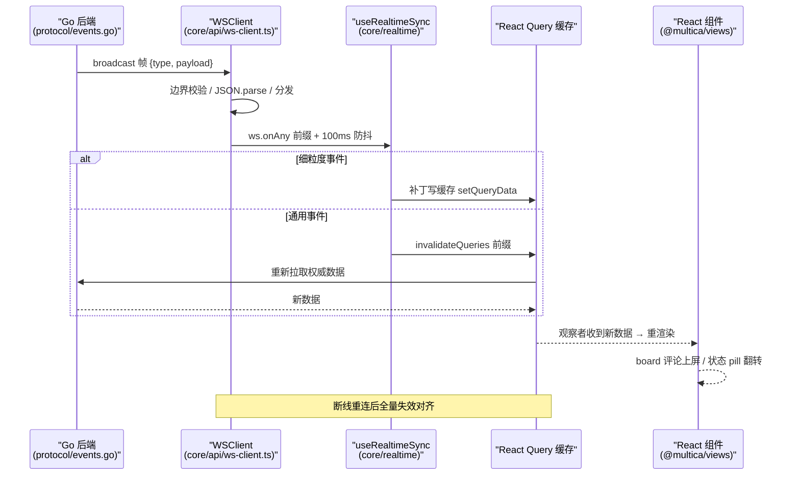
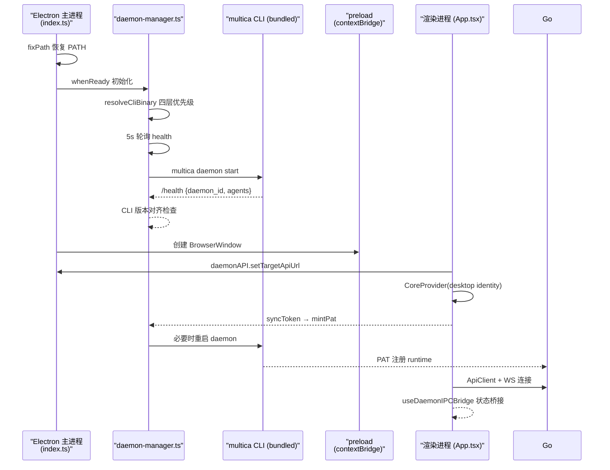

## 模块定位

一句话：**前端是把"多 Agent 协作现场"投射到浏览器 / 桌面 / iPhone 的三个投影仪，共享同一盏灯（packages/core 领域层），各自负责把 Go 后端的能力变成可交互的像素。**

本模块回答四个问题：Next.js 怎么组织路由并保持前后端类型对齐；WS 事件怎么穿过 provider 进 React Query 缓存变成 UI 更新；Electron 壳怎么把"这台电脑"自动注册成 runtime；移动端为什么坚持"镜像而不导入"。四个答案的公共分母，是 `packages/core` 这个被三端共享、又与 Go 领域模型严格对齐的领域层。

## 在项目中的角色

先回答"去掉前端会怎样"，这是理解它价值的起点。

### 去掉前端，Multica 还剩什么

后端已经完备——board 是后端数据模型与实时广播的真实来源（见 [realtime.md](realtime.md)），runtime/daemon 体系能独立跑任务（见 [runtime.md](runtime.md)）。但**没有前端，这些能力没有任何一个人类可见的入口**：

- 读：board 上 agent 的每一条评论、每一次状态迁移，都靠浏览器/桌面里的 React Query 缓存渲染出来；`packages/views` 承载了全部可见页面（board、issue 详情、inbox、chat、runtimes 列表）。
- 写：`apps/web/app/[workspaceSlug]/(dashboard)/issues/page.tsx` 这种**十几行的薄页面**负责把 App Router 的 URL 参数接进共享视图组件 `@multica/views/issues/components` 的 `IssuesPage`（该文件 `Page()` 主体就是一行渲染 `<IssuesPage />`）；写操作（建 issue、派任务、@agent）全部经由 `packages/core/api/client.ts` 的 `ApiClient` 带上认证头打到 `/api/**`。
- 端到端闭环：agent 在 runtime 上跑完任务、把结果写回 board，必须有一个人打开这个 board 看到"它 comments as it goes"。前端就是这条闭环的人机接口。

前端是"次要关注面"，但它的**架构分层决定了对齐成本**：如果 Web/桌面/移动三端各自实现一遍领域逻辑，后端的每个字段变更就要改三处；如果共享一个领域层，就只改一处。这是整个 monorepo 把 `packages/core` 抬到一等公民位置的根因。

## 根因：领域层为什么从 Next.js 里分离出来

### 三端面对同一个后端，第一性约束是"领域模型只有一个"

仓库同时存在 `apps/web`（Next.js）、`apps/desktop`（Electron 复用 web UI）、`apps/mobile`（Expo/RN）。如果领域代码（类型、查询客户端、realtime 同步、store）写在任何一端的 app 目录里，另外两端要么 import 一个 web 框架产物（Electron 可以，React Native 不可能），要么各自重写一份（三份漂移）。

`packages/core` 把领域逻辑抽到独立 workspace 包，是 monorepo 在 [pnpm-workspace.yaml:1-3]() <!-- anchor: packages: …   - packages/* --> 声明的 `apps/*` + `packages/*` 双区结构下的必然结果：

- **web 消费它**：[apps/web/components/web-providers.tsx:69-92]() <!-- anchor:     <CoreProvider …     </CoreProvider> --> 把 `CoreProvider` 包在 App Router 根部。
- **desktop 消费同一份**：[apps/desktop/src/renderer/src/App.tsx:453-464]() <!-- anchor:      {runtimeConfigResult.ok ? ( …           localeAdapter={localeAdapter} --> 在 Electron renderer 里包同一个 `CoreProvider`，只是 `apiBaseUrl`/`wsUrl` 来自主进程解析的 runtime config。
- **mobile 消费类型与 schema 白名单**：[apps/mobile/data/api.ts:16-60]() <!-- anchor: import type { … } from "@multica/core/types"; --> 用 `import type` 从 `@multica/core/types` 引入类型、从 `@multica/core/api/schemas` 引入 Zod schema，但**运行时代码自己写一份**——这是移动端特有的"镜像，不导入"策略（见下文"决策三"）。

三层消费强度递减：web/desktop 全量复用（含 provider 组件与 hooks），mobile 只复用纯数据（类型 + schema）。这个梯度本身就是设计——RN 的模块图与 web 完全不同，强绑 web 的 React/Query 代码是负资产。

### 前后端对齐：类型与 Zod schema 是同一个对齐面

[packages/core/types/events.ts:12-93]() <!-- anchor: export type WSEventType = …   | "pull_request:unlinked"; --> 的 `WSEventType` 联合类型在文件头直接声明"WebSocket event types (matching Go server protocol/events.go)"——**类型就是协议**。Go 端每个广播事件在 `protocol/events.go` 有一个字符串名，TS 端有同一个字符串名 + payload 类型，二者靠代码注释和人工 review 保持同步，但一旦对齐，编译器就能保证：`WSClient.on("issue:updated", …)` 的 handler 拿到的 payload 是编译期确定的 `IssueUpdatedPayload`，绝不需要 `as any`。

对齐面有两条线：

1. **类型线**：[packages/core/types/events.ts:553-636]() <!-- anchor: export interface WSEventPayloadMap { …   "pull_request:unlinked": unknown; --> 的 `WSEventPayloadMap` 把每个事件映射到 payload 类型，`WSEventPayloadMap` 加事件时漏掉 map 键，所有订阅点立刻编译报错（[packages/core/types/events.ts:547-551]() <!-- anchor:  *   const handler = (payload: WSEventPayload<"issue:created">) => { ... }; …  * forgets the payload shape — that's the whole point. -->）。
2. **运行时线**：HTTP 响应经 `parseWithFallback`（[packages/core/api/schema.ts:38-54]() <!-- anchor: export function parseWithFallback<T>( …   return fallback; -->）过 zod schema，校验失败不 throw 而是返回 fallback 并记日志——"API 契约漂移"从白屏事故降级为"页面降级但可渲染"（[packages/core/api/schema.ts:24-26]() <!-- anchor:  * but never throw — the UI layer must keep rendering. This is the boundary …  * into a degraded-but-rendering page. -->）。

这两条线合起来回答了"前端怎么跟 Go 后端对齐"：**编译期靠类型联合，运行期靠 schema 兜底，两处都是领域层集中定义，三端共享**。

### 状态管理为什么是 React Query 缓存，而不是 zustand 全局 store

[packages/core/query-client.ts:3-16]() <!-- anchor: export function createQueryClient(): QueryClient { …         retry: false, --> 的 `createQueryClient` 暴露了设计取向：`staleTime: Infinity`（缓存永不过期，**新鲜度完全交给失效信号**）、`refetchOnWindowFocus: false`。这与"WS 作为失效信号 + 主动 refetch"的实时同步模式互为表里（见下节）。zustand 只用于**会话级本地状态**（auth store、chat store），领域数据一律进 Query 缓存——因为 Query 缓存提供了查询键、失效、重连恢复这些 zustand 没有的原语。

这也是三端共享的关键：`apps/web` 和 `apps/desktop` 都靠同一个 `useRealtimeSync` 把 WS 事件写进同一个 `QueryClient` 结构，移动端则把自己的 `data/realtime` 镜像成同一套"事件 → 缓存失效"的语义（见 [apps/mobile/CLAUDE.md:221-228]() <!-- anchor: ### Mobile-owned updaters (don't import `packages/core/issues/ws-updaters.ts`) … When the same logic needs to exist on both sides, copy the design — not the impor --> 的 mirror 规则）。

## 设计思路

### Next.js App Router 组织：路由是薄壳，逻辑在 views，状态在 core

Web 端路由树分三组，语义边界清晰：

- `app/(landing)` + `app/(auth)`：公开营销站与登录/邀请/onboarding，无 workspace 上下文。
- `app/[workspaceSlug]`：**一切领域页面都挂在动态段下面**，因为 URL 里的 slug 就是 workspace 身份的唯一来源。`apps/web/app/[workspaceSlug]/layout.tsx:79-80` <!-- anchor:   if (workspace && workspaceSlug === workspaceSlugFromPathname(pathname)) { …     setCurrentWorkspace(workspaceSlug, workspace.id); --> 在渲染期把 slug 写进 `packages/core/platform/workspace-storage.ts` 的平台单例，下游每个 Query 的 `X-Workspace-Slug` 头、WS 连接的 workspace 绑定、persist 存储命名空间全部跟随它。
- 页面文件只做三件事：`"use client"`、包 `Suspense`（`useSearchParams` 需要）、把 `<IssuesPage />` 这类**来自 `@multica/views` 的共享组件**直接渲染（`apps/web/app/[workspaceSlug]/(dashboard)/issues/page.tsx:14-20` <!-- anchor: export default function Page() { …       <IssuesPage /> -->）。真正的 UI（sidebar、issue 表格、chat 窗口）全在 `packages/views`。

`(dashboard)/layout.tsx` 复用了 `@multica/views/layout` 的 `DashboardLayout`（[packages/views/layout/dashboard-layout.tsx:23-49]() <!-- anchor: export function DashboardLayout({ …     </DashboardGuard> -->），把 sidebar、全局快捷键、workspace presence prefetch、ModalRegistry 一次配齐——**desktop 复用同一份**（[apps/desktop/src/renderer/src/routes.tsx:132-133]() <!-- anchor:             element: <IssuesPage />, …             handle: { title: "Issues" }, --> 的 `IssuesPage` 来自同一个包）。

server component / client component 边界的原则：**SSR 只用于无状态壳**（`app/layout.tsx` 的字体/元数据/主题、landing 页），凡是碰 auth、workspace、realtime 的组件一律 `"use client"` 并共享 `CoreProvider`。[apps/web/components/web-providers.tsx:60-92]() <!-- anchor:   const cookieAuth = !hasLegacyToken(); …     </CoreProvider> --> 是 web 端的组装点：`cookieAuth = !hasLegacyToken()` 选择 cookie 还是 token 认证，`identity = { platform: "web", version, os }` 注入 `CoreProvider`，后者据此给每个 HTTP/WS 请求打 `X-Client-Platform` 等头（[packages/core/api/client.ts:458-460]() <!-- anchor: export interface ApiClientIdentity { …   platform?: string; -->）。

### 前后端代理：proxy.ts 把 Next 变成后端的前置路由

[apps/web/proxy.ts:49-56]() <!-- anchor: export function proxy(req: NextRequest) { …     return NextResponse.rewrite(url); -->（Next.js 16 把 middleware 改名为 proxy）承担三类职责：

1. **/api、/v1、/uploads、/ws、/docs、/health 的运行时 rewrite**：`runtimeRewriteDestination`（[apps/web/config/runtime-urls.ts:110-149]() <!-- anchor: export function runtimeRewriteDestination( …   return undefined; -->）按路径把请求转发到后端 origin，URL 在请求时从 `process.env` 解析而非构建期烘焙（生产自托管不改前端构建就能换后端地址）。
2. **老 URL 迁移**：`/issues/...` 这类旧段重写到 `/{lastSlug}/issues/...`，靠 `last_workspace_slug` cookie 定位（[apps/web/proxy.ts:64-91]() <!-- anchor:   const firstSegment = pathname.split("/")[1] ?? ""; …     return NextResponse.redirect(url); -->）。
3. **i18n locale 头转发**：把解析出的 locale 通过 `x-multica-locale` 请求头发给 RSC layout（[apps/web/proxy.ts:39-43]() <!-- anchor: function nextWithLocale(req: NextRequest): NextResponse { …   return NextResponse.next({ request: { headers } }); -->）。

matcher 用负向预查排除静态资源，保证 `/ws` 等敏感路径必定经过 proxy（[apps/web/proxy.ts:119-126]() <!-- anchor:   matcher: [ …     "/((?!api|v1|_next/static|_next/image|favicon.ico|.*\\.).*)", -->）。`next.config.ts` 的 `rewrites` 只兜 dev 环境与构建期 fallback（[apps/web/next.config.ts:51-95]() <!-- anchor:   async rewrites() { …       fallback: [], -->），生产以 proxy 运行时为准；`transpilePackages: ["@multica/core", "@multica/ui", "@multica/views"]` 让三个共享包在 Turbopack 下也能被 web 直接 import（[apps/web/next.config.ts:43]() <!-- anchor:   transpilePackages: ["@multica/core", "@multica/ui", "@multica/views"], -->）。

### 实时同步：WS 是失效信号，不是状态源

这是前端最重要的架构决策。`packages/core/realtime/use-realtime-sync.ts` 的 `useRealtimeSync` 在 WSProvider 里挂一次，把"事件类型前缀"映射到"对应 Query 失效函数"：

- **通用路径**：`ws.onAny` 拿到消息，取 `type.split(":")[0]` 前缀，按前缀查 `refreshMap` 做 **100ms 防抖失效**（[packages/core/realtime/use-realtime-sync.ts:981-985]() <!-- anchor:     const unsubAny = ws.onAny((msg) => { …       if (refresh) debouncedRefresh(prefix, refresh); --> + [packages/core/realtime/use-realtime-sync.ts:942-952]() <!-- anchor:     const timers = new Map<string, ReturnType<typeof setTimeout>>(); …         }, 100), -->）。例如 `agent:*` 事件失效 agents 缓存，`task:*` 事件失效 agent-task-snapshot、working-agents、issue table、activity 系列缓存（[packages/core/realtime/use-realtime-sync.ts:889-911]() <!-- anchor:       task: () => { …         qc.invalidateQueries({ queryKey: agentTasksKeys.all(wsId) }); -->）。
- **专用路径**：高频/高价值的 `issue:updated`、`comment:created`、`task:message`、`chat:*` 事件有专门 handler，做**细粒度缓存补丁**（乐观写入）而不是整段失效。例如 `chat:done` 先把 assistant 消息 `setQueryData` 进消息缓存、清 pending 占位，再 invalidate 让权威 refetch 兜底（[packages/core/realtime/use-realtime-sync.ts:1444-1470]() <!-- anchor:     const unsubChatDone = ws.on("chat:done", (p) => { …       invalidateSessionLists(); -->）。
- **重连恢复**：`ws.onReconnect` 触发 `invalidateWorkspaceScopedQueries` 全量失效 workspace 域查询（[packages/core/realtime/use-realtime-sync.ts:1746-1759]() <!-- anchor:   useEffect(() => { …   }, [ws, qc]); -->），因为断开期间的事件无法重放，只能靠重新拉取对齐。新的 WSClient 实例（换 workspace）走同样路径（[packages/core/realtime/use-realtime-sync.ts:1764-1777]() <!-- anchor:   const wsInstanceRef = useRef<WSClient | null>(null); …   }, [ws, qc]); -->）。

为什么"失效 + refetch"而不是"WS 推送直接更新 store"？两个权衡点：

1. **服务器是唯一真相**：很多事件只带增量字段（如 `chat:task:*` 不含权限过滤后的聚合），乐观拼装会绕过服务端权限过滤（[packages/core/realtime/use-realtime-sync.ts:1394-1411]() <!-- anchor:     // Helpers reused by chat lifecycle handlers. …     // cross-user aggregate leak. --> 的 SECURITY 注释），所以跨会话 pending 聚合只允许 invalidate，绝不允许 setQueryData。
2. **事件洪峰**：`task:message` 在长任务里逐条广播，直接每条写缓存会把一次渲染变成几百次。所以只在"已打开的 timeline"里收帧，且按 100ms 窗口批量合并成一次 `mergeTaskMessagesBySeq` 写（[packages/core/realtime/use-realtime-sync.ts:1343-1369]() <!-- anchor:     const taskMessageBatches = new Map<string, TaskMessagePayload[]>(); …       taskMessageBatches.clear(); -->）。

`WSProvider` 把 WS 生命周期绑定在"用户 + 当前 workspace slug"上：slug 变化（`setCurrentWorkspace` 通知）就拆掉旧 socket、按新 slug 建新连接（[packages/core/realtime/provider.tsx:80-101]() <!-- anchor:     if (!user || !wsSlug) return; …     ws.connect(); -->）。`useWSEvent`/`useWSReconnect` 是暴露给页面的订阅钩子（[packages/core/realtime/hooks.ts:13-19]() <!-- anchor: export function useWSEvent(event: WSEventType, handler: EventHandler) { …   }, [event, handler, subscribe]); -->），供 IssueDetail 这类需要细粒度更新的页面在 WSProvider 之外再挂自己的 handler——集中式全局同步 + 页面级细粒度订阅两层共存。

### WS 客户端：浏览器不能自定义握手头，于是 token 走首帧

[packages/core/api/ws-client.ts:73-89]() <!-- anchor:   connect() { …     this.ws = new WebSocket(url.toString()); --> 的 `WSClient.connect()` 只把 `workspace_slug`、`client_platform/version/os` 放 query string——**浏览器 WebSocket 握手无法设自定义头**，query 是唯一可移植通道；token 绝不进 URL（会被代理/浏览器历史记录），token 模式下改为连接建立后的第一条 `{ type: "auth", payload: { token } }` 消息，cookie 模式则靠 HttpOnly cookie 自动随握手发送（[packages/core/api/ws-client.ts:91-96]() <!-- anchor:     this.ws.onopen = () => { …           JSON.stringify({ type: "auth", payload: { token: this.token } }), -->）。重连用指数退避 + 抖动（1s 起、30s 封顶），因为 UI 没有可见的断线状态，客户端必须无限期自愈（[packages/core/api/ws-client.ts:163-179]() <!-- anchor:   private scheduleReconnect() { …     this.reconnectTimer = setTimeout(() => this.connect(), delay); -->）。对端每帧做信任边界校验：非 `{type: string}` 对象直接丢弃并记一次日志，防止坏帧打进下游每个 handler（[packages/core/api/ws-client.ts:113-127]() <!-- anchor:       // Trust boundary: a frame must be an object carrying a string `type`. …             summarizeUnparseable(event.data), -->）。

### Electron 壳：主进程管 daemon，renderer 复用 web UI

Desktop 是三端里架构最重的一端，因为它必须同时处理"渲染 web UI"和"在本机维护 runtime"两件事，主进程/预加载/渲染进程三层分工：

- **主进程**（`apps/desktop/src/main/index.ts`）：创建窗口、deep link（`multica://` 协议，[apps/desktop/src/main/index.ts:184-203]() <!-- anchor: function handleDeepLink(url: string): void { …       if (id) dispatchToMainRenderer("invite:open", decodeURIComponent(id)); -->）、单实例锁（[apps/desktop/src/main/index.ts:580-609]() <!-- anchor: const gotTheLock = app.requestSingleInstanceLock(); …   if (coldStartDeepLink) handleDeepLink(coldStartDeepLink); -->）、WS Origin 头剥离（dev 本地 origin 不被服务端白名单拒绝，[apps/desktop/src/main/index.ts:350-358]() <!-- anchor:   // Strip Origin header from WebSocket upgrade requests so the server's …       callback({ requestHeaders: details.requestHeaders }); -->）、加载 runtime config 后交给 daemon 管理（[apps/desktop/src/main/index.ts:611-628]() <!-- anchor:   app.whenReady().then(async () => { …         appUrl: viteEnv.VITE_APP_URL, -->）。
- **预加载**（[apps/desktop/src/preload/index.ts:100-101]() <!-- anchor: const desktopAPI = { …   /** App version + normalized OS. Read once at preload time so the renderer -->）：`contextBridge` 暴露三组 API——`desktopAPI`（窗口/通知/badge/系统语言）、`daemonAPI`（daemon 生命周期控制）、`updaterAPI`（自动更新）。`appInfo`（版本 + OS）用同步 IPC 在 preload 阶段取好，保证 renderer 首个 HTTP 请求就带上 `X-Client-Version/OS`（[apps/desktop/src/preload/index.ts:36-49]() <!-- anchor: function fetchAppInfo(): { version: string; os: "macos" | "windows" | "linux" | "u …   return { version: "unknown", os }; -->）。
- **渲染进程**：不跑 Next.js，而是 `createMemoryRouter`（react-router-dom）把 `@multica/views` 的页面组件按同样 URL 结构组织成 tabs（[apps/desktop/src/renderer/src/routes.tsx:251-255]() <!-- anchor: export function createAppRouter() { …     initialEntries: ["/"], -->），再包同一个 `CoreProvider`（[apps/desktop/src/renderer/src/App.tsx:453-464]() <!-- anchor:      {runtimeConfigResult.ok ? ( …           localeAdapter={localeAdapter} -->）。web 的"URL 驱动 workspace 单例"在桌面没有 URL bar，由 `workspace-route-layout.tsx` 用同样的 `setCurrentWorkspace` 补上（[apps/desktop/src/renderer/src/components/workspace-route-layout.tsx:107-109]() <!-- anchor:   if (workspace && workspaceSlug && !isWorkspaceDeletePending(workspace.id)) { …     setCurrentWorkspace(workspaceSlug, workspace.id); -->）。

### 自动注册 runtime：daemon-manager 把"这台电脑"变成一个 runtime

README 宣传的"Desktop registers the computer it's running on automatically and detects the agent CLIs installed there"（[README.md:132-133]() <!-- anchor: cloud box. Desktop registers the computer it's running on automatically and detects the a … CLIs installed there. On the web — or to add another machine — open **Runtimes** in the -->），落到实现是 `apps/desktop/src/main/daemon-manager.ts` 的一条链：

1. **CLI 解析**：按"捆绑 → userData 托管 → 下载最新 → PATH 兜底"的优先级找 `multica` CLI（[apps/desktop/src/main/daemon-manager.ts:501-511]() <!-- anchor: async function resolveCliBinary(): Promise<string | null> { …         cachedCliBinary = bundled; -->，优先捆绑二进制让 Desktop 与 Go 变更同仓库锁步）。
2. **profile 解析**：`resolveActiveProfile` 按目标 API URL 派生独立 profile（`~/.multica` 下按 server_url 命名），`server_url` 不匹配的 daemon 视为"别人的"，不接管（[apps/desktop/src/main/daemon-manager.ts:393-402]() <!-- anchor:   // Safety: if we have a target URL and the daemon on our port reports a …     return { state: "stopped" }; -->）。
3. **启动/健康轮询**：`startDaemon` 用 `multica daemon start` 拉起 daemon，随后 5s 一轮 `fetchHealth`（[apps/desktop/src/main/daemon-manager.ts:56-56]() <!-- anchor: const POLL_INTERVAL_MS = 5_000; -->），状态机覆盖 installing_cli → stopped → starting → running → auth_expired（登录过期时用 `/api/me` 探 token 判定，[apps/desktop/src/main/daemon-manager.ts:216-233]() <!-- anchor: async function probeTokenValidity(profile: string): Promise<AuthProbeResult> { …     return classifyAuthProbe({ networkError: true }); -->）。
4. **注册本体**：daemon 自身注册到服务端（runtime 列表出现该电脑），renderer 端 `useDaemonIPCBridge` 把本地 daemon 状态即时合并进 runtimes Query 缓存，绕过服务端 75s 的 sweeper 延迟（[apps/desktop/src/renderer/src/platform/daemon-ipc-bridge.ts:58-67]() <!-- anchor:  * Why: the server-side runtime sweeper takes up to 75s to flip a runtime to …  * every related runtime row sees the same status flip. -->）。desktop 的 Runtimes 页用 `bootstrapping` 区分"还没注册"与"正在装 CLI"（[apps/desktop/src/renderer/src/components/desktop-runtimes-page.tsx:18-30]() <!-- anchor: export function DesktopRuntimesPage() { …       bootstrapping={context.bootstrapping} -->）。
5. **版本对齐**：daemon 的 `cli_version` 与捆绑 CLI 不一致时，等 `active_task_count` 归零后自动重启（[apps/desktop/src/main/daemon-manager.ts:598-641]() <!-- anchor: async function ensureRunningDaemonVersionMatches(): Promise< …       return "restarted"; -->）。

关键环境细节：macOS GUI 从 launchd 拿到的 PATH 不含 shell 配置，主进程在 spawn 任何子进程前用 `fixPath` + 常见安装路径兜底恢复 PATH（[apps/desktop/src/main/index.ts:107-117]() <!-- anchor: if (process.platform !== "win32") { …   process.env.PATH = `${fallbackPaths.join(":")}:${process.env.PATH ?? ""}`; -->）——否则 daemon 找不到 claude/codex/opencode。每个 CLI 子进程带 `MULTICA_LAUNCHED_BY=desktop` 环境变量（[apps/desktop/src/main/daemon-manager.ts:929-936]() <!-- anchor: // Env passed to every CLI child so the daemon process knows it was spawned …   return { ...process.env, MULTICA_LAUNCHED_BY: "desktop" }; -->），服务端据此标记 runtime 为 desktop 托管。

## 关键数据结构

### 平台单例：当前工作区（URL 驱动）

`packages/core/platform/workspace-storage.ts` 是整个前端"现在在哪个 workspace"的唯一真相，配对的模块级变量 + 订阅者集合：

```ts
let _currentSlug: string | null = null;      // 主键，来自 URL / 活动 tab
let _currentWsId: string | null = null;      // 派生，来自 workspace 列表缓存
// 变更时通知：WSProvider 重建连接、persist store 按新 slug 命名空间重水合
```

`setCurrentWorkspace` 在 slug 变化时把两个副作用（订阅者通知、persist 重水合）延迟到 microtask，规避 React 19 渲染期跨组件 setState（[packages/core/platform/workspace-storage.ts:16-32]() <!-- anchor:  * Update the current workspace identity. This is the single source of truth …  * React 19 forbids "cross-component updates during render". -->）。`createWorkspaceAwareStorage` 把 zustand persist 的 key 自动加上 `:{slug}` 后缀（[packages/core/platform/workspace-storage.ts:106-115]() <!-- anchor: export function createWorkspaceAwareStorage(adapter: StorageAdapter): StateStorage { …     removeItem: (key) => { -->），保证切 workspace 不串数据。

### WS 帧与事件类型

`WSEventType` 是 90+ 事件的联合类型（[packages/core/types/events.ts:12-93]() <!-- anchor: export type WSEventType = …   | "pull_request:unlinked"; -->），帧结构 `{ type, payload, actor_id?, actor_type? }`（[packages/core/types/events.ts:95-99]() <!-- anchor: export interface WSMessage<T = unknown> { …   actor_type?: string; -->）。payload 携带领域对象（Issue、Comment、Agent）或增量字段（`issue_revision`、`assignee_changed`），消费方按事件粒度决定"整段失效"还是"细粒度补丁"。

### Runtime 领域对象

`RuntimeDevice` 是 daemon 注册的"机器实例"，`AgentRuntime = RuntimeDevice` 别名（[packages/core/types/agent.ts:59-93]() <!-- anchor: export interface RuntimeDevice { … export type AgentRuntime = RuntimeDevice; -->）。关键字段：`daemon_id`（IPC 桥靠它匹配本地 daemon）、`status: "online" | "offline"`（服务端 sweeper 维护，desktop 本地桥可提前覆盖）、`provider`（claude/codex/opencode…）、`profile_id`（自定义 runtime profile 回链）。

## 核心流程

### 流程一：实时事件从 WS 到 UI 更新的链路

这是"comments as it goes"的完整链路，跨 web/desktop 共用同一段代码：



设计要点：**通用事件走"失效 → refetch"，细粒度事件走"补丁 → 权威 refetch 兜底"**。前者保证数据永远不会绕过服务端权限/派生逻辑，后者保证高频事件（流式评论、任务进度）不产生 refetch 风暴。两层都以 React Query 缓存为唯一状态源，zustand 不参与领域数据。

### 流程二：Desktop 启动 → 自动注册 runtime → 连接后端



关键权衡：**Desktop 的 daemon 是"应用生命周期内的托管进程"，不是 OS 服务**。`desiredDaemonRunning` 标记 + `DaemonRecoveryPolicy` 决定 daemon 意外退出后是否拉起（[apps/desktop/src/main/daemon-manager.ts:100-107]() <!-- anchor: // Recovery is intentionally process-local: it keeps a daemon alive while the … let externalDaemonObserved = false; -->），退出时按 `autoStop` 偏好决定是否停掉 daemon（[apps/desktop/src/main/daemon-manager.ts:1480-1498]() <!-- anchor:   let isQuitting = false; …         app.quit(); -->）。JWT 转 PAT 是因为 JWT 30 天过期且绑定实例，daemon 需要长期 token（[apps/desktop/src/main/daemon-manager.ts:643-647]() <!-- anchor:  * Exchange the user's JWT for a long-lived PAT via POST /api/tokens. The …  * daemon needs a PAT (or `mul_` / `mdt_` token) because JWTs expire in 30 -->）。

## 与其他模块的协同

前端是后端能力的投影面，跨模块依赖都指向"领域层对齐"这一根因：

- **与 realtime 模块**：前端不发明自己的实时协议，`WSEventType` 逐字对齐 Go 的 `protocol/events.go`（[packages/core/types/events.ts:12-93]() <!-- anchor: export type WSEventType = …   | "pull_request:unlinked"; --> 头注释明示）。realtime 的广播语义（workspace fanout、actor_id 标识、daemon 注册事件）由后端决定，前端只决定"这条事件该失效哪些缓存"。desktop 额外把本地 daemon 状态通过 IPC 注入 runtimes 缓存（[apps/desktop/src/renderer/src/platform/daemon-ipc-bridge.ts:35-51]() <!-- anchor: function mergeDaemonStatus(rt: AgentRuntime, status: DaemonStatusLike): AgentRuntime { …   return rt; -->），这是唯一绕过 WS 通道的状态来源，且只在 desktop 存在。
- **与 runtime 模块**：前端 Runtimes 页展示的 `AgentRuntime` 是 daemon 注册的实例（[packages/core/types/agent.ts:59-93]() <!-- anchor: export interface RuntimeDevice { … export type AgentRuntime = RuntimeDevice; -->）；model 发现通过 `resolveRuntimeModels` 轮询（[packages/core/runtimes/models.ts:11-42]() <!-- anchor: const POLL_INTERVAL_MS = 500; …   SERVER_PENDING_TIMEOUT_MS + SERVER_RUNNING_TIMEOUT_MS + POLL_SLACK_MS; --> 把服务端 pending+running 两个窗口预算进客户端超时，避免"服务端还活着、客户端先超时"的误报）。runtime 的自动注册服务端细节（`daemon:register` 事件消费、75s sweeper）属于 [runtime.md](runtime.md)，此处只确认前端侧承接。
- **与 plugin/skill 模块**：前端只通过 `packages/core` 的查询键与 schema 消费这些领域对象，三端共享的失效路径（`useRealtimeSync` 的 refreshMap 里有 skill/plugin 前缀映射）保证改动一处即全端生效。plugin surface 的浏览器/桌面注入点是否与 plugin-sdk 的运行时约定一致。

## 关键设计决策

### 决策一：领域层共享 vs 各端独立——按"运行环境能力"切出三档共享

这不是非黑即白。三端对 `packages/core` 的依赖强度是**分层消费**：

- web/desktop 共享全量：`CoreProvider`、`ApiClient`、`useRealtimeSync`、所有 hooks 原样复用。代价是 core 包必须同时兼容 SSR（`defaultStorage` 用 `typeof window` 守卫，[packages/core/platform/storage.ts:3-8]() <!-- anchor: /** SSR-safe localStorage. Works in both Next.js (SSR) and Electron (always client). */ …     if (typeof window !== "undefined") localStorage.setItem(k, v); -->）与 Electron 渲染进程，任何环境假设都要写死在这层——这是共享的维护税。
- mobile 只共享"纯数据"：类型（`import type` 零运行时耦合）+ Zod schema + 领域常量，运行时代码（ApiClient、WSClient、缓存写入）在 `apps/mobile/data/` 镜像重写，靠 CLAUDE.md 的 "Mirror, don't import" 纪律强制（[apps/mobile/CLAUDE.md:221-228]() <!-- anchor: ### Mobile-owned updaters (don't import `packages/core/issues/ws-updaters.ts`) … When the same logic needs to exist on both sides, copy the design — not the impor -->）。

**替代方案**：让 mobile 直接 import core 的运行时层。代价是 RN 打包器要拖进 web 的 React 组件、`window`/`document` 依赖、react-query 的 web 行为假设，且 core 每次演进都要为 RN 跑回归——**把一个浏览器包塞进 RN 的 module graph，比维护一份镜像的成本高一个量级**。镜像方案的代价是两份实现要人工对齐，但对齐点收敛在类型/schema（编译期强校验）+ 明确的 mirror 注释（可 review）。

### 决策二：realtime 用"查询失效"而非"推状态"——服务器权限为唯一真相

WS 事件进前端有三条路：直接写 zustand、直接 setQueryData、invalidateQueries。项目选择以第三条为主、第二条为辅、第一条基本不用：

- 为什么不用 zustand 当领域状态源：`staleTime: Infinity` 意味着缓存是唯一新鲜度权威，zustand 没有"失效重拉"原语，切 workspace 的命名空间重水合也要额外做。
- 为什么不全用 setQueryData：chat 的 `task:*` 事件是 workspace 全员广播、payload 不含权限过滤结果，乐观写聚合会让成员 B 的任务翻转成员 A 的 FAB（[packages/core/realtime/use-realtime-sync.ts:1394-1411]() <!-- anchor:     // Helpers reused by chat lifecycle handlers. …     // cross-user aggregate leak. --> 的 SECURITY 注释直接写明这是安全边界）。**服务器过滤后的权威响应才是 pending 聚合的真相，所以只允许 invalidate 触发带权限的 refetch**。
- 为什么不全用 invalidate：流式评论/任务消息逐条广播，全量失效会 refetch 风暴。所以 `task:message` 只写入已打开 timeline 的缓存、且 100ms 批量合并（[packages/core/realtime/use-realtime-sync.ts:1343-1369]() <!-- anchor:     const taskMessageBatches = new Map<string, TaskMessagePayload[]>(); …       taskMessageBatches.clear(); -->），`chat:done` 先补丁后失效。

这套"失效为主、补丁为辅"的粒度梯度，本质是把"网络成本 vs 正确性"的权衡显式化：**通用事件付一次 refetch 换取正确性，高频事件付一次缓存写入换取流畅度**。

### 决策三：Electron 复用 web 包而非独立实现——UI 共享、壳层独有

Desktop 没有为 UI 另起炉灶（没有复制 dashboard、issue 表格、chat 窗口），而是把 `@multica/views` 的组件在 `createMemoryRouter` 里按 web 相同的 URL 结构组织（[apps/desktop/src/renderer/src/routes.tsx:114-132]() <!-- anchor: export const appRoutes: RouteObject[] = [ …             element: <IssuesPage />, -->）。这不是偷懒：**三端共享 UI 意味着后端字段/交互变更只改 `packages/views` 一处**。桌面特有的差异全部收在壳层：

- 没有 URL bar → workspace 单例由 `workspace-route-layout.tsx` 写入而非 URL 驱动，且要处理多 tab 同时挂载的竞争（singletonOwner symbol，[apps/desktop/src/renderer/src/components/workspace-route-layout.tsx:30-30]() <!-- anchor: let singletonOwner: symbol | null = null; --> 注释的 MUL-6303）。
- 需要本地能力 → daemon 管理、通知、badge、deep link、系统语言全走 preload 的 `desktopAPI`/`daemonAPI`。
- 需要窗口形态 → 主窗口多 tab + 独立 issue 窗口（`window:open-issue` IPC）。

替代方案是 Desktop 独立实现整套 UI，代价是每个领域变更 ×2；而当前方案暴露的代价是 `@multica/views` 必须保持"渲染无关"——不能碰 Next 专有 API，不能依赖 URL bar，路由上下文必须通过 props/context 注入（[apps/desktop/src/renderer/src/components/workspace-route-layout.tsx:178-197]() <!-- anchor:   return ( …       {!overlayActive && <SourceBackfillModal />} --> 手动补 `WorkspacePresencePrefetch`/`SourceBackfillModal` 就是 web layout 被桌面手动补齐的证据）。

## 亮点与问题

### 亮点

- **类型即协议，schema 兜运行时**：`WSEventType` + `WSEventPayloadMap` 把事件协议做成编译期约束，新增事件漏注册 map 就编译失败；HTTP 侧 `parseWithFallback` 把契约漂移降级为可渲染的页面。这是"前后端对齐"落到代码层面的最强手段。
- **实时同步的分层失效**：onAny 前缀防抖 + 专用 handler 补丁 + 重连全量失效三层配合，同时解决正确性（权限真相）、性能（refetch 风暴）、一致性（断线恢复）三个问题，且全部集中在 `use-realtime-sync.ts` 一个文件，可测试性高（`use-realtime-sync.test.ts` 存在）。
- **desktop 本地状态桥接**：`useDaemonIPCBridge` 用 IPC 把本地 daemon 状态即时合并进 runtimes 缓存，绕过服务端 75s sweeper——本地机器的即时反馈与远程机器的慢同步被同一套缓存优雅区分。

### 问题

- **`use-realtime-sync.ts` 是 1778 行的巨文件**，所有事件的失效逻辑集中在一次 `useEffect` 里，事件类型爆炸后维护和测试成本都在上升。mobile 已经用 per-feature hooks 规避了同一问题（[apps/mobile/data/realtime/realtime-provider.tsx:16-28]() <!-- anchor:  *   AppState 'background'  → pause socket (iOS will kill it anyway; clean …  * scales without one giant 700-line file like web's use-realtime-sync. --> 明确吐槽 "one giant 700-line file"），web/desktop 侧尚未重构。是否已有拆分计划。
- **mobile 镜像的成本已显性化**：`apps/mobile/data/api.ts` 1307 行镜像 + 独立 WSClient（398 行）+ per-feature updaters，每加一个后端字段要同步多处。CLAUDE.md 的 mirror 纪律是软约束，依赖 review 执行，长期看维护者会感到"三端对同一契约各写一份"的重复压力。
- **移动端不共享 `useRealtimeSync`**，导致 web/desktop 的"断线全量失效"与 mobile 的 per-feature 重连逻辑各写一遍，协议演进（例如未来加入事件重放）需要三处同步——这是共享层红利被 mobile 隔离策略削弱的地方。

