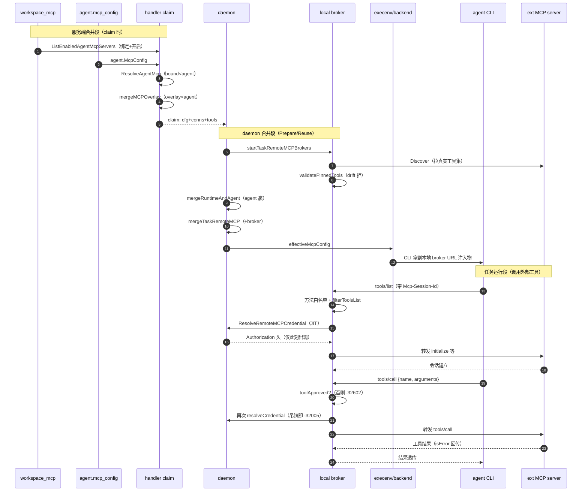
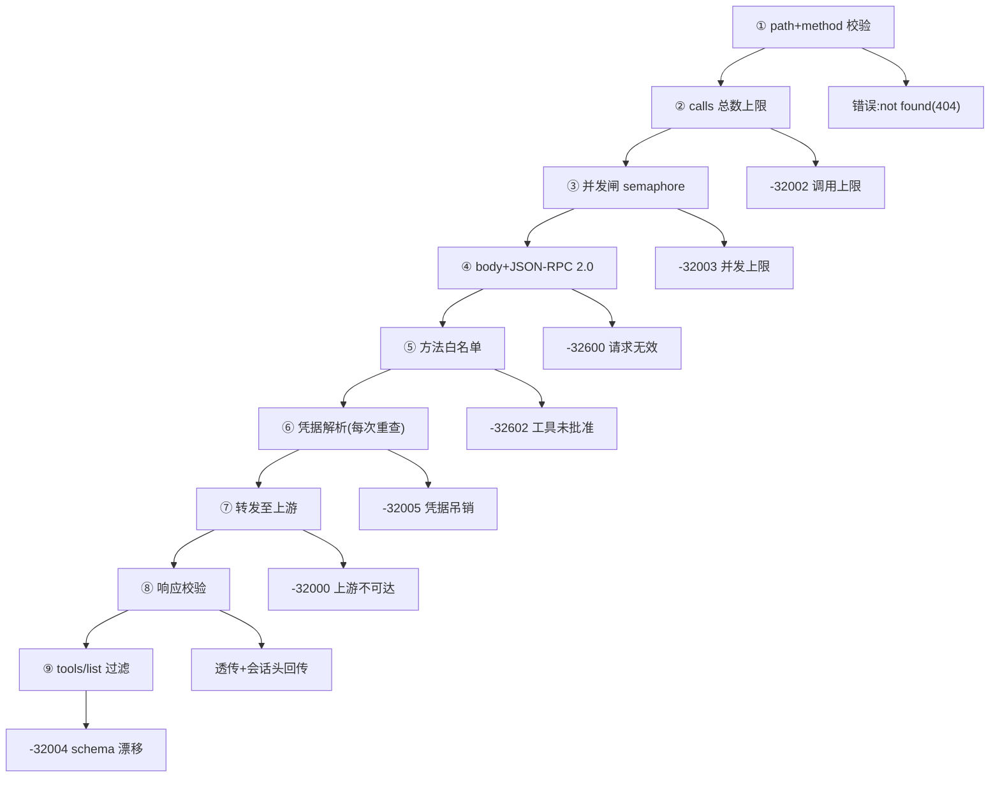
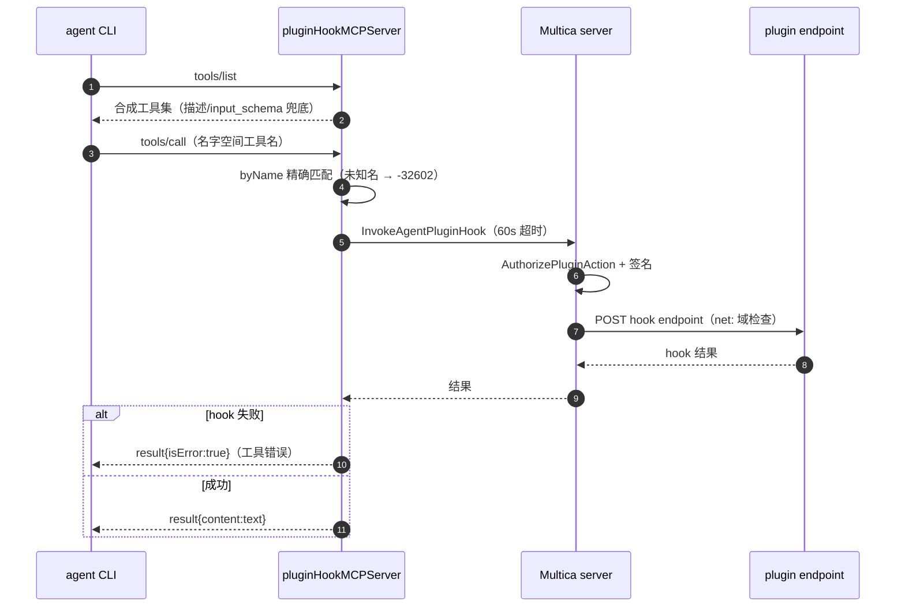

# MCP 接入层：为 CLI 会话注入外部能力的双通道

## 模块定位：MCP 是 agent CLI 能力的天花板放大器

Multica 驱动的是用户已安装的 26 种 agent CLI，但 CLI 自带工具是有限的——写文件、读仓库、跑命令是每个 CLI 都有的，而「查数据库、调 Slack、控浏览器」这类外部能力必须靠 MCP（Model Context Protocol）server 注入。本模块回答的问题很直接：**除了 CLI 自带工具，Multica 还能给 CLI 会话注入什么，以及 Multica 自己如何作为 MCP 端点被消费**。

实现上分为四个层次，各自回答一个子问题：

| 层 | 承载物 | 回答的问题 |
|---|---|---|
| 配置来源 | `agent.mcp_config`（046）、`workspace_mcp_server`（315）、`agent_task_queue.runtime_mcp_overlay`（128） | 谁声明了哪些 MCP server |
| 合并链路 | `internal/handler/workspace_mcp.go`、`internal/handler/mcp_overlay.go`、`internal/daemon/runtime_mcp.go` | 多个来源如何按优先级汇成一份任务级配置 |
| 本地注入 | `internal/daemon/execenv/` 的 sidecar 生成器 + `pkg/agent/` 各后端 argv/env | 配置如何变成 CLI 会话实际拿到的东西 |
| 远程代理 | `internal/daemon/remote_mcp_broker.go`、`plugin_hook_mcp.go`、`pkg/remotemcp/` | Multica 如何把自己变成 CLI 能连接的 MCP 宿主 |

去掉这层的后果是直接可见的：agent 只能做 CLI 开箱即用的那点事，而「工作区共享一套 MCP server」「插件携带 MCP 能力」「按 schema digest 审批外部工具」这三个 Multica 相对裸 CLI 的增值点全部消失——用户得回到每台机器手动编辑 `~/.claude.json`、`~/.codex/config.toml` 的状态，且没有任何审批与凭据治理。

## 根因：为什么不能让 CLI 直连外部 MCP server

### 配置侧的根因：MCP 配置是 secret，且散落在各 CLI 自己的文件里

每个 CLI 的 MCP 配置形态完全不同：Claude 读 `~/.claude.json`（JSON）、Codex 读 `~/.codex/config.toml`（TOML）、Cursor 读 `~/.cursor/mcp.json`、OpenCode 读 `~/.config/opencode/opencode.json`。更关键的是这些条目**几乎都是凭据载体**——`url` 里嵌 bearer、`env` 里放 token、`headers` 里带 API key。Multica 若想「服务端管一套、用户机器全生效」，就必须面对两个约束：

1. **secret 不能离开用户机器**。daemon 在用户机器上跑，所以任务级合并必须在 daemon 内完成，`mergeRuntimeAndAgentMcpConfig` 的注释把这点讲得很直白——合并发生在本地 daemon，runtime 的 URL/headers/command/env 永远不需要离开机器。

[server/internal/daemon/runtime_mcp.go:26-30]()
<!-- anchor: // mergeRuntimeAndAgentMcpConfig builds the task-local MCP configuration used … // values never need to leave the machine. -->

2. **runtime 原生配置与托管配置的边界要算清**。`loadRuntimeMcpServerConfigs` 为每个 provider 按各自的路径与格式解析原生配置（Claude 读 JSON、Codex 读 TOML、OpenCode 读 JSON，key 名也不同——`mcpServers` vs `mcp_servers` vs `mcp`），并把它们作为「运行时底座」与 agent 托管配置合并；而 kimi 被刻意排除在合并之外——`kimi acp` 会自己把用户文件与 session/new 里带的 `mcpServers` 合并，daemon 再合并一次就会把每个 user server 拉起两遍。

[server/internal/daemon/runtime_mcp.go:404-408]()
<!-- anchor: 		// Inventory only — kimi is deliberately absent from … 		// again would spawn every user server twice. -->

### 远程侧根因：外部 MCP server 的「能力是流动的」，托管必须伴随审批

MCP 与普通 HTTP API 的本质差异，在 `plugin_mcp_transport.go` 的注释里被一句话点破：http hook 的 manifest 声明一个端点、管理员读过的形状是固定的；而 **MCP server 在运行时自己决定工具列表，且随时可以改**——「安装这个插件」若不设防，就变成「无限期授权执行这个服务器下周提供的任何东西」。

[server/internal/service/plugin_mcp_transport.go:17-27]()
<!-- anchor: // The whole difference from an `http` hook is who decides the shape. An http … // wires the plugin's hook into the connection shape that check already reads. -->

由此引出本模块三个环环相扣的设计决定：**发现（Discover）只读不采纳、审批（Approve）按 schema digest pin 住工具集、运行时（broker）只放行被 pin 的工具**。安装插件不是授权，审批工具才是。

### 第三个根因：插件 hook 的签名 secret 不能放 daemon

插件系统让第三方写 HTTP endpoint，Multica 以签名请求调用它。若让 daemon 直接调用，每台跑 agent 的机器都要持有能向所有插件后端冒充服务器的凭据。`plugin_hook_mcp.go` 的注释给出了选择：**daemon 的本地 MCP server 不直连插件，而是把工具调用回发给 Multica server，由 server 做签名请求**——这样 rate limit、熔断、`net:` 检查、调用记录对四种触发器（UI/manual/event/agent）全是同一套代码。

[server/internal/daemon/plugin_hook_mcp.go:23-28]()
<!-- anchor: // A tool call does NOT go to the plugin from here. It goes back to Multica, … // and invocation record are the same code for all four triggers. -->

## 设计思路：三层合并 + 两套本地 MCP server

### 配置→注入链路：一条「服务端合并 + daemon 合并」的双段链

MCP 配置从三个持久化来源出发，最终汇成一份 daemon 传给 CLI 的 JSON。链路在服务端与 daemon 各合并一次：

```
来源一：agent.mcp_config            （046，agent 私有）
来源二：workspace_mcp_server 绑定   （315，库式条目，显式绑定+开关）
来源三：runtime_mcp_overlay        （128，任务级，enqueue 时写入，终态清空）
                │
                ▼  服务端（claim 时）
    ResolveAgentMcpConfig（绑定→agent 私有，agent 同名获胜）
    mergeMCPOverlay（overlay→agent，overlay 同名获胜）
                ▼
    wire 上的 agent.mcp_config
                │
                ▼  daemon（Prepare/Reuse 时）
    mergeRuntimeAndAgentMcpConfig（runtime 原生→agent，agent 同名获胜）
    mergeTaskRemoteMCPConfig（+remote broker 注入的 http 入口 + plugin hook 入口）
                ▼
    effectiveMcpConfig → execenv sidecar / agent backend argv/env / ACP session/new
```

服务端那半段的优先级契约写在 `ResolveAgentMcpConfig` 的注释里，是 `bound < agent < overlay` 三级：

[server/internal/handler/workspace_mcp.go:30-35]()
<!-- anchor: //	bound workspace servers  <  agent's own servers  <  per-task overlay … //     in. A workspace MCP server is a LIBRARY entry, exactly like a workspace -->

关键语义是「**库式条目**」——工作区 MCP server 就像工作区 skill，创建时不给任何人，必须显式绑定到某个 agent 才生效，且带独立的 on/off 开关。这保证共享凭据不会隐式扩散到没人 opt-in 的 agent。

[server/internal/handler/workspace_mcp.go:32-38]()
<!-- anchor: //   - Only servers explicitly bound to this agent and left enabled are folded … //     spreading to agents no one opted in. -->

而「同名谁赢」的规则在两端刻意一致：agent 自己的条目 > 绑定的工作区条目 > overlay（overlay 携带 live 的 user-scoped session URL，如 Composio 的 bearer，覆盖 agent 保存的过期/占位条目）。overlay 的语义是「任务级、short-lived、带终态自动清空」——`runtime_mcp_overlay` 存的是 bearer token，128 迁移用一个 BEFORE UPDATE 触发器在任务进入 terminal 状态时把它置 NULL，保证队列审计永远不会看到挂在已结束任务上的过期凭据。

[server/migrations/128_agent_task_queue_runtime_mcp_overlay.up.sql:36-47]()
<!-- anchor-base64:ICAgIC0tIE9ubHkgYWN0IG9uIGFjdHVhbCB0cmFuc2l0aW9ucyBJTlRPIGEgdGVybWluYWwgc3RhdGUgZnJvbSBhIG5vbi10ZXJtaW5hbCDigKYgJCQgTEFOR1VBR0UgcGxwZ3NxbDs= -->

### 注入形态：因 CLI 而异的三条通道

合并出的 `effectiveMcpConfig` 在 daemon 侧被消费成三种形态，本质是「CLI 原生怎么吃配置就怎么喂」：

1. **argv/临时文件**：Claude/CodeBuddy 走 `--mcp-config <tempfile>`（带 `--strict-mcp-config` 收紧为「只用托管集」），Qwen 走 `--mcp-config` 的 0600 临时文件。Codex 没有该 flag，改为 `ensureCodexMcpConfig` 把 JSON 渲染成 TOML 的 `[mcp_servers.*]` 块写进任务的 config.toml——且托管集是 strict 语义：会**剥离用户全局 `~/.codex/config.toml` 里的 `[mcp_servers.*]`**，因为 TOML 拒绝同表重复定义、以及「管理员在 MCP Tab 存了显式清单却看到用户全局 server 悄悄混进来」违背 UI 语义。

[server/pkg/agent/codex.go:522-536]()
<!-- anchor: 	if managed { … 		stripped = stripCodexUserMcpServerTables(stripped) -->

2. **sidecar 文件/环境**：Cursor 走 `prepareCursorMcpConfig` 写项目 `.cursor/mcp.json`，OpenClaw 走「sanitized snapshot + `$include`」——托管集是 strict 替换，剥掉用户 resolved config 的 `mcp.servers` 再写 sanitized 快照（0600），让 managed 集成为唯一 MCP server 定义而用户的 `mcp.*` 其它调优仍透传。OpenCode 走 `OPENCODE_CONFIG_CONTENT` 环境变量而非写文件——因为任务 workdir 跨 turn 复用，写文件会覆盖用户/agent 自己写的 `opencode.json`，env 随进程死亡零清理。

[server/internal/daemon/execenv/openclaw_config.go:381-391]()
<!-- anchor: 	// **Strict replace for managed mcp_config.** When the agent has a managed … 	// tuning still flows through. -->

3. **ACP 协议**：Hermes/Kimi/Kiro/Grok 等 13 个 ACP 运行时既不读 argv 也不读文件——`buildACPMcpServers` 把 `mcp_config` 翻译成 ACP 的 `McpServer` 数组，随 `session/new` 发出去，resume 时再随 `session/resume`/`session/load` 重发以保住工具集。

[server/pkg/agent/hermes.go:2277-2291]()
<!-- anchor: func buildACPMcpServers(raw json.RawMessage, logger *slog.Logger) ([]any, error) { … 		warnNonCanonicalMcpConfigKey(trimmed, logger) -->

### remote MCP broker：Multica 作为 MCP 宿主的代理层

这是本模块最重的一块。**remote MCP 的动机是凭据治理**：外部 MCP server（比如插件作者跑的、或 workspace 配置的托管 server）需要 Authorization header 才能连，而 daemon 不能持有、任务记录里也不能落。于是 Multica 采用「**任务级本地 broker 代理**」：daemon 为每个任务在 `127.0.0.1:0` 起一个 HTTP server，CLI 通过 `http://127.0.0.1:<port>/<24字节随机token>` 连接；broker 收到 CLI 的 MCP 请求后，**动态**向 server 解析凭据（`ResolveRemoteMCPCredential`，按 contribution id 区分 plugin/remote 两条路由），再转发到真实端点。凭据从不出现在 claim 载荷里，token 是 workspace+daemon 作用域的短期值。

[server/internal/daemon/remote_mcp_broker.go:112-138]()
<!-- anchor: 		listener, err := net.Listen("tcp", "127.0.0.1:0") … 		servers[name] = map[string]any{ -->

broker 在转发链上有四层防线（见下文核心流程），每层对应一个独立的安全属性；且 `startTaskRemoteMCPBrokers` 会在启动时做**启动校验**——先 Discover 拉真实工具集、与批准集逐一比对（缺失或 digest 漂移即拒），再验证端点是公共 HTTPS。启动失败时按 failure-policy 分流：`optional`（插件贡献的连接恒为 optional）降级为 diagnostic 不阻塞任务，`required` 直接让任务 fail。

[server/internal/daemon/remote_mcp_broker.go:62-106]()
<!-- anchor: 	for _, connection := range connections { … 			set.Close() -->

### plugin hook MCP：把插件 hook 合成成 MCP 工具

与 remote broker 相邻的是第二套本地 MCP server：`plugin_hook_mcp.go`。它**没有上游 MCP server 可代理**——插件作者写的是普通 HTTP endpoint，从不学 MCP。所以这里从 manifest 合成协议：hook 描述变成工具描述、hook 的 input_schema 变成工具的 inputSchema、`tools/call` 不直连插件而是把调用**回发给 Multica server**（`InvokeAgentPluginHook`），由 server 做签名请求。合成物以固定名 `multica-plugins` 注入，与 remote broker 的产物走同一条 merge 路径，因此两者到 agent 只有一条路。

[server/internal/daemon/plugin_hook_mcp.go:16-21]()
<!-- anchor: // A local MCP server that presents this workspace's plugin hooks as tools. … // becomes the tool description, the hook's input_schema becomes the tool's. -->

### stdio/HTTP/SSE 与能力门控

传输形态跟随 CLI：stdio（本地命令）与 http/sse（远程 URL）在配置里由 `type`/`command`/`url` 区分。daemon 侧对远端的能力做了**传输门控**——ACP 运行时从 `initialize` 响应读 `agentCapabilities.mcpCapabilities`，没声明 http/sse 就不发对应条目，否则按协议是违规、会让整个 `session/new` 被 JSON-RPC 错误拒掉；stdio 永不设限。例外只有一个：内置 Hermes 二进制验证过「不声明却接受」，自定义 `protocol_family: hermes` 的 profile 不享受该例外。

[server/pkg/agent/hermes.go:2570-2596]()
<!-- anchor: // Sending an http/sse entry to a runtime that doesn't support it is a … 		return servers -->

## 关键数据结构

### `remotemcp.Connection`：claim 时线的「连接描述」，凭据缺席

这是 remote MCP 在服务端与 daemon 之间唯一的线形契约。最关键的设计是**凭据刻意缺席**——`Connection` 里只有 `Endpoint`、`CredentialHeader`（声明「该用什么 header」，不含值）、`ApprovedTools`（带 `SchemaDigest` 的批准集）、`FailurePolicy`。`ContributionID` 是区分插件贡献与 workspace 自身配置的唯一凭据，靠 `plugin:` 前缀标记，绝不允许从字符串形状猜——否则一个恰好含冒号的 cloud 签发 id 会被解析到错误的凭据路由。

[server/pkg/remotemcp/types.go:20-38]()
<!-- anchor: // Connection is claim-time, task-scoped connection metadata. Credentials are … 	FailurePolicy        string          `json:"failure_policy"` -->

### `Tool.SchemaDigest`：审批的指纹，不只是名字

`Tool` 携带 `SchemaDigest`（sha256 内容指纹），是整个审批体系的基石。注释讲清了动机：pin 住「管理员批准的具体形状」，server 之后换参数不改名时 agent 无从察觉——digest 就是让这种漂移暴露的哨兵。

[server/pkg/remotemcp/types.go:9-18]()
<!-- anchor: // Tool is one remote MCP tool pinned by an administrator. SchemaDigest freezes … 	Risk         string          `json:"risk,omitempty"` -->

### `remoteMCPProxy`：任务级 broker 的无状态代理体

每个 connection 一个 `remoteMCPProxy`，持有所需的一切：任务 id、连接描述、固定的上游 `endpoint`、`client`（安全 HTTP client）、启动时解析好的 `credentialHeaders` + 运行时 `resolveCredential` 回调、随机 `path`、`semaphore`（并发闸）与 `calls` 计数器。它是无状态的——每个请求独立校验并转发，任务级限制（调用上限、并发上限）由这两个原子字段承担。

[server/internal/daemon/remote_mcp_broker.go:207-218]()
<!-- anchor: type remoteMCPProxy struct { … 	logger            *slog.Logger -->

### `remoteMCPBrokerSet` / `pluginHookMCPSet`：生命周期容器

`sync.Once` 保证 Close 幂等，`server.Serve` 在 goroutine 中跑、`lifetimeCtx.Done()` 触发关闭。这套「per-task set + lifetime ctx」的模式让 broker 的生命周期与任务绑定——任务结束即关闭，token 即失效。

[server/internal/daemon/remote_mcp_broker.go:31-50]()
<!-- anchor: type remoteMCPBrokerSet struct { … 		_ = listener.Close() -->
[server/internal/daemon/plugin_hook_mcp.go:48-65]()
<!-- anchor: type pluginHookMCPSet struct { … 		_ = set.listener.Close() -->

### `PluginMCPApprovals` / `PluginHookTool`：插件侧的审批与工具描述

`mcp_approvals` 是一个按 hook key 组织的 JSONB map，存的是「该 hook 批准的工具集 + 审批人/时间」——JSONB 而非独立表，因为没有任何东西 join 它、没有查询进它内部，表会成为与安装生命周期平行的第二个生命周期。`PluginHookTool` 是 daemon 渲染给 agent 的工具描述，`Name` 经 `PluginToolName` 命名空间化——插件 key 的短 digest（6 位 hex）加 `__` 分隔符，保证 `a.b` 与 `a-b` 的 sanitize 塌缩不会让两个插件互相遮蔽（`a.b_`+`c` 与 `a.b`+`c` 这类注入碰撞被 digest 消解）。

[server/migrations/369_plugin_mcp_approvals.up.sql:20-25]()
<!-- anchor-base64:LS0gSlNPTkIgcmF0aGVyIHRoYW4gYSB0YWJsZTogbm90aGluZyBqb2lucyBvbiBpdCwgbm90aGluZyBxdWVyaWVzIGluc2lkZSBpdCwgYW5kIOKApiAgICAgQ0hFQ0sgKGpzb25iX3R5cGVvZihtY3BfYXBwcm92YWxzKSA9ICdvYmplY3QnKTs= -->
[server/internal/service/plugin_agent_tools.go:34-45]()
<!-- anchor: type PluginHookTool struct { … 	InputSchema json.RawMessage `json:"input_schema,omitempty"` -->

## 核心流程

### 流程 A：MCP server 配置 → 注入 CLI 会话 → 工具调用 → 结果回传

下图是端到端主链路（含 remote broker 的审批环节）。两条本地注入路径都画了——左侧是「配置合并+注入」的纵向主线，右侧是任务运行时「工具调用」的横向往返。



读图的三个关键点：

1. **审批在两端各执一半**：daemon 启动时的 `validatePinnedRemoteMCPTools` 保证「批准的工具现在还在、形状没变」；运行时的 `toolApproved` 保证「agent 此刻调用的就是批准集里的那一个」。前者守静态、后者守动态，缺一个都不完整。

2. **凭据出现两次、且都不落盘**：启动时解析一次（给 Discover 用）、每次 `tools/call` 前再解析一次（`TestRemoteMCPProxyRechecksCredentialBeforeUpstreamCall` 验证了吊销场景——credential 解析失败返回 -32005 且不触达上游）。token 24 小时过期，broker 生命周期短于任务。

3. **工具调用的失败降级**：插件贡献的连接 `FailurePolicy=optional`，MCP server 挂掉只降级该连接、任务照常跑；同一规则下，插件 http hook 调用失败是**工具错误**（`isError: true`）而不是协议错误——agent 读到的是「工具没干成」而非「工具链坏了」。

### 流程 B：remote MCP broker 的单次请求转发链

`remoteMCPProxy.ServeHTTP` 是整层安全属性的载体，一次转发经过 9 个节点、8 种错误出口：



`allowedRemoteMCPMethod` 的名单揭示了一个克制的取舍：**只放行 initialize/notifications/ping/tools/list/tools/call 五类**——`prompts/`、`resources/` 这两个 MCP 能力域被有意排除，remote broker 只做工具注入（本模块的定位就是工具，不承诺资源/提示），这让能力面窄、可审计。`tools/list` 的响应会被二次改写：只返回批准集且用**已审核的 description**覆盖上游描述（`TestRemoteMCPProxyFiltersToolsAndInjectsCredential` 断言了 `pinned` 描述被保留）——避免上游换 description 来操纵 agent 的调用意图。

[server/internal/daemon/remote_mcp_broker.go:368-371]()
<!-- anchor: func allowedRemoteMCPMethod(method string) bool { … 		return true -->
[server/internal/daemon/remote_mcp_broker.go:386-426]()
<!-- anchor: func (proxy *remoteMCPProxy) filterToolsListResponse(raw []byte) ([]byte, error) { … 	return json.Marshal(response) -->

### 流程 C：插件 http hook → MCP 工具的回流（plugin hook 合成端）

与 broker 不同，plugin hook MCP server 是「合成」而非「代理」，其核心是失败语义的双层设计：



这条路径的护栏是「**签名 secret 只在 server**」：daemon 连插件 endpoint 都不认识，它的全部贡献就是「把 hook 说成 MCP 工具 + 把调用转交 server」。`TestPluginHookToolFailureIsAToolErrorNotATransportError` 钉死了这条语义——失败返回 `isError` 而非 JSON-RPC error，否则 agent 会以为自己的工具链坏了。

[server/internal/daemon/plugin_hook_mcp.go:194-233]()
<!-- anchor: func (s *pluginHookMCPServer) handleCall(w http.ResponseWriter, r *http.Request, request pluginHookMCPRequest) { … 		"content": []map[string]any{{"type": "text", "text": text}}, -->

### 凭据治理的完整闭环

凭据不落 claim、不落任务记录，靠的是三段式：

1. **claim 时**：`remoteMCPDaemonTokenForClaim` 仅为有连接的 claim 生成短期 daemon token（24h，hash 与任务 token 原子提交），随 claim 响应返回 raw 值——注释强调它「绝不进 agent env/config」。

[server/internal/handler/daemon.go:1901-1921]()
<!-- anchor: // remoteMCPDaemonTokenForClaim prepares the short-lived credential the daemon … 	}}, nil -->

2. **dial 时**：daemon `ResolveRemoteMCPCredential` 按 contribution id 前缀路由到 `remote-mcp` 或 `plugin-mcp` 两条 handler——插件连接的 secret 存在插件的 secret 存储（secretbox 加密、write-only），由 `plugin:installUuid:hookKey` 解析出安装与 hook 再解密。

[server/internal/daemon/client.go:222-244]()
<!-- anchor: func (c *Client) ResolveRemoteMCPCredential(ctx context.Context, daemonToken, taskID, contributionID string) (http.Header, error) { … 	return headers, nil -->

3. **调用时**：每次上游调用前重解析（见流程 B 的 G2），吊销在下一跳立即生效。

三层共同的底线是：**secret 只存在于 daemon 进程内一次转发的瞬间**。工作区级 MCP server 的 `config` 列同理——API 响应投影成不含 url/command/headers/env 的清单，审计日志只记名字不记条目（`workspace_mcp_api.go` 的多处注释反复强调「never echo」）。

[server/internal/handler/workspace_mcp_api.go:15-20]()
<!-- anchor: // WorkspaceMcpServerResponse is the intentionally non-secret shape of one … // runtimeLocalMcpServerSummary, which draws the same line for the same reason. -->

## 与其他模块的协同

- **execenv（注入执行端）**：`PrepareParams.McpConfig` / `ReuseParams.McpConfig` 是本模块向 CLI 物质化的接口。复用路径同样重放配置——「复用一个 stale wrapper 会把上一轮的旧 MCP 集留在场」，所以 Reuse 必须重新 materialise。OpenClaw 的 strict-replace 快照、Cursor 的 `.cursor/mcp.json`、OpenCode 的 `OPENCODE_CONFIG_CONTENT` 是三个并行 sidecar 生成器，各自按 CLI 原生语义实现「托管集唯一」的同一契约。各 sidecar 生成器（cursor_mcp.go/omp_mcp.go/openclaw_config.go/qwenpaw 等）在 runtime 模块草稿中是否有更细的逐家说明。

- **agent 后端（argv/env 端）**：Claude/CodeBuddy 的 `--mcp-config`+strict、Qwen 的 `--mcp-config` 临时文件、Codex 的 config.toml 块、OpenCode 的 env 注入，都是 `ExecOptions.McpConfig` 的消费端。OpenCode 那个值得单记：env 注入刻意避开写 workdir 文件，因为任务 workdir 跨 turn 复用、`opencode.json` 可能已被用户/agent 写过——env 随进程死亡零清理。

[server/pkg/agent/opencode_mcp.go:73-89]()
<!-- anchor: // Why env-var injection vs writing <workdir>/opencode.json: the task workdir … // semantics of agent.mcp_config being the authoritative daemon-managed -->

- **ACP 运行时**：`buildACPMcpServers` + `filterACPMcpServersByCapability` 是 ACP 族的注入端（详见 ACP 模块草稿）；这里强调它与本模块的接口语义——canonical envelope（`mcpServers`）是硬约束，runtime-native 的 `servers`/`mcp`/`mcp_servers` 键只警告不采纳，因为「周围条目的形状不保证匹配 ACP，猜着转发只会转发半懂配置」。

[server/pkg/agent/hermes.go:2322-2328]()
<!-- anchor: // mcp_config is stored as opaque JSON, so pasting a runtime's own config … // half-understood config. -->

- **plugin 模块（边界划分）**：本模块只处理插件 MCP 的「传输与服务治理」——hook 的 `mcp` transport 发现/审批/凭据走 `plugin_mcp_transport.go`，http transport 合成 MCP 工具走 `plugin_agent_tools.go` + `plugin_hook_mcp.go`；插件自身的生命周期（安装/授权/secret 存储）归 plugin 模块。交叉点是 `plugincontract.TransportMCP` 声明——manifest 的 hook transport 白名单（http/mcp）决定一个 hook 走哪条 MCP 路。

[server/pkg/plugincontract/capabilities.go:48-52]()
<!-- anchor: 		// http calls one declared endpoint; mcp adopts an external MCP server's … 		HookTransport: map[string]bool{TransportHTTP: true, TransportMCP: true}, -->

- **task/composio（overlay 生产端）**：`runtime_mcp_overlay` 的写端在 `internal/integrations/composio/dispatch.go`——`BuildTaskOverlay` 按「agent owner 的 allowlist ∩ owner 当前活跃 Composio 连接」为每个任务建会话，写 `{"mcpServers":{"composio":{type:http,url,headers}}}`。overlay 名字是集成方的命名空间（未来 pipedream 之类必须选不同名），同名覆盖 agent 自有条目是有意的——overlay 携带 live user-scoped session URL。

[server/internal/integrations/composio/dispatch.go:16-24]()
<!-- anchor: // mcpOverlayServerName is the deterministic key under `mcpServers` used to … // generic service-wide entry at most. -->

- **browser MCP 加固（Windows 特化）**：`browser_mcp_config.go` 的 `hardenBrowserMcpConfig` 只在 Windows 生效——给 playwright/chrome-devtools 两类浏览器 MCP server 注入 `--disable-gpu` 启动参数或 pin Edge 可执行路径，解决 Windows 上浏览器 MCP 的无头启动问题。这是 MCP 配置层的平台特化，说明本模块不是纯管道——它对特定工具的配置内容做改写。

[server/pkg/agent/browser_mcp_config.go:18-23]()
<!-- anchor: func hardenBrowserMcpConfig(raw json.RawMessage, tempDir string) ([]byte, error) { … 	return hardenWindowsBrowserMcpConfig(raw, tempDir) -->

## 关键设计决策

### 决策一：remote MCP 用「任务级本地 broker 代理」而非「CLI 直连」

反事实推理先问：为什么不把端点直接给 CLI、让 CLI 自己连？答案是凭据与治理：

- **凭据不进 CLI 会话**。CLI 进程是 agent 的领地，把 Authorization 交给 CLI 意味着会话内容（含日志）能读到凭据。broker 把凭据隔离在 daemon 进程内、每次调用前临时解析，CLI 只见一个无需鉴权的本地 URL。
- **审批在单点执行**。直连的话，`toolApproved` 检查要在 CLI 内做（不可能，CLI 不是我们的代码），或者不做（危险）。代理让「只放行批准集」成为 daemon 一处强制逻辑。
- **SSRF 边界统一**。`NewSecureHTTPClient` 在 dial 时拒绝非公网地址、拒绝跨 host 重定向，daemon 是唯一的出口。若 CLI 直连，这个安全边界要每个 CLI 各守一遍。

代价是显著的：**每个任务多一层本地 HTTP server + 每次工具调用多一跳转发**。调度与响应延迟增加（本地 loopback 很小），且 broker 成为任务的生命周期依赖——任务结束即关。这个权衡对「凭据治理 + 审批强制」的目标是值得的；对无凭据、无审批场景（比如纯内部工具）则纯粹是开销，这也解释了为何普通 `mcp_config` 条目仍走「直连 CLI 原生通道」（stdio/http 由 CLI 自己吃），broker 只用于**需要凭据与审批的外部 server**。

### 决策二：审批按「schema digest pin 整个工具集」，而不是按名字或按安装

三层递进的选择：名字审批太弱（server 改参数不改名，agent 无从察觉，`plugin_mcp_transport_test.go` 里 `drifted := []remotemcp.Tool{{Name: "search", SchemaDigest: "sha256:CHANGED"}}` 断言了它必须失败）；逐工具 digest 已经够强，Multica 再加一层「**工具集级 digest**」（`ToolSetDigest`）——集级校验失败时降级为「集不 pin 但每个工具仍单独校验」，这是 fail-safe 的退化方向。审批的另一个关键设计是**审批是替换式全集**（PUT 而非 PATCH）：`ApproveMCPHookTools` 的请求语义是「完整集合，删一个工具与加一个是同一种请求」，杜绝「你以为撤销了某工具但它在增量合并下残留」。

[server/internal/service/plugin_mcp_transport.go:214-224]()
<!-- anchor: // toolSetDigest pins the whole approved set, not just each tool. A digest error … 	return digest -->

审批时机的选择同样有讲究：`DiscoverMCPHookTools` 在**审批时**重新拉取真实工具集（不是用上次缓存的），确保 admin 批准的是「现在」的形状；运行时则靠 `validatePinnedRemoteMCPTools` 再做一次启动校验，两头都对时审批才闭环。

### 决策三：`optional` failure-policy 把「外部能力故障」降级为「任务内部的一个工具错误」

这是贯穿本模块的失败哲学：插件 MCP server 挂掉、hook endpoint 不可达、凭据吊销——**都不允许让用户的任务失败**。实现机制分两层：

- 连接层：`FailurePolicy=optional` 时启动失败只进 diagnostics 不 fail 任务（`TestRemoteMCPStartupDegradesAnOptionalConnectionInsteadOfFailingTheTask` 钉死此语义）。
- 调用层：工具调用失败返回 `isError: true` 的结果，agent 读到「工具没干成」、自己决定怎么绕过，而不是 JSON-RPC 错误让 agent 以为工具链整体坏了。

反事实：若外部能力故障=任务失败，那么一个第三方的 MCP server 宕机就能瘫痪整个工作区的 agent 生产流水线——这是 SaaS 集成产品不可接受的耦合。代价是失败被「吞掉一层」、最终结果里工具调用可能标记失败但任务仍 completed，需要执行日志去追踪根因（trade-off：可用性优先于失败可见性）。

### 决策四：`runtime_mcp_overlay` 用「数据库触发器清空」而非「代码逐处清空」

overlay 携带 bearer token，终态后必须消失。设计者选了数据库 `BEFORE UPDATE OF status` 触发器而非在 ~12 个 sqlc 查询里逐个 SET NULL——terminal 转换分散在 CompleteAgentTask/FailAgentTask/FailStaleTasks/ExpireStaleQueuedTasks/Cancel 系列等十几处，触发器是「未来的查询也绕不过」的单点真相。

[server/migrations/128_agent_task_queue_runtime_mcp_overlay.up.sql:27-32]()
<!-- anchor-base64:LS0gVHJpZ2dlci1iYXNlZCByYXRoZXIgdGhhbiBwZXItcXVlcnkgU0VUIGNsYXVzZXMgYmVjYXVzZSB0aGUgdGVybWluYWwg4oCmIC0tIGNhbid0IGJ5cGFzcy4= -->

这个决策的洞察是：**安全清理不该依赖「每个写路径都记得清理」**。它把「overlay 不会泄漏」从代码纪律升级为数据库不变量——即使未来有人加了一条绕过所有现有查询的终态路径，触发器仍兜底。

## 亮点与问题

### 亮点

1. **write-only 凭据是结构性纪律，不是约定**。`WorkspaceMcpServerResponse`、`runtimeLocalMcpServerSummary`、`OAuthMetadata` 三个脱敏类型在注释里反复声明同一红线（never echo url/command/headers/env），且 API 层与 daemon 层镜像同一规则——响应类型里压根没有 secret 字段，泄漏需要「显式加字段」才能发生，而非依赖开发者记得脱敏。

2. **双端审批闭环 + schema digest**。启动校验（工具在不在、形状变没变）+ 运行时白名单（调的是不是批准集）+ 工具集 digest 的 fail-safe 降级，三层把「管理员批准的工具」从静态文档变成了运行时强制的边界。测试覆盖密度极高（`remote_mcp_startup_test.go` 专门为「之前完全测不到的那层」补了缺）。

3. **同一安全模型贯穿三种通道**。MCP server 转发（broker）、插件 http hook 合成（plugin_hook_mcp）、插件 MCP hook 代理（plugin_mcp_transport）都落在同一套「发现-审批-运行时强制」框架上，插件作者的本地开发（`MULTICA_PLUGIN_DEV_ORIGINS`）与生产行为共享同一校验路径。

4. **kimi 合并问题的识别**。`loadRuntimeMcpServerConfigs` 刻意排除 kimi、只做 inventory——因为 `kimi acp` 自己会合并用户文件与传入的 `mcpServers`。这是对「各 CLI 原生 MCP 行为差异」的精准把握：不把「CLI 会自己做的事」再做一遍。

### 问题 / 风险

1. **broker 是单任务单 server**。每个任务每个 connection 一个 `net.Listen("127.0.0.1:0")` + HTTP server + 转发 client。对多 connection、多任务并发的 daemon，这是「每任务 N 个本地监听端口」的规模放大。当前有 `remoteMCPMaxConcurrency=8` 兜底并发，但 broker 结构本身不共享——若一个 daemon 跑 50 个任务 × 5 个插件连接，就是 250 个本地端口。

2. **overlay 与 broker 是两套注入，语义可能漂移**。`runtime_mcp_overlay`（composio 的 http url）走配置合并链注入，remote broker 连接走本地代理注入——两者都最终进入 `mcpServers`，但前者是「CLI 直连外部」、后者是「经 daemon 代理」。同一份配置里有两种连接模型，运维排查「为什么这个 server 的调用路径多一跳」时需要区分来源。

3. **approval 的「approve 什么」有信息不对称**。管理员批准的是 schema digest，但 digest 只覆盖 `inputSchema`，不含 `description`。上游 server 可以保持 schema 不变、改写 description 来操纵 agent 是否调用该工具（`filterToolsListResponse` 用已审核 description 覆盖上游——说明设计者意识到了，但对「approved description 被存到哪、是否可复审」没有显式审计面）。

4. **`mcp_config` 三态语义靠「全局布尔」约定**。`hasManagedMcpConfig`/`hasManagedCodexMcpConfig`/`hasManagedCursorMcpConfig` 在多个包分别实现同一「NULL/null=继承，任意对象=托管」语义，且 codebuddy 被刻意排除在 runtime 合并之外（因为它自己会加载 user/project/local 三层 scope）。三态语义在多处重复实现，新增一个 provider 时必须同步这个认知，否则会出现「托管了但静默继承」的漂移。

5. **OAuth 流程的复杂度集中在 `remotemcp/oauth.go`**：RFC 9728 受保护资源元数据 → RFC 8414 授权服务器元数据（含 OIDC 兼容 fallback）→ 动态客户端注册（RFC 7591）→ PKCE S256 强约束（不支持 S256 直接拒）→ 每次抓取的 URL 独立做公网 HTTPS 校验。这是「正确但昂贵」——一个 MCP server 的 OAuth 建链要走 4-5 次 HTTPS 元数据抓取，且 `probeResourceMetadataURL` 还会先发一次 initialize 探测 `WWW-Authenticate`。对本地/内网 server 来说这套流程偏重，但 dev origin 的 CA 信任路径（`MULTICA_PLUGIN_DEV_CA`，只加信任、绝不跳过验证）是一个克制的折中。

## README 宣传核对

README 未直接列 MCP 为卖点（本模块是支撑性设施），但四处宣传与本模块相关：

| README 宣传 | 本模块对应 | 核实结果 |
|---|---|---|
| 用户可以为 agent 配置 MCP server | `agent.mcp_config`（046）+ workspace MCP 库与绑定 API（315）+ claim 时合并 | 属实（workspace_mcp.go 的 ResolveAgentMcpConfig 与 workspace_mcp_api.go 的绑定 CRUD） |
| remote MCP broker 让外部能力被 daemon 代理 | `startTaskRemoteMCPBrokers` 的任务级本地代理 | 属实（remote_mcp_broker.go，含凭据 JIT 解析） |
| MCP 工具调用受审批控制 | Discover→Approve→validatePinnedRemoteMCPTools→toolApproved 四级 | 属实（plugin_mcp_transport.go + remote_mcp_broker.go，schema digest pin） |
| 插件系统可携带 MCP 能力 | hook transport 白名单含 `mcp`，369 审批列，broker 消费 | 属实（plugincontract/capabilities.go + plugin_mcp_transport.go） |

一处与「工作区级」宣传的偏差值得记录：工作区 MCP 是**显式绑定**模型（创建不给任何人），不是「工作区配置自动共享给所有 agent」——314 迁移的 inherit-by-default 模型在同周期被 315 替代（318 删列，且注释明确记录 314「从未部署」，因同周期合并、无扩缩窗）。README 若不读迁移注释会误读成「工作区配置=全 agent 生效」。

