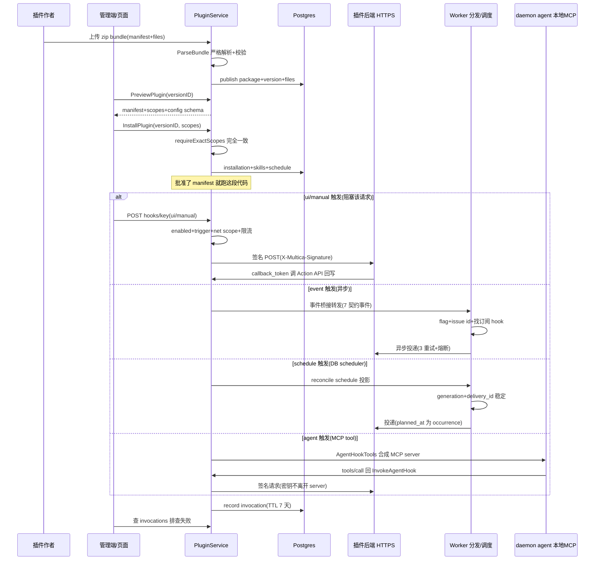
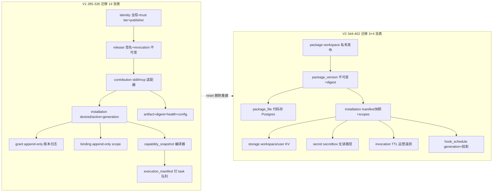

# 插件系统：把平台能力以受控方式开放给第三方

## 模块一句话定位

插件系统是 Multica 唯一的"**平台向外开口**"：前四个模块（data-model / task-orchestration / runtime / acp）讲的是"平台内部如何把能力给 agent"，本模块回答"第三方如何以声明式插件的形式进入平台并拿到受控能力"——plugin 是 v1/v2 双体系的演进产物，当前落地为「consent 即信任」的 workspace 私有插件引擎。

## 在项目中的角色

去掉插件系统，Multica 依旧是一个完整的单 Agent/多 Agent issue 协作平台：issue 流、agent 执行、runtime、realtime 全部独立成立。插件系统是**附加的可扩展层**，它让平台自身成为可被第三方组合的对象，具体给出五类开口：

- **Hook**：平台 `→` 插件方向的反向调用，5 个 trigger（ui/manual/agent/event/schedule），是唯一真正离开平台基础设施的调用点。
- **Action API + surface**：插件 `→` 平台方向的调用，surface 是宿主挂载的沙箱 iframe，Action API 是它唯一的能力入口。
- **Resource**：无调用的静态贡献，当前唯一类型是 skill（一行 `plugin_installation_id` 落到既有 skill 表）。
- **MCP 提供**：插件可以同时是 MCP 的"消费者反向"——插件作者自己跑的 MCP server 被平台采纳为 agent 工具（`mcp` transport + approval pin）。
- **存储 / secret / 调度**：插件拥有的有界状态（双作用域 KV）、写后即焚的加密凭据、声明式 cron 调度投影。

这个分层在 `server/pkg/plugincontract/manifest.go` 开篇注释里被明确陈述为三种关系：

> A plugin relates to Multica in exactly three ways: Action (plugin -> Multica), Hook (Multica -> plugin), Resource (no call at all)。

```text
[server/pkg/plugincontract/manifest.go:5-12]()
```
<!-- anchor: // A plugin relates to Multica in exactly three ways: … // declared once and may be invoked by any of the triggers it opts into. -->

这套三角（Action / Hook / Resource）就是全章的骨架：谁触发、调用什么能力是正交的，同一个 Hook 可以被它声明的任意 trigger 触发。

**去掉插件系统的代价**：平台失去"第三方供应链"这个增长维度——不会有人给 Multica 写 issue-panel 插件、定时通知、外部工作流桥接；同时，runtime/skill 模块中"agent 调用插件提供的工具"这一整条路（`agent` trigger + `mcp` transport）也随之消失。

## 根因：为什么平台需要插件，v1 为什么演进到 v2

### 第一性问题：平台自证可扩展，而不是把能力做死进产品

Multica 的设计哲学（据 VISION 与 CLAUDE 语境）是"Agent 是一等公民 teammate、平台可扩展"。插件回答的问题是：**平台自身如何被第三方组合**。一个 issue 协作平台如果只允许产品团队自己加面板、加通知、加桥接，那么所有长尾需求都会堆进核心 repo；插件把"面板、hook、定时任务、存储、skill、MCP 提供"变成声明式清单，由管理员对每个清单做一次精确 consent。

关键证据是 consent 模型的刻意简化——没有签名、没有 trust tier、没有 publisher 验证，"管理员读 scopes 就是信任决策"：

```text
[server/internal/service/plugin.go:154-161]()
```
<!-- anchor: // PluginPreview is what the consent screen renders. … // code that runs. -->

> 原文：「It is deliberately the raw manifest text plus the scope list: there is no signature, no trust tier, and no publisher verification in this model, so the administrator reading the scopes IS the trust decision.」

### v1→v2：从"为未来做太多"的重型供应链，到"consent 即信任"的极简引擎

插件系统在仓库里走了两代。v1（迁移 285-326）是一套 14 张表的重型供应链：全局 identity + publisher + trust tier、带签名与 revocation 的不可变 release、contribution 适配器、grant/binding 的 append-only 版本日志、capability-snapshot 编译器、以及一个用 INSERT trigger 钉在 `agent_task_queue` 上的 per-task 执行 manifest。v1 从未离开 feature flag、没有生产数据，因此 v2 不是迁移而是**推倒重建**：

```text
[server/migrations/344_plugin_v2_reset.up.sql:1-12]()
```
<!-- anchor-base64:LS0gUGx1Z2luIHN5c3RlbSByZXNldC4g4oCmIC0tIHJlcG9zaXRvcnkgcG9saWN5OiBubyBmb3JlaWduIGtleXMsIG5vIGNhc2NhZGVzLg== -->

> 原文：「The previous design shipped 14 tables, an append-only revision log per relationship, a capability-snapshot compiler, and a per-task execution manifest pinned by an INSERT trigger on agent_task_queue. It never left its feature flag and holds no production data, so this migration removes it outright rather than migrating it forward.」

v1 的教训可以归纳为四条（从 v2 各迁移注释反推）：

1. **供应链基建与平台发展阶段不匹配**。v1 做了 trust tier（official/verified/community/private_dev）、release 签名、吊销状态机，但那时连一个公开目录、一个真实第三方都没有——所有安全机制都没有被测过、没有真实威胁模型。v2 直接把这一整层砍掉，把信任决策压缩成"管理员读 manifest + scopes"。
2. **URL 托管导致"consent 的代码 ≠ 运行的代码"**。v1 是 manifest 从 URL 拉取后冻结，但 surface 脚本每次打开面板都从作者服务器加载——作者 uptime 变成平台 uptime，每次面板打开都向作者泄露"谁在读哪个 issue"：

```text
[server/migrations/392_plugin_package_publishing.up.sql:3-17]()
```
<!-- anchor-base64:LS0gVW50aWwgbm93IGEgcGx1Z2luIHdhcyBhIFVSTDogdGhlIG1hbmlmZXN0IHdhcyBmZXRjaGVkIG9uY2UgYW5kIGZyb3plbiBhcyB0aGUg4oCmIC0tIHRoZSBmcm9udGVuZCBhcnRpZmFjdCBtb3ZlZC4= -->
```

> 原文：「the author's uptime became our uptime, and every panel open told the author who was reading which issue. What replaces it: the author uploads an artifact bundle, Multica stores it, and an installation is bound to one immutable version.」

3. **skill 的 14 张表流水线最终只交付一个 SKILL.md**。v1 把 skill 路由经过 artifact/digest/bundle 流水线，但产物就是既有 `skill` 表一行：

```text
[server/migrations/368_skill_plugin_ownership.up.sql:3-7]()
```
<!-- anchor-base64:LS0gRGVsaWJlcmF0ZWx5IHRoZSBFWElTVElORyBza2lsbCB0YWJsZSByYXRoZXIgdGhhbiBhIHBsdWdpbi1vd25lZCBjb3B5LiBUaGUg4oCmIC0tIHRoaW5nIHRoZSBwbGF0Zm9ybSBuZWVkcyB0byByZW1lbWJlciBpcyB3aG8gcHV0IGl0IHRoZXJlLg== -->

> 原文：「The previous plugin system routed skills through an artifact/digest/bundle pipeline across fourteen tables and, after all of it, delivered one SKILL.md that the skill table could already hold. A plugin skill is a skill; the only thing the platform needs to remember is who put it there.」

4. **append-only 版本日志与 capability 快照编译器是高估了"回放/审计"需求**。grant/binding 每层决策都是一条 append-only revision（285 迁移），读者要"select 最大 revision"；v2 改为 installation 上一行 `granted_scopes` 直接覆盖，revision 语义彻底消失：

```text
[server/migrations/285_plugin_lifecycle_v1.up.sql:105-116]()
```
<!-- anchor-base64:LS0gR3JhbnRzIGFuZCBiaW5kaW5ncyBhcmUgYXBwZW5kLW9ubHkgcmV2aXNpb24gbG9ncy4gQSBuZXcgZGVjaXNpb24gaW5zZXJ0cyBhIOKApiAgICAgYXBwcm92ZWRfYnkgVVVJRCw= -->

### v2 的重构：一张 installation + 两个叶子表 + 四张运营表

v2（344 之后）的核心是**把"安装"作为唯一的信任快照**。`plugin_installation` 一行存 manifest 快照 + `granted_scopes` + config；`plugin_storage` / `plugin_secret` 是插件拥有的状态；`plugin_invocation` / `plugin_hook_schedule` / `plugin_package*` 是运营投影。结构对比见下文"v1→v2 演进"图。

v2 同时把发布从 URL 模型改为 bundle 模型（392），并从"全局身份 + workspace 安装"收窄为**完全 workspace 私有**——公开目录"needs review, reporting and takedown"，是与"字节放哪里"分开的另一项决策：

```text
[server/migrations/392_plugin_package_publishing.up.sql:19-30]()
```
<!-- anchor-base64:LS0gT25lIHB1Ymxpc2hhYmxlIHBsdWdpbiBpZGVudGl0eSBwZXIgd29ya3NwYWNlLiBQdWJsaXNoaW5nIGlzIHdvcmtzcGFjZS1wcml2YXRlIOKApiAgICAgdXBkYXRlZF9hdCBUSU1FU1RBTVBUWiBOT1QgTlVMTCBERUZBVUxUIG5vdygp -->

> 原文：「Publishing is workspace-private for now; a public directory needs review, reporting and takedown, which is a separate decision from where the bytes live.」

## 设计思路：五个开口如何被统一在"consent 快照"之上

### 宿主能力门：Capabilities 与 manifest 渐进式解锁

v2 有一层 v1 没有的显式门：`plugincontract.Capabilities`。manifest schema 从第一版就完整定义，但宿主是"一块一块"落地运行时；任何 manifest 声明了宿主未启用的能力，在**发布/预览/安装**三个入口都会被 `CheckCapabilities` 拦下并一次性列出全部缺口：

```text
[server/pkg/plugincontract/capabilities.go:9-15]()
```
<!-- anchor: // Capabilities is what this host build can actually run. The manifest schema is … // Flip an entry on in the same change that lands its runtime. -->

```text
[server/pkg/plugincontract/capabilities.go:72-102]()
```
<!-- anchor: func (m Manifest) CheckCapabilities(host Capabilities) error { … 	return &ErrCapabilityUnavailable{Missing: names} -->
 -->

```text
[server/pkg/plugincontract/capabilities.go:28-57]()
```
<!-- anchor: func HostCapabilities() Capabilities { … 		ResourceTypes: map[string]bool{ResourceSkill: true}, -->

> 注意当前宿主能力：`sidebar_panel` 是**关闭**的（`SurfaceTypes` 不含它），因为"host 没有挂载位置，启用一个宿主渲染不出来的 surface 就是装一个静默永不出现的插件"——这是门存在的价值证明。

### manifest：声明式契约的三段式

`multica.plugin.json`（`ManifestFilename`）是插件唯一入口。它分成三段：身份（key/name/version/author）、请求（scopes + config schema）、贡献（surfaces/hooks/resources）。三段各有独立校验，且校验是**严格模式**（`DisallowUnknownFields` + 拒绝尾随 JSON），防止"一个拼错的字段悄悄削弱管理员同意的内容"：

```text
[server/pkg/plugincontract/manifest.go:356-359]()
```
<!-- anchor: // ParseManifest decodes a strict v1 manifest and returns the canonical bytes an … // approved. -->

```text
[server/pkg/plugincontract/manifest.go:400-445]()
```
<!-- anchor: func (m Manifest) Validate() error { … 	return m.validateContributions() -->

-->

scope 是**封闭集合**（fixed + `net:<domain>` 参数化），`ValidateScope` 之外的任何字符串在解析期被拒：

```text
[server/pkg/plugincontract/manifest.go:89-106]()
```
<!-- anchor: // Scopes. This list is complete and closed; anything else is rejected at parse … ScopeNetPrefix = "net:" -->

`net:` 是唯一参数化 scope，且是**精确主机匹配，绝不后缀匹配**——因为它同时驱动 iframe 的 CSP `connect-src` 和 hook 出站校验，"一个 scope 字符串在两个地方不能有两种含义"：

```text
[server/pkg/plugincontract/manifest.go:753-755]()
```
<!-- anchor: // validateHookTransport enforces that a hook can only reach a host the manifest … // describe where plugin data actually goes. -->

```text
[server/pkg/plugincontract/manifest.go:769-773]()
```
<!-- anchor: // Exact host, never a suffix match. The consent screen renders one line per … // that needs a subdomain declares it: net:api.example.com. -->

manifest 里最能体现设计约束的是**事件订阅与读权限的绑定**：订阅 `issue.*`/`comment.created` 等 push 事件，要求 manifest 同时声明对应的 read scope，否则 install 被拒。理由是"event 推送的是 Action API 拉取需要 scope 的同一份内容——订阅不能成为绕过读权限的通道"：

```text
[server/pkg/plugincontract/manifest.go:652-657]()
```
<!-- anchor: // An event PUSHES the same content the Action API would have … // shows the read scope the subscription actually implies. -->

### 生命周期：publish → preview → install → grant → execution → uninstall

v2 的安装生命周期全部围绕"**管理员批准的那一版代码**"展开：

1. **Publish**：作者上传 zip bundle。`ParseBundle` 在发布期一次性完成全部校验（manifest 解析、文件齐全性、surface JS 语法、skill 文本），"缺失路径在发布时就被点名"而不是读者浏览器里几个月后才静默失败：

```text
[server/pkg/plugincontract/bundle.go:18-21]()
```
<!-- anchor: // A bundle is what an author publishes: the manifest plus every file the … // author still controls. -->

2. **Preview**：读已发布版本的 manifest 和 scopes，不写任何东西——"管理员必须先看到 scopes 才存在 installation 行"：

```text
[server/internal/service/plugin.go:260-263]()
```
<!-- anchor: // PreviewPlugin reads a published version's manifest without writing anything. … // scopes before an installation row exists. -->

3. **Install**：`grantedScopes` 必须与 manifest **完全一致**（`requireExactScopes`），部分同意 = 插件静默残废，同意 manifest 未请求的 scope = 未展示过理由的越权。安装绑定一个发布版本，事务里同时落 skill 资源与 hook schedule 投影：

```text
[server/internal/service/plugin.go:331-334]()
```
<!-- anchor: // InstallPlugin is the second half of the install. grantedScopes must match the … // administrator was never shown a reason for. -->

```text
[server/internal/service/plugin.go:490-503]()
```
<!-- anchor: func requireExactScopes(manifestScopes, grantedScopes []string) error { … 	return nil -->

-->

```text
[server/internal/service/plugin.go:382-392]()
```
<!-- anchor: installation, createErr := queries.CreatePluginInstallation(ctx, db.CreatePluginInstallationParams{ … 			Manifest:      canonical, -->

4. **Upgrade in place**：新版发布不改旧 installation 行，升级是第二次显式 consent；升级事务里 prune 掉新 manifest 不再声明的 config 字段与 secret（孤儿 ciphertext 也要删）：

```text
[server/internal/service/plugin.go:417-422]()
```
<!-- anchor: // Upgrade in place. Values whose fields the new manifest dropped are pruned … // version's secrets still attached. -->

5. **Uninstall**：删安装及其全部应用持有的行（hook schedule、storage、secret、invocation、skill）——仓库策略无外键无级联，所以是单事务显式删除，"部分卸载会留下任何东西都无法到达或清理的行"：

```text
[server/internal/service/plugin.go:726-729]()
```
<!-- anchor: // Uninstall removes the installation and all of its application-owned rows. … // reach or clean up later. -->

并发正确性是生命周期实现里最用心的部分：publish/install/delete 都先取 `LockPluginPackageKey`（`workspace:plugin_key` 事务锁），install 在锁内**重读**版本仍在发布（`requireVersionStillPublished`），堵住"install 校验通过但并发 delete 抢先"的窗口：

```text
[server/internal/service/plugin_package.go:391-399]()
```
<!-- anchor: // requireVersionStillPublished re-reads a version inside the caller's locked … // slip in between. -->

### surface 与 plugin-sdk：无凭据的 iframe 与 postMessage 桥

surface 是宿主挂载的 iframe，`packages/plugin-sdk` 是第三方唯一依赖。核心约束：**iframe 无凭据、无 same-origin**（sandbox 无 `allow-same-origin`，origin 是 opaque "null"），SDK 的每次调用变成发给宿主页的 MessagePort 消息，宿主用登录用户的 session 执行并回传——"插件永远不能做得比正在看它的人更多"：

```text
[packages/plugin-sdk/index.ts:2-9]()
```
<!-- anchor:  * @multica/plugin-sdk — what a plugin surface imports. …  * is no token in the frame to leak. -->

SDK 暴露四个能力面：`context`（谁在看/在哪/挂在哪个 issue）、`issue`（Action API 的 issue/comment）、`storage`（workspace/user 双作用域 KV）、`hooks.invoke`（只允许调**本插件** manifest 声明的 `ui` trigger hook）：

```text
[packages/plugin-sdk/index.ts:238-254]()
```
<!-- anchor:   hooks: { …         trigger: "ui", -->

身份绑定由 MessagePort 通道而非 `event.origin` 完成（协议 V2 注释明确说），SDK 与宿主各自持有协议副本，不共享包——第三方可安装不同版本 SDK，宿主不能依赖它：

```text
[packages/plugin-sdk/protocol.ts:2-6]()
```
<!-- anchor:  * The bridge wire format, shared in spirit by the surface (this package) and …  * third party could install a different version of. -->

发布侧对 surface 的校验体现了"把失败前移到发布期"：条目必须是**单个 classic script**（`.js`/`.mjs`），宿主生成 HTML 文档并注入它（这样 CSP 才能由 manifest 的 `net:` scope 派生——插件自带的 HTML 会携带自己服务器的策略，`net:` 就从控制变成声明）；bundle 校验用 JS 解析器拒绝顶层 `import`/`export`/top-level `await`/`import.meta`：

```text
[server/pkg/plugincontract/manifest.go:577-581]()
```
<!-- anchor: // The host generates the surface's HTML document and loads this script … // than a control. -->

```text
[server/pkg/plugincontract/bundle.go:240-243]()
```
<!-- anchor: // validateSurfaceScript refuses what would only fail later in a reader's … // no module graph, which is the contract the SDK is shipped for. -->

### Hook 引擎：唯一真正离开平台的反向调用

`plugin_hook.go` 是整套系统的安全最前线。方向逆转是关键：此前所有调用都是"沙箱 surface 问宿主，宿主以登录用户身份执行"，从不离开平台基础设施；hook 第一次让平台的出站请求**由插件的请求触发**，因此"检查对象是目的地而不是调用者"——必须是被 `net:` scope 声明的宿主、dial 时解析为公网地址、body 签名可验证：

```text
[server/internal/service/plugin_hook.go:26-31]()
```
<!-- anchor: // The hook engine: the one place Multica calls OUT to a plugin's own server. … // checks here are about the destination rather than the caller: the host must -->

Hook 的 5 个 trigger 分成两类身份语义：`ui`/`manual` 背后是人（写入归按下按钮的人，标记 `via_plugin_id`），`event`/`schedule` 背后没有人（绝不能借用最近碰过资源的那个人），`agent` 背后是 agent：

```text
[server/internal/service/plugin_hook.go:77-83]()
```
<!-- anchor: // HookActor is who the resulting writes belong to. … // resource. -->

出站前的防线按序执行：安装必须 enabled、hook 必须声明该 trigger、transport 必须 http（mcp 走另一路径）、per-hook 限流（120/min）：

```text
[server/internal/service/plugin_hook.go:192-196]()
```
<!-- anchor: // InvokeHook performs one call and records it. … // request, and schedule delivery runs under the durable scheduler lease. -->

签名方案的关键不对称（`hookSigningKey` vs install token）：宿主必须**产生**签名密钥，所以它是从部署密钥 HMAC 派生而非存储（存可恢复副本 = 数据库可读就能伪造）；install token 是插件产生、宿主只验证，所以存 hash。同一部署密钥，相反方向：

```text
[server/internal/service/plugin_hook.go:444-452]()
```
<!-- anchor: // hookSigningKey derives this installation's signing secret from the deployment … // one is stored hashed. Same deployment key, opposite directions. -->

签名校验的接收端被导出（`VerifyHookSignature`），Go 写的插件与测试用同一实现——"只有一方能实现的方案，是没人能 review 的方案"：

```text
[server/internal/service/plugin_hook.go:476-478]()
```
<!-- anchor: // VerifyHookSignature is the receiver's half, exported so a plugin written in Go … // implement is a scheme nobody can review. -->

hook 请求体的核心是：`config` 只带非 secret 值（secret 是插件自己服务的凭据，插件本来就有，上 wire 等于把每个值交给持有 endpoint 的人）；`issue_id` 由宿主解析并权限校验后给出；`callback_token` 是短命的 Action API 回写凭证：

```text
[server/internal/service/plugin_hook.go:134-142]()
```
<!-- anchor: // Config is the installation's non-secret configuration, the values an … // would hand every value to whoever holds the endpoint. -->

hook 出站还带**运营三件套**：invocation 表（TTL 7 天、无 body，`recordInvocation` 是 best-effort，"遥测绝不能拖垮它描述的调用"）、per-hook 熔断（5 失败/5 分钟窗口，背景投递暂停）、以及响应体限 1MiB 与拒绝重定向：

```text
[server/internal/service/plugin_hook.go:54-63]()
```
<!-- anchor: // Circuit breaker. After this many failures inside the window, background … hookRateWindow = time.Minute -->

invocation 表刻意不是审计日志：TTL 清扫、不存请求/响应 body——"hook payload 可能携带 issue 文本，永远保留每个 payload 的表是 workspace 内容的第二份拷贝，且没有第一份的删除路径"。dispatcher 在事件投递场景下还有一个隐藏理由：路由测试里它曾在构造期立刻清扫而 panic（Queries 底层 pool 未打开），现在第一个 sweep 等首个 tick，且每个 sweep 带 recover——"非 nil Queries 不保证 pool 已打开"：

```text
[server/internal/service/plugin_event_dispatch.go:81-85]()
```
<!-- anchor: // sweepInvocations makes the table's "TTL-swept" description true. … // per-hook limit of 120 rows a minute, per hook, forever. -->

### 事件桥与事件投递：词汇解耦 + 永远异步

`plugin_event_bridge.go` 干一件小而关键的事：把内部 events bus 的 7 个事件名映射到插件对外发布的 7 个契约事件。两套词汇是刻意分开的——内部名字是 realtime 传输关注点，可以随前端改动；插件名字是已发布的契约，改名等于打破所有已装插件：

```text
[server/internal/service/plugin_event_bridge.go:12-18]()
```
<!-- anchor: // Translating the internal event bus into the seven events a plugin may … // change to this file rather than a break in every installed plugin. -->

映射里最有意思的是 `issue.status_changed`：内部没有这个事件（状态变更就是一次 `issue:updated` 携带 `status_changed=true`），桥在这里派生它而不是让宿主多发一个事件——"一次写产生一个内部事件"，插件可以订阅更具体的东西：

```text
[server/internal/service/plugin_event_bridge.go:57-61]()
```
<!-- anchor: // issue.status_changed has no event of its own internally: a status change … // instead of filtering every field change itself. -->

事件投递遵守一条铁律：**event hook 永远不阻塞宿主**。内部总线是同步 inline 调 listener 的（`Bus.Publish` 在产生事件的请求 goroutine 上跑），所以 bridge 的 listener 只做最少的转发（不解析 payload），真正的工作交给有界 worker pool（队列 512、worker 4），满了就丢并计数：

```text
[server/internal/service/plugin_event_dispatch.go:15-21]()
```
<!-- anchor: // Event-triggered hooks. … // creating an issue. Everything here therefore hands off to a bounded worker -->

```text
[server/internal/service/plugin_event_dispatch.go:148-170]()
```
<!-- anchor: func (d *PluginEventDispatcher) Dispatch(eventType, workspaceID string, payload any) { … 		dropped := d.dropped -->

两个隐藏设计：投递**不携带请求的 context**（否则浏览器一响应、hook 就被取消）；feature flag 的检查放在 worker 的 `run` 里而不是订阅时——"部署关掉插件后，已装的插件必须停止出站，而不只是隐藏 UI"，每次投递读 flag 让翻转立即生效且 flag-off 时零成本（不做任何 DB 查询）：

```text
[server/internal/service/plugin_event_dispatch.go:221-225]()
```
<!-- anchor: // The flag gates this path too, and checking it HERE rather than at … // instead of at the next restart. -->

投递的另一个细节是"issue id 提取发生在 worker 上、flag 检查之后"——`issue_id` 用于收窄 callback token（关于一个 issue 的 hook 不能碰同 workspace 其他 issue）：

```text
[server/internal/service/plugin_event_bridge.go:71-73]()
```
<!-- anchor: // issueIDFromPayload finds the issue an event is about, so the callback token … // zero UUID, which simply means the grant is not issue-scoped. -->

### 调度：manifest 声明 cron，投影表交给共享 DB scheduler

定时能力走"**manifest 是声明源，`plugin_hook_schedule` 是执行投影**"两段式。安装/升级事务里 `reconcilePluginHookSchedules` 把 manifest 的 hook schedule 物化为行；不变的 cron/timezone 保留 generation（代码-only 升级不得重置调度时钟或孤儿化可重试执行）：

```text
[server/internal/service/plugin_schedule.go:13-16]()
```
<!-- anchor: // reconcilePluginHookSchedules makes the durable schedule projection match the … // upgrade must not reset the schedule clock or orphan a retryable execution. -->

执行侧复用 `scheduler` 模块的 DB 驱动调度器（与 autopilot 同一条 cron 管线，`cron.go` 的 `NextOccurrencesUTC` 以 DB 时间计算，保证多实例一致）：scope 带上 generation UUID，让改/重启用新的串行时间线，旧的 in-flight 投递允许跑完：

```text
[server/internal/scheduler/jobs_plugin_hook.go:96-99]()
```
<!-- anchor: // PluginHookScheduleDispatchJob drives manifest-declared Plugin schedules … // delivery is allowed to finish. -->

调度执行的关键不变量是 **delivery_id 幂等**：一次 cron occurrence（`planned_at`）对应一个稳定 delivery_id，跨重试不变；`invocation_id` 每次 HTTP 尝试都变。`plugin_hook_schedule_job_test.go` 用两个 scheduler replica 竞争同一 plan、端点第一次成功写入后断连来验证：重试在同一执行行、同一 delivery_id 上发生，且 attempt=1→2、invocation_id 不同、callback token 每尝试全新且用后即废：

```text
[server/cmd/server/plugin_hook_schedule_job_test.go:43-47]()
```
<!-- anchor: // TestPluginHookScheduleTwoReplicasRetryWithStableDelivery is the end-to-end … // fresh invocation. -->

> 调度是"轮询原语而非高频计时器"：manifest 校验强制 cron 间隔 ≥ 5 分钟（`MinimumScheduleInterval`），既防把 manifest 变成无限出站流量，也留足 HTTP 超时 + 持久重试的空间。

### 存储：恰好两个作用域，配额在写入时强制

插件存储是**恰好的两个作用域**（workspace 团队共享 / user 每成员私有，含该成员在插件外部服务里的凭据），加第三个是产品决策不是配置旋钮；配额只在写入时检查、**绝不驱逐**——静默丢最老 key 会破坏插件以为已存的状态：

```text
[server/internal/service/plugin_storage.go:12-24]()
```
<!-- anchor: // Plugin storage scopes. There are exactly two, and adding a third is a product … // would corrupt state the plugin believes it stored. -->

配额强制（key 1KB / value 100KB / 1000 keys / 总 5MB）在字节层面比较（usage 查询用 `octet_length`），且承认并发写超限的已知边界——"限制是为了阻止失控增长，不是精确到字节"：

```text
[server/internal/service/plugin_storage.go:104-108]()
```
<!-- anchor: // EnforceStorageQuota decides whether one write fits, given the scope's usage … // reason. -->

### secret 与 token：两套凭据、两个方向、三条隔离

**secret（插件配置里的 secret 字段）**：与 config 分表存储，secretbox 加密，且**任何读端点都不回传明文**（连 masked 都不回传，只回名字）。这条隔离是结构性的——读存储的查询路径永远到不了 secret 表：

```text
[server/internal/service/plugin_storage.go:62-64]()
```
<!-- anchor: // GetStorageValue reads one value. This path can never reach plugin_secret: … // to a request handler. -->

**两套凭据，方向相反**（`plugin_token.go` 注释）：

```text
[server/internal/service/plugin_token.go:19-26]()
```
<!-- anchor: // Two credentials, moving in opposite directions. … // servers". -->

- **install token**（`mpi_`）：插件 → 宿主，长驻、可轮换，仅存 hash，明文只在 mint 时返回一次，丢了就轮换不找回。
- **callback token**（`mpc_`）：宿主 → 插件，5 分钟、绑一次 invocation、内存存储，调用完成即 revoke。

callback token 的"一次 invocation 多请求"是**跑真实 handler 才发现的权衡**：single-use 更严格，但参考 handler"读 issue → 决策 → 发评论"两调用就死在已花 token 上；而如果回调做不完事，作者就会直接用永不失效的 install token——"一个把作者推向更强凭据的控制，比稍松但会被使用的那个更糟"：

```text
[server/internal/service/plugin_token.go:145-151]()
```
<!-- anchor: // CallbackTokens issues and resolves the per-invocation callback tokens. … // is the floor for any handler that does something with what it read. -->

内存实现的自认代价：跨实例/重启后 token 提前失效，失败模式是 403（可见、可重试），而不是"授权活过它的窗口"：

```text
[server/internal/service/plugin_token.go:163-165]()
```
<!-- anchor: // Held in memory. Across several instances or after a restart a token stops … // — visible and retriable — not a grant outliving its window. -->

### MCP：插件既是 hook 的提供者，也是 MCP 的提供者

插件系统与 MCP 的交集有两条路，方向相反：

1. **`agent` trigger + 本地合成 MCP**（`daemon/plugin_hook_mcp.go`）：插件作者写 HTTP endpoint、根本不用知道 MCP 是什么；daemon 为每次 task 起一个本地 MCP server，把 manifest 的 hook 描述/input_schema 合成成 MCP tool。关键约束：**工具调用从 daemon 回传 server 执行签名请求**——把签名密钥放 daemon 意味着每台跑 agent 的机器都握有能冒充服务器向所有插件后端发请求的凭据：

```text
[server/internal/daemon/plugin_hook_mcp.go:16-21]()
```
<!-- anchor: // A local MCP server that presents this workspace's plugin hooks as tools. … // becomes the tool description, the hook's input_schema becomes the tool's. -->

```text
[server/internal/daemon/plugin_hook_mcp.go:23-28]()
```
<!-- anchor: // A tool call does NOT go to the plugin from here. It goes back to Multica, … // and invocation record are the same code for all four triggers. -->

2. **`mcp` transport**（`plugin_mcp_transport.go`）：插件 hook 直接指向插件作者运行的 MCP server，平台"采纳"其工具给 agent。与 http hook 的本质差异是**谁决定形状**——http hook 在 manifest 里声明一个 endpoint（管理员审过）；MCP server 运行时自决工具列表、可随时改，"安装插件"于是变成"下周它提供什么就运行什么"的长期授权。所以必须有审批：管理员看到**发现的工具**，按名字 + schema digest pin 下来，之后新工具不被采纳、schema 漂移的工具停止被调用：

```text
[server/internal/service/plugin_mcp_transport.go:17-21]()
```
<!-- anchor: // The whole difference from an `http` hook is who decides the shape. An http … // whatever that server offers next week. -->

审批存 installation 上的 JSONB `mcp_approvals`（按 hook key 键控，一次安装可贡献多个 mcp hook 各自审批；"没有 join、没有内部查询、整体读取"是 JSONB 而非表的原因）：

```text
[server/migrations/369_plugin_mcp_approvals.up.sql:9-22]()
```
<!-- anchor-base64:LS0gVGhhdCBpcyB0aGUgZGlmZmVyZW5jZSB0aGlzIGNvbHVtbiBleGlzdHMgZm9yLiBBbiBhZG1pbmlzdHJhdG9yIGFwcHJvdmVzIGEg4oCmIC0tIGxpZmVjeWNsZSB0byBrZWVwIGluIHN0ZXAgd2l0aCB0aGUgaW5zdGFsbGF0aW9uIGZvciBubyByZWFkZXIncyBiZW5lZml0Lg== -->

-->

审批连接进 daemon 的既有 machinery：`AgentMCPConnections` 把已批准的 mcp hook 变成 broker connection，daemon 的 `validatePinnedRemoteMCPTools` 在 broker 启动时拒绝缺失/漂移的工具。**安装插件不是授权，审批工具才是**（无审批的 hook 不产生连接）：

```text
[server/internal/service/plugin_mcp_transport.go:138-146]()
```
<!-- anchor: // AgentMCPConnections turns approved mcp hooks into broker connections. … // the plugin is not the grant, approving the tools is. -->

agent 看到/调用插件的工具命名有反注入约束：`PluginToolName` 用"可读段 + 6 位 key digest + `__` + hook key"，因为"两个半段各自 sanitize 后拼 `_`"不单射（`a.b` 与 `a-b` 坍缩；`a.b_`+`c` 与 `a.b`+`c` 撞名），撞名会让两个插件共用一个工具名、后注册者替两人应答：

```text
[server/internal/service/plugin_agent_tools.go:52-60]()
```
<!-- anchor: // PluginToolName namespaces a hook so two plugins can both contribute a hook … // answer for both. -->


## 核心流程

### 生命周期：发布 → 安装 → hook 触发 → 执行 → 回写

以下时序覆盖从作者发布到"hook 被触发、结果回写"的完整闭环，并区分四种触发路径的身份与阻塞语义：



### v1→v2 演进：从 14 张表的重型供应链到 3+4 张表的极简引擎



### 关键数据结构（精简片段）

**Manifest**（插件对宿主的完整契约，真实示例 `examples/plugins/schedule-pulse/multica.plugin.json`）：

```jsonc
{
  "manifest_version": 1,
  "key": "ai.multica.schedule-pulse",          // reverse-DNS，唯一身份
  "version": "1.0.0",                          // semver，发布后不可变
  "scopes": ["storage:workspace", "net:pulse.example.com"], // 封闭集合
  "contributes": {
    "surfaces": [{ "key": "pulse", "type": "issue_panel", "entry": "ui/main.js" }],
    "hooks": [{
      "key": "pulse",                           // contribution key
      "description": "Records one workspace-storage pulse per planned delivery",
      "triggers": ["schedule"],                 // 谁可调用
      "schedule": { "cron": "*/5 * * * *", "timezone": "UTC" },
      "transport": { "type": "http", "url": "https://pulse.example.com/hooks/pulse" },
      "timeout_ms": 8000
    }]
  }
}
```

**Hook 定义**（`server/pkg/plugincontract/manifest.go:212-222`）：`triggers` 声明"谁可调用"（封闭五选一），`events`/`schedule` 分别补充 event/schedule 触发细节，`transport` 决定调用形状（http 声明一个 endpoint vs mcp 采纳外部工具），`input_schema` 是 agent 看到的 MCP tool schema。

**Grant/Binding 的 v1→v2 收缩**：

| 维度 | v1（285-326） | v2（344+） |
|---|---|---|
| grant | plugin_grant append-only revision，读者取 max revision | installation.granted_scopes 一行覆盖 |
| binding | plugin_binding（workspace/agent scope）append-only | manifest contributes + trigger 声明直接决定 |
| 信任 | trust tier + 签名 + publisher 验证 | "管理员读 manifest + scopes 就是信任决策" |
| 身份 | 全局 identity（310 迁移私有化） | workspace 私有的 plugin_package |
| 代码 | URL 托管，面板每次打开拉取作者服务器 | bundle 存 Postgres，安装绑定不可变版本 |
| 执行 | per-task execution manifest（agent_task_queue 触发器） | 无——每个 trigger 动态解析安装快照 |

**Invocation 行**（plugin_invocation，运营遥测）：installation/hook_key/trigger/status/attempt/latency/error + delivery_id/planned_at（schedule 专用）。status 是宿主的裁决（ok/failed/timeout/refused）；error 只存宿主自己的描述——"会回显输入的 endpoint 能把 issue 内容写进没有删除路径的表"。它是 TTL-swept 的，不是审计日志。

## 与其他模块的协同

插件系统不是孤岛，它复用/喂入三个既有子系统：

- **与 scheduler（最紧密）**：调度执行完全复用共享 DB scheduler（`PluginHookScheduleDispatchJob` 注册为 JobSpec，与 autopilot 共用 `server/internal/service/cron.go` 管线与 `sys_cron_executions`）。manifest 声明 cron → 投影表 → scheduler scope（generation 串行化）→ handler 投递 → `advancePluginHookNextRun`。generation 语义（scope = `scheduleID:generation`）把"启用/禁用/升级不打断在途投递"做成调度器的既有能力，插件只是新 scope kind。autopilot 调度与插件调度共享同一 retry/lease 语义的具体细节，请以 task-orchestration 模块解读为准。

- **与 skill（方向：插件贡献内容）**：插件的 skill resource 直接写既有 `skill` 表，靠 `plugin_installation_id` 区分来源（`server/migrations/368_skill_plugin_ownership.up.sql:16`）；卸载时只删插件贡献的、不碰人写的。`server/internal/service/plugin_skill.go` 里 manifest key 是名称权威——"consent screen 列出的是 key，工具命名空间用它，文件不同意也不能静默装到别的名字下"：

```text
[server/internal/service/plugin_skill.go:60-63]()
```
<!-- anchor: // The manifest key is authoritative for the name, not the frontmatter. … 		name := resource.Key -->

- **与 MCP / runtime（方向：插件提供工具）**：`agent` trigger 在 daemon 合成本地 MCP server（`server/internal/daemon/plugin_hook_mcp.go:16-28`）；`mcp` transport 采纳外部 MCP server 并 pin 审批（`server/internal/service/plugin_mcp_transport.go:138-146`）。两条路都通过"server 是签名边界"——签名密钥永不下发到 daemon。反过来，runtime 的 remote MCP broker（`remote_mcp_broker.go`）与插件 mcp transport 共用 `remotemcp` 包，本模块只触及边界。

- **与 realtime/events bus（方向：消费事件）**：`SubscribePluginEvents` 在 `server/cmd/server/router.go:1231-1232` 接上内部 bus，把 realtime 传输事件翻译为插件契约事件。两套词汇由此隔离——内部改名不破坏已装插件。

- **与 feature flag**：整个插件面（catalog、事件投递、调度 scope）由 `PluginsV1` flag 门控，且事件投递在**每次投递时**读 flag 而非订阅时（`server/internal/featureflags/keys.go:57-59`），保证部署级关闭即时生效。事件路径没有请求可读 flag，所以检查必须住在 service 里：

```text
[server/internal/service/plugin.go:56-57]()
```
<!-- anchor: 	// FeatureFlags gates the hook engine. Held here because the EVENT path has … // no request to read the flag from: it runs on a worker, so the check has to -->

- **与 workspace 生命周期**：插件是"无外键无级联"策略的践行者——`DeleteWorkspacePluginData` 显式按序清 storage→secret→hook_schedule→invocation→package file→package version→package→installation，且 invocation 按 workspace 而非 installation 删（已卸载的 installation 的行不能靠 installation 到达）：

```text
[server/pkg/db/queries/workspace_delete.sql:599-603]()
```
<!-- anchor-base64:LS0gbmFtZTogRGVsZXRlV29ya3NwYWNlUGx1Z2luRGF0YSA6ZXhlYyDigKYgV0lUSCBpbnN0YWxsYXRpb25zIEFTIE1BVEVSSUFMSVpFRCAo -->

- **与 Action API / public API（方向：两套入口、同一套授权）**：插件 token（`mpi_`）在 public API 走 plugin 路径、浏览器 session token 被拒；`ui/manual` trigger 只对 surface bridge 面开放、public API 不暴露 person-triggered hooks。这是"两套入口、同一套授权"的信任边界测试：

```text
[server/cmd/server/plugin_action_routes_test.go:51-76]()
```
<!-- anchor: 			name:          "public API does not expose person-triggered hooks", … 			authorization: "Bearer " + testToken, -->

### 与 README 宣传的核对

仓库 `README.md` 对插件几乎无直接宣传（grep `plugin` 无实质条目），只有一行提及外部工具链："Drive Multica from Codex, Claude Code, or Cursor — [Multica CLI skill](https://github.com/multica-ai/multica-cli)"（`README.md:185`）。该 CLI skill 指向独立外部仓库，不在本仓库 `packages/` 下。该 CLI 是否消费插件系统的 Public API/install token，需在 CLI/工具模块单独核对。本模块其余论断全部以源码为据；"插件可携带 MCP 与 skill"（`mcp` transport + `skill` resource）、"hook/schedule/event bridge 双体系"（v1 迁移 285-326 vs v2 迁移 344-402）均已在源码中核实成立。

## 关键设计决策

### 决策一：v2 重置 v1——"consent 即信任"替代供应链基建

**权衡**：v1 用 14 张表把"未来才需要的供应链"（trust tier、签名、吊销、revision 日志、snapshot 编译器、per-task 执行 manifest）一次性做全，代价是：没有真实第三方时这些机制全部无效、无生产数据可迁移、且把插件系统的产品形态锁死在"发布目录"想象里。v2 的选择是砍掉一切不能被"管理员 consent"这个动作兑现的机制，用 3 张状态表 + 4 张运营表重新开始。

**替代方案的代价**：
- v1 的签名/吊销被移除 → v2 的插件供应链没有"作者身份验证"与"撤销传播"；一个泄露了密钥的插件发布者或一个被入侵的 workspace 作者，只能靠"重新发布新版本 + 管理员手动升级"止血。这是把信任从"密码学"降级为"管理员肉眼读 manifest"。
- v1 的 append-only revision（grant/binding/snapshot）被移除 → v2 无法回答"这个权限是什么时候、被谁、依据哪个版本授予的"历史审计问题；只有 `granted_scopes` 的当前值。对合规场景是损失。
- 但 v2 换来的东西更贵：**"批准了 manifest，就跑这段代码"从口号变成可验证事实**——manifest 快照 + scopes + config 与运行的代码同在一个事务/同一次 consent（`server/internal/service/plugin.go:331-334` 的"approved the manifest, ran the code"）。

### 决策二：hook vs 事件桥——"宿主决定调用"与"事件驱动调用"的分工

**权衡**：hook 的 5 个 trigger 里，ui/manual/schedule/agent 是"宿主作为调用发起者"（人或调度器或 agent 主动叫），event 是"宿主作为事件订阅者"（平台状态变化推送）。两者在 `InvokeHook` 汇合（同一个签名、限流、熔断、invocation 记录），但阻塞语义完全不同：

- ui/manual 阻塞，但只阻塞"发起请求的那个人的请求"——"人在等答案，立即返回等于没返回"。
- event 永不阻塞宿主，走有界队列 + worker + 丢弃计数。
- agent 是唯一的"宿主没有决定调用"的调用点——agent 看到工具描述后**选择**调用，是"可拒绝的"。

事件桥把"内部传输词汇"与"对外契约词汇"分离，且 eventReadScope 强制订阅事件需要对应 read scope，堵住"订阅绕过读权限"。这套分工的深层理由在 `server/internal/service/plugin_event_dispatch.go:24-27` 说得最直接：**agent 执行路径根本没有 hook**——"一个必须每次 agent turn 前后都跑的 hook，是第三方握着产品主循环"，所以 agent 只能通过"选择调用"到达插件。

**替代方案**：让 event hook 也同步（在产生事件的请求里 inline 调用插件）→ 插件端点故障变成平台写路径故障，被否决；给 agent 加"turn 前后置 hook"→ 第三方握住主循环，被否决。两者都是"把不可控注入可控关键路径"的反模式。

### 决策三：存储/secret/凭据的三层隔离——"结构性而非纪律性"的权限边界

**权衡**：插件需要状态、需要凭据、需要回调，但任何一个都不该让插件获得"宿主普通成员"之外的能力。三层隔离各用结构保证而非代码纪律：

1. **secret 无 read 路径**：secret 与 config 分表，唯一解密路径是 `decryptedSecret`（mcp transport 认证用），任何读端点不返回明文——"隔离是结构性的（表没有读查询）而不是靠记住别泄露"。
2. **surface 无凭据**：iframe sandbox 无 `allow-same-origin` + 无浏览器存储，SDK 每调用经宿主 session 执行，"插件永远不能做得比正在看它的人更多"。插件持有的凭据只许在服务器之间移动（`server/internal/service/plugin_token.go:19-26`）。
3. **权限仍是用户的**：`AuthorizePluginAction` 只检查"安装真实且启用 + 拥有 scope"，不重复实现资源权限——"插件继承它背后用户的权限，不多不少，也没有第二份会漂移的权限规则"：

```text
[server/internal/service/plugin_action.go:39-45]()
```
<!-- anchor: // AuthorizePluginAction performs the two checks that belong to the plugin: the … // no separate copy of the permission rules to drift. -->

**替代方案**：插件用自己的凭据表/独立权限模型 → 会产生"第二套权限规则"并漂移；给 surface 直接发 token → 泄漏面扩散到 iframe；secret 与 config 混存 → hook 的 config 上 wire 前要逐字段过滤（现状），若混存则无过滤依据（manifest 丢失时 `nonSecretConfig` 干脆一个都不发，fail-closed）。

## 亮点与问题

### 亮点

1. **"批准什么跑什么"的闭环做得完整**：从发布（ParseBundle 一次校验）→ 安装（manifest 快照 + scopes 精确匹配）→ surface 读安装快照的存储文件（`SurfaceScript` 从 `PackageVersionID` 读、绝不 fetch 作者服务器）→ hook 从安装行读 manifest（`FindHook`/`nonSecretConfig` 都以安装行而非"来源 URL 今天提供的"为准）。"管理员同意后代码被换掉"在多个读取路径上同时被结构性排除。

2. **失败前移 + fail-closed 的密度**：surface JS 用真实解析器校验顶层 import（发布期而不是浏览器期）；hook 出站 destination 与 manifest `net:` scope 精确匹配；config 过滤失败时一个 secret 都不发；`mcp_approvals` 工具缺失时 broker 拒绝启动；`CheckCapabilities` 让"宿主跑不了的贡献"在三个入口都一次性列出缺口。

3. **部分失败隔离**："一张不可读 manifest 不能藏起其他插件所有工具"（`plugin_mcp_transport.go:169-172` 与 `plugin_agent_tools.go:99-101`）；事件投递 panic 被 recover 到单个 delivery；调度 skip 原因（schedule_not_found / generation_changed / circuit_open）都是显式结果而非异常。

4. **多实例正确的显式工程**：cron 用 DB 时间（`cron.go:14-25`）而非本地时钟；generation UUID 串行化调度时间线；callback token 内存失效方向是"提前失效而非过期仍活"；install 在事务锁内重读版本仍在发布。

5. **对第三方作者的开发者体验**：`PublishLocalBundle`（MULTICA_PLUGIN_DIR）dev 循环不重打包，`+dev.N` 后缀避免冲突；`DevOrigins` + dev CA 让本地 HTTPS 端点可调试；error message 面向作者（"package 是 invalid" 时点名缺失路径）。

### 问题

1. **供应链能力缺失是明牌**：无签名、无吊销、无 publisher 验证，consent 完全依赖管理员肉眼。workspace 私有发布使其暂时可接受，但一旦做公开目录，这是第一个必须回补的机制（392 迁移注释也承认公开目录是"separate decision"）。
2. **callback token 内存存储**：多实例/重启提前失效（作者自认），且 `Issue` 前 `ctx` 被丢弃（`server/internal/service/plugin_token.go:197` 的 `_ = ctx`）——接口带 context 但没用，是未来改成共享存储时的遗留。
3. **MCP approvals 是 JSONB 列**：读时整列解码、写时整列覆盖，多 mcp hook 并发审批有丢失更新窗口；列内无约束，只能靠应用层解析防御。
4. **事件投递背压即丢弃**：队列满直接 drop 并计数，无持久化、无死信。对"issue.created 通知"类可丢失事件可接受，但对"必须送达"类订阅是缺口。
5. **storage 配额无锁**：并发写同 scope 可超限（作者承认"限制是为了阻止失控增长，不是精确到字节"）。对 KV 场景通常可接受，但无上限文档化。
6. **manifest 无"最低宿主版本"概念**：`CheckCapabilities` 只能按能力逐项声明，宿主缺什么就给什么；插件无法声明"我需要 capabilities 的某种组合"（如 event+read scope 的组合限制由 manifest 校验覆盖了一部分，但 hook transport + trigger 的组合只做了局部禁止，如 schedule 仅支持 http）。

