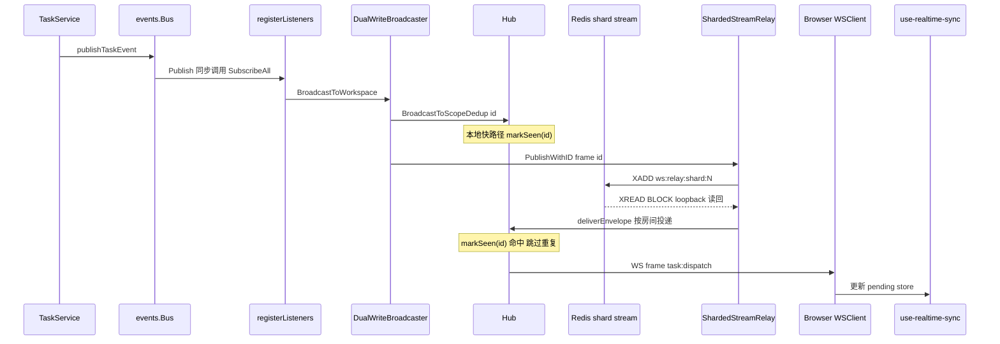
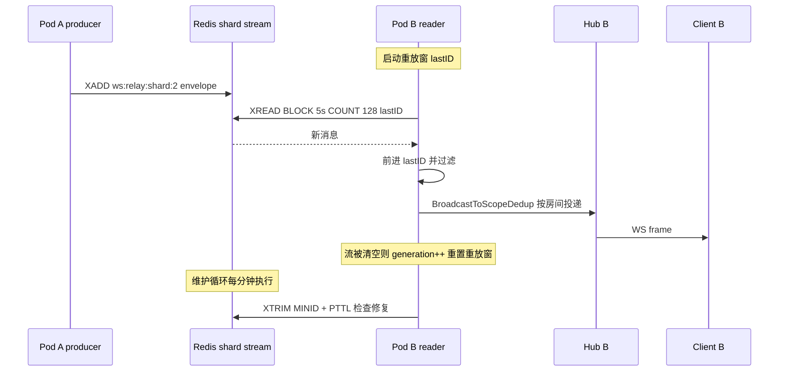

# Multica 实时协作层：事件如何可靠地到达每个订阅者

## 定位一句话

实时协作层是 Multica board 的"心跳"：它把 service 层产生的领域事件，经**单实例 hub（scope-based room 分发）→ Redis Streams relay（跨实例广播）**两级通道，低延迟、带去重与重放地投递到浏览器、桌面与 daemon 三类 WebSocket 订阅者，让"agent 边跑边评论、任务状态实时翻转、inbox 即时弹窗"在任意多后端实例部署下都能发生。

## 去掉实时层，board 会变成什么

这是回答本模块价值最直接的思想实验。把 `realtime` 包、`daemonws` 的事件投递面、`packages/core/realtime/` 前端同步全部拆掉，Multica 会退化成一个"请求-响应"应用：

- **board 上的 agent 列不再自己动**。任务状态翻转（queued→dispatched→running→completed）是 daemon 侧的异步行为，浏览器端只能靠轮询看见。由于 task 事件的分辨率被刻意定在"用户想看到什么变化"，而不是"每一个内部状态翻转"（[server/pkg/protocol/events.go:30-33]()），事件通道一旦消失，"何时轮询"的触发源也没了，只能退化为全量定时刷新。
<!-- anchor: // Each event maps to a status transition on agent_task_queue. Front-end … // change" — not "every internal status flip". -->
- **agent 边执行边评论（comments as it goes）变为"跑完再刷新"**。`comment:created` 走 workspace 广播，实时层没了，评论要等下一次 HTTP 拉取。
- **inbox 通知失去即时性**。`inbox:new` 依赖 SendToUser 个人通道（[server/cmd/server/listeners.go:81-91]()），没有推送就只能靠用户主动刷新收件箱。
<!-- anchor: personalEvents := map[string]bool{ … protocol.EventChatSessionUpdated: true, -->
- **daemon 从"被唤醒"退回"被动等心跳"**。任务入队后 daemon 不再被 `daemon:task_available` 提示打断，最多等一个 HeartbeatInterval（默认 15s）才 claim 新任务，交互式 UI 流程出现明显延迟（[server/pkg/protocol/events.go:152-159]()）。
<!-- anchor: // EventDaemonPendingWork is a runtime-scoped hint that a heartbeat-carried … // claim, so a lost or duplicated hint is harmless. -->

一句话：**实时层决定 board 是"协作现场"还是"定时刷新的后台管理系统"**。这也是 README 宣传的 `comments as it goes`、`Execution log → Replay`、`Inbox → Get pinged` 三条体验的物理前提。

## 根因：为什么不能简单地为每个客户端各开一条 WS

最容易想到的朴素方案是"每条 WS 连接按事件源各拉一条通道"，但 Multica 的实时层在三层约束下选择了一条更曲折的路：

1. **单客户端可能需要多个事件源的合并**。一个浏览器标签打开一个 workspace，关心的不是某一个 channel，而是 workspace 里所有 issue、task、chat、inbox、member 事件的并集。若按事件源逐条建通道，连接数是"客户端 × 事件源"的组合爆炸。Multica 用 **scope 房间模型**把订阅面收敛成少量维度：`scopeKey{Type, ID}`，type ∈ {workspace, user, task, chat, daemon_runtime, wecom_outbound}（[server/internal/realtime/broadcaster.go:6-30]()），一个连接默认自动订阅 workspace + user 两个房间（[server/internal/realtime/hub.go:332-334]()），再按需补订 task/chat 房间。
<!-- anchor: ScopeWorkspace = "workspace" … ScopeWecomOutbound = "wecom_outbound" --> <!-- anchor: h.subscribe(client, ScopeWorkspace, client.workspaceID) … h.subscribe(client, ScopeUser, client.userID) -->
2. **单进程 hub 无法支撑多实例**。浏览器 WS 连接固定在某个 API pod 上（网关层负载均衡决定），但事件可能在任何 pod 产生（daemon 的完成回调落在哪个 pod 是 LB 决定）。一个事件要在"产生它的 pod"与"持有订阅者 WS 的 pod"之间搬运，跨实例通道不可避免（[server/internal/realtime/broadcaster.go:15-28]() 中 `ScopeWecomOutbound` 的注释就是这个问题的典型形态）。
<!-- anchor: // ScopeWecomOutbound routes a WeCom reply to the replica holding that … // replica, and the relay is how the others reach it. -->

于是核心问题被拆成两级：**单实例内** hub 管理 scope 房间、事件按房间 fanout；**跨实例** Redis Streams relay 把事件广播给所有 pod，每个 pod 只消费本地有订阅者的部分。

### 单实例内：hub 是 scope 房间分发器

`Hub` 的核心是 `rooms map[scopeKey]map[*Client]bool`，一条事件进来只做一件事：找到房间里的所有连接，逐个往它们的 send 通道里塞（[server/internal/realtime/hub.go:277-283]()）。房间的 0↔1 订阅者跳变会触发 `onFirstSubscriber`/`onLastSubscriber` 回调，供 relay 按需启停消费循环——**房间既是订阅结构，又是资源生命周期触发器**。
<!-- anchor: type Hub struct { … unregister chan *Client -->

## 设计思路：hub → Redis relay → 分片 Streams 的三阶段演进

实时层不是一次设计成型的，而是顺着部署规模压力演进的三代结构：

**阶段一：单实例 hub（无 Redis）**。`registerListeners` 把 bus 事件转发给 `Broadcaster`，此时 `broadcaster` 就是 `*Hub` 本身（[server/cmd/server/main.go:394-394]()<!-- anchor: var broadcaster realtime.Broadcaster = hub -->）。单 pod 内完成"事件→房间→WS"，零额外组件，适合单机自托管。

**阶段二：legacy Redis relay（每 scope 一条 Stream + 消费组）**。多实例时，`RedisRelay` 把每个 scope 的事件 XADD 到 `ws:scope:{type}:{id}:stream`，每个 pod 对本地有订阅者的 scope 各跑一条 XREADGROUP BLOCK 循环，用 `group = "node:" + nodeID` 保证一个 stream 的每条消息都被所有在线的 node 各自消费到（[server/internal/realtime/redis_relay.go:371-449]()）——**消费组在这里不是做负载均衡，而是做复制广播**（每个 node 独立 group，各自全量消费）。
<!-- anchor: group := "node:" + r.nodeID … r.writeRDB.XGroupDelConsumer(cleanCtx, stream, group, consumerName) -->

**阶段三：sharded relay（固定 8 个分片 Stream）**。legacy 的痛点是"一个活跃 scope 一条阻塞连接"，Redis 连接数随活跃 workspace 数线性膨胀。分片方案把所有事件 FNV 哈希到固定 `ws:relay:shard:0..7` 八个流，每个 pod 固定跑 8 条 XREAD BLOCK 循环（[server/internal/realtime/sharded_stream_relay.go:152-155]()），阻塞连接数从 `active_scope_count` 降到 `pod_count × shard_count`。本地投递在 `deliverEnvelope` 时再按 `ev.Scope/ScopeID` 匹配 hub 房间过滤——订阅面缩小，代价是"每个 pod 消费全部事件、本地过滤"。
<!-- anchor: // ShardedStreamRelay publishes all realtime events into a fixed set of Redis … // bounded by pod_count * shard_count instead of active_scope_count. -->

三态由 `REALTIME_RELAY_MODE` 环境变量切换：`sharded`（默认）/ `dual`（sharded + legacy 镜像）/ `legacy`（[server/cmd/server/main.go:101-112]()）。`dual` 与 `MirroredRelay` 是灰度工具：同一条事件带同一个 `event_id` 写两个后端，客户端按 event_id 去重，从而在滚动升级期间新老 pod 混跑也能保持一致（[server/internal/realtime/relay_lifecycle.go:23-28]()）。
<!-- anchor: func realtimeRelayModeFromEnv() string { … return defaultMode --> <!-- anchor: // MirroredRelay is a temporary rollout helper: it starts two relay backends, … mirror  ManagedRelay -->

### 订阅模型：按 scope 房间，不按实体单聊

订阅单位是 `{scopeType, scopeID}` 房间，而不是某个实体的专属通道。重要推论：

- **workspace 房间是默认兜底**。`registerListeners` 里所有非个人事件最终都 `BroadcastToWorkspace`（[server/cmd/server/listeners.go:219-258]()），即当前生产路径上"一条 issue:updated 广播给整个 workspace 的所有连接"。
<!-- anchor: bus.SubscribeAll(func(e events.Event) { … b.Broadcast(data) -->
- **个人房间承载 inbox/invite/chat-session 私有事件**。`inbox:*`、`invitation:*`、`chat:session_created/updated` 走 `SendToUser`，只在 user 房间内投递（[server/cmd/server/listeners.go:82-88]()）。
<!-- anchor: protocol.EventInboxNew:           true, … protocol.EventInboxBatchArchived: true, -->
- **task/chat 细粒度房间服务端已就绪、客户端未启用**（详见「问题与风险」首条）。`Broadcaster` 接口早已声明 `BroadcastToScope("task", taskID)`，hub 也实现了 `handleSubscribe(ScopeTask/ScopeChat)` + `ScopeAuthorizer`（DB 校验实体归属 workspace），但 [server/cmd/server/listeners.go:237-251]() 的大段注释明确写着"客户端还没有发 subscribe 帧，现在切过去会把所有 chat/task 消息丢地上"。这是**服务端前瞻能力与客户端落地之间的显式缺口**，被代码注释钉死在当前行为上。
<!-- anchor: // Phase 1 (MUL-1138): the per-resource scope routing for high-frequency … // one-line change here. See review on PR #1429 for context. -->

### Retention / 重放语义：把"实时通道"当"短期事件日志"用

Redis Streams 而非 Pub/Sub 的选择带来一个重要副产品：**事件在流里留痕可重放**。三层裁剪共同定义事件的存活区间：`MAXLEN ~2000`（近似裁剪）控流长、`XTRIM MINID` 按 `TrimHorizon=10m` 滚动剪掉太旧的事件、整条流挂 `StreamTTL=15m` 的 TTL 让空闲流自然过期（[server/internal/realtime/stream_retention.go:15-18]()）。且 `StreamTTLEnabled` 默认关闭（opt-in），先兼容旧 pod 再启用。
<!-- anchor: defaultRelayStreamTrimHorizon         = 10 * time.Minute … defaultRelayStreamMaintenanceInterval = time.Minute -->

重放窗口 `ReplayGrace=5m` 与裁剪阈值 `TrimHorizon=10m` 之间由 `ReplayGrace < TrimHorizon ≤ StreamTTL` 的不等链保证"能重放的都在，已剪的都在重放窗之外"，配置校验函数把这个约束写成显式错误（[server/internal/realtime/sharded_stream_relay.go:137-141]()）。
<!-- anchor: if c.TrimHorizon <= c.ReplayGrace { … return fmt.Errorf("StreamTTL (%s) must be at least TrimHorizon (%s)", c.StreamTTL, c.TrimHorizon) -->

## 关键数据结构

### 事件与信封

事件在系统里的三次变形，对应三层协议：

1. **领域事件**（内存态）：`events.Event`，带 `Type`、`WorkspaceID`、`ActorType/ID`、`Payload`，以及为细粒度路由预留的 `TaskID`/`ChatSessionID` 提示（[server/internal/events/bus.go:8-21]()）。
<!-- anchor: // Event represents a domain event published by handlers or services. … ChatSessionID string -->
2. **WS 帧**（线上形态）：`{"type": "...", "payload": {...}, "actor_id": ..., "actor_type": ...}`，由 `registerListeners` 从 `events.Event` 序列化而来（[server/cmd/server/listeners.go:225-229]()）。
<!-- anchor: msg := map[string]any{ … "actor_type": e.ActorType, -->
3. **Relay 信封**（Redis 形态）：`envelope`，把 WS 帧整体塞进 `PayloadJSON` 字段，外层补 `EventID`/`EventType`/`Scope`/`ScopeID`/`NodeID` 等路由与去重元数据（[server/internal/realtime/redis_relay.go:37-46]()）。消费端把 `EventID` 注入回 WS 帧（`injectEventID` 避免重复解码 payload），供客户端/本地去重（[server/internal/realtime/redis_relay.go:623-639]()）。
<!-- anchor: type envelope struct { … PayloadJSON string `json:"payload_json"` // raw JSON of the original ws frame --> <!-- anchor: func injectEventID(frame []byte, eventID string) []byte { … obj["event_id"] = idJSON -->

### 订阅关系

`Hub` 用三个索引服务三种投递：`rooms` 按 scope 定向、`clients` 全集广播、`subscriptions` 是 client 侧反向索引（O(1) 断开清理）：

```go
type scopeKey struct { Type string; ID string }
type Hub struct {
  rooms      map[scopeKey]map[*Client]bool   // 房间 → 该房间里的连接
  clients    map[*Client]bool                // 全部连接（global 广播用）
}
type Client struct {
  subscriptions map[scopeKey]bool            // 该连接订阅的房间（断开时清理）
  seenIDs  map[string]struct{}; seenList []string  // event_id 去重，容量 128
}
```

（[server/internal/realtime/hub.go:214-219]()、[server/internal/realtime/hub.go:223-241]()、[server/internal/realtime/hub.go:277-283]()）
<!-- anchor: type scopeKey struct { … func sk(t, id string) scopeKey { return scopeKey{Type: t, ID: id} } --> <!-- anchor: type Client struct { … seenList []string --> <!-- anchor: type Hub struct { … unregister chan *Client -->

### Relay 消费状态

legacy 的 `scopeConsumer`（cancel + done）表示"这个 scope 正在被本节点消费"，`consumers map[scopeKey]*scopeConsumer` 防止重复起消费循环；分片模式没有 per-scope 状态，只有每分片的 `streamSeen`/`streamGeneration`（atomic），用于检测流被清空后的 generation bump，让 reader 重置到重放窗口（[server/internal/realtime/sharded_stream_relay.go:156-173]()、[server/internal/realtime/sharded_stream_relay.go:407-415]()）。
<!-- anchor: type ShardedStreamRelay struct { … wecomOutbound WecomOutboundDeliverer --> <!-- anchor: func (r *ShardedStreamRelay) updateStreamPresence(shard int, exists bool) { … M.RedisRelayStreamMissingTotal.Add(1) -->

## 核心流程

### 流程一：一条任务状态变更从 service 到浏览器渲染的完整事件链路

以 `task:dispatch`（daemon claim 成功）为例：



各环节的依据：

- **事件源头**：`TaskService` 的 `publishTaskEvent` 把任务状态事件塞进 bus（[server/internal/service/task.go:6951-6955]()）；`taskEvent` 组装 payload 并预填 `TaskID`/`ChatSessionID` 路由提示（[server/internal/service/task.go:6923-6948]()）。
<!-- anchor: func (s *TaskService) publishTaskEvent(eventType, workspaceID string, task db.AgentTaskQueue, extra ...map[ … s.Bus.Publish(taskEvent(eventType, workspaceID, task, extra...)) --> <!-- anchor: payload := map[string]any{ … return e -->
- **同步总线**：`events.Bus.Publish` 是**进程内同步调用**，按注册顺序逐个执行 handler，单 handler panic 被 recover（[server/internal/events/bus.go:61-78]()）。这个同步性很关键——它保证"先写库再广播"的调用方在广播返回前，所有在进程内的下游（订阅者、通知、活动记录）都已处理完。`main.go` 里特意要求 subscriber 监听器先于 notification 监听器注册，正是依赖同步顺序（[server/cmd/server/main.go:544-546]()）。
<!-- anchor: func (b *Bus) Publish(e Event) { … for _, h := range globals { --> <!-- anchor: // Order matters: subscriber listeners must register BEFORE notification … // so subscribers must be written first within the same synchronous event -->
- **双写投递**：`DualWriteBroadcaster` 先本地直投 hub（快路径），再发 Redis（跨实例路径）；同一 `id`（ULID）保证 relay 回环投递时被 `Client.markSeen` 去重（[server/internal/realtime/redis_relay.go:650-675]()、[server/internal/realtime/hub.go:249-262]()）。
<!-- anchor: type DualWriteBroadcaster struct { … _ = d.relay.PublishWithID(scopeType, scopeID, "", message, id) --> <!-- anchor: func (c *Client) markSeen(eventID string) bool { … c.seenList = append(c.seenList, eventID) -->
- **前端落地**：浏览器 `WSClient.on("task:dispatch")` 里 `promotePendingChatTask` 直接把待办 pill 从 "Queued" 推到 "Thinking"（跳过无意义的 "Starting" 帧，[packages/core/realtime/use-realtime-sync.ts:1519-1528]()），随后 invalidate 消息缓存。
<!-- anchor: const unsubTaskDispatch = ws.on("task:dispatch", (p) => { … invalidatePendingAggregate(); -->

### 流程二：多实例 sharded relay 的投递 / 重放 / 清理



（[server/internal/realtime/sharded_stream_relay.go:317-333]()、[server/internal/realtime/sharded_stream_relay.go:447-475]()、[server/internal/realtime/sharded_stream_relay.go:353-403]()）
<!-- anchor: func (r *ShardedStreamRelay) readShard(ctx context.Context, shard int) { … if !r.readShardOnce(ctx, shard, stream, &lastID) { --> <!-- anchor: res, err := r.readRDB.XRead(readCtx, &redis.XReadArgs{ … r.deliverMessage(msg) --> <!-- anchor: func (r *ShardedStreamRelay) maintainStreams(ctx context.Context) { … M.SetRedisStreamsWithoutTTL("sharded", withoutTTL) -->

这个流程回答三个"如何"：

- **如何不丢**：消费位移是本地的 `lastID`，从 `replayStartID()`（now-ReplayGrace）起步而非 `$`，pod 重启/断线期间的事件会被回放（[server/internal/realtime/sharded_stream_relay.go:313-314]()）。回放的正确性不依赖"恰好只投一次"，而依赖**下游幂等**——客户端按 event_id 去重、daemon wakeup 的代价只是早一次心跳（[server/internal/daemonws/notifier.go:103-107]()）。这是"at-least-once + 幂等"的经典取舍。
<!-- anchor: func (r *ShardedStreamRelay) replayStartID() string { … return streamMinID(r.now(), r.config.ReplayGrace) --> <!-- anchor: // NotifyPendingWork fans a runtime-scoped "heartbeat now" hint out to the local … // runtime ID: hints for one runtime stay ordered relative to each other, and a -->
- **如何不过载**：分片哈希 `FNV-1a(scopeType + 0x00 + scopeID) % shards` 让同一 scope 的所有事件落在同一分片，保住单 scope 内的相对顺序（[server/internal/realtime/sharded_stream_relay.go:301-306]()）；每 shard reader 一次 `XREAD COUNT 128` 批量消费。
<!-- anchor: func (r *ShardedStreamRelay) shardFor(scopeType, scopeID string) int { … return int(h.Sum32() % uint32(r.config.Shards)) -->
- **如何清理**：维护循环对每分片 `XTRIM MINID(TrimHorizon)` + TTL reconcile；TTL 过期/流被删后 `updateStreamPresence` 检测到存在性翻转就 bump generation，驱动 reader 回到重放窗而不是继续等一个不存在的游标（[server/internal/realtime/sharded_stream_relay.go:407-415]()）。
<!-- anchor: func (r *ShardedStreamRelay) updateStreamPresence(shard int, exists bool) { … M.RedisRelayStreamMissingTotal.Add(1) -->

## 与其他模块的协同

- **事件源（task-orchestration / chat / channels）**：所有实时事件的"产生"都在各自的 service/handler，经 `events.Bus` 汇入。task 状态机发 `task:*`（[server/internal/service/task.go:6951-6955]()），chat 回调发 `chat:message/done`，channel 集成（Slack/Lark/Telegram 等）在 [server/pkg/protocol/events.go:75-91]() 里有一整族事件。实时层只管"收到即投"，不感知业务状态机。
<!-- anchor: func (s *TaskService) publishTaskEvent(eventType, workspaceID string, task db.AgentTaskQueue, extra ...map[ … s.Bus.Publish(taskEvent(eventType, workspaceID, task, extra...)) --> <!-- anchor: EventChatMessage = "chat:message" … EventChatSessionUpdated  = "chat:session_updated" -->
- **daemon 通道（daemonws）**：与浏览器通道平行的第二张 WS 面。daemon 连接按 `byRuntime/byWorkspace/byUser` 三个索引组织（[server/internal/daemonws/hub.go:184-202]()），接收 `daemon:heartbeat`/`daemon:rpc_request` 上行、`daemon:*` 下行 wakeup。跨实例时 wakeup 借 realtime relay 的 `ScopeDaemonRuntime` 通道投递——`RelayNotifier` 本地直投 + relay 广播双写（[server/internal/daemonws/notifier.go:23-48]()），`Hub.DeliverDaemonRuntime` 按帧类型解析 runtime/workspace/user 键再定向（[server/internal/daemonws/hub.go:393-453]()）。
<!-- anchor: // Hub keeps daemon WebSocket connections indexed by runtime ID. Messages are … kindRecorder MessageKindRecorder --> <!-- anchor: func (n *RelayNotifier) NotifyTaskAvailable(runtimeID, taskID string) { … M.WakeupPublishedTotal.Add(1) --> <!-- anchor: func (h *Hub) DeliverDaemonRuntime(scopeID string, frame []byte, eventID string … M.WakeupDeliveredMiss.Add(1) -->
- **wecom 集成**：`ScopeWecomOutbound` 是 relay 的第三条使用面——WeCom 回复只能从"持有该安装 WS 租约的那个 pod"发出，`chat:done` 却可能在任何 pod 被发布，relay 把帧送到所有 pod、持租约者独活（[server/internal/realtime/broadcaster.go:15-28]()）。
<!-- anchor: // ScopeWecomOutbound routes a WeCom reply to the replica holding that … // replica, and the relay is how the others reach it. -->
- **迁移**：realtime 本身无专表（内存 + Redis 面）。`020_task_session` 只是给 `agent_task_queue` 加 session/work_dir 列支持 `--resume`（[server/migrations/020_task_session.up.sql:1-7]()），`063_chat_message_elapsed` 给 `chat_message` 加 `elapsed_ms`（[server/migrations/063_chat_message_elapsed.up.sql:1-6]()）——两者与实时投递无关，仅是 UI 渲染（"Replied in 38s"）所需的持久化字段。
<!-- anchor-base64:LS0gQWRkIHNlc3Npb24gcGVyc2lzdGVuY2UgY29sdW1ucyB0byBhZ2VudF90YXNrX3F1ZXVlLiDigKYgQUxURVIgVEFCTEUgYWdlbnRfdGFza19xdWV1ZSBBREQgQ09MVU1OIHdvcmtfZGlyIFRFWFQ7 --> <!-- anchor-base64:LS0gQ2FwdHVyZSBwZXItdGFzayB3YWxsLWNsb2NrIGR1cmF0aW9uIChxdWV1ZSDihpIgZG9uZSkgb24gYXNzaXN0YW50IGNoYXQg4oCmIEFMVEVSIFRBQkxFIGNoYXRfbWVzc2FnZSBBREQgQ09MVU1OIGVsYXBzZWRfbXMgQklHSU5UOw== -->

## 关键设计决策

### 决策一：Broadcaster 接口 + 可插拔 relay，把"部署拓扑"藏进配置

`registerListeners` 只依赖 `realtime.Broadcaster` 接口（[server/cmd/server/listeners.go:74-78]()、[server/internal/realtime/broadcaster.go:39-57]()），接口实现从 `*Hub` 换到 `RedisRelay` 再换到 `ShardedStreamRelay`/`DualWriteBroadcaster`，事件转发层一行不改。`main.go` 里装配决策全部收敛在一个 `switch relayMode` 里（[server/cmd/server/main.go:453-475]()）。
<!-- anchor: // The broadcaster parameter is intentionally typed as the realtime.Broadcaster … // without touching any of the event listeners below. This is Phase 0 of the --> <!-- anchor: type Broadcaster interface { … Broadcast(message []byte) --> <!-- anchor: relayMode := realtimeRelayModeFromEnv() … daemonWakeup = daemonws.NewRelayNotifier(daemonHub, sharded) -->

**代价**：接口把"每个事件都要经过 Redis 往返"的成本藏了起来——legacy 模式下本地投递也要 XADD→XREADGROUP 回环一圈（[server/internal/realtime/redis_relay.go:270-275]()）。`DualWriteBroadcaster` 正是对这个性能反感的补偿：本地快路径 + Redis 跨实例路径并存，用 event_id 去重抹平两条路径的重复。**权衡的本质是"牺牲一点本地延迟，换取统一的单机/多机代码路径"**——不引入接口的话，单机与多机的行为分裂会让自托管用户的 bug 在云端才暴露。
<!-- anchor: // BroadcastToScope publishes message into the scope's Redis stream. The … r.publish(scopeType, scopeID, "", message) -->

### 决策二：Streams 而非 Pub/Sub

跨实例广播的"标准答案"是 Redis Pub/Sub，但这里选了 Streams。差异在语义上：

- **Pub/Sub 是 fire-and-forget**，订阅者掉线期间的消息直接丢，无法重放；Multica 的 pod 滚动发布、daemon 重连都需要"下线期间的事件补投"能力，这正是 `ReplayGrace` 存在的理由。
- **Streams 自带消费位移（lastID）与持久化**，`XREAD` 从任意 ID 起步（[server/internal/realtime/sharded_stream_relay.go:449-453]()），天然支撑重放；代价是要自己处理 retention（MAXLEN/TRIM/TTL 三层）、自己跟踪游标。
<!-- anchor: res, err := r.readRDB.XRead(readCtx, &redis.XReadArgs{ … }).Result() -->

**代价**：复杂度明显上升——legacy 还要维护消费组生命周期（`XGROUP CREATE` 的 `BUSYGROUP`/`NOGROUP` 自修复，[server/internal/realtime/redis_relay.go:371-449]()），sharded 模式则把"精确路由"换成"全量消费 + 本地过滤"，每个事件在所有 pod 被读到后才丢弃。**低流量时这是纯浪费**，但换来了 O(pod) 而非 O(scope) 的连接上界。
<!-- anchor: group := "node:" + r.nodeID … r.writeRDB.XGroupDelConsumer(cleanCtx, stream, group, consumerName) -->

### 决策三：固定分片 + 幂等消费，而非每 scope 一条流的精确路由

legacy→sharded 的动因直接写在代码注释里：legacy 的阻塞连接数 = 活跃 scope 数，分片后 = `pod_count × shard_count`（[server/internal/realtime/sharded_stream_relay.go:152-155]()）。分片策略选择 `shards=8` 的固定数，而不是动态重平衡，因为：
<!-- anchor: // ShardedStreamRelay publishes all realtime events into a fixed set of Redis … // bounded by pod_count * shard_count instead of active_scope_count. -->

- **路由只需确定性**：同一 scope 的事件必须落到同一分片保住顺序，FNV 哈希满足（[server/internal/realtime/sharded_stream_relay.go:301-306]()）；
<!-- anchor: func (r *ShardedStreamRelay) shardFor(scopeType, scopeID string) int { … return int(h.Sum32() % uint32(r.config.Shards)) -->
- **不追求均衡的极致**：8 分片足以把热点打散，而动态分片（一致性哈希 + 迁移）对"实时事件流"这种短生命数据过度设计。

**取舍**：牺牲了"按 scope 隔离流"的精确性——所有事件混在 8 条流里，一个高流量 workspace 会短暂挤占同分片内其他 scope 的流长；但 MAXLEN 与幂等消费把这种"突发噪声"的吸收成本压到很低。

### 决策四：TTL opt-in，先兼容再启用

`StreamTTLEnabled` 默认 `false`（[server/internal/realtime/stream_retention.go:21-24]()），且 `reconcileTTL` 在 disabled 时执行 `PERSIST` 把旧流上遗留的过期清掉（[server/internal/realtime/stream_retention.go:115-125]()）。这是滚动发布的防御姿态：**TTL 一旦上线，旧 replica 若在过期后才刷新，活跃流会被 Redis 删掉**。先让所有新 pod 具备刷新能力，再打开开关，避免"升级窗口期事件静默丢失"。
<!-- anchor: // StreamRetentionConfig is shared by sharded and legacy relay modes so one … // then enable it only after every replica can refresh or remove expirations. --> <!-- anchor: func (r *streamTTLRefresher) reconcileTTL(ctx context.Context, client *redis.Client, … ok, err := client.Persist(ctx, key).Result() -->

## 亮点

1. **两级去重协议统一**：`event_id`（ULID）从 `DualWriteBroadcaster` 生成，经 envelope 进 Redis，`injectEventID` 塞回 WS 帧，服务端 `Client.markSeen` 与前端幂等消费共用同一个 ID（[server/internal/realtime/redis_relay.go:650-675]()、[server/internal/realtime/hub.go:249-262]()）。一套 ID 贯穿本地快路径、跨实例回环、双写镜像三处重复来源。
<!-- anchor: type DualWriteBroadcaster struct { … _ = d.relay.PublishWithID(scopeType, scopeID, "", message, id) --> <!-- anchor: func (c *Client) markSeen(eventID string) bool { … c.seenList = append(c.seenList, eventID) -->
2. **"正确性不依赖实时通道"的 daemon 设计**：所有 daemon wakeup 都是 best-effort hint，daemon 的 HTTP claim / 心跳调度才是正确性路径（[server/internal/daemonws/hub.go:184-185]()、[server/internal/daemonws/notifier.go:103-107]()）。实时层可以丢消息、可以重复，代价只是延迟而不是数据损坏——这是把"实时"从可靠性问题上解耦的教科书姿势。
<!-- anchor: // Hub keeps daemon WebSocket connections indexed by runtime ID. Messages are … // best-effort wakeup hints; the daemon still uses HTTP claim for correctness. --> <!-- anchor: // NotifyPendingWork fans a runtime-scoped "heartbeat now" hint out to the local … // runtime ID: hints for one runtime stay ordered relative to each other, and a -->
3. **内外部 payload 边界显式化**：`internalOnlyPayloadKeys` 把 `issue:updated` 的 `prev_description/prev_title` 和 `task:failed` 的 `error` 挡在 WS 之外（[server/cmd/server/listeners.go:37-42]()），修掉的是"每次描述自动保存向整个 workspace 广播两份全文"的结构性 O(N×size) 浪费，而非单个 bug。
<!-- anchor: var internalOnlyPayloadKeys = map[string][]string{ … protocol.EventTaskFailed: {"error"}, -->
4. **同步 bus + 注册顺序保证**：`events.Bus.Publish` 同步、panic 隔离，配合 subscriber 监听器先于 notification 监听器注册（[server/cmd/server/main.go:544-549]()），让"写订阅表→查订阅表定通知对象→发通知"在同一同步派发窗口内完成，避免通知发给"还没订阅"的用户。
<!-- anchor: // Order matters: subscriber listeners must register BEFORE notification … registerNotificationListeners(bus, queries) -->

## 问题与风险

1. **workspace 级 fanout 仍是主路径，细粒度 scope 是未启用的前瞻能力**。[server/cmd/server/listeners.go:237-251]() 注释承认所有 task/chat 事件仍走整个 workspace 广播，而 hub/relay 的 `task:{id}`/`chat:{id}` 房间、`ScopeAuthorizer`、前端订阅协议已全部就绪。当前状态是"每条聊天消息推给 workspace 每个连接"，规模化后的带宽与客户端无效处理是可见成本；README 宣称的实时体验在单 workspace 场景成立，但在大 workspace 下依赖这个未兑现的优化。
<!-- anchor: // Phase 1 (MUL-1138): the per-resource scope routing for high-frequency … // one-line change here. See review on PR #1429 for context. -->
2. **sharded 模式下"全量消费、本地过滤"的成本随 pod 数线性放大**。每分片一条阻塞连接，事件到每个 pod 都完整走一遍 Redis 网络往返再丢弃（[server/internal/realtime/sharded_stream_relay.go:152-155]()）。极端大集群下 relay 流量会成为 Redis 的固定负载，这是精确路由换连接上界的代价。
<!-- anchor: // ShardedStreamRelay publishes all realtime events into a fixed set of Redis … // bounded by pod_count * shard_count instead of active_scope_count. -->
3. **消费位移是进程内内存态，非持久化**。sharded 靠 reader 本地 `lastID`，pod 崩溃即丢位移，只能靠 ReplayGrace 回放补救（[server/internal/realtime/sharded_stream_relay.go:317-333]()）。若事件在下线窗口外（>5m 或已被 TRIM），即永久丢失——对"实时提示"可接受，对任何需要事件审计的场景不行。
<!-- anchor: func (r *ShardedStreamRelay) readShard(ctx context.Context, shard int) { … if !r.readShardOnce(ctx, shard, stream, &lastID) { -->
4. **`seenIDs` 容量 128 的 LRU 去重窗口有限**（[server/internal/realtime/hub.go:249-262]()）。超高频 scope（如 `task:message` 长流）下，如果同事件 ID 的两条投递间隔超过 128 条消息，去重失效、重复投递。当前由"同 ID 的重复来源都是毫秒级回环"的现实约束兜底，但这是隐式的。
<!-- anchor: func (c *Client) markSeen(eventID string) bool { … c.seenList = append(c.seenList, eventID) -->

