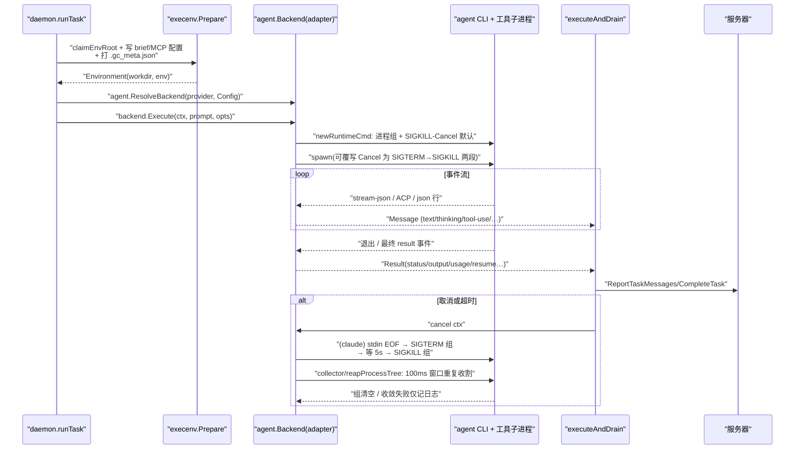
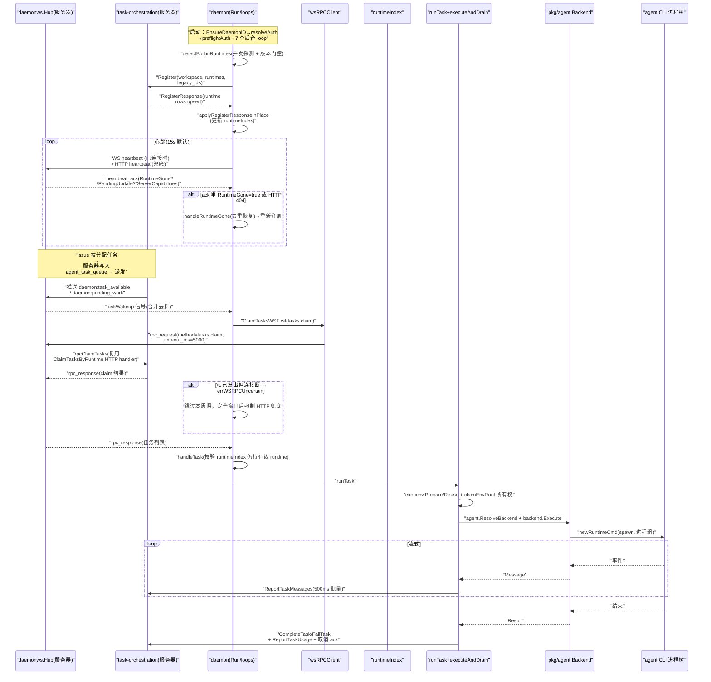

# Multica Agent 运行时模块解读

## 模块一句话定位

Agent 运行时模块是 Multica「Agent 是一等公民 teammate」哲学的落地层：它让用户本机上运行的一个 daemon 进程，通过一套统一的 `Backend` 接口和若干共享的进程生命周期基础设施，无差别地发现、注册、拉起并驱动 26 种协议形态各异的编码 agent CLI，同时负责这些 agent 进程从诞生到被彻底清理的全生命周期可靠性，以及与服务器的 WS/HTTP 双轨连接。

## 在项目中的角色：去掉 daemon 系统会怎样

去掉这个模块，Multica 剩下的是一个空壳的 issue 看板 + 一套任务状态机。原因在于本模块承载了全部「谁在真正执行代码」：

- **执行发生在用户机器上，不在服务器上**。任务编排（task-orchestration）只负责把 issue 翻译成一条 `agent_task_queue` 行和派发信号；真正 `spawn` 进程、灌 prompt、读 stream 的，是本机 daemon 上的 `runTask`。服务器侧没有一个函数会去执行 agent CLI，它的职责止于 `ClaimTasksByRuntime` 把已派发任务交给连接着的 daemon。
- **运行时的存在性/健康性完全由 daemon 维护**。`agent_runtime` 行、它的 `daemon_id`、`status`、`version`、`timezone`，全部由 daemon 通过注册（`DaemonRegister`）和心跳（`DaemonHeartbeat` / WS 心跳）驱动；服务器只在收到心跳 ack 时更新 `last_seen_at`，在 WS ack 里回 `RuntimeGone=true` 告诉 daemon 行已被删。
- **agent CLI 的协议差异被这个模块封存在 `pkg/agent` 内部**。`agent_task_queue`、前端 UI、甚至 daemon 的 `runTask` 都不需要知道某 provider 是 stream-json 还是 ACP；它们只面对 `agent.Backend` 接口和 `agent.Message`/`agent.Result` 两个语义结构。

一句话：**task-orchestration 决定"任务该给谁"，本模块决定"谁、用什么进程、以什么协议、在什么隔离环境里、如何安全地执行它"。**

## 解决的根本问题（Why）

### 根因一：26 种 CLI 的协议差异，必须被收敛到一个接口之后，调度层才能写通用逻辑

各 agent CLI 的交互形态差异极大（详见「抽象层设计」）：Claude Code 是 stdin 喂 prompt + `stream-json` 行协议；Codex 是 `app-server` 的长连接 JSON-RPC；Grok/Kimi/Hermes 等走 ACP（stdin/stdout 上的 JSON 请求-响应）；Pi/Oh-My-Pi 是 JSON event 协议；Qwen 是一次性 `-p` + `stream-json`；OpenCode 是 `run --format json`。若 `runTask` 直接写这些细节，调度逻辑会被协议特例淹没，每加一个 CLI 就要动调度核心。

### 根因二：daemon 是长时间驻留的进程管理器，进程泄漏是慢性死亡

一个 daemon 可能连续运行数周，反复拉起 agent CLI。agent CLI 本身会派生工具子进程（MCP server、shell、codex 的 Node wrapper + Rust app-server、npm/PowerShell shim 的孙进程）。若每次取消任务只杀掉直接子进程，孙进程会变成孤儿继续消耗资源——注释里直白记载了历史事故：`os/exec` 默认 Cancel 只杀 leader，Linux 上造成 #5918，Windows 上 `cmd.exe` shim 让被取消的 agent 继续工作了 40 分钟。

### 根因三：daemon 与服务器的连接必须在不可靠网络上保持可靠性

daemon 跑在用户笔记本上，网络会断、服务器会升级、runtime 行会被 UI 删除。需要 WS 推送（任务可达性提示）+ HTTP 兜底（心跳、claim）的双轨设计，且两类传输必须语义等价、可互相降级而不双倍 claim。

### 根因四：daemon 是一次性部署的长期进程，必须能自愈

agent CLI 会被用户升级/卸载（路径消失、版本低于最低要求）、daemon 二进制自己也会被更新。如果不处理，"装在用户机器上"的承诺会腐烂成"装在配置快照里"。

## 抽象层设计：让 26 种 CLI 呈现统一接口

### Backend 接口：以"流式事件 + 最终结果"为最小公共语义

`pkg/agent` 的契约不是"返回答案"，而是"给一个 Session，一边流式吐事件、一边异步给最终结果"：

- 接口面只有两个方法之一：`Execute(ctx, prompt, opts) (*Session, error)`。
- `Session` 由两个通道组成：`Messages <-chan Message`（文本/思考/工具调用/工具结果/状态/错误/日志的七种统一事件）与 `Result <-chan Result`（最终状态 completed/failed/aborted/timeout/cancelled + 输出 + usage + 会话指针）。

这样设计的关键收益：`daemon.executeAndDrain` 可以用一套与 provider 无关的代码消费消息——批量上报给服务器、驱动 idle watchdog、累计 usage——而 `Result` 的 `Status` 枚举让重试/失败分类逻辑（如 `shouldRetryWithFreshSession`）只读一个值，不需要理解某个 CLI 的退出码。

引用：
[server/pkg/agent/agent.go:17-23]() `Backend` 接口本体，Execute 返回可流式的 Session。
<!-- anchor: // Backend is the unified interface for executing prompts via coding agents. … // Session.Result for the final outcome. -->

### ExecOptions：抽象层如何长成"含 26 种 CLI 特例的动态协议表"

`ExecOptions` 是这份抽象真正有意思的地方——它不是纯净的公共字段集，而是**公共字段 + provider 特例字段**的混合体。`SystemPrompt`、`ThinkingLevel`、`ServiceTier`、`OpenclawMode`、`ClaudeSettingsPath` 等字段都明确标注"只被某几个 backend 消费，其余忽略"。注释里明说这就是刻意设计：`ThinkingLevel` 让新 CLI 可以增量支持 effort 而不破坏其他 agent（MUL-2339 的模式）。这避免了"为每个 provider 建独立配置结构"的爆炸，代价是接口读者需要按 provider 阅读注释。

同一哲学还体现在 `ExtraArgs` 的注释上：它明确承认"故意不在接口里枚举谁消费它"，因为"上一个列表在 backend 增加后就过时了，这正是 MULTICA_QWENPAW_ARGS 布线后丢掉的经过"——所以用 `Grep for ExtraArgs` 而非静态清单来保持真相。

引用：
[server/pkg/agent/agent.go:88-93]() ExtraArgs 特例字段的注释，承认静态清单会腐烂。
<!-- anchor: 	// ExtraArgs is honoured only by backends that opt in by reading it; the … 	ExtraArgs        []string        // daemon-wide default CLI arguments appended before CustomArgs -->

### 传输形态的三族分类（适配器差异的本质）

26 个适配器的差异可以归约为三种传输形态，这是理解抽象层的关键：

| 形态 | 交互方式 | 代表 | 适配器核心工作 |
|------|----------|------|----------------|
| stream-json / json 事件流 | 一次 `spawn`，prompt 走 stdin 或 `-p`，输出是行分隔 JSON | claude、codebuddy、qwen、opencode、cursor、copilot、pi、openclaw、codearts、deveco | 拼参数（`buildClaudeArgs`）、读事件循环、终结状态判定 |
| ACP（Agent Client Protocol） | 长连接，stdin/stdout 上 JSON 请求-响应，含工具回调握手 | grok、kimi、hermes、reasonix、kiro、dim、qwenpaw、mcode、zeroclaw、traecli | 复用共享的 `hermesClient` ACP 客户端 + 各自的会话创建/模型选择细节 |
| 单次参数传递 | `-p "prompt"` 一次性调用 | qwen（`-p` + stream-json）、antigravity（`agy -p`） | 保证 prompt 安全传递（走 stdin 而非 argv）、解析输出 |

`launchHeaders` 表就是这个三族分类的用户可见投影——每个 provider 一行"命令行骨架"，daemon 展示给用户看他们配置的 `custom_args` 会被拼在什么命令后面。

引用：
[server/pkg/agent/agent.go:464-490]() launchHeaders 表，26 个 provider 的命令行骨架。
<!-- anchor: var launchHeaders = map[string]string{ … 	"zeroclaw":    "zeroclaw acp", -->

### SupportedTypes 白名单与 BuiltinRuntime 描述符：两套"注册表"防止抽象漂移

`SupportedTypes` 是 26 个 protocol family 的白名单，注释明确要求它与 DB 里 `runtime_profile.protocol_family` CHECK 约束保持同步（迁移 120/134/136/175/179/202/242/253/254/313/342/370/403/441 逐个加）。`New()` 的 switch 与迁移 CHECK 双处锁定，是"让程序验证"的 DB 侧版本——自定义 runtime profile 只能基于官方支持的协议族，防止 wrapper 命令冒充未测试的协议。

`BuiltinRuntimes` 描述符解决的是另一个问题：**协议族的派生运行时**。omp（Oh-My-Pi）说 pi 协议但有自己的 CLI/模型发现/技能目录。`BuiltinRuntime` 描述符把"一个运行时的全部身份"收敛在一条声明里（ID、协议族、默认命令、env 前缀、显示名、技能目录、launch header、模型发现函数），注释明言"加一个新的兼容 fork 是一条描述符，不是跨栈改动"。派生的机制是 `backendOverrideApplicator` 接口 + `NewRuntime` fail-closed：协议族 backend 若不实现 override，直接报错，绝不静默用错 executable。

`ResolveBackend` 是 daemon 唯一的生产入口，把"协议族走 New、运行时身份走 NewRuntime"的区分完全封装。

引用：
[server/pkg/agent/agent.go:312-338]() SupportedTypes 白名单数组本体。
<!-- anchor: var SupportedTypes = []string{ … 	"zeroclaw", -->
[server/pkg/agent/builtin_runtimes.go:18-70]() BuiltinRuntime 描述符的字段定义。
<!-- anchor: type BuiltinRuntime struct { … 	ModelDiscovery ModelDiscoveryFunc -->

### Command + LaunchPrefix：把"wrapper 包装"也纳入抽象

`Command` 抽象了"CLI 的身份 = executable + argv 前缀"。原因写在注释里：自定义 runtime profile 可能是 `ccms start q36` 这种 wrapper，`start`/`q36` 是程序身份的一部分，必须紧跟 executable 出现在所有协议参数之前，否则 Commander 风格解析器会直接拒绝。`newRuntimeCmd` 是包内唯一构造进程的地方，它强制所有进程（任务启动和 `--version` 探测）都拿到进程组与取消语义，测试 `TestOnlyLaunchGoSpawnsRuntimeProcesses` 会强制这一单点。`filterLaunchPrefix` 负责在新进程前过滤掉会破坏协议通道的 flag（如 `--output-format text`），注释明言"位置 token 是命令身份、flag token 是与 daemon 拥有的协议参数竞争"，二者规则不同。

引用：
[server/pkg/agent/launch.go:72-82]() Command 结构体定义。
<!-- anchor: type Command struct { … 	logger *slog.Logger -->
[server/pkg/agent/launch.go:112-135]() exec 单点构造 + newRuntimeCmd 统一进程组与取消默认值。
<!-- anchor: func (c Command) exec(ctx context.Context, args ...string) *exec.Cmd { … 	cmd.Cancel = func() error { -->

## 进程生命周期可靠性：从"spawn 成功"到"连孙进程都被收走"

### 问题域：为什么普通的 os/exec 不够用

agent CLI 不是单一进程，而是进程树：claude 派生 MCP server；codex 的 Node wrapper 再拉起 Rust app-server；npm/PowerShell 的 `.cmd` shim 本身是个中间进程，真 CLI 是它的孙进程。注释里明确记载了三类历史事故：

1. `os/exec` 默认的 `Cancel` 只杀 leader，工具子进程全部存活（Linux #5918）；
2. Windows 上 shim 被杀后真 CLI 变成孤儿，被取消的 agent 继续工作了 40 分钟；
3. 27 处启动进程的代码里只有 8 处主动建了进程组，其余都把 CLI 留在 daemon 自己的组里，组级信号够不着它（GH #7522）。

结论是：**进程组/Job Object 归属必须成为构造进程时的默认，而不是每个 backend 的 opt-in**。

### 默认进程语义：一个函数统一所有运行时进程

`newRuntimeCmd` 是包内构造 `*exec.Cmd` 的唯一出口，它做两件事：`configureProcessGroup` 把子进程放进独立进程组（Unix `Setpgid`；Windows 用 Job Object + 挂起创建，见 proc_windows.go），并覆写 `cmd.Cancel` 为 `signalProcessGroup(cmd, SIGKILL)`——即取消时杀整组而非 leader。backend 想要优雅终止可以自行覆写 `Cancel`（claude/dsh/deveco 就这么做），但默认必须保守。

`signalProcessGroup` 向 `-pid` 发信号（组），失败才退化为只发给 leader；`waitProcessGroupGone` 以 10ms 间隔轮询组是否清空，供优雅终止流程判断何时升级到 SIGKILL。

引用：
[server/pkg/agent/launch.go:133-140]() newRuntimeCmd 统一进程组 + SIGKILL 取消默认值。
<!-- anchor: func newRuntimeCmd(cmd *exec.Cmd) *exec.Cmd { … 	return cmd -->
[server/pkg/agent/proc_other.go:27-32]() configureProcessGroup：Setpgid 使子进程成为组 leader。
<!-- anchor: func configureProcessGroup(cmd *exec.Cmd) { … 	cmd.SysProcAttr.Setpgid = true -->
[server/pkg/agent/proc_other.go:53-60]() signalProcessGroup：向进程组发信号，失败退化为单进程。
<!-- anchor: func signalProcessGroup(cmd *exec.Cmd, sig syscall.Signal) { … 	_ = cmd.Process.Signal(sig) -->

### 优雅终止：SIGTERM → 等待 → SIGKILL 的两级升级

以 claude 的取消路径为例，其语义层次值得拆解：

1. `closeStdin()` 先给 CLI 一个干净的 EOF，提示它正常收尾；
2. `signalProcessGroup(SIGTERM)` 让整组收到优雅信号；
3. `waitProcessGroupGone(cmd, claudeTerminateGrace())`（默认 5s）轮询**整个进程组**是否清空——注释特别强调不能以 `procDone`（leader 退出）为准，因为 leader 可能先退出而忽略 SIGTERM 的孙进程还活着，等 SIGKILL 只有等组清空才保险；
4. 组未清空则 `signalProcessGroup(SIGKILL)`，不可捕获，此后才安全地 `stdout.Close()` 去解阻塞 scanner。

这套两级升级让"能体面收尾"的 CLI 拿到体面，让"拒绝体面"的进程树最终被强杀，且强杀以进程组为单位。

引用：
[server/pkg/agent/claude.go:188-210]() claude 取消 goroutine：stdin EOF → SIGTERM 整组 → 升级 SIGKILL → 关闭 stdout。
<!-- anchor: 		go func() { … 			_ = stdout.Close() -->
[server/pkg/agent/claude.go:195-205]() 以进程组而非 leader 为准判断升级时机。
<!-- anchor: 			if cmd.Process != nil { … if !waitProcessGroupGone(cmd, claudeTerminateGrace()) { -->

### collector：为什么必须自己管理管道

`launch.go` 的 `runOwned`/`outputOwned` 等是给同步探测用的；长生命任务的 stdout 读取走 `collector`（run_collect.go），两者决策不同。核心区别：**谁决定"读完了"**。

- `os/exec` 的 `Run`/`Output` 由它自己起 copy goroutine 排空管道，`Wait` 要等到管道 EOF 才返回；而管道 EOF 要求**所有**写端关闭——CLI 派生一个继承了 stdout 的后台 helper，`Wait` 就被卡到 helper 生命结束。
- `collector` 反其道：它自建 `os.Pipe`，把 `*os.File` 直接给子进程当 Stdout/Stderr，**os/exec 不启动任何 copy goroutine**，于是 `Wait` 在直接子进程退出瞬间就返回，何时停止读由本包决定。

这个决定权带来一个必须遵守的纪律：直接子进程退出 ≠ 输出结束（Windows 上 wrapper 退出 0 而真 CLI 500ms 后才打印是常态）。所以 `awaitOutputAfterExit` 等管道 EOF（`collectDrainGrace` 2s 上限），除非调用方的 completeness 规则（`OutputComplete`）已判定答案在缓冲里。这就是 `RunCollectQuiet` 的语义：一个「答案已到 + 静默 + 管掉进程树」的组合。

引用：
[server/pkg/agent/run_collect.go:275-334]() startCollector：自建 os.Pipe、不用 os/exec 的 copy 机制、finish 负责清场。
<!-- anchor: func startCollector(cmd *exec.Cmd, env []string) (*collector, error) { … 	go func() { c.waitErr = cmd.Wait(); close(c.waitDone) }() -->
[server/pkg/agent/run_collect.go:457-471]() awaitOutputAfterExit：leader 退出后等管道 EOF，completeness 规则可短路。
<!-- anchor: func (c *collector) awaitOutputAfterExit(ctx context.Context, complete OutputComplete) { … if complete != nil && complete(c.stdout.snapshot()) { -->

### 进程树收割：为什么一次 kill 不够

`finish()` 的收割循环体现了对竞态的实证认知：单次向进程组发 SIGKILL 会漏掉"kill 的枚举与送达之间刚好 fork 出来"的后代（注释记录实测 10 次里 3 次漏，漏网的后代被 reparent 到 init 继续运行）。因此收割在 `collectReapWindow`（100ms）内反复发信号 + 轮询组清空，窗口刻意很短，因为组 id 就是已被 Wait reap 的 leader pid，拉长窗口会扩大 pid 复用风险。收割后仍有未收敛则记 warn 日志，但**绝不把清理失败当答案失败**——一个成功的 `--version` 探测不能因为内核拒绝杀某个 helper 而整体失败。

引用：
[server/pkg/agent/run_collect.go:19-26]() collectReapWindow 注释：一次 pass 不够、fork 竞态是实测而非推测。
<!-- anchor: // One pass is not enough. A descendant whose fork completes between the kill's … const ( -->
[server/pkg/agent/run_collect.go:351-391]() finish：重复收割 → 等待 Wait/读者收敛 → 收敛失败只记日志。
<!-- anchor: func (c *collector) finish() { … if !treeGone || !drained || !waitReturned { -->
[server/pkg/agent/run_collect.go:496-501]() reapProcessTree：SIGKILL 整个进程组，空组得到 ESRCH 被吸收。
<!-- anchor: func reapProcessTree(cmd *exec.Cmd) { … 	signalProcessGroup(cmd, syscall.SIGKILL) -->

### 输出边界：防"被 CLI 撑爆内存"和"被 CLI 饿死管道"

三条防线：

- `stream_scanner.go` 把单行上限提到 32MiB（从 10MiB 修的 GH#4520——Codex `thread/resume` 会把整个线程序列化成一行），行太长按传输故障报告而不是崩溃；构造器是包内唯一读 agent 事件流的方式，因为"每个 backend 各自 copy 上限导致 GH#4520 的修复只到其中一个"。
- `run_collect.go` 对一次性命令的 stdout 设 8MiB 上限且 overflow **报错**（回答被截断必须是错误不是静默成功），stderr 则保留尾部 32KiB（诊断样本取尾巴）；注释里有一整段推导这个 8MiB 为什么是兼容性边界而非内存边界。
- 缓冲写满时继续读而不是停：停会让子进程阻塞在写满的管道上，把"答案太大"变成"挂起"。

引用：
[server/pkg/agent/stream_scanner.go:8-21]() 单行上限注释：为何 32MiB、为何必须走统一构造器。
<!-- anchor: // agentStreamMaxLineBytes bounds a single line read from an agent CLI's … const agentStreamMaxLineBytes = 32 * 1024 * 1024 -->
[server/pkg/agent/run_collect.go:149-163]() absorb：超过上限仍继续读，避免子进程阻塞在写满的管道上。
<!-- anchor: // Reading continues past max in both modes. Stopping would leave the child … if errors.Is(err, io.EOF) || errors.Is(err, os.ErrClosed) { -->

### 执行环境隔离与所有权（execenv）

`runTask` 里的执行环境由 `execenv.Prepare` 建在稳定 env root 下（workdir + output + logs + 0700 的 multica-config 沙盒），关键是所有权纪律：

- `claimEnvRoot` 用 `.task_owner` + `.task_lock` 做**原子独占**：注释直白记录了一个历史事故——env root 段曾是 UUIDv7 前缀，一次删除把运行中兄弟任务的 workdir 一起清掉（#7326），所以现在 "prove ownership instead of assuming it"。
- 每个 env root 写 `.gc_meta.json` 元数据（任务/issue 归属、TTL 语义），供 GC 判断可否回收；`activeEnvRoots` 引用计数 + `activeStores` 计数让 GC 绝不删正在运行任务引用的目录。
- 进程树隔离：`execenv.Prepare` 也可经由一个独立 helper 进程（`isolation.go` 的 `PrepareIsolated`）跑，配合 `processtree` 包（Unix 进程组 / Windows Job Object，1s 优雅停、5s 收割上限）保证"helper 的后代也活不过取消"。

引用：
[server/internal/daemon/execenv/execenv.go:445-458]() Prepare 中对 env root 所有权的论述。
<!-- anchor: 	// Take exclusive ownership of the env root before touching anything in it. … 	// looks unowned to a racing task. -->
[server/internal/daemon/execenv/execenv.go:1426-1471]() claimEnvRoot：原子独占 + 清空 + 标记。
<!-- anchor: func claimEnvRoot(envRoot, workspaceID, taskID string) (lockFile *os.File, reset bool, err error) { … return lockFile, true, nil -->
[server/internal/daemon/processtree/run.go:44-92]() processtree.run：启动 → 等 → 取消时 interrupt/stop 两级 → 收割。
<!-- anchor: func run(ctx context.Context, cmd *exec.Cmd, waitDelay time.Duration) error { … 	return err -->

### 进程生命周期总览图

## daemon 进程模型：身份、配置、启动编排

### 身份：机器级稳定 UUID，一次写入永久有效

daemon 的 id 存放在 `~/.multica/daemon.id`，机器级共享（profile 只区分连哪个后端，不区分机器身份），原子写入 + 0600。设计上预防三类身份漂移：hostname 变化、`.local` 后缀漂移（注释记载同一台机器历史上同时返回过 `foo` 和 `foo.local`）、以及迁移期多 profile 各自有 id。`LegacyDaemonIDs`/`LegacyDaemonUUIDs` 枚举历史 hostname 形态，注册时让服务器把旧行合并进新 UUID（048 迁移专门加了 `legacy_daemon_id` 列记录合并来源）。

引用：
[server/internal/daemon/identity.go:14-18]() daemonIDFileName 与"一旦创建就是永久身份"的注释。
<!-- anchor: // daemonIDFileName is the file that stores this machine's stable daemon … const daemonIDFileName = "daemon.id" -->
[server/internal/daemon/identity.go:39-74]() EnsureDaemonID：读/迁移/新建的三分支。
<!-- anchor: func EnsureDaemonID(profile string) (string, error) { … 	return id.String(), nil -->

### 启动编排：健康端口先行、preflight 后 ready

`Run` 的启动顺序体现"可观测性优先"：先 bind 健康端口（127.0.0.1，还能检测重复 daemon）、再 renew PAT、preflightAuth（首次 workspace 同步会逐个 exec agent CLI 探测版本，冷缓存下约 20s）、然后拉起来 7 个后台循环（workspaceSync、agentDiscovery、taskWakeup、heartbeat、gc、autoUpdate、tokenRenewal），最后才把 `/health` 从 `starting` 翻成 `running`——这是 `daemon start` 就绪等待的信号，失败不会误报为已启动。健康 handler 透出 activeTaskCount/runningTasks/skippedAgents/reloadPendingReason 等诊断维度。

引用：
[server/internal/daemon/daemon.go:2016-2025]() 健康端口先行 + starting/running 分离。
<!-- anchor: 	// Bind and serve the health port before the (potentially slow) preflight, … 	go d.serveHealth(ctx, healthLn, time.Now()) -->
[server/internal/daemon/daemon.go:2039-2063]() 7 个后台循环启动后翻转 ready。
<!-- anchor: 	// Start workspace sync loop to discover newly created workspaces. … 	return err -->
[server/internal/daemon/health.go:315-321]() health status 的语义注释。
<!-- anchor: 		// "starting" until preflight (PAT renew + initial workspace sync + … 		status := "starting" -->

## 与服务器连接：wsrpc 协议与双轨传输

### 协议形态：一个共享 WS 控制连接 + 通用 RPC envelope

daemon 与服务器之间不只为每个调用建连接，而是维护一条**长连接的控制 WS**（`task wakeup` 连接），其上传三类帧：`daemon:heartbeat`、`daemon:rpc_request`/`daemon:rpc_response`、以及服务端推送的唤醒提示（`daemon:task_available`、`daemon:pending_work`、`daemon:runtime_profiles_changed`、`daemon:workspaces_changed`）。

通用 RPC 的 envelope（`protocol.RPCRequestPayload`/`RPCResponsePayload`）用 `request_id` 关联响应，`method` 选服务端 handler（如 `tasks.claim`），`timeout_ms` 是**服务端执行预算**——服务器用它在 handler context 上加限，慢 RPC 被取消并回滚，而不是在 daemon 已经超时降级到 HTTP 后才提交。`status` 镜像 HTTP 语义，让 daemon 对 WS/HTTP 两种传输统一判读。

引用：
[server/pkg/protocol/messages.go:56-66]() RPCRequestPayload：request_id + method + 服务端执行预算。
<!-- anchor: type RPCRequestPayload struct { … 	TimeoutMs int64 `json:"timeout_ms,omitempty"` -->
[server/pkg/protocol/events.go:160-167]() daemon:rpc_request / rpc_response 事件定义注释。
<!-- anchor: 	// Generic daemon→server request/response over the WebSocket control … 	EventDaemonRPCResponse = "daemon:rpc_response" -->

### 双轨传输的正确性核心：把"不确定"与"确定失败"分开

wsrpc 最精妙的设计是**结果三态**，而不是"成功/失败"两态：

- `errWSRPCUnavailable`：帧还没离开 writer（无连接 / 写缓冲满 / 未协商成功），**确定没到服务器** → 可以安全 HTTP 降级；
- `errWSRPCUncertain`：帧已经离开 writer（beginWrite 之后连接断/超时），**服务器可能已提交** → 绝不能在同一周期内用 HTTP 重做同一工作，否则双倍 claim；
- 成功：正常返回。

`wsOutbound` 的 `sent/cancel` 原子竞态保证这个判断可靠：caller 放弃时如果 writer 还没 beginWrite 就可以 cancel 掉（确定未发），已经开始写就不可撤回（不确定）。配套的 `wsClaimHTTPFallbackAfter` 延迟窗口让不确定的 claim 先跳过当前周期，等 `batchClaimRequestTimeout + grace` 之后再强制走一次 HTTP 恢复活性。整条链路上"任务只被 claim 一次"的语义由帧级别的 sent 状态机保障，而不是靠服务器幂等。

引用：
[server/internal/daemon/wsrpc.go:15-24]() 三态错误注释：Unavailable 可降级，Uncertain 不可。
<!-- anchor: // errWSRPCUnavailable is returned by wsRPCClient.Call when there is no live WS … var errWSRPCUncertain = errors.New("ws rpc: sent but outcome unknown (connection lost)") -->
[server/internal/daemon/wsrpc.go:228-238]() giveUp：已取消帧 = 可降级，已发出帧 = 不确定。
<!-- anchor: 	// giveUp resolves an abandoned request. If the frame is still queued we … 		return errWSRPCUncertain -->
[server/internal/daemon/wsrpc.go:315-367]() ClaimTasksWSFirst：WS 优先、Uncertain 跳过周期、HTTP 兜底。
<!-- anchor: func (d *Daemon) ClaimTasksWSFirst(ctx context.Context, daemonID string, runtimeIDs []string, maxTasks int) ([]*Task, error) { … tasks, err := d.client.ClaimTasks(ctx, daemonID, runtimeIDs, maxTasks) -->

### 服务端侧：Hub 连接管理 + 复用 HTTP handler

`daemonws.Hub` 管理所有 daemon 连接：`register`/`unregister`、按 runtime/workspace/user 三种 scope 做事件投递与去重（`markSeen`）、心跳 handler 与 RPC handler 的可注入性。`handleRPCFrame` 把 handler 丢进独立 goroutine 并受 `maxInFlightRPCPerClient`（8）槽位约束，饱和即回 `429` 让 daemon 走 HTTP——绝不在单条 socket 上无限排队。

服务端 RPC dispatch 的巧妙之处在 `handler/daemon_rpc.go`：`tasks.claim` 不重写业务逻辑，而是构造一个带 WS 身份上下文的**内存 http.ResponseWriter**（`rpcResponseCapture`）直接复用 `ClaimTasksByRuntime`——HTTP 路径的鉴权/载荷构建/终态化逻辑零重复，WS 只是传输层的另一个前端。

引用：
[server/internal/daemonws/hub.go:761-806]() handleRPCFrame：goroutine + 并发槽位 + 服务端执行预算。
<!-- anchor: func (c *client) handleRPCFrame(raw json.RawMessage) { … c.sendRPCResponse(req.RequestID, status, body, "") -->
[server/internal/handler/daemon_rpc.go:45-50]() DaemonRPCHandler：method 分发，默认 404。
<!-- anchor: func (h *Handler) DaemonRPCHandler(ctx context.Context, identity daemonws.ClientIdentity, method string, body json.RawMessage) (int, json.RawMessage, error) { … return http.StatusNotFound, nil, fmt.Errorf("unknown rpc method %q", method) -->

## 关键数据结构（精简片段）

- `Runtime`（daemon 本地视图）：`ID/Name/Provider/Status/ProfileID`，其中 `ProfileID` 把"来自自定义 runtime profile 的 runtime"与内置探测的区分开，是 runTask 里 `customProfileLaunchForRuntime` 查找 profile 启动 spec 的键。`AgentEntry`（发现结果）：`Path/Command/Model`，`Command` 保留原始命令名以便路径消失后重新解析（MUL-4486 自愈的原料）。
- `Task`（claim 到的任务载荷）：包含 issue/chat/autopilot/squad 全触发类型字段、`Repos`、`ProjectResources`、`Agent`（含 `CustomArgs`/`ThinkingLevel`/`ServiceTier`）、`PriorSessionID`/`PriorWorkDir`（resume/reuse 指针）。
- `agent.Config`：executable、launch prefix、版本、env、task/runtime 身份、`BuiltinRuntime` 布尔（限定兼容性例外只作用于真 vendor 二进制，不扩散到同协议族的任意 wrapper）。
- `execenv.Environment`：workdir、env map、env root、锁文件句柄、GC meta 载体。
- 协议层：`protocol.Message{Type, Payload}` 统一信封；`RPCRequestPayload/RPCResponsePayload` 是 wsrpc 的请求/响应体；`DaemonHeartbeatAckPayload` 是心跳动作信封（pending update/model list/local skills + RuntimeGone + ServerCapabilities）。

引用：
[server/internal/daemon/types.go:24-36]() Runtime 本地视图与 ProfileID 语义。
<!-- anchor: // Runtime represents a registered daemon runtime. … 	ProfileID string `json:"profile_id,omitempty"` -->
[server/internal/daemon/prompt.go:218-234]() BuildPrompt：run 作用域上下文追加而非前置，保证 resume 缓存前缀稳定。
<!-- anchor: func BuildPrompt(task Task, provider string, options ...PromptOption) string { … 	return body -->

## 核心链路：注册 → 心跳 → 任务执行

### 完整时序图

### 任务执行内部：handleTask → runTask → executeAndDrain 的分层职责

- `handleTask`：任务级编排。校验 runtime 是否仍被本 daemon 持有（claim 在途时 runtime 可能已被 demote，此时以 `runtime_offline` 失败并让服务器重试，而不是空 provider 错误地判为"宿主机配错"）；acquire local_directory 路径锁；`watchTaskCancellation` 轮询服务器取消信号；跑完后先报 usage 再按"是否被轮询取消"分叉处理。
- `runTask`：执行环境装配。校验 task 身份（agent id 顶层与扩展配置一致）、构建 backend 的 `agent.Config`（executable/launch prefix/版本/环境）、解析模型（agent.model 优先，其次 daemon env，两者皆空则**故意传空字符串**让 CLI 用自己的默认——注释明言静态默认是 cursor 回归的根源）、生成 prompt/execOpts、交给 runTask 中的 task runner。
- `executeAndDrain`：provider 无关的消息泵。包一层 `agentCtx`（让 idle watchdog 能同时掐断子进程和 drain）、启动 idle watchdog（有 in-flight tool 时放宽到 tool 预算）、500ms 批量 flush 消息到服务器、最后消费 Result 并做 session pin/resume 判定。

关键防线：backend 构造通过唯一的 `agent.ResolveBackend`；自定义 runtime profile 的路径在注册期解析并缓存到 `profileLaunchSpecs`，运行期 `customProfileLaunchForRuntime` 取用，宿主即使没装内置 CLI 也能用 wrapper。

引用：
[server/internal/daemon/daemon.go:5305-5329]() handleTask 开头的 runtime 有效性校验与回退上报。
<!-- anchor: func (d *Daemon) handleTask(ctx context.Context, task Task, slot int) { … 	provider := rt.Provider -->
[server/internal/daemon/daemon.go:7908-7919]() runTask 通过 agent.ResolveBackend 构造 backend 的唯一边界。
<!-- anchor: 	backend, err := agent.ResolveBackend(provider, agent.Config{ … BuiltinRuntime: !usesCustomProfileCommand, -->
[server/internal/daemon/daemon.go:7924-7929]() 模型解析"故意传空"的注释。
<!-- anchor: 	// Two-tier model resolution: an explicit agent.model wins, … 	// default, codex app-server's account-scoped default, etc.). -->
[server/internal/daemon/daemon.go:8610-8623]() executeAndDrain：Execute 失败统一过 ExplainExecError，成功才计数 runningTasks。
<!-- anchor: 	session, err := backend.Execute(agentCtx, prompt, opts) … 	defer d.runningTasks.Add(-1) -->

## 运行时发现与健康维持：把"用户机器上的环境"变成"可收敛的状态"

### 发现：LookPath 为主、login shell 兜底、TTL 缓存

`probeAgentCLIs` 是纯发现（不探测版本、不设最低版本门），核心问题是 GUI 启动的 daemon 拿不到用户交互 shell 的 PATH（fnm/nvm 的 multishell 都在 `~/.zshrc` 里才加）。解法是**惰性** fork login shell：只在某个标准命令名 LookPath 失败时才让 shell 解析，且结果缓存 30 分钟（TTL 故意远大于发现间隔，避免"几乎总有一个未安装的 provider"导致每轮都 fork shell）。缓存 key 是 `PATH+SHELL+HOME` 的指纹，环境变了立刻失效。

发现结果 `AgentEntry` 只含 Path/Command/Model；`BuiltinRuntime` 描述符驱动 omp 等派生运行时也走同一 probe 循环——加一个 fork 只是描述符条目。

引用：
[server/internal/daemon/agents_probe.go:16-30]() shellResolveTTL 注释：为什么 TTL 必须远大于发现间隔。
<!-- anchor: // shellResolveTTL bounds how long one login-shell PATH resolution is reused … var shellResolveTTL = 30 * time.Minute -->
[server/internal/daemon/agents_probe.go:92-108]() probeAgentCLIs 纯发现语义与惰性 shell 解析说明。
<!-- anchor: var probeAgentCLIs = func() map[string]AgentEntry { … 	// only fork a shell when a bare command name actually missed LookPath. -->

### 收敛：只增不减 + 版本门控 + 降级（demote）三件套

`agentDiscoveryLoop`（2 分钟间隔）把"新装的 CLI 出现"收敛到"注册成 runtime"。三个纪律：

1. **refreshAgentAvailability 单向**：只对"新出现的 provider"行动；provider 消失不摘除——因为临时环境差异（daemon 从更窄 PATH 重启、版本管理器升级中）不应拆掉一个正在干活、可能正在执行任务的 runtime。摘除只交给显式重启。
2. **版本门控**：`detectBuiltinRuntimes` 并发探测（`runtimeVersionProbeConcurrency` 限流）并产出 verdict——below-minimum 或（经确认窗口的）not-executable 会触发 `demote`，注册 payload 里不带它，且 `demotedProviders` 记录让"已确认低于最低版本"的 verdict 能顶住晚到的旧注册响应（响应被当作新鲜真相 apply 的竞态）。
3. **converge 带退避**：`convergeRuntimeRegistrations` 只在仍有 provider 缺 runtime 时以指数退避重试（最大 30 分钟），新 provider 立即尝试。

引用：
[server/internal/daemon/agents_refresh.go:162-170]() refreshAgentAvailability 单向性注释。
<!-- anchor: // Deliberately one-directional: only providers GAINED are acted on. A provider … func (d *Daemon) refreshAgentAvailability() []string { -->
[server/internal/daemon/daemon.go:2470-2494]() detectBuiltinRuntimes：并发探测 + not-executable 需二次确认才 demote。
<!-- anchor: 	// Snapshot before any probe runs: everything sampled below is at least as … 			demote := verdict == builtinProbeBelowMinimum || -->

### 自愈：路径消失后的自我修复

agent CLI 的 in-place 升级会删除旧可执行文件，注册期 pin 的路径就断了。`resolveAgentEntryForLaunch` / `resolveAgentEntryWithHeal` 在**任务启动前**做自愈：重新做 login-shell 解析（`healAgentPath`）、把新路径+新版本成对缓存进 `resolvedPaths`（"路径和版本一起存，防止用旧版本策略启动新二进制"），并用 `singleflight` 合并并发任务对同一 provider 的重复治愈——一次登录 shell probe + 版本探测，而不是每个排队任务各付一次。`agent_path_selfheal.go` 同时处理 Windows 上 installer junction 的稳定启动目标。

引用：
[server/internal/daemon/daemon.go:463-475]() resolvedPaths 与 healGroup(singleflight) 字段注释。
<!-- anchor: 	// resolvedPathsMu guards concrete executable paths paired with the version … 	healGroup singleflight.Group -->

### runtime 行消失的恢复：runtime_gone 收敛

runtime 行可能被 UI 删除或 7 天离线 GC 清掉。三处独立信号（HTTP 心跳 404、WS ack `RuntimeGone=true`、`daemon:pending_work`）都可能发现它。`handleRuntimeGone` 用 `runtimeGoneInflight` 去重（三个来源不会同时各自重注册），`reregisterNextAttempt` 退避，恢复动作统一走 `registerRuntimesForWorkspaceAfterRuntimeGone`。WS ack 里专门设计了 `RuntimeGone=true` 而非直接断连接，注释说明了原因：没有它，死 UUID 会一直心跳到 daemon 进程重启。

引用：
[server/pkg/protocol/messages.go:356-362]() RuntimeGone 的注释：WS 版本的 404 替代。
<!-- anchor: // RuntimeGone is the WebSocket replacement for the HTTP 404 "runtime not found" … 	// daemon process restarts. -->
[server/internal/daemon/daemon.go:508-516]() runtimeGoneMu 组字段：三来源收敛到单一恢复路径。
<!-- anchor: 	// runtimeGoneMu guards runtimeGoneInflight, reregisterNextAttempt, and … 	reregisterLastCompletedAt map[string]time.Time // workspace_id -> wall-clock at which the last SUCCESSFUL re-register call returned (failures intentionally not stamped — see recordRegisterCompletion) -->

## GC：磁盘所有权是运行时维护的另一半

daemon 长期驻留会堆积大量任务目录、clone 的仓库缓存、per-conversation 会话存储、临时目录。`gcLoop`（30s 后首跑 + 按 `GCInterval` 周期）回收 8 类对象，重点是所有权纪律与"只回收被证明没人要的东西"：

- **任务目录的回收依据**不是 mtime 拍脑袋，而是三层证据：`.gc_meta.json` 里的 issue 归属与 TTL、服务器权威的 issue 终态（`GetIssueGCCheck`——已 completed/failed/cancelled 且超 TTL 才收）、以及 72h orphan 兜底（无 meta 或 issue 不可达）。
- **绝不删运行中的东西**：`activeEnvRoots` 引用计数 + `deletingEnvRoots` 保留位让新任务等 GC 完成而不是挂上正在删的目录（issue #3999 race B 的修复）。`activeStores` 同理守护 Codex 会话存储与 Hermes 记忆——这些是"任务结束后还要被 resume 用"的资产，回收是用户可见的记忆丢失。
- **repo 缓存与 worktree 清理**：`.repos` 下的 bare clone 是 daemon 维护的 checkout 服务端，worktree 引用过期后 prune，缓存自身超 TTL evict。
- **教训注释密集**：runGC 开头就记录 `.skill-cache` 曾被当成 workspace 遍历、孤儿路径差点把整个技能包缓存当孤儿删掉的往事（dot-prefix 目录必须跳过）。

引用：
[server/internal/daemon/gc.go:83-110]() runGC 扫描根：跳过 dot 目录 + 教训注释。
<!-- anchor: func (d *Daemon) runGC(ctx context.Context) { … 		d.gcWorkspace(ctx, wsDir, stats) -->
[server/internal/daemon/gc.go:96-106]() dot 前缀目录跳过的历史教训。
<!-- anchor: 		// Skip every daemon-internal dot directory, not just .repos. A … 			continue -->
[server/internal/daemon/daemon.go:577-585]() activeEnvRoots/deletingEnvRoots 与 activeStores 字段注释。
<!-- anchor: 	activeEnvRootsMu   sync.Mutex … 	deletingStores   map[string]bool // store paths a GC delete has reserved; markActive waits these out so a task never mounts a store mid-removal -->

## 自动更新与自我 reload：把"长驻进程"的腐烂关进笼子

### 两个更新源、一把更新锁

daemon 更新可来自服务器推送（heartbeat ack 里的 `PendingUpdate` → `handleUpdate`）或本地 `autoUpdateLoop`。两者通过 `updating` CAS 互斥，且都在 `claimMu` 的 claim barrier 下工作：`trySetClaimBarrier` 暂停 claim、等 in-flight claim 与 handleTask 清空后才 `triggerRestart`。注释引用了需求原文「升级过程中如果有 task 进来，会延后升级而不是中断 task」——这是把"不断言用户正在跑的任务"写进协议而不是留给运气。

### trySelfReload：探测"磁盘上另一个版本的自己"

`trySelfReload` 每 10 分钟探测**重启时会 exec 的那个二进制**（`restartTargetBinary`，brew 安装时是 `brew --prefix` 解析的稳定 symlink，而不是 `os.Executable()`），发现磁盘版本 ≠ 运行版本就先记 `reloadPendingReason`（/health 可见的诊断），等 claim barrier 空闲时 handoff。设计要点：版本比对要求两侧都非空（空值不重启，避免"空白→空白→每次 tick 都重启"的循环）；探测失败按"没变化"处理而不是按"变化了"处理（失败的探测不应触发重启）。

引用：
[server/internal/daemon/auto_update.go:356-382]() trySelfReload：探测 restart 目标 + 空值不比对。
<!-- anchor: 	// Probe the binary the restart would actually exec, not os.Executable(): … 	if onDisk == d.cfg.CLIVersion { -->
[server/internal/daemon/daemon.go:561-575]() claimMu/pauseClaims/claimsInFlight 字段注释：auto-update 的 claim barrier。
<!-- anchor: 	// claimMu guards pauseClaims and claimsInFlight. It is held only for the … 	claimsInFlight int  // pollers that have decided to claim but haven't yet handed the task off to handleTask -->

## 与其他模块的协同

### 与 task-orchestration（服务端派发）的关系

task-orchestration 产出 `agent_task_queue` 行并触发派发；本模块的 claim 是派发的**拉取侧**。二者通过任务状态机衔接：`task:queued → dispatched(claim) → running(StartTask) → completed/failed`。本模块观察到的关键耦合点是 `agent_task_queue.runtime_id` 的 NOT NULL→nullable 演进（迁移 251：删 runtime 不再连坐删任务历史）、`runtime_connected_apps` 列（132：任务携带 MCP overlay 语义元数据进 brief）、以及 `runtime_profile` 表作为"自定义 runtime 的定义源"（120：协议族 CHECK 与 `agent.New` switch 双锁）。

### 与 acp 模块的关系

`pkg/agent/acp_*.go` 提供 ACP 协议的帧编解码与 RPC 客户端；本模块的 ACP 适配器（grok/kimi/hermes/kiro/dim/qwenpaw/mcode/zeroclaw/reasonix/traecli）在 `Execute` 内通过共享的 `hermesClient` 复用该层——grok 的 `Execute` 直接构造 `&hermesClient{...}` 就是一个佐证。**适配器里 ACP 调用的发生环节**：在 `Execute` 的 run goroutine 里，进程 spawn 后、以 stdin/stdout 管道为传输，依次做 session/create（或 load）、model 设置、prompt 注入、工具回调响应、end_turn 判定。差异点集中在会话初始化与结果判定，而非帧协议本身。

### 与 realtime（Relay 通知）的关系

`daemonws/notifier.go` 的 `RelayNotifier` 把本地 Hub 的通知（task_available、runtime_profiles_changed、workspaces_changed、pending_work）同时发布到 realtime 中继，让多实例/多进程部署下另一实例的 daemon 连接也能收到提示——本地 Hub 与中继是同一事件的两种投递面。

### 与 channels 模块的关系

channels（Slack/Lark 等）产生 chat 任务；本模块的 daemon 同样执行 chat 型任务（`task.ChatSessionID` 非空路径），且取消语义专门设计了 `chat:cancel_finalized` 事件（daemon flush 完 transcript 后才由服务器广播 outcome），避免"取消响应时 transcript 还没 flush"的状态分裂。

## 关键设计决策（权衡与替代方案）

### 决策一：进程组默认归属，而不是每个 backend opt-in

替代方案是"让每个 backend 记得建进程组"。历史证明该方案失败（27 处中只有 8 处记得，GH #7522 出了事故）。代价是：所有进程统一获得独立进程组意味着失去"与 daemon 同组、随 daemon 信号树联动"的隐式行为；但 daemon 要的就是树外管理。这个决策的收益是单点保障——`newRuntimeCmd` 一处生效，新 backend 想忘记都忘不掉，且 `TestOnlyLaunchGoSpawnsRuntimeProcesses` 在测试层面把它钉死。

### 决策二：wsrpc 结果三态 + 服务端执行预算，替代"重试幂等"

替代方案 A：让服务器 claim 幂等（幂等键），daemon 随意重试。代价：claim 语义复杂化、服务器要记录历史 claim。替代方案 B：daemon 超时就直接 HTTP 重试。代价：双倍 claim（任务被派发两次，服务器可能把同一任务同时给两个 runtime）。Multica 选的是"帧级 sent 状态机"：把不确定性在**发送边界**消解，只有确定未发才重试，不确定则等待安全窗口。配套的 `TimeoutMs` 把服务器执行预算显式化，让两端对"什么时候该放弃"有共同时间基准。这是"让正确性存在于协议里而非概率里"的典型工程。

### 决策三：env root 所有权先证明再用，替代"UUID 前缀即身份"

历史上 env root 用 UUIDv7 前缀做段名，'prefix 碰撞导致删掉兄弟任务 workdir' 的事故后，改为 `.task_owner` + `.task_lock` 的**原子独占**（claim→清空→写标记一气呵成，读-删分离会让两个同 key 任务同时通过检查）。替代方案（文件名加随机后缀、用 server 生成唯一名）能降低碰撞概率但无法根除，而"证明所有权"把概率问题变成确定性检查。代价是每次 Prepare 多两个文件操作与一次锁等待，换来的是一句硬保证：一个任务拒绝启动是可恢复的，删掉运行中兄弟的未提交工作是不可恢复的。

### 决策四：Login-shell PATH 的惰性解析 + 长 TTL，替代"启动时全量 fork shell"

替代方案 A：每次发现都 fork shell 解析全部 26 个命令名。代价：几乎总有一个未安装的 provider 命中 LookPath miss，导致 daemon 生命周期里每 2 分钟 fork 一次用户 shell、跑一遍 rc 文件——启动慢、对用户 shell 配置是侵入。替代方案 B：永不 shell 解析。代价：GUI 启动的 daemon 永远发现不了 nvm/fnm 装的 CLI。选型的核心是识别"shell fork 成本由 miss 驱动"，于是把 TTL 拉长到 30 分钟、用 `PATH+SHELL+HOME` 指纹做环境感知失效、并对"裸命令名"与"显式 MULTICA_*_PATH"做严格区分（显式路径 miss 必须硬失败，不许静默换二进制）。

## 亮点与问题

### 亮点

- **单点构造 + 双默认**（进程组 + SIGKILL 取消）是本模块可靠性的地基，配合"失败收敛只记日志不吞答案"（collector.finish 不因清理不收敛而失败答案）体现了正确的优先级：答案是产品面，清理是资源面，二者不允许互相绑架。
- **结论注释本身就是工程质量**：几乎每个常量的存在都有一段落地的历史事故注脚（fork 竞态 3/10 次漏杀、40 分钟 Windows 孤儿、8MiB 边界的推导、`.skill-cache` 差点被当孤儿删）。这让后来者改代码时知道边界为什么在那里。
- **发现/版本/降级三分离**：纯发现（`probeAgentCLIs`）与版本门控（`detectBuiltinRuntimes`）与注册（`registerRuntimesForWorkspaceLocked`）各司其职，任何一个环节失败都有诊断面（`skippedAgents` 上 /health）。
- **身份不漂移**：机器级 daemon UUID + legacy id 合并，避免了 hostname/.local 漂移这类"低概率高破坏"的长期运行问题。

### 问题与代价

- **抽象层的"特例字段"哲学两头不讨好**：`ExecOptions` 里 provider 特例字段全靠注释声明，新增 backend 若没读注释可能静默消费或忽略——`ExtraArgs` 注释已自认这一风险（"grep 才知道谁在用"）。这是"一个结构 vs 每个 provider 独立配置"之间的主动取舍，但它把正确性押在代码评审纪律上。
- **collector 的 2s drain 与 8MiB 上限是合理但手工推导的边界**：推导注释非常严谨，但一旦某 CLI 合法答案超过 8MiB（如超大 codebase 的模型目录），会表现为"任务无法开始"的兼容性故障而非优雅放大。
- **两个更新源 + claim barrier 的状态机很细**：`updating` CAS、`restartBinary`、`trySetClaimBarrier` 三者的交互在 auto_update.go 里有大段注释说明竞态，属于"聪明但难学"的代码，新维护者要投入成本。
- **`daemonws` 与 `daemon` 各维护一套心跳**（WS ack 与 HTTP tick 以 `wsHeartbeatRecentlyAcked` 互斥），双轨的"谁当前负责写 last_seen_at"逻辑依赖 freshness 窗口，若两端时钟/窗口配置漂移可能短暂双写或漏写。

## README 宣传核对

| README 宣传点 | 源码兑现 | 判定 |
|---|---|---|
| 26 agent CLIs（Runtimes 表） | `SupportedTypes` 白名单 26 项 + `launchHeaders` 26 行 | ✅ 一致（`qoder`/`qoderclicn` 共享 ACP backend 但仍算两个注册 key） |
| "Their desk is your machine — daemon on your laptop. Code never leaves it." | 全部 agent spawn 在 daemon 宿主；服务器无执行路径 | ✅ 一致 |
| "drives them, doesn't ship them" | daemon 只探测已安装 CLI（LookPath + login shell），不捆绑安装 | ✅ 一致 |
| "Retries and timeouts" | 失败分类（retryableReasons）在服务端、fresh-session fallback 在 daemon、进程树超时/取消全链路 | ✅ 一致（细节在 task-orchestration/acp 模块展开） |
| "Execution log — replay every tool call, command, and error, timestamped" | `ReportTaskMessages` 批量上报 Message（tool_use/tool_result/text/thinking），`TaskMessagePayload` 带 seq + created_at | ✅ 一致 |
| "Desktop 自动把本机注册为 runtime" | 未在本模块源码中直接核实（desktop 产物不在 server 仓库内） |  |

## 总结回扣根因

本模块的全部工程都围绕一句话：**"在用户的机器上，安全地替用户运行 26 种未经 Multica 控制的行为体进程"**。为此它把两件最难的事情做成了默认行为——进程组归属和所有权证明——并用 wsrpc 的三态语义把"网络不可靠"从偶发事故变成协议一等公民。抽象层的价值不在"统一接口多干净"，而在"协议差异被锁在适配器里，调度层和可靠性层对 provider 无感"。这是与 README 宣传完全对齐的实现，也是"Agent 是一等公民 teammate"这句话最有技术分量的一层。
