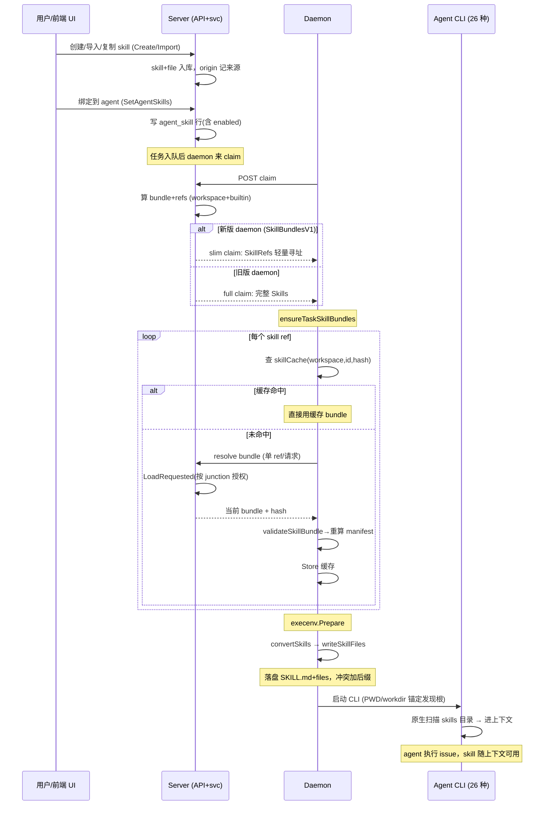

# Multica Skill 体系模块解读

## 模块一句话定位

Skill 是 Multica 在「issue 内容 + runtime brief」之外，给 agent 注入的第三种知识源：把「某种工作怎么做」从「某个 agent 的一次性 instructions」里抽出来，变成 `SKILL.md` + 支撑文件的**可复用、可绑定、可禁用**的包，经「server 存储 → daemon 内容寻址缓存 → 按各 runtime 原生 skill 目录物化」的链路，在每个任务启动时落到 CLI 能自动发现的位置。

## 在项目中的角色：去掉 skill 系统会怎样

去掉 skill，Multica 仍能派发任务、跑通 agent，但三件事会退化：

- **agent 配置里塞进一大坨长住 instructions**。skill 与 agent instructions 的分工是 docs 明确写的对比：instructions 承载「这个 agent 长期的职责/边界/交付要求」，skill 承载「某种工作的可复用步骤与素材」，前者每次运行都提供、后者按绑定与开关提供 [apps/docs/content/docs/skills.mdx:14-18]()<!-- anchor: | | Agent instructions | Skill | … | **Example** | "Only review frontend code, never modify it directly" | An accessibility checklist and report template | -->。没有 skill，一个「要审查前端的 agent」就得把整套审查清单写进 instructions，第二个同类 agent 再抄一遍，更新只能逐份改。
- **平台级「how to 用 Multica」的知识无处安放**。内置 skill（`multica-mentioning`、`multica-working-on-issues` 等 9 个）是编译期 embed 进二进制的，每个 agent 无条件收到，专教平台自身的操作规范——比如「mention 链接的四种类型各 enqueue 什么」。去掉它们，运行时 brief 会膨胀，或每个 agent 各行其是地乱发 mention [server/internal/service/builtin_skills.go:15-18]()<!-- anchor: // BuiltinSkills returns the platform's built-in skills, embedded at compile -->
- **跨机器复用断链**。skill 支持「从运行时的本地目录复制进 workspace」「从 GitHub/ClawHub/skills.sh 导入」，把「某台机器上 Claude Code 里已经调好的技能」变成团队资产 [apps/docs/content/docs/skills.mdx:20-31]()<!-- anchor: ## Creating or importing a skill -->。没有这套，技能被困在单机单 CLI。

一句话：**task-orchestration 决定任务怎么产生，runtime 决定任务怎么跑，skill 决定「agent 除了 issue 本身还带着哪些复用性知识」——它是把「一次性解决的某个问题」沉淀成「每个 agent 复用的 playbook」的载体。**

## 解决的根本问题（Why）

### 根因一：与直接写进 prompt 相比，skill 换来「一处维护、多点复用、可控启用」

直接把方法贴进 prompt 没有「结构」：它属于某个 agent、无法被另一个 agent 复用、无法单独开关、没有支撑文件、没有来源与版本。skill 的结构化换来三个直接 prompt 给不了的属性：

- **多对多绑定**。`agent_skill` 联结表让「一个 skill 服务多个 agent、一个 agent 挂多个 skill」，绑定上还有 `enabled` 开关——「暂时用不上就 disable，不必删」是 docs 明示的用法 [server/migrations/161_agent_skill_enabled.up.sql:1-3]()<!-- anchor: ALTER TABLE agent_skill -->
- **支撑文件随主文件一起投递**。SKILL.md 之外的脚本/模板/参考文档作为 `skill_file` 子表存，任务注入时按原相对路径落盘，供 skill 引用 [server/migrations/008_structured_skills.up.sql:1-2]()<!-- anchor-base64:LS0gU3RydWN0dXJlZCBTa2lsbHM6IHdvcmtzcGFjZS1sZXZlbCBza2lsbCBlbnRpdGllcyB3aXRoIHN1cHBvcnRpbmcgZmlsZXM= -->
- **逐 agent 启用/禁用，且与 runtime 本地技能并列成两套开关**。workspace skill 用绑定行 `enabled` 列控制（`SetAgentSkillEnabled`），runtime 本地技能用 `agent.disabled_runtime_skills` JSONB 名单控制（`SetAgentRuntimeSkillEnabled`），两个开关语义不同（见「设计思路」）[server/migrations/206_agent_disabled_runtime_skills.up.sql:1-2]()<!-- anchor: ALTER TABLE agent … ADD COLUMN disabled_runtime_skills JSONB NOT NULL DEFAULT '[]'::jsonb; -->

### 根因二：从「本机 Claude 目录里的技能」到「团队共享资产」需要一条完整搬运链路

`~/.claude/skills/`、`~/.codex/skills/` 这类目录里的技能天然存在于用户机器，但 Multica 的 workspace skill 存服务器。搬运涉及「扫描 → 上报 → 导入 → 冲突处理」，且这不能是人工复制：daemon 在心跳里响应服务器的 list/import 请求，扫描运行时本地技能并回报，服务器把结果存进共享 store，UI/CLI 再决定导入哪几个、同名冲突怎么处理（overwrite/rename/skip）[server/internal/handler/runtime_local_skills.go:23-36]()<!-- anchor: type RuntimeLocalSkillRequestStatus string -->。这是 skill 系统存在的一等动机：**技能的第一现场是用户的机器，而共享现场是服务器**。

### 根因三：agent 是「一等公民 teammate」，skill 必须跨 26 种 CLI 落地

Multica 的哲学是 agent 可在任意 runtime 上跑。skill 不是给某一个 CLI 设计的——daemon 必须把同一份 skill 内容翻译进每种 runtime 的原生 skill 目录（`~/.claude/skills` 在 workdir 下是 `.claude/skills`、openclaw 是 `skills/`、qwenpaw 是 `skill_pool/`…），让「CLI 自动发现」替你完成注入。这意味着 skill 的「单一定义」与「多形态落地」之间必须有一层适配（见 `skillsDirPath`）[server/internal/daemon/execenv/context.go:340-370]()<!-- anchor: func skillsDirPath(workDir, provider string) string -->

### 根因四：README 宣传「Turn a solved problem into a playbook」——实现上的真相

README 这句口号暗示「解决过的问题自动变成可复用 playbook」[README.md:58-58]()<!-- anchor: - **[Skills](https://multica.ai/docs/skills) →** Turn a solved problem into a playbook every agent r -->。实现并非自动：skill 的来源是人工创建、归档导入、URL 导入、从 runtime 复制四种，且「从 runtime 复制」明确是**快照**而非订阅——本地文件后续改动不会自动同步进 workspace [apps/docs/content/docs/skills.mdx:31-39]()<!-- anchor-base64:Q29weWluZyBmcm9tIGEgcnVudGltZSB0YWtlcyBhIHNuYXBzaG90IG9mIHRoZSBmaWxlcyBhdCB0aGF0IG1vbWVudC4gTGF0ZXIgY2hhbmdlcyB0byB0aGUgbG9jYWwgZmlsZXMgZG8gbm90IHVwZGF0ZSB0aGUgd29ya3NwYWNlIHZlcnNpb24gYXV0b21hdGljYWxseTsgcmUtaW1wb3J0IG9yIGVkaXQgaW4gTXVsdGljYS4= -->。真正的「自动 playbook」只有一半：内置 skill 随二进制发布自动到每个 agent，但它来自产品团队维护，不是从用户解决过的问题提炼。这句营销文案与实际机制（人工沉淀为主）是否需要在宣传层面修正。

## 设计思路

### skill 的 schema 与形态：SKILL.md 是唯一主角，支撑文件只是附加资产

从 008 迁移看，skill 是「一行主表 + 一列文件表 + 一张绑定表」的最小结构：`skill`（id/workspace_id/name/description/content/config JSONB/created_by/时间戳，`UNIQUE(workspace_id, name)`）、`skill_file`（skill_id/path/content，`UNIQUE(skill_id, path)`）、`agent_skill`（agent_id/skill_id 复合主键）[server/migrations/008_structured_skills.up.sql:3-15]()<!-- anchor: CREATE TABLE skill ( -->。这版迁移刻意把 `agent` 上旧的 text 型 `skills` 列删掉，从「agent 身上贴一段文本」改成「skill 是独立实体、agent 只是绑定它」[server/migrations/008_structured_skills.up.sql:33-36]()<!-- anchor-base64:LS0gUmVtb3ZlIG9sZCB0ZXh0LWJhc2VkIHNraWxscyBjb2x1bW4gZnJvbSBhZ2VudA== -->。

`SKILL.md` 是保留路径：`IsReservedContentPath` 用 case-insensitive + 路径清洗后的比较，把 `./SKILL.md`、`sub/../SKILL.md` 这类伪装写法也拦住——daemon 自己会把 Content 写到 `SKILL.md`，支撑文件不得再占这个名字 [server/internal/skill/reserved.go:25-26]()<!-- anchor: func IsReservedContentPath(p string) bool { … return strings.EqualFold(filepath.Clean(p), ContentFilename) -->。前端打包与导入解析都复用同一个 frontmatter 正则（Go 的 `frontmatterPattern` 与 TS 的 `FRONTMATTER_RE` 刻意镜像），保证两侧对同一份 SKILL.md 解析出一致的 name/description [server/internal/skill/frontmatter.go:15-27]()<!-- anchor-base64:dmFyIGZyb250bWF0dGVyUGF0dGVybiA9IHJlZ2V4cC5NdXN0Q29tcGlsZShgKD9zKVxBLS0tXHI/XG4oLio/XHI/XG4pLS0tYCk= -->。

### bundle 打包格式与生命周期：hash manifest 把「skill 内容」变成「可寻址的不可变对象」

skill 的本质是一组文本（Content + Files），`pkg/skillbundle.BuildManifest` 把它压成一个稳定 SHA-256：对 Skill 的 Source/ID/Name/Description/Content 和每个文件（按 path 排序）做长度前缀写入，产出 `Manifest{Hash, SizeBytes, FileCount, Files[]}` [server/pkg/skillbundle/hash.go:43-79]()<!-- anchor: func BuildManifest(skill Skill) Manifest -->。两个测试钉死这个合约：文件顺序不影响 hash、内容变化必然改变 hash [server/pkg/skillbundle/hash_test.go:5-29]()<!-- anchor: func TestBuildManifestStableAcrossFileOrder(t *testing.T) -->。

生命周期是这样的「内容寻址」流：

- server 侧 `BuildAgentSkillBundles` 对每个 skill 算 manifest，把 hash/size/fileCount 塞进轻量 `ref`，把完整内容留在 `bundle`，两个一起给 claim 响应 [server/internal/service/task.go:6681-6746]()<!-- anchor: func BuildAgentSkillBundles(skills []AgentSkillData) ([]AgentSkillData, []AgentSkillRefData) -->
- daemon 按 `(workspaceID, source, id, hash)` 四级目录缓存 bundle.json，命中即用，未命中走 resolve 下载 [server/internal/daemon/skill_cache.go:34-49]()<!-- anchor: func (c *SkillBundleCache) Load(workspaceID string, ref SkillRefData) (SkillData, bool) -->
- 缓存读取时 `validateSkillBundle` 用下载内容**重算 manifest** 与 ref 比对，任一不符即删缓存返回 miss——防的是「缓存里存了被篡改/截断的 bundle 还被当好的用」[server/internal/daemon/skill_cache.go:126-155]()<!-- anchor: func validateSkillBundle(ref SkillRefData, bundle SkillData) bool -->

### 发现/加载机制：两套发现，语义不同

- **服务器侧（workspace + builtin）**：`LoadAgentSkills` 用两条查询一次拿全（`ListAgentSkills` + `ListSkillFilesBySkillIDs` 按 skill_id 批量回填文件），文件读取失败**必须上报而不是吞掉**——吞掉会让 bundle 在被截断的状态下算出一个「看起来合法」的 hash，daemon 校验反而通过 [server/internal/service/task.go:6518-6537]()<!-- anchor: // LoadAgentSkills loads an agent's skills with their files for task execution. -->。workspace skills 之上无条件追加内置 skill，一起算 bundle/refs [server/internal/service/task.go:6580-6586]()<!-- anchor: func (s *TaskService) LoadAgentSkillBundles(ctx context.Context, agentID pgtype.UUID) ([]AgentSkillData, []AgentSkillRefData, error) { … bundles, refs := BuildAgentSkillBundles(skills) -->。
- **daemon 侧（runtime-local）**：`listRuntimeLocalSkills` 沿「provider 专属根 → 通用 `~/.agents/skills` → 插件根」的优先级序扫描，`SKILL.md` 目录即一个技能；同一 key 先到先得，保证加通用根后原有 provider 根技能解析不变 [server/internal/daemon/local_skills.go:456-513]()<!-- anchor: func listRuntimeLocalSkills(provider string) ([]runtimeLocalSkillSummary, bool, error) -->。

### 注入时机：任务启动（Prepare）时物化成 runtime 原生目录，不是启动命令带参数

skill 注入发生在 daemon 的 `execenv.Prepare` 阶段：`writeSkillFiles` 把每个 skill 写成 `<skillsDir>/<slug>/SKILL.md` + 支撑文件，`skillsDir` 按 provider 映射到该 CLI 会**原生发现**的项目级目录——Claude 是 `.claude/skills`、OpenCode 是 `.opencode/skills`、OpenClaw 是 `skills/`、QwenPaw 是 `skill_pool`，未知 provider 回落 `.agent_context/skills` [server/internal/daemon/execenv/context.go:346-446]()<!-- anchor: case "claude": -->。依赖的是「CLI 自己扫目录」这个机制，daemon 只负责把文件放到 CLI 能扫到的地方——这就是跨 26 种 CLI 不用为每种改启动参数的原因。Codex 例外：它的 HOME 被重定向到 per-task 目录，所以 workspace skills 之外还要把用户 `~/.codex/skills` 的内容**链接**（不是复制）进 per-task CODEX_HOME，复制的代价是每个任务目录背上整套技能树 [server/internal/daemon/execenv/codex_user_skills.go:11-36]()<!-- anchor: // seedUserCodexSkills links user-installed skill directories from the shared -->

### slash skill：chat 消息里的 `/skill` 引用在 prompt 里展开成「Explicitly selected skills」

前端编辑器渲染出 `[/deploy](slash://skill/<id>)` 形态的链接，daemon 的 `ExtractSlashSkills` 用正则把它从 chat 消息里抓出来（按 ID 去重、忽略 `slash://action` 与其他链接）[server/internal/daemon/slash_skill.go:8-35]()<!-- anchor: var slashSkillRe = regexp.MustCompile( -->，然后在 prompt 里对照 agent 实际拥有的 skill，把命中的名字列成「Explicitly selected skills」清单 [server/internal/daemon/prompt.go:643-673]()<!-- anchor: if task.Agent != nil && len(task.Agent.Skills) > 0 -->。这是唯一的「按需点名」通道——其余技能都靠模型读 brief 里的技能索引自行决定调不调。

### 与内置 skill 的关系：产品自带的平台层，永远在 workspace skill 之上

内置 skill 是 `//go:embed builtin_skills` 编译进二进制的 9 个「模板」，每个 agent 都收到（`LoadAgentSkillBundles` 里 `append(workspace, builtin...)`）[server/internal/service/builtin_skills.go:10-26]()<!-- anchor: //go:embed builtin_skills -->。它们讲的是平台自身的 how-to（mention、working-on-issues、squads、runtimes-and-repos…），frontmatter 里带 `user-invocable: false`（不被用户手动点名，只被模型按需读）[server/internal/service/builtin_skills/multica-mentioning/SKILL.md:2-5]()<!-- anchor: name: multica-mentioning … allowed-tools: Bash(multica *) -->。其内容被 `builtin_skills_test.go` 的模板规约钉死：`multica-` 前缀防与用户 skill 撞 slug、description ≤300 字符（它决定模型要不要打开这个技能）、body ≤500 行（Anthropic L2 预算，超出就拆进支撑文件）[server/internal/service/builtin_skills_test.go:40-68]()<!-- anchor: func TestBuiltinSkillsConformToTemplate(t *testing.T) { … if n := strings.Count(body, "\n") + 1; n > maxSkillBodyLines { -->。测试还保证「frontmatter 必须是严格 YAML 1.2」，否则 strict 的 runtime（如 Codex）会静默丢弃整个技能 [server/internal/service/builtin_skills_test.go:83-89]()<!-- anchor: // TestBuiltinSkillsFrontmatterIsStrictYAML is the regression guard for MUL-3100 … // This check is deliberately separate from TestBuiltinSkillsConformToTemplate: -->。

## 关键数据结构

### wire 三件套：SkillData（完整）↔ SkillRefData（轻量）↔ SkillFileData

任务执行线上有三层形态，`json` tag 直接对应 claim/resolve 报文：

- `SkillData`：**完整 bundle**——Content + Files 全带，daemon 拿到它就能落盘 [server/internal/daemon/types.go:247-257]()<!-- anchor: // SkillData represents a structured skill for task execution. -->。
- `SkillRefData`：**只带寻址信息**——ID/Source/Name/Description/Hash/SizeBytes/FileCount + 每文件的 Path/SHA256/SizeBytes，没有内容 [server/internal/daemon/types.go:267-282]()<!-- anchor: type SkillRefData struct { -->。slim-claim 时 claim 响应只发 refs，内容在 resolve 时按需取回。
- `SkillFileData`：bundle 里单个文件，Path + Content +（可选）SHA256/SizeBytes [server/internal/daemon/types.go:259-265]()<!-- anchor: // SkillFileData represents a supporting file within a skill. -->。

### 身份三要素：source 决定寻址空间，id 在 source 内唯一

`pkg/skillbundle` 定义了三种 source：workspace / builtin / plugin [server/pkg/skillbundle/hash.go:10-14]()<!-- anchor: const ( -->。它们决定 ref 怎么解析：

- workspace skill 的 id 是 DB 行 UUID；
- builtin skill 没有 DB 行，`BuiltinSkillID(name) = "builtin:"+name` 是「把名字变成身份」的唯一地方 [server/internal/service/task.go:6594-6594]()<!-- anchor: func BuiltinSkillID(name string) string { return "builtin:" + name } -->；
- `AgentSkillBundleKey(source, id) = source+"\x00"+id` 强调「同名不同源是两个 bundle」——内置的 `multica-mentioning` 与用户自建的 `multica-mentioning` 不会混淆 [server/internal/service/task.go:6599-6599]()<!-- anchor: func AgentSkillBundleKey(source, id string) string { return source + "\x00" + id } -->。

### manifest：内容的指纹，也是缓存的钥匙

`Manifest{Hash, SizeBytes, FileCount, Files}` 由 `BuildManifest` 产出 [server/pkg/skillbundle/hash.go:36-41]()<!-- anchor: type Manifest struct { -->；`buildbundle` 在 daemon 侧缓存路径里，`(workspaceID, source, id, hash)` 就是 bundle.json 的四级目录 [server/internal/daemon/skill_cache.go:115-124]()<!-- anchor: func (c *SkillBundleCache) bundlePath(workspaceID string, ref SkillRefData) string -->。

## 核心流程：从「创建 skill」到「agent 任务执行时注入」

下图是完整链路。两个关键设计先点出来：**claim 只带 refs（slim），内容在 Prepare 前按 ref 逐个 resolve**；**注入的落点不是进程参数而是 runtime 原生 skill 目录**。

### 链路关键节点注解

1. **claim 的双分支是能力协商**：`useSkillRefs := requestHasClientCapability(r, DaemonCapabilitySkillBundlesV1)`，旧 daemon 收全量 Skills、新版收 SkillRefs——slim-claim 上线不需要客户端同步升级 [server/internal/handler/daemon.go:2104-2204]()<!-- anchor: useSkillRefs := requestHasClientCapability(r, protocol.DaemonCapabilitySkillBundlesV1) -->。
2. **resolve 是「每 ref 一请求」**：`ResolveSkillBundle` 单请求下传一个 bundle，deadline 按 bundle 声明 size 缩放（`skillBundleResolveTimeout(ref.SizeBytes)`）[server/internal/daemon/daemon.go:6392-6415]()<!-- anchor: func (d *Daemon) resolveSkillBundle(ctx context.Context, task *Task, ref SkillRefData) (SkillData, TransferStats, error) -->；对应 server 端 `LoadRequestedAgentSkillBundles` 只读所问的 refs，而不是把 agent 整套技能重算一遍——否则 N 个 skill 冷启动就是 N 次 O(N) 重算 [server/internal/handler/daemon.go:3462-3489]()<!-- anchor: // Load ONLY what was asked for. The daemon resolves one skill per request, -->
3. **resolve 返回的 hash 可能与 claim 时的 ref 不同**：skill 在 claim 和 prepare 之间被编辑过，server 返回「当前 bundle 和 hash」，daemon 校验时用「从 bundle 自身推导的 ref」而不是过期的请求 ref，唯一例外是 plugin skill 保持 pinned（hash 必须一致）[server/internal/daemon/daemon.go:6400-6416]()<!-- anchor: // The resolve endpoint serves the agent's *current* bundle and hash, which -->
4. **注入结果回传**：执行结果（diff/comment/status）经 task message 回传属 task-orchestration 模块，skill 本身不产生回传；skill 唯一的「产出反馈」是运行时对 skill 内容的消费。

## 与其他模块的协同

### 与 runtime / daemon：skill 是 Prepare 的输入，brief 是索引、目录是内容

- **resolve 发生在 Prepare 之前**：`ensureTaskSkillBundles` 在 `execenv.Prepare` 前跑完，确保 Prepare 落盘时内容已就位（cache 命中即免网络）[server/internal/daemon/daemon.go:7100-7130]()<!-- anchor: if err := d.ensureTaskSkillBundles(prepareCtx, &task); err != nil -->。
- **runtime brief 只给索引不给内容**：`writeSkills` 把可见技能渲染成一行一个名字（经 `modelVisibleSkills` 把 Name 归一化为 on-disk slug），刻意不重复 description——重复会每次任务白付约 3100 token 且得不到额外路由信号；每个 CLI 自己从 SKILL.md frontmatter 构建完整列表 [server/internal/daemon/execenv/runtime_config_sections.go:733-761]()<!-- anchor: // writeSkills emits the Skills section: an index of invocable skill names. -->。
- **同名可见性治理**：`modelVisibleSkills` 同时是「模型不可调用技能」的过滤口——frontmatter 带 `disable-model-invocation: true` 的技能仍会落盘（用户仍可手动 slash 调用），但不进 brief 的技能清单 [server/internal/daemon/execenv/skill_visibility.go:30-42]()<!-- anchor: func modelVisibleSkills(skills []SkillContextForEnv) []SkillContextForEnv … return visible -->。
- **禁用本地技能的落地也是 per-provider**：claude 写 task-local settings JSON（`skillOverrides: off` + `permissions.deny`），codex 在 per-task `config.toml` 追加 `[[skills.config]] enabled=false` 段落 [server/internal/daemon/execenv/runtime_skill_policy.go:32-149]()<!-- anchor: func prepareClaudeSkillSettings(envRoot string, disabled []RuntimeSkillRefForEnv, workspaceSkills []SkillContextForEnv) (string, error) -->。这是「skill 是跨 CLI 的知识，但禁用手段是 per-CLI 的」的典型体现。

### 与 plugin：两条截然不同的技能线

- **服务器侧的 plugin skill = 普通 workspace skill**。368 迁移把 plugin 的 `skill` 资源直接写进既有 `skill` 表，加一个可空的 `plugin_installation_id` 列：卸载时用 `DELETE FROM skill WHERE plugin_installation_id = $1` 精确删掉该安装贡献的技能，且不碰人工创建的 [server/migrations/368_skill_plugin_ownership.up.sql:1-16]()<!-- anchor-base64:LS0gQSBwbHVnaW4ncyBgc2tpbGxgIHJlc291cmNlcyBiZWNvbWUgb3JkaW5hcnkgd29ya3NwYWNlIHNraWxscy4= -->。迁移注释明说动机：旧的插件系统把技能在十四张表间走 artifact/digest/bundle 管道，最后交付的还是一份 SKILL.md——「plugin skill 就是一个 skill，平台只需记住谁放的」。
- **daemon 侧 claude 插件的技能 = 本地技能发现的一部分**。`localSkillRootsForProvider` 对 claude 额外追加插件根，key 带 `插件名:` 前缀防撞用户技能 [server/internal/daemon/local_skills.go:253-264]()<!-- anchor: if provider == "claude" { … keyPrefix: plugin.Name + ":" -->。这条线的技能只有被「复制导入」或「禁用」两条出路，不自动进 workspace。

### 与 MCP：并列的上下文增强，不是替代

claim 的 AgentData 里 `Skills`/`SkillRefs`、`McpConfig`、`DisabledRuntimeSkills` 并列存在，都是「任务启动时 server 一次性组装给 daemon」的上下文 [server/internal/daemon/types.go:215-234]()<!-- anchor: // AgentData holds agent details returned by the claim endpoint. -->。技能给「怎么做某类工作的方法」，MCP 给「能调用的外部工具」；runtime brief 的「Always Use the multica CLI」条目则约束 agent 只用受控通道访问平台资源。三者合起来才是「issue 内容之外的完整上下文」。MCP 的具体装配（server 折叠 workspace 绑定 + per-task overlay）在 runtime/handler 模块有独立实现，本模块只确认并列关系。

### 与 task-orchestration：resolve 端点被任务状态机门控

`ResolveTaskSkillBundles` 只允许 `dispatched` / `waiting_local_directory` 状态的任务调用——技能 resolve 是「已派发、未开始执行」窗口内的专属操作 [server/internal/handler/daemon.go:3436-3437]()<!-- anchor: if task.Status != "dispatched" && task.Status != "waiting_local_directory" { … writeError(w, http.StatusConflict, "task is not preparing") -->；daemon 侧 load 失败的恢复靠 resolve 的 5xx + daemon 重试，而不是用「更小的技能集」糊弄过去（见 `LoadAgentSkills` 的 fail-closed 语义）。

## 关键设计决策

### 决策一：内容寻址 bundle + daemon 缓存，而不是全量透传

**为什么**：旧版 claim 把 agent 全部技能内容一次性发给 daemon；弱网下一次原子 body 读取的超时会让整个技能集全部重来、缓存永远收敛不了。改成「claim 只带 refs、每 ref 一请求、按 size 缩放 deadline、成功即落缓存」后，一次 dispatch 失败至少留下已下载的部分，下一次继续补 [server/internal/daemon/daemon.go:6347-6354]()<!-- anchor: // Resolve each missing bundle in its own request, caching it the moment it -->。

**替代方案代价**：纯文本透传实现最简，但「内容大了必然超时、超时必然全丢」是无解的；把身份从「名字」升级为 `(source, id, hash)` 三元组让跨版本缓存和「编辑后内容更新」有了精确语义，代价是 resolver 必须处理「hash 对不上」的三种情形（过期 ref→用当前 bundle；plugin→严格 pin；缓存损坏→删除重下）。hash 校验是 fail-closed 的：缓存内容与 ref 不一致宁可当 miss 也不交付 [server/internal/daemon/skill_cache.go:44-48]()<!-- anchor: if err := json.Unmarshal(data, &bundle); err != nil || !validateSkillBundle(ref, bundle) { -->。

### 决策二：物化到 runtime 原生目录，而不是改启动参数或让 agent 自拉

**为什么**：26 种 CLI 的差异是「发现机制」而不是「能不能发现」——它们都扫自己的工作目录。daemon 只要把技能放到各 CLI 扫的目录（一个 provider→目录的映射 switch [server/internal/daemon/execenv/context.go:340-446]()<!-- anchor: func skillsDirPath(workDir, provider string) string -->），就零侵入地借用了「CLI 原生发现」这层机制，不需要为每种 CLI 维护启动 flag。

**代价与补救**：各 CLI 的发现语义不一致——Claude 按目录名路由、OpenCode 按 frontmatter `name`。`ensureSkillFrontmatter` 把 `name` 键归一化为 on-disk slug（Multica 必须拥有 name，因为它是唯一带唯一性保证的值；目录碰撞时分配 `-multica` 后缀）[server/internal/daemon/execenv/context.go:451-478]()<!-- anchor: // ensureSkillFrontmatter returns SKILL.md content guaranteed to lead with a -->；`resolveSkillSlugs` 与 `allocateCollisionFreeSkillDir` 必须对同一 slug 序列达成一致，否则「brief 里列的名字」和「落盘的目录」对不上 [server/internal/daemon/execenv/sidecar_manifest.go:194-198]()<!-- anchor-base64:Ly8gVHdvIGNhbGxlcnMgbXVzdCBhZ3JlZSBvbiB0aGlzIHNlcXVlbmNlIOKAlCBhbGxvY2F0ZUNvbGxpc2lvbkZyZWVTa2lsbERpciwg4oCmIGZ1bmMgc2tpbGxTbHVnQ2FuZGlkYXRlKGJhc2VTbHVnIHN0cmluZywgYXR0ZW1wdCBpbnQpIHN0cmluZyB7 -->。

**替换方案代价**：agent 自行拉取（`multica skill get`）把「技能进上下文」变成一次需要 agent 主动执行、多一轮工具调用的动作，且拉取内容与隔离环境割裂——不符合「agent 开局就带全方法」的产品假设。

### 决策三：runtime 本地技能只做「发现 + 禁用」，不参与绑定/版本

**为什么**：用户机器上的技能是「现场」，workspace skill 是「共享资产」。让现场技能直接参与 agent 绑定会引入两个事实源（机器上的文件 vs 服务器的绑定），所以本地技能只有两条出路：被**复制导入**成 workspace skill（快照语义），或在 agent 上被**禁用**（`agent.disabled_runtime_skills` 名单，且仅 codex/claude 支持 [server/internal/handler/agent_runtime_skills.go:119-122]()<!-- anchor: if rt.RuntimeMode != "local" || (rt.Provider != "codex" && rt.Provider != "claude") { -->）。

**试错的证据**：109 迁移回滚了未发布的 `agent.skills_local` 列——「per-agent 本地技能开关」这个方向曾试过并放弃 [server/migrations/109_drop_agent_skills_local.up.sql:1-4]()<!-- anchor-base64:LS0gQ2xlYW4gdXAgdGhlIHVucmVsZWFzZWQgcGVyLWFnZW50IGxvY2FsIHNraWxsIHRvZ2dsZS4gRnJlc2gvcHJvZCBkYXRhYmFzZXM= -->。收敛后的边界是：本地技能 = 机器现场，管理权只到「禁不禁用」；workspace skill = 团队资产，管理权到「增删改绑」。这让「从 runtime 复制」成为两条线之间唯一（也是单向）的桥。

## 亮点与问题

### 亮点

1. **读失败 fail-closed，绝不静默降级**。`LoadAgentSkills` 的注释说得透彻：文件读取是「全或无」的，吞掉错误不会减小 payload，而是「悄悄替换」——每个技能丢支撑文件，或 agent 丢全部技能，而 hash 恰好还是自洽的，daemon 校验会通过。所以错误必须上报（保留 claim 重投递 / resolve 5xx），不能带着残缺技能开跑 [server/internal/service/task.go:6520-6528]()<!-- anchor: // A read failure is REPORTED, never swallowed into a shorter skill set. Both -->
2. **list/load 一致性当不变量维护**。daemon 的本地技能列表与导入用同一套「根优先级 + key 去重」逻辑，且导入时对每个根坚持「目录 + SKILL.md 同时存在才算有」，普通 IO 错误返回而不是跳根——保证「UI 列出的技能」与「导入拿到的技能」是同一个 [server/internal/daemon/local_skills.go:624-703]()<!-- anchor: // Walk the roots in the same priority order as listRuntimeLocalSkills so -->
3. **两端解析镜像 + 测试即规约**。Go 与 TS 用同一 frontmatter 正则、内置技能用 `builtin_skills_test.go` 把格式要求（前缀/描述上限/body 预算/严格 YAML）写成 CI 断言，新加一个内置 skill 不符合模板就红 [server/internal/service/builtin_skills_test.go:37-81]()<!-- anchor: // TestBuiltinSkillsConformToTemplate enforces the standard-template invariants -->。这种「用测试锁住产品约定」的做法让内置技能不会悄悄长歪。
4. **二进制/编码边界双防线**。技能文件进 PG TEXT 或经 JSON 往返都可能被静默改写（invalid UTF-8 → U+FFFD），所以 `IsLikelyBinaryFilePath` 的扩展名黑名单只是第一道廉价防线，实际读取时还校验「有效 UTF-8 且不含 NUL」——UTF-16LE 这种「合法 UTF-8 但含 NUL」的漏网之鱼也被拦住 [server/internal/daemon/local_skills.go:380-430]()<!-- anchor: // A binary supporting file cannot survive SkillFileData.Content: the -->
5. **多根扫描的 symlink 心智健全**。每个 root 独立 visited 集合、按 resolved 真实路径去重，允许「同一个目录以两个名字出现在两个根」而不会误丢（`~/.claude/skills/bar -> ~/.agents/skills/foo` 两个都列出）[server/internal/daemon/local_skills.go:487-505]()<!-- anchor: // Each root gets its OWN `visited` set. It must NOT be shared across -->

### 问题与风险

1. **营销与机制存在落差（前文已述）**。README 的「Turn a solved problem into a playbook every agent reuses」暗示自动化沉淀，实际是人工创建/导入/快照复制；这是文案过度承诺还是另有半自动机制未读到。
2. **已知未闭环：brief 里列出的 slug 可能与落盘目录不符**。`resolveSkillSlugs` 纯内存去重，看不到文件系统；当技能 slug 撞上用户已装目录时落盘到 `<slug>-multica`，但 brief 仍显示裸 slug——模型看到的不可调用。代码注释承认此 gap，提出需要把分配后的 slug 从 Prepare 穿回渲染层（MUL-5550），尚未实现 [server/internal/daemon/execenv/skill_visibility.go:24-29]()<!-- anchor: // Known gap: resolveSkillSlugs cannot see the filesystem, so a skill that -->
3. **列表接口的兼容性债务**。`GET /api/skills` 的 summary 不带 content 是默认，但 detail 端点的 `include` 默认仍是全量 content（兼容旧 CLI/Desktop），大技能要靠调用方显式发 `include=metadata` 才瘦身——作者自己写了「default can flip once clients that send include=content have aged in」，说明是明知的技术债 [server/internal/handler/skill.go:389-416]()<!-- anchor: // resolveSkillInclude reads `?include=`. `content` inlines the SKILL.md body -->
4. **provider 映射表双份维护**。`localSkillRootsForProvider`（用户级根）与 `skillsDirPath`（项目级根）各是一张大 switch，新加一个 runtime 要同时更新两处，注释承认长期应挪进 `server/pkg/agent` 与 provider 定义同址 [server/internal/daemon/local_skills.go:122-124]()<!-- anchor: // Longer-term this mapping would be better colocated with the provider -->
5. **技能注入是「全量落盘、模型自选」**。除 slash skill 点名外，所有已绑定技能都写进 workdir（受 `disable-model-invocation` 影响只在 brief 里隐藏），没有「按 issue 语义只注入相关技能」的过滤——技能越多，落盘越重、brief 越长。这是「简单 + 可控」对「精准」的取舍，（留待进一步评估）是否符合「scoped, not dumped」的项目哲学（项目资源注入倒是明确 scoped [server/internal/daemon/execenv/context.go:195-198]()<!-- anchor: // Project resources are best-effort: a write failure logs but does not -->）。

