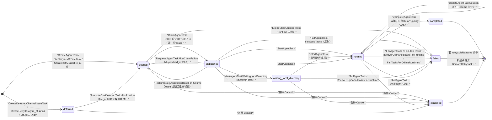
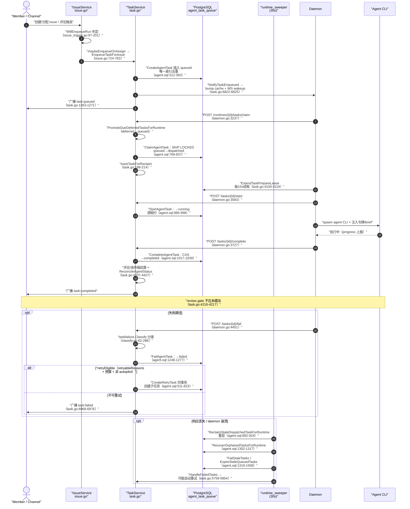
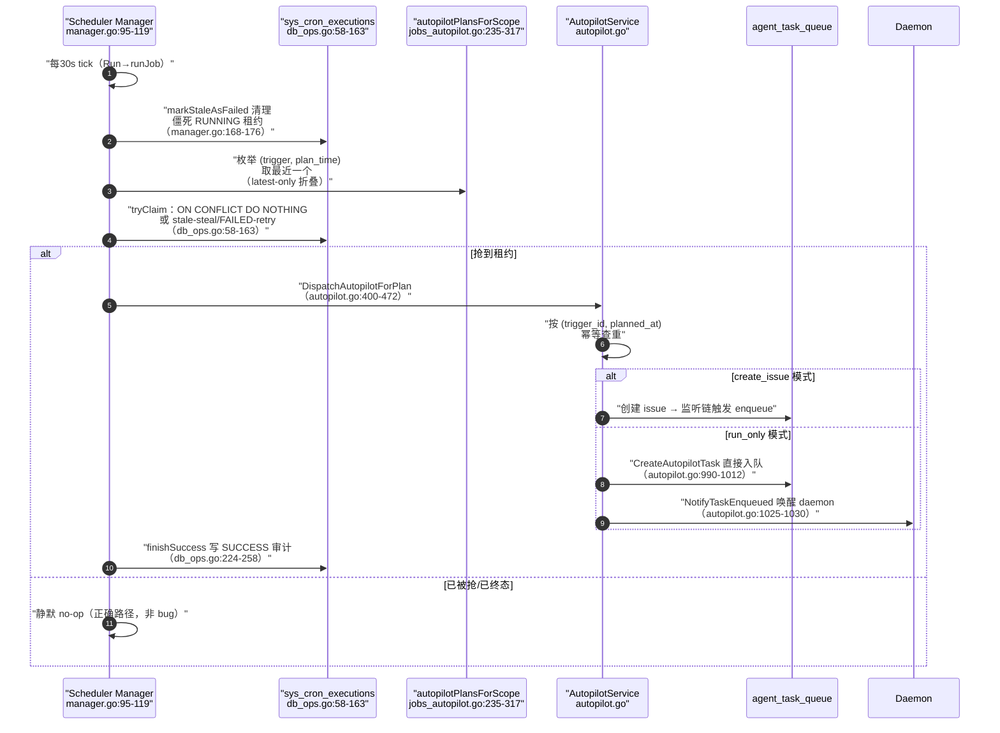

# 任务生命周期编排：agent_task_queue 状态机与"至多一次"派发

> 本模块回答"任务怎么被创建、派发、认领、执行、失败重试、完成回审"。它与 [runtime.md](runtime.md)（daemon 如何执行）的边界是：**本模块管到"把任务交给哪个 daemon"为止**，daemon 拿到任务后怎么 spawn agent CLI、怎么收集输出，属于 runtime 模块。

## 一句话定位

Multica 的"给 AI 同事派活"引擎：`agent_task_queue` 是唯一的任务事实源，所有状态迁移都由**纯 SQL 的原子 UPDATE + 状态 CAS**完成，Go 服务层只是 SQL 之上的决策编排器——核心问题只有一个：**在多 daemon 分布式并发下，怎么保证一个任务只被一个 daemon 执行一次（至多一次），并在 daemon 崩溃后还能恢复而不丢任务（至少一次）**。

## 在项目中的角色：去掉它系统会怎样

`agent_task_queue` 是 Web 工作区与 daemon 之间的唯一握手点。它的存在让"issue/chat/autopilot 产生的运行意图"和"daemon 实际执行"彻底解耦：

- **Issue 侧不感知 daemon**：issue 被分配/被评论触发后，`IssueService`/`TaskService` 只负责向队列插入一行 `queued` 任务（[server/internal/service/task.go:1157-1272]() 的 `enqueueIssueTaskWithCommentPlan`），完全不知道任务何时、被哪台机器、以什么顺序执行。
<!-- anchor: func (s *TaskService) enqueueIssueTaskWithCommentPlan(ctx context.Context, issue … return task, nil -->
- **Daemon 侧不感知业务**：daemon 只轮询"我的 runtime 有没有可领的任务"（`POST /api/daemon/runtimes/{id}/tasks/claim`），领到后执行，再回调 complete/fail。任务背后是 issue 还是 chat 还是 autopilot，daemon 不关心。
- **执行状态是实时数据**：`agent_task_queue` 的每行是工作区 UI 上"agent 正在做什么"的直接投影，`RefreshAgentStatusFromTasks` 根据它推导 agent 的 busy/idle（[server/pkg/db/queries/agent.sql:1751-1757]() 的 `CountRunningTasks`，`waiting_local_directory` 也占容量）。
<!-- anchor-base64:IC0tIG5hbWU6IENvdW50UnVubmluZ1Rhc2tzIDpvbmUg4oCmIFdIRVJFIGFnZW50X2lkID0gJDEgQU5EIHN0YXR1cyBJTiAoJ2Rpc3BhdGNoZWQnLCAncnVubmluZycsICd3YWl0aW5nX2xvY2FsX2RpcmVjdG9yeScpOyA= -->

如果去掉这个模块（或者说让 issue 直接调用 daemon RPC）：一次"分配 issue"就会变成一次同步 RPC——issue 创建必须在 daemon 在线且空闲时才能成功；daemon 崩溃则任务凭空消失；两个 daemon 并发抢一个任务需要调用方自己加分布式锁。**队列把"调度"从"执行"中剥离，同时把调度本身变成可审计、可恢复、可重试的持久状态**——这是"agent 是一等公民 teammate"这条设计哲学的执行底座。

## 根因：多 agent 并发执行的核心难题

一次"把 issue 分配给 agent"在分布式环境里要同时满足三个互相打架的目标：

| 目标 | 朴素实现 | 崩在哪 |
|------|---------|--------|
| **至多一次**：一个任务不能被两个 daemon 各执行一遍 | 内存里维护"已被认领"集合 | 多实例、daemon 崩溃后内存丢失，认领记录不可靠 |
| **至少一次**：daemon 执行完但响应丢了，任务不能丢 | 收到响应才推进状态 | 响应丢失 = 任务永久悬挂 |
| **可恢复**：daemon 崩溃后任务要能重新派发 | 超时后强制重派 | 长任务与崩溃任务无法区分，健康的长时间运行会被误杀 |

Multica 的解法是**把状态机放进数据库，让 PostgreSQL 的行锁成为唯一的仲裁者**：

- 认领不是"SELECT 后 UPDATE"，而是 `UPDATE ... WHERE id = (子查询) FOR UPDATE SKIP LOCKED`（[server/pkg/db/queries/agent.sql:769-837]()）。`SKIP LOCKED` 让并发 daemon 各自锁不同的候选行，不会互相阻塞；`FOR UPDATE` 保证同一行在同一时刻只有一个事务能把它从 `queued` 翻到 `dispatched`。
<!-- anchor-base64:IC0tIG5hbWU6IENsYWltQWdlbnRUYXNrIDpvbmUg4oCmIFJFVFVSTklORyAqOyA= -->
- 每个状态迁移都带**状态前置条件**（`WHERE status = 'queued'`、`WHERE status = 'running'`），是一个 compare-and-swap（CAS）。两个 daemon 同时 complete 同一任务，只有一个的 `WHERE status='running'` 能命中，另一个拿到 0 行，被当作幂等成功处理（[server/internal/service/task.go:4306-4335]()）。
<!-- anchor: 	// When parallel agents race, a task may already be completed, … 		return nil, fmt.Errorf("complete task: %w", err) -->
- 执行方和恢复方之间用 **lease 时间戳**（`prepare_lease_expires_at`）做无锁协调：daemon 活着就续租，租约过期后恢复方才有权接管。

一句话：**Multica 用"数据库行级锁 + 状态 CAS + 时间戳租约"实现了分布式任务调度的 at-most-once 执行与 at-least-once 投递，没有引入任何分布式锁组件（etcd/Redis 锁），把并发正确性全部押在 PostgreSQL 的单行原子性上。** Redis 在其中的角色只是性能缓存（empty-claim 短路、reclaim 提示），不是正确性来源——缓存挂了，系统退化为每次全量查库，行为不变。

## 设计思路：状态机完整形态

任务生命周期是一个**六态（含一个辅助等待态 + 一个惰性预备态）+ 三终态**的状态机，全部状态转移由 SQL 强制：

**各状态的设计意图**（为什么多出 `deferred` 和 `waiting_local_directory` 这两个非常规状态）：

- **`deferred`（惰性预备态）**：任务已持久化但**不可认领**，等 `fire_at` 到期或媒体绑定完成后才被 Promote 成 `queued`。它承担三类职责：渠道 /issue 的延迟任务（媒体还在下载）、分配回退的定时升级（assignee fallback）、以及带退避的重试子任务（runtime_offline 等 runtime 恢复、provider_network 最后一跳等 5s）。这让"已创建但还不到执行时机"成为一个**可崩溃恢复的持久状态**，而不是内存 timer。
- **`waiting_local_directory`（辅助等待态）**：一个 runtime 上可能有两个任务竞争同一 `local_directory` 项目资源（例如两个 agent 都要在同一个本地仓库里跑）。任务已认领但停在队首等路径锁，`wait_reason` 向 UI 暴露"在等什么"。它在容量计算里**仍然占位**（[server/pkg/db/queries/agent.sql:1751-1757]() 的注释明确说"waiter-only 的 agent 不能继续认领新任务"），避免超发。
<!-- anchor-base64:IC0tIG5hbWU6IENvdW50UnVubmluZ1Rhc2tzIDpvbmUg4oCmIFdIRVJFIGFnZW50X2lkID0gJDEgQU5EIHN0YXR1cyBJTiAoJ2Rpc3BhdGNoZWQnLCAncnVubmluZycsICd3YWl0aW5nX2xvY2FsX2RpcmVjdG9yeScpOyA= -->
- 三个终态（completed/failed/cancelled）都写 `completed_at`，`RuntimeMcpOverlay` 通过触发器在进入终态瞬间被清空（[server/migrations/128_agent_task_queue_runtime_mcp_overlay.up.sql:33-50]()），防止行上残留带 bearer token 的敏感字段。
<!-- anchor: CREATE OR REPLACE FUNCTION clear_runtime_mcp_overlay_on_terminal_state() … CREATE TRIGGER trg_clear_runtime_mcp_overlay -->

**每一条迁移边都有对应的 SQL 防错**，例如 `MarkAgentTaskWaitingLocalDirectory` 只允许从 `dispatched` 进入（[server/pkg/db/queries/agent.sql:1000-1015]()），daemon 不能把已 running 的任务标成等待。
<!-- anchor-base64:IC0tIG5hbWU6IE1hcmtBZ2VudFRhc2tXYWl0aW5nTG9jYWxEaXJlY3RvcnkgOm9uZSDigKYgUkVUVVJOSU5HICo7IA== -->

### claim/lease/心跳：三件套如何保证"至多一次"

认领到执行之间隔着一次网络往返 + daemon 准备执行环境（拉技能包、解析缓存、绑定 MCP 覆盖层）。这期间有三层防重保护，缺一不可：

1. **`dispatched` 状态本身**就是第一道闸。一个任务只能从 `queued` 认领一次；`dispatched` 行对后续 claim 不可见（`ListQueuedClaimCandidatesByRuntime` 明确只返回 `queued`，[server/pkg/db/queries/agent.sql:2192-2200]()）。
<!-- anchor-base64:LS0gbmFtZTogTGlzdFF1ZXVlZENsYWltQ2FuZGlkYXRlc0J5UnVudGltZSA6bWFueSDigKYgLS0gaWR4X2FnZW50X3Rhc2tfcXVldWVfY2xhaW1fY2FuZGlkYXRlcyBzbyB0aGUgd2FybSBwYXRoIGlzIGNoZWFwLg== -->
2. **`prepare_lease_expires_at`（45s 租约）**：daemon 在 claim 之后、StartTask 之前每 15s 续租（[server/internal/service/task.go:4100-4119]() 调 `ExtendAgentTaskPrepareLease`），续租走 [server/pkg/db/queries/agent.sql:972-983]() 的 `ExtendAgentTaskPrepareLease`。只要 daemon 还在正常准备，租约就不过期，恢复方不能动它。
<!-- anchor: func (s *TaskService) ExtendTaskPrepareLease(ctx context.Context, taskID, runtim … return &task, nil -->
<!-- anchor-base64:LS0gbmFtZTogRXh0ZW5kQWdlbnRUYXNrUHJlcGFyZUxlYXNlIDpvbmUg4oCmIFJFVFVSTklORyAqOw== -->
3. **`dispatched_at` 作为版本戳的 CAS**：重排队用 `RequeueAgentTaskAfterClaimFailure`（[server/pkg/db/queries/agent.sql:864-880]()）、响应丢失回收用 `ReclaimStaleDispatchedTaskForRuntime`（[server/pkg/db/queries/agent.sql:882-924]()）、评论投递回执用 `SetTaskDeliveredCommentIDs`——都带上 `WHERE dispatched_at = @dispatched_at`：只有**针对同一认领代次**的操作才能成功，一个过期 handler 无法把新代次的状态覆盖掉。
<!-- anchor-base64:LS0gbmFtZTogUmVxdWV1ZUFnZW50VGFza0FmdGVyQ2xhaW1GYWlsdXJlIDpvbmUg4oCmIFJFVFVSTklORyAqOw== -->
<!-- anchor-base64:LS0gbmFtZTogUmVjbGFpbVN0YWxlRGlzcGF0Y2hlZFRhc2tGb3JSdW50aW1lIDpvbmUg4oCmIFJFVFVSTklORyAqOw== -->

**恢复方的三重分工**（[server/cmd/server/runtime_sweeper.go:156-170]() 的 `runRuntimeSweeper` 每 30s 一轮）：
<!-- anchor: func runRuntimeSweeper(ctx context.Context, queries *db.Queries, liveness handle … sweepDeferredChatFinalizations(ctx, queries, taskSvc) -->

- **`ReclaimStaleDispatchedTaskForRuntime`**（认领响应丢失）：任务已是 `dispatched`、`started_at IS NULL`、`dispatched_at` 超过 90s（`claimResponseRecoveryWindow`，[server/internal/service/task.go:190-195]()）且 prepare lease 已过期 → 重新设 `dispatched_at = now()` 重新投递。**它刷新 dispatched_at 而不是直接改状态**，所以同样的 CAS 机制保证重新投递时旧 handler 的迟到响应（比如 StartTask）不会写坏新代次。
<!-- anchor: 	// claimResponseRecoveryWindow must exceed daemon client.Timeout for … 	prepareLeaseDuration        = 45 * time.Second -->
- **`RecoverOrphanedTasksForRuntime`**（daemon 重启）：daemon 启动时把自己上次没终结的 dispatched/running/waiting 任务一次性 fail，附错误 `'daemon restarted while task was in flight'`、failure_reason=`runtime_recovery`（[server/pkg/db/queries/agent.sql:1302-1317]()）。这个动作是 daemon 自己做的，所以能精确区分"我崩溃过"而不是误杀。
<!-- anchor-base64:IC0tIG5hbWU6IFJlY292ZXJPcnBoYW5lZFRhc2tzRm9yUnVudGltZSA6bWFueSDigKYgUkVUVVJOSU5HICo7IA== -->
- **`FailStaleTasks` / `FailTasksForOfflineRuntimes` / `ExpireStaleQueuedTasks`**（runtime 长期失活）：三者都以 `agent_runtime.last_seen_at` 心跳新鲜度为前提才敢动任务——**一个还在心跳的 runtime，它的长任务永远不会被服务器端墙钟杀掉**（[server/pkg/db/queries/agent.sql:1319-1394]() 的注释："healthy multi-hour work alive through a network partition"），这是 MUL-4107 的核心设计。
<!-- anchor-base64:IC0tIG5hbWU6IEZhaWxTdGFsZVRhc2tzIDptYW55IOKApiBSRVRVUk5JTkcgKjsg -->

### 心跳机制：两套时钟，互不混淆

系统里有**两套独立的 liveness 信号**，各自服务不同目的：

- **`agent_runtime.last_seen_at`（runtime 级心跳）**：daemon 每 ~15s 写一次，Redis 侧还有更热的 `LivenessStore`（[server/cmd/server/main.go:632-635]() 构建，Redis 优先、DB 兜底）。它回答"这台机器活着吗"。Reclaim、FailStale、queued-expire、autopilot 健康门控全用它。
<!-- anchor: var liveness handler.LivenessStore = handler.NewNoopLivenessStore() … liveness = handler.NewRedisLivenessStore(storeRedis) -->
- **`prepare_lease_expires_at`（任务级租约）**：只回答"这个任务在 claim 后、start 前还被保护吗"。`started_at` 一旦写入（StartAgentTask），任务级租约就废弃，改为完全依赖 runtime 心跳——因为运行中的任务没有独立租约可续（[server/pkg/db/queries/agent.sql:985-998]() 的注释明确说明）。
<!-- anchor-base64:IC0tIG5hbWU6IFN0YXJ0QWdlbnRUYXNrIDpvbmUg4oCmIFJFVFVSTklORyAqOyA= -->

这套"机器级 + 任务级"的分离是刻意的：**runtime 心跳是粗粒度、高频、统一写入的；任务租约是细粒度、低频、只在准备的短暂窗口内存在**。把两者合并（比如每任务每 15s 续租）会在任务数大时把 DB 打成热点；只用 runtime 心跳则无法区分"刚 claim 还没 start"与"claim 后响应丢了"。prepare lease 精确覆盖了这个 45s 的易碎窗口。

## 失败分类与重试：两套正交的判定维度

任务的失败处理是**两个互相独立的维度**，Multica 刻意不让它们混淆：

- **retryable 维度**（要不要重试）：只问"这次失败是不是基础设施抖动"。`retryableReasons` 白名单只有 7 个原因：runtime_offline、runtime_recovery、timeout、codex_semantic_inactivity、provider_network、skill_bundle_unavailable（[server/internal/service/task.go:5046-5053]()）。**agent 侧的错误（编译失败、模型拒绝、上下文溢出）一律不重试**——那是真实问题，用户该看到而不是被自动掩盖。
<!-- anchor: var retryableReasons = map[string]bool{ … string(taskfailure.ReasonSkillBundleUnavailable): true, -->
- **resume-safe 维度**（能不能续会话）：只问"重试时能不能复用失败的 agent 会话"。`resumeUnsafeFailureReason` 黑名单（iteration_limit、agent_fallback_message、api_invalid_request、codex_semantic_inactivity、context_overflow、codex_resume_oversized）命中则子任务强制 fresh session，否则继承父任务的 session_id/work_dir 续跑（[server/internal/service/task.go:5111-5127]()）。
<!-- anchor: func resumeUnsafeFailureReason(reason string) bool { … return false -->
会话继承/放弃的 SQL 实现在 `CreateRetryTask` 的 CASE WHEN 里（[server/pkg/db/queries/agent.sql:511-623]()）。
<!-- anchor-base64:LS0gbmFtZTogQ3JlYXRlUmV0cnlUYXNrIDpvbmUg4oCmIFJFVFVSTklORyAqOw== -->

这个拆分的关键洞察是：**一个失败可以"可重试但不可续会话"（context_overflow 重试会立刻再次溢出）、"可续会话但不可重试"（provider 400 会重复）、或两者都行（provider_network 瞬断）**。把它们混在一个维度里，会导致"重试了一个必死会话"或"放弃了一个能续跑的任务"。

**失败分类的写路径**有两层防御（这是"失败分类与恢复"章节的核心）：

1. **daemon 侧**：CLI 包装器把原始错误字符串带回来，daemon 的 `classifyPoisonedError` 做第一层分类。
2. **服务器侧兜底**：`FailTask` 在调用方没给 reason 时用 `taskfailure.Classify(errMsg)` 从错误文本重新分类（[server/internal/service/task.go:4656-4667]()）。
<!-- anchor: 	if failureReason == "" { … 	failureReason = taskfailure.NormalizeDaemonReason(failureReason, errMsg).String() -->
`Classify` 是 14 个子原因的顺序字符串匹配器，规则顺序即优先级（先 context_overflow 再 provider_quota，避免 "token limit" 被 "limit" 抢走）（[server/pkg/taskfailure/classify.go:62-286]()）。
<!-- anchor: func Classify(rawError string) Reason { … 	return ReasonAgentUnknown -->

更精巧的是**跨版本兼容**：`NormalizeDaemonReason` 处理"老 daemon + 新服务器"的混合部署——老 daemon 报告的是粗糙的 `agent_error` 或 `agent_error.unknown`，服务器用错误文本中的**见证串**（witness）把旧标签升级到新分类（[server/pkg/taskfailure/classify.go:461-501]()）。
<!-- anchor: func NormalizeDaemonReason(reason, rawError string) Reason { … return Reason(reason) -->
例如 OpenCode 的 `opencode stream ended` 前缀在旧 daemon 下会被错误地归为 `process_failure`（不重试），新服务器能识别前缀并升级为 `provider_network`（可重试）。

同时 `resume.go` 的 `UnresumableHistory`/`AuthMethodUnresolved` 用**纯文本双正则**做 provider 无关的"会话已中毒"判定（[server/pkg/taskfailure/resume.go:38-43]()）。
<!-- anchor: func UnresumableHistory(errText string) bool { … return emptyContentRe.MatchString(errText) && historyMessageLocatorRe.MatchString(errText) -->
同一个守卫被**三处**使用：Go 层 FailTask 清 chat 指针，与 SQL 层 `GetLastTaskSession`/`GetLastChatTaskSession` 的 resume 黑名单（[server/pkg/db/queries/agent.sql:1167-1204]()）保持同步，保证新老 daemon 写入的行行为一致。
<!-- anchor: SELECT session_id, work_dir, runtime_id FROM latest_per_session … LIMIT 1; -->

### 重试的原子性：子任务在父失败事务里创建

`FailTask` 的重试子任务**在父任务置 failed 的同一个事务里创建**（[server/internal/service/task.go:4669-4879]()），这是防"失败已提交但重试还没出现"的空窗——否则新到的 chat 任务可能抢占会话、跳队到重试前面。
<!-- anchor: // Pre-compute the auto-retry so the retry child can be created inside the … return fmt.Errorf("create retry task: %w", cerr) -->
子任务创建用 `CreateRetryTask` 的 `ON CONFLICT DO NOTHING`（[server/pkg/db/queries/agent.sql:511-623]()）：
<!-- anchor-base64:LS0gbmFtZTogQ3JlYXRlUmV0cnlUYXNrIDpvbmUg4oCmIFJFVFVSTklORyAqOw== -->

- 冲突目标是 `idx_one_pending_task_per_issue_agent_v2` 的唯一槽位。如果用户手动 rerun 已经占了这个槽，自动重试**让位而不是报错**——`ON CONFLICT DO NOTHING` 返回 0 行，父事务照常提交，日志记 "no row written"。这个设计把"人为有意 rerun 优先于自动重试"的语义固化在 SQL 里。
- 带退避的重试用 `fire_at` 插入为 `deferred` 态：runtime_offline 等 runtime 恢复（健康门控 promotion），provider_network 最后一跳等 5s（[server/internal/service/task.go:5100-5109]()）。
<!-- anchor: func retryDelayForAttempt(reason string, failedAttempt int32) time.Duration { … return 0 -->
- `max_attempts` 预算（默认 2 = 首次 + 1 次重试）通过 `retryAttemptCeiling` 只允许**加宽**、不允许复活 disabled（`max_attempts<=1` 不重试）的任务（[server/internal/service/task.go:5084-5092]()）。
<!-- anchor: func retryAttemptCeiling(reason string, taskMaxAttempts int32) int32 { … return taskMaxAttempts -->

### 去重：唯一部分索引 + head_sha 键控 + 评论折叠

去重分三层，分别防不同的重复来源：

1. **唯一部分索引**（schema 层硬约束）：`idx_one_pending_task_per_issue_agent_v2`——每 (issue, agent) 至多一个 queued/dispatched（deferred 且媒体待定也占位）任务（[server/migrations/257_agent_task_queue_channel_media_pending_unique_v2.up.sql:9-9]()）。这是"同一个 agent 不会对同一个 issue 起两个 run"的最后防线，靠数据库强制，不依赖应用层先查后插。
<!-- anchor: OR (status = 'deferred' AND context->>'channel_issue_media_pending' = 'true'); … OR (status = 'deferred' AND context->>'channel_issue_media_pending' = 'true'); -->
2. **head_sha 键控**（防 review 循环被旧 HEAD 挡住）：issue 关联 PR 时，任务在 context JSONB 里盖 `head_sha` 章；去重查询只有同一 HEAD 才互相屏蔽（[server/pkg/db/queries/agent.sql:1778-1799]() 的 `HasPendingTaskForIssueAndAgent`）。HEAD 前进了，旧 pending 任务不再挡新请求。
<!-- anchor-base64:LS0gbmFtZTogSGFzUGVuZGluZ1Rhc2tGb3JJc3N1ZUFuZEFnZW50IDpvbmUg4oCmIE9SIGNvbnRleHQtPj4naGVhZF9zaGEnID0gc3FsYy5uYXJnKCdoZWFkX3NoYScpOjp0ZXh0 -->
3. **评论折叠**（防"新评论被静默丢弃"）：新评论到达时若已有 pending 任务，用 `MergeCommentIntoPendingTask` 把新评论**合进**已有任务的 `coalesced_comment_ids` 并重设 trigger（[server/pkg/db/queries/agent.sql:1819-1906]()），而不是让去重查询把评论丢弃。同时整体重新盖章 attribution（originator/accountable/overlay 随最新 trigger 走），避免跨用户身份/能力串用。
<!-- anchor-base64:LS0gbmFtZTogTWVyZ2VDb21tZW50SW50b1BlbmRpbmdUYXNrIDpvbmUg4oCmIFJFVFVSTklORyBpZCwgY29hbGVzY2VkX2NvbW1lbnRfaWRzOw== -->

### 取消与清理：终态也分三六九等

取消不是一刀切，`CancelTaskWithResult` 按语义分四种 SQL（[server/internal/service/task.go:2795-2902]()）：
<!-- anchor: func (s *TaskService) CancelTaskWithResult(ctx context.Context, taskID pgtype.UU … }, nil -->

- **`CancelAgentTaskByUser`**（用户主动取消）：不写 error/failure_reason——用户知道为什么取消，但会**原子地追加 delegated-failure 恢复回执**（[server/pkg/db/queries/agent.sql:1569-1627]()），防止一个已计划的恢复信号被取消吞掉。
<!-- anchor-base64:LS0gbmFtZTogQ2FuY2VsQWdlbnRUYXNrQnlVc2VyIDpvbmUg4oCmIFJFVFVSTklORyB0YXNrLio7 -->
- **`CancelAgentTaskWithReason`**（服务器主动拒绝）：必须写 reason——否则用户看到的是无法解释的"cancelled"，而重试也无法修复。
- **`CancelAgentTask`**（自动取消，无持久 reason）：保留 recovery 输入可重放。
- **`CancelQueuedAgentTask`**（编辑队列，纯 CAS）：只允许在 `queued` 态取消，防"用户点击时任务已被 daemon 领走"。

取消还有个值得注意的细节：**取消正在运行的 chat 任务会延迟到 daemon 确认**。`MarkChatFinalizeDeferred` + `ClaimChatFinalizeDeferred`（[server/pkg/db/queries/agent.sql:1725-1731]()）原子地抢占"deferred finalize"标记，daemon 的 cancel-ack 和 sweeper 只能有一个做最终裁决（防双写 "Stopped."）。
<!-- anchor-base64:LS0gbmFtZTogTWFya0NoYXRGaW5hbGl6ZURlZmVycmVkIDpvbmUg4oCmIFJFVFVSTklORyAqOw== -->
sweeper 超过 60s 没收到 ack 就接管（[server/cmd/server/runtime_sweeper.go:645-675]()）。
<!-- anchor: // sweepDeferredChatFinalizations settles cancelled chat tasks whose deferred … return -->

## 关键数据结构：一行记录"从意图到 diff"的全部证据

`AgentTaskQueue`（[server/pkg/db/generated/models.go:109-175]()）一行就是一个任务的全部事实。按功能分五组：
<!-- anchor: type AgentTaskQueue struct { … ChannelContextRevision    pgtype.Int8 `json:"channel_context_revision"` -->

| 分组 | 关键列 | 用途 |
|------|--------|------|
| 状态与时钟 | `status` / `dispatched_at` / `started_at` / `completed_at` / `prepare_lease_expires_at` / `fire_at` | 状态机 + 两套时钟（上文） |
| 认领身份 | `agent_id` / `runtime_id` | 谁执行、在哪台机器（`runtime_id` 从 004 迁移的 NOT NULL 演化为 251 的 CHECK `runtime_id IS NOT NULL OR completed_at IS NOT NULL`） |
| 业务上下文 | `issue_id` / `chat_session_id` / `autopilot_run_id` / `trigger_comment_id` / `coalesced_comment_ids` / `context`(JSONB) | 任务从哪个业务实体来；`coalesced_comment_ids` 是"计划合并的评论批"，`delivered_comment_ids` 是"实际投递回执" |
| 重试血缘 | `attempt` / `max_attempts` / `parent_task_id` / `retry_of_task_id` / `rerun_of_task_id` | 系统自动重试 vs 人类手动 rerun 严格分离（MUL-4302 §5，[server/migrations/184_agent_task_attribution.up.sql:1-95]()<!-- anchor-base64:LS0gSHVtYW4gQXR0cmlidXRpb24sIFBoYXNlIDEgZm91bmRhdGlvbiAoTVVMLTQzMDIsIHBhcmVudCBNVUwtNDI3NDsgdXBzdHJlYW0g4oCmICdUaGUgcm93IGlkIHJlZmVyZW5jZWQgYnkgdHJpZ2dlcl9ldmlkZW5jZV9raW5kIChhIGNvbW1lbnQgaWQsIGF1dG9waWxvdF9ydW4gaWQsIHJ1bGVfdmVyc2lvbiBpZCwgc291cmNlIHRhc2sgaWQsIC4uLikuIE5vIEZLOyByZXNvbHZhYmxlIHBlci1raW5kIGluIHRoZSBhcHAgbGF5ZXIgKE1VTC00MzAyIMKnMikuJzs= -->） |
<!-- anchor-base64:LS0gSHVtYW4gQXR0cmlidXRpb24sIFBoYXNlIDEgZm91bmRhdGlvbiAoTVVMLTQzMDIsIHBhcmVudCBNVUwtNDI3NDsgdXBzdHJlYW0g4oCmICdUaGUgcm93IGlkIHJlZmVyZW5jZWQgYnkgdHJpZ2dlcl9ldmlkZW5jZV9raW5kIChhIGNvbW1lbnQgaWQsIGF1dG9waWxvdF9ydW4gaWQs -->
| 溯源与审计 | `originator_user_id` / `accountable_user_id` / `originator_source` / `trigger_evidence_kind` / `trigger_evidence_ref_id` / `rule_version_id` | "这个 run 背后是哪个人"的可解释瀑布链（MUL-4302），`CHECK` 强制 `accountable = originator`（除非 originator 为 NULL） |
| 执行产物 | `session_id` / `work_dir` / `branch_name` / `durable_work_dir` / `result`(JSONB) | resume 指针 + 交付物位置。`branch_name` 只给 worktree 任务写（[server/migrations/308_agent_task_branch_name.up.sql:1-31]()<!-- anchor-base64:LS0gUmVjb3JkcyB0aGUgZ2l0IGJyYW5jaCBhIHRhc2sgZGVsaXZlcmVkIGl0cyB3b3JrIG9uLiDigKYgLS0gcmVjb2duaXNlLiBUaGUgb25seSBsb3NzIGlzIGJyYW5jaF9uYW1lLCB3aGljaCBhbiBvbGQgc2VydmVyIGRyb3BzLg== -->），是 agent 工作的唯一指针 |
<!-- anchor-base64:LS0gUmVjb3JkcyB0aGUgZ2l0IGJyYW5jaCBhIHRhc2sgZGVsaXZlcmVkIGl0cyB3b3JrIG9uLiDigKYgLS0gcmVjb2duaXNlLiBUaGUgb25seSBsb3NzIGlzIGJyYW5jaF9uYW1lLCB3aGljaCBhbiBvbGQgc2VydmVyIGRyb3BzLg== -->

设计要点：**`context` JSONB 是任务的自描述舱**（quick-create 的 prompt/requester、head_sha 章、渠道媒体待定标记都塞这里），让无 FK 的 issue-less 任务（quick-create、run_only autopilot）也能携带完整执行说明，daemon claim 后直接解读，不需要回查业务表。而 `originator_user_id`/`accountable_user_id` 刻意**无外键**（[server/migrations/117_agent_task_queue_initiator_user_id.up.sql:10-14]() 解释了原因：加 FK 会在热表上锁、拖垮生产迁移），完整性由应用层 resolve 保证，坏 id 只退化为"evidence 不可解析"，不会损坏 run。
<!-- anchor-base64:LS0gTVVMLTI2NDUuIOKApiAtLSBidXN5IHByb2R1Y3Rpb24gZGVwbG95LiBUaGUgY29sdW1uIG9ubHkgZmVlZHMgYSBiZXN0LWVmZm9ydCBuYW1lL2VtYWlsIGxvb2t1cA== -->

## 核心流程：完整时序

### 主线：issue → task → claim → run → complete → review

下图把"issue 被分配/评论触发 → 入队 → daemon 认领 → 执行 → 回传 → 终态"画全，关键步骤标注 `文件:行号`：

### autopilot 的 cron 触发链路：调度器如何变成分布式锁

README 宣传 "Autopilots → Run standups, audits, and reports on a cron"。这个"cron"不是进程内 timer，而是**数据库持久化的分布式调度器**：`sys_cron_executions` 表即分布式锁 + 审计日志（[server/internal/scheduler/spec.go:1-14]()）。每个 app 实例都 tick 同样的 job，但表的唯一键 `(job_name, scope_kind, scope_id, plan_time)` 保证同一 plan 只有一个实例抢到租约。
<!-- anchor: // Package scheduler is the DB-backed execution-record scheduler … package scheduler -->

这套设计的两个关键性质：
- **崩溃恢复自洽**：scheduler 崩溃在 claim 之后、终态之前 → 租约过期 → 下一个 tick 的 stale-sweep 把它标 FAILED → 重试分支在 `tryClaim` 的 `status='FAILED' AND next_retry_at<=now` 条件下重新抢（[server/internal/scheduler/db_ops.go:116-142]()）。而 autopilot 侧的幂等（`DispatchAutopilotForPlan` 先查 (trigger_id, planned_at)）保证重放不会产生重复 run——**scheduler 层的 at-least-once + autopilot 层的幂等 = 恰好一次**。
<!-- anchor: stealSQL := ` … RETURNING id, lease_token, attempt -->
- **occurrence 折叠**：`autopilotPlansForScope` 只在半开区间 `(lastPlan, dbNow]` 枚举、只取最近一次（[server/internal/scheduler/jobs_autopilot.go:235-317]()），并且有 5 分钟 lateness 门禁（`maxAutopilotScheduleLateness`）——一个停机很久的 autopilot 不会在恢复后把历史每个 cron 槽都补跑一遍。
<!-- anchor: func autopilotPlansForScope(cache *autopilotScheduleCache) func( … return []time.Time{latestDue}, nil -->

## 与其他模块的协同

**与 daemonws（daemon 长连接）**：任务派发的"最后一公里"。TaskService 只负责入队 + bump 缓存；真正把"有新任务"送到 daemon 的是 daemonws 的 `RelayNotifier.NotifyTaskAvailable`（[server/internal/daemonws/notifier.go:23-49]()）——先投本地 `Hub`，再经 Redis relay 发布让持有该 daemon WebSocket 的任意 API 节点投递。
<!-- anchor: func (n *RelayNotifier) NotifyTaskAvailable(runtimeID, taskID string) { … M.WakeupPublishedTotal.Add(1) -->
wakeup 只是**提示**，daemon 的轮询是正确性路径（[server/internal/daemonws/hub.go:335-336]() 的 `NotifyPendingWork` 注释：heartbeat schedule remains the correctness path）。
<!-- anchor: func (h *Hub) NotifyPendingWork(runtimeID, kind string) { … h.notifyPendingWork(runtimeID, kind, "") -->
RPC 帧（`tasks.claim` 等）走 `daemonHub.SetRPCHandler`（[server/cmd/server/router.go:1272-1275]()）。
<!-- anchor: 	daemonHub.SetHeartbeatHandler(h.HandleDaemonWSHeartbeat) … 	daemonHub.SetRPCHandler(h.DaemonRPCHandler) -->

**与 realtime（WebSocket 事件扇形）**：任务状态变化通过事件总线 `Bus.Publish`（同步调用所有 listener，[server/internal/events/bus.go:61-82]()）发布 `task:queued/dispatch/running/completed/failed/cancelled`。
<!-- anchor: func (b *Bus) Publish(e Event) { … slog.Error("panic in global event listener", "event_type", e.Type, "recovered", r) -->
`registerListeners` 的 `SubscribeAll` 把非个人事件广播到工作区房间（[server/cmd/server/listeners.go:219-261]()）。
<!-- anchor: bus.SubscribeAll(func(e events.Event) { … // Otherwise drop — no global broadcast for non-daemon events without a workspac -->
`task:failed` 的 error 字段被 `internalOnlyPayloadKeys` 剔出外发路径（[server/cmd/server/listeners.go:37-43]()）——provider/runtime 细节留在 chat 记录，不进工作区扇形。
<!-- anchor: var internalOnlyPayloadKeys = map[string][]string{ … 	protocol.EventTaskFailed: {"error"}, -->
Redis relay 让多 API 节点间能互投对方持连的事件（[server/cmd/server/main.go:386-475]()）。
<!-- anchor: 	// MUL-1138: when REDIS_URL is set, route fanout through a Redis relay so … 		daemonWakeup = daemonws.NewRelayNotifier(daemonHub, sharded) -->

**与 runtime 模块（[runtime.md](runtime.md)）**：边界清晰——本模块把任务派给"runtime 的 daemon"，runtime 模块管 daemon 怎么 spawn CLI 并收集输出。两个接缝点：claim 响应的 payload 由 handler 组装（`buildClaimedTaskResponse`，含任务令牌、brief、技能包清单），完成/失败回调的 `result`/`error` 由 runtime 的 `run_collect.go` 提供（本模块只消费其产物）。
<!-- anchor: package agent … } -->

**与 channels（Slack/Lark 等渠道）**：任务系统是渠道事件的上游。渠道 /issue 的媒体待定任务用 `deferred` 态 + `fire_at` 兜底（[server/pkg/db/queries/agent.sql:365-406]() 的 `CreateDeferredChannelIssueTask`），媒体绑定后 Promote 成 queued；`channel_context_revision` 列把渠道上下文版本与 chat 任务绑定。这部分与渠道出站（`channel_task_delivery`）的协同细节需要渠道模块补全。
<!-- anchor-base64:LS0gbmFtZTogQ3JlYXRlRGVmZXJyZWRDaGFubmVsSXNzdWVUYXNrIDpvbmUg4oCmIFJFVFVSTklORyAqOw== -->

**与 subscribers/notifications（订阅与通知）**：任务是这两个模块的事件源。`autopilot_listeners.go` 监听 task 终态事件来同步 autopilot run 状态（[server/cmd/server/autopilot_listeners.go:16-64]()）；`subscriber_listeners.go`/`notification_listeners.go` 消费 `issue:created` 等事件建立订阅与通知。
<!-- anchor: func registerAutopilotListeners(bus *events.Bus, svc *service.AutopilotService)  … syncRunFromTaskEvent(ctx, svc, e) -->
任务完成时如果 agent 没发过评论，`CompleteTask` 会**合成**一条 agent 评论保证 issue 上永远有可见反馈（[server/internal/service/task.go:4340-4382]()）——这是 "agent 是 teammate" 哲学的实现细节。
<!-- anchor: 	// Invariant: every completed issue task must have at least one agent … 						s.createAgentComment(ctx, task.IssueID, task.AgentID, content, "comment", task.Tri -->
<!-- anchor: func registerAutopilotListeners(bus *events.Bus, svc *service.AutopilotService)  … syncRunFromTaskEvent(ctx, svc, e) -->

## 关键设计决策

### 决策一：把状态机押在 SQL 原子性上，而不是应用层锁

**选择**：所有状态迁移都是 `UPDATE ... WHERE status = X` 的 CAS，配合 `FOR UPDATE SKIP LOCKED` 认领；Go 层无任何互斥锁，多 API 节点共享同一 DB 即共享同一仲裁者。

**不选什么**：
- **应用层分布式锁（Redis lock / etcd）**：引入额外故障点（锁服务挂了怎么办）、锁持有时间与业务时间强耦合、Redis 锁有丢锁窗口。Multica 把 Redis 降级为"纯性能提示"，正确性完全不依赖它——这是有意的架构决策，不是偷懒。
- **消息队列（Kafka/RabbitMQ）做任务管道**：消息队列天然 at-least-once 且乱序，需要消费者侧幂等表；而 Multica 的任务本来就是"数据库里的行"，用 DB 做队列零拷贝、可审计、可事务性联动（重试子任务与父失败同事务）。

**代价**：所有状态转换都要设计成幂等 CAS，SQL 查询变得复杂（ClaimAgentTask 的子查询有 40 行+）；DB 成为单点，对 PostgreSQL 的稳定性要求极高；长事务会积累锁等待。换来的是一致性模型极其简单——"数据库提交了就是事实"。

### 决策二：认领响应的"至少一次"窗口——用 lease 而非纯超时

**选择**：认领（queued→dispatched）到开始（dispatched→running）之间设计了一个 90s 恢复窗口（`claimResponseRecoveryWindow`）+ 45s 可续租租约。daemon 每 15s 续租，响应丢失后 90s 才被 `ReclaimStaleDispatchedTaskForRuntime` 重新投递；重新投递通过刷新 `dispatched_at` 使旧代次的所有后续操作 CAS 失效。

**为什么不纯用墙钟超时**：纯超时无法区分"daemon 正在准备"与"daemon 死了"。健康 daemon 准备执行环境（拉技能包、绑定 MCP）可能要几十秒，一个 30s 的固定超时会把正常准备误判为僵死、把任务派给第二个 daemon，导致**双执行**。租约把"我还活着且在干活"的证明责任交给 daemon 自己——这是 lease 机制区别于 wall-clock timeout 的本质。

**为什么不直接等 StartTask 确认再算派发成功**：那会把"派发"和"执行"耦合，daemon 网络分区时任务永久悬挂。lease 让"派发了但没确认"成为一个**可回收的中间态**，这是 at-least-once 的经典取舍——**可能短暂双派发（新老 daemon 都拿到任务），但绝不丢任务**。真正防止双执行的仍是下游：旧代次 handler 的任何写（StartTask/CompleteTask）都带 `dispatched_at` CAS 或状态前置条件，新代次已把状态推进，旧写自然失败。

### 决策三：自动重试的白名单哲学——"基础设施抖动才重试"

**选择**：只有 7 个 failure_reason 进入重试白名单，agent 业务失败一律不重试；重试与 resume-safe 两个维度分离；重试子任务与父失败同事务、冲突时让位。

**不选什么**：**"失败就重试 N 次"的通用重试**（很多任务系统的默认）。对 AI agent 任务，agent 的业务失败（编译错、模型拒绝、上下文溢出）重试**必死**或有害——上下文溢出的会话重试会再次溢出，模型拒绝的请求重试会重复计费。通用重试把用户的注意力从"该介入的真实问题"转移到"系统在自动烧钱"。白名单是逆人性但正确的取舍：**把自动化的边界画在基础设施层，把裁决权留给人在环上的 review gate**——这与项目的设计哲学（agent 是 teammate，人类是最终裁决者）完全一致。

## 亮点与问题

### 亮点

1. **"数据库即队列 + 即锁 + 即审计"三合一**：`agent_task_queue` 同时是业务事实、调度队列、并发仲裁者。相比专门的消息队列，没有"队列里有一条任务、业务表里也有一条"的双写一致性问题；相比分布式锁，没有锁服务故障域。这是自托管单机部署（PostgreSQL + Redis 都是可选的性能件）能成立的根本原因——**正确性路径上只有一个 PostgreSQL**。
2. **幂等重试的 SQL 级固化**：`CreateRetryTask` 的 `ON CONFLICT DO NOTHING` 把"自动重试让位给人手 rerun"写成不可绕过的约束；`FailTask`/`CompleteTask` 对 `pgx.ErrNoRows` 的幂等处理（[server/internal/service/task.go:4916-4941]()）让 daemon 的重试回调安全。并发正确性不是靠代码纪律，而是靠 DB 语义。
<!-- anchor: }); err != nil { … return nil, fmt.Errorf("fail task: %w", err) -->
3. **失败分类的双层 + 跨版本见证串**：`Classify`（服务端兜底）与 `NormalizeDaemonReason`（老 daemon 标签升级）配合，让"服务器部署"与"daemon 升级"解耦——新服务器能立即纠正老 daemon 的错误分类，不必等整个舰队升级。这类"部署窗口兼容"的细致处理在自托管 + 用户自装 daemon 的产品里是生存级问题。
4. **每 (issue, agent) 一个 pending 任务的唯一索引 + head_sha 键控**：用最小的 schema 面积解决了 review 循环（agent 推新 commit 又触发新 review）和人工连点两个高频重复源，且索引演进有清晰的迁移谱系（[server/migrations/257_agent_task_queue_channel_media_pending_unique_v2.up.sql:1-9]()<!-- anchor-base64:LS0gQnVpbGQgdjIgYmVmb3JlIGRyb3BwaW5nIHYxIHNvIHF1ZXVlZC9kaXNwYXRjaGVkIHVuaXF1ZW5lc3MgcmVtYWlucyBlbmZvcmNlZCDigKYgT1IgKHN0YXR1cyA9ICdkZWZlcnJlZCcgQU5EIGNvbnRleHQtPj4nY2hhbm5lbF9pc3N1ZV9tZWRpYV9wZW5kaW5nJyA9ICd0cnVlJyk7 -->）。
<!-- anchor-base64:LS0gQnVpbGQgdjIgYmVmb3JlIGRyb3BwaW5nIHYxIHNvIHF1ZXVlZC9kaXNwYXRjaGVkIHVuaXF1ZW5lc3MgcmVtYWlucyBlbmZvcmNlZCDigKYgT1IgKHN0YXR1cyA9ICdkZWZlcnJlZCcgQU5EIGNvbnRleHQtPj4nY2hhbm5lbF9pc3N1ZV9tZWRpYV9wZW5kaW5nJyA9ICd0cnVlJyk7 -->

### 问题与风险

1. **DB 是单点，且热表行锁是吞吐瓶颈**：所有并发仲裁都落在 `agent_task_queue` 的行锁上，多 API 节点 + 大量 agent 同时 claim 时，`FOR UPDATE` 的锁队列和 sweeper 的批量 UPDATE 可能互相争抢。项目用 `SKIP LOCKED`、批 claim（一次请求跨所有 runtime 领任务，[server/internal/service/task.go:3760-3952]()）缓解，但扩展上限是"PostgreSQL 的锁粒度"，而不是无状态的横向扩缩容。对自托管（通常单机）这是合理取舍，对云上大规模多租户是明确的瓶颈。
<!-- anchor: func (s *TaskService) ClaimTasksForRuntimes(ctx context.Context, runtimeIDs []pg … return claimed, nil -->
2. **状态机复杂度的持续侵蚀**：`agent_task_queue` 从最初简单的 5 列演进出 lease、deferred、waiting、attribution 十列、评论投递回执、delegated-failure 恢复……每次新需求都在状态机上加一条边 + 一个 CAS。代码里"Keep this list in sync with X"的注释（resume 黑名单在 SQL 和 Go 里三处同步，[server/pkg/db/queries/agent.sql:1070-1081]()）是这种侵蚀的报警灯——**跨层同步的黑名单/白名单是未来 bug 的温床**，一旦 SQL 与 Go 的判定漂移，会出现"Go 判可续会话、SQL 判不可续"的幽灵行为。
<!-- anchor-base64:LS0gVGFza3MgdGhhdCBlbmRlZCBpbiBhIGtub3duICJwb2lzb25lZCIgdGVybWluYWwgc3RhdGUgYXJlIGFsc28gZXhjbHVkZWQg4oCmIC0tIGxpc3QgaW4gc3luYyB3aXRoIHJlc3VtZVVuc2FmZUZhaWx1cmVSZWFzb24gYW5kIEdldExhc3RDaGF0VGFza1Nlc3Npb24u -->
3. **"至少一次"的残留窗口**：任务在 daemon 执行到一半时被误判（如 runtime 心跳抖动超过 3 小时 reconnect grace）会导致第二个 daemon 重新执行同一任务——`at-least-once` 意味着**重复执行是可能的**，系统靠 agent CLI 的幂等性（git 操作、session resume）来兜底。对不可幂等的业务（发外部通知、扣款类工具），需要用户在 agent 层处理。这不是 bug，但是 README 宣传 "Retries and timeouts" 时没讲清的边界。
4. **review gate 与本模块的关系是隐式的**：任务完成时"不改 issue 状态、由 CLI 管理"（[server/internal/service/task.go:4216-4217]()），README 宣传的 "Work lands in review, not in main" 实际是 agent CLI 的行为约定 + issue 状态机（in_review）的语义，而不是任务模块的强制。任务系统只保证"执行结果回传"，不保证"必须过 review 才能进 main"。对不了解实现的人，README 的承诺与模块能力之间存在落差。
<!-- anchor: // CompleteTask marks a task as completed. … // Issue status is NOT changed here — the agent manages it via the CLI. -->

## README 宣传核对

| 宣传点 | 核对结果 | 证据 |
|--------|---------|------|
| "Assign an issue → pick an agent as assignee, it takes the work from there" | ✅ 一致 | issue 创建/分配 → `maybeEnqueueOnAssign` → `EnqueueTaskForIssue`（[server/internal/service/issue.go:724-763]()） |
<!-- anchor: func (s *IssueService) maybeEnqueueOnAssign(ctx context.Context, issue db.Issue, … return pgtype.UUID{} -->
| "Autopilots → run on a cron" | ✅ 一致，且比宣传更强 | 分布式 scheduler + 幂等，见上文时序图 |
| "Retries and timeouts" | ✅ 一致 | retryableReasons 白名单 + sweeper 超时矩阵 |
| "Review gates → work lands in review, not in main" | ⚠️ 部分一致 | 任务是"执行回传"，review gate 是 issue 状态语义 + agent CLI 约定；任务模块不强review。 |
| "Inbox → get pinged when an agent needs a call" | ⚠️ 间接一致 | quick-create 完成/失败会写 inbox（[server/internal/service/task.go:7389-7601]()），但 inbox 机制本体属于通知模块 |
<!-- anchor: func (s *TaskService) notifyQuickCreateCompleted(ctx context.Context, task db.Ag … // listeners (notification_listeners.go). -->
| "Squads → leader routes the work" | ✅ 一致 | `is_leader_task` 标记 + `EnqueueTaskForSquadLeader`（[server/migrations/090_task_is_leader.up.sql:1-9]()） |
<!-- anchor-base64:LS0gYWdlbnRfdGFza19xdWV1ZS5pc19sZWFkZXJfdGFzayBtYXJrcyBhIHRhc2sgYXMgZW5xdWV1ZWQgaW4gdGhlIHNxdWFkLWxlYWRlciDigKYgICAgIEFERCBDT0xVTU4gaXNfbGVhZGVyX3Rhc2sgQk9PTEVBTiBOT1QgTlVMTCBERUZBVUxUIEZBTFNFOw== -->

