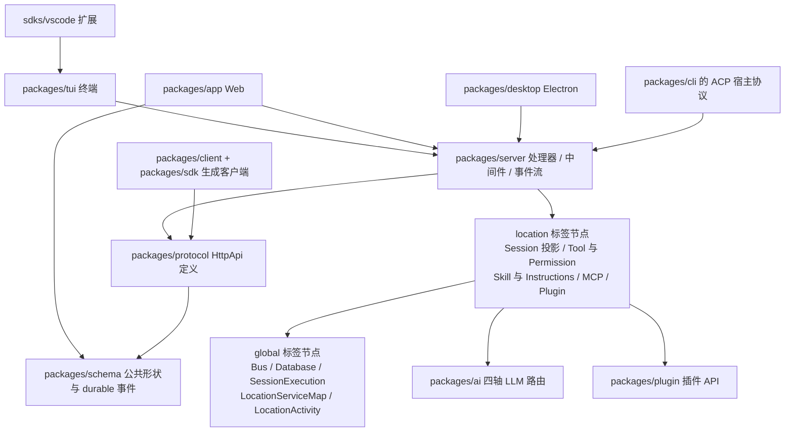

# OpenCode 深度解读

> **仓库：** [github.com/anomalyco/opencode](https://github.com/anomalyco/opencode)（原 `sst/opencode`）· **许可证：** MIT · **官网：** [opencode.ai](https://opencode.ai)
>
> **解读基线：** `v2.0.11`（`9eb6902aaf`）
>
> **本解读按 ai-agent 类规格产出**（叠加 CLI / 前端 / 可部署服务三类触发项）

---

## 子文档索引

- [`architecture.md`](architecture.md) — 分层与依赖方向、Effect 层体系、Global/Location 两阶段部署、启动与进程模型
- [`session-engine.md`](session-engine.md) — 会话引擎：事件溯源账本、准入/投递/提升、执行权协调与崩溃恢复
- [`agent-loop.md`](agent-loop.md) — Agent 循环：step 与物理尝试、重试与续写、指令代数、compaction
- [`tool-system.md`](tool-system.md) — 工具构造/注册/执行契约、权限裁决、输出边界治理
- [`llm-route-system.md`](llm-route-system.md) — `packages/ai` 的正交路由：protocol / endpoint / auth / transport
- [`data-model.md`](data-model.md) — 持久化：事件账本与投影视图、表结构、迁移与多宿主数据边界
- [`mcp-and-plugins.md`](mcp-and-plugins.md) — 两条扩展路径：跨进程 MCP 与进程内插件
- [`skill-system.md`](skill-system.md) — Skill、Instructions、配置发现与自定义命令
- [`acp-integration.md`](acp-integration.md) — 宿主接入协议 ACP：外部编辑器如何驱动 OpenCode
- [`server-and-protocol.md`](server-and-protocol.md) — HttpApi 契约、Server 中间件、事件流与 SDK 代码生成
- [`code-mode.md`](code-mode.md) — Code Mode：让模型写代码组合工具，而非逐个调用工具
- [`tui.md`](tui.md) — 终端前端：OpenTUI 渲染、feature-plugins、主题令牌纪律
- [`web-and-desktop.md`](web-and-desktop.md) — Web app、会话 UI、组件库、Electron 桌面端与周边服务
- [`platform-packages.md`](platform-packages.md) — 平台与支撑包：渲染、录制回放、模拟环境、自研持久层
- [`deployment.md`](deployment.md) — 安装器、单二进制、服务选举与自更新、CI/CD 与发布
- [`CHANGELOG.md`](CHANGELOG.md) — 各版本变更汇总
- [`v1-to-v2-migration-guide.md`](v1-to-v2-migration-guide.md) — **迁移指南**：把实例从 V1 升到 V2 的操作路径（自动归一化的覆盖面与边界、`package` 缺失报错的成因、`tui.json` 搬迁、验证与回滚）

> 以上均为源码级文档：每条机制论断都附可程序校验的 `文件:行号` 引用与逐字锚点指纹。最后一篇是**面向操作**的迁移指南（其余各篇面向"读懂架构"），它同样逐条挂源码引用，但基线只锚定一次升级路径——字段映射只对 V1 `1.18.31` → V2 `2.0.11` 的迁移语义成立，不等于对后续版本仍然成立的兼容承诺。

---

## 根因：难点不在「调模型」，而在「编排一次会失败的调用」

AI 编码 Agent 的门槛看起来很低——接一个大模型 API，把工具描述塞进 system prompt，循环到模型停止调用工具为止。这条路能在 demo 里跑通，却会在真实工程里接连撞墙：

- **模型调用是不可靠的**：限流、超时、流被截断、供应商内部错误、上下文溢出，每一种都需要不同的恢复动作。
- **会话是长的**：一次编码任务可能跨越几十轮工具调用与数百次模型请求，中途关掉终端、进程崩溃、换台机器，用户期望的是接着干而不是重来。
- **上下文是有限的**：整个仓库塞不进去，必须决定"什么进、什么出、什么时候重写历史"。
- **动作是有副作用的**：写文件、跑命令、发请求，一旦重复执行可能造成真实损害。
- **能力是要长出来的**：供应商在变、工具在变、项目规约在变，架构必须允许这些变化不触碰内核。

OpenCode v2 给出的答案是把**「会话」提升为一等公民**：一条只追加的持久事件日志是唯一事实来源，模型执行只是由这条日志的投影驱动、可重放、可中断的步骤。三个贯穿全局的设计法则可以直接从作者写下的贡献者规范里读到：

- **只记录不可约的新事实**，其余状态由折叠有序历史派生，不重复存储 —— [AGENTS.md:180-188]()
<!-- anchor: - Keep durable events minimal: record irreducible new facts and do not repeat st … - Keep delivery vocabulary explicit. Prompts steer by default. At safe step boun -->
- **准入与执行分离**：输入先落成持久记录，再在安全边界被提升为模型可见消息 —— [AGENTS.md:181-181]()
<!-- anchor: - Keep durable prompt admission separate from model execution. `Session.prompt(...)` pub -->
- **每个物理尝试恰好一次显式 `llm.stream(request)`**，绝不让编排退化成一个内存里的 tool loop —— [AGENTS.md:185-185]()
<!-- anchor: - Preserve one explicit `llm.stream(request)` call per Physical Attempt and reload proj -->

一句话概括本篇要论证的命题：**OpenCode 的真正产品不是终端界面，而是一套把「不可靠的模型调用」转化为「可恢复的会话」的运行时**；TUI、Web、桌面端、HTTP API、SDK 都只是这套运行时的不同投影。

---

## 项目概览

### 这是什么

OpenCode 是开源的 AI 编码 Agent（项目自述 "The open source AI coding agent"），由 SST 团队主导开发。与"一个 CLI 二进制"的常见形态不同，它是一个**服务化的 Agent 运行时**：同一套内核同时驱动终端 TUI、Web 应用、Electron 桌面端与无头 HTTP Server，并通过 ACP 被外部编辑器当引擎调用。

### 解决的痛点

多数编码 Agent 采用"输入指令 → 等待结果 → 接受或拒绝"的简化心智模型：易用，但用户对执行过程既不可观察也不可编排，且任何中断都意味着上下文丢失。OpenCode 把执行过程建模为**可查询、可重放、可中断、可扩展的持久会话**——这正是本解读逐层拆解的对象。

### 核心能力清单

| 能力 | 说明 | 展开于 |
|------|------|--------|
| **事件溯源会话** | 输入先持久化再执行（admit → deliver → promote），支持 steer/queue 双投递语义与崩溃恢复 | [`session-engine.md`](session-engine.md) |
| **多前端** | 终端 TUI、Web app、Electron 桌面端、VS Code 扩展、无头 HTTP API | [`tui.md`](tui.md) · [`web-and-desktop.md`](web-and-desktop.md) |
| **多供应商 LLM** | 自研正交路由（protocol / endpoint / auth / transport），含 Bedrock SigV4 与二进制事件流 | [`llm-route-system.md`](llm-route-system.md) |
| **工具系统** | 内置 + 插件 + MCP 三类来源统一注册，权限前置裁决，输出边界治理 | [`tool-system.md`](tool-system.md) |
| **插件系统** | 进程内挂钩，Promise / Effect 双编程模型，可改 agent、命令、provider、compaction 策略 | [`mcp-and-plugins.md`](mcp-and-plugins.md) |
| **MCP 接入** | stdio / HTTP 等 transport 的 MCP 客户端，含 OAuth 与连接生命周期治理 | [`mcp-and-plugins.md`](mcp-and-plugins.md) |
| **Skill 与 Instructions** | 分层发现（ambient 全局 / 逐级项目 / 显式条目）+ 按需注入，含指令纪元与增量更新 | [`skill-system.md`](skill-system.md) |
| **宿主接入协议 ACP** | 以 client–agent 形态被外部编辑器拉起与驱动 | [`acp-integration.md`](acp-integration.md) |
| **Code Mode** | 把工具暴露成受限解释器里的函数，让模型写程序一次编排多个调用 | [`code-mode.md`](code-mode.md) |
| **契约先行 + 代码生成** | `schema` → `protocol`（Effect HttpApi）→ `server` 实现 / 生成客户端 SDK | [`server-and-protocol.md`](server-and-protocol.md) |
| **本地优先持久化** | SQLite 账本 + 投影视图，多运行时适配（bun / node / workerd） | [`data-model.md`](data-model.md) |
| **自托管分发** | curl 安装器、单二进制内嵌前端资产、常驻服务选举与自更新 | [`deployment.md`](deployment.md) |

### 技术栈一览

下表版本均取自 v2.0.11 的 `package.json` 与 workspace catalog，非文档宣传口径。

| 层面 | 技术 |
|------|------|
| 运行时 | Bun（`packageManager: bun@1.4.2`）；同时提供 node / workerd 适配实现 |
| 语言 | TypeScript（`typescript: 5.8.2`），ESM，Bun workspaces + Turborepo |
| 函数式框架 | Effect（`effect: 4.0.0-rc.112`，RC 阶段），配自研 app-node / LayerNode 体系 |
| 持久化 | SQLite（`bun:sqlite` / `node:sqlite` / workerd 三套实现）、Drizzle ORM（`1.0.0-rc.5-*`，RC 阶段） |
| HTTP 服务 | Hono（`4.10.7`）+ Effect HttpApi（`@effect/platform-node` 等一整套 RC 依赖） |
| LLM 接入 | 自研 route 运行时 + protocols（27 个文件）+ providers（35 个文件）；catalog 内 `ai: 6.0.168` |
| 终端前端 | OpenTUI（`@opentui/core`、`@opentui/keymap`、`@opentui/solid` 均 `0.5.10`）+ SolidJS |
| Web 前端 | SolidJS（`1.9.15`）+ Vite（`7.3.6`）+ TailwindCSS（`4.1.11`）+ Kobalte |
| 桌面端 | Electron + electron-builder（`packages/desktop`） |
| 官网 / 控制台 | Astro（`packages/web`）、SST（`sst: 4.13.1`）驱动的基础设施定义（`infra/`） |
| 代码质量 | oxlint + ast-grep 自定义规则（`lint:effect-patterns` 扫描 core/server/protocol/cli/util） |
| 测试 | Bun test、Playwright、cassette 式 HTTP/WebSocket 录制回放（`packages/http-recorder`） |

### 项目规模

| 类别 | 数量 |
|------|------|
| workspace 包清单（`package.json`） | 41（`packages/*` 34 个目录 + `packages/console/*` + `packages/stats/*` + `services/*`） |
| 生产 TypeScript 行数（剔除测试、`dist`、`*.d.ts`） | 约 53 万行 |
| 体量最大的四个包 | `packages/app` 16.7 万 · `packages/core` 6.4 万 · `packages/tui` 6.1 万 · `packages/console` 4.1 万 |
| Schema 模块 | 78 个（`packages/schema/src/*.ts`） |
| HttpApi 操作 | 136 个 operation / 113 条 path（`packages/protocol/openapi.json` 实测；仓库内的 API 审计清单记为 139，存在漂移） |
| 内置工具 | 14 个（`packages/core/src/tool/plugin/*.ts`） |
| LLM provider / protocol 文件 | 35 / 27 |
| 许可证 | MIT |

> 上游宣传口径（未在本仓库内可核验，仅作参照）：官网自称 20.8 万 GitHub stars、950 名贡献者、每月 1600 万开发者使用 —— [opencode.ai](https://opencode.ai/)、[star-history](https://www.star-history.com/anomalyco/opencode/)。

---

## 架构总览

OpenCode 没有把"系统有哪些能力"写成散落的单例或模块级全局变量，而是建模成**一张带标签的类型化依赖图**，再由 `LayerNode.compile` 编译成 Effect 的 `Layer`。图上只有两种标签：`global`（进程级单例）与 `location`（按工作目录 / 工作区实例化），两者的依赖方向被硬编码为一条声明：

```ts
export const tags = LayerNode.tags({
  location: ["global"],   // location 节点可以依赖 global
  global: [],             // global 节点什么都不能依赖
})
```

[packages/util/src/effect/app-node.ts:3-12]()
<!-- anchor: export const tags = LayerNode.tags({ … export const makeLocationNode = tags.make("location") -->

**这条 3 行的声明就是"两阶段部署"的全部机制来源**：依赖图上不允许出现 global → location 的边，于是编译出的 Effect Layer 天然分层，进程级资源先就绪、目录级资源后构造。它同时解决了一个在多项目场景下很实际的问题——用户可能同时开着十几个工作区，会话、文件监视、LSP、权限、MCP 连接都不该是全局单例，但数据库、事件总线、执行协调器又必须是。

`packages/core/src/instance.ts` 把 51 个 location 节点收成一张图，其中最晚启动的是文件系统监视器 —— 注释明说"要在启动关键的文件系统与 Git 工作之后再开仓库监视"，是刻意的启动顺序控制 —— [packages/core/src/instance.ts:59-114]()
<!-- anchor: const nodes = [ … export const graph = LayerNode.group(nodes) -->

实例化一个目录时，`Instance.layer(ref, options)` 会绑定该目录并交出**三档优先级明确的替换能力**（vanilla 默认 → 调用方替换 → 实例绑定，后者覆盖前者），最后以 `shared: global` 编译，让所有 Location 图共享同一批 global 节点 —— [packages/core/src/instance.ts:148-159]()
<!-- anchor: export function layer(ref: Location.Ref, options: Options = {}): Layer.Layer<Services> { … return LayerNode.compile(graph, { replacements, shared: Node.tags.values.global }).pipe( -->



> 两处容易画错的边，已在核验后改正：`sdks/vscode` **不是** ACP 宿主——它在 VS Code 终端里拉起 **TUI**，再用 `POST /tui/append-prompt` 注入 `@file#L37-42` 形式的引用（`sdks/` 内 `acp` 零命中）；而 `opencode acp` 反过来**自己 spawn 一个私有 `opencode serve --stdio --port 0` 子进程**，以生成的客户端 + `GET /api/event`(SSE) 驱动它，因此 ACP 适配层与 TUI/Web/Desktop 一样是 server 的**消费者**，不是宿主内嵌的引擎。

### Location 生命周期不是"用完不管"

目录级服务图的开销必须被回收，但回收不能粗暴——直接销毁缓存会打断正在跑的执行。`LocationActivity` 是那个负责回收的 global 节点：默认 **60 分钟**不活跃即驱逐，每分钟扫一次；判定过期后先以 `reason: "inactivity"` **中断该目录下所有活跃会话并等待工具清理落定**，再复查是否有新工作在此期间接管了同一张图，确认没有才 `invalidate` —— [packages/core/src/location-activity.ts:25-43]()、[packages/core/src/location-activity.ts:61-81]()
<!-- anchor: const timeToLive = Duration.toMillis(options.timeToLive ?? "60 minutes") … yield* Effect.sleep(options.sweepInterval ?? "1 minute") -->
<!-- anchor: // Invalidation only detaches the cache entry; borrowers retain the old … }).pipe(Effect.andThen(locations.invalidate(entry.ref))) -->

这段"中断 → 落定 → 复查 → 再驱逐"的顺序本身就是一条设计观点：**缓存的失效必须尊重在途工作，且要与并发准入赛跑**。对应的销毁契约在 location 侧由 `LocationLifecycle` 承担——关闭权限询问、表单、RPC，并广播 `LocationEvent.Shutdown`，且整个 shutdown 被包成 `Effect.cached` + `uninterruptible`，保证重复调用幂等、且不可被打断 —— [packages/core/src/location-lifecycle.ts:26-39]()
<!-- anchor: const shutdown = yield* Effect.cached( … }).pipe(Effect.uninterruptible), -->

### 依赖方向的刚性

"合约先行"在依赖方向上表现为一条硬规则：`Schema` 位于图底，`Core` 与 `Protocol` 依赖它，`Server` 依赖前两者，而**客户端运行时代码可以依赖 `Schema` 与 `Protocol`，但永远不能依赖 `Core` 或 `Server`** —— [AGENTS.md:2-2]()
<!-- anchor: - Keep runtime dependencies directed from Schema to Core and Protocol, then from -->

值得注意的是**这条规则并不是靠 lint 拦住的**。根 `.oxlintrc.json` 把 `correctness`/`suspicious`/`pedantic`/`perf`/`style`/`restriction`/`nursery` 七个类别**全部关闭**，只留一条 `no-restricted-globals`（禁裸 `Reflect`）—— [.oxlintrc.json:3-11]()
<!-- anchor: "categories": { … "nursery": "off" -->

真正拦人的是三重**结构性**约束：workspace 声明（`@opencode/client` 的 `dependencies` 里只有 schema 与 protocol，`effect`/`solid-js` 走 peerDependencies）、`exports` 只暴露少量入口且只发布 `dist`、以及**打包会失败**——浏览器与 workerd 目标一旦拖入 `core`，就会连带拉进 `bun-pty`、`tree-sitter`、`node:sqlite` 而构建不过。换句话说，违反依赖方向的代价是**可发布性**，不是一条 CI 红灯。少数包还会自建护栏，例如会话 UI 包用一条测试扫描自身全部 `ts/tsx` 并对 `package.json` 断言 —— [packages/session-ui/src/import-boundaries.test.ts:4-18]()
<!-- anchor: const forbidden = /["']@opencode\/(?:core|sdk|server)(?:\/[^"']*)?["']/ … expect(dependencies["@opencode/server"]).toBeUndefined() -->

这条规则的实际动机是**让前端能共享类型而不被拖入 Node 世界**：`packages/schema` 被刻意做成浏览器安全，`packages/app` 才能直接依赖它并复用同一份事件与会话形状。代价是共享形状必须持续上提到 `schema` 层，不能图省事从 `core` 里导出。规则本身也有边界——`packages/cli` 在 `package.json` 里声明 `@opencode/tui: workspace:*` 并真的在运行时导入它（ACP 适配层取用 `@opencode/tui/mini/tool` 的 `readDisplayText`），所以"TUI 只是前端"在包粒度上并不绝对。

---

### 一次 prompt 走完的完整链路

把上面的零件串起来，一次用户输入的生命周期如下（每一步都有子文档展开细节）：

1. **前端发起。** TUI、Web、Desktop 与 ACP 适配层都是 server 的客户端，走同一个 HTTP 端点 —— [packages/protocol/src/groups/session.ts:391-391]()
<!-- anchor: HttpApiEndpoint.post("session.prompt", "/api/session/:sessionID/prompt", { -->

2. **中间件链定位上下文。** 请求依次穿过表单定位、会话定位、目录定位、鉴权、schema 错误处理与认证六层，归属顺序为 `requestRef` → 目录查询参数 → `x-opencode-directory` 头 → 进程工作目录 —— [packages/server/src/routes.ts:174-181]()
<!-- anchor: const api = HttpApiBuilder.layer(Api, { openapiPath: "/openapi.json" }).pipe( … Layer.provide(auth), -->

3. **准入先于执行。** `Session.prompt(...)` 先发布 `session.inbox.enqueued`，其投影在**同一事务**里插入一行持久 `session_inbox`，之后才调度 advisory 的 `SessionExecution.wake(sessionID)`；`resume: false` 时只准入不执行 —— [AGENTS.md:181-181]()
<!-- anchor: - Keep durable prompt admission separate from model execution. `Session.prompt(...)` pub -->

4. **在安全边界提升。** 执行协调器把 inbox 项提升为模型可见消息，投递发布 `session.inbox.delivered`，其投影消费 inbox 行并插入消息，同样在同一事务内完成——因此 `session_inbox` 只存**未被消费**的工作。

5. **恰好一次显式流调用。** runner 重新加载投影出的历史后发起**恰好一次** `llm.stream(request)`；重试、续写、溢出压缩都围绕这一次调用展开，而不是退化成内存里的工具循环 —— [AGENTS.md:185-185]()
<!-- anchor: - Preserve one explicit `llm.stream(request)` call per Physical Attempt and reload proj -->

6. **工具往返。** 模型返回工具调用后，注册表解析名字与命名空间，权限层按 `{action, resource, effect}` 裁决（可能经 `permission.asked` 往返客户端），执行结果经编码与有界化后落成 durable 事件。

7. **记账与投影同事务。** 事件在同一个 `BEGIN IMMEDIATE` 事务里**先跑投影器、再写** `event` 与 `event_sequence`，所以视图永不落后于账本——这也正是读路径完全不碰 `event` 表的前提。

8. **外推给所有前端。** Server 级的单一编码 feed 把公开事件编码成不可变 SSE 帧，每个连接领一个容量 4096 的有界队列，溢出只终止该连接而不影响他人。

9. **渲染。** TUI 用投影加增量追加路径渲染，Web app 复用同一份 `schema` 形状——共享发生在契约层而非组件层。

这条链的每一段都能独立替换：换前端不触碰内核，换供应商不改会话语义，换存储实现不影响对外行为。

---

## 核心模块导读

| 模块 | 一句话职责 | 深读 |
|------|-----------|------|
| **运行时骨架** | 类型化依赖图、global/location 两阶段编译、目录实例的启动与驱逐 | [`architecture.md`](architecture.md) |
| **会话引擎** | 只追加事件账本 + 投影视图；准入/投递/提升三阶段；执行权协调与崩溃恢复 | [`session-engine.md`](session-engine.md) |
| **Agent 循环** | step 与物理尝试的分离、四类恢复路径、指令代数与纪元、compaction 职责切分 | [`agent-loop.md`](agent-loop.md) |
| **工具与权限** | 三类来源统一注册、每调用一次权限裁决、结果三值与输出边界 | [`tool-system.md`](tool-system.md) |
| **LLM 路由** | protocol / endpoint / auth / transport 四轴正交分解，覆盖 35 个 provider | [`llm-route-system.md`](llm-route-system.md) |
| **数据模型** | 事件账本与投影表的划分、字段提升、V1→V2 迁移、多宿主数据边界 | [`data-model.md`](data-model.md) |
| **MCP 与插件** | 跨进程拿能力 vs 进程内挂钩：两条扩展路径的信任边界与代价 | [`mcp-and-plugins.md`](mcp-and-plugins.md) |
| **Skill 与配置** | 分层发现 + 按需注入、配置优先级与热重载、自定义命令 | [`skill-system.md`](skill-system.md) |
| **ACP 宿主接入** | 外部编辑器以 client–agent 形态驱动 OpenCode，含权限往返 | [`acp-integration.md`](acp-integration.md) |
| **服务与契约** | HttpApi 中间件链、SSE 单一编码 feed、SDK 代码生成管线 | [`server-and-protocol.md`](server-and-protocol.md) |
| **Code Mode** | 把工具暴露为受限解释器里的函数，一次程序编排多个调用 | [`code-mode.md`](code-mode.md) |
| **终端前端** | OpenTUI 渲染、feature-plugins、语义主题令牌 | [`tui.md`](tui.md) |
| **图形前端与周边** | Web app 分层、会话 UI 边界测试、Electron 三进程、控制台与官网 | [`web-and-desktop.md`](web-and-desktop.md) |
| **平台与支撑包** | mermaid/LaTeX 渲染、HTTP 录制回放、模拟环境、自研 Drizzle+Effect 持久层 | [`platform-packages.md`](platform-packages.md) |
| **部署与分发** | 安装器、单二进制内嵌资产、常驻服务选举与自更新、发布流水线 | [`deployment.md`](deployment.md) |

> 上表是**架构解读**的入口。如果你要做的不是"读懂 opencode"而是"把自己的实例从 V1 升到 V2"（自定义 provider 的 `package` 从哪来、旧词表哪些能自动迁移、终端配置怎么办、怎么回滚），直接看迁移指南 [`v1-to-v2-migration-guide.md`](v1-to-v2-migration-guide.md)。

---

## 同类定位

编码 Agent 大致有三种形态：**单体 CLI 循环**（模型调用与工具执行同进程同循环，最快落地）、**IDE 内嵌助手**（与编辑器强耦合，体验顺滑但难服务化）、**服务化运行时**（会话与执行抽成服务，前端只是投影）。opencode 属于第三类，而它的特殊之处不在"有 TUI"，在于**同一内核同时驱动 TUI / Web / 桌面 / 无头 API / 宿主编辑器**，并把"中断后能接着干"当成一等需求而非补丁。

| 维度 | 单体 CLI 循环 | IDE 内嵌助手 | opencode v2 |
|---|---|---|---|
| 会话状态 | 进程内存 | 编辑器内存 | 持久事件账本，可重放 |
| 中断恢复 | 通常丢失 | 部分保留 | 显式恢复边界 + write-ahead claim |
| 多前端 | 无 | 绑定单一编辑器 | TUI / Web / Desktop / HTTP / ACP 共享同一契约 |
| 扩展面 | 改源码 | 插件 API | 插件 + MCP + Skill + Code Mode 四类并存 |
| 供应商适配 | 直连单一 SDK | 直连单一 SDK | 四轴正交路由 + 外部元数据目录 |
| 部署形态 | 单二进制 | 编辑器扩展 | 单二进制 / 常驻服务 / 进程内嵌入 |

> 该表按**架构形态**归类，不是功能逐项评测；opencode 之外的项目未在本次核验中逐行验证，仅作定位参照。

---

## 设计亮点

**在途工作的优先级高于缓存回收。** 目录级服务图的驱逐不是"过期即销毁"，而是先中断该目录下所有活跃会话、等工具清理落定、再复查是否有新工作接管，确认无人认领才失效。这个顺序把"缓存正确性"和"并发准入"两个容易互相踩踏的问题显式排了序。

**性能结论以可复现实验为据，并公开记录失败的优化。** 事件流改造不是凭感觉：服务端改为"一条 Server 级编码 feed + 每连接一个有界队列"后，作者留下了实测数据——1 连接几乎不变（9.488 → 9.554 ms），10 连接从 96.312 ms 降到 10.352 ms（−89.3%），50 连接从 553.928 ms 降到 12.389 ms（−97.8%）；同一份记录里还写明曾尝试用 `Schema.fromJsonString` 替换直接编码，结果单连接中位数**从约 9.5 ms 回退到 38.8 ms** 且方差显著变大，因此被弃用 —— [specs/v2/event-stream-architecture.md:201-213]()
<!-- anchor: The disposable benchmark reproduced the previous per-connection schema/JSON/SSE … An experiment replacing direct schema encoding plus `JSON.stringify` with `Schem -->

保留一次失败实验的记录，比只报告成功数字更有工程价值：它把"为什么不能顺手换成更类型安全的写法"变成了可复查的事实。

**能力发现优先于硬编码，但保留一条显式的替换通道。** 供应商与模型元数据来自外部目录而非写死在代码里；判定一个 npm 包能否由第一方实现替代，由一个专门的识别函数承担 —— [packages/core/src/models-dev.ts:82-84]()
<!-- anchor: function nativePackage(provider: SourceProvider, model?: SourceModel) { … return AISDKNative.native(npm, { providerID: provider.id, modelID: model?.id }) -->

命中后就换成自带实现，这张替换表共 **17 条** —— [packages/core/src/aisdk-native.ts:54-71]()
<!-- anchor: const PACKAGES: Readonly<Record<string, string>> = { … "ai-gateway-provider": "@opencode/ai/providers/cloudflare-ai-gateway", -->

这也解释了 Vercel AI SDK 在这里的真实地位：**它不是兜底方案，而是"退化 route"**。命中替换表就走第一方实现；未命中时才构造一条 `protocol` 为 `"ai-sdk"`、endpoint 为占位 `https://ai-sdk.local`、`Auth.none`、`transport.execute` 返回空流的合成 route——也就是把 Endpoint / Auth / Framing 三轴退化为常量，绕过 HTTP 与分帧两轴。四轴抽象强到可以把"不是 HTTP 的东西"也表达成一条 route，这既是它灵活的证据，也是它复杂度的来源。

**共享发生在契约层，而不是组件层——并且这个取舍被明确接受。** Web 端从组件库引入数百处 DOM 组件，而 TUI 对同一个组件库**只引用了音频资产**，没有复用任何组件 —— [packages/tui/src/attention-sounds.bun.ts:2-6]()
<!-- anchor: import defaultSoundPath from "@opencode/ui/audio/bip-bop-01.mp3" with { type: "f … import subagentDoneSoundPath from "@opencode/ui/audio/yup-01.mp3" with { type: " -->

跨端真正共享的是 `schema` / `theme` / `plugin` 契约层。这看起来"浪费"了一次组件复用机会，但换来的是两端可以各自选择最适合的渲染范式（终端字符网格 vs DOM），而不必为了复用把交互模型拧成一个。

**依赖方向由"可发布性"强制，而非由 lint 强制。** 见上文「依赖方向的刚性」——七个 lint 类别全关，真正拦住越界的是打包会在浏览器 / workerd 目标上失败。

---

## 局限与风险

**关键依赖处在 RC 阶段。** 全局 catalog 把 `effect` 锁在 `4.0.0-rc.112`、`drizzle-orm`/`drizzle-kit` 锁在 `1.0.0-rc.5-*`，并把 Drizzle 的 Effect-SQLite 驱动 vendored fork 进 `packages/core/src/database/drizzle/`（README 自陈是维护中的源码而非生成物，且承认初始上游 revision 未知）。这意味着持久层与编排层同时押在两个未 GA 的依赖上，升级节奏受上游 RC 波动牵制 —— [package.json:82-83]()
<!-- anchor: "effect": "4.0.0-rc.112", … "ai": "6.0.168", -->

**事件账本没有容量治理，而且是设计如此。** 只有文件类产物带 TTL（shell 输出保留 7 天并每小时清理）；`event` 表本身没有 TTL，压缩只减少投影出的上下文、不删账本行。代价是长寿命用户的单库持续膨胀，换来的是"任意时刻可回到任意一步且不依赖外部备份"。

**规格文本与代码存在多处漂移**，且规格自己也承认历史文档可能使用废弃名。本次核验中被逐条记录的有：

- `specs/v2/session.md` 称"至多四次重试"，代码是 **10 次**（约 84s，67–101s 抖动）。
- 同处只说"未发送/投递未知可重试"，代码还允许"投递已接受但失败在读阶段"。
- `specs/v2/session.md` 的指令来源清单漏了 Code Mode 工具指引。
- 根 `AGENTS.md` 点名的 `loadInstructions` 函数**在仓库里不存在**，真实组合点是 `SessionContext.select` 里的一次 `Instructions.combine`（全仓 `loadInstructions` 零命中）。
- 根 `AGENTS.md` 声明不使用 Changesets，但 `.changeset/` 目录下仍有遗留文件，且根 `package.json` 无 changesets 依赖。
- `specs/v2/tools.md` 称默认输出截断为"头尾各留一段、省略标记在中间"，而实现**只保留头部**、标记追加在尾部。
- `specs/v2/tools.md` 称 metadata 会被独立测量体积，代码里 `metadata` 只作为 `truncated` 哨兵被读写，**没有任何体积测量**。

**有一批能力"已实现但没有消费者"**，读代码时容易误判为在主链上：

- `packages/ai/src/tool-runtime.ts` 的 `ToolRuntime.dispatch` 没有生产调用点，只被示例与再导出引用；会话主链走的是 `Tool.Snapshot.execute` 加 `core/src/tool/runtime.ts`。注意 `packages/codemode` 里有一个**同名但不同**的 `ToolRuntime`，那个才在生产使用。
- MCP 的 `readResource` 已完整实现（客户端与聚合层都有），但仓库内**没有任何生产调用方**，只在测试里被调用——也就是说 MCP 资源目前对模型和 UI 都不可见。
- Code Mode 的 OpenAPI 适配器在 v2.0.11 **未被接线**：全仓搜不到 `OpenAPI.fromSpec` 的调用，属"能力先于宿主就位"。

**残留与空壳。** `packages/effect-drizzle-sqlite/` 仍在 workspace glob（`packages/*`）覆盖范围内，但因无 `package.json` 而不构成包——目录里只剩 `sst-env.d.ts` 与一个 `create_users` 示例迁移，集成代码已整体搬进 core。同一件事在仓库历史上换过一次位置。

**分发与更新依赖集中式基础设施。** `infra/` 里的 SST 定义与 `services/update`（D1 + R2）承担安装与更新的选路，账号、zone、桶名按官方硬编码；CLI 与服务端本体可以自托管，但"装"和"更新"这两条链路没有自托管模板。同时**没有回滚路径**：没有 A/B 双槽、不保留旧二进制，唯一的"撤销"是显式装回旧版本。

**底层依赖的稳定性分布不均，最弱的一环是预览构建。** 除了 `effect` 与 `drizzle` 处在 RC 阶段，控制台还直接依赖一个 **pkg.pr.new 预览构建**而非正式发布版 —— [package.json:107-107]()
<!-- anchor: "@solidjs/start": "https://pkg.pr.new/@solidjs/start@dfb2020", -->

**文档与快照不一致之处不止于规格文件。** 仓库自用的说明文档也会漂移，例如统计后台的 `README.md` 描述的目录结构里有 `function`（Lambda 入口），而 v2.0.11 快照中该目录并不存在（实际只有 `app` / `core` / `server`）—— [packages/stats/README.md:3-3]()
<!-- anchor: Stats is a separate site from the console. Runtime, database, and domain services live -->

**两个文档站在同一快照里并存。** `packages/web` 用 Astro Starlight 构建（`@astrojs/starlight`），`services/www` 则是独立部署的官网且自带一份文档目录；两者在 v2.0.11 同时存在，本解读未断言它们之间的职责交接状态 —— [packages/web/astro.config.mjs:3-3]()
<!-- anchor: import starlight from "@astrojs/starlight" -->

**本解读自身的覆盖局限（如实标注，未按精读计入）。** 各模块的覆盖明细在撰写期以草稿末尾的覆盖率表逐项核对，达标情况并不齐一：

- **`packages/merman`（约 1.18 万行终端图表渲染引擎）做到约 80%**：六种图的解析器全部读完，布局与绘制主干读完，未读的主要是 `state/routing.ts` 余下部分与各 kind 的样式/类型声明。
- **`packages/ai` 的 `providers/**` 与 `protocols/**` 约 62%**：主战场（路由、执行器、错误归一化、合同）为逐行精读，同构 provider facade 采用**抽样证实**口径——实际打开 6 个形状互不相同的 facade，其中 4 个是纯组合、2 个是可预期例外（薄协议包装、多协议网关），未发现重复实现协议的情况。**抽样不计入精读**。
- **Web 与 UI 的叶子组件未逐文件通读**：只覆盖 `packages/app` 的架构骨架与关键子目录。该包合计行数中约 7.1 万行是多语言文案数据而非逻辑，因此"占分母比例"会显著低估实际逻辑覆盖面。
- **`packages/plugin` 的 Promise 镜像类型声明与提示词资产为抽读**；MCP 与插件篇的整体覆盖约 94%。

未见任何模块存在"读了但结论无出处"的情况：全部 1400 余条引用均经程序重定位校验。

---

## 可借鉴的设计

1. **把"会话"而不是"对话"建模。** 输入先落成持久事实、再在安全边界提升为模型可见消息；模型执行只是这条日志的投影。这个建模让"中断恢复""多前端""可观测"三件事同时变得自然，而不是各打一个补丁。

2. **准入与执行分离，把幂等键放在 ID 上。** 重复提交同一个 ID 不会产生第二条工作项——这让客户端可以安全重试，也顺带解决了"用户连按两次回车"这类现实问题。

3. **正交分解胜过枚举分支。** 把"接一家供应商"拆成 protocol / endpoint / auth / transport 四轴后，新增一家通常只需要组合既有零件；Bedrock 那种四类专属复杂度的反例也被论证为可被现有轴吸收，从而避免了"N=1 就加第五轴"的膨胀。

4. **用标签化的依赖图表达生命周期，而不是靠约定。** 声明 `location` 只能依赖 `global`，就让"进程级资源先就绪、目录级资源后构造"从一条纪律变成编译期结构；再配合可替换节点，测试时可以把整棵子树换成假的。

5. **缓存的失效要与在途工作赛跑。** 先中断、再落定、再复查、最后失效——这四步值得抄进任何带资源回收的长驻服务。

6. **把失败的优化实验写进文档。** 性能决策最容易在时间里失真；留下"试过什么、为什么退回"的记录，能让后人不必重犯。

7. **扩展点按信任边界分类，而不是按功能分类。** 跨进程的 MCP、进程内的插件、纯声明的 Skill、受约束执行的 Code Mode，四者的能力与风险各不相同；把它们明确分开，比做一个"万能扩展 API"更容易说清代价。

8. **权限裁决放在执行入口，而不是注册表。** 因为授权所需的资源只有具体执行者能解析（文件路径、shell 命令、agent id、URL），统一注册表做不到；于是选择"统一入口、分散解析"，让插件自建工具也能参与裁决。
