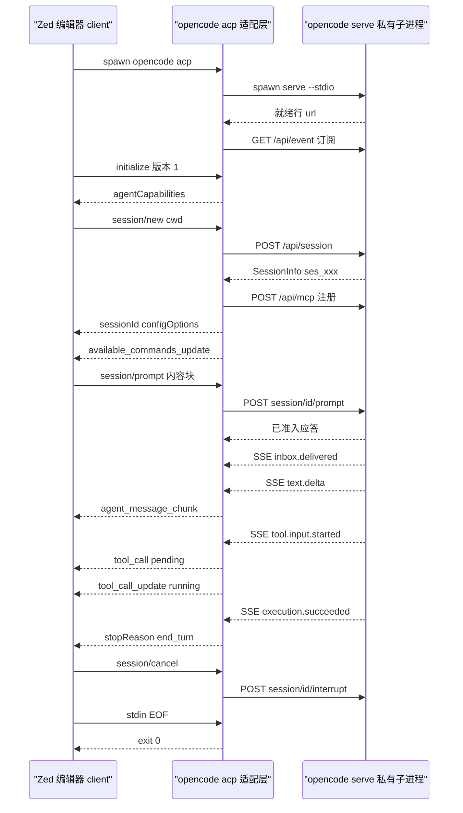
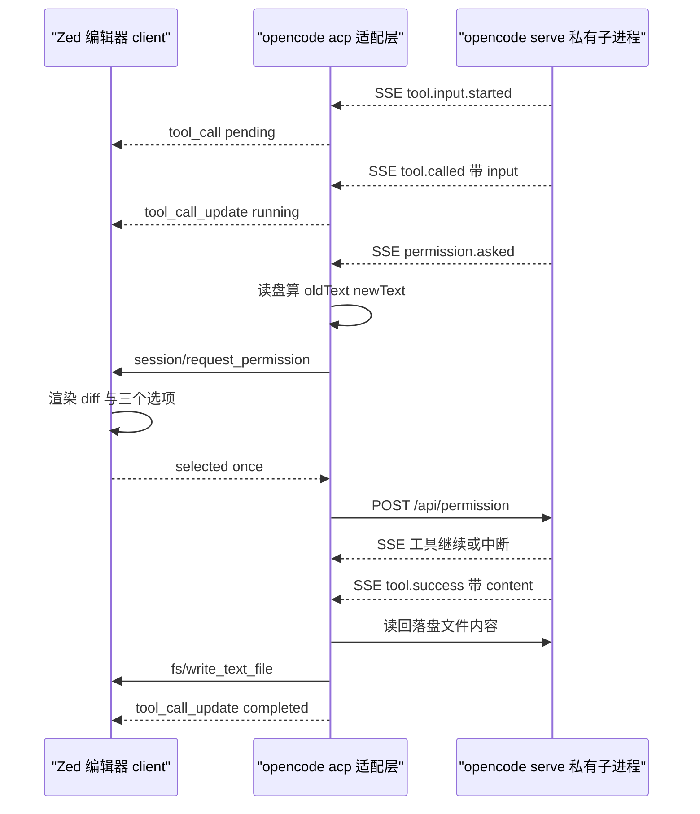

# 宿主不是 opencode 的界面时

opencode 自带的 TUI、Web app、Electron 桌面端都直接消费自己的 HTTP API。当宿主换成 Zed 这类外部编辑器时，问题变了：编辑器不愿也不能实现 opencode 的整套 HTTP 语义，它只愿意实现一个通用的「编辑器 ↔ 编码 Agent」协议。ACP（Agent Client Protocol）就是这个协议，而 `packages/cli/src/acp/` 是 opencode 侧的适配层。

本篇的核心结论是：**这个适配层几乎不拥有任何领域状态**。它把 ACP 的每个方法机械地翻译成对生成客户端的调用，把 core 的事件流翻译成 ACP 的 `session/update` 通知，把 core 的权限请求翻译成宿主 UI 请求。理解这条「只做映射」的边界，比记住方法名重要得多——这也是 `specs/v2/README.md` 权威归属表的直接推论：HTTP 操作与传输错误归 Protocol/Server，公共领域形状与 durable event payload 归 Schema，运行时行为与持久化归 Core，因此 ACP 适配层既不该定义领域形状，也不该复制 core 语义，只能做形态转换。
[specs/v2/README.md:9-14]()
<!-- anchor: | Concern                                         | Owner … | Contributor-critical regression guardrails      | Root [AGENTS.md](../../AGENT -->

## ACP 与 MCP 是两条方向相反的接入线

两个协议都叫「某种 Client Protocol」，都在 JSON-RPC 上跑，都由「不属于本进程的东西」驱动，所以极易混淆。区分它们只需要问一句：**谁是 client，谁拥有会话？**

- **MCP（Model Context Protocol）**：方向是 *agent → 能力*。opencode 是 **client**，外部 MCP server 是 server，提供 tools/resources/prompts。MCP server 不拥有会话、不持有消息、不决定任何跨回合状态。
- **ACP（Agent Client Protocol）**：方向是 *宿主 → agent 产品*。编辑器是 **client**，opencode 是 **agent**。反过来，agent 也会向 client 发请求和通知（`session/update`、`session/request_permission`、`fs/write_text_file`）——这是 ACP 与 MCP 在拓扑上最容易被忽略的差别：ACP 是双向的，且**会话状态在 agent 一侧**。

opencode 同时站在两条线的两侧。作为 ACP agent，它把宿主传进来的 MCP server 配置再注册成自己的 MCP 连接，也就是说一次会话里两条线是同一条链路上的两跳；而 MCP-over-ACP（把 ACP 本身当作 MCP 传输）被显式拒绝。
[packages/cli/src/acp/service.ts:523-530]()
<!-- anchor: const config = mcpConfig(server) … throw error -->
[packages/cli/src/acp/service.ts:537-544]()
<!-- anchor: function mcpConfig(server: McpServer) { … oauth: false as const, -->

保留的能力位是 HTTP 型 MCP，SSE 型没有打开：`mcpCapabilities` 声明 `http: true, sse: false`。
[packages/cli/src/acp/service.ts:191-211]()
<!-- anchor: const authMethod: AuthMethod = { … agentInfo: { name: "OpenCode", version: OPENCODE_VERSION }, -->

还有一个反向对照值得记住：opencode 自己的 VS Code 扩展**不走 ACP**。它只是在 VS Code 终端里拉起 `opencode --port <n>` 的 TUI，再通过 `POST /tui/append-prompt` 注入 `@file#L37-42` 形式的引用——它消费的是 opencode 私有界面，而不是宿主协议。
[sdks/vscode/src/extension.ts:93-99]()
<!-- anchor: async function appendPrompt(port: number, text: string) { … body: JSON.stringify({ text }), -->
这说明 ACP 的目标受众恰恰是「要自己实现 UI」的编辑器（Zed 一类），而不是「愿意复用 opencode TUI」的编辑器。**仓库内没有任何 ACP 客户端样例**，只有服务端适配层与协议级测试。

## 角色与状态：谁持有状态

把状态按「谁必须持久化它」切开，ACP 的职责边界就清楚了。

**宿主（client）持有**：编辑器缓冲区与未保存内容、diff 的渲染方式、终端 UI、以及**每一次权限裁决的最终决定权**。宿主不持有会话列表、不持有消息历史、不持有工具执行。

**opencode（agent）持有**：会话本身（durable，落在 server 侧数据库）、消息与工具调用记录、执行/中断、模型与工具执行、权限规则集。`session/new` 返回的 `sessionId` 就是 core 的 Session ID 本身，没有映射表。
[packages/cli/src/acp/service.ts:218-232]()
<!-- anchor: newSession: async (params) => { … return { configOptions: configOptions(state) } -->
[packages/cli/test/acp/lifecycle.subprocess.test.ts:36-36]()
<!-- anchor: expect((await newSession(acp, fixture.home)).sessionId).toStartWith("ses_") -->

**适配层持有**的只有一小撮进程内缓存，且全部可丢弃：已 attach 的会话表、按 cwd 缓存的模型/模式目录、每会话已注册的 MCP server 键、进行中的回合控制、以及从 `initialize` 协商出的两个能力开关。
[packages/cli/src/acp/service.ts:111-115]()
<!-- anchor: const sessions = new Map<string, Attached>() … const capabilities = { writeTextFile: false, childSessionUpdates: false } -->

**暴露成协议状态 vs 留在内部**，取舍的方向很一致：只暴露「宿主需要用来渲染或选择」的东西。模型、努力档、模式被提升为 `configOptions`；可用斜杠命令被提升为 `available_commands_update`；上下文用量与累计成本被提升为 `usage_update`。
[packages/cli/src/acp/service.ts:149-171]()
<!-- anchor: const attach = async (session: SessionInfo, cwd: string, mcpServers: readonly Mc … return state -->
[packages/cli/src/acp/service.ts:563-581]()
<!-- anchor: async function sendUsageUpdate( … cost: { amount: info.cost, currency: "USD" }, -->
而 prompt 的准入次序、durable inbox、事件日志、快照 ID、重试状态、provider 原生 continuation state 全部留在内部——它们是 core 的机制，不是宿主的契约。这正是「事件即事实」哲学的对外投影：ACP 暴露的是**投影**（消息、用量、配置），不是**事实**（事件序列、inbox 行）。

## 进程与传输：stdio 上的适配层，外加一个私有 server 子进程

### 宿主如何拉起进程

ACP 是一个 CLI 子命令，形参为空：`Spec.make("acp", { description: ... })` 一条声明，没有任何 flag。这一点值得注意，因为 `--server` / `--standalone` 这组参数被定义在根命令上供其它前端复用，而 `acp` 不取用它们——**ACP 宿主协议会话永远自己独占一个服务端**，不能挂到已有的后台 service 上。
[packages/cli/src/commands/commands.ts:99-99]()
<!-- anchor: Spec.make("acp", { description: "Start an Agent Client Protocol server" }), -->
[packages/cli/src/commands/commands.ts:16-21]()
<!-- anchor: standalone: Flag.boolean("standalone").pipe( … Flag.withDescription("Connect to a server URL instead of the background service"), -->

handler 通过 `Runtime.handlers` 的懒加载表注册，只有真正执行到 `acp` 时才 import 这个模块，因此 ACP 适配层不会给其它命令增加启动成本。
[packages/cli/src/index.ts:23-28]()
<!-- anchor: const Handlers = Runtime.handlers(Commands, { … api: () => import("./commands/handlers/api"), -->
[packages/cli/src/index.ts:101-101]()
<!-- anchor: return yield* Runtime.run(Commands, Handlers, { version: OPENCODE_VERSION }) -->

handler 本身只有三件事：标记客户端身份、拉起私有 server、把 stdin/stdout 包成 ACP 流。
[packages/cli/src/commands/handlers/acp.ts:13-15]()
<!-- anchor: process.env.OPENCODE_CLIENT = "acp" … const client = OpenCode.make({ baseUrl: endpoint.url, headers: Service.headers(e -->

**传输是 stdio，不是 TCP/WebSocket**：`ndJsonStream(input, output)` 把 `process.stdin` / `process.stdout` 变成换行分隔的 JSON-RPC 流，`WritableStream` 直接写 stdout，`ReadableStream` 直接读 stdin。
[packages/cli/src/commands/handlers/acp.ts:29-33]()
<!-- anchor: const connection = ACP.connect(client, ndJsonStream(input, output)) … yield* Effect.sync(() => process.exit(0)) -->

### 真正的引擎在另一个进程里

这是本模块最容易被误读的一点：**ACP 适配层不是 agent 引擎，它是引擎的客户端**。它 `spawn` 一个自己的子进程 `opencode serve --stdio --port 0`，随机生成 32 字节密码做 Basic 认证，并用这个子进程的 **stdin 管道当所有权租约**——租约断，server 自己退出，所以父进程被 SIGKILL 也不会留下孤儿服务。
[packages/cli/src/services/standalone.ts:19-31]()
<!-- anchor: const [executable, ...args] = options.command ?? [...selfCommand(), "serve"] … killSignal: "SIGTERM", -->

`--stdio` 模式的含义是「仍在本机绑定随机端口用 HTTP 服务，但把 stdin EOF 当作关机信号」，并在 stdout 打一行 `{"url": ...}` 供父进程解析就绪。
[packages/cli/src/commands/commands.ts:526-526]()
<!-- anchor: stdio: Flag.boolean("stdio").pipe(Flag.withDefault(false)), -->
[packages/cli/src/server-process.ts:161-164]()
<!-- anchor: return yield* options.mode === "service" … ? waitForStdinClose() -->

于是链路是三条通道并行：**stdio（宿主 ↔ 适配层，ACP）**、**HTTP + SSE（适配层 ↔ 私有 server，生成客户端）**、**stdio 租约（适配层的生命周期 ↔ server 的存活）**。第三条解释了为什么 `connection.closed` 之后要 `process.exit(0)`：EOF 拥有这个 stdio 进程，退出同时会关闭私有 server 的租约管道。适配层还把自己标成 `OPENCODE_CLIENT=acp`，这个值会随 `extendEnv` 继承给私有 server，最终成为 server 上报的 `app.name`——和 `OPENCODE_CLIENT=desktop` 是同一套机制，即把「第 N 个前端」的身份告诉共享的引擎。
[packages/cli/src/server-process.ts:86-87]()
<!-- anchor: name: process.env.OPENCODE_CLIENT ?? OPENCODE_ARTIFACT, … version: OPENCODE_VERSION, -->

### 连接与会话的完整生命周期

## 会话生命周期与流式 update

### 一个会话一张 attach 记录

`session/new`、`load`、`resume`、`fork` 四个入口都会走 `attach`：解析当前 cwd 的目录目录（模型/agent/命令），以 core 返回的 model 与 agent 初始化本地状态，注册宿主声明的 MCP server，然后推一条 `available_commands_update` 把斜杠命令清单交给宿主。
[packages/cli/src/acp/service.ts:149-171]()
<!-- anchor: const attach = async (session: SessionInfo, cwd: string, mcpServers: readonly Mc … return state -->

四个入口的差别是**回放策略**，而不是状态来源：

| 方法 | 是否回放历史 | 说明 |
|------|-------------|------|
| `session/new` | 否 | 新会话本无历史 |
| `session/load` | 是 | 翻页拉取历史消息后逐条转成 `session/update` |
| `session/fork` | 是 | 先 fork 再对**新**会话回放 |
| `session/resume` | 否 | 只重新 attach，宿主自己决定是否要历史 |

`replay` 就是「拉消息 → 转 update」的封装，消息按 `limit=200` 翻页，首页带 `order=asc`，后续页用 cursor。
[packages/cli/src/acp/service.ts:174-175]()
<!-- anchor: const replay = async (state: Attached) => { … await replayMessages(input.connection, state.id, state.cwd, await messages(input -->
[packages/cli/src/acp/service.ts:500-510]()
<!-- anchor: async function messages(client: OpenCodeClient, sessionID: string) { … return result -->

`session/list` 直接转发服务端的倒序分页（`limit=100` + cursor），标题用 core 的时间戳兜底策略；`session/delete` 把「不存在」当成幂等成功；`session/close` 会先取消进行中的回合并**等它结算完**再脱离——所以宿主看到的是「prompt 先返回 cancelled，close 才返回」。
[packages/cli/src/acp/service.ts:251-256]()
<!-- anchor: deleteSession: async (params) => { … return {} -->
[packages/cli/test/acp/cancel.subprocess.test.ts:29-36]()
<!-- anchor: const prompt = acp.send<PromptResponse>("session/prompt", { … expect(expectOk(await prompt.response).stopReason).toBe("cancelled") -->

### prompt：一个回合，一个准入键

`session/prompt` 做四件事：校验会话已 attach；拒绝并发回合；**由适配层生成 message ID** 并把它当作 core 的 inbox ID 传下去；注册取消回调后把回合 promise 返回给宿主。
[packages/cli/src/acp/service.ts:315-359]()
<!-- anchor: prompt: async (params, signal) => { … return turn -->

「自己生成 message ID 并复用它当 inbox ID」是关键设计：core 的准入是幂等的——同一 SessionID + 同一 inbox ID 重放会被折叠成第一次准入，payload、metadata、delivery 都被忽略。适配层因此天然获得重试安全，不需要自己维护去重表。
[packages/core/src/session/session.ts:144-168]()
<!-- anchor: const admitted = yield* Effect.gen(function* () { … if (input.resume !== false) yield* execution.wake(sessionID) -->

内部提示（`synthetic`）的存在感也在这里：ACP 的 `annotations.audience === ["assistant"]` 会被转成一条与用户 prompt **分离**的 synthetic 输入，描述为 `ACP embedded context`，并以 `delivery: "steer"` 先于正式 prompt 提交。也就是说「嵌入上下文」在 opencode 内部不是 prompt 的一部分，而是另一条 steer 输入。
[packages/cli/src/acp/content.ts:15-25]()
<!-- anchor: export function contentBlockToParts(block: ContentBlock): PromptPart[] { … return [{ type: "text", text: block.text }] -->

`delivery` 被固定为 `steer`，宿主无法通过 ACP 表达 `queue`（排队到下一回合）语义——协议面不支持，所以内部能力在这里被削掉了一档。
[packages/cli/src/acp/service.ts:390-397]()
<!-- anchor: if (prompt.command) { … delivery: "steer", -->
[packages/schema/src/session-inbox.ts:11-17]()
<!-- anchor: export const Delivery = Schema.Literals(["steer", "queue"]).annotate({ identifie … metadata: Schema.Record(Schema.String, Schema.Unknown).pipe(optional), -->

### 流式 update 来自事件流，不是 ACP 通道

`streamTurn` 的第一件事是**先订阅 core 的事件流，再提交 prompt**：`client.event.subscribe()` 打开的是 `GET /api/event` 的 SSE，和 ACP 的 stdio 通道完全无关；若订阅在准入前就断了，直接抛错而不是静默丢事件。
[packages/cli/src/acp/event.ts:87-91]()
<!-- anchor: const streamController = new AbortController() … const connected = await stream.next() -->

然后事件消费循环按三重条件筛流：**session ID 匹配**（本会话，或已登记的 child 会话）、**回合起点匹配**（`session.inbox.delivered` 的 inboxID 等于本回合的 message ID，或 skill 激活事件的 ID 匹配）、以及**起点之后**才计分。起点之前的 delta 被丢弃，其它会话的 delta 也被丢弃。
[packages/cli/src/acp/event.ts:551-554]()
<!-- anchor: function matchesStart(event: EventSubscribeOutput, start: TurnStart) { … return event.type === "session.skill.activated" && event.id === start.id.replace -->

增量语义是**逐片、非累积**的：每个 `session.text.delta` 对应一条独立的 `agent_message_chunk`，宿主必须自己拼接。推理增量映射到 `agent_thought_chunk`，并用 `<assistantMessageID>:reasoning:<ordinal>` 合成 messageId，让宿主能把同一条推理链归组——因为 core 的推理增量是按 ordinal 编号的，而 ACP 没有 ordinal 字段。
[packages/cli/src/acp/event.ts:193-198]()
<!-- anchor: if (event.type === "session.text.delta") { … content: { type: "text", text: event.data.delta }, -->

回合终止由 durable 执行事件决定：`session.execution.succeeded/failed/interrupted` 三者之一返回，随后适配层用最后一条 assistant 消息补齐 token 用量，并把 `usage_update`（已用 / 上下文窗口 / 累计成本）作为收尾通知补发（这一条失败不影响 prompt 结果）。
[packages/cli/src/acp/event.ts:564-585]()
<!-- anchor: const error = assistant?.error ?? executionError … return { stopReason, ...(usage ? { usage } : {}), _meta: {} } -->

### 取消语义与执行中断的对接

取消有三条入口，但只有一个出口 `cancelTurn`：ACP 的 `session/cancel` 通知、SDK 层的 `$/cancel_request`（它被转成 prompt 请求的 `ctx.signal`）、以及 `session/close`。
[packages/cli/src/acp/agent.ts:8-22]()
<!-- anchor: const connection = agent({ name: "opencode" }) … .connect(stream) -->
[packages/cli/src/acp/service.ts:331-332]()
<!-- anchor: // A `$/cancel_request` for this prompt behaves like `session/cancel` for its tu … const cancel = () => void cancelTurn(state.id).catch(() => {}) -->

`cancelTurn` 做两件事：把回合控制标记为 cancelled 并 **abort 一个 admission AbortController**（它同时是这一次回合所有「出站 client 请求」的取消信号，所以待决的权限请求会随之中断），然后调用 core 的 `session.interrupt`。
[packages/cli/src/acp/service.ts:128-146]()
<!-- anchor: const requireSession = async (sessionID: string) => { … return input.client.session.interrupt({ sessionID }) -->

这就是与执行引擎的衔接点：适配层不实现中断，它只是 `SessionExecution.interrupt` 的一个调用方。core 的中断语义是「接受即返回，清异步结算」——显式 resume 是默认行为的一部分，而中断本身只针对本进程拥有的执行，幂等（空闲会话上是 no-op）。
[packages/core/src/session/execution.ts:34-41]()
<!-- anchor: readonly interrupt: ( … ) => Effect.Effect<boolean> -->
[packages/core/src/session/execution.ts:156-171]()
<!-- anchor: interrupt: (sessionID, options) => … yield* coordinator.wake(sessionID, "steer") -->

`stopReason` 的映射把内部状态压扁成三个值：cancelled 或中断或 `aborted` 错误 → `cancelled`；`finish === "length"` → `max_tokens`；内容过滤 → `refusal`；其余 → `end_turn`。
[packages/cli/src/acp/event.ts:588-597]()
<!-- anchor: function resolveStopReason(input: { … return "end_turn" -->

### 斜杠命令是特例：值即副作用

文本以 `/` 开头时，适配层不再走 prompt 端点：解析出命令名与参数，命中目录里的命令就走 `session.command`，`/compact` 则改走 compaction 端点。这类「动作型回合」在提交后**立即返回成功**，不等生命周期事件——因为命令的副作用由服务端命令处理器负责，没有可等的模型回合。
[packages/cli/src/acp/service.ts:367-376]()
<!-- anchor: function preparePrompt(catalog: Catalog, prompt: PromptRequest["prompt"], messag … return { start, text, files, synthetic, slash, command } -->
[packages/cli/src/acp/service.ts:402-403]()
<!-- anchor: return client.session.prompt( … { sessionID: session.id, id: prompt.start.id, text: prompt.text, files: prompt.f -->

## 工具调用：全部在 agent 侧执行

这是与读者直觉最可能冲突的一点，必须先说结论：**ACP 里没有任何一种「工具由宿主执行」的通道被 opencode 使用**。工具由 opencode 自己声明（`Tool.Info` 带 input schema 与 `execute`），在私有 server 进程里执行，工具结果也从 core 事件流回到适配层，再作为通知推给宿主。
[packages/schema/src/tool.ts:73-84]()
<!-- anchor: export interface FileContent extends Schema.Schema.Type<typeof FileContent> {} … export type Content = Schema.Schema.Type<typeof Content> -->

ACP 规范里确实存在两类「宿主代劳」能力，opencode 只用了其中一部分：

- **`session/request_permission`**（agent → client，请求）：**实现了**，是唯一的裁决通道。
- **`fs/write_text_file`**（agent → client，请求）：**有条件实现**——只在宿主 `initialize` 时声明 `clientCapabilities.fs.writeTextFile === true` 才回写。
- **`fs/read_text_file`**（agent → client）：**未实现**。适配层的出站连接类型里根本没有这个能力，因此工具读文件始终读 server 侧磁盘，而不是编辑器缓冲区。
- **`terminal/*`**（agent → client）：**未实现**，能力也未声明。

适配层的出站面只有四个方法，正好对应上述边界。
[packages/cli/src/acp/connection.ts:12-27]()
<!-- anchor: export type Connection = { … extNotification: (method, params) => connection.client.notify(method, params), -->

### 从事件到 ACP tool_call 的四段式

一条工具调用在 ACP 上分四拍推送，每拍都从一条 core 事件触发：`session.tool.input.started` → `tool_call(status=pending)`（此时 input 还是空的）；`session.tool.called` → `tool_call_update(status=in_progress)`（带上 input）；`session.tool.progress` → 再次 `tool_call_update`（元数据刷新）；`session.tool.success` / `failed` → 终态。
[packages/cli/src/acp/event.ts:211-224]()
<!-- anchor: if (event.type === "session.tool.input.started") { … state: { input: {} }, -->

工具身份靠一个 `toolKey(sessionID, id)` 的 Map 暂存，因为 core 的 tool 事件只保证「id 在 Step 内唯一」，而 ACP 的 `toolCallId` 是全局字符串——适配层用 `<sessionID>:<toolCallId>` 做键，用**原始 id** 作为对外的 `toolCallId`。终态推送前还有一步宿主回写：若这次工具被判定为「编辑类」且宿主支持，就把落盘后的文件内容读出来发给宿主，让编辑器缓冲追上磁盘。
[packages/cli/src/acp/event.ts:262-274]()
<!-- anchor: if (event.type === "session.tool.success") { … signal: control.admission.signal, -->

终态内容里，工具类型被映射到 ACP 的 `ToolKind`（bash/shell → execute，webfetch → fetch，edit/write/patch/apply_patch → edit，grep/glob/context → search，read → read，task/subagent → think，其余 other），路径被映射到 `locations`，`read` 工具的 JSON 分页信封会被 TUI 的 `readDisplayText` 拆掉只留正文。
[packages/cli/src/acp/tool.ts:11-35]()
<!-- anchor: export function toToolKind(toolName: string): ToolKind { … return "other" -->
[packages/cli/src/acp/tool.ts:108-132]()
<!-- anchor: // Read's model content is a JSON page envelope; show the clean text instead. … content: [...primary, ...diff, ...images], -->

注意这里有个容易误判的地方：完成态的 `diff` 是**从工具 input 的 `oldString`/`newString` 现算的**，不是从 core 的记录里读出来的。所以 `apply_patch` 这类没有 `oldString` 的工具在完成态**不会**带 diff——尽管它在权限预览阶段带了 diff。
[packages/cli/src/acp/tool.ts:116-126]()
<!-- anchor: const oldText = stringValue(input.input.oldString) … newText, -->

### 一次工具调用 + 权限请求的跨宿主往返

## 权限审批点：唯一由宿主裁决的环节

core 的权限模型是「规则集求值 → allow / deny / ask」，只有 `ask` 会创建待决请求并发布 `permission.asked`；`ask` 是异步的、以 Deferred 等待回复的。
[packages/schema/src/permission.ts:44-53]()
<!-- anchor: const Asked = ephemeral({ type: "permission.asked", schema: Request.fields }) … export const Event = { Asked, Replied, Definitions: inventory(Asked, Replied) } -->

适配层监听 `permission.asked`，把它翻译成一次 `session/request_permission`：

1. **组装 UI 载荷**：工具名与参数（core 的 `metadata` 与工具 input 合并，input 优先）、`toolCall`（含 title/kind/locations）、以及**权限预览**——对 write/edit/patch/apply_patch 直接从磁盘读旧内容并算出新内容，以 ACP 的 `diff` 内容块下发，`patch`/`apply_patch` 会先解析 patch 再用 `Patch.derive` 推导结果。
2. **固定三个选项**：`Allow once`（allow_once）、`Always allow`（allow_always）、`Reject`（reject_once）。
3. **把宿主的任意回答收敛成三值**：只有 `selected` 且 optionId 是 `once`/`always` 才照传，其余一律 `reject`——包括宿主返回 `cancelled`、返回别的 optionId、或 `requestPermission` 本身抛错（例如宿主权限 UI 崩了）。
[packages/cli/src/acp/permission.ts:36-58]()
<!-- anchor: const request = { … const reply = selected === "once" || selected === "always" ? selected : "reject" -->
[packages/cli/src/acp/permission.ts:105-121]()
<!-- anchor: async function permissionPreviews(toolName: string, input: ToolInput, cwd: strin … return [{ type: "diff", path, oldText, newText }] -->

**被拒绝后的语义是这一段最需要说清的事，因为它和直觉不同**：ACP 只传 decision，不带任何反馈文本，所以 core 走的是 `DeclinedError` 分支（而不是带反馈的 `CorrectedError`），而这个错误被刻意实现成**缺陷隧道**——`Permission.assert` 用 `Effect.die` 抛出它，就是为了让工具层无法把它 catch 成「模型可见的工具输出」，把一个「不」洗成模型可以绕过的文本。它在 `executeTool` 被显式恢复成类型化失败，语义是「这不是工具的错误，是用户的拒绝」。
[packages/core/src/permission.ts:231-253]()
<!-- anchor: const assert = Effect.fn("Permission.assert")((input: AssertInput) => … Effect.catchTag("Permission.DeclinedError", (error) => Effect.die(error)), -->

然后 runner 的收尾逻辑决定回合命运：拒绝先让对应 tool call 以 `aborted` 失败（消息文本就是 `The user declined this tool call`），随后**把整个 Step 以 interrupt 结束**。
[packages/core/src/session/runner/step.ts:192-201]()
<!-- anchor: for (const decline of tools.declines) … const interrupted = tools.declines.length > 0 || streamInterrupted || tools.inte -->
[packages/core/src/session/runner/step.ts:257-259]()
<!-- anchor: if (tools.declines.length > 0) { … return yield* Effect.interrupt -->

结论对宿主实现者非常重要：**拒绝一次权限会让整个回合以 `stopReason: "cancelled"` 结束，而不是 `end_turn`，也不是协议错误**；宿主会先收到一条 `tool_call_update(status=failed)`，再收到 cancelled 的 prompt 结果。这不是 bug，而是「用户的否定必须中断，而不是让模型换个说法重试」的直接体现——它和 `tool-system.md` 的权限模型是同一套：`ask` 只决定要不要问，`reject` 的效果是停止而不是报错。

另外两个细节值得宿主注意：

- **`always` 会持久化并级联**：当拒绝或批准带 `save` 列表时，`always` 会写入项目级持久化规则，并**重新求值其它同会话待决请求**，把因此变为 allow 的一并放行。
[packages/core/src/permission.ts:295-317]()
<!-- anchor: if (input.reply === "always" && existing.request.save?.length) { … pending.delete(id) -->
- **`reject` 会级联拒绝同会话的其它待决请求**，所以宿主不需要逐个回答被同一拒绝波及的请求。
[packages/core/src/permission.ts:282-290]()
<!-- anchor: for (const [id, item] of pending) { … pending.delete(id) -->

**串行性从哪里来**：适配层不额外加锁。每个回合有一个顺序 await 的事件消费循环，因此同一会话内的权限请求天然串行；而不同会话各有自己的消费循环，所以一个会话卡在权限 UI 上不会阻塞另一个会话。取消回合时，`cancelTurn` abort 掉 admission 信号，适配层会**直接跳过这次往返**（而不是先发请求再取消），并把该权限判为 reject。
[packages/cli/src/acp/event.ts:126-130]()
<!-- anchor: const consume = async (mode: "turn" | "background") => { … const event = next.value -->
[packages/cli/src/acp/permission.ts:36-58]()
<!-- anchor: const request = { … const reply = selected === "once" || selected === "always" ? selected : "reject" -->

## 内容映射：阻抗匹配发生在哪，丢了什么

**入站（宿主 prompt → core）**的转换表：
[packages/cli/src/acp/content.ts:27-83]()
<!-- anchor: case "image": … return [] -->

| ACP 内容块 | 内部形态 | 备注 |
|-----------|---------|------|
| `text` | text part | `annotations.audience` 为 `["assistant"]` → synthetic 输入；为 `["user"]` → 标记 ignored 并被排除 |
| `image` + `data` | `data:` URL 的 file part | 无 data 但有 http(s)/data URI 时也接受，否则丢弃 |
| `resource_link` | file part | `file://` 直通；`zed://...?path=` 特例还原成本地文件 URL；其它 URI 退化成一段文本 |
| `resource`（带 text） | 一段**内联文本** `[路径:行]\n内容` | file: URI 会解出路径与 `#L<n>` 行号 |
| `resource`（带 blob） | `data:` URL 的 file part | 无 mimeType 时丢弃 |
| 其它 | 丢弃 | 静默忽略，不报错 |

**出站（core → 宿主）**发生在两个地方：实时推送的 `session/update`，以及 `load`/`fork` 的历史回放。回放会复用同一套内容转换：`file://` → `resource_link`，`data:image/*` → `image`，其它 `data:` 按 mime 决定给 `text` 还是 `blob`。
[packages/cli/src/acp/content.ts:86-102]()
<!-- anchor: export function partsToContentChunks(parts: readonly ReplayPart[]): ContentChunk … return part.text ? [{ content: { type: "text", text: part.text } }] : [] -->
[packages/cli/src/acp/content.ts:138-147]()
<!-- anchor: mime.startsWith("text/") || mime === "application/json" … blob: data, -->

**丢失发生在哪里，是这一节最有价值的部分**。回放函数只处理两种消息类型：`user` 和 `assistant`，其余一律直接返回。而 core 的消息模型有十一种类型——`agent-switched`、`model-switched`、`location-switched`、`synthetic`、`system`、`skill`、`shell`、`compaction`、`idle` 全部在回放中消失。
[packages/cli/src/acp/event.ts:437-460]()
<!-- anchor: if (message.type === "user") { … if (message.type !== "assistant") return -->
[packages/schema/src/session-message.ts:295-307]()
<!-- anchor: export const Info = Schema.Union([ … ]).annotate({ identifier: "Session.Message.Info" }) -->

保存下来的信息也只是一部分：assistant 消息里的 `snapshot`（快照 ID 与改动文件）、`cost`、`tokens`、`retry`、`rawFinish`、`providerState`、以及文本/推理块上的 provider 状态，在回放中都不出现；工具完成态的 `metadata` 只被塞进 `rawOutput.metadata`，宿主拿不到结构化的工具语义。真正被映射的只有文本、推理、工具调用（pending / running / completed / failed）和用户附件。
[packages/cli/src/acp/tool.ts:100-105]()
<!-- anchor: export function completedToolUpdate(input: { … readonly metadata?: Readonly<Record<string, unknown>> -->

还有两处「工具内容本身的损失」：core 的工具内容只有 `text` 与 `file` 两种，而 `file` 只有在 data URL 且 mime 是 `image/*` 时才被转成 ACP 的 image 块——其它文件内容**直接丢弃**；ACP 规范里的 `plan` / `plan_update` / `current_mode_update` / `config_option_update` / `session_info_update` / `compaction_update` 一个都没有发过，这些内部状态要么以别的形态暴露（模式变成 config option、用量变成 `usage_update`），要么完全不暴露。
[packages/cli/src/acp/tool.ts:163-168]()
<!-- anchor: function toolContent(content: ToolContent): ToolCallContent[] { … return [{ type: "content", content: { type: "image", mimeType: match[1], data: match[2] } }] -->

这些丢失直接限制了外部宿主的体验：**重新打开一个旧会话，宿主看不到 agent/模型切换点、看不到 compaction 发生过、看不到被 skill 注入了什么、也看不到子代理的完整生命周期**——它看到的是一条干净的「用户说了什么 / agent 回了什么 / 调了哪些工具」的转录。取舍是有道理的（协议面窄、宿主实现成本低），代价是外部宿主的会话历史观感必然弱于 opencode 自己的 TUI。

针对子代理，适配层开了一个**私有扩展**而不是扩展协议语义：宿主在 `initialize` 的 `_meta` 里声明 `opencode/child-session-updates`，适配层就会用 `opencode/session/child_update` 这个扩展通知把子会话的 update 与 status（created/running/completed/failed/interrupted）单独推给宿主；未声明时，前台子会话的工具调用会被「投影」到父回合上——`toolCallId` 加 `<childId>:` 前缀，标题加 `<子会话标题>: ` 前缀，并在 `_meta["opencode/child-session"]` 里带上父子关系与深度。回合结束后若还有未完成的子会话，消费循环会**交接给后台模式**继续推送，直到所有子会话收敛或会话被关闭。
[packages/cli/src/acp/event.ts:36-42]()
<!-- anchor: export type TurnStart = … export const ChildSessionUpdateMethod = "opencode/session/child_update" -->
[packages/cli/src/acp/event.ts:404-419]()
<!-- anchor: function projectChildUpdate(update: SessionUpdate, child: ChildSession) { … return projected -->

## 配置项协商：会话级的模型 / 努力档 / 模式

`configOptions` 是一个动态构造的列表：`model` 恒有；`effort` 仅在当前模型声明了 variant 时出现；`mode` 在目录里有可用 agent 时出现。三者都是 `select` 类型，模型项的 value 形如 `provider/model`，努力档把 `default` 作为显式选项，模式项的选项直接来自 agent 列表。
[packages/cli/src/acp/config-option.ts:39-43]()
<!-- anchor: const effort = … ...(effort ? [effort] : []), -->
[packages/cli/src/acp/config-option.ts:105-120]()
<!-- anchor: const provider = providers.find((item) => modelId.startsWith(`${item.id}/`)) … return { model: { providerID: provider.id, modelID } } -->

宿主通过 `session/set_config_option` 修改，`configId` 只认 `model` / `effort` / `mode` 三个字面量，`value` 必须是字符串，否则抛「未知配置项」；`session/set_mode` 是 `mode` 的等价快捷方式。
[packages/cli/src/acp/service.ts:315-359]()
<!-- anchor: prompt: async (params, signal) => { … return turn -->

**生效范围与生命周期**：改动是**会话级**的，直接落成本地 `Attached` 状态 + 一次 core 调用（`switchModel` / `switchAgent`），后者会发布 durable 的模型/agent 选择事件。不是全局配置，不会影响其它会话，也不写回配置文件。每次设置后都把**重新构造过的**完整 `configOptions` 返回给宿主，避免宿主自己维护状态。

几处刻意的窄化：`effort` 必须是当前模型的合法 variant（或 `default`），跨模型换挡要分两步；`model` 切换时会尽量保留同一模型上的 effort，但换到不支持该 effort 的模型时会清掉——这条在测试里被显式固定为行为契约。
[packages/cli/src/acp/service.ts:191-211]()
<!-- anchor: const authMethod: AuthMethod = { … agentInfo: { name: "OpenCode", version: OPENCODE_VERSION }, -->

目录本身按 cwd 缓存（同一 cwd 的并发调用共享一次加载），但**加载失败不缓存**；首屏还带一个 5 秒轮询：某些 provider 会在插件启动后异步发现模型，因此「没有模型 / 没有 primary agent」时会每 25ms 重试，直到超时抛错。
[packages/cli/src/acp/service.ts:117-125]()
<!-- anchor: const catalog = (cwd: string) => { … return loaded -->
[packages/cli/src/acp/service.ts:415-450]()
<!-- anchor: // Some providers discover models in the background after plugin startup begins. … throw new Error(missing) -->

**没有通过协议暴露的配置**：temperature 一类生成参数、权限规则集、compaction 阈值、插件/skill 开关、以及通过协议注册 MCP 之外的任何配置写入。宿主能改的只有「用哪个模型、多大努力、哪种模式」。

## 错误语义：九个内部错误映射到三类 JSON-RPC 错误

适配层定义了一组 `Schema.TaggedError`，并在 `agent.ts` 里用一个白名单把它们转成 SDK 的 `RequestError`；不在白名单里的异常统一被 `fromUnknown` 收敛成一个**不含原始 message 与堆栈**的内部错误。这个「白名单 + 兜底脱敏」的两段式结构，是为了保证任何未预期的内部异常都不会把 provider 密钥或 token 泄漏进协议错误里。
[packages/cli/src/acp/error.ts:54-88]()
<!-- anchor: export function toRequestError(error: Error): RequestError { … return exhaustive -->
[packages/cli/src/acp/agent.ts:28-34]()
<!-- anchor: async function run<A>(promise: Promise<A>) { … throw ACPError.toRequestError(ACPError.fromUnknown(error)) -->

| 内部错误 | JSON-RPC 码 | data 载荷 | 触发点 |
|---------|------------|----------|--------|
| `SessionNotFoundError` | -32602 | sessionId | 未 attach 的 sessionId |
| `SessionDirectoryMismatchError` | -32602 | sessionId, cwd | load/resume 的 cwd 与会话目录不一致 |
| `InvalidConfigOptionError` | -32602 | configId | 未知 configId 或非字符串 value |
| `InvalidModelError` | -32602 | providerId, modelId | 模型不在目录里 |
| `InvalidEffortError` | -32602 | effort | variant 不存在 |
| `InvalidModeError` | -32602 | mode | agent 不在目录里 |
| `UnknownAuthMethodError` | -32602 | methodId | `authenticate` 传了未知 methodId |
| `AuthRequiredError` | -32000 | {} | prompt 失败且错误类型是 `provider.auth` |
| `ServiceFailureError` | -32603 | service?, errorName? | 目录加载失败、并发回合、prompt 非取消类失败 |

三个需要理解的约定：

- **认证是占位实现**。`authenticate` 只校验 methodId，成功就返回空对象——它不真的发起登录，而是把用户指向终端里的 `opencode auth login`；若宿主声明了 `terminal-auth` 能力，`initialize` 会额外给出可执行的命令与参数，否则只给一行描述。这解释了为什么 `AuthRequiredError`（-32000）是有意义的一档：宿主收到它应当引导用户去登录，而不是重试。
[packages/cli/src/acp/service.ts:191-211]()
<!-- anchor: const authMethod: AuthMethod = { … agentInfo: { name: "OpenCode", version: OPENCODE_VERSION }, -->
- **prompt 的失败不是「回合失败」，而是「请求失败」**。回合内部失败会被压成一条 Assistant 消息上的 error，只有非 `aborted`、非 `provider.content-filter` 的错误才升级成 `ServiceFailureError`（-32603）并把 `errorName` 原样带上；被取消和内容过滤则**不抛错**，改由 `stopReason` 表达。这是「停止」与「出错」的有意区分。
[packages/cli/src/acp/event.ts:564-585]()
<!-- anchor: const error = assistant?.error ?? executionError … return { stopReason, ...(usage ? { usage } : {}), _meta: {} } -->
- **同一会话并发 prompt 返回的是内部错误（-32603）而不是参数错误（-32602）**，消息里带 `Session already has an active ACP prompt`。宿主必须把它理解为「本会话忙」，而不是「请求写错了」。
[packages/cli/src/acp/service.ts:315-359]()
<!-- anchor: prompt: async (params, signal) => { … return turn -->

一个**待确认的风险点**：`response()` 把内部错误的 `message` 直接当作 `safeMessage` 传给 `ServiceFailureError`，而 `fromUnknown` 才做脱敏。也就是说 provider 返回的错误文本会原样出现在 -32603 的 message 里；它是否可能携带用户不该看到的内容，需要结合 provider 错误构造路径判断。

[packages/cli/src/acp/event.ts:564-585]()
<!-- anchor: const error = assistant?.error ?? executionError … return { stopReason, ...(usage ? { usage } : {}), _meta: {} } -->

## 明确未实现或不支持的部分

按源码实际实现边界如实列出，**不按外部规范补全**：

- `protocolVersion` 硬编码为 `1`，不做版本协商或降级。
- **未实现** `fs/read_text_file`：工具读文件只读 server 侧磁盘，宿主编辑器的未保存内容对工具不可见。
- **未实现** `terminal/*` 全部方法，`terminal` 能力未声明。
- **未实现** MCP-over-ACP：`mcpServers` 里 `type === "acp"` 直接抛错，私有的 remote/local 两种形态被转成 opencode 自己的 MCP 配置。
- **未发送** `plan` / `plan_update` / `plan_removed`：opencode 的「计划」是一个 agent（通过 `mode` 配置项选择），不是协议里的 plan 对象。
- **未发送** `current_mode_update` / `config_option_update` / `session_info_update` / `compaction_update` / `compaction_summary_chunk`。
- **不支持** 通过 ACP 表达 `delivery: queue`、revert、session move、shell 命令、viewed 确认等 core 能力。
- **不支持** 带边界的 fork（`session/fork` 只转发 sessionID）。
- **认证不真正执行**：`authenticate` 是成功即返回的空实现。
- `session/prompt` 的 `signal` 取消路径依赖 SDK 层把 `$/cancel_request` 转成请求级 abort，而且**必须缓存到 prompt 响应里再取消**已经准入的回合——这条在 `cancelTurn` 里被显式处理。
- 本仓库内**没有 ACP 客户端实现**，无法从源码确认某个宿主（如 Zed）如何消费这些通知；协议面的正确性只能靠 `packages/cli/test/acp/` 的协议级测试与外部宿主实测。

- 仓库锁定的 SDK 是 `@agentclientprotocol/sdk@1.2.1`，而本机可用的离线副本是 1.4.0，因此「某个 `SessionUpdate` 变体在 1.2.1 的类型里是否存在」无法用仓库内源码核对。

## 回到全局设计哲学：为什么服务化运行时必须对外提供宿主协议

ACP 适配层是「服务化 Agent 运行时」这一命题最干净的证据。它没有自己的会话存储、没有自己的模型调用、没有自己的工具执行、没有自己的权限裁决——它甚至连服务端进程都不复用，而是**站在生成客户端之上，和 TUI / Web / Desktop 是同一层的消费者**。任何能让 ACP 适配层工作的改动，也必然让其它前端一起受益，因为中间那层 HTTP + SSE 契约是共享的。
[packages/cli/src/commands/handlers/acp.ts:13-15]()
<!-- anchor: process.env.OPENCODE_CLIENT = "acp" … const client = OpenCode.make({ baseUrl: endpoint.url, headers: Service.headers(e -->

四条哲学在这里都能对上：

- **事件即事实**：ACP 的流式输出全部来自 `GET /api/event` 的事件投影，历史回放来自消息投影，适配层从不制造第二份状态。deltas 之所以是「逐片非累积」，正是因为它们本来就是事件，不是状态。
- **准入与执行分离**：`session/prompt` 的返回值由 durable 执行事件决定，而回合身份由 inbox ID 决定；宿主看到的「提交」与「完成」之间，隔着一整个 core 的准入—提升—执行流程，适配层只观察，不参与。
- **Effect-TS 全量函数式编排**：错误用 `Schema.TaggedError` 建模并做穷尽映射（`toRequestError` 末尾保留 `const exhaustive: never` 分支），回合控制用 `AbortController` 做结构化取消，取消信号沿着「A 请求 → core 中断 → 出站 client 请求」一路传播。
- **合约先行 + 代码生成**：链路是 Schema（消息/工具/权限形状）→ Protocol（HTTP 操作）→ Server（实现）→ 生成的客户端 → ACP 适配层。适配层能如此薄，恰恰因为它上面有稳定的生成客户端，而不是手写的 HTTP 调用。

反过来说，这条协议也是**协议面窄化的代价**的展示窗。core 里有十一类消息、快照、重试、子代理、compaction、权限规则，而 ACP 出口只有「消息、推理、工具、用量、三档配置」。选择窄面是为了让外部宿主能以低成本接入并快速可用；选择用私有 `_meta` 扩展（child session updates、terminal-auth）而不是改动协议，则体现了另一种克制：**能加在扩展里就不动协议语义**，因为协议的所有权不在 opencode 手里。

最后一个判断：`opencode acp` 这个命令没有任何参数，也无法指向已有服务——这不是省事，而是设计。宿主协议的一次会话必须独占它驱动的引擎，否则「谁拥有这个进程的生命周期」会变得不可回答；而 stdio 租约管道的存在，正是为了让那个答案永远是「宿主」。
