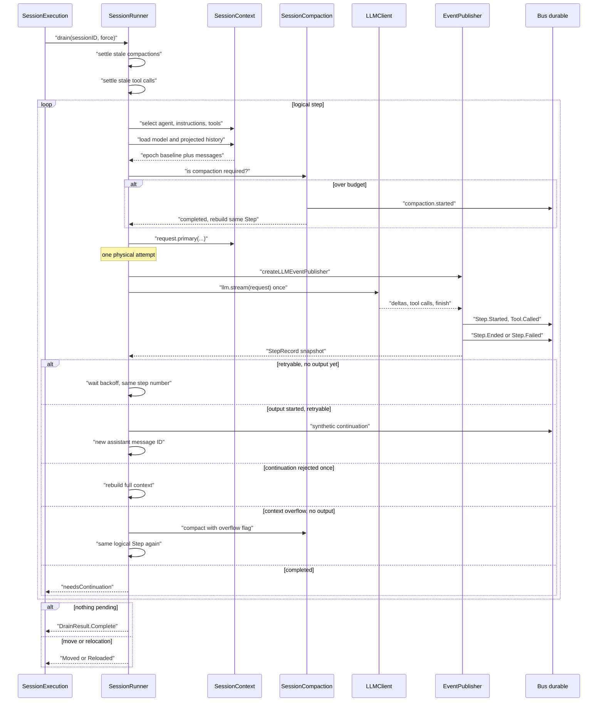
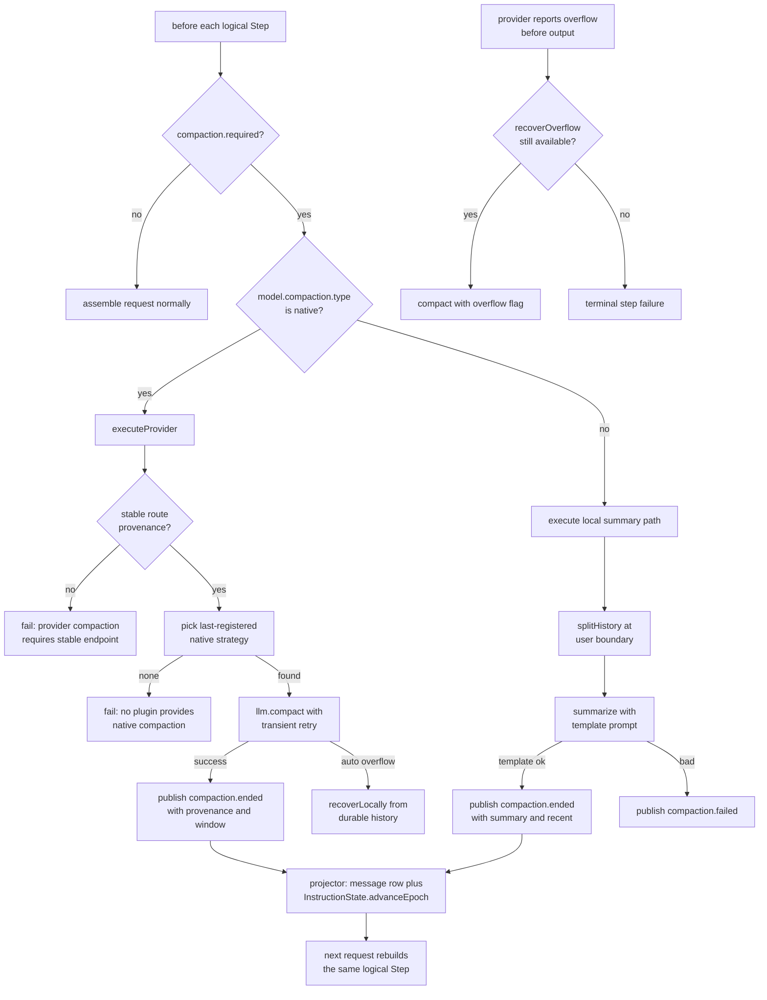
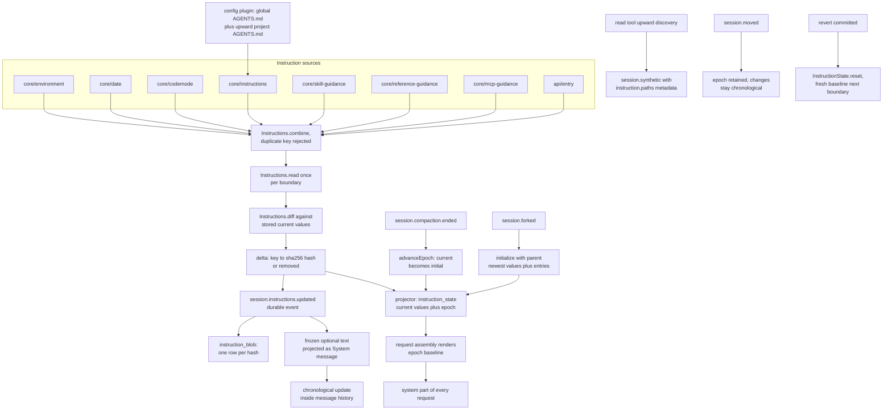

会话引擎（coordinator / runtime）解决的是「谁在什么时候拿到执行权、崩溃后如何续上」；本文讨论它交权之后的另一层问题：**拿到执行权之后，一次 prompt 到底怎么被走完**。这一层在 opencode v2 里有一个明确的归属——`SessionRunner`。它是**策略（policy）**，不是**引擎（engine）**：引擎管调度、恢复、写前声明（write-ahead claim），策略管装配什么请求、step 与 attempt 如何划分、什么时候重试、什么时候压缩、什么时候停。

## 策略层的边界：runner 是 Location 级策略，引擎是进程级调度

整篇文档的前提是一条接口边界。`SessionRunner` 只暴露一个入口 `drain`，语义是「从已经记录好的 Session 历史往前推进一步」，返回 `Complete` / `Moved` / `Reloaded` 三种终态：`Moved` 表示执行权必须迁移到新的 Location，`Reloaded` 表示当前 Location 的模型传输通道已关闭、需要在新实例上重新装载。
[packages/core/src/session/runner/index.ts:29-38]()
<!-- anchor: /** Runs one local continuation from already-recorded Session history. */ … }) => Effect.Effect<DrainResult, RunError> -->
`Moved` 的 `continuation` 字段承载「迁移前后 logical step 走到哪了」这一份**瞬时**状态，这是策略层唯一需要跨 Location 传递的东西——其余状态全在 durable 事件里，引擎不替策略保存执行进度。
[packages/core/src/session/runner/index.ts:20-26]()
<!-- anchor: export type Continuation = { readonly step: number } … Reloaded: { readonly force: boolean; readonly continuation?: Continuation } -->
引擎侧的对应实现是 `SessionExecution`：它是进程级单例，按 `sessionID` 找到 Session 的 placement，进入对应 Location，然后调用 `runner.drain`；拿到 `Moved` / `Reloaded` 就**递归重新 drain**，而不是自己解释这两种结果的含义。
[packages/core/src/session/execution.ts:90-112]()
<!-- anchor: const drain = Effect.fnUntraced(function* ( … Reloaded: (result) => drain(sessionID, result.force, result.continuation, promot -->
这解释了为什么 `runner` 必须是 Location-scoped（AGENTS.md 明确要求），而 `SessionExecution` 必须是 process-global：只有引擎知道「这个 Session 现在归哪个 Location 管」，只有策略知道「这个 Location 上这一次模型调用该怎么发」。
[AGENTS.md:183-184]()
<!-- anchor: - Keep `SessionExecution` process-global and Session-ID based. Its local impleme … - Keep `SessionRunner`, model resolution, tool registry, permissions, and filesy -->
`runner` 用注释把这条边界钉死：`runStep` 拥有 logical Step 策略，而每次 attempt 拥有自己的 streaming、工具执行与 durable settlement；attempt 本身**不引入第二个服务、也不引入第二个执行循环**——它只是 `runStep` 内部的一个 `while(true)` 迭代。
[packages/core/src/session/runner/llm.ts:204-225]()
<!-- anchor: /** Owns logical Step policy; each attempt owns its streaming, tools, and durabl … continue -->
### 为什么这条边界值得单独讲

如果把「重试」「续写」「压缩后重建」交给引擎，引擎就必须理解模型请求的内部结构（system part、工具定义、provider 元数据、cache 前缀），引擎会立刻从「调度器」退化为「半个模型客户端」。反过来，如果让策略自己管恢复与写前声明，`Moved` 这类跨 Location 的状态迁移就会散落在重试循环里，无法保证「迁移后仍然只发一次请求」。**边界划在「一个逻辑模型调用」这一粒度上**：跨调用的一切（调度、恢复、claim）归引擎，一次调用内部的一切归策略。

## step 与 attempt：一次逻辑调用，四条恢复路径

术语先定死。仓库自己的规范要求：**one step is one logical LLM call**，durable 记录只覆盖模型可见的那一段；并且明确禁止把一次调用叫 "provider turn" 或单独的 "turn"，因为 "turn" 被保留给未来「一次 prompt 提升到 Session 即将 idle 的整段」这个更大单位。

[AGENTS.md:189]()

于是 `SessionStep.attempt` 的一次调用 = 一个 **physical attempt**；`runStep` 的 `while(true)` 迭代 = 一个 **logical step**，它可以包含多个 physical attempt。策略层对此的全部表达就是 `Outcome` 这个 tagged enum：`Completed` / `Retry` / `Continue` / `RecoverFull` / `Compacted`。
[packages/core/src/session/runner/step.ts:32-42]()
<!-- anchor: export type Outcome = Data.TaggedEnum<{ … export const Outcome = Data.taggedEnum<Outcome>() -->
### 四条恢复路径与它们的判别依据

四条路径的判别条件都写在 `attempt` 的收尾处，核心判据是 `record.outputStarted`——**模型是否已经产出过可见输出**。这个字段是整个恢复策略的总开关。
[packages/core/src/session/runner/publish-llm-event.ts:30-44]()
<!-- anchor: /** Immutable fold of the durable facts a step's writer has recorded so far. */ … readonly needsContinuation: boolean -->

| 路径 | 触发条件 | 代价 | 产出 |
| --- | --- | --- | --- |
| 通用 scheduled retry（`Retry`） | 可重试失败 且 **未** 产出可见输出 | 等退避 | 复用同一 assistant message ID，step 号不变 |
| full-context rebuild（`RecoverFull`） | `Transport` 失败且 `recovery` 为 `retry-full` / `rotate-and-retry-full` 且未产出输出 | 一次立即重发全上下文 | 复用 message ID，step 号不变 |
| incomplete-stream 续写（`Continue`） | 已产出可见输出 且 该失败仍可重试 且无工具拒绝 | 等退避 + 注入续写指令 | **换新 assistant message ID**，step 号不变 |
| overflow-compaction 重建（`Compacted`） | 未产出输出 且 失败被分类为 context-overflow 且 overflow 恢复额度未用完 | 一次压缩 + 重建 | 换新 message ID，step 号不变 |

`Continue` 与 `Retry` 的分流点就是那一个布尔量：同一条 `retry` 决策，`outputStarted === false` 时走 `Retry`，为 `true` 时走 `Continue`。
[packages/core/src/session/runner/step.ts:185-189]()
<!-- anchor: if (llmFailure && llmError && retry?.retry && !recorded.outputStarted) { … return Outcome.Retry({ error: llmError, decision: retry }) -->
[packages/core/src/session/runner/step.ts:246-255]()
<!-- anchor: llmFailure && … return Outcome.Continue({ error: llmError, decision: retry }) -->
`Continue` 落地时做了三件事：等退避、发布一条 `session.synthetic` 续写指令（文本是「上一次响应被中断，从断点继续，不要重复已完成内容」）、换一个新的 assistant message ID——因为上一段半截输出已经是 durable 事实，不能覆盖它。
[packages/core/src/session/runner/llm.ts:281-289]()
<!-- anchor: Continue: Effect.fnUntraced(function* (outcome) { … assistantMessageID = SessionMessage.ID.create() -->
`RecoverFull` 只用一次：`recoverContinuation` 在第一次进入该分支后立刻置 false，所以「provider 拒绝了续写状态」之后最多一次全上下文重发。
[packages/core/src/session/runner/llm.ts:294-296]()
<!-- anchor: RecoverFull: Effect.fnUntraced(function* () { … recoverContinuation = false -->
### 为什么通用重试保留 step 号、且不消耗 step 配额

答案在 `drain` 的循环结构里。`step` 是 `drain` 作用域内的一个 `let`，只有 `runStep` **返回**（即返回 `needsContinuation` 这个布尔量）之后才 `step++`；重试循环完全在 `runStep` 内部，`Outcome` 只在 `runStep` 内部流转，外部只能看到「这一步是否还需要继续」这一个布尔量，所以重试根本不会出现在 step 级事实里。
[packages/core/src/session/runner/llm.ts:187-193]()
<!-- anchor: while (true) { … entering = false -->
配额检查发生在 `runStep` 的每一次迭代开头：`step >= loaded.agent.info.steps` 才视为到达上限。重试不改变外部 `step`，因此重试自然不消耗配额。
[packages/core/src/session/runner/llm.ts:227-247]()
<!-- anchor: const stepLimitReached = loaded.agent.info.steps !== undefined && step >= loaded … webSocket: "session", -->
这是**语义正确性**要求，不是省额度的小聪明。step 号与「agent 允许走几步」是**给用户和运维看的东西**：一次网络抖动导致的内部重发如果计入步数，会让「最多 50 步」在坏网络下变成「最多 5 步」，配额就变成了对网络质量的惩罚。反过来，只有**产生了新模型可见输出**的调用才应该被计为一步，因为只有它推进了会话。

### step 配额在哪里被重置

`step` 变量的每一次赋值都是显式的：初值为 1；`runStep` 完成后 `step++`；**promote 成功（`promoted > 0`）时重置为 1**。
[packages/core/src/session/runner/llm.ts:173-177]()
<!-- anchor: if (promoted > 0 && !selected.session.parentID && SessionTitle.isUntitled(select … if (promoted > 0) step = 1 -->
另有一处提前重置：当边界上存在待处理输入、且该输入不是 steer（即 idle 边界上的 queued 输入）时，`entering = true; step = 1`——新工作开始，重新发牌。
[packages/core/src/session/runner/llm.ts:105-108]()
<!-- anchor: if (!continuing && pending?.delivery !== "steer") { … step = 1 -->
「一批 steer 只重置一次」也是同一个机制的自然结果：steer 由 `SessionInbox.promote` 一次性批量提升并返回提升条数，`promoted > 0` 只判断一次。
[packages/core/src/session/inbox.ts:490-501]()
<!-- anchor: * Promotes pending input into visible messages and returns the promoted count, … scope: Promotable, -->
值得单独指出：**重置的触发者是「输入被提升为模型可见消息」，而不是「prompt 被接收」**。这是「准入与执行分离」在策略层的直接投影——一个排队的 prompt 在真正 promote 之前完全不影响当前 step 预算。

### 重试策略：分类、退避与共享预算

`isRetryable` 先看 provider 用 `x-should-retry` 响应头给出的显式覆盖，再按错误分类判定：限流与 provider 内部错误可重试；`Transport` 只有在「未投递」或「已投递但失败在读阶段」时才可重试（注释解释了原因：WebSocket 的 ack 只表示投递被接受，模型输出仍可能不存在）；不完整流可重试；`UnknownProvider` **默认也可重试**，理由是「分类器记录的是确定性的拒绝证据，而真正的瞬时故障恰好总是以分类器没预料到的形状出现」。
[packages/core/src/session/runner/retry.ts:30-61]()
<!-- anchor: export function isRetryable(error: AIError) { … return exhaustive -->
退避是 2 秒起步、每段上限 10 秒、抖动后总预算约 84 秒（67–101 秒区间）；provider 给出的 `retry-after` 可以拉长单段延迟，但被 15 分钟硬上限截断——防止一个恶意或错误的 `retry-after` 把会话卡住数小时。
[packages/core/src/session/runner/retry.ts:66-89]()
<!-- anchor: /** Bound provider-requested delays so a hostile or buggy retry-after cannot sta … return Effect.succeed(Duration.millis(Math.ceil(Duration.toMillis(duration)))) -->
每次决策都会触发 `session.retry` 插件钩子，钩子可以否决重试或改写延迟；`session.retry.scheduled` durable 事件把「第几次、什么时候」写进事件流，所以退避不是黑箱等待，而是可观测事实。
[packages/core/src/session/runner/retry.ts:99-117]()
<!-- anchor: const now = yield* Clock.currentTimeMillis … return { retry: true as const, attempt, delay: normalized } -->
最关键的是**预算共享**：`runStep` 在循环外创建一次 `SessionRunnerRetry.make`，因此 `Retry`、`Continue`、以及后续重建后的失败共享同一份 Schedule 额度，而不是每条路径各拿一份。
[packages/core/src/session/runner/llm.ts:205-212]()
<!-- anchor: const runStep = Effect.fn("SessionRunner.runStep")(function* (first: SessionCont … while (true) { -->
### overflow 恢复额度是「一次」，但不是每次都算

`recoverOverflow` 初始化 true，在 `Compacted` 或主动压缩已触发 overflow 恢复后置 false。
[packages/core/src/session/runner/llm.ts:290-293]()
<!-- anchor: Compacted: Effect.fnUntraced(function* () { … assistantMessageID = SessionMessage.ID.create() -->
判定本身在 `attempt` 的收尾：只有当**尚未产出可见输出**、失败被 `isContextOverflowFailure` 分类为溢出、且 `recoverOverflow` effect 真的完成压缩时，才返回 `Compacted`；否则把这个错误照常发布出去走失败路径。
[packages/core/src/session/runner/step.ts:147-152]()
<!-- anchor: !publisher.record().outputStarted && … return Outcome.Compacted() -->
注意一个容易读错的细节：**step 前的主动压缩不消耗 overflow 额度**——只有 `result.recoveredOverflow === true`（即这次压缩本身是在 overflow 驱动下从本地历史恢复的）才会把额度置 false。所以「先主动压一次、之后仍允许一次 overflow 抢救」是允许的。
[packages/core/src/session/runner/llm.ts:219-226]()
<!-- anchor: if (compaction.required({ messages: loaded.messages, resolved: loaded.model, con … continue -->
### 图：一次 step 的完整生命周期

## 显式流调用纪律：可恢复性来自投影，而不是来自内存循环

仓库的规范用一句话定义了这条纪律：**每个 physical attempt 恰好一次显式 `llm.stream(request)`，并在 durable 续写前重新加载投影历史**；同时禁止把编排委托给内存里的 tool loop。

[AGENTS.md:185]()

源码里这条纪律体现在三个地方。

第一，`llm.stream` 在整个 `attempt` 里只出现一次，并且注释说明了为什么必须**读到流的末尾**而不只是读到 finish 事件：「这样下一个请求可以复用这个响应」。
[packages/core/src/session/runner/step.ts:102-104]()
<!-- anchor: let overflowFailure: ProviderErrorEvent | undefined … const providerStream = llm.stream(input.prepared.request, input.prepared.options -->
第二，工具调用的本地执行**在 `Tool.Called` 发布完成之后**才启动，注释写明「本地执行只在其 `Tool.Called` 发布完成之后开始」。工具 fiber 的结果经 `publisher.toolExecution` 收敛为**唯一一个**终结事件（`Tool.Success` 或 `Tool.Failed`）。
[packages/core/src/session/runner/step.ts:117-129]()
<!-- anchor: if (event.type !== "tool-call" || event.providerExecuted) return … ).pipe(Effect.forkScoped), -->
[packages/core/src/session/runner/publish-llm-event.ts:557-573]()
<!-- anchor: const toolExecution = Effect.fnUntraced(function* (id: string, name: string, res … executed: tool.providerExecuted, -->
第三，续写的起点是**重新装配**而不是内存里的消息数组：`runStep` 的下一次迭代在 `initial` 已被消费后调用 `prepareContext` + `context.load`，从 durable 投影重新取历史。
[packages/core/src/session/runner/llm.ts:212-215]()
<!-- anchor: while (true) { … initial = undefined -->
历史装配本身也是纯投影：`entriesForRunner` 在一个事务里同时取「压缩边界之后的 durable 消息」与「instruction epoch 基线」，两者必须来自同一个一致快照。
[packages/core/src/session/history.ts:118-135]()
<!-- anchor: export const entriesForRunner = Effect.fn("SessionHistory.entriesForRunner")(fun … .pipe(Effect.orDie) -->
### 「内存 tool loop」到底差在哪

把编排交给内存 tool loop（模型返回 tool_call → 在内存里 push 结果 → 再调一次 `llm.stream`）在单进程 happy path 上完全等价，差别只在三种时刻暴露：

- **可恢复性**：进程死亡后，内存里的消息数组消失。opencode 的做法是每条 tool call 都先落 `Tool.Called`、结果再落 `Tool.Success`/`Tool.Failed`，重启后 `settleStaleToolCalls` 专门把「投影上仍是 streaming/running」的工具调用结算为中断失败，原样保留 assistant 归属，且**绝不重放可能已生效的副作用**。
- **可观测性**：内存 loop 的中间态对外不可见；这里是 `session.step.started` / `session.text.ended` / `session.tool.called` 等 durable 事件，UI 与回放消费者读的是同一条事实流。
- **重放一致性**：内存 loop 的正确性依赖「这次循环里我手里那份 messages 是对的」这个隐含前提；而投影重建保证「无论哪条恢复路径，模型看到的都等于 durable 历史折叠出来的东西」——这也是 `RecoverFull` 敢于整段重发的前提。
[packages/core/src/session/runner/llm.ts:332-351]()
<!-- anchor: const settleStaleToolCalls = Effect.fn("SessionRunner.settleStaleToolCalls")(fun … executed: tool.executed === true, -->
`LLMEventPublisher` 把这种「跨 fiber 无锁并发写入」的约束用注释固化下来：两个不变式是「检查与标记之间绝不 yield」和「绝不依赖跨源事件的全局顺序，各发布 fiber 自身有序，消费者按 id/序号折叠」。
[packages/core/src/session/runner/publish-llm-event.ts:64-75]()
<!-- anchor: * Persist one step without executing tools or starting a continuation step. … * and consumers fold by id/ordinal rather than global position. -->
## 上下文装配：两阶段 select / load 与 instruction epoch 基线

请求装配不是「把消息拼起来」，而是**两阶段**：`select` 固定 Session、agent、指令来源与工具快照；`load` 在此基础上解析模型与活动历史。辅助操作只解析自己需要的能力（比如标题生成只解析标题能力，不做指令与工具预检）。
[packages/core/src/session/context.ts:45-49]()
<!-- anchor: * Resolves model-request state in two phases: `select` fixes the Session, … * capabilities they need; request preparation stays separate from selection. -->
`select` 里最值得看的是那一组并行加载与随后的**显式组合**：工具快照、内置指令、指令发现、skill 指引、reference 指引、MCP 指引、API 托管的 instruction entries，最后交给 `Instructions.combine`。
[packages/core/src/session/context.ts:130-142]()
<!-- anchor: // Session permissions narrow discovery the same way they narrow the tool snapsh … { concurrency: "unbounded" }, -->
模型解析走 `SessionRunnerModel.resolve`：Session 上没有模型时交给 resolver 自身解析（取目录默认模型，默认模型没有可用 provider 包时退到首个可被解析出包的可用模型）；Session 上写了模型则必须在当前目录的可用目录里命中，否则报 `ModelUnavailableError`——**可用性是每次显式选择时惰性采样**的，因为 Location 插件会在层启动过程中异步填充目录。
[packages/core/src/session/runner/model.ts:88-103]()
<!-- anchor: resolve: Effect.fn("SessionRunnerModel.resolve")(function* (session, available)  … return yield* resolver.resolveModel(selected, session.model.variant) -->
system 段由 `baseTranscript` 组装，顺序固定为两段：agent 自定义 system（缺省时由 `SessionSystemPrompt.make` 按工具名渲染）与 `initial`（instruction epoch 基线）。工具指引是**按实际暴露的工具名**条件插入的——有 shell 才有 shell 指引，有 write/edit 才有对应指引。
[packages/core/src/session/model-request.ts:73-92]()
<!-- anchor: export const baseTranscript = (input: { … messages: toLLMMessages(input.messages, input.model.ref, providerMetadataKey), -->
[packages/core/src/session/system-prompt.ts:9-26]()
<!-- anchor: export function render(prompt: string, tools: string[]) { … "- Use the edit tool for targeted changes to existing text files. It replaces th -->
provider 专属的 system 提示（gpt / claude / kimi / meta / trinity 等）由 `optimize` 插件在 `session.context` 钩子里**覆写或追加**第一段 system，并且当 agent 自带 system 时直接跳过——这是「agent 定义优先于 provider 调优」的显式取舍。
[packages/core/src/plugin/optimize.ts:64-91]()
<!-- anchor: function make( … yield* ctx.session.hook("generate", hook) -->
`request.primary` 最后把 system、messages、tools、toolChoice、generation/providerOptions、以及一组会话亲和性 header 和 `promptCacheKey` 组装成 `LLM.request`；消息在进入请求前会被两层处理包裹——先按模型能力剔除不支持的 part，再按字节预算裁剪超限图片，因此降级是显式的而不是静默丢弃。
[packages/core/src/session/model-request.ts:233-253]()
<!-- anchor: const base = LLM.request({ … providerOptions: Object.keys(providerOptions).length === 0 ? undefined : provide -->
一个安全阀：历史选择 native 窗口时用的是**目录路由**的 provenance，而请求钩子可以改写 baseURL；如果改完的 route 与历史选择时不兼容、且消息里含 compaction 窗口，装配直接 die 而不是发出去。
[packages/core/src/session/model-request.ts:274-288]()
<!-- anchor: // History selects native windows against the catalog route before hooks run. A  … new Error("Provider context is incompatible with the route selected by model req -->
多模型混用时，provider 元数据的重放规则也被显式编码：文本与 reasoning 上携带的 provider state（例如 Gemini 的 thought signature）只有在「同一 provider 且同一 model 且该 assistant 消息无错误」时才回放，否则丢弃或降级为普通文本；hosted tool 的结果载荷则按 provider 兼容性回放。
[packages/core/src/session/runner/to-llm-message.ts:153-200]()
<!-- anchor: const assistant = (message: SessionMessage.Assistant, model: Model.Ref, provider … reuseToolProviderMetadata -->
## 上下文与压缩：core 决策 + 插件机制

压缩在 v2.0.11 有三个触发点，全部由策略层决定。

第一个是**每 step 前的主动压缩**：`required()` 先检查是否开启自动压缩、上一条消息是不是刚完成的 checkpoint（是则不再压）、以及最近一次有真实 usage 的 assistant 是否晚于最近一个 native checkpoint（否则 native usage 描述的是压缩操作本身、不足以锚定新窗口）；然后用 `estimateTokens` 与「上下文窗口减去输出预留与缓冲」比较。
[packages/core/src/session/compaction.ts:742-762]()
<!-- anchor: const required = (input: RequiredInput) => { … return estimateTokens(input) >= promptCeiling -->
估算方式很讲究：以**最近一次带输入 usage 的 assistant** 为锚，锚之前的 token 数用 provider 报的真实 usage，锚之后的部分按内容逐 part 估算（图片按 1500、PDF 按 2000 粗估），并把该锚本地产生的工具结果补上——因为锚的 usage 不覆盖它们。
[packages/core/src/session/compaction.ts:174-191]()
<!-- anchor: export const estimateTokens = (input: RequiredInput) => { … last.tokens.reasoning -->
第二个是 **overflow 抢救**：同样在 step 收尾处判定，只有当 provider 报溢出、且这次 attempt 尚未产出可见输出时才会启动，并且整条会话只允许一次。

第三个是**手动压缩**，它走的是同一个 inbox：一个 `compaction` 类型的控制项被提升时，`advanceToStep` 调用 `compactManual`，成功后 `force = false` 并 `continue`——即压缩本身不产生模型可见回合，只是重建活动历史。
[packages/core/src/session/runner/llm.ts:111-158]()
<!-- anchor: if (pending?.type === "compaction") { … continue -->
### provider-mode 决策：core 决定「用哪种机制」，插件决定「机制怎么做」

`compact()` 只有三行决策逻辑：overflow 标记走本地恢复；模型策略不是 `native` 就走本地摘要；否则走 provider 压缩。
[packages/core/src/session/compaction.ts:736-741]()
<!-- anchor: const compact = Effect.fn("SessionCompaction.compact")(function* (input: AutoInp … return yield* executeProvider(request) -->
`native` 策略是一个**注册表**，注册顺序反向遍历，所以**后注册者胜**（注释原文 "Later registrations take precedence."）。
[packages/core/src/session/compaction.ts:96-114]()
<!-- anchor: export type NativeInput = { … native: (strategy: NativeStrategy) => void -->
[packages/core/src/session/compaction.ts:529-544]()
<!-- anchor: const native = state … `No plugin provides native compaction for ${request.model.provider}/${request.mo -->
内置的 `NativeCompactionPlugin` 自己决定用哪种 `@opencode/ai` 压缩机制：如果路由支持 `trigger`（模型侧的 checkpoint 触发），就保留一批**完整的真实用户消息**并追加 provider 返回的 checkpoint assistant 消息；否则若支持 `endpoint`，直接调用端点压缩；都不支持就返回 `undefined`，让注册表继续找下一个策略。
[packages/core/src/plugin/compaction.ts:9-25]()
<!-- anchor: export const Plugin = define({ … return undefined -->
core 保留的部分同样是显式的：route provenance 的稳定性校验（没有稳定 endpoint 就拒绝 provider 压缩，绝不猜测 URL）、与路由钩子改写后的 route 做兼容性校验、瞬态失败重试、中断记录、usage 记账、以及 checkpoint 的持久化。
[packages/core/src/session/compaction.ts:501-527]()
<!-- anchor: const executeProvider = Effect.fn("SessionCompaction.executeProvider")(function* … "Provider compaction requires the endpoint in provider/model settings, not a mod -->
[packages/core/src/session/compaction.ts:546-573]()
<!-- anchor: const transient = SessionRunnerRetry.transient(yield* SessionRunnerRetry.policy( … return { status: "completed" as const } -->
provenance 的定义值得记住：providerID、provider、modelID、route id、protocol，加上 endpoint（baseURL + path + 排序后的 query）的 SHA-256——**绝不使用动态 URL builder**，因为动态端点无法建立可持久化的部署身份。
[packages/core/src/session/provider-context.ts:17-32]()
<!-- anchor: /** No guessed endpoints. Dynamic URL builders cannot establish a durable deploy … Object.entries(endpoint.query ?? {}).sort((a, b) => (a[0] < b[0] ? -1 : a[0] > b -->
checkpoint 持久化的是**规范化后的 replacement 窗口本体**（连同 provenance），而不是本地摘要或传输层续写状态。
[packages/core/src/session/provider-context.ts:47-61]()
<!-- anchor: /** Stores the canonical replacement, not a local summary or transport continuat … : part, -->
历史读取时，native 窗口只对能重放它的模型可见：`Boundary` 为 `latest` 时所有完成压缩都生效，为 `local` 时 native 窗口不生效（保证本地摘要有完整原始转录可读），为具体 provenance 时只保留兼容的 checkpoint。
[packages/core/src/session/history.ts:16-25]()
<!-- anchor: * Which completed compactions bound a history read. Local summaries always do. N … boundary === "latest" || -->
### 本地摘要路径：它是 fallback，不是主路径

本地摘要要自己切分历史：从尾部向前累加 token，遇到超预算就停，然后**回退到最近的 user 边界**，保证一次 assistant 的工具调用与其结果不被切开；如果整段都装得下，就只保留最后一轮交换，把更早的前缀留给摘要；若连「更早的前缀」都不存在，则按注释的取舍「摘要全部、保留为空」处理；唯一的例外是上一条完成摘要已经带了 recent 文本，此时改为把整段可见对话都当作 recent，不再重复摘要。
[packages/core/src/session/compaction.ts:322-361]()
<!-- anchor: const splitHistory = (messages: readonly SessionMessage.Info[], keepTokens: numb … return previousSummary?.recent ? conversation[0].index : messages.length -->
如果 provider 返回的摘要没有通过模板校验（缺少必需章节标题），会**再发一次**追加了明确提醒的请求；两次共用同一份重试额度，且被拒绝的输出绝不会进入第二次请求。
[packages/core/src/session/compaction.ts:632-643]()
<!-- anchor: // Both requests share the retry allowance; rejected output never enters the rem … Message.user( -->
### 为什么不让 core 直接实现压缩算法

这是本文最值得展开的一次架构权衡。压缩算法在 v2.0.11 里其实有**两族完全不同的机制**：本地摘要（token 估算 + 历史切分 + LLM 摘要 + 模板校验）与 provider-native checkpoint（`trigger` / `endpoint` 两种协议操作，返回的东西是**不可读的加密窗口**）。它们的共同点只有「把活动历史换成一个更小的等价物」这一句语义。

把机制留在 core 的代价是：core 必须知道每个 provider 的 checkpoint 协议细节、必须随 provider 协议演进改 core、必须为「不支持压缩的路由」写分支，而这些知识的归属地本来就是 provider 适配层与插件层。更严重的是**第三方无法插入新机制**——而压缩恰恰是最需要实验的领域（不同上下文策略、不同摘要模板、结构化记忆）。

于是切分点选在**「输入一个已准备好的 `LLMRequest`，输出一个 replacement 窗口」**这个最小契约上：`NativeStrategy` 只拿到 request、stream options 与「保留的真实用户消息」这个 effect。
这条切分同时保住了两件 core 必须独占的事：

- **可持久化身份**：checkpoint 是不是能装进这条会话，取决于 provenance，而不是取决于策略实现者的自觉。core 在注册表之外单独校验。
- **恢复的正确性**：overflow 之后的本地恢复必须从 **durable 历史**重建，而不是把已经溢出的 native 窗口再提交一次——注释原文说明了这一点。
[packages/core/src/session/compaction.ts:117-122]()
<!-- anchor: export type AutoInput = { … readonly overflow?: boolean -->
### 图：compaction 决策与 checkpoint 流程

## 指令代数：没有 registry，组合点就是一行 combine

作者在仓库规范里明确写了「没有 instruction registry」，并且把「组合内置项、discovery、guidance 与 entries」的职责交给 runner 显式完成。

[AGENTS.md:191]()

真实组合点就是 `SessionContext.select` 里那一次 `Instructions.combine([...])` 调用。下面解释这个代数为什么不需要 registry。

### 一个 Source 是五元组，自描述到可以独立哈希

`Instructions.Source` 只有五个成员：`key`、`read`（一个 effect，产出 canonical JSON 或 `unavailable` / `removed`）、以及 `initial` / `changed` / `removed` 三个渲染函数。注释点明了关键设计：canonical JSON 就是**被哈希、被存储、被重放**的同一份表示；渲染器返回 `undefined` 表示跳过（历史值无法解码或无法渲染）。
[packages/core/src/instructions/index.ts:27-38]()
<!-- anchor: * One composable instruction source over canonical JSON — the same … readonly removed: (previous: Schema.Json) => string | undefined -->
`make` 负责把带类型的定义「闭合」成一个 `Source`：用 codec 做编解码、把 `Unavailable` / `Removed` 两个哨兵值当成**引用相等**的标记透传（注释特意说明类型 `A` 本身可能长得像这两个哨兵，所以只能用 identity 判别），并在渲染出空文本时直接抛错——空渲染是编程错误，不是合法状态。
[packages/core/src/instructions/index.ts:87-118]()
<!-- anchor: /** Closes a typed definition into one `Source`, so differently typed sources co … : requireText(source.key, "removed", source.render.removed(decoded)) -->
`combine` 是唯一的组合原语，并且在这里做**重复 key 检查**并抛 `DuplicateKeyError`。
[packages/core/src/instructions/index.ts:124-131]()
<!-- anchor: export function combine(values: ReadonlyArray<List>): List { … return sources -->
### 组合顺序是「产品决策表」

v2.0.11 的显式顺序是：内置项（`core/environment`、`core/date`）→ Code Mode 工具指引（`core/codemode`）→ 指令发现（`core/instructions`）→ skill 指引（`core/skill-guidance`）→ reference 指引（`core/reference-guidance`）→ MCP 指引（`core/mcp-guidance`）→ API 托管条目（`api/<key>`）。
[packages/core/src/session/context.ts:144-156]()
<!-- anchor: return { … tools: loaded.tools, -->
[packages/core/src/instructions/builtins.ts:22-53]()
<!-- anchor: load: (sessionID) => … changed: (_previous, date) => `Today's date is now: ${date}`, -->
[packages/core/src/instruction-discovery.ts:80-107]()
<!-- anchor: const source = (value: ReadonlyArray<File> | Instructions.Unavailable | Instruct … return source(files.length === 0 ? Instructions.removed : files) -->
[packages/core/src/mcp/instructions.ts:68-80]()
<!-- anchor: return Service.of({ … removed: () => "MCP server instructions are no longer available.", -->
[packages/core/src/codemode/instructions.ts:127-142]()
<!-- anchor: const key = Instructions.Key.make("core/codemode") … removed: () => "Code Mode tools are no longer available. Do not use any previous -->
这个顺序同时是**渲染顺序**，而 discovery 内部的顺序也有明确语义：Map 的插入顺序即渲染顺序，config 插件先加全局文件、再加从近到远的项目文件，同级贡献者按 transform 注册顺序交错。
[packages/core/src/instruction-discovery.ts:28-35]()
<!-- anchor: export type Editor = { … unavailable: () => void -->
### 三种「没有值」天差地别

代数的精髓在于把「读失败」与「观察到缺失」分开：`unavailable` 表示读暂时失败、**存储的旧值继续成立**；`removed` 表示来源存在但值没了（观察到的缺席）。
[packages/core/src/instructions/index.ts:16-25]()
<!-- anchor: type NonValue = Data.TaggedEnum<{ Unavailable: {}; Removed: {} }> … export type Removed = typeof removed -->
两者的行为差异体现在 `diff`：`unavailable` 直接跳过（保留旧值）；`removed` 只在 previous 里确实有该 key 时才产生 `"removed"` 标记；值没变则完全不入 delta。还有一个更隐蔽的规则：**初始 delta 必须是完整的**——如果初始同步时有任何来源 `unavailable`，整个初始化被 `InitializationBlocked` 拒绝，宁可不建立基线，也不建立一份残缺基线。
[packages/core/src/instructions/index.ts:142-158]()
<!-- anchor: export function diff(observed: ReadResult, previous?: Values): Effect.Effect<Adm … return Effect.succeed({ delta, blobs }) -->
### delta 是「key → 内容哈希」，blob 只存一次

内容寻址的实现：`hash(value)` 对 canonical JSON（对象键排序）做 SHA-256；`applyHashDelta` 把 delta 折叠进当前值表，`"removed"` 即删除 key。
[packages/core/src/instructions/index.ts:194-196]()
<!-- anchor: export function hash(value: Schema.Json) { … return Hash.make(createHash("sha256").update(canonical(value)).digest("hex")) -->
这一对选择（事件只存 key + hash，值只存一份）是对「事件即事实、不重复存可由 fold 得到的状态」的直接执行：**同一份内容出现 N 次，事件日志里只出现 N 个哈希，blob 表里只有一行**；而「当前值表」这种可由事件 fold 出来的状态，则通过投影写进 `instruction_state` 行供边界处理直接读取。
[packages/core/src/session/instruction-state.ts:89-116]()
<!-- anchor: export const apply = Effect.fn("InstructionState.apply")(function* ( … .pipe(Effect.orDie) -->
### epoch：baseline 与 chronological update 的分工

请求装配渲染的是 **epoch 基线**：从 `instruction_state.initial_values` 取出哈希、从 blob 表解引用、按 source 顺序渲染。
[packages/core/src/session/instruction-state.ts:164-173]()
<!-- anchor: /** Renders the epoch baseline shown at the start of every model request. */ … return Instructions.renderInitial(instructions, dereference(state.initial_values -->
而 epoch 之内发生的变更**不再重渲染整个基线**，而是把渲染结果**冻结**进 `session.instructions.updated` 事件的 `text` 字段，随后作为一条 durable System 消息进入历史——模型看到的是「这个 context 变了，新值如下」这种按时间顺序的增量叙述。
[packages/schema/src/session-event.ts:254-269]()
<!-- anchor: export const InstructionsUpdated = Event.durable({ … text: Schema.String.pipe(optional), -->
[packages/core/src/session/runner/to-llm-message.ts:284-289]()
<!-- anchor: case "synthetic": … return [Message.system(message.text)] -->
为什么要冻结文本？源码给出的是**因果性**理由：稍后重新渲染需要当初那些 Location-scoped 的指令来源，而它们在那个时刻很可能已经不存在（文件删了、目录换了、MCP server 断了）。写进事件的那份文本是**当时唯一可得的真值**。
[packages/core/src/session/instruction-state.ts:44-53]()
<!-- anchor: if (!observation.initial && Object.keys(observation.delta).length === 0) return … ...(text.length > 0 ? { text } : {}), -->
冻结时还要渲染出「旧值 → 新值」的叙述，所以 `renderUpdateText` 会**只加载被替换 key 的旧 blob**，把 previous 值补齐后交给 `Instructions.renderUpdate`。
[packages/core/src/session/instruction-state.ts:63-77]()
<!-- anchor: const renderUpdateText = Effect.fnUntraced(function* ( … return Instructions.renderUpdate(instructions, previous, dereferenceDelta(observ -->
读取只发生一次：`observe` 并行做「读全部 source」与「取已存状态」，然后对二者做 diff；`commit` 在没有变更时直接返回。
[packages/core/src/session/instruction-state.ts:21-36]()
<!-- anchor: export const observe = Effect.fn("InstructionState.observe")(function* ( … ...result, -->
### epoch 何时移动、何时保留、何时清除

- **移动（完成压缩）**：`session.compaction.ended` 的投影把 epoch 起点设为该事件的精确序号，并**把 current 值直接变成 initial 值**——不重新读 source、不写任何指令事件。
- **保留（会话移动）**：`session.moved` 的投影只改目录/路径/项目/工作区这些 placement 列，完全不碰指令状态，因此目标 Location 上的指令变化会表现为**按时间顺序的更新**而不是新基线。
- **清除（已提交的 revert）**：revert 提交的投影删掉边界之后的消息与 inbox 行，然后 `InstructionState.reset` 删掉状态行，下一次边界重新建立基线。
- **fork**：只复制到边界为止的消息，但**采用父级最新的指令值**作为基线，同时把父级的 instruction entries 快照一并继承。
[packages/core/src/session/projector.ts:702-705]()
<!-- anchor: yield* bus.project(SessionEvent.Compaction.Ended, (event) => … yield* InstructionState.advanceEpoch(db, event.data.sessionID, event.durable.seq -->
[packages/core/src/session/instruction-state.ts:139-153]()
<!-- anchor: export const advanceEpoch = Effect.fn("InstructionState.advanceEpoch")(function* … .pipe(Effect.orDie) -->
[packages/core/src/session/projector.ts:466-479]()
<!-- anchor: yield* bus.project(SessionEvent.Moved, (event) => … .run() -->
[packages/core/src/session/projector.ts:759-765]()
<!-- anchor: yield* db … yield* InstructionState.reset(db, event.data.sessionID) -->
[packages/core/src/session/instruction-state.ts:156-161]()
<!-- anchor: export const reset = Effect.fn("InstructionState.reset")(function* (db: Database … .pipe(Effect.orDie) -->
[packages/core/src/session.ts:325-342]()
<!-- anchor: const inherited = yield* db … return yield* result.get(sessionID).pipe(Effect.orDie) -->
[packages/core/src/session/projector.ts:222-225]()
<!-- anchor: if (copiedSeq !== undefined) yield* Bus.reserveSequence(db, event.data.sessionID … yield* InstructionState.initialize(db, event.data.sessionID, event.durable.seq,  -->
fork 为什么反直觉地取「最新」而不是「边界时的值」？源码注释给了理由：**复制的历史里可能带着已冻结的指令更新文本，而基线已经反映了那些更新的结果**。若基线回退到边界时的值，模型会同时看到「旧基线」和「说它已过期的更新文本」，自相矛盾。取最新值让基线与冻结文本一致，代价是 fork 分支继承了父级在边界之后才发生的指令变化——这是有意的取舍。

还有一个配套的细节：当重放**跨越一个 native checkpoint** 时，位于该 checkpoint 之前的 System 消息会被整体过滤掉——因为它的完成已经推进了 instruction epoch，基线取代了那些按时间顺序的更新；而 fork 把基线种在序号 0 却保留父级序号，所以被复制过来的 checkpoint 同样能「退掉」这些消息。
[packages/core/src/session/history.ts:99-107]()
<!-- anchor: // Re-expansion may cross a native checkpoint whose completion already advanced  … !(entry.message.type === "system" && native && entry.seq < native.seq) && replay -->
### 第二条注入路径：读文件时向上发现 AGENTS.md

指令并不只从 instruction source 进入上下文。`read` 工具在读取一个项目内文件后，会从目标目录**向上**搜索 `AGENTS.md` 直到 Location 根，把候选路径交给 `SessionInstructions.load`。
[packages/core/src/tool/plugin/read.ts:86-99]()
<!-- anchor: // skipped, and discovery failures never fail the read. … (file) => dirname(file) !== root, -->
这条路径注入的是 `session.synthetic` 消息（带 `instruction.paths` 元数据作为去重台账），不是 instruction source——因为它注入的是**逐路径的原文**，语义上属于「你刚读了这个子目录，这是它的局部约定」，而不是「会话级基线」。
[packages/core/src/session/instructions.ts:59-89]()
<!-- anchor: if (toInject.length === 0) return … return next -->
两个防重入/防重复的设计写得很直白：同一 step 内的并行读用内存 claim 保护 Session/path 对；而**唯一持久台账是 synthetic 消息自身的元数据**，所以当这些 synthetic 因为压缩或 revert 掉出模型可见历史时，路径会被重新发现并重新注入，而不是静默丢失。
[packages/core/src/session/instructions.ts:36-44]()
<!-- anchor: // absolute paths, but the human-facing description shows paths relative to the  … const inFlight = yield* Ref.make<Map<SessionSchema.ID, Set<string>>>(new Map()) -->
### 图：指令从来源到 epoch 基线 + 冻结更新

## 停止条件与失败语义

### 一次 agent 执行什么时候算结束

三层嵌套的「结束」需要分清。

**一次 physical attempt 的结束**是流读到末尾、所有本地工具 fiber join 完成、并且该 attempt 的 durable 记录已收敛（`Step.Ended` 或 `Step.Failed`）。

**一次 logical step 的结束**是 `attempt` 返回 `Completed`，且 `needsContinuation` 表示是否还需要下一步。
[packages/core/src/session/runner/step.ts:263-266]()
<!-- anchor: if (record.failure) return yield* new StepFailedError({ error: record.failure }) … needsContinuation: input.prepared.request.toolChoice?.type !== "none" && record. -->
`needsContinuation` 的判据很具体：**存在至少一个非 providerExecuted 的工具被调用或被结算过**。也就是说，是工具调用（而非文本长度、而非 finish reason）决定要不要继续。
[packages/core/src/session/runner/publish-llm-event.ts:591-600]()
<!-- anchor: /** Immutable snapshot of everything recorded for this step so far. */ … (tool) => !tool.providerExecuted && (tool.called || tool.settled), -->
**一次 drain 的结束**是 `runStep` 返回 false 之后，回到 `advanceToStep`，发现没有可提升的输入、没有待处理的 control、且 `force` 与 `continuing` 都为 false，于是返回 `DrainResult.Complete`。
[packages/core/src/session/runner/llm.ts:160-161]()
<!-- anchor: if (!force && !continuing && (!pending || (pending.delivery === "queue" && promo … return DrainResult.Complete() -->
### step 配额耗尽是一个「软停止」

到达 agent 的 `steps` 上限时，runner 不终止会话，而是：在消息尾部追加一条 `MAX_STEPS_PROMPT` assistant 消息，并把 `toolChoice` 设为 `"none"`（注释：**保留工具定义以维持 provider 的缓存前缀**，只是不再允许调用）。
[packages/core/src/session/runner/llm.ts:240-247]()
<!-- anchor: system: transcript.system, … webSocket: "session", -->
[packages/core/src/session/runner/max-steps.ts:1-16]()
<!-- anchor: export const MAX_STEPS_PROMPT = `CRITICAL - MAXIMUM STEPS REACHED … Any attempt to use tools is a critical violation. Respond with text ONLY.` -->
这是一个经过权衡的失败模式：直接中断会让用户丢掉「总结一下你做到哪了」这个最有价值的信息；而继续允许工具调用又会让步数上限形同虚设。于是用「禁用工具 + 要求文字总结」把模型逼到收尾。若 provider 无视 `toolChoice: "none"` 仍然发出工具调用，`executeTool` 会直接返回错误「Tools are disabled after the maximum agent steps」。
[packages/core/src/session/runner/step.ts:88-90]()
<!-- anchor: const executeTool = (call: ToolCall) => { … return new Tool.Error({ message: "Tools are disabled after the maximum agent ste -->
### 失败如何变成 session error

单向转换集中在 `toSessionError`：`AIError` 的每一种 reason 映射到一个 `provider.*` 类型（限流 / 认证 / 配额 / 内容策略 / 传输 / provider 内部 / 无效输出 / 无效请求 / 不支持操作 / 无路由 / 未知），并带上 HTTP 状态码；权限拒绝映射为 `permission.rejected`；工具失败优先保留工具自己策划的 message，避免用空消息覆盖它。
[packages/core/src/session/to-session-error.ts:9-38]()
<!-- anchor: export function toSessionError(cause: unknown): SessionError.Error { … return exhaustive -->
[packages/core/src/session/to-session-error.ts:40-52]()
<!-- anchor: if (cause instanceof Permission.BlockedError) return { type: "permission.rejecte … if (cause instanceof UserInterruptedError) return { type: "aborted", message: ca -->
策略层把「一个 step 失败」包成 `StepFailedError`，它携带的 `SessionError.Error` 就是模型与用户能看到的那一份表示。
[packages/core/src/session/error.ts:45-51]()
<!-- anchor: export class StepFailedError extends Schema.TaggedError<StepFailedError>()("Sess … return this.error.message -->
引擎侧再把 runner 的退出翻译成执行终态：正常退出 → `succeeded`；cause 里有中断 → `interrupted`（原因默认 shutdown）；`UserInterruptedError` → `interrupted/user`；其余 → `failed` 并附 `toSessionError` 结果。
[packages/core/src/session/execution.ts:51-57]()
<!-- anchor: export function terminal(exit: Exit.Exit<void, SessionRunner.RunError>, reason?: … return { type: "failed" as const, error: toSessionError(failure) } -->
### 中断与失败如何区分

三条判据在源码里是**并列且互斥**的：

- **用户拒绝工具**（权限拒绝或问题工具被取消）：`tools.declines.length > 0` 时，若 Location 已关闭则视为正常完成（`needsContinuation: true`），否则 `Effect.interrupt`——即这是一次中断，不是失败。每个被拒绝的调用都会先各自落一条 `Tool.Failed`，并且位置关闭与用户主动取消给出不同的 message。
- **工具执行被打断**：`tools.interrupted` 为真时，把工具本身的 failure cause 抛出去；没有 cause 就抛 joined 的 cause。
- **工具失败（非中断）**：`tools.failure` 是剔除中断原因后剩下的 die reason，转成 session error 后结算为未完成工具与 assistant 的失败。
[packages/core/src/session/runner/step.ts:192-211]()
<!-- anchor: for (const decline of tools.declines) … if (interrupted) yield* publisher.failAssistant(STEP_INTERRUPTED) -->
[packages/core/src/session/runner/step.ts:256-265]()
<!-- anchor: if (Exit.isFailure(stream)) return yield* Effect.failCause(stream.cause) … needsContinuation: input.prepared.request.toolChoice?.type !== "none" && record. -->
这个划分背后是一条产品语义：**用户拿走执行权不等于 agent 失败**。中断要保留会话可用性（pending 输入不删、可以立刻 resume），失败要留下可诊断的错误表示（`session.execution.failed` 携带 error）。协调器的 `interrupt` 也遵守同一原则：中断只停止本地拥有的执行、并**认领已记录的 wake**（属于被打断的意图），清理期间新到达的 wake 是新的准入、会在 settle 时正常重启。
[packages/core/src/session/run-coordinator.ts:147-166]()
<!-- anchor: const interrupt = (key: Key, reason?: Reason): Effect.Effect<boolean> => … return true -->
### 崩溃恢复是引擎的事，但策略要保证「看起来只是继续」

进程死亡会跳过所有 finalizer，所以 drain 一开始必须做两件结算：把仍是 `running` 的 compaction 消息结算为 `compaction.failed`（原因 `compaction.interrupted`），以及把投影上仍是 streaming/running 的工具调用结算为 `Tool.Failed`；后者会特意把子会话 ID 附在 message 里，方便模型继续那个 subagent。
[packages/core/src/session/runner/llm.ts:302-327]()
<!-- anchor: const settleStaleCompactions = Effect.fn("SessionRunner.settleStaleCompactions") … error: { type: "compaction.interrupted", message: "Compaction was interrupted" } -->
引擎侧的写前 claim 保证「没有 terminal 的 claim」就是崩溃签名，启动恢复会为它追加一条 durable 续写指令并按次计数；计数超限则把该 turn 结算为 `aborted`，避免跨重启的崩溃循环。
[packages/core/src/session/execution.ts:79-89]()
<!-- anchor: // Write-ahead claim: starting records the durable intent that a turn is in flig … commit: () => store.release(sessionID), -->
[packages/core/src/session/execution/restart.ts:92-105]()
<!-- anchor: yield* bus.publish(SessionEvent.Synthetic, { … const text = -->
## Agent 定义与选择

### 内置 agent 与默认权限的三个来源

内置 agent 由 `opencode.agent` 插件注册：`build`（`Agent.defaultID`，mode primary，附加 `question: allow`）、`general`（subagent，禁止 question 与嵌套 subagent）、`explore`（subagent，专用 system prompt 且默认全拒、只放行 grep/glob/webfetch/websearch/read）、以及三个 hidden 的 `compaction` / `title` / `summary`。

[packages/core/src/agent.ts:18]()
[packages/core/src/plugin/agent.ts:86-103]()
<!-- anchor: yield* ctx.agent.transform((editor) => { … { action: "subagent", resource: "*", effect: "deny" }, -->
[packages/core/src/plugin/agent.ts:105-128]()
<!-- anchor: editor.update(Agent.ID.make("explore"), (item) => { … [{ action: "external_directory", resource: "*", effect: "ask" }, ...externalDire -->
[packages/core/src/plugin/agent.ts:133-153]()
<!-- anchor: editor.update(Agent.ID.make("compaction"), (item) => { … item.permissions.push({ action: "*", resource: "*", effect: "deny" }) -->
权限默认值来自三处叠加，顺序很重要：

1. `Agent.Info.default(id)` 的基线规则集（`*: allow`、external_directory: ask、`*.env` 读取 ask、`*.env.example` allow）；
2. `Agent` 服务层为每个 agent 追加的 Location 级放行（shell 输出目录、tool-output 目录、`global.tmp`、`global.config` 的 external_directory allow）——注释说明这些是**每个 agent 都需要的内部目录**；
3. 各插件与配置的显式 `permissions.push`，其中 config 插件只在 agent 首次创建时才 push 默认规则（`if (!exists)`），避免每次配置变更都重复叠加。
[packages/schema/src/agent.ts:39-53]()
<!-- anchor: default: (id: ID) => … }) satisfies Info, -->
[packages/core/src/agent.ts:59-64]()
<!-- anchor: const permissions: Info["permissions"] = [ … { action: "external_directory", resource: path.join(global.config, "*"), effect: -->
[packages/core/src/config/plugin/agent.ts:103-121]()
<!-- anchor: editor.update(agentID, (agent) => { … if (item.permissions !== undefined) { -->
### resolve / select / list 的差异

`resolve(id)` 带 id 时直接查表；不带 id 时走 `selectedDefault()`——它**只挑可被用户选中的 agent**（排除 `mode === "subagent"` 与 `hidden`），优先显式配置的 default，其次 `build`，最后任意一个可选项。
`select(id)` 的差别在于它总是返回一个 `Selection`：带 id 时即使查不到也返回 `{id, info: undefined}`（由调用方决定报 `AgentNotFoundError`）；不带 id 时用 `selectedDefault()`，仍为空则退回 `build` 这个 ID。
[packages/core/src/agent.ts:92-104]()
<!-- anchor: const selectable = (agent: Info | undefined) => … if (fallback) return fallback -->
[packages/core/src/agent.ts:106-129]()
<!-- anchor: return Service.of({ … return [selected, ...agents.filter((agent) => agent.id !== selected.id)] -->
`Agent.Info.steps` 是可选的正整数，**默认不设上限**；只有 config 里显式写了 `steps` 才会写进 agent 信息，而它正是那个「软停止」阈值——超过它就禁用工具、只允许文字收尾。
[packages/schema/src/agent.ts:24-37]()
<!-- anchor: id: ID, … .pipe( -->
### 模型解析链

Session 上记录的 `model` 是**目录身份**（providerID + id + 可选 variant），`ModelResolver.Resolved` 把它解析成四件东西：路由级 `model`（其 id 可能是 provider API 模型 id，与目录 id 不同）、目录身份 `ref`（durable 记录与展示必须用它）、`capabilities`、`cost`、`limit`，以及可选的 `compaction` / `transport` 策略。
[packages/core/src/model-resolver.ts:110-125]()
<!-- anchor: export interface Resolved { … readonly transport?: Provider.Transport -->
`variant` 是**请求级叠加**而不是提交快照的变更：它把 variant 的 settings/headers/body 合并进模型信息；若是 variant 未定义则要求目录里真的有这个 variant，否则报 `VariantUnavailableError`。
[packages/core/src/model-resolver.ts:134-158]()
<!-- anchor: // Variant resolution adds request-local overlays without changing the committed … : model, -->
variant 的取值集合由 `Variant.resolve` 依据 provider 包名选择协议（effort / toggle / budget_tokens）生成，协议表以 `@opencode/ai/providers/...` 的包名为键，覆盖 openai-responses、anthropic-messages、gemini、bedrock 等实现；这也解释了 `to-llm-message` 里为什么需要 `variantEffort` 这一层映射——只有 effort 类 variant 才能表达成模型可见的 effort 变更消息。
[packages/core/src/variant.ts:505-554]()
<!-- anchor: const PROTOCOLS: Readonly<Record<string, Protocol>> = { … [Provider.aisdk("@ai-sdk/cohere")]: cohere, -->
### subagent：派发与回收

`subagent` 工具的职责边界很清晰：算深度（受 `experimental.subagent_depth` 限制）、解析 agent（拒绝 primary agent）、断言 subagent 权限、解析可选模型覆盖（显式模型 > agent 配置模型 > 继承父级）、按需创建或复用子会话，然后**把真正的执行交给 prompt 准入 + Job**。
[packages/core/src/tool/plugin/subagent.ts:200-233]()
<!-- anchor: const background = input.background === true … return backgroundResult(child.id) -->
前台模式阻塞在 `jobs.block`，中断时同时 interrupt 子会话并 cancel job；后台模式立刻返回一段明确的「不要轮询、不要重复它的工作」文本。失败结果里**始终保留 sessionID**，让模型可以继续那个子会话。
[packages/core/src/tool/plugin/subagent.ts:234-256]()
<!-- anchor: const result = yield* jobs.block({ id: child.id, sessionID: context.sessionID }) … output: result?.info.output ?? SubagentCompletion.NO_TEXT, -->
`SubagentJob` 只做三件事：注册一个 `type: "subagent"` 的 job（其 run 效应是 resume 子会话并取最近一条无错误、已完成的 assistant 文本）、后台化、以及**按「子会话 + 启动时间」去重地投递完成通知**（同一代 job 只观察一次，续跑会生成新的 key）。
[packages/core/src/session/subagent-job.ts:16-58]()
<!-- anchor: export const make: Effect.Effect<Runner, never, Session.Service | Job.Service |  … notify, -->
循环如何消费这些结果：`subagent` 的返回在 completed 时被包装成 `<subagent sessionID="..." state="completed">…</subagent>` 文本（否则直接用提示文本），并带 `metadata: { sessionID, status }`，作为**普通工具内容**落进 `Tool.Success`——策略层对 subagent 没有特殊分支，这正是「工具注册与执行细节归 tool-system、循环只管消费工具结果」这条边界的体现。
[packages/core/src/tool/plugin/subagent.ts:257-265]()
<!-- anchor: }).pipe( … metadata: { sessionID: output.sessionID, status: output.status }, -->
## 旁路 LLM 调用：generate 与 title

有两类 LLM 调用不产生 Session 回合，但确实走同一条路由解析链。

**`generate`** 的契约是「从当前 Session 上下文生成文本但**不修改 Session**」：它只做 `select`（拿 agent/指令/工具）与 `resolveModel`，用 `SessionHistory.preview` 取一份只读视图（并且**只取已结算的前缀**，因为活动中的 assistant 可能带着未结算的工具调用），然后拼接可选的 instruction update 与调用方 prompt，走 `session.generate` 钩子与 `llm.generate`（非流式）。
[packages/core/src/session/generate.ts:19-66]()
<!-- anchor: /** Generates text from current Session context without mutating the Session. */ … }).pipe(instances.provide(input.session)) -->
[packages/core/src/session/history.ts:137-161]()
<!-- anchor: export const preview = Effect.fn("SessionHistory.preview")(function* ( … .pipe(Effect.catch((error) => (error instanceof Instructions.InitializationBlock -->
**`title`** 使用独立的 `title` agent 与小模型偏好：`selectTitle` 先取 agent 配置的模型，否则取当前 provider 的「小模型」（按 `gpt-luna` / `gemini-flash-lite` / `gemini-flash` / `claude-haiku` 顺序找），并把 variant 压到最小推理档（`none` → `minimal` → `low`）。
[packages/core/src/session/context.ts:95-118]()
<!-- anchor: const selectTitle = Effect.fn("SessionContext.selectTitle")(function* (session:  … return { agent, primary, selected } -->
标题生成走 `session.title` 钩子家族、用 stream 收流、把 usage 记在 `source: "title"` 下；写完前还要做一次**乐观并发校验**——重新读取 Session，只有当标题仍是当初那份、且期望的 durable 序号未被别人占用时才发布 `session.renamed`，冲突则静默放弃。
[packages/core/src/session/title.ts:100-133]()
<!-- anchor: const generate = Effect.fn("SessionTitle.generate")(function* (sessionID: Sessio … : undefined) -->
[packages/core/src/session/title.ts:134-147]()
<!-- anchor: if (!title) return … .pipe(Effect.catchDefect((defect) => (defect === titleChanged ? Effect.void : Ef -->
它们与主循环的关系可以一句话概括：**不占 step 配额、不进 drain 循环，但复用同一套 context.request 装配与同一条路由**。标题生成甚至是在 promote 成功之后、由 `FiberMap` 以 `onlyIfMissing` 语义异步触发的，条件是「promoted > 0 且这是没有父会话的未命名会话」——即它不可能拖慢模型执行。
[packages/core/src/session/runner/llm.ts:173-177]()
<!-- anchor: if (promoted > 0 && !selected.session.parentID && SessionTitle.isUntitled(select … if (promoted > 0) step = 1 -->
## 规格文本与实现的偏差

仓库根有作者亲写的 `specs/v2/session.md`，声称覆盖 prompt admission、execution、instructions、compaction 与 recovery boundaries。逐条对照后有几处**代码新于规格**的地方，值得作为高价值发现记录。

**重试次数**：规格写「初始请求加至多四次重试」，而 v2.0.11 的代码是 10 次（注释明确 "for 10 retries"），总退避预算约 84 秒。规格落后于代码。

[specs/v2/session.md:84]()
[packages/core/src/session/runner/retry.ts:77-79]()
<!-- anchor: // Exponential from 2s capped at 10s per gap, for 10 retries: 2, 4, 8, then 10 × … // cap applies per gap; `max` with `recurs` bounds the count. -->
**传输可重试的边界**：规格只说「未发送或投递状态未知的传输失败可重试」，而代码额外允许「投递已被接受、但失败发生在读阶段」的情况，注释解释了原因（WebSocket ack 早于模型输出）。

[specs/v2/session.md:84]()
[packages/core/src/session/runner/retry.ts:38-44]()
<!-- anchor: // A WebSocket acknowledgment marks delivery accepted before model output may ex … (error.reason.delivery !== "accepted" || error.reason.operation === "read") -->
**指令来源清单**：规格列举了 built-ins、ambient discovery、selected-agent skill guidance、references、MCP guidance、API-managed entries，**漏了 Code Mode 工具指引**这一项；代码里它是组合列表的第二个元素，并且是唯一由工具快照派生的指令来源。

[specs/v2/session.md:92]()
**组合函数名**：`AGENTS.md` 说「runner 在 `loadInstructions` 中显式组合」，但 v2.0.11 里不存在名为 `loadInstructions` 的函数；实际组合点是 `SessionContext.select` 内的一次 `Instructions.combine`。

[AGENTS.md:191]()
[packages/core/src/session/context.ts:144-156]()
<!-- anchor: return { … tools: loaded.tools, -->
**与规格一致的部分**同样值得记录，因为它们是最稳定的契约：四条恢复路径的清单、「通用重试保留 logical step 号且不消耗 step 配额」、「续写换新 assistant message ID 但共用同一份重试预算」、以及「overflow 抢救只允许一次、且必须在 durable 输出之前」。

[specs/v2/session.md:86]()
[specs/v2/session.md:104]()

还有一处是**规格里没有、代码里有的防御分支**：runner 对 in-band 的 `provider-error` LLMEvent 做了完整处理（记录、阻止后续事件、转成 step 失败），但当前仓库内没有协议发出该事件——`packages/ai` 的协议实现都把流内错误直接 `Effect.fail` 成 `AIError`，`provider-error` 只在事件 schema 与 runner 的这一处 switch 里出现。
[packages/core/src/session/runner/publish-llm-event.ts:535-539]()
<!-- anchor: case "provider-error": … return -->
这属于「预留 seam 还是历史遗留」的判断，我只能确认「仓库内没有生产者」这一事实，无法确认作者意图。

## 回到设计哲学

把上面每一节折回契约里的两条哲学，结构会变得很清楚。

**策略与执行引擎分离**：`drain` 的三种返回、`Moved` 只携带 step 号、attempt 不引入第二个循环、压缩机制通过 `native` 注册表外置——这些看似零散的约束其实是同一条边界的不同切面：引擎只需回答「谁在哪里执行」，策略只需回答「这一次请求怎么发」。而这条边界的**粒度**选在「一个 logical Step」上，正是为了让两种职责都有完整的、可测试的语义单位。

**事件即事实**：指令系统是这条哲学最彻底的实现——`session.instructions.updated` 只记录「哪些 key 变成了哪个哈希」加上「当时渲染出的那段文本」；值的本体只存一份在 `instruction_blob`；当前值与 epoch 起点这两个可由事件 fold 出来的状态，交给投影写进 `instruction_state`；跨请求的稳定性由 epoch 机制保证，而 epoch 的移动、保留、清除各自都只是一条事件投影的副作用。同理，`Step.Ended` / `Step.Failed` 是唯一的 step 终态事实，重试与续写之所以能够「不消耗 step 配额」「不改变 step 号」，是因为它们**不产生新的 step 级事实**——配额与编号读的是事实流，而不是某段内存循环的计数器。

最后，指令的「冻结渲染文本」是一个特别好的注脚：它承认了**有些事实一旦错过就无法重算**（Location-scoped 的来源可能已经消失），所以在事实发生的那一刻把不可重算的部分固化进事件，把可重算的部分（哈希 → 值）留给内容寻址去重。这是「事件即事实」在工程细节上最不显然、也最有说服力的一次应用。
