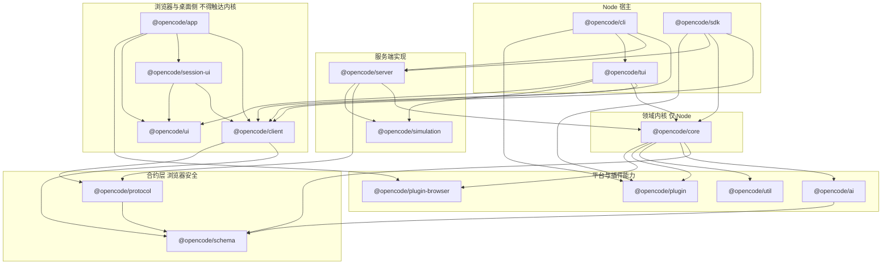
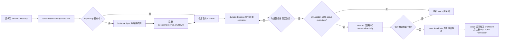
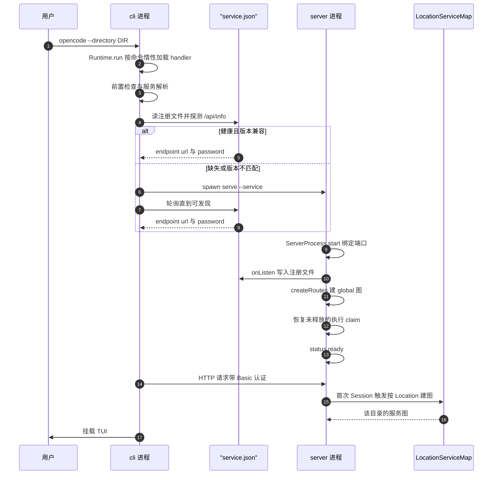

## 为什么"运行时骨架"值得单独看

一个 AI 编码 Agent 的表面工作是"把 prompt 发给模型"，但它真正要解决的问题是：**把一次不可靠、会中断、上下文有限的模型调用，编排成可持久、可恢复、可观测、可扩展的长会话执行**。这个目标决定了它的代码形状——不是一条 `main()` 直线，而是一张**可以被多宿主重新接线、可以按目录反复实例化、可以优雅回收**的服务图。

opencode v2.0.11 把这个形状做成了显式的三层机制：**包的依赖方向**（谁能 import 谁）、**Effect LayerNode 的图编译**（依赖树如何被静态检查与选择性共享）、**Global/Location 两阶段部署**（哪些服务是进程级单例、哪些按目录实例化并回收）。本文要回答的是这三个机制**为什么长成这样**，以及 `opencode` 这个命令敲下之后到 TUI 可用之间究竟发生了什么。

架构总览（箭头方向表示"依赖"，即箭头起点 import 箭头终点）：

## 依赖方向是刚性的，但强制它的不是 lint

### 规则本身

仓库根 `AGENTS.md` 用一条 bullet 写死了整张图的形状：Schema 是根，Core 与 Protocol 并列向外，Server 站在两者之上，而 **Client 运行时代码可以依赖 Schema/Protocol，永远不得依赖 Core/Server**，只有 `sdk` 这个聚合包才被允许把三者装在一起。

[AGENTS.md:2-2]()
<!-- anchor: - Keep runtime dependencies directed from Schema to Core and Protocol, then from -->

这条规则不是风格建议——它同时解释了 `specs/v2/README.md` 里那张"权威归属表"：HTTP 操作与传输错误归 Protocol + Server，公共领域形状与 durable event payload 归 Schema，运行时行为与持久化归 Core，而贡献者的回归护栏归根 `AGENTS.md`。规格文档因此被定义为"解释跨模块契约而不复制具体类型"，避免与代码类型二次真源化。

[specs/v2/README.md:7-16]()
<!-- anchor: Authority follows the concern: … Current specifications explain cross-module contracts without copying exact type -->

### 规则在 package.json 里长什么样

规则落地为**声明式的 workspace 依赖**，而不是一条 lint 规则。`@opencode/client` 的 dependencies 只有两项：Schema 与 Protocol。它连 `effect` 与 `solid-js` 都放在 peerDependencies，让宿主决定单例的 Effect 运行时实例。

[packages/client/package.json:35-38]()
<!-- anchor: "dependencies": { … "@opencode/protocol": "workspace:*" -->

同一份约束在浏览器侧被反复确认：`packages/app` 的依赖列表里有 client、schema、session-ui、ui、util、plugin-browser，**没有 core，也没有 server**；`session-ui` 只依赖 client、ui、util；`ui` 更彻底——它连一个 `@opencode/*` 依赖都没有，是一套纯 Solid 组件。而 `@opencode/tui` 因为跑在 Node 进程里，可以正当地直接依赖 core。

我逐包检查了 `packages/*/package.json` 的 dependencies 字段与 `packages/client/src`、`packages/app/src` 中是否出现 `@opencode/core` / `@opencode/server` 的字面 import，结论是双向干净；但我没有穷尽 `session-ui`、`ui`、`desktop` 全部子目录的传递依赖闭包。

### 没有专门的边界检查脚本

根 `.oxlintrc.json` 把所有规则类别关掉，只保留一条 `no-restricted-globals`（禁止裸用 `Reflect`），**没有任何 `no-restricted-imports` 或包边界规则**。

[.oxlintrc.json:12-17]()
<!-- anchor: "rules": { … "message": "Use typed property access or direct invocation. Suppress this rule o -->

`bun run check` 的组合也只是 `oxlint` 加上 `turbo typecheck`，外加两条针对 Effect 用法的 ast-grep 规则检查；CI 的 check workflow 直接调用同一个脚本，没有第二条独立通道。

[package.json:27-27]()
<!-- anchor: "check": "bun run lint && bun run typecheck", -->

[.github/workflows/check.yml:21-22]()
<!-- anchor: - name: Run checks … run: bun run check -->

所以"违规会被拦下"依赖的是三重**结构性**约束，而不是一条显式断言：

1. **显式声明才有解析路径**。Bun workspace 会把所有包软链到根 `node_modules`，所以字面上 import 能解析；但 `packages/client` 的 `exports` 只暴露 8 个入口（`. /promise /promise/api /service /solid /effect /effect/api /effect/service`），全部指向 `src/promise|solid|effect`，发布物 `files: ["dist"]` 也只含构建产物，越界 import 会在打包与下游消费处暴露。
2. **浏览器打包会失败**。`@opencode/client` 被 workerd 与 Vite 产物消费，一旦拉进 core 就会带走 `bun-pty`、`tree-sitter`、`node:sqlite` 这类 Native 依赖。代码库里对这件事的敏感度是明写的——`packages/util` 的平台层特意做深导入，因为 `@effect/platform-node` 的 barrel 会急切拉入 undici、ioredis 与 node:sqlite。
3. **代码生成对齐**。`packages/client` 的 `check:generated` 会重新生成 Protocol SDK 并 `git diff --exit-code` 校验，确保客户端表面始终来自 Protocol 定义，而不是手写的第二份实现。

[packages/util/src/effect/app-node-platform.ts:1-11]()
<!-- anchor: // Deep imports: the @effect/platform-node barrel eagerly pulls in undici, … export const httpClient = makeGlobalNode({ service: HttpClient.HttpClient, layer -->

同类顾虑在 WebSocket 构造器上重复了一次：platform barrel 会暴露 Redis 与可选的原生 hash loader，workerd 无法解析，所以那一层是手写的。

[packages/core/src/effect/websocket-constructor.ts:1-7]()
<!-- anchor: // The platform barrel also exposes Redis and its optional native hash loader, w … import { Socket } from "effect/unstable/socket" -->

### 违反的代价

把 Core 引进 Client，代价不是"架构不优雅"，而是**同一份 SDK 无法再同时服务浏览器、workerd 与 Electron 渲染进程**——而这三者是 opencode 同一套核心引擎必须支持的宿主。反过来把 Server 引进 Client 则会把 HTTP 路由、数据库迁移和 Basic 认证悄悄变成前端包的一部分。这条规则之所以刚性，是因为它守的是一个**可发布性**边界（`@opencode/client` 确实发布到 npm 且 `@opencode/sdk` 有 workerd 出口），而不是代码整洁度。

## Effect Layer 体系：为什么不用原生 Layer

`packages/core/src/effect/` 只有 4 个文件、不到 200 行，但它背后站着 `packages/util/src/effect/layer-node.ts` 这 330 行自建基础设施。项目并没有"用 Effect 就够了"，而是在 Effect 的 `Layer` 之上补了一层**图编译器**。

### 图是值，编译是计划，acquire 才交给 Effect

`LayerNode` 把原来混在类型里的东西拆成三个显式概念：`Graph`（可组合的依赖图值）、`Node`/`Provider`（可被替换的接缝）、`Replacement`（替换声明）。`compile` 的文档注释把分工讲得很清楚：**在验证或 acquire 任何东西之前先解析最终覆盖**，真正的资源获取与释放仍由 Effect 负责。

[packages/util/src/effect/layer-node.ts:237-249]()
<!-- anchor: /** Resolve the final overrides before validating or acquiring anything. Effect  … local: new Map<AnyGraph, readonly Resolved[]>(), -->

`compile` 的返回值是货真价实的 `Layer`，但内部走的是自己的一遍解析：先查替换表，再递归展开 group 与 node 依赖，用 `stack` 做**可读的环检测**（会打印 `a -> b -> a` 的路径），再用 `definitions` 注册表保证"同一个实现 Layer 不能接到不同依赖上"——否则报 `use a distinct implementation Layer`。

[packages/util/src/effect/layer-node.ts:253-295]()
<!-- anchor: const resolve = (graph: AnyGraph, inherited = false): readonly Resolved[] => { … return result -->

最后一次构建通过 `Layer.fromBuild` 把解析结果转回 Effect 世界，并用一个内部 `BuildResult` service 把输出 context 原样取回来，避免 Effect 追加自己的 memo-map 元数据污染契约。

[packages/util/src/effect/layer-node.ts:299-318]()
<!-- anchor: return Layer.fromBuild((memoMap, scope) => { … }) as Layer.Layer<A, E> -->

### Tag 分层把"方向"变成类型错误

真正让"Global 不能依赖 Location"成立的机制是 tag 配置：`location` 允许依赖 `global`，`global` 只允许依赖 `global`。这两个 tag 就是全仓库的两阶段部署词表。

[packages/util/src/effect/app-node.ts:3-12]()
<!-- anchor: export const tags = LayerNode.tags({ … export const makeLocationNode = tags.make("location") -->

约束在类型层用 `CheckTags` 表达，错误类型是一个**带名字的对象**（`{ "Invalid tag dependencies": ... }`）而不是一个巨大的未满足 `R` 联合。

[packages/util/src/effect/layer-node.ts:155-159]()
<!-- anchor: type CheckTags<Items extends GraphList, Names extends string> = [ … : { readonly "Invalid tag dependencies": Exclude<GraphTag<Items[number]>, Tag<Na -->

依赖完整性同样如此：`makeLocationNode` 的 `deps` 参数被 `CheckDependencies` 校验，缺哪个服务就在类型里直接叫 `Missing dependencies`。

[packages/util/src/effect/layer-node.ts:133-137]()
<!-- anchor: type CheckDependencies<Implementation extends Layer.Any, Items extends GraphList … : { readonly "Missing dependencies": Exclude<Layer.Services<Implementation>, Lis -->

### replace：同一张图在四种宿主上重新接线

`replace` 的注释说明了它的语义：**替换这个声明，包括所有对它的依赖，且不 acquire 旧的接线**。替换目标可以是另一个 Node，也可以是一个"闭合的" `Layer`（自身无未满足依赖）；类型层会检查输出是否被覆盖、错误是否变少、tag 是否一致。

[packages/util/src/effect/layer-node.ts:80-91]()
<!-- anchor: /** Replace this declaration, including every dependency on it, without acquirin … return new ReplacementValue(this, makeProvider({ name: this.name, layer: replace -->

这套接缝是整个骨架的支点。同一个 `Instance.graph`（51 个 Location 节点的有序 group）在四个地方被不同替换表编译：生产 server 用 `createRoutes` 的 12 条标准替换、测试用 `fixture` 的最小替换、`benchmark-location-memory` 用桩替换、`instance.layer` 在 `discovery: false` 时把 Config 与 InstructionDiscovery 换成 vanilla 版本。

[packages/core/src/instance.ts:147-159]()
<!-- anchor: // One instance is one compiled, fresh copy of the graph standing on a directory … return LayerNode.compile(graph, { replacements, shared: Node.tags.values.global  -->

`unbound` 则是"先声明确认接缝，后由替换补齐实现"的机制：`Instance.node` 与 `LocationServiceMap.node` 都只声明了 service 与 tag，实现留给上层。

[packages/core/src/instance/service.ts:10-14]()
<!-- anchor: /** Selects Session capabilities; implementations own caching and lifetime. */ … ) => <A, E, R>(effect: Effect.Effect<A, E, R>) => Effect.Effect<A, E, Exclude<R, -->

### shared：全局子图只建一次，其余接线每次重建

`compile` 的 `shared` 选项把缓存分成两层：`shared` 与 `local`。`instance.layer` 传入 `shared: Node.tags.values.global`，含义是**任何 global tag 的节点只 acquire 一次并在所有 Location 之间复用，而 Location 自己的接线每次建图都拿一份新的 memo map**。这正是"进程级单例 + 按目录实例化"能同时成立的技术原因。

[packages/util/src/effect/layer-node.ts:218-229]()
<!-- anchor: /** Ordered, associative composition. Only these roots' outputs are exposed; the … readonly shared?: Tag -->

### 与原生 Layer 的净增量

结论：LayerNode 不是 Layer 的替代品，而是它的**编译期规划层**。相对原生 `Layer`，它多出五样原生没有的东西——(a) 图是值，可以在 acquire 之前被解析、打印和校验；(b) tag 分层让"方向违规"变成具名类型错误；(c) 带契约检查的 `replace`，使测试/基准/多宿主复用同一张图；(d) `shared` 让"部分缓存"成为可声明策略，而不是全有或全无的 memoMap；(e) 环检测与"同实现异接线"在编译期就失败，而不是在运行时表现为难以定位的单例串味。代价是多一层概念、以及每新增一个服务必须同时想清楚它的 tag 归属。

## Global 与 Location 两阶段部署

### 哪些是进程级单例

server 的顶层图就是一张**Global 节点清单**：Global 路径、Database、Bus、EventLogger、httpClient、Job、Project、Worktree、Session（durable 记录）、Instance、SessionTransfer、SdkPlugins、PluginUpdate、PermissionSaved、PtyTicket、PersistentPty、Credential、WellKnown、PtyEnvironment、LocationServiceMap、LocationActivity、SessionRestart、Workspace。

[packages/server/src/routes.ts:51-76]()
<!-- anchor: const applicationServiceNodes = [ … const applicationServices = LayerNode.group(applicationServiceNodes) -->

在 core 里，`makeGlobalNode` 与 `makeLocationNode` 的声明数量比约为 44 : 58（按 `makeGlobalNode({` / `makeLocationNode({` 出现次数统计）。Global 侧集中在：持久化与事件（Database、Bus、KV、Credential、Project、Worktree、Workspace）、会话调度（Session、SessionStore、SessionExecution、SessionRestart、Job）、进程级平台（Global 路径、App 元数据、httpClient/LLMClient/RequestExecutor/WebSocketConstructor、原生文件监视器、ripgrep 二进制、git）、以及**回收器本身**（LocationServiceMap、LocationActivity）。Location 侧则是"跟目录/工作区绑定的一切"：Config、Agent、Provider、Model、ModelResolver、AISDK、Plugin 家族、Mcp、Permission、Tool 与工具输出、FileSystem 与搜索、Formatter、Shell/Pty、Skill 与指令体系、Vcs、Snapshot、SessionRunner 与 Compaction，以及 `LocationWatcher`。

这个划分与 `AGENTS.md` 的 V2 约束一字对应：`SessionExecution` 保持 process-global 且只按 Session ID 定位，它**只在 drain 真正开始时**才通过 `SessionStore` 加 `LocationServiceMap.get(session.location)` 去发现落点，任何 layer 都不接收 Session ID。

[AGENTS.md:183-183]()
<!-- anchor: - Keep `SessionExecution` process-global and Session-ID based. Its local impleme -->

而 `SessionRunner`、模型解析、工具注册表、权限与文件系统保持 Location-scoped。

[AGENTS.md:184-184]()
<!-- anchor: - Keep `SessionRunner`, model resolution, tool registry, permissions, and filesy -->

代码印证：`SessionExecution.node` 是 global 节点，依赖 `SessionStore`、`Instance`、`Bus`、`Database`、`Job`。

[packages/core/src/session/execution.ts:181-186]()
<!-- anchor: export const node = makeGlobalNode({ … deps: [SessionStore.node, Instance.node, Bus.node, Database.node, Job.node], -->

### Location 的键

键是 `Location.Ref`：一个绝对目录加一个**可选的** workspace 标识。

[packages/schema/src/location.ts:9-12]()
<!-- anchor: export const Ref = Schema.Struct({ … }).annotate({ identifier: "Location.Ref" }) -->

在成为缓存键之前会被 `canonical` 归一化（win32 下先 `path.normalize`），这样"同一目录的不同写法"不会把同一个工作区建成两份服务图。

[packages/core/src/location-service-map.ts:38-42]()
<!-- anchor: /** Normalize equivalent placements before they become resource-cache keys. */ … workspaceID: ref.workspaceID, -->

省略 `workspaceID` 就是"隐式本地放置"——这是绝大多数情况；显式 workspace 身份被保留给未来的放置语义。

### 生命周期：没有引用计数回收，只有不活跃超时

`buildLocationServiceMap` 用 `LayerMap.make` 建缓存，但显式把 `idleTimeToLive` 设成 `Duration.infinity`：**Effect 的缓存永远不会自己淘汰**，回收完全由外部策略决定。建图路径是 `Instance.layer(ref, { replacements: bindings })`，且在 `onExit` 里做三件事——成功后把 `LocationLifecycle.shutdown` 记进 `builds` 表，失败时（且该项仍是自己时）把自己从表里摘掉并 `inner.invalidate`，而失败清理被 `forkIn(owner)` 交给拥有者作用域完成，不阻塞借出方。

[packages/core/src/location-services.ts:21-57]()
<!-- anchor: const inner: LayerMap.LayerMap<Location.Ref, LocationServices> = yield* LayerMap … { idleTimeToLive: Duration.infinity }, -->

真正的回收器是 `LocationActivity`：默认 60 分钟 TTL、1 分钟扫描。它监听 Bus 上的 **durable Session 事件**，只有该 Location 当前确实在缓存里（`RcMap.has`）才刷新过期时间；扫描时对"没有任何记录但仍在缓存"的项补一次 touch，清掉已不在缓存的记录，然后处理过期项。

[packages/core/src/location-activity.ts:16-30]()
<!-- anchor: export function layer(options: { readonly timeToLive?: Duration.Input; readonly  … entries.set(key(ref), { ref, expiresAt: clock.currentTimeMillisUnsafe() + timeTo -->

过期处理是有序的、且刻意避免两类竞态：先查 `execution.active` 找出属于该 Location 的活跃执行，用 `reason: "inactivity"` 加 `awaitSettlement: true` 中断它们并等结算（因为 `invalidate` 只是把缓存项"脱钩"，借出方仍持有旧图，必须先停掉在旧图上跑的工作）；清理期间若又有新工作被准入到同一 Location，就重新 touch 而不是继续回收。

[packages/core/src/location-activity.ts:50-85]()
<!-- anchor: const now = clock.currentTimeMillisUnsafe() … }).pipe(Effect.forever, Effect.forkScoped) -->

`invalidate` 自己也是不interruptible的：先 `inner.invalidate` 断开路由，再执行 `build.close`，注释明确"不要在这里 await 一次建图，失败/在途的建图有自己的清理路径"。

[packages/core/src/location-services.ts:64-73]()
<!-- anchor: invalidate: (ref: Location.Ref) => … }).pipe(Effect.uninterruptible), -->

我在 `location-services.ts` 里没有看到显式的手写引用计数器；借出方语义来自 `LayerMap` 底层 `RcMap` 的 scope 持有（`reload` 通过 `RcMap.keys(locations.rcMap)` 枚举，`LocationActivity` 通过 `RcMap.has` 查询），以及注释所述的"缓存实例借出 owner 而不保留其 Layer scope"。我未逐行核对 Effect 4.0.0-rc.112 的 `LayerMap`/`RcMap` 实现来确认计数时机。

### 回收时如何反注册资源

每个 Location 图自带一个 `LocationLifecycle` 服务：`shutdown` 是 `Effect.cached` 的（只跑一次、不可中断），依次关闭 Permission、Form、Rpc，然后带 location 引用发布 `LocationEvent.Shutdown`，让客户端知道这个目录的服务已经下线；`isClosed()` 供同图内的其他服务判断是否已进入关闭态。

[packages/core/src/location-lifecycle.ts:26-42]()
<!-- anchor: const shutdown = yield* Effect.cached( … isClosed: () => closed, -->

`shutdown` 通过 `instance.layer` 的 `Effect.addFinalizer` 绑定到该图的 scope 上，所以无论是显式 `invalidate`、还是作用域整体关闭（server 退出、测试结束），反注册都会发生。

[packages/core/src/instance.ts:147-159]()
<!-- anchor: // One instance is one compiled, fresh copy of the graph standing on a directory … return LayerNode.compile(graph, { replacements, shared: Node.tags.values.global  -->

Location 生命周期：

### 根本问题与代价

这套设计解决的是**一个 server 进程要同时服务多个项目/工作区**：Config 的向上发现、插件激活、MCP 客户端、文件监视器、PTY、Vcs 快照都是"带目录语义且昂贵"的资源，既不能全局共享，也不该为切换项目而重启进程。

被放弃的替代方案是"全局单例 + 手动清理"，它的代价要具体地看：全局单例意味着每个服务内部再各自按 directory 建一张 Map，二十多个服务各写一遍查找、各写一遍清理，且没有任何机制保证清理顺序（比如必须先停执行再关 Rpc）；切换项目时要么重启 server，要么泄漏上一个项目的 watcher 与 PTY。两阶段部署把这件事收敛成**一个键、一个缓存、一个回收器、一份关闭协议**。

代价同样具体：读者要理解两套词表（tag 分层）并保证方向不被违反；回收是**超时驱动**而非引用计数驱动，所以在活跃执行与回收之间存在必须显式处理的竞态（`awaitSettlement`、touch-again、`builds` 表身份比对都是为此存在）；`shared` 策略要求每个新服务都必须想清楚"它属于哪个 tag"。

### 一手决策记录：为什么最终是可重放的 Location-scoped transforms

仓库里的 `specs/v2/catalog-config-plugin-lifecycle.md` 是作者留下的**历史决策记录**，明确记录 Option B"可重放的 Location-scoped Catalog transforms"被选中并实现，而 Option A 被否决。

[specs/v2/catalog-config-plugin-lifecycle.md:191-210]()
<!-- anchor: ## B. Selected: Catalog Transforms … → Frontend.refetchCatalog() -->

Option A 的方案是"插件变换整个 Config，任何变换变化都触发全服务 reload"。它的致命处在于：变换可以改 config 的任意字段，因此**无法安全地只 reload 一部分**——`Policy`、`Catalog`、`Agent`、`MCP` 全都必须原地重载，而且要在活动中的 Location 上原地重载，这正是两阶段部署最不愿意做的事。Option B 把可变草稿收窄到 catalog 自身，让禁用、源刷新、策略重估都变成**变换重放**操作。

[specs/v2/catalog-config-plugin-lifecycle.md:314-324]()
<!-- anchor: ### Tradeoffs … - Debouncing those rebuilds needs an additional batching interface or an activat -->

这条决策在架构上还有一个可验证的沉淀：通用的"可重放变换"原语被抽成了 `packages/core/src/state.ts`。`State.create` 的注释写着"注册一个受作用域约束的变换；读取时按注册顺序重放全部变换来重建，关闭拥有作用域即移除变换并失效当前值"——这就是 Option B 的机制被泛化后供 Config、Agent、Tool、Mcp、Provider 等二十多个域复用的形态。

[packages/core/src/state.ts:160-193]()
<!-- anchor: export function create<State, Editor>(options: Options<State, Editor>): Interfac … return state -->

它承载的是"同一份状态，多来源按序叠加，来源消失则结果自动退回去"这个语义。

[packages/core/src/state.ts:3-11]()
<!-- anchor: import { Cause, Context, Effect, Exit, Fiber, Scope } from "effect" … type TransformCallback<Editor> = (editor: Editor) => void -->

## 启动流程：从 `opencode` 到 TUI 可用

### 阶段一：命令体系是惰性加载的表

入口先把 handler 表声明成"命令节点 → `() => import(...)`"，`Runtime.handlers` 把它摊平成 `{ spec, load }` 数组（含每个别名），真正的模块导入发生在 `Command.withHandler` 里。

[packages/cli/src/index.ts:23-74]()
<!-- anchor: const Handlers = Runtime.handlers(Commands, { … serve: () => import("./commands/handlers/serve"), -->

这是**启动敏感路径上的刻意设计**：`opencode` 的冷启动只加载被调用命令的模块图。命令节点本身是 `Spec.make` 产出的"名字 + Effect Command + 子命令 + 额外别名"结构，别名共享同一份 params 与子命令。

[packages/cli/src/framework/runtime.ts:92-112]()
<!-- anchor: function provide(node: Spec.Any, handlers: ReadonlyArray<LazyHandler>): Provided … ) as ProvidedCommand -->

### 阶段二：进程级前置与服务选举

默认 handler 的第一步是把目录定下来（`--directory` 触发 `process.chdir`），然后调用 `ServerConnection.resolve`，并带上 `mismatch: "replace"` 与一个 `onStart` 回调——回调把"正在启动后台服务"的事件推进队列去记日志，只有版本不匹配时才升级为可见的升级前置流程。

[packages/cli/src/commands/handlers/default.ts:31-46]()
<!-- anchor: const server = yield* ServerConnection.resolve({ … Effect.promise(() => preflight.fail("OpenCode update could not start the new bac -->

`resolve` 分三条路：显式 `--server` 直接构造 endpoint、用环境里的密码做 5 秒健康检查，版本不一致只警告不终止；`--standalone` 走子进程；两者都没有则走托管服务——读 `ServiceConfig.options()`，按 `replace` / `ignore` / `error` 三种版本失配策略决定是替换、复用还是报错。

[packages/cli/src/services/server-connection.ts:21-50]()
<!-- anchor: export const resolve = Effect.fn("cli.server-connection.resolve")(function* (arg … } satisfies Resolved -->

### 阶段三：server 自己怎么起来

`ServerProcess.run` 把 CLI 与 Global/AppProcess 的图编译在一起，`serve` handler 只做一件事：把 `--service` / `--stdio` 映射成 mode，其余交给 `ServerProcess.run`。

[packages/cli/src/commands/handlers/serve.ts:6-15]()
<!-- anchor: export default Runtime.handler( … cors: input.cors.length > 0 ? input.cors : undefined, -->

服务模式下会先 `chdir` 到 Global home、读持久化的 hostname/port/密码配置、并在正式启动前用 `Service.incumbent` 做一次**幂等探测**：如果注册文件里已经有一个绑在同一 URL 上的兼容实例，直接返回，不重复绑定端口。

[packages/cli/src/server-process.ts:53-64]()
<!-- anchor: const global = yield* Global.Service … ? yield* Service.incumbent({ ...serviceOptions, url: serviceURL(hostname, port)  -->

随后动态导入 `@opencode/server/process`，装配 ServerOptions（app 身份、hostname/port、CORS、password、PTY handoff、simulation、数据库路径、models.dev 来源、config 发现开关、watcher 与 fff 开关），并以 `onListen` 回调把监听地址与密码写进注册文件。stdio 模式下会先从环境里删掉 `OPENCODE_PASSWORD` / `OPENCODE_SERVER_PASSWORD`，避免租约凭证被工具进程继承。

[packages/cli/src/server-process.ts:123-133]()
<!-- anchor: serviceOptions === undefined … file: serviceOptions.file, -->

server 侧的 `start` 是"先监听、后建图、再就绪"的顺序：立刻 bind，创建 latch 与 status，挂上 CORS 与日志中间件，然后才在应用作用域里 `createRoutes` 建出整个服务图。

[packages/server/src/process.ts:52-63]()
<!-- anchor: export const start = Effect.fn("ServerProcess.start")(function* <E, R>( … const bound = yield* listen({ hostname, port }) -->

端口选择也是"按 channel 隔离"的一部分：服务模式下默认端口由 channel 派生（latest/dev/beta/next 固定 `0xc0de`，local 固定 `0xc0df`，其他 channel 用名字哈希落在 10000–59999），不同 channel 因此不会互抢端口；只有当端口完全未指定时才会从 4096 起在 `EADDRINUSE` 上逐个递增试探。

[packages/cli/src/services/service-config.ts:34-37]()
<!-- anchor: export function defaultPort(channel = OPENCODE_CHANNEL) { … return 10_000 + (Number.parseInt(Hash.fast(channel).slice(0, 8), 16) % 50_000) -->

[packages/server/src/process.ts:149-155]()
<!-- anchor: function listen(options: { readonly hostname: string; readonly port: Option.Opti … return next(4096) -->

在就绪之前 `/api/info` 依然可答（但仍需通过认证），用 `503` 加 `retry-after: 1` 告诉客户端"正在启动"，失败则返回 `service_failed` 和可执行建议。

建图完成后把应用装进 `Ref`、置 `status.ready`，并**安装重启连续性**：把 `SessionRestart.resumeSuspendedSessions` fork 到作用域里，用写前执行 claim 恢复那些从未被释放的执行——graceful 重启与非正常死亡走的是同一条路径，不依赖 shutdown 钩子。

[packages/server/src/process.ts:249-254]()
<!-- anchor: * The managed server owns restart continuity: at boot it resumes Sessions whose  … yield* Effect.forkScoped(restart.resumeSuspendedSessions) -->

### 阶段四：前端挂载

CLI 把 server 的 endpoint 与三条宿主能力（`reconnect` / `restart`、config 的 get/update、updater 与 npm 包安装）一起交给 TUI 的 `run()`；`server.service` 存在时说明连的是托管后台服务，TUI 因此具备"重连/重启"能力，而连显式 `--server` 时该能力缺省。

[packages/cli/src/commands/handlers/default.ts:67-78]()
<!-- anchor: yield* run({ … restart: () => runServicePromise(service.restart()), -->

Web UI 资源走的是同一套进程：CLI 构建期把 app 产物内联，运行时用 `virtual:opencode-app-assets` 惰性取用，只有本地开发模式才会回退到读 `packages/app/dist`。

[packages/cli/src/app-assets.ts:10-17]()
<!-- anchor: export const load = Effect.fn("cli.app-assets.load")(function* () { … return yield* sourceAssets() -->

非交互路径（`opencode run`）与 TUI 共用同一个 server：它构造带 Basic 头的 client，把 Bun 默认 5 分钟 fetch 超时关掉（否则会掐断长会话的事件流），然后订阅事件流驱动输出。

[packages/cli/src/run/run.ts:83-88]()
<!-- anchor: async function execute(input: RunCommandInput, prepared: Prepared, endpoint: End … fetch: ((request: RequestInfo | URL, init?: RequestInit) => -->

它对事件的处理顺序本身反映了"准入与执行分离"：在收到 `session.inbox.delivered` 之前，任何 `session.execution.failed` 只被记成"准入前错误"，不输出；只有在消息真正被提升为模型可见消息之后，文本、推理、工具事件才会被渲染。

[packages/cli/src/run/noninteractive.ts:70-83]()
<!-- anchor: export async function runNonInteractivePrompt(input: Input) { … let promoted = false -->

V1 兼容层是这层的薄包装：它按 `--server` 是否给出来决定是连已有服务还是自己起一个 standalone 子进程，然后把参数翻译成 V2 输入。

[packages/cli/src/run/v1.ts:27-35]()
<!-- anchor: export function runV1Bridge(input: V1RunCommandInput) { … return Promise.resolve() -->

终端输出的最小实现只负责 stderr 上的着色与错误前缀，`--format json` 时所有内容改走 stdout 的结构化事件。

[packages/cli/src/run/ui.ts:14-24]()
<!-- anchor: let blank = false … println(Style.TEXT_DANGER_BOLD + "Error: " + Style.TEXT_NORMAL + message) -->

## 进程模型：CLI 始终是客户端

### 三种拓扑

1. **托管后台服务（默认）**：CLI 只是客户端，server 是一个独立的、可能早已存在的守护进程；CLI 通过注册文件发现它。
2. **standalone 子进程**（`--standalone`，也是 V1 桥的默认）：CLI 用 `ChildProcess.make` 起一个 `opencode serve --stdio --port 0`，子进程把 `{"url": ...}` 打到 stdout 作为就绪信号，CLI 持续排水 stdout 避免 EPIPE，并用**管道 EOF 作为所有权租约**——TUI 被 kill 掉时 OS 也会关掉这根管道，子进程因此能可靠退场（即使 Effect finalizer 没跑到）。

[packages/cli/src/services/standalone.ts:18-33]()
<!-- anchor: function command(password: string, options: Options) { … forceKillAfter: "3 seconds", -->

3. **同宿主嵌入**：server 提供 `createEmbeddedRoutes`，测试与桌面/后续宿主可以在自己的进程里装同一张图，而 `createRoutes` 与它共享同一份替换表装配逻辑。

### `server-process.ts` 到底做了什么

它是 CLI 包里的"server 角色实现"，被 `opencode serve` 调用：解析 PTY handoff、把 mode 映射为运行时行为、读服务配置、做幂等探测、组装 ServerOptions、在监听时完成注册、并决定进程何时结束——service 模式等 `server.shutdown`，stdio 模式等 stdin 关闭，前台模式则永不主动结束。

[packages/cli/src/server-process.ts:158-164]()
<!-- anchor: const url = HttpServer.formatAddress(server.address) … ? waitForStdinClose() -->

### "mini" 模式

`opencode mini` 是第三个前端：它不是另一套引擎，而是**接同一个 endpoint 的轻量交互前端**。它连上 server 后，用 `@opencode/tui/mini` 渲染，并在本进程里构造一个 host（终端、信号、编辑器、偏好、诊断 trace、路径），其中最有意思的一段是 stdin 处理——如果 stdin 不是 TTY，它会去打开 `/dev/tty`（Windows 上 `CONIN$`）拿真正的控制终端，失败则报 "requires a controlling terminal for input"。

[packages/cli/src/mini-host.ts:92-111]()
<!-- anchor: export function resolveInteractiveStdin( … throw new Error(INTERACTIVE_INPUT_ERROR, { cause: error }) -->

它同时也演示了托管服务的自愈路径：`resolveMiniTarget` 在遇到 Transport 类错误时会调用 `reconnect` 重新拿到 endpoint 与新的 client 再重试，而不是把错误抛给用户。

[packages/cli/src/mini.ts:33-39]()
<!-- anchor: export async function runMini(input: MiniCommandInput) { … const directory = localDirectory() -->

### 单例选举：注册文件是唯一发现契约

`packages/client/src/effect/service.ts` 的注释把契约写得很直白：守护进程通过用户 state 目录下的注册文件（0600）广播 url、pid、version 和私有密码，**读这个文件就是客户端需要的全部发现信息**；守护进程自己的 port 与持久化密码属于 CLI，客户端从不读取。

[packages/client/src/effect/service.ts:19-25]()
<!-- anchor: // Find, start, and stop the local opencode background service. … // persisted password) is CLI-owned and never read here. -->

`ensure` 是幂等的"确保在跑"：复用健康且版本兼容的服务、替换版本不匹配的服务、否则**生成小的 contender 进程直到服务可被看见**，并且"绝不因为启动慢而杀掉一个 contender"。

[packages/client/src/effect/service.ts:50-58]()
<!-- anchor: // Idempotent ensure-running: reuses a healthy compatible server, replaces a … let announced = false -->

避免多个 server 抢同一份数据靠的是**分层互斥**而不是分布式选主：

- **注册文件即单写者**。server 侧启动前用 `Service.incumbent` 幂等探测，客户端侧用同一函数识别"已被别人注册的实例"；端口被占用时不会立刻失败，而是每 100 毫秒重试识别、最多等 15 秒，认出就接受，认不出才报出"换端口"的可执行建议。

[packages/cli/src/server-process.ts:53-64]()
<!-- anchor: const global = yield* Global.Service … ? yield* Service.incumbent({ ...serviceOptions, url: serviceURL(hostname, port)  -->

[packages/cli/src/server-process.ts:170-178]()
<!-- anchor: const recognizeIncumbent = Effect.fnUntraced(function* (options: DiscoverOptions … return Option.isSome(found) -->

- **contender 并发上限**。客户端同时最多保留两个候选（一个真正的候选加一个锁探测），用指数退避的 `spawnDelay` 控制重生频率，避免"多个客户端同时启动 → 无限 spawn"。

[packages/client/src/effect/service.ts:124-130]()
<!-- anchor: // Keep one candidate plus one lock probe so a pre-lock stall cannot block recov … return Option.none<LocalService>() -->

- **contender 是分离进程**。`spawnServiceContender` 用 `detached: true`、stdout/stderr 分流并 `unref()`，只保留 8KiB 的 stderr 尾巴用于失败诊断——它是"候选者"，不是被父进程管理的孩子。

[packages/client/src/service-contender.ts:13-21]()
<!-- anchor: export function spawnServiceContender( … env: { ...process.env, ...env }, -->

- **同一份数据由单进程 + 聚合级串行化保证**。Bus 是 global 节点，它的 `publish` 在写序列表之前先按 aggregate ID 拿一把进程内锁，把"同一聚合的并发写"收敛成队列；跨进程互斥不在这一层解决。

[packages/core/src/bus.ts:469-477]()
<!-- anchor: return yield* durableLocks.withLock(aggregateID)( … return event -->

### 与 session-engine 的接缝

进程模型直接决定了会话执行的边界：因为 `SessionExecution` 是**进程级**的，它的写前 claim 只是重启恢复标记，不是集群所有权、fencing 或 exactly-once 保证；在集群真正实现之前，会话 drain 必须保持 process-local。

[AGENTS.md:186-186]()
<!-- anchor: - Keep local Session drains process-local until clustering is implemented. `Sess -->

这也是"location 可以被回收、但正在跑的会话不能凭空消失"这条约束的技术来源：回收器必须在脱钩之前先中断并**等待结算**，恢复器则必须在启动时重新接管那些 claim 未被释放的会话。

## 骨架里的三个通用原语

除了 LayerNode 与两阶段部署，还有三个模块值得单独记住，因为后面的会话引擎与工具系统都建在它们上面。

**KeyedMutex**：`withLock` 用 `Effect.suspend` 惰性建锁、按 key 计数持有人与等待者、归零即删除表项，因此等待中的节点不会在持有者释放后被误删。

[packages/core/src/effect/keyed-mutex.ts:20-41]()
<!-- anchor: export const makeUnsafe = <Key>(): KeyedMutex<Key> => { … return { size: Effect.sync(() => locks.size), withLock } -->

**Bus 的 Location 路由**：事件在发布时解析一次位置——显式 `options.global` 则不带位置，否则用 `options.location` 或**当前环境里的 `Location.Service`**；订阅侧再用 `local()` 把流按当前 Location 过滤。这让同一个 global 事件总线可以服务多个 Location，而不需要为每个目录起一条总线。

[packages/core/src/bus.ts:507-527]()
<!-- anchor: function publish<D extends Event.Definition>(definition: D, data: Event.Data<D>, … options?.commit, -->

路由与投影是分开的：`project` 把投影函数登记到 `versionedType` 键上（按事件类型 + durable 版本分桶），`publishAll` 与单条 `publish` 都在同一个事务里先跑投影、再写序列表、再写事件表，保证"投影与事件同事务"。

[packages/core/src/bus.ts:882-888]()
<!-- anchor: const project = <D extends Event.Definition>(definition: D, projector: Subscribe … list.push((event) => projector(event as Event.Payload<D>)) -->

**Global 路径与平台节点**：`Global` 负责解析并创建 data/cache/config/state/log/bin/repos/tmp 目录，并把 `tmp` 规范化（realpath）后再对外暴露，避免路径比较出现软链差异；它本身也是 global 节点。

[packages/util/src/global.ts:63-84]()
<!-- anchor: const acquire = (input: Partial<Interface>) => … export const layerWith = (input: Partial<Interface>) => Layer.effect(Service, ac -->

LLM 客户端与 HTTP/WebSocket 平台层同样是 global 节点：`RequestExecutor` → `LLMClient` 是一条 global 依赖链，WebSocket 构造器独立无依赖；它们被集中在 core 的 `effect/app-node-platform.ts` 里，使"哪些平台能力属于进程"这件事只有一个答案。

[packages/core/src/effect/app-node-platform.ts:7-18]()
<!-- anchor: export const requestExecutor = makeGlobalNode({ … deps: [], -->

**App 元数据**用 `Context.Reference` 而不是 `Context.Service`：`name/version/channel` 有默认值，任何需要它的地方都能读到，而不必强制每个宿主都提供一层。这解释了为什么它能既是 global 节点又是"随处可得"的引用。

[packages/core/src/app.ts:12-31]()
<!-- anchor: export const Metadata = Context.Reference<Info>("@opencode/App", { … makeGlobalNode({ service: Metadata, layer: layer(input), deps: [] }) -->

**schema 侧的 Newtype** 是这套骨架里唯一被反复使用的类型技巧：用 `Object.setPrototypeOf` 把类的原型挂到 `Schema.brand(tag)` 上，使类同时具备 nominal 的 TS 身份与运行时 schema 行为。

[packages/core/src/schema.ts:80-87]()
<!-- anchor: export function Newtype<Self>() { … return Base as unknown as NewtypeSchema<Self, Tag, S> -->

## 回连全局设计哲学

**合约先行**是这套骨架的地基。Schema 是依赖树的根，Protocol 由 Schema 派生并作为唯一的 HTTP 操作真源，Client 的表面由 Protocol 代码生成——所以"Client 不得依赖 Core/Server"不是洁癖，而是合约先行在包结构上的投影：合约必须能被任何宿主（浏览器、workerd、Electron 渲染进程）消费，而实现不必。

**Global/Location 两阶段**是"事件即事实"在**内存布局**上的对应物。既然 durable event log 是唯一事实来源，那么按目录重建的服务图就只是**可丢弃的投影**：`LocationActivity` 只把 **durable Session 事件**当作活跃证据（瞬时事件不算），因此一个安静了 60 分钟的目录可以被安全回收，运行中的目录则因事件流持续被 touch 而豁免。回收必须先中断执行并等待结算，正是"执行由事件投影驱动、可重放"这一前提的直接后果。

**策略与引擎分离**在这一层表现为"谁持有生命周期"：server 是引擎（进程、端口、注册、恢复），LocationServiceMap 与 LocationActivity 是引擎侧的调度与回收，而 Config/Agent/Catalog 这些策略域全部下沉为 Location 内部可按序重放变换的 State；可重放的 Location-scoped transforms 之所以被选中，正是因为全量 Config 变换会迫使整个 Location 图原地重载，破坏"策略热替换、引擎稳定"的分工。

## 一处容易混淆的命名

根 `package.json` 的 `dev:www` 指向 `services/www`，不是 `packages/web`；两者都是 Astro 站点，但 `services/www` 是部署单元（带 `wrangler.jsonc` 与 `openapi.json`），`packages/web` 是包内的官网应用。仓库同时还有 `sst.config.ts`、`infra/`、`services/update`、`services/files` 以及记录 139 个 endpoint 的 `V2_HTTP_API_AUDIT.md`，这些属于部署与审计面，不在本文范围内。
