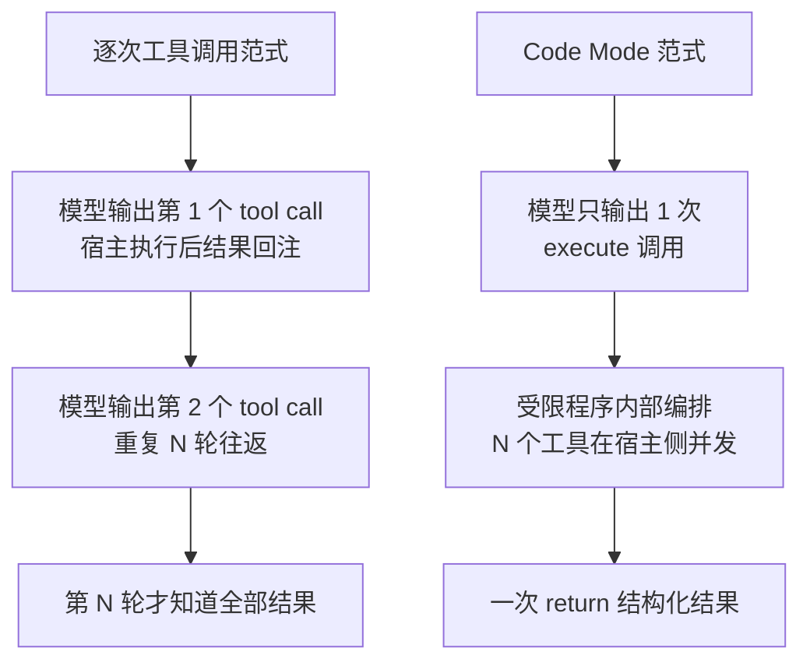
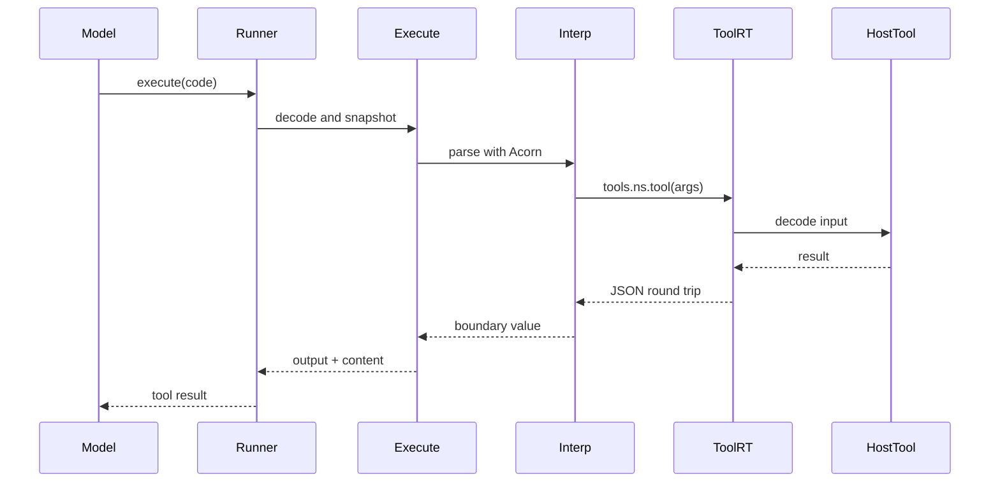

基线：opencode `v2.0.11` 的 `packages/codemode`；下文引用一律为「仓库相对路径 + 行号」，可点开源码核对。

## 根本问题：每次工具调用都要回到模型

Agent 主循环的纪律是硬的：一次 Physical Attempt 恰好一次 `llm.stream`，编排不许下沉到内存里的 tool loop。

[AGENTS.md:185-185]()
<!-- anchor: - Preserve one explicit `llm.stream(request)` call per Physical Attempt and ... - Preserve one explicit `llm.stream(request)` call per Physical Attempt and -->

这条纪律换来的是可恢复、可持久化、可重放的执行模型，代价也随之而来：只要模型一次只能发一个（或一批并列的）工具调用，那么"先查订单、再查库存、再按两者结果决定是否退款"就必须拆成多轮模型往返。每多一轮，就多一次完整的上下文重放、多一条持久工具调用记录、多一次 provider 缓存命中率波动。

Code Mode 是这个问题的一种非典型答案：**把编排搬进一次工具调用内部**。模型不再逐个调用工具，而是输出一段程序，程序里调用 `tools.<namespace>.<tool>(...)`。对主循环而言这仍然是"一次工具调用"，纪律没有被绕过；被压缩的是往返次数。

[specs/v2/tools.md:134-142]()
<!-- anchor: 4. Encodes the returned output with the output codec; the encoded value is ... When an output-bearing tool omits `content`, an encoded string becomes one -->

这段契约是 Code Mode 能成立的前提：工具响应里那个 schema 校验过的 `output` 是**短暂的机器值**，正是交给 Code Mode 的东西；`content` 才是面向模型、被持久化的那份。

包的自我定位很克制——"schema 描述的工具之上的受限代码执行"，注意限定词是 confined，不是 sandboxed：

[packages/codemode/package.json:5-5]()
<!-- anchor: "description": "Effect-native confined code execution over schema-described tools", -->

[packages/codemode/README.md:3-9]()
<!-- anchor: This is our take on code mode: a lightweight, pure interpreter for ... world only through tools provided by the host, which can also limit execution -->

README 讲得很直白：它不试图沙箱化任意 JavaScript，而是**只运行自己实现的语言特性**。这条自我限制是整个安全模型的地基，后文会验证它是否真的成立。

## 两种范式的对照

| 维度 | 逐次工具调用 | Code Mode |
| --- | --- | --- |
| 模型往返 | N 个工具 = N 轮，每轮都重放上下文 | 固定 1 轮：一次 `execute` 调用 |
| token 成本 | 每个工具定义常驻请求，工具结果逐轮累积 | 工具清单走可预算的内联目录 + `search` 分页，目录按变更增量下发 |
| 可组合性 | 组合逻辑在模型脑子里，跨轮靠上下文传递 | 组合逻辑在程序里：`Promise.all`、`try/catch`、循环、数据变换 |
| 可观测性 | 每轮一条工具调用记录，天然分散 | 单次调用内含 `toolCalls` 数组与实时进度行，失败也保留已接纳调用 |
| 错误恢复 | 工具失败 = 一轮失败，模型重新规划 | 程序内 `try/catch` 就地降级；只有解析、超时、输出裁剪在程序外 |

"固定 1 轮"不是理论值：`execute` 就是一个普通工具，注册名固定为 `execute`，名字被注册表保留，任何直接工具都不许叫这个名字。

[packages/core/src/tool.ts:313-314]()
<!-- anchor: if (tool.options?.codemode === false && id === "execute") ... return new RegistrationError({ name: id, message: 'Tool name "execute" is -->

程序内并发是有意开放的：工具调用一发出就开始执行，是"受监督、只跑一次"的 promise；并发不设上限，但受时限与工具调用总数约束。

[packages/codemode/interpreter-support.md:204-206]()
<!-- anchor: - [x] Tool calls start eagerly and return supervised, run-once CodeMode promises. ... a function/program. -->

[packages/codemode/interpreter-support.md:35-40]()
<!-- anchor: - [x] Cooperative timeout, an optional total tool-call limit, output bounding, and unrestricted tool-call concurrency. ... expression match can still run long on a pathological pattern; the host regex engine has no interrupt hook. -->

注意最后一句是诚实披露的缺口：单次正则匹配可以跑很久，因为宿主正则引擎没有中断钩子。所有配额都是"合作式"的——超时只在解释器步骤之间检查。

## 解释器是什么：Acorn 解析 + 自研受限求值器

先澄清一个常见误解：这里没有 WASM、没有 Worker、没有嵌入的 JS 引擎。链路是 **Acorn 按最新 ECMAScript 解析 → 自己实现的树遍历求值器逐节点执行**。解析器只是前端，语义由这个包自己定义。

[packages/codemode/interpreter-support.md:17-18]()
<!-- anchor: - [x] JavaScript parsed with the latest syntax accepted by Acorn, then ... TypeScript-only syntax is rejected rather than stripped before execution. -->

Acorn 的配置也印证了"解析宽松、语义收紧"：按 `latest` 解析，允许顶层 `return`/`await`（后面套一层隐式 async 函数作用域），再交给白名单求值器。

[packages/codemode/src/interpreter/execute.ts:109-114]()
<!-- anchor: return parse(code, { ... locations: true, -->

这一步是理解全部"不支持"行为的钥匙：**TypeScript 语法不是被剥掉，而是被拒绝**。模型若输出类型注解，得到的是解析错误，而不是被静默容忍。

### 支持矩阵（摘自 interpreter-support.md，非推测）

| 能力面 | 状态 |
| --- | --- |
| 语句与控制流 | `for...of`/`for...in`/`for await...of`、`try/catch/finally`、`throw`、标签化 break/continue、switch、while/do-while 全支持 |
| 函数 | 声明/表达式/箭头、async、闭包、递归、默认参数、rest、解构参数；深度上限 10000 抛可捕获 `RangeError` |
| 回调 | Array/Map/Set/URLSearchParams/sort/字符串替换/`Array.from` 共用一条接受规则；不接受 tool 引用与游离的 `Promise` 静态方法 |
| 值 | 字面量、模板字符串、正则字面量、数组/对象字面量与展开、解构、`Map`/`Set`/`Date`/`RegExp`/`URL`/`Headers`/`Uint8Array` 均为活动对象 |
| 异步 | `Promise.all/allSettled/race/any`、`new Promise`、thenable 同化、`await` 让出一轮反应 |

不支持项同样是矩阵的一部分，且每一项都是真实缺口（矩阵中标记为 `[ ]`）：

[packages/codemode/interpreter-support.md:54-58]()
<!-- anchor: - [ ] BigInt literals and in-interpreter BigInt arithmetic; BigInt remains invalid at JSON-like host boundaries. ... - [ ] Getter and setter definitions in object literals. -->

[packages/codemode/interpreter-support.md:41-42]()
<!-- anchor: - [ ] Strict-mode early errors: duplicate parameter names, `yield` as an identifier, and a trailing comma after a ... rest parameter are accepted unless the program itself begins with -->

这里有个容易被忽略的细节：严格模式的早期错误**默认不检查**，除非程序自己以 `"use strict"` 开头。也就是说，重复参数名这类代码会被接受——这与"受限子集"的直觉相反，属于矩阵里公开承认的偏差。

### 不支持语法怎样失败

失败路径被设计成"可自我修复"：诊断里带被拒绝的节点类型、源码位置，以及一段面向模型的语言取向说明（而不是让模型去读整个矩阵）。

[packages/codemode/src/interpreter/model.ts:74-83]()
<!-- anchor: export const supportedSyntaxMessage = ... [supportedSyntaxMessage], -->

[packages/codemode/interpreter-support.md:504-505]()
<!-- anchor: - [x] Source locations on unsupported-syntax diagnostics. The diagnostic names the rejected node type and attaches a ... short orientation to the supported subset; this matrix is the full reference. -->

解析失败与运行时"用了不支持语法"是两种类别：前者由 Acorn 抛出、按名字归入 `ParseError`；后者是求值器主动抛出的 `SyntaxError` + `UnsupportedSyntax`，并附位置。

[packages/codemode/src/interpreter/errors.ts:60-63]()
<!-- anchor: if (error instanceof Error) { ... message: error.message, -->

## confined 的真实边界

这是安全上最需要验证的一条：**默认全局表**就是边界本身。整个默认面是一张显式表格，没有 `fetch`、`fs`、`require`、`import`、`process`、`globalThis`、`setTimeout`、`setInterval`、`eval`、`WebSocket`、`XMLHttpRequest`、`localStorage`。

[packages/codemode/src/interpreter/globals.ts:57-96]()
<!-- anchor: const table: Record<string, Factory> = { ... ...Object.fromEntries(errorTypes.map((type) => [type, <R>(ctx: Interpreter<R>) -->

这张表同时是"扩展全局名冲突检查"的输入：`CodeMode.make` 用它的键集合判断宿主扩展是否覆盖了内置名。

[packages/codemode/src/interpreter/globals.ts:100-100]()
<!-- anchor: export const globalNames: ReadonlySet<string> = new Set(Object.keys(table)) -->

| 默认可用 | 默认不可用 |
| --- | --- |
| `tools`、`search`、`Object`/`Array`/`Function`/`Math`/`JSON`/`console`/`Promise`/`Symbol`/`Number`/`String`/`Boolean`、`Date`/`RegExp`/`Map`/`Set`、`URL`/`URLSearchParams`/`Headers`、`Uint8Array`/`TextEncoder`/`TextDecoder`、URI 与 base64 助手、`crypto`、全部错误类型 | 网络（`fetch`/`WebSocket`/`XMLHttpRequest`）、文件系统、进程（`process`）、模块（`import`/`require`）、定时器（`setTimeout`/`setInterval`）、动态求值（`eval`）、宿主全局（`globalThis`）、存储（`localStorage`） |

三个值得写进结论的观察：

**其一，网络能力是宿主"显式赠予"的。**核心包把 `fetch` 作为扩展注入，这恰好符合包自己的教条——默认不可用，除非宿主刻意提供。

[packages/codemode/interpreter-support.md:465-466]()
<!-- anchor: Host functions a host opts in through `Extension.make({ name, globals })` and `CodeMode.make({ extensions })`. ... Nothing is exposed unless a host provides it; extension calls are not tool calls. -->

但把"赠予"与"策略"放在一起看，会发现一个尚未闭合的差距（详见 OpenAPI 之后的小节）：当前注入的 `fetch` 只有 30 秒超时，没有来源、方法、响应体大小的策略控制。

[packages/core/src/codemode/web.ts:13-20]()
<!-- anchor: const fetch = async (input: string | URL, init: Init = {}) => { ... const bytes = await response.bytes() -->

[packages/core/src/codemode/web.ts:40-40]()
<!-- anchor: export const extension = Extension.make({ name: "web", globals: { fetch } }) -->

**其二，`crypto`/`atob`/`btoa`/`Date` 是环境内置能力，不是 opt-in。**包的设计笔记明确主张这类东西应当"默认不可用"，但当前默认表里就包含它们。这不是漏洞级别的错，而是文档意图与实现之间的一处张力，值得在演进时对齐。

[packages/codemode/AGENTS.md:24-24]()
<!-- anchor: - Keep host capabilities explicit. Globals such as `fetch`, `crypto`, -->

**其三，解释器内部没有"逃逸口"。**求值器只暴露自己实现的宿主对象，任何原生 JS 反射对象都没有进入路径；这一点由两个设计支撑：工具路径用惰性引用累积（连 `constructor`/`prototype`/`__proto__` 这样的段名都只是惰性 Map 键），以及求值器对未知节点类型一律抛不支持。

[packages/codemode/interpreter-support.md:240-242]()
<!-- anchor: - [x] Dotted tool names are canonicalized into namespace paths; a path can be both callable and a namespace, and the ... - [x] Tool path segments may be named `constructor`, `prototype`, or -->

[packages/codemode/src/interpreter/interpreter.ts:2065-2070]()
<!-- anchor: if (objectValue instanceof ToolReference) { ... return new ToolReference([...objectValue.path, key]) -->

### 自保配额与跨边界转换

"合作式超时"意味着解释器不能靠超时解决单步爆炸，所以单步能构造的值必须有上限。这四个常量是那个上限的具体形态。

[packages/codemode/src/interpreter/limits.ts:3-13]()
<!-- anchor: // The timeout only fires between interpreter steps, so a single built-in must not be able to materialize an ... /** Deepest nesting a value may have when it crosses to or from the host. */ -->

跨界规则是"JSON.stringify 语义 + 一张短表"，而这张表恰好是模型最容易踩坑的地方（未 await 的 Promise 会失败并附 await 提示、Uint8Array 被拒绝并提示改用 `TextDecoder`、`__proto__` 被丢弃）。这份"可编程的诚实"比宽松的静默转换更有价值。

[packages/codemode/interpreter-support.md:21-30]()
<!-- anchor: - [x] The host boundary is `JSON.stringify` plus a short table. The program result and tool arguments cross as ... Error form and a promise, which is a `TypeError` with an await hint rather than a silent `{}`. -->

[packages/codemode/src/data.ts:63-75]()
<!-- anchor: if (value === undefined || typeofValue(value) === "function") return undefined ... if (stack.has(target)) throw typeError("Converting circular structure to JSON.") -->

[packages/codemode/src/data.ts:86-97]()
<!-- anchor: // Own data property regardless of the key, so "__proto__" never reaches the Object.prototype setter. ... if (boundary && name === "__proto__") continue -->

`Uint8Array` 是唯一的二进制类型，且**工具边界拒绝它**；这是一条"刻意的窄边界"，而不是遗漏。

[packages/codemode/interpreter-support.md:432-433]()
<!-- anchor: The only binary type. Bytes stay inside the program or cross to extensions as copies; the tool boundary rejects them ... with a hint to encode as text first (`TextDecoder`, `toBase64`, `toHex`). -->

### 未 await 的 promise 不会被放过

有一个细节值得单独说：程序结束时仍在跑的工作会被中断，而"已经落地但没人等"的拒约会变成 `Success.warnings` 而不是被吞掉——这让"忘了 await"从静默数据丢失变成可见诊断。

[packages/codemode/interpreter-support.md:223-226]()
<!-- anchor: - [x] All still-pending work (race losers, fail-fast `Promise.all` stragglers, and un-awaited calls alike) is ... without a warning. -->

[packages/codemode/src/interpreter/promises.ts:63-66]()
<!-- anchor: const failure = normalizeError(Cause.squash(exit.cause)) ... message: `Unhandled rejection from an un-awaited promise: ${failure.message}`, -->

[packages/codemode/src/interpreter/promises.ts:45-48]()
<!-- anchor: if (this.active.size >= MAX_PENDING_PROMISES) { ... `Too many pending promises (limit ${MAX_PENDING_PROMISES}); await promises before creating more.`, -->

## 工具怎样变成语言里的函数

模型看到的是 TypeScript 风格签名，宿主提供的是 schema；两者之间是一层纯渲染。关键设计判断是：**JSON Schema 只塑造"模型可见的签名"，CodeMode 不拿它校验运行时值**。

[packages/codemode/src/tool.ts:6-7]()
<!-- anchor: * JSON Schema subset for model-visible signatures. CodeMode does not validate values against ... * these schemas. -->

签名是惰性渲染的——只有被 `search` 真正返回或目录真正消费的工具才需要付渲染成本，这在工具数量大时是决定性的。

[packages/codemode/src/tool-runtime.ts:169-181]()
<!-- anchor: const describeTool = <R>(visible: VisibleTool<R>): ToolDescription => { ... ].join("")) -->

渲染纪律里最值得学的一条是**不臆造名字**：无法解析的 `$ref`、超出渲染深度的结构，一律降级为 `unknown`，而不是编一个看起来合理的类型名。

[packages/codemode/src/tool-schema.ts:203-213]()
<!-- anchor: export const toTypeScript = (schema: Schema.Top, decoded = false, pretty = false): string => { ... return "unknown" -->

[packages/codemode/src/tool-schema.ts:261-274]()
<!-- anchor: export const inputTypeScript = <R>(tool: Tool<R>, pretty = false): string => ... : jsonSchemaToTypeScript(tool.output, pretty) -->

### 命名、路径与冲突

工具树用点号分段：`a.b.c` 进入代码就是 `tools.a.b.c`；非标识符段用括号记法。同名冲突的规则只有一句"规范路径下最后一个工具获胜"，而"某个路径既是一个可调用工具、又是一个命名空间"这种别扭情况由宿主侧渲染器显式处理。

[packages/core/src/codemode/tool.ts:250-294]()
<!-- anchor: function renderTools(root: ToolNode) { ... for (const [name, child] of node.children) flattenTools(child, [...path, name], tools) -->

调用的解析是**惰性**的：读取 `tools.a.b` 只是累积路径，不校验存在性；真正报 `UnknownTool` 是在调用那一刻。这带来一个实用性质——程序可以遍历/探测工具树而不触发错误，前提是不要调用。

[packages/codemode/src/interpreter/interpreter.ts:1591-1605]()
<!-- anchor: // The single dispatch for every invocation: call expressions and callbacks share it. ... return yield* self.createToolCallPromise(callable.path, args) -->

[packages/codemode/src/interpreter/interpreter.ts:1563-1580]()
<!-- anchor: // EvaluateCall: a member callee supplies its base object as `this`; anything else calls with undefined. ... return yield* self.call(callable, thisValue, args, node, callee) -->

一个真实存在的行为陷阱：对未 await 的 Promise 取任意属性会直接失败并给出 await 提示，而不是返回 `undefined`。这是把"忘了 await"从隐性 bug 变成显式错误的又一例。

[packages/codemode/src/interpreter/interpreter.ts:2092-2100]()
<!-- anchor: private readReference(reference: MemberReference, node: MemberExpression): unknown { ... return this.readProperty(reference.target, reference.key, node, reference.receiver) -->

### 宿主侧：目录预算与进度

内联工具目录不是"全量清单"，而是**有预算的摘要**：约 2000 token 的预算、按 4 字符/token 估算、描述截断，先保证每个命名空间都露面，再按"每轮每命名空间一个"补全最短的条目；被 `pinned` 的工具优先保留。

[packages/core/src/codemode/catalog.ts:48-56]()
<!-- anchor: const DESCRIPTION_LIMIT = 120 ... const flattened = flatten(inventory.tools) -->

[packages/core/src/codemode/catalog.ts:79-89]()
<!-- anchor: const pinned = new Set( ... selectionOrder: ranked.filter((candidate) => !pinned.has(candidate.listing)), -->

[packages/codemode/README.md:152-154]()
<!-- anchor: `value` is JSON-safe. `warnings` are non-fatal diagnostics, `logs` contain program console output, and `truncated` ... failure. -->

目录没列全时，指令会明说"这是 partial"，并把 `search` 的精确签名一并给出——把发现能力作为提示的一部分交付，而不是让模型猜。

[packages/core/src/codemode/instructions.ts:21-32]()
<!-- anchor: export function render(catalog: CodeModeCatalog.Summary) { ... ${tools.join("\n")} -->

工具调用的可观测性落在两处：结果里的 `toolCalls`（失败也保留已接纳调用，含 running/completed/error 状态），以及宿主进度回调——TUI 里为每个工具调用开一行，唯一例外是 `fetch`（它被当作扩展而不是工具）。

[packages/codemode/src/codemode.ts:84-90]()
<!-- anchor: export const Diagnostic = Schema.Struct({ ... /** A normalized program diagnostic safe to return across an agent tool boundary. */ -->

## OpenAPI：宁可 skipped，也不猜

OpenAPI 适配器的设计立场可以一句话概括：**只生成能正确执行的接口，其余全部进 `skipped` 并给出精确原因**。这不是保守，而是承认"猜错了的序列化"比"没有这个工具"危害更大。

[packages/codemode/AGENTS.md:12-14]()
<!-- anchor: - Generate an operation only when its transport semantics are supported; ... - Render unresolved schema constructs as `unknown`, never as invented -->

证据在参数规划里：cookie 参数、未知 location、既无 schema 又无 content、`content` 编码、非法 style/explode/allowReserved、`allowReserved=true`、查询参数的非 form/deepObject style、`deepObject` 配 `explode=false`——每一种都有各自的 skip 文案，没有一种是"其它情况"。

[packages/codemode/src/openapi/spec.ts:340-372]()
<!-- anchor: if (location === "cookie") return { ok: false, reason: `cookie parameter ... return { ok: false, reason: `query parameter '${name}' uses deepObject -->

运行时侧同样是"先校验、后取凭据"：输入不合法根本不会触碰认证解析；如果所有备选安全方案都拿不到凭据，失败信息会列出缺哪些方案。路径参数还额外防了 `..` 归一化重定向。

[packages/codemode/src/openapi/runtime.ts:117-152]()
<!-- anchor: const resolveAuth = (plan: Plan): Effect.Effect<AppliedAuth, unknown> => ... `${plan.operation.method} ${plan.operation.path} requires authentication; -->

[packages/codemode/src/openapi/runtime.ts:200-224]()
<!-- anchor: const buildUrl = (plan: Plan, input: Readonly<Record<string, unknown>>): string | ToolError => { ... return url -->

网络读取是有界的：总响应体上限 50 MiB，且声明长度先判、流式读取时再判一次。

[packages/codemode/src/openapi/runtime.ts:302-309]()
<!-- anchor: if (declaredSize !== undefined && declaredSize > maxResponseBodyBytes) { ... return Effect.fail(toolError(`${plan.operation.method} ${plan.operation.path} -->

### 两个诚实标注

**标注一：这个适配器在 v2.0.11 没有被 core 接线。**core 只从 `@opencode/codemode` 取用了受限执行、命名空间、工具、错误、签名渲染与扩展这几块；仓库内未见任何包调用 `OpenAPI.fromSpec`。它更像是"能力先于宿主就位"。

[packages/core/src/codemode/instructions.ts:3-3]()
<!-- anchor: import { searchSignature, toolExpression } from "@opencode/codemode" -->

[packages/core/src/codemode/web.ts:3-3]()
<!-- anchor: import { Extension } from "@opencode/codemode" -->

**标注二：`fetch` 的赠予缺策略控制。**包的设计笔记要求把 `fetch` 建模为"带策略控件的宿主出站能力"（允许的来源、方法、头部、响应体大小、超时、响应体是否可返回）；当前实现只有 30 秒 `AbortSignal` 超时，且一次性 `response.bytes()` 读完整包体，没有大小上限，也没有来源/方法白名单。

[packages/codemode/AGENTS.md:25-25]()
<!-- anchor: - If `fetch` is added, model it as a host-provided outbound capability with policy controls: -->

## 失败分类学：程序内故意坍缩，宿主侧仍是公开缺口

这里必须区分两个观察面，否则很容易得出相反结论。

**在程序内部，坍缩是刻意的。**`catch` 里拿到的是同一个 Error 形状的值——不管是用户 `throw`、解释器失败还是工具失败。设计意图写得明明白白：程序应当用同一种方式处理失败。

[packages/codemode/interpreter-support.md:507-509]()
<!-- anchor: - [x] Caught errors do not distinguish user throws, interpreter failures, and tool failures; a program sees one ... This is deliberate: the program should handle a failure the same way regardless of where it originated. -->

同时，程序内能捕获的范围也有明确边界：用户 `throw`、求值期运行时失败、已 await 的工具失败与工具调用上限失败可被捕获；解析/编译失败、合作式超时、输出裁剪在程序 `catch` 之外。

[packages/codemode/interpreter-support.md:501-503]()
<!-- anchor: - [x] Catchable user throws, runtime failures raised during interpreted evaluation, awaited tool failures, and awaited ... `catch`. -->

**在宿主/模型边界上，分类学已经存在，但不够细。**`Diagnostic.kind` 有 11 个取值，覆盖了解析、语法、未知工具、输入/输出/数据非法、调用上限、超时、工具失败、执行失败、裁剪。

[packages/codemode/src/codemode.ts:68-79]()
<!-- anchor: export const DiagnosticKind = Schema.Literals([ ... "Truncated", -->

包自己的文档也把 `ToolFailure` 解释为"工具拒绝或失败"——也就是说，**拒绝与内部失败共用同一类别**。

[packages/codemode/README.md:156-170]()
<!-- anchor: Diagnostic kinds: ... | `Truncated` -->

归一化逻辑是这处坍缩的机制所在：`ToolError` 一律变 `ToolFailure` 且只保留 message；任意 `Throw` 变 `ExecutionFailure`；工具执行期的非中断失败被拼成一条 `toolError`（含 prettyErrors），原始 cause 不进入模型可见诊断。

[packages/codemode/src/interpreter/errors.ts:24-33]()
<!-- anchor: if (error instanceof ToolRuntimeError) { ... return { kind: "ToolFailure", message: error.message } -->

[packages/codemode/src/interpreter/errors.ts:36-50]()
<!-- anchor: if (error instanceof Throw) { ... return { kind: "ExecutionFailure", message: `Uncaught: ${message}` } -->

[packages/codemode/src/tool-runtime.ts:385-421]()
<!-- anchor: const normalized = args.length === 0 ? [{}] : args ... catch: (cause) => new ToolRuntimeError("InvalidToolOutput", -->

| 期望区分（包的设计笔记） | 当前对应的 kind | 差距 |
| --- | --- | --- |
| 解析/编译错误 | `ParseError` | 已区分 |
| 不支持的语法 | `UnsupportedSyntax` | 已区分，且带位置与建议 |
| 用户 `throw` | `ExecutionFailure` | 与"真正的运行时缺陷"混在一起，只有 message 前缀 `Uncaught:` 可辨 |
| 返回数据非法 | `InvalidToolOutput`/`InvalidDataValue` | 已区分 |
| 工具拒绝（如权限/策略拒绝） | `ToolFailure` | **与工具内部失败合并** |
| 工具内部失败 | `ToolFailure` | **与拒绝合并**，且宿主 cause 被折叠进 message |
| 超时 | `TimeoutExceeded` | 已区分，但同一 kind 有两种语义（失败 / 成功但后台被中断的警告） |
| 真正的运行时缺陷 | `ExecutionFailure` | **与用户 throw 合并** |

这张差距表并非本文的推断，而是包的设计笔记明确列出的改进目标。

[packages/codemode/AGENTS.md:21-21]()
<!-- anchor: - Improve the failure taxonomy. Distinguish parse/compile mistakes, -->

配套地，笔记还要求保留宿主失败消息与底层 cause，并继续保持中断语义不被吞掉。

[packages/codemode/AGENTS.md:20-20]()
<!-- anchor: - If a captured user-visible output channel returns (an earlier `output.text` -->

顺带纠正一个过时印象：`output.text`/`output.file`/`output.image` 这类捕获式输出通道**已在 v1 移除**，`return` 才是交给模型的结构化结果；媒体产物由宿主在 CodeMode 之外收集。当前实现里 `return` 的契约就是 `Result`（`ok` 分支带 `value`/`warnings`/`logs`/`truncated`/`toolCalls`）。

[packages/codemode/README.md:187-193]()
<!-- anchor: | Limit ...  Execution limits have no default values. -->

## 与 MCP 的互斥：避免 Code Mode 套 Code Mode

存在两种不同的互斥机制，动机相同但作用层次不同。

**机制一：插件级排除。**对已经自带 Code Mode 的 MCP 服务（本地 `executor mcp` 与 `executor.sh` 端点），插件把 `codemode` 置为 `false`，让它们直接暴露，而不是再嵌一层。

[packages/core/src/plugin/mcp-codemode-exclusion.ts:6-22]()
<!-- anchor: // These servers provide Code Mode, so expose them directly instead of nesting them inside OpenCode Code Mode. ... if (urls.some((pattern) => pattern.test(endpoint))) server.codemode = false -->

**机制二：协议参数协商。**对远端 MCP，若配置未显式关闭 Code Mode，客户端会带上 `?codemode=false`，请求服务端返回原始工具；若服务端拒绝该参数（400/404），则退回配置 URL 重试一次。URL 本身仍是 OAuth 身份，不被查询参数污染。

[packages/core/src/mcp/client.ts:214-218]()
<!-- anchor: // Servers that bundle their own Code Mode (Cloudflare and others) expose raw tools when asked ... if (addedCodemode) url.searchParams.set("codemode", "false") -->

配置面是 per-server 的：`codemode` 默认 true，即默认进 Code Mode；关闭后工具回到 provider 原生工具列表。

[packages/schema/src/mcp.ts:34-35]()
<!-- anchor: codemode: Schema.Boolean.pipe(optional).annotate({ ... description: "Expose this server's tools through Code Mode. Defaults to true.", -->

用户可感知的后果有三点：其一，默认情况下 MCP 工具不在原生工具列表里，必须经 `execute` 调用；其二，当会话根本无权 `execute` 时，Code Mode 型服务器的说明会被整体隐藏（避免给出无法执行的指引）；其三，工具级权限仍然生效，被禁用的服务器工具不会被列出。

[packages/core/src/mcp/instructions.ts:84-90]()
<!-- anchor: const canExecute = Permission.evaluate("execute", "*", permissions).effect !== "deny" ... if (codemode && !canExecute) return [] -->

值得一提的是，Code Mode **不是**实验特性：实验配置项里只有 shell 权限扫描、子代理深度与策略三项。

[packages/schema/src/config/experimental.ts:7-15]()
<!-- anchor: export class Info extends Schema.Class<Info>("ConfigExperimental.Info")({ ... description: "Ordered policies controlling access to configured resources", -->

## host 中立性：一个能力包，与填空的宿主

包对自身职责的界定非常清晰，这是它可复用的前提：它只拥有"对显式 schema 工具做受限执行"；授权、持久化、外部权威与工具特有的投递语义属于应用。

[packages/codemode/AGENTS.md:3-8]()
<!-- anchor: - This local package owns confined execution over explicit schema-described tools. ... - When interpreter behavior or support changes, update `interpreter-support.md` -->

它甚至明确规定**不要**加通用的权限/审批策略：宿主要么不提供某个工具，要么在工具内部执行领域授权。

[packages/codemode/README.md:16-24]()
<!-- anchor: - **Only supported APIs are available.** Programs can use the provided tools, supported JavaScript built-ins, and the ... [interpreter support checklist](./interpreter-support.md). -->

宿主（core）填的空正好对应权威划分：公共形状归 schema、运行时行为归 core。

[specs/v2/README.md:9-13]()
<!-- anchor: | Concern ... | Runtime behavior and persistence -->

| 关注点 | 归属 | 具体形态 |
| --- | --- | --- |
| 工具形状（`codemode`/`pinned`） | `packages/schema` | `Options` 联合类型：`codemode?: true` 时可 `pinned`，显式布尔时不可 |
| MCP 配置 | `packages/schema` | per-server `codemode` 默认 true |
| 工具到 Code Mode 的分流 | `packages/core` | `codemode === false` 进原生列表，其余进 Code Mode 清单；`execute` 也受权限规则约束 |
| 目录与指令 | `packages/core` | 预算化目录、partial/complete 措辞、增量更新 |
| 会话上下文注入 | `packages/core` | 与内置、发现、技能、MCP 说明一起组合 |
| 出站网络能力 | `packages/core` | 以 `web` 扩展注入 `fetch` |
| 授权与持久化 | 各工具 + runner | 包不参与 |

[packages/schema/src/tool.ts:32-40]()
<!-- anchor: export type Options = BaseOptions & ... readonly pinned?: never -->

[packages/core/src/tool.ts:234-245]()
<!-- anchor: const direct = new Map(Array.from(active).filter(([, tool]) => tool.options?.codemode === false)) ... : undefined -->

[packages/core/src/session/context.ts:147-154]()
<!-- anchor: instructions: Instructions.combine([ ... loaded.entries, -->

对照一个"直接暴露"的工具形态会更清楚：读取文件的工具显式声明 `codemode: false`，因此留在 provider 原生列表上，并使用 `FileAccess` 做授权——这正好演示了"授权在工具内部、不在 Code Mode 里"的分工。

[packages/core/src/tool/plugin/read.ts:40-44]()
<!-- anchor: editor.add({ ... "Read the contents of a file or directory. Supports text files, images, -->

[packages/core/src/tool/AGENTS.md:33-33]()
<!-- anchor: Built-ins, plugins, and MCP install tools through `Tool.Service.transform`, -->

## 连回整体设计哲学

**工具系统的可扩展性，在这里换了一种解法。**朴素的可扩展性靠"暴露更多工具"；Code Mode 的解法是"把工具列表变成可预算、可分页、可增量的接口"。内联目录控住常驻成本，`search` 承接长尾发现，目录变更走增量指令——工具数量增长时，模型侧的成本不再是线性的。

[packages/core/src/codemode/catalog.ts:79-89]()
<!-- anchor: const pinned = new Set( ... selectionOrder: ranked.filter((candidate) => !pinned.has(candidate.listing)), -->

**它与"事件即事实"和"准入/执行分离"是同一套思路的延伸。**每个工具调用仍被逐个接纳（受 `maxToolCalls` 约束、逐个记录、逐个进入进度行），程序只是把"决策顺序"从模型轮次里搬进了受限求值；一次 `execute` 调用内部的 N 次调用不会消失，而是变成可观测的、有序的 `toolCalls`。

[packages/codemode/interpreter-support.md:95-101]()
<!-- anchor: - [x] `for...of` over arrays, strings, Maps, Sets, URLSearchParams, Headers, Uint8Arrays, built-in iterators, custom ... - [x] Labeled statements, labeled `break`, and labeled `continue`. -->

**它与 Effect 的语义对齐得也相当刻意。**求值步骤是 Effect，工具调用是 fork 出来的受监督 fiber，中断不可被程序 `catch` 吞掉，宿主失败与缺陷的边界因此保持干净。

[packages/codemode/interpreter-support.md:110-116]()
<!-- anchor: - [x] Function declarations, function expressions, and arrow functions. ... as recursive pagination are unaffected. -->

[packages/codemode/src/extension.ts:4-6]()
<!-- anchor: * Host functions a program calls directly as globals. Values crossing in either direction are converted, never ... * same way. Extension calls are not tool calls. -->

**最重要的一个设计判断，是把"受限"定义为能力清单，而不是沙箱承诺。**因为不运行任意 JavaScript，"默认没有逃逸面"是可验证的断言而不是经验判断；代价则是语言子集必须自己维护（矩阵中每一项 `[ ]` 都是真实成本），以及 TypeORM 式的生态复用在语法层面被主动放弃。

[packages/codemode/src/interpreter/execute.ts:60-79]()
<!-- anchor: Effect.timeoutOrElse({ ... message: `The program returned, but background work was still running at t -->

[packages/codemode/src/codemode.ts:68-79]()
<!-- anchor: export const DiagnosticKind = Schema.Literals([ ... "Truncated", -->

**遗留的三件事**，按影响排序：一是失败分类学的细化（工具拒绝 vs 内部失败、用户 throw vs 运行时缺陷、保留宿主 cause），这是包自己列出的第一号改进目标；二是 `fetch` 的策略控制（来源/方法/大小/响应体处置），当前赠予过宽；三是 OpenAPI 适配器尚未接入宿主，属"能力已就位、调用方未就位"。

[packages/codemode/AGENTS.md:21-21]()
<!-- anchor: - Improve the failure taxonomy. Distinguish parse/compile mistakes, -->

[specs/v2/tools.md:167-177]()
<!-- anchor: ## Laws ... - **Storage encapsulation:** domain output does not change according to -->

最后，Code Mode 并没有绕开 `specs/v2` 定义的工具契约，而是落回同一个契约：一次工具调用仍然只有一个 `execute`、仍然区分"工具观察到的解码输入"与"Code Mode 观察到的校验后编码输出"、仍然遵守单一执行与存储封装这些定律。它改变的是编排发生在哪一层，而不是工具语义本身。

[specs/v2/tools.md:134-142]()
<!-- anchor: 4. Encodes the returned output with the output codec; the encoded value is ... When an output-bearing tool omits `content`, an encoded string becomes one -->
