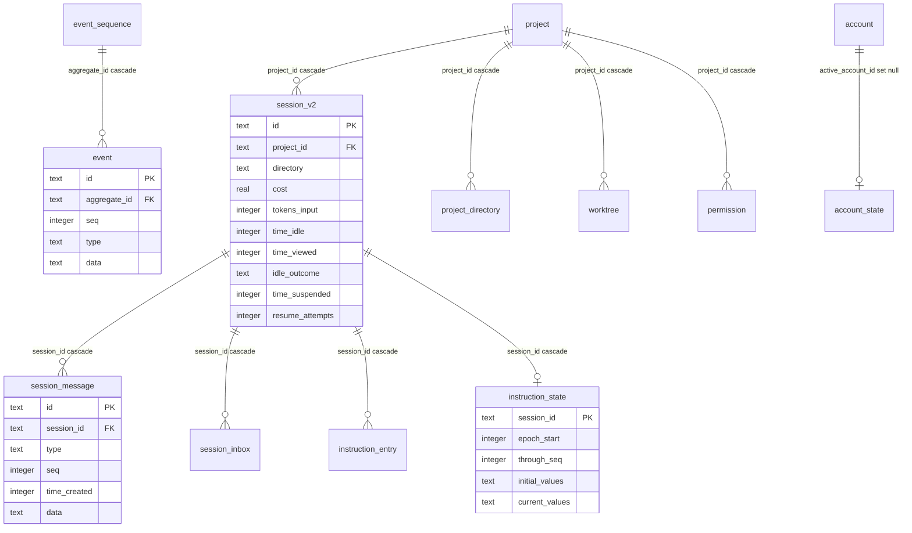
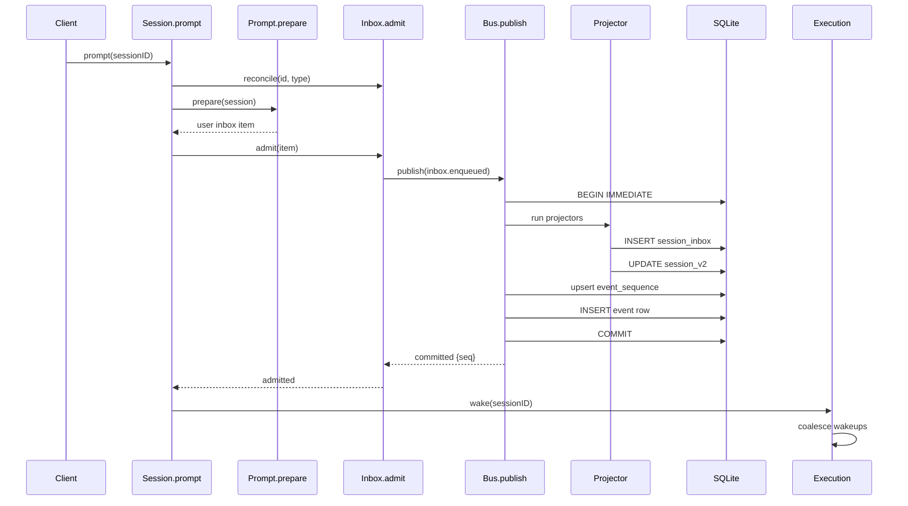
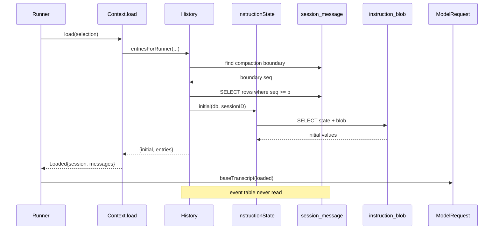

## 根因：一次不可靠的模型调用，为什么需要一个账本

把一个"会中断、会超时、上下文有限"的模型调用编排成"可持久、可恢复、可观测"的长会话，需要同时满足两个互相拉扯的诉求：**恢复需要一份权威的、有序的、不可篡改的历史**；**读取需要便宜**——每次装配请求都从头折叠一遍历史，代价随会话长度线性增长。 opencode v2 的答案是二分的：一份 append-only 的 durable event log 当账本，一组可重放的投影表当视图，读取只碰视图。这条分界不是文档里的口号，而是可以直接从 schema 和事务边界上读出来的工程事实。项目自己的语义契约把结论写得很直白：不存在一个独立的"有限历史"端点，请求/响应用的消费者读投影，重放消费者才读 durable log。[specs/v2/session.md:106-112]()
<!-- anchor: ## Durable Events Are Session-Scoped … There is no separate finite Session-history endpoint. Reques -->
而在架构分工上，Core 负责"事件的含义、发布、持久化、类型化观察、durable log、重放与事务性投影"这一整条链路，Server 只负责公共事件的选择、线上编码、有界下发与订阅者生命周期。[specs/v2/event-stream-architecture.md:25-29]()
<!-- anchor: Core owns event meaning, publication, persistence, typed obs … Protocol continues to own the `OpenCodeEvent` SSE contract.  -->
这里的"事务性投影"（transactional projection）是本文的核心线索：投影不是异步追赶的物化视图，而是与事件落库**同一个事务**内的同步写入。这决定了整套数据模型的形态——视图永远不落后于账本，因此读路径可以放心地完全不碰账本。

## 账本与视图：这条线画在哪儿

### 账本：`event` 与 `event_sequence`

账本只有两张表。`event_sequence` 是按聚合根（aggregate）维护的序号游标：`aggregate_id` 主键、`seq` 当前已分配到的最大序号、`owner_id` 可空的写入所有者。[packages/core/src/database/schema.gen.ts:54-57]()
<!-- anchor: CREATE TABLE \`event_sequence\` ( … \`owner_id\` text -->
`event` 是事实本体：事件 id 主键、`aggregate_id` 外键指向 `event_sequence` 并在删除时级联、`seq`、`created`、`type`、以及一个 **不透明的 JSON 文本** `data`。[packages/core/src/database/schema.gen.ts:61-67]()
<!-- anchor: CREATE TABLE \`event\` ( … \`data\` text NOT NULL, -->
Drizzle 侧的声明与之一一对应，并且只建了两个索引：`(aggregate_id, seq)` 唯一索引和 `(aggregate_id, type, seq)` 查询索引。[packages/core/src/event/sql.ts:10-23]()
<!-- anchor: export const EventTable = sqliteTable( … uniqueIndex("event_aggregate_seq_idx").on(table.aggregate_id -->
`owner_id` 的设计意图值得单说：它允许同一个聚合根的事件流被"接管"。发布时如果已有 owner 且与传入 owner 不符，会直接以 `Replay owner mismatch` 失败；如果 owner 为空而调用方声明了 owner，则把这个聚合根的所有权**补写**进 `event_sequence`。[packages/core/src/bus.ts:337-368]()
<!-- anchor: if (input && input.seq <= latest) { … if (input && row?.ownerID && row.ownerID !== input.ownerID)  -->
这套机制是后续多宿主（本机进程与外来的日志追平）共享一份会话历史的对齐基础，而不是本机多线程的锁——本机多进程的串行化另有安排。

### 视图：五张表加一个外置对象库

投影表按"给谁看"分成几层，每一层都是某个事件的直接折叠结果：

| 视图表 | 由什么事件折叠而来 | 读者 |
|--------|-------------------|------|
| `session_v2` | `session.created` / `session.moved` / `session.renamed` / `session.usage.*` / `session.execution.*` | 列表、恢复扫描、UI 概览 |
| `session_message` | `session.message.content.updated`、`session.text.ended`、工具调用与结算事件、`session.inbox.delivered` | 模型请求装配、会话详情 |
| `session_inbox` | `session.inbox.enqueued` | 调度器决定"下一步做什么" |
| `instruction_entry` / `instruction_state` | `session.instructions.updated` | 指令增量渲染 |
| `instruction_blob` | 由 `instructions.updated` 的 `commit` 钩子随事务写入 | 内容寻址的旧值回溯 |

另有一个既不在 SQLite、也不算"投影"但同样承载派生状态的东西：**快照**。文件级历史被写成 `Global.data/snapshot/<projectID>/<hash(worktree)>` 下一个独立 git 仓库，`worktree` 是真实工作树，`gitDirectory` 是仓库自己的目录。[packages/core/src/snapshot.ts:95-97]()
<!-- anchor: const gitDirectory = AbsolutePath.make( … path.join(global.data, "snapshot", location.project.id, Hash -->
这是个刻意的取舍：diff/恢复需要 git 的对象模型与内容寻址，用 SQLite 表重建这套语义远不如直接复用一个 git 仓库划算。代价是持久层被劈成两半——**结构化状态在 SQLite，文件状态在 git 对象库**，"删库即清空一切"的直觉不再成立。

### 投影器长在 append 事务里

这是本模块最该被记住的一段。`Bus` 的持久化路径是：先取当前 `seq` 与 owner，校验通过后进入 `db.transaction(...)`，在**同一个事务内**先按序跑完该事件类型注册的全部 projector，然后才 upsert `event_sequence` 并插入 `event` 行。[packages/core/src/bus.ts:314-435]()
<!-- anchor: const list = projectors.get(versionedType(definition.type, d … .pipe(Effect.orDie) -->
projector 列表在事务开始前就按"版本化类型"取好：`versionedType(definition.type, durable.version)`。[packages/core/src/bus.ts:314-320]()
<!-- anchor: const list = projectors.get(versionedType(definition.type, d … Effect.gen(function* () { -->
真正落账本的那一步是普通的 upsert 加 insert：`event_sequence` 用 `max(seq, ?)` 单调推进，`event` 行写入 id、aggregate、seq、created、type 与编码后的 data。[packages/core/src/bus.ts:416-431]()
<!-- anchor: if (persist) … return { aggregateID, seq, event: committed, route } -->
它也提供了一条逃生通道：`PublishOptions.commit` 允许调用方在同一个事务里追加一个"局部操作型投影"——文档注释明确写着它**不被重放、不被序列化**。指令 blob 的写入用的就是它。[packages/core/src/session/instruction-state.ts:41-60]()
<!-- anchor: instructions: Instructions.List, … commit: () => insertBlobs(db, observation.blobs), -->
被放弃的替代方案很清楚：projector 跑在事务外、失败后异步重试。那样能缩短写锁持有时长，但会引入"账本已提交、视图未更新"的中间窗口，读路径就不得不处理陈旧视图，或者退化成"读不到就重放事件"。opencode 选择了强一致：**投影失败等于事件没有发生**，整笔回滚。代价是所有投影逻辑都被拉进了写路径的关键区，投影器的每一次查询都在延长写事务。

### core 本地库的 ER 图

图里没画的还有三处松耦合：`instruction_blob` 是独立的内容寻址表（只有 `hash` 主键与 `value`，不挂外键），`worktree` 与 `project_directory` 在 v2.0.11 是并存的新旧两代表（前者是现行实现，后者标注为 deprecated），`kv` 与 `credential`/`account` 完全不参与事件溯源。

## 核心表逐张字段

### `event` 与 `event_sequence`：只 append 的事实

| 字段 | 类型 | 约束 | 语义 |
|------|------|------|------|
| `id` | text | PRIMARY KEY | 事件身份。重复写入同一 id + 相同 type/created/data 会被识别为幂等重放而静默返回；内容不一致则判为 `Replay diverged` 直接 die |
| `aggregate_id` | text | NOT NULL, FK → `event_sequence.aggregate_id`, ON DELETE CASCADE | 聚合根。绝大多数是会话 id，另有 worktree 解析事件 |
| `seq` | integer | NOT NULL, UNIQUE(`aggregate_id`,`seq`) | 聚合内严格递增序号。它同时是投影表 `seq` 列的唯一合法来源 |
| `created` | integer | NOT NULL, DEFAULT 0 | 事件创建时间（epoch ms）。注意 DEFAULT 0 而非 `Date.now()`：反序列化时缺时间就是 0 |
| `type` | text | NOT NULL | 版本化类型串，由 `versionedType(type, version)` 生成 |
| `data` | text | NOT NULL（JSON） | 事件载荷。**没有任何一列是从 data 提升出来的**——账本刻意保持"薄" |

| 字段 | 类型 | 约束 | 语义 |
|------|------|------|------|
| `aggregate_id` | text | PRIMARY KEY | 聚合根 id |
| `seq` | integer | NOT NULL | 已分配到的最大序号；`max(seq, ?)` 单调推进，绝不回退 |
| `owner_id` | text | 可空 | 事件流的写入所有者，用于接管时的 fencing |

账本之所以只要两个索引，是因为它的访问模式被限定为"按聚合根顺序读"：`latestSequence` 就是一次按 `(aggregate_id, seq)` 的点查，读不到返回 -1 表示空流。[packages/core/src/bus.ts:21-31]()
<!-- anchor: export const latestSequence = Effect.fn("Bus.latestSequence" … return row?.seq ?? -1 -->

### `session_v2`：会话主视图（提升列最密集的一张表）

`SessionTable` 的声明里，字段可以明显分成三组。**身份与位置**：`id` 主键、`project_id` 外键级联、可空的 `workspace_id`、`parent_id`、`fork_session_id`、`fork_boundary`、`slug`、`directory`、`path`、`title`、`version`、`share_url`。[packages/core/src/session/sql.ts:22-30]()
<!-- anchor: export const SessionTable = sqliteTable( … workspace_id: text().$type<Workspace.ID>(), -->
**从事件里折叠出来的累计量**：`cost`、`tokens_input` / `tokens_output` / `tokens_reasoning` / `tokens_cache_read` / `tokens_cache_write`、`summary_additions` / `summary_deletions` / `summary_files` / `summary_diffs`。这些值全部可以由 `session.step.ended` 事件重算，视图却把它们物化下来——因为每次读都重算一遍的代价是 O(事件数)，而视图存在的意义就是便宜。
**执行与可观测时间戳**：`time_idle`、`time_viewed`、`idle_outcome`、`time_compacting`、`time_archived`、`time_suspended`、`resume_attempts`。[packages/core/src/session/sql.ts:59-67]()
<!-- anchor: ...Timestamps, … resume_attempts: integer().notNull().default(0), -->
其中最容易被误读的是 `time_suspended`：注释明说这是"execution claim 时间戳（历史列名，见 `SessionStore.claim`）"。[packages/core/src/session/sql.ts:65-66]()
<!-- anchor: /** The execution claim timestamp (historical column name; s … time_suspended: integer(), -->
它的语义是**写前意图（write-ahead intent）**而非"暂停"：执行开始时写上，终态事件提交时清掉。一个跨过下次启动还留着的 claim，就代表"这一轮执行从来没完成"。清除动作会把 `time_suspended` 置空并把 `resume_attempts` 归零，而单独计数的那条路径只做 `resume_attempts + 1` 并返回新值。[packages/core/src/session/store.ts:205-220]()
<!-- anchor: claim: Effect.fn("SessionStore.claim")(function* (sessionID) … .set({ time_suspended: null, resume_attempts: 0, time_update -->
索引也全是"为查询而生"的：`project_id`、`workspace_id`、`parent_id` 三个普通索引，加一个**部分索引** `session_v2_time_suspended_idx`，条件是 `time_suspended is not null`。[packages/core/src/session/sql.ts:69-76]()
<!-- anchor: (table) => [ … .where(sql`${table.time_suspended} is not null`), -->
部分索引是这里最省的一笔：绝大多数会话从没有过 claim，索引只覆盖那一小撮正在执行或崩溃残留的行。

### `session_message`：可见消息视图

| 字段 | 类型 | 约束 | 语义 |
|------|------|------|------|
| `id` | text | PRIMARY KEY | 消息 id（`msg_*`） |
| `session_id` | text | NOT NULL, FK → `session_v2.id` ON DELETE CASCADE | 所属会话 |
| `type` | text | NOT NULL | 消息类型：`user` / `synthetic` / `system` / `shell` / `assistant` / `compaction`。**从 JSON 提升出来的列** |
| `seq` | integer | NOT NULL | **提升列**。直接取事件的 `durable.seq`，因此消息顺序与账本序号严格同源 |
| `time_created` | integer | NOT NULL | **提升列**，来自 `message.time.created` |
| `time_updated` | integer | NOT NULL | **提升列** |
| `data` | text | NOT NULL（JSON） | 消息其余全部内容：正文、工具状态、provider 上下文、附件 |

[packages/core/src/session/sql.ts:79-96]()
<!-- anchor: export const SessionMessageTable = sqliteTable( … index("session_message_time_created_idx").on(table.time_crea -->
四个索引几乎覆盖了全部读取形态：`(session_id, seq)` 唯一（顺序分页）、`(session_id, type, seq)`（按类型取，如"最后一条完成的 compaction"）、`(session_id, time_created, id)`（游标翻页）、以及全局 `time_created`（跨会话按时间扫描）。[packages/core/src/session/sql.ts:92-97]()
<!-- anchor: (table) => [ … index("session_message_time_created_idx").on(table.time_crea -->
写入只由一个函数负责：把 message 编码后拆出 `id` / `type`，其余塞进 `data`，`seq` 取 `event.durable.seq`，`time_created` 取 `message.time.created`。[packages/core/src/session/projector.ts:386-400]()
<!-- anchor: function insertMessage(db: DatabaseService, event: SessionEv … .pipe(Effect.orDie) -->
这是一处关键的对称性：**投影表的 `seq` 直接就是账本的 `seq`，不是自增主键**。所以视图行与账本行可以按序号逐一对齐，"消息 i 对应事件 j"这件事不需要额外映射表。

### `session_inbox`：未消费的工作

| 字段 | 类型 | 约束 | 语义 |
|------|------|------|------|
| `id` | text | PRIMARY KEY | 与将来的消息同 id，使"准入"和"投递"共享身份 |
| `session_id` | text | NOT NULL, FK → `session_v2.id` ON DELETE CASCADE | 所属会话 |
| `type` | text | NOT NULL | `user` / `synthetic` / `compaction` / `move` |
| `payload` | text | NOT NULL（JSON） | 用户载荷、合成载荷、压缩载荷或移动载荷 |
| `delivery` | text | NOT NULL | `steer`（默认）或 `queue`，决定在哪个安全边界投递 |
| `enqueued_seq` | integer | NOT NULL, UNIQUE(`session_id`,`enqueued_seq`) | **提升列**。入队序号，与账本序号同源 |
| `time_created` | integer | NOT NULL, DEFAULT `Date.now()` | 入队时间 |

[packages/core/src/session/sql.ts:125-136]()
<!-- anchor: export const SessionInboxTable = sqliteTable( … enqueued_seq: integer().notNull(), -->
索引是 `(session_id, delivery, enqueued_seq)`（按投递模式取下一个）+ `(session_id, enqueued_seq)` 唯一。[packages/core/src/session/sql.ts:141-144]()
<!-- anchor: (table) => [ … uniqueIndex("session_inbox_session_enqueued_seq_idx").on(tab -->
准入走的是"先写库、再决定要不要执行"：投影 `session.inbox.enqueued` 时先按 id 读一次做幂等判重，只有既存行的会话、类型都对得上才视为重试并直接返回旧行；否则插入新行，拿不到返回行就判 `LifecycleConflict`。[packages/core/src/session/inbox.ts:277-316]()
<!-- anchor: export const projectAdmitted = Effect.fn("SessionInbox.proje … if (!stored) return yield* Effect.die(new LifecycleConflict( -->
投递则是一次删除加一次消息插入：`projectDelivered` 删掉 inbox 行并返回被删的行，而删除是否真的发生了由返回行是否为空判定——这是把"恰好消费一次"编码进单条 SQL 的手法。[packages/core/src/session/inbox.ts:324-335]()
<!-- anchor: export const projectDelivered = Effect.fn("SessionInbox.proj … return fromRow(deleted) -->
投递顺序有一条不显眼但重要的规则：control 项（compaction / move）构成投递边界，后面的 steer 不允许跨过去；如果 compaction 排在前面，先把它提到队首，好在检查点生成**之前**把更早的 steer 原文投出去，让它们的文本保持逐字而不被卷进摘要。[packages/core/src/session/inbox.ts:533-549]()
<!-- anchor: const pendingSteers = (db: DatabaseService, sessionID: Sessi … return rows -->

### `session_pending`：声明还在、没人使用的表

`session/sql.ts` 里还声明了第三张工作队列表 `SessionPendingTable`，结构上几乎是 `session_inbox` 的孪生：`admitted_seq` 而非 `enqueued_seq`，并且多一条"每个会话最多一条 compaction"的部分唯一索引。[packages/core/src/session/sql.ts:100-123]()
<!-- anchor: export const SessionPendingTable = sqliteTable( … uniqueIndex("session_pending_session_admitted_seq_idx").on(t -->
但在 v2.0.11 的运行时里，除了 `schema.gen.ts` 与生成的历史迁移文件之外，**没有任何代码读写这张表**：inbox 的读写全部落在 `SessionInboxTable`，而迁移测试断言它作为表依然存在、并且外键级联迁移仍然正确。[packages/core/test/database-migration.test.ts:188-189]()
<!-- anchor: yield* db.get(sql`SELECT name FROM sqlite_master WHERE type … ).toEqual({ name: "session_pending" }) -->
它之所以不能直接删掉声明，是因为 `schema.gen.ts` 是 `drizzle-kit` 从所有 `.sql.ts` 声明扫描出来的全量建表 SQL。删声明会生成一条 `DROP TABLE session_pending` 迁移，而这张表在既有用户的库里是有数据的。这就是"声明文件即迁移源"的代价：**废弃表的删除必须走一次显式迁移，不能靠删声明顺手完成**。留下的取舍是——账面上多一张空转的表，换来迁移历史不必为纯粹的代码清理买单。

### `instruction_blob` / `instruction_entry` / `instruction_state`

这三张表把"会话上下文里的键值对"拆成了**哈希化的日志**与**折叠后的快照**。

| 表 | 字段 | 类型 | 约束 | 语义 |
|----|------|------|------|------|
| `instruction_blob` | `hash` | text | PRIMARY KEY | 值的哈希（内容寻址） |
| | `value` | text | 可空（JSON） | 值本体。**同一份值只存一次**，被多个 epoch/多个 key 共享 |
| `instruction_entry` | `session_id` | text | NOT NULL, FK 级联 | 所属会话 |
| | `key` | text | NOT NULL | 上下文键 |
| | `value` | text | 可空（JSON） | 当前值；软删除后置空 |
| | `removed` | integer(bool) | NOT NULL, DEFAULT false | 逻辑删除标记，而不是物理删除 |
| | `time_created` / `time_updated` | integer | NOT NULL | 时间戳；`put` 时手动更新 `time_updated` |
| 主键 | — | — | PRIMARY KEY(`session_id`,`key`) | 每个会话每个 key 一行 |
| `instruction_state` | `session_id` | text | PRIMARY KEY, FK 级联 | 每个会话一行 |
| | `epoch_start` | integer | NOT NULL | 当前 epoch 的起点序号 |
| | `through_seq` | integer | NOT NULL | 状态已经折叠到哪个账本序号 |
| | `initial_values` | text | NOT NULL（JSON） | epoch 起点的值快照（`key → hash`） |
| | `current_values` | text | NOT NULL（JSON） | 当前值（`key → hash`） |

[packages/core/src/session/sql.ts:162-176]()
<!-- anchor: export const InstructionBlobTable = sqliteTable("instruction … current_values: text({ mode: "json" }).notNull().$type<Instr -->
把值存成 blob 的收益是**增量渲染可以去重**：`renderUpdateText` 只需要按旧值的 hash 把被替换掉的那几个 blob 取回来，重新渲染一次"变更说明"，不必保留每条历史记录的完整文本。而 `InstructionState` 之所以要同时存 `initial_values` 与 `current_values`，是为了支持 epoch 重置——重放某个区间的增量时得有一个基线。`through_seq` 则让"折叠到哪了"变成可校验的，而不是靠遍历推断。
写入路径有两个入口，一个在事务里、一个在投影里：`commit` 把 blob 插入挂到事件的 `commit` 钩子上（与事件同事务），而 `apply` 在投影时更新 `initial_values` / `current_values` / `through_seq`。[packages/core/src/session/instruction-state.ts:139-153]()
<!-- anchor: export const advanceEpoch = Effect.fn("InstructionState.adva … .pipe(Effect.orDie) -->
blob 的插入是 `onConflictDoNothing` 的纯追加语义——同一个 hash 重复出现是常态，不是异常。[packages/core/src/session/instruction-state.ts:227-231]()
<!-- anchor: const insertBlobs = Effect.fnUntraced(function* (db: Databas … yield* db.insert(InstructionBlobTable).values(rows).onConfli -->
entry 的写入则带一个条件更新：只有"原来是 removed"或"值真的变了"时才更新，避免无意义的 `time_updated` 抖动。[packages/core/src/session/instruction-entry.ts:134-156]()
<!-- anchor: const put = Effect.fn("InstructionEntry.put")(function* (inp … .pipe(Effect.orDie) -->

### `project` / `project_directory` / `worktree` / `workspace`

| 表 | 字段（节选） | 语义 |
|----|-------------|------|
| `project` | `id` PK、`worktree`（绝对路径，自定义列类型校验）、`vcs`、`name`、`icon_url` / `icon_url_override` / `icon_color`、`time_initialized`、`sandboxes`（绝对路径 JSON 数组）、`commands`（JSON） | 项目身份。`worktree` 走 `absoluteColumn`，写入时校验必须绝对、非 Windows 一律转 `/` |
| `project_directory` | PK(`project_id`,`directory`)、`directory`、`type`（main/root/git_worktree）、`strategy` | **已标注 deprecated**，被 `worktree` 取代的上一代表 |
| `worktree` | PK(`project_id`,`directory`)、`directory`、`strategy` | 现行的目录→项目解析表 |
| `workspace` | `id` PK、`provider`、`binding`（JSON）、`created_at`、`last_used_at` | 远程/沙箱工作区的绑定信息 |

[packages/core/src/project/sql.ts:12-24]()
<!-- anchor: export const ProjectTable = sqliteTable("project", { … commands: text({ mode: "json" }).$type<{ start?: string }>() -->
[packages/core/src/worktree/sql.ts:6-20]()
<!-- anchor: export const WorktreeTable = sqliteTable( … (table) => [primaryKey({ columns: [table.project_id, table.d -->
[packages/core/src/workspace/sql.ts:5-11]()
<!-- anchor: export const WorkspaceTable = sqliteTable("workspace", { … last_used_at: integer().notNull(), -->
路径列的自定义类型值得单独指出：`absoluteColumn` / `directoryColumn` / `pathColumn` / `absoluteArrayColumn` 在 `toDriver` / `fromDriver` 两侧做规范化与合法性校验，并且刻意允许**遗留的空目录**字符串继续可读。[packages/core/src/database/path.ts:45-61]()
<!-- anchor: // Legacy sessions may persist an empty directory. Keep that … return input ? toPlatform(absolute(input)) : input -->
这是"schema 层承载数据治理"的一例：把"路径必须是绝对路径"从散落各处的调用点收敛成列类型，代价是所有比较和索引都建立在规范化后的字符串上——迁移期间换操作系统（注释里明说了这个场景）就必须依赖同一套规范化规则。

### 账本之外：`kv` / `credential` / `account` / `permission`

这四张（加 `account_state`、`control_account`）是**账本外的事实**：它们不产生事件，直接 upsert，因为它们的变更不需要历史。

| 表 | 字段 | 语义 |
|----|------|------|
| `kv` | `key` PK、`value`（JSON）、`time_created`、`time_updated` | 通用持久化键值。被当"持久备忘"用，例如仓库缓存的每日刷新节流 |
| `credential` | `id` PK、`integration_id`、`label`、`value`（JSON）、`connector_id`、`method_id`、`active` | 凭据本体。**明文存在本机 SQLite 里**，靠 `active` 位表达"同一 integration 只有一个生效" |
| `account` | `id` PK、`email`、`url`、`access_token`、`refresh_token`、`token_expiry` | 账号与 OAuth token |
| `account_state` | `id` PK、`active_account_id` FK ON DELETE SET NULL、`active_org_id` | 单行表，指向当前账号 |
| `permission` | `id` PK、`project_id` FK 级联、`action`、`resource`、UNIQUE(`project_id`,`action`,`resource`) | "总是允许"记问 |

[packages/core/src/kv.ts:40-59]()
<!-- anchor: return Service.of({ … yield* db.delete(KVTable).where(eq(KVTable.key, key)).run(). -->
[packages/core/src/credential/sql.ts:5-14]()
<!-- anchor: export const CredentialTable = sqliteTable("credential", { … ...Timestamps, -->
[packages/core/src/permission/sql.ts:7-20]()
<!-- anchor: export const PermissionTable = sqliteTable( … (table) => [uniqueIndex("permission_project_action_resource_ -->
`credential` 的 `active` 位切换被实现成一个事务：先把该 integration 下所有行置 `active = false`，再置目标行为 `true`。[packages/core/src/credential.ts:107-126]()
<!-- anchor: yield* db … .run() -->
`kv` 被 `RepositoryCache` 用作刷新节流：每次尝试前先写下 `attemptedAt`，让**失败的尝试也受同一个刷新间隔约束**，避免网络故障时反复重试打满远端。[packages/core/src/repository-cache.ts:155-164]()
<!-- anchor: const now = yield* Clock.currentTimeMillis … yield* kv.set(key, { attemptedAt: now }) -->

## 提升列：事件溯源库的典型演进手法

"事件用 JSON blob 承载载荷"带来极强的可演化性，代价是无法索引载荷内部。事件溯源库的成熟标志，就是看它**什么时候、把哪些字段从 blob 里提升成真正的列**。opencode 在这个维度上留下了清晰的三段地层。

### 三次真实的提升动作

**消息顺序列**。`20260603040000_session_message_projection_order` 的做法极端到有教学意义：它先把所有既有 `session_message` 行删掉，再补上 `seq` 列并要求后续投影写值。迁移注释直言不讳——"pre-launch"的投影写在 durable 事件持久化之前，它们**无法被赋予真实的聚合顺序**。[packages/core/src/database/migration/20260603040000_session_message_projection_order.ts:6-17]()
<!-- anchor: up(tx) { … `CREATE INDEX \`session_message_session_type_seq_idx\` ON \` -->
这是提升列最重要的一课：**提升的前提是历史事件里已经记下了这个值**。`seq` 来自账本，所以对账本存在之后的数据是免费的；对账本存在之前的数据，唯一的诚实做法是丢弃。同一时期还有一条 `20260603001617_session_message_projection_indexes` 专门补索引，两条迁移合起来说明"先有列、再补索引"是标准两步走。
**会话可观测状态**。`20260819222447_session_viewed_state` 给 `session_v2` 一口气加了 `time_idle`、`time_viewed`、`idle_outcome` 三列。[packages/core/src/database/migration/20260819222447_session_viewed_state.ts:6-15]()
<!-- anchor: up(tx) { … export default migration -->
这三列是典型的"界面诉求倒逼 schema"：要问"哪些会话有未读结果"，就得有一个可比较的时间戳，而不能每次遍历事件折叠。投影器写入时的注释顺带交代了实现细节——未读判定用的是严格时间比较，所以**每个终态都必须推进时间，哪怕落在同一毫秒内**，于是有了 `max(time, coalesce(time_idle + 1, time))` 这种写法。[packages/core/src/session/projector.ts:403-431]()
<!-- anchor: function projectIdle( … .pipe(Effect.orDie) -->
**恢复计数**。`20260811161259_execution_claim_attempts` 只加了一列 `resume_attempts`（`DEFAULT 0 NOT NULL`），配合 `time_suspended` 把"崩溃恢复最多试几次"变成可查询、可限额的状态。

### 没提升的部分：`json_extract` 的中间态

提升不是一次做完的，大量查询仍直接伸手进 JSON。最典型的是"找最近的、可用作边界的完成态 compaction"：条件里既有 `type = 'compaction'` 这个提升列，也有 `json_extract(data, '$.status') = 'completed'` 与 `json_extract(data, '$.providerContext.provenance.*')` 这类未提升字段。[packages/core/src/session/history.ts:28-60]()
<!-- anchor: export const latestCompaction = Effect.fnUntraced(function*  … .pipe(Effect.orDie) -->
`json_extract` 在 SQLite 里不能走普通索引（只能靠表达式索引），所以这里的读是**全表过滤后再按 `seq` 排序取一条**。它至今没被提升，大概率是因为这个查询在每次请求装配时只跑一次、且能在 `(session_id, type, seq)` 索引上先做大幅剪枝。
判断"该不该提升"的经验规则因此在代码里是可读的：**每次请求都过滤的字段 → 提升；每个会话只问一次的字段 → 留在 JSON 里**。桌面端的草稿库给出了这条规则更激进的版本——它干脆开了一个 SQLite 虚拟表把 JSON 树整个摊开，用 `json_tree` / `json_each` 在 SQL 里走引用关系，明确写着"nothing parses drafts in JS"。[packages/desktop/src/main/storage/drafts.ts:16-26]()
<!-- anchor: // Every blob id a document references: image parts `{ blob: … WHERE node.key = 'blob' AND node.type = 'object' AND json_ty -->

### 视图里存的是折叠结果，不是事实

`session_v2` 的 `cost` / `tokens_*` 是这条线的边界案例：它们完全可由 `session.step.ended` 重算，**却物化在视图里**。写法是 `SET cost = cost + ?` 的累加。[packages/core/src/session/projector.ts:58-73]()
<!-- anchor: function applyUsage(db: DatabaseService, sessionID: SessionS … .pipe(Effect.orDie) -->
设计哲学里的"不重复存可由 fold 得到的状态"在这里被有意违反了一次，原因和事件溯源本身一样古老：**账本要薄以保真，视图要厚以保快**。真正要防的是"往账本里塞派生量"，而不是"往视图里存折叠结果"。区分这两者，是判断一个事件溯源实现有没有跑偏的关键。

## 存储选型：为什么 SQLite、为什么三套实现

### 单文件、单写者、进程内串行化

本地库落在 `Global.data` 下的单文件，文件名按发布渠道区分：`opencode.db`（latest/dev/beta/next/prod 或显式禁用渠道库时）或 `opencode-<channel>.db`，可用 `OPENCODE_DB` 覆盖，`:memory:` 是特例。[packages/cli/src/database-path.ts:4-13]()
<!-- anchor: export function databasePath(data: string) { … return filename === ":memory:" ? filename : path.resolve(dat -->
选 SQLite 而不是 Postgres 或文件，理由可以逐条对上需求：**单机单用户**（不需要并发写者）、**需要事务与外键**（投影与事件必须原子，文件方案做不到）、**零运维**（不能要求用户先装数据库服务）、**需要按序号分页与部分索引**（纯文件方案得自建索引）。代价是横向扩展被锁死——多进程同时写同一个会话文件会被 SQLite 的写锁串行化，这也正是"多宿主各自持久化"的根因。
`sqlite.ts` 里最该被注意的一行是连接层的信号量：`Semaphore.make(1)`，一个连接、串行取用，事务的 acquirer 把许可一直持有到事务 Scope 结束。[packages/core/src/database/sqlite.ts:62-70]()
<!-- anchor: const semaphore = yield* Semaphore.make(1) … connection, -->
也就是说，**进程内的并发由 Effect 的 Semaphore 收敛成单写者，而不是靠连接池 + SQLite 的锁重试**。这和 `database.ts` 里对同一文件的 bootstrap 锁是同一思路的两次应用：同一路径的多个 Layer 实例共享一个信号量，保证 schema 引导不会并发跑两遍。[packages/core/src/database/database.ts:53-63]()
<!-- anchor: // Two instances over one file bootstrap the same schema, so … return lock -->

### 三个运行时的能力矩阵与代价

运行时选择走 Node 的 `imports` 条件导出，同一份 `#sqlite` 别名在 workerd / bun / node 下解析到不同实现。[packages/core/package.json:33-38]()
<!-- anchor: "#sqlite": { … "default": "./src/database/sqlite.node.ts" -->

| 能力 | `bun:sqlite` | `node:sqlite` | Durable Object SQLite |
|------|-------------|--------------|----------------------|
| 调优 pragma（WAL / synchronous / busy_timeout / cache_size / checkpoint） | ✅ | ✅ | ❌ 只放行内省类 pragma |
| 切换 `foreign_keys` | ✅ 默认关，可切 | ✅ 默认关，可切 | ❌ 恒开，且拒绝该 pragma |
| `BEGIN/COMMIT/SAVEPOINT` 语句 | ✅ | ✅ | ❌ 由 `storage.transaction()` 原生托管 |
| bigint 模式 | ✅ `safeIntegers` | ✅ `setReadBigInts` | ❌ 整数恒为 number |
| blob 返回 | — | — | `ArrayBuffer` → 归一化为 `Uint8Array` |

[bun 适配层]()[packages/core/src/database/sqlite.bun.ts:83-96]()
<!-- anchor: const nativeLayer = (config: Config) => … return native -->
[node 适配层]()[packages/core/src/database/sqlite.node.ts:78-93]()
<!-- anchor: const nativeLayer = (config: Config) => … return native -->
[workerd 适配层]()[packages/core/src/database/sqlite.workerd.ts:14-22]()
<!-- anchor: // Durable Object SQLite only allowlists introspection pragm … export const supportsForeignKeyToggle = false -->
三套实现的第一层代价是**能力探测代替能力假设**：`supportsTuningPragmas` 与 `supportsForeignKeyToggle` 两个布尔量把差异显式化，`database.ts` 的 pragma 段与 `migration.ts` 的外键放松逻辑都被它们守着。[packages/core/src/database/database.ts:36-51]()
<!-- anchor: if (supportsTuningPragmas) { … }).pipe(Effect.orDie), -->
第二层代价更尖锐：workerd 下 `sql.exec()` 拒绝事务语句，于是 `SqlClient.make` 默认生成的事务 SQL 根本跑不了，必须把 `withTransaction` 换成由 `DurableObjectStorage.transaction` 托管的实现，同时把 `transactionStatements: false` 作为能力标记暴露给 Drizzle session。[packages/core/src/database/sqlite.workerd.ts:58-64]()
<!-- anchor: // sql.exec() rejects BEGIN/COMMIT/SAVEPOINT, so SqlClient.m … "@opencode/core/database/SqliteWorkerdTransaction", -->
Drizzle 侧对应的分叉写在 session 抽象里：如果 client 声明了 `transactionStatements: false`，事务整体委托给 client 的 `withTransaction`；否则自己发 `begin <behavior>` 并在嵌套时退化为 `savepoint effect_sql_<n>`，回滚时 `rollback to savepoint` 再 `release`。[packages/core/src/database/drizzle/effect-sqlite/session.ts:31-43]()
<!-- anchor: * A SqlClient whose runtime rejects SQL transaction statemen … return (client as SqlClient & { readonly transactionStatemen -->
[packages/core/src/database/drizzle/effect-sqlite/session.ts:164-195]()
<!-- anchor: return connection.pipe( … this.executeTransactionStatement(connection, `release savepo -->
值得注意的是顶层还有两个语义修正：提交时如果遇到 SQLite 的延迟约束失败，事务其实还开着，所以必须先补一次 `rollback` 再抛错；而 workerd 路径不支持嵌套事务，遇到嵌套直接失败而不是静默降级。这三套实现合起来就是"同一份领域代码跑在三种运行时"的真实成本：**不是写三个 SQL 方言，而是写三套并发与事务语义的适配**。

### WAL 与 pragma 的写法在哪

WAL 在两个地方被打开。适配层开库时无条件（或按 `disableWAL` / 只读判断）执行一次 `PRAGMA journal_mode = WAL`；随后 `database.ts` 在能力允许时补齐一组调优：`synchronous = NORMAL`、`busy_timeout = 5000`、`cache_size = -64000`（约 64 MiB）、以及一次 `wal_checkpoint(PASSIVE)`。[packages/core/src/database/sqlite.bun.ts:93-93]()
<!-- anchor: if (config.disableWAL !== true) native.run("PRAGMA journal_m … if (config.disableWAL !== true) native.run("PRAGMA journal_m -->
`database.ts` 用的是 `db.run(...)` 而不是原生句柄，所以这些 pragma 走的是同一条 Effect 化的 SQL 通道，也就能被能力开关统一守卫。[packages/core/src/database/database.ts:37-43]()
<!-- anchor: if (supportsTuningPragmas) { … yield* db.run("PRAGMA wal_checkpoint(PASSIVE)") -->
`journal_mode = WAL` 让读写不再互相阻塞（读旧快照），`busy_timeout` 给多进程场景留出退避窗口，`NORMAL` 换取"崩溃安全但断电可能丢最后一批"的性能——对一个可以重放、可以重建的本地库，这是合理的赌注。

### 押在 rc 版本上的取舍

整个持久层建在两个 release candidate 上：`drizzle-orm 1.0.0-rc.5-169397b`、`drizzle-kit 1.0.0-rc.5-ab785fc`，配套 `effect 4.0.0-rc.112`。[package.json:80-82]()
<!-- anchor: "drizzle-kit": "1.0.0-rc.5-ab785fc", … "effect": "4.0.0-rc.112", -->
这不是无意识的。opencode 需要的是 Drizzle 尚未正式发布的 **Effect 化查询构建器**（`drizzle-orm/effect-core`、`QueryEffectHKT`），而这套 API 只在 rc 线上存在。于是它可以接受的代价被写成了工程动作：
- **把集成层 fork 进仓库**。`packages/core/src/database/drizzle/` 是从 Drizzle 的 `effect-sqlite`、`sqlite-core`、`utils` 三个上游源码族派生出来的维护型源码，README 明确写"maintained source, not generated output"，并列出本地适配项：运行时无关的 Effect `SqlClient` 驱动、本地缓存与映射辅助、抑制语句追踪、显式事务与 savepoint、Durable Object 的原生事务委托、以及刻意加上的 query-builder 变型标注。[packages/core/src/database/drizzle/README.md:3-16]()
<!-- anchor: This subtree is an upstream-derived Drizzle ORM fork adapted … copy provenance. -->
[packages/core/src/database/drizzle/README.md:18-33]()
<!-- anchor: ## Local Boundary … Preserve these adaptations when comparing or synchronizing u -->
  仓库同时诚实标注了"最初拷进来时的上游 revision 未知"，并把当前 pin 的版本定性为"兼容性依赖，不是拷贝出处"。这是 fork 成本的标准偿付方式：承认漂移，并把它固化成一份必须人工保持的清单。
- **`packages/effect-drizzle-sqlite` 已经空了**。这个曾经的独立包在 v2.0.11 里只剩下 `sst-env.d.ts` 和一个 `create_users` 示例迁移，**没有 package.json、没有 src**。集成代码整体搬进了 core。也就是说，同一件事在仓库历史上换过一次位置：先做成独立包，再内联进领域内核，因为只有 core 在用它。
- **rc 的一个真实行为差异必须被本地修补**。Drizzle 的 Effect 缓存策略对"事务内读"没有特殊处理，而 opencode 的投影恰恰是"事务内写后立即读"。于是出现了两处显式的绕过：select + 缓存开启 + 处于事务中时直接执行查询，`strategy.type === "try"` 分支同样先判 `isInTransaction`。[packages/core/src/database/drizzle/sqlite-core/effect/session.ts:242-263]()
<!-- anchor: if (this.queryMetadata?.type === "select" && this.cacheConfi … return yield* this.mapCachedResult(yield* query, mapResult) -->
  没有这一段，投影器可能读到写事务之外的陈旧快照——这正是"押 rc"最实际的风险形态：不是 API 会变，而是**语义边界需要自己补**。

## Schema 演进：三件生成物加一道 check 门

### `drizzle.config.ts` 的 schema 扫描

`packages/core/drizzle.config.ts` 只有十行：SQLite 方言，schema 通配 `./src/**/*.sql.ts` 与 `./src/**/sql.ts`，输出目录 `./migration`，`dbCredentials.url` 指向一个开发者本机的绝对路径（只服务于交互式 `drizzle-kit` 命令，不代表运行时路径）。[packages/core/drizzle.config.ts:4-9]()
<!-- anchor: dialect: "sqlite", … url: "/home/thdxr/.local/share/opencode/opencode.db", -->
schema 通配是关键：**表声明散落在各领域目录**（`session/sql.ts`、`event/sql.ts`、`project/sql.ts`、`workspace/sql.ts`、`worktree/sql.ts`、`kv/sql.ts`、`credential/sql.ts`、`permission/sql.ts`、`account/sql.ts`），而单一事实源是这些声明文件的合集。这是"领域内聚 vs 迁移集中"的一次取舍：日常改表在领域目录里完成，迁移产物集中在 `database/`。

### 生成流水线

`bun run migration`（即 `packages/core/script/migration.ts`）产出**三件**东西，而不是 Drizzle 默认的两件。[packages/core/script/migration.ts:29-61]()
<!-- anchor: async function generate() { … await fs.rm(temporary, { recursive: true, force: true }) -->

| 产物 | 性质 | 作用 |
|------|------|------|
| `src/database/migration/<timestamp>_<name>.ts` | 逐个增量迁移 | 用 `drizzle-kit` 对着 `schema.json` 基线生成 SQL，再包成 Effect 化的 `Migration.up(tx)` |
| `src/database/migration.gen.ts` | 注册表 | 自动 import 全部迁移并导出有序数组 `migrations` |
| `src/database/schema.gen.ts` | **全量**建表 SQL | 新库一次性 bootstrap，不走历史迁移链 |
| `packages/core/schema.json` | 快照基线 | Drizzle 的 schema snapshot，下一次生成差分的对照基准 |

`migration.gen.ts` 是逐行生成出来的：每个迁移映射成 `m00`、`m01`… 序号别名并按序放进数组。[packages/core/script/migration.ts:208-214]()
<!-- anchor: function renderRegistry(names: string[]) { … ] satisfies DatabaseMigration.Migration[] -->
到这里 v2.0.11 一共有 47 条迁移，从 `20260127222353_familiar_lady_ursula` 到 `20260910120000_clear_v1_session_permission`。
`--check` 模式是这套流水线的门禁：重新生成一遍差分，如果还有未生成的迁移、或 `schema.gen.ts` / `migration.gen.ts` 与重新生成的文本不一致，就报错并提示跑生成脚本。[packages/core/script/migration.ts:63-91]()
<!-- anchor: async function check() { … await fs.rm(temporary, { recursive: true, force: true }) -->
把"生成物是否最新"变成 CI 可判定的布尔量，代价是生成物必须被提交进仓库（否则无法校验），并且格式化必须确定——脚本用 prettier 统一格式，注释里专门解释了为什么连 snapshot JSON 都要格式化：让重新生成的 diff 最小化。

### 迁移日志的双写与种子

运行时的迁移日志叫 `migration`（`id` 主键 + `time_completed`），**不是** Drizzle 的 `__drizzle_migrations`。[packages/core/src/database/migration.ts:54-61]()
<!-- anchor: export function applyOnly(db: Database, input: Migration[])  … (yield* db.all<{ id: string }>(sql`SELECT id FROM ${sql.iden -->
对老库，它会做一次性的日志种子：如果 `migration` 表为空而 `__drizzle_migrations` 存在，就尝试把旧日志搬过来。这里有两个分支——旧日志表有 `name` 列时直接 `INSERT OR IGNORE ... SELECT name`；只有 `created_at` 时，则把毫秒时间戳转成 `%Y%m%d%H%M%S` 前缀，去 `input` 里找前缀匹配的迁移 id，**找不到就 die**。[packages/core/src/database/migration.ts:62-107]()
<!-- anchor: if (completed.size === 0) { … for (const migration of input) { -->
"找不到就 die"是刻意的：宁可启动失败并报出"遗留迁移时间戳 X 不匹配任何已知迁移"，也不要静默地把一批迁移重放一遍——在一个已经含数据的库上重放建表语句的后果远比启动失败严重。

### 新库 bootstrap 与存量库 applyOnly

`DatabaseMigration.apply` 用一次 `sqlite_master` 查询决定走哪条路，判据是**表的存在性**而非版本号：存在 `session` 或 `session_v2` 就当作已有库走 `applyOnly`；库里有别的表但没有会话表，直接 die（"Database is not empty and has no session table"）；空库才走完整的 `schema.up(tx)` 并在同一个事务里建日志表、把 47 条迁移全部标为已完成。[packages/core/src/database/migration.ts:22-54]()
<!-- anchor: export function apply(db: Database) { … export function applyOnly(db: Database, input: Migration[])  -->
这段代码还有一个容易被忽略的所有权约定：bootstrap 只认**不带下划线前缀**的表（`substr(name, 1, 1) <> '_'`），注释写明"OpenCode 拥有无前缀的表命名空间，共享这个数据库的嵌入方可以拥有下划线前缀的表，bootstrap 会忽略它们"。这是给嵌入场景留的一个极便宜的隔离约定——不用单独的 schema（SQLite 也没有），只用一个命名前缀。
迁移执行本身有两个保护：每条迁移在独立事务里跑，成功后立刻写日志；`foreignKeys === false` 的迁移会在执行前关外键（workerd 下退化为 `PRAGMA defer_foreign_keys = ON`，因为在那里关不掉）。[packages/core/src/database/migration.ts:107-145]()
<!-- anchor: for (const migration of input) { … durationMs: Date.now() - started, -->

## 一次性数据迁移：V1 到 V2

`schema.gen.ts` 与 47 条 Drizzle 迁移只覆盖 **V2 库内部**的演进。跨越 V1→V2 的一次性数据搬运是另一套东西，走条件导出：bun 下解析到 `v1-migration.bun.ts`，node 与 workerd 下解析到一个**全部返回 `completed` 的 noop**。[packages/core/package.json:75-81]()
<!-- anchor: "#v1-migration": { … "default": "./src/database/v1-migration.noop.ts" -->

### 迁的是什么

V1 的表结构是 `session` + `message` + `part` 三层（消息与"部件"分离），V2 是 `session_v2` + `session_message` 两层（部件合并进消息 JSON）。迁移做的就是这件事：把一条 V1 消息与它名下的所有 part，折叠成**一条 V2 消息**。
`transformSession` 是纯函数，输入是会话行、消息行数组、part 行数组，输出是 V2 消息数组加一份性能/warning 清单。[packages/core/src/database/v1-migration.bun.ts:222-246]()
<!-- anchor: export function transformSession(input: TransformInput): Tra … messageID: row.message_id, -->
它的行为线索很清楚：
- 消息按 `time_created` 排序、同毫秒按 id 兜底，然后按角色分别处理。
- 文本类 part 拼成正文；`ignored` 的文本被排除；synthetic 文本单独成段。
- 工具调用 part 转成 V2 的工具状态机，三种状态分别映射：completed 保留 input/content/metadata 与时间；error 把错误归一成 `tool.execution`；其余情况（含 running）归为 `tool.interrupted`。[packages/core/src/database/v1-migration.bun.ts:881-934]()
<!-- anchor: function migrateTool(part: typeof SessionV1.ToolPart.Type, f … time: { created: part.state.status === "running" ? part.stat -->
- 内联的 data URL 附件被重编码成 base64 附件；不可用的 URL 附件被替换成一段**给人看的占位文本**（`[Attachment unavailable after migration: ...]`），而不是静默丢弃。[packages/core/src/database/v1-migration.bun.ts:969-995]()
<!-- anchor: function migrateFile(part: SessionV1.FilePart) { … return `[Attachment unavailable after migration: ${label} ($ -->
- 无法解析的消息、孤儿 part（`message_id` 不在本会话消息集合里）都进 warning 清单而不是让整次迁移失败。
- 合成 id 用 SHA-256 加盐重试来保证在会话内唯一。[packages/core/src/database/v1-migration.bun.ts:997-1013]()
<!-- anchor: function syntheticID(source: string, used: Set<string>) { … return id -->
- 迁移完成后还要**人为推进账本序号**：把该会话的 `event_sequence.seq` 设成 `transformed.watermark`，并把 `owner_id` 清空（V1 数据没有真实事件，不能声称有 owner）。[packages/core/src/database/v1-migration.bun.ts:643-650]()
<!-- anchor: yield* tx … .run() -->
  这一步是整套迁移里最诚实的地方：V1 历史被搬进了 V2 的**视图**，但对应的**账本**是空的。所以严格说，V1 会话在迁移后不是"可重放的"——它的 `session_message` 行存在、可见、可继续追加事件，但它背后的 `event` 行不存在。用 `event_sequence` 的 watermark 把序号推到已用高度，是为了让后续新事件不与被"虚拟占用"的序号冲突。

### 为什么写两份实现

`v1-migration.noop.ts` 展示得再清楚不过：同一个模块导出 `layer`（`Layer.empty`）、`status()` 与 `run()`，三者都直接返回 `{ status: "completed" }`。[packages/core/src/database/v1-migration.noop.ts:1-11]()
<!-- anchor: import { Effect, Layer } from "effect" … return Effect.succeed({ status: "completed" } as const) -->
原因在 bun 实现的第一行 import：它直接 `import type { Database as SQLiteDatabase } from "bun:sqlite"`，并在 `openNextDatabase` 里动态 `import("bun:sqlite")` 打开一个只读连接去读那种旧库文件。[packages/core/src/database/v1-migration.bun.ts:690-698]()
<!-- anchor: function openNextDatabase(sourcePath: string) { … (source) => Effect.sync(() => source.close()), -->
于是能力矩阵又出现一次分叉：V1 迁移需要**同时打开两个 SQLite 文件**（当前 V2 库由一个连接持有，旧 V1/next 库由第二个只读连接读取），而 workerd 的 Durable Object SQLite 根本没有"打开一个路径"这个概念——它的适配层在收到 filename 时是直接 die 的，并明确提示要用 `Database.layerFromClient`。[packages/core/src/database/sqlite.workerd.ts:207-217]()
<!-- anchor: // Defends against the shared path-based Database.layer, whi … "workerd sqlite cannot open a database from a path; use Data -->
所以这不是"实现偷懒"，而是**运行时能力差异在模块粒度上的正确表达**：迁移是本地 CLI/桌面场景特有的能力，服务端运行时没有旧库可迁，给它一个恒返回 completed 的 noop，比在运行时里塞分支判断更干净。

### 幂等与断点续跑

迁移状态存在 `kv` 表的一个键里（`migration.v1-v2`），值是 `{ phase: "sessions", cursor }` 或 `{ phase: "completed" }`。[packages/core/src/database/v1-migration.bun.ts:566-591]()
<!-- anchor: while (true) { … projectID: nextID.project_id, -->
跑之前先做几件事：把 `end` 判定为"已有 `session` 表"才继续；确保 `Project.ID.global` 存在；**清空 `event` 表**（分批 1000 行删除，直到一轮删不满一批为止）；然后才把状态写成 `{ phase: "sessions" }`。[packages/core/src/database/v1-migration.bun.ts:516-548]()
<!-- anchor: export function run(options: Options = {}): Effect.Effect<Ru … .pipe(Effect.orDie) -->
之后按 id 降序逐会话处理，每个会话一个事务：写游标 →（必要时）重分配 project → 复制 `session` 行到 `session_v2` → 读该会话的 `message` 与 `part` → `transformSession` → 删掉该会话已有的 `session_message` → 批量插入新消息 → 更新会话的聚合字段 → 推进 `event_sequence`。[packages/core/src/database/v1-migration.bun.ts:613-650]()
<!-- anchor: const sourceMessages = yield* tx.all<SourceMessage>( … .run() -->
进度是 `源库会话数 + 本库残留会话数` 作分母，每完成一个 `yieldNow` 让出一次，避免长时间独占事件循环。[packages/core/src/database/v1-migration.bun.ts:654-663]()
<!-- anchor: if (runtimeState.status === "running") … yield* Effect.yieldNow -->
另一个入口 `importNextDatabase` 处理的是"V2 早期实验库"（`opencode-next.db`）：它先用 `pragma_table_info` 逐列比对一份**列级兼容矩阵**——每列标注 `required` / `nullable` / `{ fallback: 列名 }`，缺 `required` 列就整体判为不兼容并跳过；有 `fallback` 的列（例如 `icon_url_override` 回退到 `icon_url`）用 `AS` 别名补上；其余补 `NULL`。[packages/core/src/database/v1-migration.bun.ts:831-857]()
<!-- anchor: function selectNextRows<A>(source: SQLiteDatabase, table: "p … .all() -->
它整体包在一个只读连接的 `BEGIN` / `COMMIT` 里，并用 finalizer 保证任何提前退出都把连接回滚。[packages/core/src/database/v1-migration.bun.ts:711-728]()
<!-- anchor: function importNextDatabase( … if (source.inTransaction) source.run("ROLLBACK") -->
**列级兼容矩阵**是这套迁移里最值得抄的模式：它把"老库能否被新代码读"从"版本号比较"换成了"缺哪些列"，对 SQLite 这种无 schema 版本概念的存储是唯一可靠的判据，也让降级/升级方向的兼容性判断变成一张可读的表。

## 写路径：一次 prompt 如何同时落进账本与视图

这条路径上有三个设计点值得停下来看。
**准入先于执行，且准入门槛是"持久"而不是"调度"**。`Session.prompt` 被 `uninterruptibleMask` 包住：先 `reconcile` 做幂等判重（同一 id 重试直接返回既存项），再 `prepare`（这里才跑插件钩子、落文件、解析 skill），然后 `admit`，最后才 `wake`。[packages/core/src/session/session.ts:139-171]()
<!-- anchor: const prompt = Effect.fn("Session.prompt")((sessionID: Sessi … return admitted -->
`wake` 的注释说得很清楚——"注册新记录的工作，重复唤醒可以合并"，它是一个建议，不是账本。`resume: false` 因此只影响调度，不影响持久性：输入照样入库。[packages/core/src/session/execution.ts:25-26]()
<!-- anchor: /** Registers newly recorded work. Repeated wakeups may coal … readonly wake: (sessionID: SessionSchema.ID) => Effect.Effec -->
**投影是事件发布的一部分，不是它的下游**。`publish` 返回的 committed 值里带着 `seq`，调用方拿到的就是投影已经写完之后的序号。这意味着从 `admit` 返回的那一刻起，"inbox 里有一行"已经是不可回滚的事实。
**视图写入是分支式的，每条分支都只动它该动的那张表**。inbox 入队只插 `session_inbox` 并戳一下 `session_v2.time_updated`；[packages/core/src/session/projector.ts:633-641]()
<!-- anchor: yield* bus.project(SessionEvent.InboxEnqueued, (event) => … timeCreated: event.created, -->
投递则反过来了：inbox 行被删、消息被插，两者必须同事务生效。[packages/core/src/session/projector.ts:603-628]()
<!-- anchor: const input = yield* SessionInbox.projectDelivered(db, { … time: { created: DateTime.makeUnsafe(event.created) }, -->

## 读路径：为什么不重放事件

`SessionContext.load` 的两段式设计（`select` 定会话/agent/指令/工具，`load` 定模型与历史）在数据访问上的体现就是：**读路径只碰 `session_message`、`instruction_state`、`instruction_blob`**。[packages/core/src/session/context.ts:160-173]()
<!-- anchor: const load = Effect.fn("SessionContext.load")(function* (sel … messages: history.entries.map((entry) => entry.message), -->
`messageEntries` 干的事可以概括成"先定边界，再顺读"：先用一条按 `seq` 倒序、`LIMIT 1` 的查询找出可用的 compaction 边界，再从 `seq >= boundary` 起正序读消息，并过滤掉边界之前的 system 消息与不可重放的检查点。[packages/core/src/session/history.ts:78-106]()
<!-- anchor: const messageEntries = Effect.fnUntraced(function* ( … !(entry.message.type === "system" && native && entry.seq < n -->
所以答案是明确的：**读路径读视图，不重放事件**。原因是投影与 append 同事务，视图在事务提交的那一刻就已经是最新的，重放只会把 O(1) 的点查变成 O(事件数) 的折叠。账本的重放能力被保留给了另一类消费者——`Bus.log({ aggregateID, after, follow })` 这种可续传的日志流，服务端把它编码成 SSE 帧下发。同一份 Core 事件流既供落库也供外推，并没有"内部事件模型"与"外部事件模型"两套。[packages/server/src/event-feed.ts:33-39]()
<!-- anchor: export const make = Effect.fn("EventFeed.make")(function* ( … const subscribers = new Set<Queue.Queue<string, Error>>() -->

### 读路径的代价

读视图不是免费的。它把复杂度从读侧搬到了写侧，还额外制造了一个必须自己维护的不变量：**视图必须与账本在语义上等价**。三条具体的代价：
- 每次投影逻辑变更都要考虑"存量视图行怎么办"。`20260603040000` 的做法是直接删掉重来，因为旧行无法被赋予真实序号——这是只能做一次的奢侈，账本上线后再加一个必要的提升列，就必须依赖账本能提供那个值。
- 提升列越多，投影器的分支就越容易漏。`cost` / `tokens_*` 由 `session.step.ended` 累加，`time_idle` / `idle_outcome` 由终态事件设置，`resume_attempts` 由恢复流程自增——同一个逻辑行可能被三处不同的路径修改，而账本只记事实，不会替视图做一致性检查。
- 视图里的"折存量"是不可重放的。删掉 `session_message` 再重放账本是可能的，但重放出来的 `cost` 是否与删除前逐位相等，取决于投影顺序与浮点累加顺序——账本给的是可重放性，不是逐位可重现性。

## 数据边界：五个库、三种方言、一条红线

opencode 的仓库里同时存在五个互不相通的持久化域。把它们摆在一起，才能看清"哪些数据出本机"这条线是怎么画的。

| 持久化域 | 位置 | 引擎 | 组织方式 | 存什么 |
|---------|------|------|---------|--------|
| core 本地库 | `Global.data`（XDG data 目录） | SQLite（bun / node / DO 三实现） | 47 条 Drizzle TS 迁移 + 全量 `schema.gen.ts` | 会话账本、投影、凭据、账号、指令、权限 |
| 快照对象库 | `Global.data/snapshot/<project>/<hash>` | git 仓库 | 无迁移（git 自己管） | 文件级内容寻址历史 |
| desktop 本地库 | Electron `userData/drafts.sqlite` | `node:sqlite` + `drizzle-orm/node-sqlite` | 3 条手写 SQL 迁移 + `migration.gen.ts` | 渲染进程状态与草稿（含 blob），以及从 .dat 导入的遗留项 |
| console + stats 服务端库 | 云端（SST `Resource.Database` / `Resource.StatsDatabase`） | **MySQL** | Drizzle-kit 生成的多份 `migrations/*/migration.sql` + snapshot.json | 计费、账号、认证、benchmark；模型/供应商/地理维度的**聚合**统计 |
| `services/update` | 云端 | Cloudflare **D1**（SQLite） | `migrations/000N_*.sql`（手写，`migrations_dir` 由 wrangler 绑定） | 发布产物目录（channel/name/distribution/version） |

服务端两处的方言与本地完全不同：console 与 stats 都是 `dialect: "mysql"`，凭据来自 SST 资源而非本地路径。[packages/console/core/drizzle.config.ts:4-17]()
<!-- anchor: export default defineConfig({ … rejectUnauthorized: false, -->
[packages/stats/core/drizzle.config.ts:3-16]()
<!-- anchor: export default defineConfig({ … ssl: { -->
stats 库的表结构本身就是"只收聚合"的证明：`modelStat` / `providerStat` / `geoStat` 以及一张 `bigint` 统计表，列名是 provider、model、tokens 各分量、cost 的微美分、requests、sessions、unique_users、成功计数、grain、period_key、client、source 这类维度与量。[packages/stats/core/src/database/schema.ts:3-32]()
<!-- anchor: export const modelStat = mysqlTable( … export const providerStat = mysqlTable( -->
`services/update` 的 D1 库更窄：唯一一张 `artifact` 表存渠道/名称/分发/版本/元数据/是否 active，主键是四列复合，`WITHOUT ROWID`，外加一条"每个 channel+name+distribution 只能有一个 active"的部分唯一索引。[services/update/migrations/0001_artifact.sql:12-14]()
<!-- anchor: CREATE UNIQUE INDEX artifact_active … WHERE active = 1; -->

### 什么会出本机

把三个服务端库的列名摊开，结论很干净：出本机的只有**发布产物、计费、聚合遥测**这三类元数据，**没有一条 SQL 路径把会话正文写去服务端**。让会话内容离开本机的出口只有两个，且都是显式的：
- **模型请求**。装配好的历史被发给用户自己配置的 provider，这是产品功能本身，无从规避。
- **显式导出**。`SessionTransfer.export` 暴露成一个显式接口，并且带 `sanitize` 参数；导入侧有独立的冲突错误类型。[packages/core/src/session/transfer.ts:33-38]()
<!-- anchor: export interface Interface { … readonly import: (input: { -->
schema 里还留着一个 `share_url` 列，但在 v2.0.11 的运行时里**没有任何代码写它**——只有 v1 迁移与历史迁移会搬运它。[packages/core/src/database/v1-migration.bun.ts:181-182]()
<!-- anchor: share_url: "nullable", … summary_additions: "nullable", -->
对一个"把整个代码库交给 AI"的工具，这条红线的意义是双重的。安全上，它把"泄露面"限定成"模型请求 + 显式导出"两个可审计的出口；工程上，它让本地库可以安全地存明文凭据与完整会话正文——桌面端存储层里那句注释就是同一套逻辑的另一个例子：SQLite 里存的是渲染进程状态，而**只有主进程设置**走一个同步整写的 JSON 文件，因为那些值在存储层存在之前就要被同步读到。[packages/desktop/src/main/storage/store.ts:11-13]()
<!-- anchor: // Main-process settings only (onboarding, default server, w … // synchronous whole-file write is acceptable here. Renderer -->
desktop 本地库的 schema 也印证了它的职责边界——两张表：按 `(name, key)` 主键的状态表、以及文档表和 blob 表。[packages/desktop/src/main/storage/schema.ts:4-28]()
<!-- anchor: export const document = sqliteTable("document", { … (table) => [primaryKey({ columns: [table.name, table.key] }) -->
desktop 那套迁移是**手写 SQL**，而不是 core 的 TS-Effect 迁移，甚至专门解释了为什么迁移日志表由 runner 而不是 schema 文件拥有（免得 drizzle-kit 去迁移日志本身）。[packages/desktop/src/main/storage/database.ts:9-23]()
<!-- anchor: // Owned by the runner rather than schema.ts so drizzle-kit  … return { db, close: () => native.close() } -->
同一家公司，两种迁移组织方式：core 因为要支持三种运行时与 47 次演进，选择了"TS + 生成 + CI 门禁"的重型方案；desktop 只有三张表、只跑在 Electron 的 node 上，就选择了手写 SQL 的轻型方案。这是本模块里"多宿主各自持久化"最实际的体现——**宿主数量决定迁移基础设施的复杂度**。

## 保留与清理：账本会不会无限长

先说结论：**账本没有 TTL，文件有。**
`file-retention.ts` 只干一件事：给定一组文件路径和保留时长，把 mtime 早于 cutoff 的删掉，并发度 8，删除失败忽略。[packages/core/src/file-retention.ts:6-23]()
<!-- anchor: export const cleanup = Effect.fn("FileRetention.cleanup")(fu … { concurrency: 8, discard: true }, -->
它有两个调用者。shell 输出落盘后按 **7 天** 保留期清理，并按小时挂了一个重复任务，文件用 `sh_<12位hex>*.out` 的模式匹配。[packages/core/src/shell.ts:32-32]()
<!-- anchor: export const RETENTION = Duration.days(7) … export const RETENTION = Duration.days(7) -->
[packages/core/src/shell.ts:81-109]()
<!-- anchor: export const cleanup = Effect.fn("Shell.cleanup")(function*  … cleanup().pipe(Effect.repeat(Schedule.spaced(Duration.hours( -->
工具输出目录按 `tool_<12位hex>` 模式匹配，用同一个保留常量。[packages/core/src/tool-output.ts:36-46]()
<!-- anchor: const cleanup = Effect.fn("ToolOutput.cleanup")(function* (f … RETENTION, -->
也就是说，清理机制只保护**可能很大的、可再生的**东西：shell 与工具的字符串输出。快照对象库不做清理（git 自己会累积对象，但没有 gc 调用），账本 `event` 表也不做清理。
账本不长的两个理由都在 schema 里：**一是聚合根粒度**。删除一个会话时会级联删掉它的全部事件（`event.aggregate_id` 外键 `ON DELETE CASCADE`），所以"清空历史"的最小单位是整个会话。**二是反向约束**：如果按时间裁剪事件而保留会话，`event_sequence.seq` 的连续性会被破坏，`session_message.seq` 与账本的对齐关系也随之失效。
真正在做的"减法"是**压缩，而不是删除**。上下文压缩（compaction）把长历史折成一条 `compaction` 类型消息，读路径用它作为边界从此处开始取，但被压缩掉的原始消息仍在 `session_message` 里、对应的事件仍在 `event` 里。revert 清除是把 `session_v2.revert` 置空并重置指令状态，也不动历史。[packages/core/src/session/projector.ts:761-766]()
<!-- anchor: .set({ revert: null, time_updated: event.created }) … yield* InstructionState.reset(db, event.data.sessionID) -->
v1 迁移里唯一一处真的删事件的地方，是迁移开始时把 `event` 表整批清空——因为那一刻的账本属于另一套 schema，没有保留价值。[packages/core/src/database/v1-migration.bun.ts:533-541]()
<!-- anchor: while (true) { … yield* Effect.yieldNow -->
所以"数据会不会无限增长"的答案是：**会，而且是设计如此**。这是一个把"完整可追溯的本地历史"放在"磁盘占用可预测"之前的选择，换来的能力是任意时刻可以回到任意一次会话的任意一步，且不需要任何外部备份。可以预期的代价是长寿命用户的单文件库持续膨胀，而目前代码里没有任何自动的容量治理。

## 事件即事实：这套 schema 的自洽之处

回到设计哲学的第一条——"只记录不可约的新事实，其余状态由折叠有序历史派生，不重复存可由 fold 得到的状态"。整套持久层对它的落实可以逐条对照：
**事实侧被压到最小**。账本只有两列语义（`type` + `data`）加四个必要维度（id、聚合、序号、时间）。`type` 是版本化的，所以同一事件可以随 schema 演进出 `@2`；`data` 是不透明的，所以加字段不需要迁移。这是"不可约"在物理表上的样子：**任何能从 `(type, data, seq)` 推出来的东西都不进账本**。
**派生侧被允许冗余**。`session_v2` / `session_message` / `session_inbox` / `instruction_*` 全是折叠结果，而且它们**允许存可由账本重算的值**（cost、tokens、summary、time_idle）。这条看似违反哲学的让步，其实是哲学的第二半句："其余状态由 projector 派生"——派生出来的状态本来就该被存下来，否则 projector 就白跑了。
**边界由事务守住，而不是由约定守住**。投影与 append 同事务，投影失败等于事件不存在，`PublishOptions.commit` 是唯一的受控例外且被明确标注为"不重放、不序列化"。所以"账本与视图一致"不是一条需要代码评审去维护的纪律，而是一条类型系统与事务语义共同保证的性质。
**序号是两条世界之间的唯一桥梁**。`event.seq` 被直接复制进 `session_message.seq` 与 `session_inbox.enqueued_seq`，而不是各自自增。这让"视图行的顺序"与"账本的顺序"永远是同一个序，也让 V1 迁移可以用一个 `event_sequence` watermark 把"虚拟占用的序号"与新事件隔开。
**未被这条哲学覆盖的部分被明确划出去**。凭据、账号、KV、权限、UI 草稿、文件快照都不进账本，因为它们的事实性与"可重放的会话历史"无关。宁可让持久层分成"账本 + 视图 + 一批普通表 + 一个 git 对象库"四个不等价的区块，也不为了架构的整齐把它们硬塞进同一套机制——**整齐是给阅读者的，一致性才是给运行时的**。
