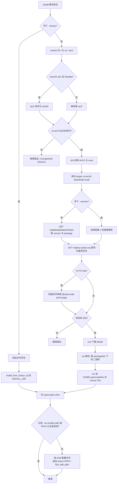
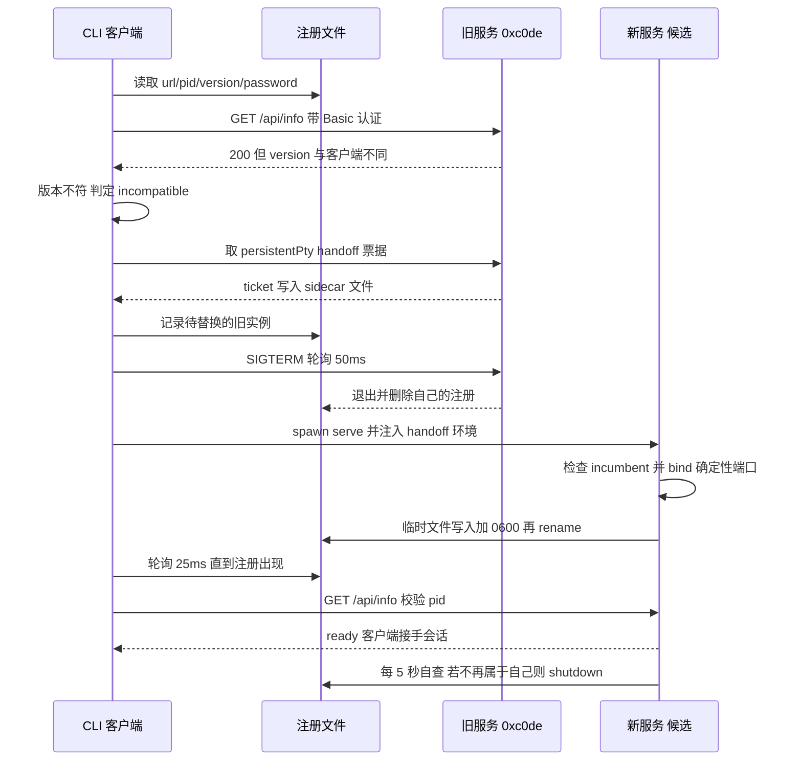
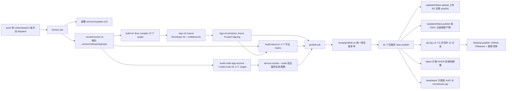

opencode 的部署问题不能用"CLI 怎么装"来回答。它出厂时是一个**单文件可执行程序**，但运行时形态是**一个常驻本地服务 + 多个前端**（TUI、Web app、Electron 桌面端、HTTP API、SDK、ACP 宿主）。这个选择把部署拆成了四件互不相同的工程：怎么把二进制送到用户手上（安装器与分发渠道）、怎么把多前端资产塞进一个文件（Bun compile + 内嵌资产）、服务怎么被选举/发现/换版（进程模型与版本协商）、以及怎么在用户不干预的前提下持续更新（CI/发布与自更新）。

本文只依据 v2.0.11 仓库里**真实存在的构建、发布与运行时配置**论证，并把"仓库里真有配置"与"README 宣传"逐项分开。

## 分发形态的前提：为什么"装一个 CLI"其实不够

三个前端共享一个运行时，是分发约束的源头。交互式入口在启动时并不自带服务，而是走一条 `ServerConnection.resolve` 协商路径：显式 `--server`、`--standalone`（临时子进程）、或**托管服务**三选一，默认命令用的是第三种的 `mismatch: "replace"` 语义——发现版本不符的常驻服务就替换它。[packages/cli/src/commands/handlers/default.ts:31-41]()
<!-- anchor: const server = yield* ServerConnection.resolve({ … : "Starting background server...\n", -->

这意味着"安装"必须同时保证两件事：二进制里包含一个完整的 HTTP 服务与全部前端资产；以及机器上**同时只有一个**该版本的服务在监听某个可预测的位置。前者决定打包形态，后者决定进程模型。

## 安装器：一个管道脚本里的平台探测与目录选择

根目录 `install` 是 v2 安装器本体（488 行 bash），线上入口是 `services/www` 的 Astro 页面把 `https://raw.githubusercontent.com/anomalyco/opencode/v2/install` 原样代理出去；www 的 `base` 是 `/v2/`，所以仓库里**真实定义**的安装 URL 是 `/v2/install`。[services/www/src/pages/install.astro:4-11]()
<!-- anchor: const response = await fetch("https://raw.githubusercontent.com/anomalyco/opencode/v2/install") … headers, -->
[services/www/astro.config.ts:7-9]()
<!-- anchor: const base = "/v2/" … export default defineConfig({ -->

### 探测逻辑

脚本先做三件事：OS 归一化（`Darwin*`/`Linux*`/`MINGW*|MSYS*|CYGWIN*`）、arch 归一化（`aarch64→arm64`、`x86_64→x64`）、以及在 macOS x64 上用 `sysctl.proc_translated` 探测 Rosetta，命中则**改判为 arm64**（原生优先，避免在 Apple Silicon 上装一份 x64 二进制）。随后用白名单校验组合，**只支持 5 种** `os-arch`。[install:105-108]()
<!-- anchor: linux-x64|linux-arm64|darwin-x64|darwin-arm64|windows-x64) … echo -e "${RED}Unsupported OS/Arch: $os/$arch${NC}" -->

注意这个白名单与构建能力并不一致：构建脚本产出 **12 个 CLI target**（含 `windows-arm64`、`linux-x64-baseline`、`linux-*-musl` 等），[packages/cli/script/build.ts:33-50]()
<!-- anchor: const allTargets: { … { os: "win32", arch: "x64", avx2: false }, -->
但 curl 安装器把 `windows-arm64` 挡在门外——Windows ARM64 用户拿不到脚本安装（构建产物仍会发布到 npm 与 GitHub Releases）。

在 x64 上还要判断 CPU 是否真的支持 AVX2：Linux 读 `/proc/cpuinfo`、macOS 读 `hw.optional.avx2_0`、Windows 走 PowerShell 调 `IsProcessorFeaturePresent(40)`。不支持就追加 `-baseline`；Linux 上再通过 `/etc/alpine-release` 或 `ldd --version` 判断 musl，追加 `-musl`。后缀顺序是 `os-arch[-baseline][-musl]`。[install:156-161]()
<!-- anchor: target="$os-$arch" … target="$target-musl" -->

### 下载源与校验

版本元数据来自自建更新服务，不是 npm API：`GET https://opencode.ai/update/api/latest/cli/npm` 返回 `{version, package}`，脚本用 `package` 反推出包作用域（`@opencode/cli` → `@opencode`）。[install:169-183]()
<!-- anchor: package_scope="@opencode" … specific_version=$requested_version -->

二进制本体直接从 **npm registry 的 tarball** 下载，完全绕过 npm 客户端：先对 `https://registry.npmjs.org/<scope>%2fcli-<target>/<version>` 发一次 HEAD 式请求拿状态码，404 时回退到旧作用域 `@opencode-ai/cli-<target>`（这是给"尚未迁移包名的老客户端"留的迁移通道，与契约里 `@opencode-ai/*` → `@opencode/*` 的改名对应）。[install:203-204]()
<!-- anchor: filename="cli-$target-$specific_version.tgz" … url="https://registry.npmjs.org/$package_name/-/$filename" -->

解包后把 tarball 里的 `package/bin/opencode` 直接 `mv` 到安装目录并 `chmod 755`。[install:328-345]()
<!-- anchor: download_and_install() { … rm -rf "$tmp_dir" -->

**这里没有任何校验和验证。** 完整性只依赖 HTTPS 与 npm registry 本身；更新服务确实为每个产物记录 SHA-256（`UpdateArtifact.upload` 会逐文件计算），但那个校验值只写进产物元数据供后续消费者使用，安装脚本本身不读它。[script/update-artifact.ts:52-56]()
<!-- anchor: export async function upload(input: { version: string; files: string[]; dryRun?: boolean }) { … const base = `https://opencode.ai/files/bin/${encodeURIComponent(input.version)}/` -->

### 安装目录与 PATH——README 与实现不一致

实现是**硬编码单一目录**：`$HOME/.opencode/bin`，脚本里不存在任何 `OPENCODE_INSTALL_DIR` 或 `XDG_BIN_DIR` 分支。[install:69-70]()
<!-- anchor: INSTALL_DIR=$HOME/.opencode/bin … mkdir -p "$INSTALL_DIR" -->

而 README 宣称了一个四级优先级（`$OPENCODE_INSTALL_DIR` → `$XDG_BIN_DIR` → `$HOME/bin` → `$HOME/.opencode/bin`）并给出两组示例命令。[README.md:85-97]()
<!-- anchor: #### Installation Directory … XDG_BIN_DIR=$HOME/.local/bin curl -fsSL https://opencode.ai/install | bash -->

全仓库范围内 `OPENCODE_INSTALL_DIR`/`XDG_BIN_DIR` 只出现在 README（含 20 余种语言版本）里，没有任何代码或构建配置引用它们。README 同时给出 `curl ... https://opencode.ai/install`（无 `/v2` 前缀），而仓库里定义的 www 路由只有 `/v2*`；`/install` 由仓库外的规则处理。相邻证据是 GitHub Action 与桌面端也都按 `~/.opencode/bin` 找二进制，说明硬编码目录才是当前的事实契约。[github/action.yml:55-61]()
<!-- anchor: path: ~/.opencode/bin … run: curl -fsSL https://opencode.ai/install | bash -->

PATH 处理是保守的：按 `$SHELL` 选配置文件集合（fish/zsh/bash/ash/sh 各有候选列表，zsh 尊重 `$ZDOTDIR`），取**第一个存在的**文件；已包含该目录则跳过；文件不可写则只打印提示而不报错。[install:390-402]()
<!-- anchor: add_to_path() { … print_message info "  $command" -->
[install:431-446]()
<!-- anchor: if [[ "$no_modify_path" != "true" ]]; then … add_to_path "$config_file" "fish_add_path $INSTALL_DIR" -->

脚本还无条件写一个 `opencode2` shim（Windows 上是 `opencode2.cmd`）指向同一二进制——这是"命令名迁移"的分发层兼容，包元数据里也同时声明 `opencode` 与 `opencode2` 两个 bin。[install:358-378]()
<!-- anchor: install_legacy_shim() { … chmod 755 "$INSTALL_DIR/opencode2" -->

## 分发形态矩阵：仓库里有配置的 vs README 宣传的

判别标准：**该渠道是否有仓库内的代码/工作流把产物推出去**（发布脚本、工作流、Flake、action 定义）。只看 README 出现的命令不算。

| 渠道 | 仓库内的真实配置 | 判定 |
|------|------------------|------|
| curl 脚本 | `install`（488 行）+ `services/www/src/pages/install.astro` 代理 + `services/update` 提供版本元数据 | ✅ 有配置 |
| npm（`@opencode/cli` 与平台子包） | `packages/cli/script/publish.ts`：把 `@opencode/cli-<target>` 平台包与元包 `@opencode/cli` 一起 `npm publish --access public --tag <channel>` | ✅ 有配置 |
| npm（`opencode-ai`） | 全仓库仅 `script/stats.ts` 抓它的下载量；v2 发布脚本发布的是 `@opencode/cli` | ❌ 仅 README 宣传（v1 包名） |
| 直链二进制（R2 + CDN） | `UpdateArtifact.upload` 上传到 `opencode-production-files` 桶，分发标识 `opencode` | ✅ 有配置 |
| Homebrew tap | `packages/cli/script/publish-homebrew.ts`：生成 `opencode-v2.rb` / `opencode-beta.rb` 并 push 到 `anomalyco/homebrew-tap` | ✅ 有配置（仅 beta/latest） |
| Homebrew core | 无 formula、无 PR 流程 | ❌ 仅 README |
| AUR | `packages/cli/script/publish-aur.ts`：写 `PKGBUILD`/`.SRCINFO` 并 SSH push 到 `aur.archlinux.org/opencode-beta` | ✅ 有配置（仅 beta/latest，包名 `opencode-beta`） |
| pacman（官方仓库） | 无 | ❌ 仅 README |
| Scoop / Chocolatey / mise | 无任何 bucket、manifest 或 mise 配置 | ❌ 仅 README |
| nix（flake + overlay） | `flake.nix` 暴露 `opencode`、`opencode-desktop` overlay 与 packages；`nix-hashes.yml` 维护 `nix/hashes.json` | ✅ 有配置（nixpkgs 侧 formula 不在本仓库） |
| Docker 镜像 | `packages/cli/Dockerfile`（alpine + musl 产物）+ `publish.ts` 里的 `docker buildx --push ghcr.io/anomalyco/opencode:<version>` | ✅ 有配置（仅 latest 且真发布时） |
| VS Code 扩展 | `sdks/vscode` + `publish-vscode.yml`（打 `vscode-v*` tag → vsce publish） | ✅ 有配置 |
| GitHub Action | `github/`（含 `action.yml`、`index.ts`、发布脚本）+ `publish-github-action.yml` | ✅ 有配置 |
| 桌面安装包 | `packages/desktop/electron-builder.config.ts` + `build-electron` 矩阵 + GitHub Releases | ✅ 有配置 |

两个渠道的细节值得单独说明。Homebrew 只发布 **4 个 target**（`darwin-arm64`、`darwin-x64-baseline`、`linux-arm64`、`linux-x64-baseline`），并为每个本地计算 SHA-256 写进 formula。[packages/cli/script/publish-homebrew.ts:27-30]()
<!-- anchor: { name: "darwin-arm64", archive: "zip" }, … { name: "linux-x64-baseline", archive: "tar.gz" }, -->
[packages/cli/script/publish-homebrew.ts:35-36]()
<!-- anchor: const sha256 = new Bun.CryptoHasher("sha256") … for await (const chunk of file.stream()) sha256.update(chunk) -->

AUR 的 PKGBUILD 里有一条容易被忽略的约束：**禁止 strip**——`options=('!strip' '!debug')`，因为剥离符号会破坏 Bun 编译产物内嵌的载荷。[packages/cli/script/publish-aur.ts:70-71]()
<!-- anchor: // Stripping a compiled Bun executable can damage its embedded application. … "options=('!strip' '!debug')", -->

### 口径说明

- **workflow 数 = 27**：口径是 `ls .github/workflows/*.yml | wc -l`，只统计该目录下的 YAML 文件。其中与构建/发布/部署直接相关的是 `publish.yml`、`release-github-action.yml`、`publish-github-action.yml`、`publish-vscode.yml`、`deploy.yml`、`deploy-files.yml`、`deploy-posts.yml`、`deploy-www.yml`、`nix-hashes.yml`、`nix-eval.yml`、`containers.yml`、`stats.yml` 共 12 条；其余是检查、issue/PR 治理、评审、通知类。
- **CLI 平台数 = 12**：口径是 `packages/cli/script/build.ts` 的 `allTargets` 数组长度；其中 5 条为 Linux glibc、3 条为 Linux musl（另有 1 条 musl+baseline 组合）、3 条 macOS、3 条 Windows。
- **Node 构建平台数 = 5**：口径是 `build-node.ts` 的 `allTargets`；显式不支持 macOS x64（Node 26.4 SEA 不支持）。
- **Electron 平台数 = 6**：口径是 `publish.yml` 里 `build-electron` 的 matrix 项数。

## 单二进制：Bun compile 与"内嵌 Web UI"

### 资产怎么进二进制

构建期的关键手法是把整个 Web 前端 `dist/` 目录压成一个**字符串字面量**，注入一个虚拟模块 `virtual:opencode-app-assets`：

- 逐文件读取 → brotli 压缩（质量 6）→ base64 编码 → 按路径建 map；`.map` 文件被排除。[packages/cli/script/app-assets.ts:20-23]()
  <!-- anchor: const source = path.join(root, "dist", key) … return [key, compress(body)] as const -->
  [packages/cli/script/app-assets.ts:30-33]()
  <!-- anchor: function compress(body: Buffer) { … }).toString("base64") -->
- 构建插件把该 JSON 直接作为 `export default {...}` 的 JS 源码交给 Bun。[packages/cli/script/build.ts:124-150]()
  <!-- anchor: const result = await Bun.build({ … windows: {}, -->
- 运行期 `import("virtual:opencode-app-assets")` 命中内嵌值；只有在 `OPENCODE_LOCAL`（channel 为 `local`，即源码运行）时才回退到读 `packages/app/dist` 的真实文件。[packages/cli/src/app-assets.ts:10-18]()
  <!-- anchor: export const load = Effect.fn("cli.app-assets.load")(function* () { … return yield* sourceAssets() -->
- 资产读取是**惰性的**：返回一个 `Proxy`，只有浏览器真的请求某个 key 时才 brotli 解压；代码注释直接给出理由——浏览器侧是不可变缓存，服务端没必要保留解压副本。[packages/cli/src/app-assets.ts:38-46]()
  <!-- anchor: function lazy(assets: EncodedAssetMap, load: (key: string) => Uint8Array): AssetMap { … return isText(key) ? Buffer.from(body).toString() : body -->

解压后的内容按扩展名（或 `_headers`）决定返回字符串还是 `Uint8Array`。服务端把这份资产表当作 SPA 的 fallback：非 `/api` 的未命中路由统一回落到 `index.html`，`_assets/` 与 `icons/` 目录的未命中则如实 404，并对 HTML/`sw.js` 用 `no-cache`、其余用一年 immutable。[packages/cli/src/services/web-ui.ts:27-45]()
<!-- anchor: function serveUI(request: HttpServerRequest.HttpServerRequest, url: URL, assets: AssetMap) { … "x-content-type-options": "nosniff", -->

### 代价与不能内嵌的东西

1. **二进制体积**：Web 前端（含 SolidJS 应用、图标、字体子集）被 brotli+base64 塞进可执行文件。base64 有约 33% 编码膨胀，但压缩在前，整体仍明显小于解压后的资产总和。
2. **启动不付解包成本，首次请求付**：`Proxy` + `Effect.cached` 让解压在首个资产请求时才发生，且每个 key 只解压一次（缓存由 HTTP 层承担）。
3. **有些东西无法内嵌**：原生插件、辅助可执行文件、WASM 等按路径消费的依赖不能用"内存中的资产"。Node SEA 版本的注释把这条边界写得很清楚：Bun 的编译器会把文件导入嵌进虚拟文件系统，而 SEA 只嵌入显式列出的资产，并且**原生插件与辅助可执行文件无法直接从 SEA 内存使用**，所以必须在启动时解出到真实路径。[packages/cli/script/node-assets.ts:14-15]()
   <!-- anchor: // Collect and stage those files under stable keys so the SEA prelude can extract them to real paths at startup; … // native addons, helper executables, and other path-based consumers cannot use assets directly from SEA memory. -->
4. **打包期还有一道"体积/内容"闸门**：产物会被扫描，禁止出现 Drive 专用的渲染载荷与字体（`@napi-rs/canvas`、`skia.*`、`CommitMono-400-Regular.otf` 等），同时校验 simulation 桥接模块确实进了图。[packages/cli/script/verify-artifact.ts:5-20]()
   <!-- anchor: const forbidden = [ … "skia.win32-", -->

### 版本号不是生成物，是编译期常量

`packages/cli/src/version.ts` 只有 10 行，读法很特别：它 `declare const OPENCODE_VERSION` 等三个标识符，再用 `typeof x === "string"` 兜底为 `"local"`。[packages/cli/src/version.ts:1-10]()
<!-- anchor: declare const OPENCODE_VERSION: string … export const OPENCODE_LOCAL = channel === "local" -->

真正的注入发生在 `Bun.build` 的 `define` 里：`OPENCODE_VERSION`、`OPENCODE_CHANNEL`、`OPENCODE_ARTIFACT`、`OPENCODE_LIBC` 都是构建期字面量替换。[packages/cli/script/build.ts:152-156]()
<!-- anchor: OPENCODE_VERSION: `'${Script.version}'`, … OPENCODE_LIBC: item.os === "linux" ? `'${item.abi ?? "glibc"}'` : "undefined", -->

所以 `version.ts` **不是生成文件**，仓库里也没有任何脚本改写它。`script/version.ts` 的作用完全不同：它只把 `Script.version` 与是否 release 写进 GitHub Actions 的 `$GITHUB_OUTPUT`。真正决定版本号的是 `@opencode/script` 包：无 `OPENCODE_VERSION` 时从分支名推断 channel，release 通道则去 npm 查 `@opencode/cli` 的 `latest` 并做 major/minor/patch 递增；preview 通道生成 `0.0.0-<channel>-<run number>`。[packages/script/src/index.ts:26-32]()
<!-- anchor: const CHANNEL = await (async () => { … const IS_PREVIEW = CHANNEL !== "latest" -->
[packages/script/src/index.ts:35-48]()
<!-- anchor: if (env.OPENCODE_VERSION) return env.OPENCODE_VERSION … return `${major}.${minor}.${patch + 1}` -->
[script/version.ts:5-12]()
<!-- anchor: const output = [`version=${Script.version}`] … output.push(`repo=${process.env.GH_REPO}`) -->

这个设计让"渠道"从构建期就固化进二进制：`OPENCODE_CHANNEL` 决定服务注册文件名、默认端口、数据库文件名，也决定 `OPENCODE_LOCAL` 是否走源码资产回退。

## 服务化进程模型：选举、发现与版本协商

### 为什么不每次启停一个 CLI

会话状态是持久化在 SQLite 里的 durable event log，多前端要看到同一份事实来源；交互式终端还托管着 persistent PTY（长跑进程）。如果每个 `opencode` 调用都各自起服务，就会出现多个进程争抢同一个数据库文件、前端之间看不到彼此的会话、以及每次启动都要重扫工作区与重连 LSP。因此形态被固定为：**一个按 channel 隔离的常驻服务 + 任意多个客户端**。

### 选举：端口绑定当互斥量，注册文件当公告板

服务模式下端口不是随机分配的，而是按 channel **确定性推导**：`latest`/`dev`/`beta`/`next` 用 `0xc0de`，`local` 用 `0xc0df`，其他 channel 用 channel 名哈希落到 `10000 + hash % 50000`。[packages/cli/src/services/service-config.ts:29-37]()
<!-- anchor: export function filename(channel = OPENCODE_CHANNEL) { … return 10_000 + (Number.parseInt(Hash.fast(channel).slice(0, 8), 16) % 50_000) -->

选举因此不需要额外的一致性协议：**先成功 bind 端口的进程获胜**。落败者有两条退出路径：

- 启动前的乐观检查：如果同 host/port 上已经能探测到 incumbent，直接返回、不启动服务器。[packages/cli/src/server-process.ts:62-66]()
  <!-- anchor: const incumbent = … if (incumbent !== undefined) return -->
- 竞争失败后的兜底：bind 抛出 `EADDRINUSE` 时，进入 `recognizeIncumbent`——每 100ms 重试探测同 URL 的 incumbent，最多 15 秒，确认存在就静默退出。[packages/cli/src/server-process.ts:173-174]()
  <!-- anchor: Effect.retry(Schedule.spaced("100 millis")), … Effect.timeoutOption("15 seconds"), -->
  只有 15 秒内始终没有 incumbent 出现（说明端口被**非 opencode** 占用）才报错，并给出可执行的修复建议：`opencode service set port <port>`。判断 `EADDRINUSE` 时沿 `cause` 链递归查找。[packages/cli/src/server-process.ts:187-190]()
  <!-- anchor: function addressInUse(error: unknown): boolean { … return "cause" in error && addressInUse(error.cause) -->

CI 把这条路径当成**必须验证的契约**：`service-smoke.ts` 同时 spawn 两个 `serve --service` 进程，断言其中一个注册成功、另一个在 10 秒内退出；随后再断言 `Service.stop` 能让胜者退出并**删除注册文件**。[packages/cli/script/service-smoke.ts:77-79]()
<!-- anchor: const winner = processes.find((process) => process.pid === info.pid) … const loser = processes.find((process) => process.pid !== info.pid) -->
[packages/cli/script/service-smoke.ts:108-112]()
<!-- anchor: function spawnService() { … return process -->

> 一个容易误判的点：仓库里确实有一套自定义文件锁 `Flock`（锁目录 + heartbeat + stale 检测 + breaker，用于崩溃恢复），但它**不参与服务选举**。它的实际调用方是需要跨进程临界区的其他流程（例如 npm 安装），选举走的是端口竞态。

### 发现：注册文件就是完整契约

服务成功监听后，从 `onListen` 回调写注册文件：先用临时文件写入并以 `0600` 权限创建，再 `rename` 原子替换（避免读到半个文件）；内容包含 `id`（随机 UUID）、`version`、`url`、`pid`、`password`。[packages/cli/src/services/service-registration.ts:20-28]()
<!-- anchor: const fs = yield* FileSystem.FileSystem … password: options.password, -->

客户端侧把这个文件当**唯一发现契约**：读它就是连接所需的全部信息（URL + Basic 认证口令），服务自己的配置（端口、持久化的密码）由 CLI 独占，客户端从不读。[packages/client/src/effect/service.ts:19-25]()
<!-- anchor: // Find, start, and stop the local opencode background service. … // persisted password) is CLI-owned and never read here. -->
（源码区间见 19-25 行。）

健康检查是 `GET /api/info`（带 Basic 头），并做**双向一致性校验**：响应里的 `pid` 必须等于注册文件里的 `pid`，`version` 也必须相等，否则视为"这个注册不是那个进程写的"，当作没发现。这里的 404 有特殊含义——上一代 V2 服务暴露的是 `/api/status`，因此一个**通过认证的 404 足以把对方标记为 incompatible**，直接进入替换路径。[packages/client/src/effect/service.ts:229-242]()
<!-- anchor: // The previous V2 service exposes /api/status instead. Its authenticated 404 is enough … } satisfies LocalService, -->

注册文件还兼任"自杀开关"：服务每 5 秒重读一次注册文件，如果里面的 `id/version/url/pid/password` 五项不再等于自己，就认为**自己的位置已被别人取代**，打印警告并主动 shutdown。[packages/cli/src/services/service-registration.ts:48-64]()
<!-- anchor: Effect.tap((found) => … Effect.andThen(options.shutdown), -->

这就是根 `AGENTS.md` 里那句"隐式 managed-service 连接可能替换 live server"的实现面：**新客户端不杀旧服务，而是新服务注册成功后旧服务自己退出**，从而保证任意时刻只有一个 owner 在公告板上。

### 版本协商：三种策略与"替换"的真实含义

版本门在 `discover` 里：注册服务必须 `state === "ready"`、`compatible`、且通过 `matchesVersion`（全等或自定义谓词，`version` 为 undefined 时放行）。[packages/client/src/effect/service.ts:31-35]()
<!-- anchor: const found = (yield* registered(options.file)).service … return found.endpoint -->

交互式命令显式选择 `mismatch: "replace"`：直接 `Service.ensure` 带 version，即"发现不匹配就停掉并拉起新的"。[packages/cli/src/services/server-connection.ts:75-83]()
<!-- anchor: if (mismatch === "replace") return yield* Service.ensure(options) … return yield* Service.ensure(options) -->

`"error"` 策略区分两种情况：存在**兼容**版本则复用它；只有存在**不兼容**版本时才报错，提示用户"后台服务版本与此客户端不匹配"，而不是默默替换。`"ignore"` 则完全不做版本要求。

替换动作本身由 `ensure` 完成：发现 `compatible && state === "ready"` 就直接复用并完成 PTY handoff；发现 `!compatible` 就 `announce("version-mismatch", 旧版本)` → `Service.stop({ pty: "handoff" })` → 重新参与启动竞争。[packages/client/src/effect/service.ts:96-114]()
<!-- anchor: if (service !== undefined) { … return Option.none<LocalService>() -->

"保 PTY"不是修辞：`stop` 在 `pty: "handoff"` 时先让旧服务签发一张带 `directory`/`instanceID`/`ticket`/`expiresAt` 的 handoff 票据并写成 sidecar 文件，注释写明顺序理由——**先发布票据再停止持有者**，这样任何替换者都能认领；新进程通过 `OPENCODE_PTY_HANDOFF` 环境变量把它读回来。[packages/client/src/pty-handoff.ts:13-14]()
<!-- anchor: /** Publish the ticket before stopping its owner so every replacement contender can adopt it. */ … export async function prepare(file: string, info: Info, timeout: number) { -->

用户可见的部分是一条动画：版本不符时会显示"Keeping your session safe / Starting the new background service / Loading OpenCode"三段式页脚，而不是一句冷冰冰的重启提示。[packages/cli/src/services/update-preflight.tsx:25-28]()
<!-- anchor: const stages = ["Keeping your session safe", "Starting the new background service", "Loading OpenCode"] as const … const completionHold = 650 -->
显式重启命令则刻意走"主动关掉 persistent PTY"的路径，注释说明理由：自动替换必须保终端，而显式重启不需要。[packages/cli/src/commands/handlers/service/restart.ts:11-18]()
<!-- anchor: Effect.fn("cli.service.restart")(function* () { … process.stdout.write(transport.url + EOL) -->

### 竞争退避与时间预算

`ensure` 维护一组 contender 子进程（`detached`，stderr 只留最后 8KB 用于报错），并有一条明确的设计注记：**"保留一个候选 + 一个锁探针，这样抢占锁阶段的卡死不会阻塞恢复"**。[packages/client/src/effect/service.ts:124-128]()
<!-- anchor: // Keep one candidate plus one lock probe so a pre-lock stall cannot block recovery. … lastSpawn = Date.now() -->

时间常数被集中在一处，并附有推理：新服务约 250ms 完成注册，所以**轮询间隔本身就是等待时间的主要构成**；探测是串行的，因此等待只发生在连接被拒绝时；两种实现都用 120 秒墙钟上限而非尝试次数上限。[packages/client/src/service-timing.ts:16-23]()
<!-- anchor: export const defaultEnsureTiming: EnsureTiming = { … stopPollAttempts: 100, -->
（口径：`pollInterval=25ms`、`requestTimeout=2000ms`、`spawnDelay=5000ms`、`maxSpawnDelay=30000ms`、`promiseTimeout=120000ms`。若候选进程**正常退出**（exitCode 0），spawnDelay 翻倍并在 30 秒封顶——这是对"启动即失败"的退避。）

## 数据目录、数据库与升级兼容性

数据落点由 `roots(app)` 统一给出，**四个平台（含 Windows）一律走 XDG 语义**：`XDG_DATA_HOME`（默认 `~/.local/share`）、`XDG_CACHE_HOME`（`~/.cache`）、`XDG_CONFIG_HOME`（`~/.config`）、`XDG_STATE_HOME`（`~/.local/state`），tmp 走 `os.tmpdir()`，最后各自拼上 `opencode`。[packages/util/src/global-roots.ts:4-17]()
<!-- anchor: const home = os.homedir() … tmp: path.join(os.tmpdir(), app), -->

代价是 Windows 上路径会变成 `C:\Users\<you>\.local\share\opencode` 这种"非 Windows 惯例"的形状——换来的是跨平台零分支的路径逻辑，以及 `XDG_*` 环境变量在各平台都可覆盖（测试就靠这套变量把整棵目录树重定向到临时目录）。

数据库文件名按 channel 隔离：白名单 channel（`latest`/`dev`/`beta`/`next`/`prod`）或不设隔离时用 `opencode.db`，其他 channel 用 `opencode-<channel>.db`（非法字符替换为 `-`），`OPENCODE_DB` 可整体接管，`:memory:` 原样返回。[packages/cli/src/database-path.ts:4-12]()
<!-- anchor: export function databasePath(data: string) { … return filename === ":memory:" ? filename : path.resolve(data, filename) -->

这带来一个直接后果：**channel 即状态隔离边界**。dev/beta 快照用的是独立数据库与独立注册文件（`service-<channel>.json`），因此可以和一个稳定版服务在同一台机器上共存而不互相覆盖。服务模式下工作目录也被固定为 `global.home`，避免"服务跟着某个项目目录漂移"。[packages/cli/src/server-process.ts:53-54]()
<!-- anchor: const global = yield* Global.Service … if (options.mode === "service") yield* Effect.sync(() => process.chdir(global.home)) -->

升级/降级时的数据兼容性，仓库里能核实到的是：服务端没有版本化的 schema 迁移编排（数据库层在 `packages/core` 的 drizzle 体系内）；**桌面端**则明确带自己的迁移目录（`packages/desktop/src/main/storage/migration/`，三组带时间戳的 `migration.sql` + `snapshot.json`）。**没有找到任何自动回滚（downgrade）路径或旧版本二进制缓存**——降级只能靠显式指定版本重装，且旧版本要能读懂新 schema。

## 自更新：策略、执行，以及"正在运行的服务怎么办"

### 三种策略与默认值

策略从三个候选配置文件里取（后出现的胜出），默认 `notify`：新式 `update: "disable"|"notify"|"auto"`，旧式 `autoupdate: false|"notify"|true`。CLI 只用轻量 JSONC 解析读这一个键，不去初始化 location 级的完整配置图——注释把理由写明了。[packages/cli/src/services/updater.ts:34-40]()
<!-- anchor: export function decodePolicy(text: string): Policy | undefined { … const input: unknown = parse(text, errors, { allowTrailingComma: true }) -->
（区间 34-49：`disable` 直接跳过，`notify` 只提示，`auto` 走真正安装。）

`OPENCODE_LOCAL`（源码构建）与 `OPENCODE_DISABLE_AUTOUPDATE=1|true` 都会短路检查。[packages/cli/src/services/updater.ts:242-250]()
<!-- anchor: const inspect = Effect.fnUntraced(function* () { … return undefined -->
（区间 242-269：`inspect` 读策略 → 取 `latest()` → 用 `action(current, latest, policy)` 判定 `none`/`notify`/`auto`。版本比较是自研的严格 semver 子集解析，拒绝前导零与超长数字，避免把畸形版本号当更新。[packages/cli/src/services/updater-action.ts:8-14]()
<!-- anchor: export function action(current: string, latest: string, policy: Policy): Action { … return policy -->）

### 五种安装方式的探测

更新必须先知道自己是怎么被装上的，`method()` 的优先级是：

1. `process.execPath` 等于 `$HOME/.opencode/bin/opencode` → `curl`（即安装器落点）；
2. 可执行路径包含 `/Cellar/opencode-beta/` 或 `/Cellar/opencode-v2/` → `brew`；
3. 否则读可执行文件上两级的 `package.json`，若自身是 `@opencode/cli`/`@opencode/cli-node` 之类的包，再并发问 npm/pnpm/bun/yarn/vp 的全局列表，谁认得这个包就是谁。[packages/cli/src/services/updater.ts:96-110]()
   <!-- anchor: const method = Effect.fnUntraced(function* () { … return "brew" -->

注意 `brew` 的 formula 名被硬编码为 `opencode-beta`/`opencode-v2`，与 Homebrew 发布脚本生成的 formula 名一致；README 推荐的 `brew install anomalyco/tap/opencode`（无后缀）不在这个探测集合里。

### 执行

`upgrade(method, version)` 先校验版本号格式，再回到更新服务问"这个分发渠道该用哪个包"，然后按方法分派：npm/pnpm/yarn/vp 走 `install --global`（必要时 `--force`，且刻意**不卸载旧包**，注释理由是卸载可能连带删掉替换后的命令）；bun 因为不会清理全局缓存，单独指定一个临时 `--cache-dir`；brew 走 `brew upgrade <formula>`。[packages/cli/src/services/updater.ts:196-213]()
<!-- anchor: const commands: Record<Exclude<Method, "bun" | "curl" | "brew">, string[]> = { … : ["vp", "update", "-g", target], -->

`curl` 方式最直白：把安装器**下载下来再执行**，带上目标版本与 `--no-modify-path`（不重复改 shell 配置）。[packages/cli/src/services/updater.ts:223-231]()
<!-- anchor: if (method === "curl") { … if (download.code !== 0) return download -->

交互式入口在启动时会 fork 一个 `updater.run()`，把结果作为 `subscribe`/`check`/`apply` 三个回调交给 TUI：`notify` 策略下 TUI 自己提示，`auto` 策略下直接安装并通知 UI；`check()` 还处理了一个细节——如果**别的客户端已经装好了新版本**，本次检查返回 `installed` 而不是 `available`。[packages/cli/src/commands/handlers/default.ts:52-58]()
<!-- anchor: const update = yield* updater … .pipe(Effect.ensuring(Effect.sync(() => (installing = undefined))), Effect.forkScoped) -->
（区间 52-58，以及 102-109 的 `check`/`apply` 接线。）

手动入口 `opencode upgrade` 支持 `--method` 覆盖与 `--target` 指定版本，版本相同则直接跳过。[packages/cli/src/commands/handlers/upgrade.ts:14-25]()
<!-- anchor: const method = Option.getOrUndefined(input.method) ?? (yield* updater.method()) … outro("Done") -->

### 正在运行的服务、以及回滚

**更新过程刻意不碰正在运行的服务。** 替换发生在"下一次客户端启动"这一时刻，并且是版本门驱动的（即 `ServerConnection.resolve` 的 `mismatch: "replace"` 路径），而不是更新器驱动的。这个设计换来两个好处：更新本身永不中断在跑的会话（因为不重启服务）；替换时机总是有一个新客户端在场，可以走 PTY handoff 保终端。

**仓库里没有回滚路径。** 没有 A/B 双槽、没有旧二进制保留、没有"回滚到上一版本"的命令；`apply(version)` 只接受前进方向的显式版本，唯一的"撤销"手段是再用 `--target` 装回旧版本。若新版本的服务数据 schema 不向后兼容，回滚会失败。这是"如实说明：源码只做检查+提示/安装，不做替换与回滚"的准确表述。

## CI/CD 与发布链路

### 流水线全景

27 条 workflow 中，与构建/发布/部署直接相关的有 12 条（计数口径见「分发形态矩阵」一节），其中 `publish.yml` 一条就占 655 行、是最大的 workflow。

触发方式是**分支即渠道**：`publish` 监听 `ci`、`dev`、`beta`、`v2`、`snapshot-*` 等分支，每次推送即一次预览发布；也可以手动 dispatch 并带 `bump`（major/minor/patch）或 `version`。[.github/workflows/publish.yml:6-12]()
<!-- anchor: branches: … - snapshot-* -->
workflow 级环境里只在 `v2` 分支的非发布推送上把 channel 显式设为 `dev`，其余情况交给 `Script` 从分支名与环境变量推导。[.github/workflows/publish.yml:36-36]()
<!-- anchor: OPENCODE_CHANNEL: ${{ (github.ref_name == 'v2' && !inputs.bump && !inputs.version -->

`version` job 先跑 `services/update` 的部署（v2 分支）再跑 `./script/version.ts` 产出 `version/release/tag/repo` 四个 output，后续 job 全部以它为准。值得注意的是 `version` job 里有一句"Install OpenCode"：发布流程本身会 `bun i -g opencode-ai`，说明**发布也依赖 opencode 自己的存在**（`script/release.ts` 甚至会起一个 opencode 会话来生成预发布评审）。[script/release.ts:128-150]()
<!-- anchor: function reviewPrompt(base: string) { … Return only the complete Markdown review in your response. Do not modify any files.` -->
（`reviewPrompt` 用它自己的服务生成 RELEASE_REVIEW，并强制 `permissions` 数组把写权限全部 deny。）

### 产物矩阵与签名

CLI 侧三条并行的产物线：

- `build-cli`：Bun 编译全部 12 个 target，`BUN_COMPILE_RELEASE: bun-v1.4.2` 固定编译用的 Bun 版本（构建脚本会去下载对应平台的 Bun 可执行文件作为 compile 的 `executablePath`，以保证**在任意 runner 上产出确定的目标平台二进制**）。[packages/cli/script/build.ts:187-204]()
  <!-- anchor: async function compileExecutable(item: (typeof allTargets)[number]) { … if (await Bun.file(executable).exists()) return executable -->
- `build-node-app-archive` + `build-node-cli`：Node SEA 版本，5 个 target，先单独构建一份共享的 app archive 再分发到各平台，避免重复构建前端。[.github/workflows/publish.yml:229-239]()
  <!-- anchor: - target: linux-arm64 … host: blacksmith-4vcpu-windows-2025 -->
- 每条 Node 平台在 CI 里都跑 `service-smoke.ts --node`，即"编译后的服务生命周期"验证——服务选举与版本替换的契约在这里被固化成回归测试。

签名分两套：macOS 用 `import-codesign-certs` 导入 Developer ID 证书，先确认身份存在，再对 `cli-darwin-*/bin/opencode` 逐个签名，扫不到任何二进制就以非零码退出（避免"签了零个却算成功"）。[.github/workflows/publish.yml:162-175]()
<!-- anchor: - name: Sign macOS CLI binaries … found=1 -->
[.github/workflows/publish.yml:187-189]()
<!-- anchor: if [ "$found" -eq 0 ]; then … exit 1 -->
Windows 侧用 **Azure Trusted Signing**（而非本地证书）签 `cli-windows-*` 三个 exe，并用 PowerShell 校验 `Get-AuthenticodeSignature` 必须为 `Valid`。

macOS 的 entitlements 是两套不同的文件：CLI 版是被编译的 Bun 可执行文件，需要 JIT、可执行内存与库校验豁免五项权限；[packages/cli/script/entitlements.plist:4-14]()
<!-- anchor: <dict> … <key>com.apple.security.cs.disable-library-validation</key> -->
而 Electron 里的那份 CLI 资源只保留其中两项，配置注释给的理由是"Bun CLI 要加载 bun-pty 的原生库，而 Electron 与其 helper 不需要这个豁免"。[packages/desktop/resources/entitlements.cli.plist:4-8]()
<!-- anchor: <dict> … <key>com.apple.security.cs.disable-library-validation</key> -->
[packages/desktop/electron-builder.config.ts:37-38]()
<!-- anchor: optionsForFile: (file) => { … const defaults = options.optionsForFile?.(file) -->

### 发布脚本链

`publish` job 把 `./script/publish.ts` 作为总闸门：它先遍历全部 `package.json`（排除 `node_modules`/`dist`）把版本号统一改写成 `Script.version`，再按固定顺序调用 16 个包的发布脚本（schema → codemode → theme → ai → util → protocol → client → cli → plugin → plugin-browser → core → simulation → server → sdk → ui），最后打 tag、推 `v2` 分支的版本同步提交、再发布桌面端。[script/publish.ts:19-35]()
<!-- anchor: async function prepareReleaseFiles() { … await prepareReleaseFiles() -->

CLI 包自身的发布做了三件容易被忽略的事：校验各平台子包版本完全一致且等于当前版本（防止半更新的产物组合）；把"postinstall 没跑"的错误提示脚本预置为 bin，再用 `postinstall.mjs` 去挑正确的平台二进制（**baseline/musl 的挑选逻辑在 npm 路径上也要独立实现一遍**）；以及把产物归档上传到 R2 并把 `cli`/`cli-node` 注册进更新服务的产物表。[packages/cli/script/publish.ts:44-48]()
<!-- anchor: console.log(input.name, "binaries", binaries) … if (!version) throw new Error(`No binary packages found for ${input.name}`) -->
[packages/cli/script/publish.ts:136-142]()
<!-- anchor: await publishDistribution({ … artifact: "cli-node", -->

产物元数据的写入走**GitHub OIDC**：向 Actions 的 token 端点请求 audience 为 `https://update.opencode.ai` 的短时令牌，再 POST 到 `https://opencode.ai/update/api/publish`；D1 可能"提交成功但超时"，所以对 5xx 做幂等重放。[script/update-artifact.ts:32-42]()
<!-- anchor: const response = await fetch("https://opencode.ai/update/api/publish", { … if (response.ok) return -->

镜像与渠道分发是同一条链的下游：只有 `latest` 且非 dry-run 时才 `docker buildx` 双架构推 GHCR，只有 `beta`/`latest` 才更新 AUR 与 Homebrew。[packages/cli/script/publish.ts:146-150]()
<!-- anchor: if (Script.channel === "latest" && Script.release && !dryRun) { … if ((Script.channel === "beta" || Script.channel === "latest") && Script.release) { -->

因为体积原因仓库只做一个架构无关的镜像：Dockerfile 用 alpine 基座 + 两个 musl 产物构建 `build-amd64`/`build-arm64`，再按 `TARGETARCH` 选择，同时预置 `opencode2` 软链并验证两个命令都能 `--version`。[packages/cli/Dockerfile:7-16]()
<!-- anchor: FROM base AS build-amd64 … ENTRYPOINT ["opencode"] -->

## 桌面端打包：一个"自带运行时的宿主"

Electron 侧由单文件 `electron-builder.config.ts` 驱动（不在 package.json 里），按 channel 生成三个互不干扰的 appId（`ai.opencode.desktop.dev`/`.beta`/空后缀），产物命名固定为 `opencode-desktop-${os}-${arch}.${ext}`。[packages/desktop/electron-builder.config.ts:192-196]()
<!-- anchor: case "prod": { … productName: "OpenCode", -->

**桌面端不是"连一个已有服务"，而是自带一份 CLI。** 打包时把 CLI 二进制作为 `extraResources` 放进 resources 目录（`opencode-cli` / `opencode-cli.exe` 与一个 `opencode-cli.version`），并在 `afterPack` 里断言二者都非空——把"忘了 copy CLI"变成构建期失败而不是运行期崩溃。[packages/desktop/electron-builder.config.ts:92-96]()
<!-- anchor: extraResources: [ … filter: ["opencode-cli", "opencode-cli.exe", "opencode-cli.version"], -->

同时它保留了两条"用别人的 CLI"的路径：远程/WSL 场景下通过 shell 探测已有 `opencode`（顺序是 `command -v` → `~/.opencode/bin/opencode` → 缓存目录），必要时回落到直接执行安装脚本；macOS 上还提供"安装 CLI"动作，把内置二进制按 `$HOME/.opencode/bin` 的约定装出去——实现方式是**把安装脚本本身 raw import 进主进程**复用。[packages/desktop/src/main/service/desktop-cli.ts:8-12]()
<!-- anchor: import installer from "../../../../../install?raw" … import { parseCliVersion } from "./cli-version" -->
[packages/desktop/src/main/service/desktop-cli.ts:38-43]()
<!-- anchor: if (process.platform !== "darwin") return yield* Effect.fail(new Error("CLI installation requires macOS")) … return path.join(home, ".opencode", "bin", "opencode") -->

打包与分发细节：

- **macOS**：`hardenedRuntime: true`、`gatekeeperAssess: false`、`notarize: true`，target 为 `dmg` + `zip`；CLI 那个资源文件单独换一份 entitlements（见上）。[packages/desktop/electron-builder.config.ts:109-125]()
  <!-- anchor: mac: { … target: ["dmg", "zip"], -->
- **Windows**：`nsis` 单键安装、`perMachine: false`（用户级安装，无需管理员），签名走 `script/sign-windows.ps1` 且**只在 GitHub Actions 上生效**（本地打包不签）。[packages/desktop/electron-builder.config.ts:133-147]()
  <!-- anchor: win: { … installerHeaderIcon: `resources/icons/icon.ico`, -->
- **Linux**：`AppImage`/`deb`/`rpm` 三产物，并用 fpm 额外塞入 `.desktop` 与 metainfo；为兼容一次 appId 更名，还刻意保留旧的 `opencode-desktop.desktop` 条目，让既有 GNOME/KDE 固定项不失效。[packages/desktop/electron-builder.config.ts:198-202]()
  <!-- anchor: publish: { … channel: "latest", -->
- **自动更新**：走 electron-updater 的 `provider: "generic"`，feed 指向更新服务的桌面清单端点（prod 为 `/update/api/latest/desktop/opencode/`）。发布时把各平台 `latest*.yml` 收集起来重新生成统一清单，并把 `files` 的 URL 换成 R2 CDN 地址、保留原始 SHA-512 与 blockmap 信息。[packages/desktop/scripts/publish.ts:20-29]()
  <!-- anchor: const uploaded = await UpdateArtifact.upload({ version: Script.version, files, dryRun }) … if (!dryRun) await UpdateArtifact.publish(artifact) -->

Windows ARM64 的 Electron 构建被显式标注为一个例外：因为 Blacksmith runner 缺少 ARM64 MSVC 交叉编译工具链，ARM64 那一条必须退回 GitHub 托管的 `windows-2025`。[.github/workflows/publish.yml:371-372]()
<!-- anchor: # github-hosted: blacksmith lacks ARM64 MSVC cross-compilation toolchain … - host: "windows-2025" -->

## 自托管可能性与"本地优先"的张力

### IaC 是什么

仓库的云资源用 **SST**（`sst: 4.13.1` 固定在根 `package.json` 的 catalog 里），`home: "cloudflare"`，只在 `beta` 之外的 stage 挂 aws/stripe/random/planetscale/honeycomb 五个 provider。[sst.config.ts:9-10]()
<!-- anchor: home: "cloudflare", … providers: -->
[sst.config.ts:23-29]()
<!-- anchor: stripe: { … honeycomb: "0.49.0", -->
部署 job 在 CI 里跑 SST 部署，凭据全部来自 GitHub Secrets（Cloudflare、PlanetScale、Stripe、Honeycomb、Sentry 等都在同一个 `env` 块里注入），本地部署则需要 `opencode-production` / `opencode-dev` 两个 AWS profile。[.github/workflows/deploy.yml:40-44]()
<!-- anchor: CLOUDFLARE_API_TOKEN: ${{ secrets.CLOUDFLARE_API_TOKEN }} … HONEYCOMB_API_KEY: ${{ secrets.HONEYCOMB_API_KEY }} -->

`infra/` 的九个文件覆盖：网站与文档、控制台（PlanetScale 分支 + Stripe + 邮件 + 鉴权）、统计湖（S3 Tables/Iceberg + Athena）、企业版（R2 存储适配器）、监控、以及 stage/secret 工具。[infra/console.ts:11-13]()
<!-- anchor: const cluster = planetscale.getDatabaseOutput({ … organization: "anomalyco", -->
[sst.config.ts:35-36]()
<!-- anchor: const { createWebApp } = await import("./infra/webapp.js") … return { WebAppUrl: createWebApp("beta.opencode.ai").url } -->

`services/` 下三个服务是**另一套部署方式**：`services/www`（Astro，Wrangler）、`services/update`（更新选路 Worker，D1 + Pipelines）、`services/files`（R2 公共分发 Worker，`/files/*`）。它们不是 SST 组件，各自 `wrangler deploy`，由 `deploy-www.yml`/`deploy-files.yml`/`publish.yml` 部署。`services/README.md` 自己给出了这张对照表。

### 能自托管到什么程度

- **服务端本体可以**：`packages/server` 不依赖任何云，`opencode serve` 就是一个本地 HTTP 服务；`Global` 甚至提供了 workerd 版本的路径根，说明同一份 server 代码能在 Cloudflare Worker 里跑（那时数据库落在 Durable Object 存储上）。
- **基础设施不能原样复用**：`infra/stage.ts` 把 zone id、域名与 awsStage 写死，[infra/stage.ts:1-9]()
  <!-- anchor: export const domain = (() => { … export const deployAws = $app.stage === awsStage -->
  console 的 PlanetScale 组织写死为 `anomalyco`，R2 桶名、D1 绑定、Cloudflare Access 策略（更新服务 README 明确要求两个 admin 路径挂在同一个 Access 应用下）也都指向官方账号。**没有自托管模板。**
- **但"装"和"更新"依赖集中式基础设施**：安装脚本的版本元数据、直链二进制的 CDN、`opencode upgrade` 的渠道选路全部来自 `opencode.ai/update/*` 与 `opencode.ai/files/*`。这是本模块最值得记下的张力：**运行时是本地优先的（会话、数据库、PTY 全在本机），分发与更新却是集中控制的（选路服务在 Cloudflare，产物表在 D1，二进制在 R2，并且用 GitHub OIDC 限制"只有官方 publish.yml 能写入"）。**

这个组合并不矛盾，而是一致的设计后果：既然客户端形态是"常驻服务 + 多前端"，更新就必须原子地决定"哪个版本的哪个产物给哪台机器"，这需要一个带 rollout/最小版本能力的中心侧——而 rollout 是按 `CF-Connecting-IP` 哈希做的，正好只有边缘网络能提供。代价是自托管用户失去 `upgrade` 与脚本安装，只能用包管理器或 nix 这类"由发行渠道负责版本"的路径。

顺带核实一处文档与工具链的失配：根 `AGENTS.md` 明确写着**本仓库不使用 Changesets**，而 v2.0.11 快照里仍残留一个 `.changeset/directory-page-heading.md`（内容是 `@opencode/core` 的 patch 说明），且根 `package.json` 里没有任何 changesets 依赖或脚本。现状是：**约定已废弃，文件是遗留物**。

## 回到设计哲学：服务化运行时在分发上的三个后果

**第一，durable event log 是唯一事实来源 → 分发必须先解决"谁拥有那份状态"。** 因为状态在本地磁盘而非进程内，多前端要看到同一份事实，就必然要求"同一 channel 只有一个服务实例"。于是分发物里必须包含：一个确定性的端口推导、一个 `0600` 的注册文件作为发现契约、以及一个"注册被改写就自我退出"的自杀开关。这些都不是"CLI 分发"该有的东西——它们是**数据库所有权协议**。

**第二，准入与执行分离、会话可恢复 → 替换运行时不能丢会话。** 版本不符时的替换走的是 PTY handoff 票据：先把终端所有权序列化出去，再停止持有者，新进程从环境变量里认领。如果会话是不可恢复的进程内状态，"换版"就只能等于"杀掉用户的工作"；正因为 durable log + ticket 让状态可移交，服务替换才敢对用户隐藏成一段三段式动画。

**第三，多前端共享一套引擎 → 分发单位是"运行时 + 资产 + 版本握手"，不是一个二进制。** Bun compile 把 HTTP 服务、TUI、Web 前端与原生依赖压进单文件；`OPENCODE_CHANNEL`/`OPENCODE_VERSION` 在编译期变成常量，让服务注册名、默认端口、数据库文件名、更新渠道在构建时就固定；`app-assets.ts` 的惰性 brotli Proxy 则保证了"单文件"不以启动时间为代价。相对地，代价压在别处：`-baseline`/`-musl` 让平台矩阵膨胀到 12 个 target（curl 安装器只覆盖其中 5 个），而某些依赖（原生插件、辅助可执行文件）根本无法内嵌，Node SEA 变体只能在启动时把它们解到真实路径。

一句话收束：opencode 的部署设计不是"把 CLI 发出去"，而是**把一台带状态的小型服务器连同它的前端、版本身份和更新通道，一起塞进一个文件并保证它在用户机器上长期只有一个 owner。**
