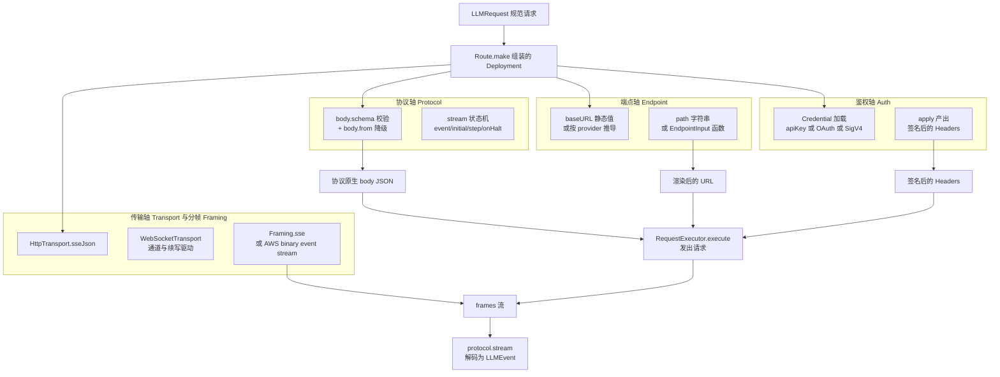
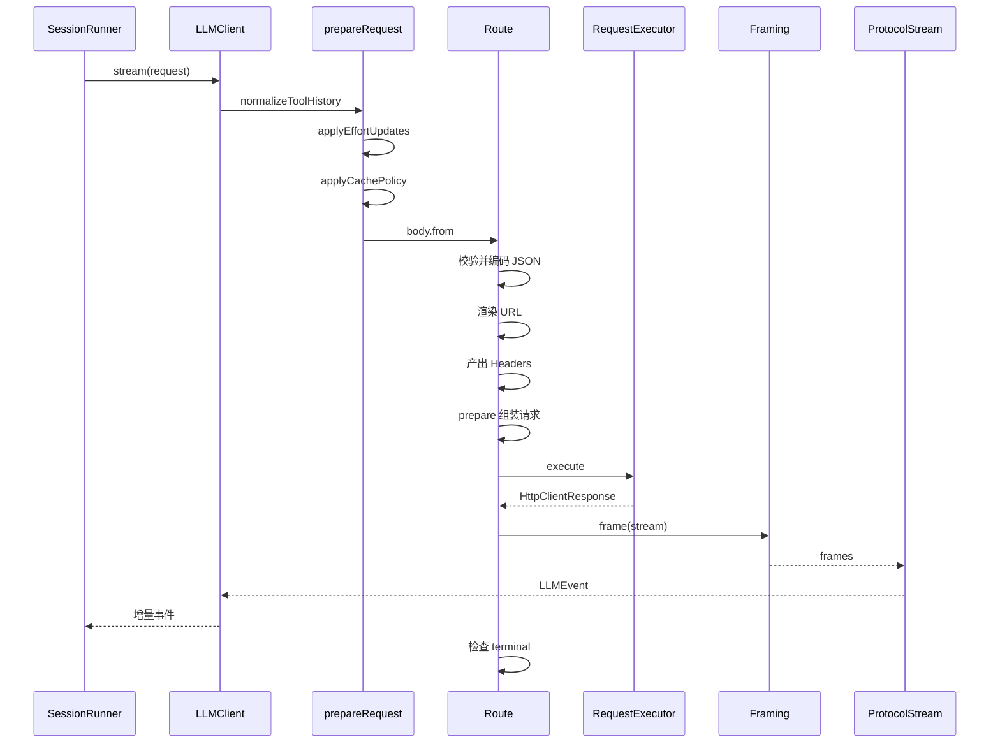

## 模型调用不是一次 fetch

读者已经熟悉会话与循环。现在要回答的是整条链路里最靠外的一跳：`LLMRequest` 究竟怎么变成一次真实的 HTTP 或 WebSocket 调用、再把字节流还原成 `LLMEvent`。

这一层最容易写歪。朴素做法是"一个供应商一份适配器"：OpenAI 抄一份、DeepSeek 抄一份、TogetherAI 再抄一份，每份 300 行，差异散落在 URL、header、body 字段名和流式解析里，谁也不知道哪一行是这家独有的、哪一行只是历史遗留。opencode v2 的答案是先做一次**正交分解**：把"供应商"这个复合概念拆成少数几个彼此独立的维度，让新增一个 OpenAI 兼容供应商从抄适配器变成填几行路由描述。

作者在自己的包说明里把这件事写成了一句话和四条清单：

```
A route is the runnable composition of four orthogonal pieces:
```

四条清单分别对应 Protocol（协议语义）、Endpoint（URL）、Auth（鉴权）和 Framing（分帧），并强调"SSE 是共享的，Bedrock 把 AWS event-stream 分帧保留为自己的 `Framing<object>` 值"。[packages/ai/AGENTS.md:61-66]()
<!-- anchor: A route is the runnable composition of four orthogonal pieces: … - **`Framing`** (`src/route/framing.ts`) — bytes → frames. SSE (`Framing.sse`) i -->

同一位作者给出了这个分解的**收益归因**：DeepSeek、TogetherAI、Cerebras、Baseten、Fireworks、DeepInfra 之所以能逐字复用 `OpenAIChat.protocol`，是因为每个 provider 只写一小段 `Route.make(...)` 组合，而不是克隆一份协议。[packages/ai/AGENTS.md:83-85]()
<!-- anchor: Route defaults are request-shaping defaults such as `headers`, `limits`, `genera … The four-axis decomposition is the reason DeepSeek, TogetherAI, Cerebras, Basete -->

本文的任务就是验证这句话在源码里是否成立，并诚实指出它在哪一处不够正交。

## 四轴的定义与边界

### Protocol：语义 API 合约

Protocol 是"这个 API 长什么样"的全部内容，且**只是**这些内容。它由四个类型参数描述一条流水线：`Body` 是provider 原生请求体的候选值，`Frame` 是分帧后的一帧（SSE 是一段 JSON 字符串，AWS event stream 是一个解析后的二进制帧），`Event` 是从一帧解出的供应商事件，`State` 是在 `stream.step` 之间穿行的累加器。[packages/ai/src/route/protocol.ts:37-45]()
<!-- anchor: export interface Protocol<Body, Frame, Event, State> { … readonly supportsEffortUpdates?: (request: LLMRequest) => boolean -->

请求侧只有两个成员：`body.schema`（校验并 JSON 编码用的 Effect Schema）和 `body.from`（把公共 `LLMRequest` 降级为原生 body 的 Effect）。响应侧是一个显式状态机：`event` 负责把一帧解码为一个供应商事件，`initial` 每次响应调用一次，`step` 把一个事件翻译成若干 `LLMEvent` 加下一个状态，`terminal` 给"流不会自然结束"的传输提供完成信号，`onHalt` 在流结束时做一次补吐（典型用途是发出 `finish`）。[packages/ai/src/route/protocol.ts:37-45]()
<!-- anchor: export interface Protocol<Body, Frame, Event, State> { … readonly supportsEffortUpdates?: (request: LLMRequest) => boolean -->

Protocol 的关键否定式约束写在注释里。原文四句话值得完整引用：**Protocol 不是部署**——它不知道用哪个 URL、哪些 header、哪种鉴权方案，这些都是由 `Route.make(...)` 连同选定的 `Endpoint`、`Auth`、`Framing` 一起拥有的部署关注点；而"正是这个分离让 DeepSeek、TogetherAI、Cerebras 等都能复用 `OpenAIChat.protocol`，不必每个 provider fork 三百行"。[packages/ai/src/route/protocol.ts:21-25]()
<!-- anchor: * A `Protocol` is **not** a deployment. It does not know which URL, which … * etc. all reuse `OpenAIChat.protocol` without forking 300 lines per provider. -->

以一个真实的 Protocol 定义收束这一轴：OpenAI Chat 的 `protocol` 把 `OpenAIChatBody` 和 `fromRequest` 交给请求侧，把 SSE 事件 union、初始解析状态（含 `ToolStream.empty`、`Lifecycle.initial`、`pendingTools`）、`step`、`terminal: event === DONE` 与 `onHalt: finishEvents` 交给响应侧。[packages/ai/src/protocols/openai-chat.ts:1167-1190]()
<!-- anchor: export const protocol = Protocol.make({ … onHalt: finishEvents, -->

### Endpoint：URL 构造，静态与动态二选一

Endpoint 是一份声明式 URL 描述：可选的 `baseURL`、一个 `path`、以及可选的 `query` 记录。`path` 的类型是 `string | ((input: EndpointInput<Body>) => string)`，`EndpointInput` 同时拿到 `request` 和**已经校验过的** `body`。[packages/ai/src/route/endpoint.ts:22-25]()
<!-- anchor: export interface Definition<Body> { … readonly query?: Record<string, string> -->

渲染时 `trimBaseUrl(baseURL) + path` 拼成 `URL`，再把 `query` 逐项写入 `searchParams`。[packages/ai/src/route/endpoint.ts:50-53]()
<!-- anchor: export const render = <Body>(endpoint: Definition<Body>, input: EndpointInput<Bo … return url -->

`path` 取函数而非字符串，是为了让三类供应商不必新增轴：Bedrock 的路径要嵌 region 与 modelId，Gemini 要嵌 model id 并把 `alt=sse` 钉在 URL 上，Google Vertex 的 tuned model 会把 `models/` 前缀换成 `endpoints/`。这类差异被吸收进一个纯函数，而不是变成新的 `Endpoint` 变体。Vertex 的实现把 baseURL 与鉴权一起从 `apiKey` / `accessToken` / `location` / `project` 推导出来，路径函数再从 `request.model.id` 决定前缀。[packages/ai/src/providers/google-vertex.ts:106-114]()
<!-- anchor: const endpoint = … auth: apiKey === undefined ? GoogleVertexShared.oauth(input, project) : Auth.hea -->

### Auth：从凭证到 Headers 的 Effect

Auth 的输入是一份完整的请求上下文：`request`（含可选 `http` 覆盖）、HTTP `method`、`url`、已编码的 `body` 字符串、以及当前 header 集合。[packages/ai/src/route/auth.ts:17-22]()
<!-- anchor: export interface AuthInput { … readonly headers: Headers.Headers -->

它的可组合性来自两个接口的分层。`Credential` 只负责"把密钥加载出来"（`load: Effect<Redacted, CredentialError>`），并派生 `bearer()` / `header(name)` 两种渲染；`Definition.apply` 把 `AuthInput` 映射为**新的** `Headers`。两者都带 `orElse`（回退：`apiKey` 选项或环境变量）和 `andThen`（叠加：先移除 `authorization` 再写入 `api-key`）。[packages/ai/src/route/auth.ts:33-37]()
<!-- anchor: export interface Definition { … readonly pipe: <A>(f: (self: Definition) => A) => A -->

`Auth.none` 是恒等变换，`Auth.remove(name)` 只删 header，`Auth.custom` 允许任意 `AuthInput → Headers` 的 Effect。这三种原语刚好覆盖了观测到的全部鉴权形态：

- Bearer：`AuthOptions.bearer` 把"显式 `auth` 覆盖 → `apiKey` 选项 → 环境变量"折成一条 `orElse` 链再 `.bearer()`。
- 自定义 header：Anthropic 用 `x-api-key`；Azure 先 `Auth.remove("authorization")`，再把 `api-key` 写进去，因为 Azure 不允许带 Bearer。[packages/ai/src/providers/azure.ts:91-96]()
<!-- anchor: const auth = (input: Config) => { … .pipe(Auth.header("api-key")), -->
- SigV4：Bedrock 用 `Auth.custom` 实现，因为签名必须覆盖**确切的 JSON 字节**。

SigV4 这一支值得单独看，它是"Auth 轴自己不够用"的第一个信号：`sigV4` 接收一个可能是静态值、也可能是每请求求值的 `Effect` 凭证源，先 `content-type: application/json` 补进待签 header，再交给 `aws4fetch` 的 `AwsV4Signer`，最后把签名结果合并回 header 集合。[packages/ai/src/protocols/utils/bedrock-auth.ts:87-108]()
<!-- anchor: export const sigV4 = ( … return Headers.setAll(headersForSigning, signed) -->

凭证优先级被显式编码，而不是留给调用方猜：Bearer 胜过 SigV4，静态凭证胜过默认链。而且默认链**每个请求都重新跑一遍**，理由是进程级 memoize 会把磁盘上被企业 SSO 工具改写的无过期时间凭证钉死到进程生命周期。[packages/ai/src/protocols/utils/bedrock-auth.ts:135-143]()
<!-- anchor: * Bearer wins over SigV4 and explicit static credentials win over the default … return sigV4(defaultChain({ region, profile: input.profile }), options) -->

### Transport 与 Framing：传输形状与字节分帧

Transport 是"怎么把请求发出去、怎么把字节拿回来"的抽象，接口只有 `prepare` 与 `execute`。`prepare` 拿到完整的四轴上下文（`body`、`request`、`endpoint`、`auth`、`encodeBody`、`headers`、可选的 `middleware` 与 `webSocket`），把鉴权和 URL 渲染一次性做完，返回传输自己的 `Prepared`；`execute` 返回 `TransportExecution`——一个 `frames` 流、可选的 `http` 上下文、可选的 `complete` 确认 Effect。[packages/ai/src/route/transport/index.ts:24-32]()
<!-- anchor: export interface Transport<Body, Prepared, Frame> { … ) => Effect.Effect<TransportExecution<Frame>, AIError, Scope.Scope -->

HTTP 这一支的 `prepare` 浓缩了整条请求构造链：`renderEndpoint` 拼 URL → 叠加 `request.http?.query` → 叠加 `request.http?.body` 覆盖层 → 构造 `Headers`（部署级 `headers` 回调、`request.http?.headers`）→ 交给 `Auth.toEffect` 签名。[packages/ai/src/route/transport/http.ts:43-60]()
<!-- anchor: export const jsonRequestParts = <Body>(input: JsonRequestInput<Body>) => … return { url, jsonBody: body.jsonBody, bodyText: body.bodyText, headers } -->

Framing 是 Transport 与 Protocol 之间的字节层接缝：`Definition<Frame>` 只有 `id`、`frame`（`Stream<Uint8Array>` → `Stream<Frame>`）和一个可选的 `body`（当分帧改写了供应商负载时，保留原始线上表示）。[packages/ai/src/route/framing.ts:19-23]()
<!-- anchor: export interface Definition<Frame> { … readonly body?: (frame: Frame) => string | undefined -->

SSE 有三种构造：`Framing.sse` 默认丢弃 `[DONE]`；`Framing.sseWithDone` 保留它，供把它当作终止信号的协议使用；`Framing.sseEvents(events)` 只放行协议认得的事件名（Anthropic 用这一种，因为它的 SSE `event:` 字段有语义）。这三种共享同一份 SSE 帧解码实现。[packages/ai/src/protocols/shared.ts:232-262]()
<!-- anchor: export const sseFraming = ( … Stream.map((event) => event.data), -->

### 四轴如何拼成一条可执行 route

`Route.make` 是四个轴的**唯一**汇合点。它的文档注释把"组合四个正交部分"写成了显式的构建契约，并说明 route 的公开表面（`body` schema、compact 操作、transport 泛型）在构造时就定型，之后只允许 `with(...)` 做 patch。[packages/ai/src/route/client.ts:520-532]()
<!-- anchor: * Build a `Route` by composing the four orthogonal pieces of a deployment: … * the public surface preemptively. -->

`with` 是一条泛型保留链：`RoutePatch` 里若带了 `compact`，返回类型就换成新的 `Compact` 参数，因此"这条 route 支不支持显式压缩"成为类型级事实，而不是运行期检查。



真正把这些轴接起来的是 `makeFromTransport`：它用 `body.schema` 校验并编码 body，取 `protocol.stream.event` 作为帧→事件的解码器，用 `Stream.mapAccumEffect` 以 `initial(request)` 为初值、以 `step` 为累加函数，最后把 `onHalt` 作为流结束时的补吐。[packages/ai/src/route/client.ts:358-371]()
<!-- anchor: function makeFromTransport<Body, Prepared, Frame, Event, State>( … cause, -->

这条流水线的收尾处还埋了两个正交性之外的东西：`terminal` 不上报就报 `incomplete-stream`，以及把解码器接上去。

#### Route.with：部署配置必须发生在模型选择之前

四轴被拆开之后，一个实际问题是"谁在什么时候填这些轴"。作者的答案是：**route 先被 patch 成部署配置，再绑定模型**。`with` 的签名是一个三态重载——带 `compact` 就换 `Compact` 类型参数，显式 `compact: undefined` 就抹平，什么都不带就保持原类型。[packages/ai/src/route/client.ts:60-67]()
<!-- anchor: readonly with: { … (patch: RoutePatch<Body, Prepared>): Route<Body, Prepared> -->

patch 的合并语义刻意做成"只有非 undefined 才覆盖"，因为 provider facade 会用 `{ baseURL: input.baseURL }` 这种可能带 undefined 的结构去 patch：`Endpoint.merge` 在 `baseURL` 与 `path` 上用 `??` 回退到基座，而 `query` 是**逐键合并**而不是整体替换。[packages/ai/src/route/endpoint.ts:39-44]()
<!-- anchor: export const merge = <Body>(base: Definition<Body>, patch: EndpointPatch<Body>):  … query: patch.query === undefined ? base.query : { ...base.query, ...patch.query  -->

这条约定在每个 facade 里都能看到同一个形状：先把 `apiKey` / `auth` / `baseURL` 从配置里解构出来，再把剩下的东西 patch 进 route，最后在 `model(id)` 上叠加 `compatibility`。Anthropic 的 `configure` 是典型——它把 provider 特定的 `auth(auth 表达式或 x-api-key) + baseURL 默认值` 全部折进 `AnthropicCompatible.configure`，对外只暴露 `model(id)`。[packages/ai/src/providers/anthropic.ts:39-50]()
<!-- anchor: export const configure = (input: Config = {}) => { … configure, -->

顺序不能颠倒，而且这一点在源码里有正面证据：`fromRequest` 自己声明"只返回 provider body；endpoint、auth、framing、校验与 HTTP 执行一律由 `Route.make` 组装"。[packages/ai/src/protocols/openai-chat.ts:737-738]()
<!-- anchor: // `fromRequest` returns the provider body only. Endpoint, auth, framing, … // validation, and HTTP execution are composed by `Route.make`. -->

紧接着它在降级时**读取** route 上的值与模型兼容位：先从 `request.model.route.endpoint.baseURL` 探测该用 `max_tokens` 还是 `max_completion_tokens`，再从 `request.model.compatibility` 取 `maxTokensField` / `supportsStore` / `supportsStrictMode` / `zaiToolStream` 的显式覆盖。[packages/ai/src/protocols/openai-chat.ts:747-751]()
<!-- anchor: const provider = String(request.model.provider) … const supportsStore = request.model.compatibility?.supportsStore ?? detectSupportsStore(provider, baseURL) -->

所以路由的部署配置必须在模型构造之前定型：`body.from` 读的正是路由上的值，而 `Route.with` 是唯一能在构造前改写它们的地方。

## 两条 provider 入口：结构性定义与扁平可序列化设置

复用度高还有一个容易被忽略的前提：provider 必须以**可统一驱动**的形状暴露自己。`packages/ai` 为此保留了两个入口，且明确建议只用其中一个。

`Provider.Definition` 是"结构性"入口：`id` 加一个 `model` 工厂，外加一个可选的 `apis` 映射，用于"一个 provider 在同一个 facade 背后暴露多个 route 选择器"的外部结构性 provider。[packages/ai/src/provider.ts:18-21]()
<!-- anchor: export interface Definition<Factory extends AnyLanguageModelFactory = LanguageMo … readonly apis?: Record<string, AnyLanguageModelFactory> -->

`ProviderPackage.Definition` 是"扁平可序列化"入口：`model(modelID, settings)`，其中 `Settings` 是一个 `Readonly<Record<string, unknown>>`，只有 `baseURL` / `headers` / `body` 三个保留连接键，其余键全部下传给 route 的协议当作 providerOptions。[packages/ai/src/provider-package.ts:8-19]()
<!-- anchor: export interface Settings extends Readonly<Record<string, unknown>> { … readonly model: (modelID: string, settings: ProviderSettings) => LanguageModel<O -->

这个区分不是风格偏好，而是**持久化边界**：目录驱动与配置驱动的构造路径不能持有闭包或函数，只能传 JSON 可序列化的设置。所以 `ProviderPackage.Settings` 必须能被写进配置、跨进程传递、并在 `ModelResolver` 里由纯数据重建。OpenAI 的 `model` 入口就是这个形状的实例：`(modelID, settings) => configure(config(settings)).responses(modelID)`，把扁平设置先还原成 `Config`，再走结构性 `configure`。[packages/ai/src/providers/openai.ts:147-151]()
<!-- anchor: export const model: ProviderPackage.Definition< … >["model"] = (modelID, settings) => { -->

注释里那句"内置 provider 应优先使用 `configure(options).model(id)`，`apis` 只留给外部结构性 provider"，正是这两条路径的主次声明。

## 结构化输出的统一路径

`generateObject` 是这套抽象最直接的一次兑现。它**不**使用任何供应商的原生 JSON 模式，而是强制一个名为 `generate_object` 的合成工具调用，再对 `call.input` 做 schema 解码；解码失败或模型没调用该工具都报 `InvalidProviderOutputError`。[packages/ai/src/llm.ts:139-148]()
<!-- anchor: * Run a model and decode its output against `schema`. Works on every protocol … *    the schema is only available at runtime (MCP, plugin manifests). Caller val -->

这是一个明确用**正交性换行为一致性**的取舍：放弃原生结构化输出能省一个工具往返，但那样每个协议都要实现自己的 JSON 模式降级与容错，`generateObject` 的行为就会随协议而变。作者选择把差异收敛到已经存在的工具调用轴上，"在所有协议上可用"优先于"少一次往返"。

请求侧的规范化同样收在这一层：`LLM.request` 把 `system` / `prompt` / `messages` / `tools` / `toolChoice` / `generation` / `http` 七种松散输入统一折叠成一个 `LLMRequest` 实例，`prompt` 被转成一条 `Message.user`，`system` 被转成 `SystemPart.content`。[packages/ai/src/llm.ts:42-64]()
<!-- anchor: export const request = <const SelectedLanguageModel extends LanguageModel>( … http: requestHttp === undefined ? undefined : HttpOptions.make(requestHttp), -->

而这个 `LLMRequest` 正是 Schema 类本身，不是另一份平行模型——`LLMRequest.update` 只对 patch 里出现的键做覆盖，`model` 缺省时沿用原值。[packages/ai/src/schema/messages.ts:398-406]()
<!-- anchor: export class LLMRequest<Model extends LanguageModel = LanguageModel> extends Sch … super(input) -->

## 一次流式调用的完整链路

调用入口是 `LLMClient.stream`。它先做三件与供应商无关的请求规范化，再进入传输。

`prepareRequest` 是这条链的"编译期"：`normalizeToolHistory` 补齐缺失的工具结果，`applyEffortUpdates` 按 route 能力决定保留还是剥掉 `effort` 标记，`applyCachePolicy` 注入缓存断点，最后合并 transport 默认与请求级 HTTP 选项。[packages/ai/src/route/client.ts:556-570]()
<!-- anchor: const prepareRequest = (request: LLMRequest) => { … : LLMRequest.update(resolved, { http: mergeHttpOptions(new HttpOptions({ headers -->

随后 `prepareTransport` 把 body 编译成 `Prepared`，`execute` 拿到 `frames` 流，`Stream.mapAccumEffect` 用协议状态机把它折叠成 `LLMEvent`。这里有两个关键设计：其一，`streamPrepared` 用 `Stream.unwrap` 让"帧流 → 事件流"的接线在 prepared 就绪后才发生；其二，流的结束被强行检查——若 route 声明了 `terminal` 而该信号从未出现，就抛 `InvalidProviderOutputError{classification:"incomplete-stream"}`，而不是让一个半截响应悄悄成功。[packages/ai/src/route/client.ts:333-354]()
<!-- anchor: const incompleteStreamError = (route: string) => … Stream.onEnd(Effect.suspend(() => (terminal ? Effect.void : Effect.fail(incomple -->



最后一步是 `Stream.takeUntil`：只要协议声明了 `terminal`，事件流就在该事件处截断，因此供应商多发的事件不会污染公共事件序列。[packages/ai/src/route/client.ts:424-456]()
<!-- anchor: streamPrepared: (prepared: Prepared, request: LLMRequest, runtime: TransportRunt … terminal ? Stream.takeUntil(({ event }) => terminal(event)) : (stream) => stream -->

## 复用度论证：真实数字

旧版解读常引用一个"新增供应商只需 5 行"的传说。下面给出可复算的统计，方法写在每一项里。

**统计口径 A——protocol 模块。** 命令：`ls src/protocols/*.ts | grep -v index.ts | wc -l`，结果 **26 个模块**；其中调用 `Protocol.make(...)` 的（`grep -l "Protocol.make(" src/protocols/*.ts`）只有 **15 个**，而真正定义新语义合约的只有 **7 个**：`openai-chat`(1207 行)、`open-responses`(1509)、`anthropic-messages`(1684)、`gemini`(825)、`bedrock-converse`(806)、`mistral-chat`(765)、以及基线 `open-responses` 的提供者中立壳。剩下 8 个是薄封装——它们复用基座的 `stream`，只替换 `body`：

- `zai-chat`(75 行) 与 `alibaba-chat`(92 行) 在 `OpenAIChat.bodyFields` 上追加供应商字段，`stream` 直接指向 `OpenAIChat.protocol.stream`。[packages/ai/src/protocols/zai-chat.ts:69-72]()
<!-- anchor: export const protocol = Protocol.make({ … stream: OpenAIChat.protocol.stream, -->
- `zai-messages`(39)、`alibaba-messages`(48)、`meta-messages`(52) 复用 `AnthropicMessages.protocol.stream`；`openai-responses`(345)、`xai-responses`(98)、`alibaba-responses`(98)、`meta-responses`(238) 复用 `OpenResponses.protocol.stream`。

七个基座的规模与角色如下（行数取自 `wc -l src/protocols/*.ts`）：

| 基座协议 | 行数 | 语义角色 |
|---|---|---|
| `open-responses.ts` | 1509 | 供应商中立的 Responses 基线，其他 Responses 皮肤（OpenAI/xAI/Meta/Alibaba）从它派生 |
| `anthropic-messages.ts` | 1684 | content-block 消息 API，含 server tool 与 thinking 签名 |
| `openai-chat.ts` | 1207 | chat completions，被 19 个顶层 provider 复用 |
| `gemini.ts` | 825 | `generateContent` / `streamGenerateContent` |
| `bedrock-converse.ts` | 806 | Converse，唯一使用二进制 event-stream 分帧 |
| `mistral-chat.ts` | 765 | Mistral 自有 chat 形状（内容既可为字符串也可为块数组） |
| `open-responses` 派生层 | — | 由 `ProviderAdapter` 参数化的共享状态机，皮肤只提供 tool 定义与 item 类型 |

注意 `openai-responses`(345 行) 本身已经是派生层。它的 `step` 只做两件基座不管的事——给 `response.reasoning_text.delta` 补 `item_id` 校验（缺失即报错），以及把 `response.output_item.done` 上属于 `HOSTED_TOOLS` 的 item 转交 hosted-tool 处理器，其余一律落到 `OpenResponses.step`。[packages/ai/src/protocols/openai-responses.ts:295-303]()
<!-- anchor: const step = (state: OpenResponses.ParserState, input: OpenResponses.Event) => { … return OpenResponses.step(state, event) -->

它的 `protocol` 更薄：`event` 直接取 `OpenResponses.protocol.stream.event`，`terminal` 直接取 `OpenResponses.terminal`，只有 `initial` 换成带 adapter 的版本、`step` 换上上面那个包装，再补一个 `supportsEffortUpdates`。[packages/ai/src/protocols/openai-responses.ts:306-319]()
<!-- anchor: export const protocol = Protocol.make({ … supportsEffortUpdates, -->

**统计口径 B——provider 文件。** 命令：`ls src/providers/*.ts | grep -v '^index.ts$' | wc -l`，结果 **34 个顶层文件**（含 4 个纯选项/共享辅助：`openai-options.ts`、`open-responses-options.ts`、`google-vertex-shared.ts`、`openai-compatible-responses.ts`），另有 **28 个子目录入口**（`find src/providers -mindepth 2 -name '*.ts' | wc -l`）。其中 `grep -l 'from "../protocols/openai-chat.js"'` 命中 **19 个**顶层文件，即超过半数的顶层 provider 直接复用同一份 OpenAI Chat 语义合约。

**统计口径 C——路由数。** `grep -h "Route.make(" -r src/providers | wc -l` 得到 **32 处** route 组装，分布在 34 个顶层文件中的 24 个（其余是 3 个纯类型/选项辅助文件，或经由 `OpenAIChat.route.with(...)` / 协议模块 `.route` 派生）。三个辅助文件是 `openai-options.ts`(74)、`open-responses-options.ts`(6)、`google-vertex-shared.ts`(88)，因此**组合 route 的 facade 恰好 31 个**——与 `providers/index.ts` 里 `export * as X from "./x.js"` 的 **31** 条导出逐一对应。

一个具体的复用样本足以说明"填几行"到底有多薄：DeepSeek 的整条 route 是 `Route.make({ id, provider, providerMetadataKey, protocol: OpenAIChat.protocol, endpoint: Endpoint.path("/chat/completions", { baseURL }), framing: OpenAIChat.framing })`，共 8 行。[packages/ai/src/providers/deepseek.ts:24-30]()
<!-- anchor: export const route = Route.make({ … framing: OpenAIChat.framing, -->

更薄的一层是 `openai-compatible-chat`：一个 24 行的模块，只做 `Route.make` 并把 `protocol` 指向 `OpenAIChat.protocol`、`endpoint` 指向 `/chat/completions`、`framing` 指向 `OpenAIChat.framing`，注释原话是"给暴露 OpenAI Chat 兼容 `/chat/completions` 的非 OpenAI 供应商用的 route：端到端复用 `OpenAIChat.protocol`，只覆盖 route id，以便按家族解析 provider 而不与原生 OpenAI 冲突；provider 辅助函数在模型选择之前配置 route endpoint"。[packages/ai/src/protocols/openai-compatible-chat.ts:10-14]()
<!-- anchor: * Route for non-OpenAI providers that expose an OpenAI Chat-compatible … * before model selection. -->

### 同构性抽样验证

"19 个顶层 provider 直连 OpenAI Chat"是 `grep -l` 计数，但计数无法证明它们**只是组合**而非各自复制了实现。为此我另抽 6 个此前未读、且形状**互不相同**的 facade 逐行打开（n=6/20）：

| 抽样文件 | 行数 | 形状 | 是否只是组合 |
| --- | --- | --- | --- |
| `baseten.ts` | 63 | 独立 `Route.make` 指向 `OpenAIChat.protocol` | 是（与 `deepseek.ts`/`cerebras.ts` 逐字同形） |
| `cerebras.ts` | 65 | 同一形状，`compatibility` 多两项 | 是 |
| `mistral.ts` | 54 | **不新建 route**，直接 `export const route = MistralChat.route` | 是，比前两者更薄 |
| `google.ts` | 72 | `Gemini.route.with({ endpoint, auth })` | 是 |
| `openrouter.ts` | 203 | **自建 `Protocol.make`**：`body.from` 包装 `OpenAIChat.fromRequest` 重排 `reasoning_details`，`stream` 仍整体复用 | 否：薄协议包装 + 自带 4 段缓存预算 |
| `cloudflare-ai-gateway.ts` | 160 | **多协议网关**：三条 route（Responses / Messages / Chat）共用一套 endpoint/auth/headers，按模型名前缀分派 | 否：网关形状 |

结论从"按行数推测"升级为"抽样证实"：6 个样本中 **4 个是纯组合**，另 2 个是两种可预期的例外——一个薄协议包装（OpenRouter 必须重排 reasoning 字段，因为它的 `reasoning_details` 回灌要求与 OpenAI 原版不同），一个多协议网关（Cloudflare 一个 baseURL 后面挂着三套 API）。**没有任何一个 facade 复制了协议实现**；最"重"的 OpenRouter 也只是把 `OpenAIChat` 的 `body.from` 包了一层，`step`/`terminal` 仍直接取 `OpenAIChat.protocol.stream`。[packages/ai/src/providers/openrouter.ts:91-96]()
<!-- anchor: export const protocol = Protocol.make({ … OpenAIChat.fromRequest(request, { cacheControl: cacheControl() }).pipe( -->

网关这个形状反过来是正交分解的正面证据：它本身就是"一个 Endpoint + 一个 Auth + N 个 Protocol"的组合，三条 route 各自 `Route.make` 之后共用同一组 `defaults`（`endpoint` / `auth` / `headers` / `http` / `providerOptions`）。[packages/ai/src/providers/cloudflare-ai-gateway.ts:53-71]()
<!-- anchor: export const responsesRoute = OpenAIResponses.route.with({ … export const routes = [responsesRoute, messagesRoute, route] -->

最薄的形态出现在 `mistral.ts`：它连 `Route.make` 都不写，直接复用协议模块导出的 route，只补 `baseURL` 与 `AuthOptions.bearer(input, "MISTRAL_API_KEY")`。[packages/ai/src/providers/mistral.ts:23-24]()
<!-- anchor: export const route = MistralChat.route … export const routes = [route] -->

### facade 的另一半：Core 侧如何认识它们

组合能成立还依赖一个 Core 侧合约。`Provider.loadPackage` 先查一张 **46 条**一方 entrypoint 的内建表（`builtins`，键形如 `@opencode/ai/providers/...`，值是惰性 `() => import(...)`），命中即动态导入；未命中才走模块解析并可能落到 npm 安装。[packages/core/src/provider.ts:106-109]()
<!-- anchor: export const loadPackage = Effect.fn("Provider.loadPackage")(function* (input: s … if (builtin) return yield* importPackage(specifier, specifier, builtin) -->

导入之后有一道形状校验：模块必须导出可调用的 `model(modelID, settings)`，否则包成 `Provider.LoadError` 抛出。[packages/core/src/provider.ts:441-447]()
<!-- anchor: if (typeof module !== "object" || module === null || typeof (module as { model?: … return module as ProviderPackageDefinition -->

这就是为什么 31 个 facade 全都以 `export const model: ProviderPackage.Definition<...>["model"]` 收尾——它不是代码风格，是加载器强制的接口形状。同一个文件还携带一条向后兼容垫片：以旧作用域 `@opencode-ai/ai/` 开头的持久化包名会在解析时被改写成新的 `@opencode/ai/`，而 AI SDK 兜底路径则用 `aisdk:` 前缀标记。[packages/core/src/provider.ts:24-26]()
<!-- anchor: export const AISDK_PREFIX = "aisdk:" … export const aisdk = (value: string) => (isAISDK(value) ? value : `${AISDK_PREFI -->

**复用度结论。** 语义合约层面是 7 个基座对 26 个模块（约 27% 是独立的）；部署层面 31 个组合 facade 里有 19 个直连 OpenAI Chat（`grep -l` 计数，占 61%）。因此"新增一个 OpenAI 兼容供应商"的真实成本是：一个 provider facade（认证解析 + 默认 `baseURL` + `compatibility` 覆盖），而**不是**一份协议实现。但"5 行"是低估的——`deepseek.ts` 整体 67 行，其中 route 只有 8 行，其余是设置类型、auth 表达式、`configure` facade 与 `ProviderPackage` 入口。[packages/ai/src/providers/deepseek.ts:24-30]()
<!-- anchor: export const route = Route.make({ … framing: OpenAIChat.framing, -->

## Bedrock：正交分解的边界案例

Bedrock 是这套分解最有力的反证：有四件事只有它需要，而作者选择**不**为此新增轴。

**其一，路径必须嵌 modelId，且必须用校验后的 body。** Bedrock 的 endpoint 是一个函数，从 `body.modelId` 取模型并 `encodeURIComponent` 后拼进 `/model/{id}/converse-stream`；注释解释了原因——签名必须覆盖与 URL 一致的那份 body。[packages/ai/src/protocols/bedrock-converse.ts:789-801]()
<!-- anchor: export const route = Route.make({ … framing, -->

**其二，SigV4 只能由它拥有。** 签名依赖确切的 URL、确切的 body 字节与 region，这三者只有 route 层同时掌握。`BedrockAuth.resolveAuth` 把"Bearer 还是 SigV4、静态凭证还是默认链"压成一个函数，而 region 的解析顺序（显式 → 凭证 → `AWS_REGION` → `AWS_DEFAULT_REGION` → `us-east-1`）被写死在一处。[packages/ai/src/providers/amazon-bedrock.ts:39-51]()
<!-- anchor: const configuredRoute = (input: Config) => { … auth: BedrockAuth.resolveAuth({ apiKey, credentials, profile }, resolvedRegion, -->

**其三，binary event-stream 分帧只有它用。** 这一层不是"换一个 Content-Type"，而是要自己维护游标与缓冲：`appendChunk` 把已消费前缀压掉再追加新 chunk，以便把缓冲增长限制在"网络块大小 + 一个活跃窗口"以内；累计不足 4 字节时直接 break，不足整帧长度时也 break；字节流结束时若仍有残留就报 `incomplete-stream` 并把残留字节 base64 进 `body`。[packages/ai/src/protocols/bedrock-event-stream.ts:8-12]()
<!-- anchor: // Bedrock streams responses using the AWS event stream binary protocol — each … const eventCodec = new EventStreamCodec(toUtf8, fromUtf8) -->

分帧还要做一次**语义重包装**：AWS 帧的 `:event-type` header 被还原成 `{ [eventType]: payload }` 的 JSON 形状，`exception` 帧换成 `{ exception: { type, details } }`，并删掉 AWS 为短负载补的 `p` 字段——这样 chunk schema 才能像其他协议一样直接匹配事件名。[packages/ai/src/protocols/bedrock-event-stream.ts:131-138]()
<!-- anchor: export const framing = (route: string): Framing.Definition<object> => ({ … Stream.mapAccumEffect(() => initialFrameBuffer, consumeFrames(route)), -->

**其四，finish 被拆成两帧。** Bedrock 把 `stopReason` 放在 `messageStop`、把 usage 放在 `metadata`，两者顺序不保证，所以 parser 把两者都存进 state，由 `onHalt` 在流结束时合成唯一一个 finish（并在 `stop` 且有工具调用时把 normalized 改成 `tool-calls`）。[packages/ai/src/protocols/bedrock-converse.ts:520-533]()
<!-- anchor: interface ParserState { … readonly reasoningRedactedContent: Readonly<Record<number, ReadonlyArray<Uint8Array>>> -->

**取舍论证。** 这四项复杂度是**可选边界**而非新轴的表现：它们都落在既有的 Framing（`Framing<object>`，天然允许非字符串帧）或 Endpoint（path 函数）或 Auth（`Auth.custom`）能力之内。要"更正交"就得新增第五条轴（比如"分帧解码器注册表"或"签名方案注册表"），但只有 Bedrock 一个消费者——抽象的成本立刻超过收益，而且会污染另外 6 个协议的类型。作者的选择是把复杂度**局部化**：`bedrock-event-stream.ts`(142 行) 与 `utils/bedrock-auth.ts`(146 行) 是两个可独立阅读、可独立测试的模块，而不是把 `if (bedrock)` 撒进 client。后果是 `Protocol` 的 `Frame` 类型参数必须是泛型（SSE 是 `string`，Bedrock 是 `object`），这本身就是为边界案例预留的正交性。

## 响应流的续写与恢复

OpenAI Responses 系有两条传输路径：HTTP+SSE（`httpTransport`）与 WebSocket 通道（`channelTransport`）。后者引入了一个新问题：连接会在长会话中途断开，或者被供应商主动拒绝，而模型输出已经产生了一部分。这部分状态被显式建模为 `ChannelObservation` 的六种取值：普通 `frame`、`completed`（可带 checkpoint）、`incomplete`、`provider-failure`、以及两种 `rejected`（`retry-full` 与 `rotate-and-retry-full`）。[packages/ai/src/route/transport/websocket-channel.ts:40-45]()
<!-- anchor: export type ChannelObservation = … | { readonly type: "rejected"; readonly error: AIError; readonly recovery: "retr -->

`WebSocketChannelDriver` 把"怎么创建一条消息"和"怎么看懂一帧"交给协议：`create(checkpoint)` 返回 `{ message, mode: "full" | "incremental" }`，`observe(create, frame)` 返回上面那个观察。续写能力则由 `OpenResponsesContinuation` 叠加在基础 driver 之上，它把 checkpoint 的读写作成一个协议私有契约：`protocol: "open-responses.websocket.v1"` 加一个带版本号的值，内含 `responseID`、原始 `request` 与已产出 `output`。[packages/ai/src/protocols/open-responses-continuation.ts:134-150]()
<!-- anchor: export const driver = (input: DriverInput): WebSocketChannelDriver => { … mode: "incremental" as const, -->

续写的正确性靠一个"可比较投影"来判定：它先规范化 JSON 字符串字段，再把 assistant message 的 annotations/logprobs 剥掉、把 `function_call` 的 `arguments` 解成对象、把 reasoning 只保留 summary 与 `encrypted_content`，然后逐字段比对，确认增量请求所依赖的前缀与上一轮完全一致。

这个"可比较投影"就是 `comparable`：assistant message 只保留 `role` / `content` / `phase` 并把 `output_text` 部件裁成 `{type, text}`（注释写明 annotations 与 logprobs 描述的是响应本身，而非要复播的输入文本）；`function_call` 把 `arguments` 解析成对象再比，避免字符串序列化差异；`reasoning` 只留 `summary` 与 `encrypted_content`。配套的 `invariant` 则把 `type` / `input` / `previous_response_id` 三个键从请求里剔除——它们本来就是增量请求自己会改写的部分。[packages/ai/src/protocols/open-responses-continuation.ts:62-93]()
<!-- anchor: const comparable = (value: unknown) => { … return rest -->

**与 agent-loop 的衔接点只有一句**：这一层负责把 `incomplete-stream` 与两种 `rejected` 如实上抛，而"该重试还是该续写"的决策属于循环策略——`runner/step.ts` 只在三个条件同时成立时返回 `RecoverFull()`：调用方开启了续写（`input.recoverContinuation`）、失败是 `Transport` 且 recovery 为 `retry-full` 或 `rotate-and-retry-full`、并且**尚未产出任何输出**（`!recorded.outputStarted`）。[packages/core/src/session/runner/step.ts:168-173]()
<!-- anchor: input.recoverContinuation && … return Outcome.RecoverFull() -->

## 模型元数据与能力发现

### models.dev 不是本地表，而是可刷新的外部目录

模型能力（上下文窗口、是否支持 tools、是否支持 reasoning effort、模态、成本）来自一个外部目录服务，默认源是 `https://models.opencode.ai`。运行时把一个**打包快照**（`src/models-dev/snapshot.txt`，构建期以文本导入）当作冷启动的缓存，随后按 TTL（5 分钟）从网络刷新，并用原始 body 的摘要跳过字节级相同的重复发布。[packages/core/src/models-dev.ts:284-297]()
<!-- anchor: // Bundled snapshot of https://models.opencode.ai/api.json, committed at … return bundledCache -->

`layer` 把 source URL、缓存文件、是否允许网络、是否使用快照四项做成可注入选项，并在配置允许时用 `Effect.repeat(Schedule.spaced(ttl))` 常驻刷新。[packages/core/src/models-dev.ts:311-333]()
<!-- anchor: export const layer = (options?: Options) => … const ttl = Duration.minutes(5) -->

`normalize` 负责把目录条目展开成 `Provider.Info` + `Model.Info[]`：为每个 provider 定 package，把 `item.api` 落成 `settings.baseURL`，再把每个模型（含 `experimental.modes` 派生的额外模式条目）折成一个 `Model.Info`，并解析出该模型的 `Variant` 列表。[packages/core/src/models-dev.ts:87-122]()
<!-- anchor: function normalize(input: Record<string, SourceProvider>): readonly Snapshot[] { … return providers -->

单条 `Model.Info` 的字段映射集中在 `modelInfo`：`tool_call` → `capabilities.tools`，`modalities` → `capabilities.input/output`，`limit.context/input/output` → 上下文窗口，`interleaved` → `Model.compatibility`，`release_date` → `time.released`，`cost`（含 cache read/write、tier 与 `context_over_200k` 分档）→ 成本表；`status` 缺省补 `"active"`，`enabled` 固定为真。[packages/core/src/models-dev.ts:208-251]()
<!-- anchor: function modelInfo( … body: input.request?.body ? { ...input.request.body } : undefined, -->

**为什么做成外部数据源而不是硬编码？** 因为模型能力是**供应商侧**事实，变化频率远高于 opencode 的发版频率：新模型、新上下文窗口、新 effort 档位每周都在变；把 `Model.Info` 硬编码进 `packages/ai` 会把"接入层"变成"模型清单维护层"，每次上游变更都要发版。作者把元数据外置之后，`packages/ai` 只需要回答"这条 route 怎么发请求"，而不回答"这个模型能干什么"。

### 从用户写的模型名到一条 route

`ModelResolver` 负责把 `provider/model` 解析成可执行的 `LanguageModel`。它按 catalog 条目解析出 package（`nativePackage`），再把用户写的 provider/model 与目录条目、配置覆盖、凭证合并，逐阶段用 `ModelConfigurationError`(phase `load`/`init`/`construct`) 报错，最后构造 `LanguageModel`。[packages/core/src/model-resolver.ts:194-248]()
<!-- anchor: const resolveCatalogModel = Effect.fn("ModelResolver.resolveCatalogModel")(funct … : initialization(resolved, "construct", cause), -->

真正的加载阶段把运行时信息（`transport`、`compatibility`、settings、headers、body 覆盖）解出来并交给 provider package。[packages/core/src/model-resolver.ts:357-390]()
<!-- anchor: const load = Effect.fn("ModelResolver.resolveModel")(function* (selected: Info,  … transport: provider?.settings?.transport, -->

### 两条并行路径：自研 route 与 Vercel AI SDK 的实际分工

目录条目的 `npm` 字段默认是 `@ai-sdk/*`。`nativePackage` 先问 `AISDKNative.native(npm, …)` 有没有第一方替代，没有才退回 `Provider.aisdk(npm)`。[packages/core/src/models-dev.ts:82-84]()
<!-- anchor: function nativePackage(provider: SourceProvider, model?: SourceModel) { … return AISDKNative.native(npm, { providerID: provider.id, modelID: model?.id })  -->

替代表是显式的：`@ai-sdk/openai` → `@opencode/ai/providers/openai`、`@ai-sdk/anthropic` → `@opencode/ai/providers/anthropic`、`@ai-sdk/amazon-bedrock` → `@opencode/ai/providers/amazon-bedrock`，等等共 17 条；表外的 provider（如 `google-vertex` 的 OpenAI 兼容形态、`zai`）走按 provider 名派生的子路径映射。[packages/core/src/aisdk-native.ts:54-71]()
<!-- anchor: const PACKAGES: Readonly<Record<string, string>> = { … "ai-gateway-provider": "@opencode/ai/providers/cloudflare-ai-gateway", -->

**所以 Vercel AI SDK 不是"备用方案"，而是一个被降格为 Route 的兼容层。** 对没有第一方实现的目录 provider，`core/src/aisdk.ts` 构造一个合成 route：`id` 是 `ai-sdk:<package>`，`protocol` 字面量是 `"ai-sdk"`，endpoint 指向占位主机 `https://ai-sdk.local`，auth 是 `Auth.none`，transport 的 `execute` 直接返回空流；请求侧 `body.from` 把 `LLMRequest` 翻成 `LanguageModelV3CallOptions`，响应侧 `streamPrepared` 直接消费 SDK 的 `streamLanguage`，绕过 HTTP/Framing 两轴。[packages/core/src/aisdk.ts:305-347]()
<!-- anchor: function modelFromLanguage(info: RuntimeInfo, language: LanguageModelV3) { … streamPrepared: (prepared) => streamLanguage(language, prepared as LanguageModel -->

这是一个很干净的工程判断：AI SDK 的 `LanguageModelV3` 自带自己的 provider 生态，硬要拆成 Protocol/Endpoint/Auth/Framing 只能得到"看起来正交、实际全靠适配"的假象。于是作者让它**贴合** Route 接口（`AnyRoute`）而不是**加入**四轴。代价在源码里是三个字面量常量：`endpoint` 指向一个占位主机 `https://ai-sdk.local`，`auth` 是 `Auth.none`，transport 的 `execute` **直接返回空帧流**（真正的请求由 `streamPrepared` 里的 SDK 调用发出），于是 HTTP 与 Framing 两轴被整体绕过。[packages/core/src/aisdk.ts:316-321]()
<!-- anchor: endpoint: Endpoint.path("/", { baseURL: "https://ai-sdk.local" }), … execute: () => Effect.succeed({ frames: Stream.empty }), -->

也就是说 SDK 路径不是"另一套实现"，而是四轴接口上的一层**退化适配器**：它保留 Route 的形状以便复用模型注册、事件消费与错误类型，但把四个轴中的三个钉成常量。版本基线：根 catalog 把 `ai` 锁在 `6.0.168`、`effect` 锁在 `4.0.0-rc.112`。[package.json:82-83]()
<!-- anchor: "effect": "4.0.0-rc.112", … "ai": "6.0.168", -->

## 工具调用的线协议差异

各家对 tool call 的编码差异集中在三个问题上：**流内身份是什么**、**什么时候知道函数名**、**什么时候认为参数齐了**。`tool-stream.ts` 把这三点抽成一组原语，用 `State<K>` 这个"按供应商流内标识稀疏存储的待定工具表"承载，`K` 是 string 或 number——OpenAI Chat / Anthropic / Bedrock 用数字 content index，OpenAI Responses 用字符串 `item_id`。[packages/ai/src/protocols/utils/tool-stream.ts:130-144]()
<!-- anchor: * Register a tool call whose start event arrived before any argument deltas. … * appear on the first delta for that index. -->

四次分化对应四个原语：

- `start`：身份与参数分离，先出 start 事件。Anthropic 的 `content_block_start` 走这一支；Bedrock 的 `contentBlockStart.start.toolUse` 也走这一支，二者都在此刻发出 `tool-input-start`。
- `appendOrStart`：身份编码在第一个 delta 上。OpenAI Chat 的 `tool_calls[].index` 是流键，`id`/`name` 可能只在首个 delta 出现——注释把这条差异写得非常明白。
- `appendExisting`：协议承诺先有 start，缺了就报错。Anthropic 的 `input_json_delta` 走这一支。
- `finish` / `finishWithInput` / `finishAll`：OpenAI Chat 没有 per-tool stop 事件，所以它靠 `finish_reason` 触发 `finishAll` 一次性收尾；OpenAI Responses 会在 `output_item.done` 上重发一份权威 `arguments`，所以用 `finishWithInput` 让最终值覆盖累加值。[packages/ai/src/protocols/utils/tool-stream.ts:226-240]()
<!-- anchor: * Finalize every pending tool call at once. OpenAI Chat has this shape: it does … ).pipe(Effect.map((events) => events.flat())), -->

**抹平的地方**是：终止语义（无论谁触发，都产出 `tool-input-end` + `tool-call` 这一对）、以及 JSON 参数的部分解析（`partial-json` + `parseToolInput`，让流式 `tool-input-delta` 也能带上一个"当前能解析出的最优对象"）。

**抹不平的地方**有五处，且都是有意保留的：

其一，**provider-executed 工具**。Anthropic 有 `server_tool_use` 与三类 `*_tool_result` 块，结果整块到达、没有流式 delta，工具结果由**供应商**执行并内联在 assistant 轮里。代码用一张三项的表把结果块映射回工具名：`web_search_tool_result` → `web_search`、`code_execution_tool_result` → `code_execution`、`web_fetch_tool_result` → `web_fetch`。[packages/ai/src/protocols/anthropic-messages.ts:1201-1204]()
<!-- anchor: const SERVER_TOOL_RESULT_NAMES: Record<AnthropicServerToolResultType, string> = { … web_fetch_tool_result: "web_fetch", -->

随后它把块转成 `tool-result` 且标 `providerExecuted: true`；`content.type` 以 `_tool_result_error` 结尾时改判为 error 结果。完整结果块作为不可约的复播状态存进 providerMetadata——注释写明它"必须被后续无状态请求原样回灌"。[packages/ai/src/protocols/anthropic-messages.ts:1208-1225]()
<!-- anchor: const serverToolResultEvent = (block: AnthropicStreamBlock, providerMetadataKey: string): LLMEvent | undefined => { … providerMetadata: providerMetadata(providerMetadataKey, { blockType: block.type, result -->

其二，**宿主侧 hosted tool**。OpenAI Responses、xAI、Meta、Alibaba 各自有 `web_search_call` / `file_search_call` / `code_interpreter_call` / `mcp_call` / `image_generation_call` 等自己的 item 类型，`ResponsesHostedTools` 用一张按 adapter 传入的定义表来分发，**不做跨供应商统一**。

其三，**工具调用的历史合法性**。协议层不负责修复历史：`normalizeToolHistory` 在 route 编译前跑，扫描 assistant 消息里的 `tool-call` 部件，凡是没有配对 `tool-result` 的都在下一个非 tool 消息之前补一条 `"Tool result missing"` 的错误结果；空文本/空错误结果被替换成 `"(no tool output)"`。[packages/ai/src/tool-history.ts:6-33]()
<!-- anchor: export function normalizeToolHistory(messages: ReadonlyArray<Message>) { … : normalized -->

其四，**工具参数的 JSON Schema 方言**。同一个 `JsonSchema` 交给不同供应商前要投影：OpenAI Chat / Responses 原样放行，Gemini 要把供应商不认的形状洗掉，Moonshot 要把元组形式的 `items`/`prefixItems` 折叠成 `anyOf` 并丢掉 `unevaluatedItems`。`ToolSchemaProjection.modelCompatibility` 就是这三条投影的分派点。[packages/ai/src/protocols/utils/tool-schema.ts:39-48]()
<!-- anchor: const modelCompatibility = ( … return moonshot(schema) -->

Gemini 的投影最重（119 行独立模块），原因是它只接受一个"类 JSON Schema 方言"：`enum` 值一律转字符串，`integer`/`number` 上的 `enum` 把 `type` 改成 `string`，`required` 里未在 `properties` 中声明的字段被剔除，非 object 类型上的 `properties`/`required` 被删除，`type: ["string","null"]` 折算成 `type: "string"` + `nullable: true`。[packages/ai/src/protocols/utils/gemini-tool-schema.ts:39-56]()
<!-- anchor: if (Array.isArray(result.enum) && (result.type === "integer" || result.type === "number")) result.type = "string" … return result -->

其五，**工具调用 ID 的格式约束**。Mistral 只接受 `/^[A-Za-z0-9]{9}$/` 形态的 ID，而其他供应商常见的是 `call_abc123...` 这类含下划线的长串。于是有一个专门的规范化器：把不合法 ID 用逐字符 FNV-1a 双种子哈希压成 9 位 base36，冲突时以 `${id}:${n}` 重试；并且先**预登记**历史里已经合法的 ID，避免新生成的哈希撞上后面才出现的合法 ID。[packages/ai/src/protocols/utils/mistral-tool-id.ts:14-31]()
<!-- anchor: export const normalizer = (request: LLMRequest) => { … return candidate -->

工具执行本身完全在协议之外：`ToolRuntime.dispatch` 查表、解码参数、执行、按 success schema 编码、再投影成 `tool-result`（失败时额外补一个 `tool-error`），构造 `DispatchResult` 时把 `providerMetadata` 从 `ToolCallPart` 带过去。[packages/ai/src/tool-runtime.ts:23-39]()
<!-- anchor: export const dispatch = (tools: Tools, call: ToolCallPart): Effect.Effect<Dispat … Effect.succeed(result(call, { type: "error", value: failure.message }, failure.e -->

## 错误归一化与重试边界

`packages/ai` 的错误模型是一层显式的 reason 联合：11 个 tagged reason（`InvalidRequest`、`UnsupportedOperation`、`NoRoute`、`Authentication`、`RateLimit`、`QuotaExceeded`、`ContentPolicy`、`ProviderInternal`、`Transport`、`InvalidProviderOutput`、`UnknownProvider`）组成 `AIErrorReason`，`AIError` 只持有 `reason`，`message` 从 reason 派生，`cause` 就是 reason 本身。[packages/ai/src/schema/errors.ts:136-148]()
<!-- anchor: export const AIErrorReason = Schema.Union([ … ]).pipe(Schema.toTaggedUnion("_tag")) -->

归一化的入口是 `classifyProviderFailure`：输入是 `{ message, status?, rawBody? }`，输出是一个具体的 reason。它维护四张码表（quota / auth / server / invalid-request）与一张内容策略码表，并在 `status` 缺失或落在 4xx 时把判定收窄到**客户端作用域**（所以一个没有状态码的 `insufficient_quota` 不会被误判成服务端瞬时错误）。[packages/ai/src/provider-error.ts:129-141]()
<!-- anchor: export function classifyProviderFailure(input: ProviderFailure): AIError["reason … const clientScoped = input.status === undefined || (input.status >= 400 && input -->

上下文溢出是唯一被提升为**跨模块契约**的分类。它不靠状态码，而是靠一份 **27 条正则**的模式表（覆盖 Anthropic、OpenAI、Bedrock、Gemini、Mistral 等的措辞），并额外承认 `4xx (no body)` 这种"状态码说溢出但没给文案"的形态。[packages/ai/src/provider-error.ts:16-43]()
<!-- anchor: const patterns = [ … /request_too_large/i, -->

与之配套的是一份 **3 条排除规则**（`throttling error` / `service unavailable` 前缀、`rate limit`、`too many requests`），以及一份 3 条的 payload 过大模式表。排除规则先跑：只要消息像节流，就不再判为溢出——这是"宁可漏判溢出，也不要把 429 误当上下文超限去触发压缩"的取舍。[packages/ai/src/provider-error.ts:46-50]()
<!-- anchor: const payloadPatterns = [ … export const isContextOverflow = (message: string) => -->

HTTP 层的诊断信息由 `RequestExecutor` 补齐：`httpFailure` 先把响应头规范化，从中抽出 `retry-after` 与两套 rate-limit 头（OpenAI 的 `x-ratelimit-*` 与 Anthropic 的 `anthropic-ratelimit-*-{limit,remaining,reset}`），再把这些连同原始 body 交给 `classifyProviderFailure` 判定 reason，最后把 URL / status / header 快照装进 `HttpContext` 挂到 reason 上。它只做归一化，不自己决定重试。[packages/ai/src/route/executor.ts:132-156]()
<!-- anchor: export const httpFailure = (input: { … : new HttpContext({ url: input.url, status: input.status, headers }), -->

分层的意义在重试决策上兑现。`SessionRunnerRetry.isRetryable` 是一个穷尽的 switch（末尾 `const exhaustive: never`，新增 reason 会编译失败）：

- 可重试：`RateLimit`、`ProviderInternal`、`UnknownProvider`、以及 `InvalidProviderOutput{classification:"incomplete-stream"}`。
- `Transport` 要看投递状态：标了 `rejected` 则不重试；标了 `accepted` 且操作是 `read` 才重试（因为 WebSocket 的 ack 只证明"送达被接受"，不代表模型输出存在）。
- 不可重试：`Authentication`、`QuotaExceeded`、`ContentPolicy`、`InvalidRequest`、`UnsupportedOperation`、`NoRoute`。
- 覆盖通道：`x-should-retry` header 可以强制 true/false。

[packages/core/src/session/runner/retry.ts:30-61]()
<!-- anchor: export function isRetryable(error: AIError) { … return exhaustive -->

把这两层合起来看，`packages/ai` 的职责边界就清楚了：它负责**把不可比的错误体归一成可比较的 reason，并诚实标注可恢复性**；它不决定重试几次、间隔多久、要不要先压缩上下文——那属于策略层。`retryAfterMs` 被透传但被策略层封顶到 15 分钟，正是这条边界的具体体现。

## 两个横切关注点

有两类关注点同时横跨多个轴，作者把它们做成**编译期 pass**，而不是塞进每个协议。

**缓存断点。** `applyCachePolicy` 在 `body.from` 之前运行，把 `CacheHint` 注入到策略指定的部件上，让既有的 inline-hint 降级路径接手。默认 `"auto"` 在 4 个断点预算内标注最后一个工具定义、首尾 system part 与对话尾部。关键设计是先按**协议 id 白名单**短路：只有 `anthropic-messages`、`google-vertex-messages`、`bedrock-converse`、`openrouter` 尊重 inline 缓存标记，其余协议（OpenAI 的隐式前缀缓存、Gemini 的隐式 + 带外 `CachedContent`）整趟 pass 直接跳过。[packages/ai/src/cache-policy.ts:40-44]()
<!-- anchor: const RESPECTS_INLINE_HINTS = new Set([ … "openrouter", -->

这意味着缓存是**协议能力**而非通用请求字段，因此"某协议不支持缓存"的实现方式是不做任何事，而不是发一个会被忽略的字段。同一 pass 里有第二个协议分包点：`countHints` 统计手工标注是否已占满预算，`markMessageAt` 只替换单个数组元素并显式避免 `.map()`，注释说明长会话下闭包派发会被 profiler 抓到。

**reasoning effort 更新。** 改顶层 effort 会让供应商 prompt cache 失效，所以支持 per-message 原生更新的协议改为冻结顶层值、下发 `Message.effort(...)` 标记；其余 route 在编译期把标记**剥掉**（`stripEffortUpdates`）。能力开关由协议自己声明，`applyEffortUpdates` 据此二选一——支持就原样放行，不支持就交给 `stripEffortUpdates` 过滤掉所有 effort 标记消息。[packages/ai/src/effort-updates.ts:16-17]()
<!-- anchor: export const applyEffortUpdates = (request: LLMRequest): LLMRequest => … request.model.route.supportsEffortUpdates?.(request) ? request : stripEffortUpda -->

同一模块还处理另一类边界：revert 或 fork 过的历史可能让最后一个 effort 标记与当前请求的 effort 不一致，`resolveEffortUpdates` 会检测这种冲突并把整个标记序列剥掉，而不是发出一个自相矛盾的请求。[packages/ai/src/effort-updates.ts:19-25]()
<!-- anchor: export const resolveEffortUpdates = (request: LLMRequest, current: string | undefined) => { … return { request, effort: updates[0]?.previous } -->

这两处的共同形态值得记下来：**横切关注点进入的是"编译期 pipeline"，不是"运行期 if"。** `prepareRequest` 里三个 pass 按固定顺序执行，协议只声明能力位（`RESPECTS_INLINE_HINTS` 集合、`supportsEffortUpdates` 函数），不参与编排。

## 图像路径复用同一套 route 吗

答案是"复用三件东西，但不用四轴"。图像有自己的 `ImageRoute` 接口——只有 `id` 与 `generate(request, execute)` 两个成员，没有 protocol / endpoint / auth / transport 四轴。[packages/ai/src/image.ts:13-15]()
<!-- anchor: export interface ImageRoute<Options extends ImageOptions = ImageOptions> { … readonly generate: (request: ImageRequestFor<Options>, execute: ImageExecute) => -->

为了确认这不是抽样错觉，我逐个读完了全部 **5 个**图像协议（`openai-images` 254 行、`google-images` 291、`meta-images` 133、`xai-images` 188、`zai-images` 123，合计 989 行）。它们的内部形状高度一致，且**每个都手写同样三步**：

1. **URL**：`${baseURL}${PATH}` 字符串拼接，再配一个各文件各自复制的本地 `applyQuery` 辅助函数写 query——完全不走 `Endpoint.render`。
2. **鉴权**：复用 `Auth.toEffect(input.auth)({ request, method, url, body, headers })` 现取签名后的 Headers。这是四轴里**唯一被图像路径复用的轴**。[packages/ai/src/protocols/zai-images.ts:81-91]()
<!-- anchor: const headers = yield* Auth.toEffect(input.auth)({ … HttpClientRequest.bodyText(text, "application/json"), -->
3. **执行与解析**：自己组 `HttpClientRequest` 交给 `execute`，响应先交给共享的 `ProviderShared.imageResponse` 做状态码与错误体归一化，再各自 `Schema.decodeUnknownEffect` 解码。

OpenAI Images 还说明图像侧把"多形态请求"也留在协议内自理：有输入图时走 `multipart/form-data` 的 `/images/edits`，无输入图时走 JSON 的 `/images/generations`。[packages/ai/src/protocols/openai-images.ts:174-187]()
<!-- anchor: const headers = yield* Auth.toEffect(input.auth)({ … return yield* parseResponse(response, request.options, http?.body) -->

第三件复用的是**执行器**与**归一化器**：`ImageClient.layer` 直接依赖 `RequestExecutor.Service`，把 `executor.execute` 注入 `route.generate`；`ProviderShared.imageResponse` 则是 5 个图像协议共用的响应/错误归一化实现。[packages/ai/src/image-client.ts:25-40]()
<!-- anchor: export const layer: Layer.Layer<Service, never, RequestExecutor.Service> = Layer … executor.execute, -->

它的职责写在自己的一句话里：读取响应体、按状态码判失败、把不可解码的响应包装成该 adapter 的 `InvalidProviderOutputError`。[packages/ai/src/protocols/shared.ts:328-340]()
<!-- anchor: export const imageResponse = Effect.fn("ProviderShared.imageResponse")(function* … message: `Failed to read the ${name} response`, -->

所以图像路径与文本路径共享 **Auth + HTTP 执行器 + 错误归一化**，但**不共享** Protocol / Endpoint / Transport / Framing。这个边界是自洽的：图像请求没有流式事件状态机（`Protocol` 的一半职责作废），也没有 SSE 或 AWS 分帧（`Framing` 整体作废）。硬套四轴会得到两个空轴，收益为负——和 Bedrock 一样，这是"分解到哪里为止"的又一次判断。

而图像输入在文本路径里仍是一等公民：它会作为 `MediaPart` 参与协议降级，例如 OpenAI Chat 只接受 `image/*`，其余媒体类型直接报 `InvalidRequest`。[packages/ai/src/protocols/openai-chat.ts:322-330]()
<!-- anchor: const lowerMedia = Effect.fn("OpenAIChat.lowerMedia")(function* (part: MediaPart … return { type: "image_url" as const, image_url: { url } } -->

## 连回设计哲学：Provider 适配正交分解

回到契约里的第六条设计哲学——**Provider 适配正交分解**。本文的证据可以归纳为四句话。

**第一，正交分解的粒度是"关注点"，不是"供应商"。** 26 个 protocol 模块里只有 7 个定义新语义合约，19/34 个顶层 provider 直连同一份 OpenAI Chat 协议。真正的复用发生在"语义合约"这一层，而不是"provider 包"这一层，这也是为什么作者要在注释里反复强调"Protocol 不是部署"。

**第二，正交性靠能力位而非继承维持。** `Protocol.supportsEffortUpdates`、`framing`、`Route.compact` 的类型参数、`RESPECTS_INLINE_HINTS` 白名单，全都是"声明能力、由外层编排"的形态。没有一处是"在基类里加个开关"。这与全局设计哲学里的"策略与执行引擎分离"同构：route 是声明，client 是引擎。

**第三，宁可局部复杂，不做假正交。** Bedrock 的四项专属复杂度被关进两个百行级别的模块；Vercel AI SDK 被降格为一个 endpoint/auth/framing 全为常量的合成 route。作者没有为单一消费者新增第五条轴，也没有为了形式统一而假装 SDK 路径能拆成四轴。这是"正交分解到哪里为止"的答案：**当第二条边的成本超过它吸收的差异时，就停。**

**第四，元数据与执行分离，是这套分解能持续维护的前提。** `models.dev` 承担"这个模型能干什么"（能力、窗口、成本、effort 档位），`packages/ai` 只承担"这条 route 怎么发请求"。两者通过 `ModelResolver` 与 `nativePackage` 的显式替代表连接，替代表本身就是"哪些 provider 已经完成第一方接入"的可读清单。这正对应设计哲学里的"准入与执行分离"在供应商层的投影：**目录决定谁可见，route 决定怎么跑，policy 决定谁被允许**——而作者为最后一项单独写了决策记录，明确"provider 配置与 provider 授权保持分离"、"一个 provider 可以配置正确、凭证有效，但策略仍拒绝其使用"。[specs/v2/provider-policy.md:16-21]()
<!-- anchor: Provider configuration and provider policy remain separate: … A provider can be correctly configured and have valid credentials while policy s -->

这条分离的适用范围也写得很清楚：策略对"provider 如何变得可知可用"一视同仁——models.dev 目录数据、环境凭证、已保存账号、内置 provider 插件、显式配置，全都受其约束；而执行顺序被钉死为"先装配 provider 与模型覆盖，最后跑终局策略变换并移除被拒条目"。[specs/v2/provider-policy.md:229-239]()
<!-- anchor: Provider policy applies regardless of how a provider becomes known or usable, in … Provider records and model overrides are assembled before checking provider poli -->

分工的权威归属同样有明文：公共领域形状与持久事件负载归 `packages/schema`，运行期行为与持久化归 `packages/core`，HTTP 操作与传输错误归 `packages/protocol` 的 endpoint 定义。[specs/v2/README.md:5-13]()
<!-- anchor: ## Authority … | Runtime behavior and persistence                | [Core](../../packages/core/src) -->

回到最初的问题：`packages/ai` 的四轴体系不是一个"能跑就行"的适配层，而是一次**有意识的分解与有意识的止步**。它的说服力不在于它拆得多细，而在于它清楚地知道哪一轴该拆、哪一轴该常量、哪一处该承认"这里就是不平坦"。
