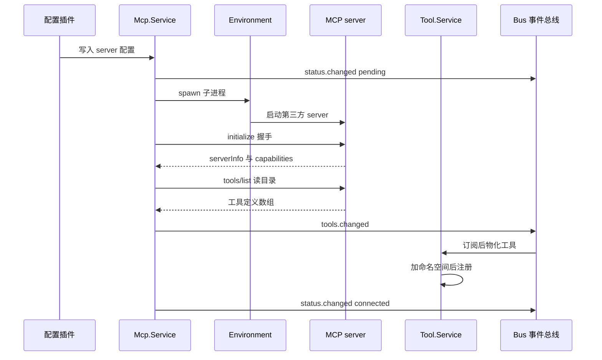
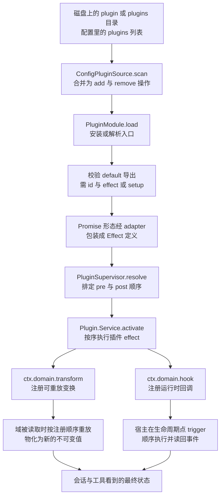
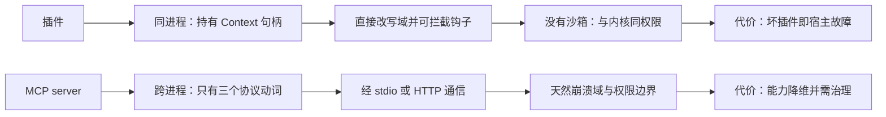

## 两条扩展路径的分野

opencode 把「扩展」拆成两件本质不同的事。一件是让外部能力**进来**：MCP server 作为独立进程或远端服务，通过标准协议暴露工具、提示词与资源。另一件是让宿主行为**被改写**：插件与内核同进程运行，直接拿到服务句柄，既可以在域数据上叠加可重放的变换，也可以在生命周期点上拦截事件。分野不是实现细节，而是能力面的取舍：MCP 对外只承认三种动词——工具、提示词、资源——因此协议接入方永远无法修改 opencode 的会话装配、权限判定或模型目录；插件能改这些，代价是它必须与内核共享同一个进程、同一份内存和同一套权限。

[packages/core/src/mcp/index.ts:30-32]()
<!-- anchor: export interface ServerInstructions { … readonly instructions: string -->

## MCP：把外部能力按协议接进来

### 两种传输各自的职责边界

MCP 客户端只使用两种传输：远端走 SDK 的 Streamable HTTP，本地走自研的 stdio 传输。SDK 提供的独立 SSE 传输没有被引入，SSE 由 Streamable HTTP 的响应体承载，这意味着「旧的 HTTP+SSE 接入方式」在本版本里没有单独的实现路径。

[packages/core/src/mcp/client.ts:5-30]()
<!-- anchor: import { … import { McpStdio } from "./stdio.js" -->

本地 server 的进程不 spawn 在宿主上，而是 spawn 在 Location 的执行平面上；`cwd` 相对 Location 目录解析，只有命令名恰为 `opencode` 时才注入 `BUN_BE_BUN`。这是为了让远程 workspace 里的 MCP server 跑在它该跑的那台机器上。

[packages/core/src/mcp/client.ts:195-236]()
<!-- anchor: const exit = yield* Effect.gen(function* () { … }).pipe(Effect.exit) -->

为什么不用 SDK 自带的 `StdioClientTransport`？因为需要走 `Environment` 的 spawner，还需要进程组回收、帧长上限与背压。源码注释写明它「Mirrors StdioClientTransport」，即语义上对齐 SDK 实现，只是换了执行平面并补上治理。

[packages/core/src/mcp/stdio.ts:9-15]()
<!-- anchor: /** Mirrors StdioClientTransport: wait this long for a graceful exit after stdin … const MAX_FRAME_BYTES = 16 * 1024 * 1024 -->

stdio 传输里三个不显眼但决定成败的细节：出站队列容量 64（因为 sink 会关闭自己的流而 stdin 必须保持打开）、单帧上限 16 MiB、stderr 被持续抽干以避免管道写满导致 server 卡死。

[packages/core/src/mcp/stdio.ts:42-52]()
<!-- anchor: export const make = Effect.fnUntraced(function* (options: Options) { … let trailingBytes = 0 -->

清理是分级升级的：先等进程在 2 秒宽限内自然退出，再 SIGTERM 等 2 秒，最后 SIGKILL；杀的是进程组，所以后代进程一并带走。传输在调用方 scope 中获取，scope 关闭即杀进程——生命周期绑定而不是手工 close。

[packages/core/src/mcp/stdio.ts:54-59]()
<!-- anchor: const stop = Effect.fnUntraced(function* (handle: ChildProcessHandle) { … }, Effect.ignore()) -->

[packages/core/src/mcp/stdio.ts:140-156]()
<!-- anchor: const startOutput = (handle: ChildProcessHandle) => … transport.onclose?.() -->

### 连接、握手与协议纪元协商

`Connection` 是 core 与 SDK 之间唯一的边界对象：它把 SDK `Client` 完全挡在 core 之外，只暴露 `modern`、`instructions`、工具/提示词/资源读取，以及关闭、会话过期、三类变更回调。

[packages/core/src/mcp/client.ts:91-99]()
<!-- anchor: export interface Connection { … /** Resolves to undefined when the server does not advertise resources. */ -->

握手阶段客户端声明 `elicitation` 能力（表单与 URL 两种）、为 legacy 声明 `roots`，注册 `roots/list` 处理器把 Location 目录作为工作根返回，并按协议纪元决定是否做版本探测。

[packages/core/src/mcp/client.ts:140-169]()
<!-- anchor: const initialize = Effect.fnUntraced(function* (transport: Transport) { … }).pipe(Effect.onError(() => Effect.promise(() => transport.close()).pipe(Effect -->

协议纪元策略是三档而非开关：未配置或 `legacy` 不做探测，直接走 `initialize` 握手，最高说到 2025-11-25；`auto` 探测 2026-07-28 并在不支持时回退；显式钉版本则要求该版本，否则失败。默认选 `legacy` 是因为绝大多数 server 只实现握手；把升级决定显式交给用户，失败时错误信息还会列出服务端支持的版本，可自愈。

[packages/schema/src/mcp.ts:20-23]()
<!-- anchor: export const Protocol = Schema.Literals(["legacy", "auto", "2026-07-28"]).annota … 'MCP protocol negotiation. "legacy" (default) opens with the initialize handshak -->

[packages/core/src/mcp/client.ts:302-316]()
<!-- anchor: const error = Cause.squash(exit.cause) … return { mode: { pin: protocol } } -->

`modern` 不是装饰性字段：只有 legacy 纪元的传输才持有服务端签发的 `Mcp-Session-Id`，因此 404（以及重启后的单会话 server 返回的 400「Server not initialized」）才能被判为「会话已过期」，并只上报一次；modern 连接上的 404 不会被误判为过期。

[packages/core/src/mcp/client.ts:173-192]()
<!-- anchor: // Legacy era only: the transport holds the Mcp-Session-Id the server minted, an … return new SessionExpiredError({ server }) -->

### 三档超时的语义

启动、目录、执行三档超时的默认值分别是 30 秒、30 秒、12 小时，并且都可以按 server 覆盖。

[packages/core/src/mcp/client.ts:32-34]()
<!-- anchor: const DEFAULT_STARTUP_TIMEOUT = 30_000 … const DEFAULT_EXECUTION_TIMEOUT = 12 * 60 * 60 * 1_000 // 12 hours -->

[packages/schema/src/mcp.ts:7-15]()
<!-- anchor: export class TimeoutConfig extends Schema.Class<TimeoutConfig>("Mcp.TimeoutConfi … description: "Maximum time in milliseconds to wait for MCP tool and prompt e -->

为什么不是一个统一超时？握手、目录读取、工具执行的时间尺度相差两到三个数量级。用一个值必然二选一：要么短到能及时暴露坏 server，但会误杀长任务；要么长到能容忍长任务，但启动挂死时用户要等同样的时间。拆开之后，每一档都能取该场景下「既不过早放弃也不无限等待」的值。

### 从配置到工具注入的完整时序

配置侧先把所有文档里的 `mcp.servers` 合并，全局超时按配置顺序合并后再被 per-server 覆盖；同名 server 采取「首个写入者胜」——后写入的配置不会覆盖已存在的条目，因此内置插件可以先占位。

[packages/core/src/config/plugin/mcp.ts:39-54]()
<!-- anchor: yield* mcp.transform((editor) => { … editor.set(name, { ...server, timeout: { ...timeout, ...server.timeout } }) -->

连接失败也要算进 connect：工具列表的读取被并入连接过程，失败直接把 server 标记为 `failed`，而不是留下「已连接但工具列表为空且没有恢复路径」的状态。

[packages/core/src/mcp/index.ts:380-407]()
<!-- anchor: const startServer = (name: ServerName, entry: ServerEntry) => … ).pipe(Effect.exit) -->

连接成功则发布 `tools.changed`、`resources.changed`、`status.changed` 三个事件，并挂上关闭、会话过期、工具/提示词/资源变更四类回调；工具注册层订阅 `tools.changed`，把发现的工具一次性写入 Tool 域。

[packages/core/src/mcp/index.ts:408-433]()
<!-- anchor: if (Exit.isSuccess(result)) { … Effect.annotateLogs({ server: name, directory: location.directory, connectionID: -->

[packages/core/src/tool/mcp.ts:36-58]()
<!-- anchor: // Register once after initial discovery; only subsequent updates need a debounc … source: { -->

### 首批连接的启动时机

首批连接一律异步 fork，源码注释直言「一个慢 server 不该阻塞 Location 启动」；所有条目先被种成 `pending` 并各自持有一个 startup latch，调用方需要时再 await 它。

[packages/core/src/mcp/index.ts:503-511]()
<!-- anchor: // Initial connections stay asynchronous so one slow server does not block Locat … fork(startServer(name, entry).pipe(locks.withLock(name))) -->

读语义也据此定义：读取报告的是「此刻已连接」的 server，正在启动的 server 会在后续变更事件里补进来。

[packages/core/src/mcp/index.ts:616-620]()
<!-- anchor: // Reads report what is connected now; servers still starting contribute once th … .toSorted((a, b) => a.server.localeCompare(b.server) || a.name.localeCompare(b.n -->

远端还会做端点级互斥：同一个 URL 的并发启动被串行化，避免共享端点收到启动风暴。

[packages/core/src/mcp/index.ts:84-85]()
<!-- anchor: // Connections remain Location-scoped, but shared remote endpoints should not re … const endpointLoads = KeyedMutex.makeUnsafe<string>() -->

### 半开连接与重连

前台请求如果观察到会话过期，会重连一次并**重放同一请求**；任何其他失败原样透传。重连前先确认 entry 的 client 仍是当初那个连接，避免在等锁期间已被替换的连接被重复启动。

[packages/core/src/mcp/index.ts:326-350]()
<!-- anchor: // Re-establishes a server whose HTTP session the server dropped, unless another … Effect.flatMap(() => (entry.client ? run(entry.client) : Effect.fail(error))), -->

后台回调（工具/提示词/资源变更）走另一条路径：它们在 server 锁下执行，并且先校验 entry 仍是那个活动连接，否则直接丢弃——晚到的 SDK 回调不能提交过期状态。

[packages/core/src/mcp/index.ts:316-322]()
<!-- anchor: const whenLive = … Effect.ignore, -->

凭据切换即重连：订阅 `Credential.Event.Switched`，只对注册过的 integration 生效，命中后停掉旧连接再起新的，因此 OAuth 登录不需要重启进程。

[packages/core/src/mcp/index.ts:530-549]()
<!-- anchor: // Bring a server online (or back to needs_auth) when its integration's credenti … Stream.runForEach((event) => Effect.sync(() => fork(reconnect(event.data.integra -->

工具目录变更做 100 毫秒去抖加滑动容量 1 的队列：server 会成批宣告变更，而每次读取都要载入整个目录，所以只保留最后一次并合并。

[packages/core/src/tool/mcp.ts:131-142]()
<!-- anchor: // Servers announce tools in bursts and each read loads the whole catalog, so se … Effect.forkScoped({ startImmediately: true }), -->

### 失败降级

状态机在 `pending`、`connected`、`needs_auth`、`failed`、`disabled` 之间流转：`UnauthorizedError` 映射为「需要授权」，其他错误映射为「失败 + 消息」；被禁用的 server 直接把 startup latch 打开并汇报为 `disabled`。资源目录的读取对每个 server 单独兜底为空数组，因此一个坏 server 不会让整个目录失败。

[packages/core/src/mcp/index.ts:664-700]()
<!-- anchor: resourceCatalog: Effect.fn("MCP.resourceCatalog")(function* () { … return ResourceCatalog.make({ -->

### 工具名冲突与命名空间化

工具全名由 server 名与工具名拼接而成，非字母数字下划线破折号的字符统一替换为下划线；这个名字同时充当权限动作名，因此权限规则可以直接写成 `myserver_search`。

[packages/core/src/tool/mcp.ts:16-17]()
<!-- anchor: export const namespace = (server: string) => server.replace(/[^a-zA-Z0-9_-]/g, " … export const name = (server: string, tool: string) => `${namespace(server)}_${to -->

为什么用下划线而不是更自然的 `server.tool`？因为工具名要落在 `[A-Za-z0-9_-]{1,64}` 内，而点号在命名空间段里才被允许；注册期会显式拒绝非法工具名、非法命名空间，以及把非 Code Mode 的工具命名为保留字 `execute` 的情况。

[packages/core/src/tool.ts:304-320]()
<!-- anchor: function registrationError(tool: Tool.Info) { … return Result.isFailure(result) ? result.failure : undefined -->

### 能力协商的真正消费面

被消费得最彻底的是工具：注册进 Tool 域后就是普通工具，带自己的输入输出 schema、权限断言与执行路径。提示词被转译成 slash 命令，因此 prompt 在 opencode 里是「命令」而不是消息。

[packages/core/src/plugin/command.ts:55-79]()
<!-- anchor: for (const prompt of loaded.prompts) { … }).pipe(Effect.asVoid), -->

说明（instructions）被渲染成系统提示的一个区块，并且受权限与 Code Mode 影响：如果 `execute` 被拒绝，或者所有工具都不可见，整个说明会退化为「MCP server instructions are no longer available.」——这是把「可见性」当成「可执行性」的一部分来处理。

[packages/core/src/mcp/instructions.ts:84-105]()
<!-- anchor: const canExecute = Permission.evaluate("execute", "*", permissions).effect !== " … return source(visible.length === 0 ? Instructions.removed : visible) -->

资源只到客户端，没有进模型：资源目录通过 HTTP 路由暴露，`readResource` 虽在服务接口上，但在生产代码里我只找到接口声明与测试调用，没有把它们注入工具或系统提示的消费者。`readResource` 是否存在 SDK 客户端或 TUI/app 侧的直接调用者；我在 `packages/client`、`packages/app`、`packages/tui` 中只找到资源目录（catalog）的使用。

[packages/core/src/mcp/index.ts:717-731]()
<!-- anchor: readResource: Effect.fn("MCP.readResource")(function* (input) { … : { type: "blob", uri: part.uri, blob: part.blob, mimeType: part.mimeType }, -->

elicitation 是第四个被映射的能力，但归属被刻意做成 Location 级：server 无法把请求归属到某个持久化会话行，所以表单挂在一个固定哨兵会话 id 下。

[packages/core/src/mcp/index.ts:219-244]()
<!-- anchor: const elicitation = { … fields: [{ key: URL_ELICITATION_FIELD_KEY, type: "external", url: input.params.u -->

## MCP OAuth：把远端 server 降维成一次集成登录

### 它解决的问题

远端 server 用 OAuth 保护时没有任何静态 header 可用，而把长期令牌写进配置又会把秘密提交进仓库。opencode 的做法是把每个远端 server 注册成 OAuth 集成，凭据落进全局凭据库，配置里只留 server 定义。

[packages/core/src/mcp/index.ts:161-183]()
<!-- anchor: // Register every remote server as an OAuth integration so credentials live in t … entry.registration = { dispose: Scope.close(scope, Exit.void) } -->

客户端注册策略有三档：配置了 `client_id` 就用静态注册；服务端声明支持 CIMD 且接受公共客户端时，用托管在 opencode.ai 的客户端元数据文档充当 `client_id`，省掉动态注册；其余走动态注册。选择过程会打日志。

[packages/core/src/mcp/oauth.ts:26-34]()
<!-- anchor: /** Client ID Metadata Document: servers that support CIMD accept this URL as th … return [String(url), init.body.get("client_id") ?? "", init.body.get("refresh_to -->

[packages/core/src/mcp/oauth.ts:419-432]()
<!-- anchor: const discovery = yield* Effect.tryPromise({ … registration: oauth?.client_id ? "static" : cimd ? "cimd" : "dcr", -->

### 浏览器与回环回调

授权流程生成本地回环监听：32 字节随机 state、惰性 `import("node:http")`（在 workerd 这类没有回环的运行时里根本不会求值）、端口按 `callback_port`、`redirect_uri` 端口、临时端口的顺序取，校验 state，并用 finalizer 关闭服务器。

[packages/core/src/mcp/oauth.ts:378-391]()
<!-- anchor: // callback_port, else the port pinned by redirect_uri, else ephemeral; a mismat … yield* Effect.addFinalizer(() => Effect.sync(() => server.close())) -->

对外只暴露「打开这个 URL」与「等这个回调」，拿到的 code 换 token 后再映射成凭据；写库发生在最终化阶段，缺少 token 会明确报错。

[packages/core/src/mcp/oauth.ts:451-460]()
<!-- anchor: const finalize = Effect.gen(function* () { … return toCredential({ methodID: input.methodID, serverUrl: input.config.url, tok -->

### 凭据去哪儿了

令牌被转成凭据行，access、refresh、过期时间与 metadata（serverUrl、tokenType、scope、issuer、客户端信息）一起落库；`connectProvider` 在这里做了一件容易被忽略的事：把同一 refresh_token 的并发刷新合并成一个请求，否则第二个请求会拿到 `invalid_grant`。

[packages/core/src/mcp/oauth.ts:269-298]()
<!-- anchor: export const connectProvider = Effect.fnUntraced(function* (input: { … presented = oauth.refresh -->

刷新去重的键是 URL、client_id 与 refresh_token 三元组，明确只对 `grant_type=refresh_token` 生效——授权码交换不该被合并。

[packages/core/src/mcp/oauth.ts:29-34]()
<!-- anchor: // Refresh tokens rotate, so concurrent refreshes of the same token share one re … return [String(url), init.body.get("client_id") ?? "", init.body.get("refresh_to -->

资源身份用配置 URL 而不是实际拨号 URL：传输会附加查询参数（例如 `?codemode=false`），而有些 server 会把它回显成 resource，因此 token 绑定到配置 URL，后续刷新才会指向与登录时同一个资源。

[packages/core/src/mcp/oauth.ts:172-179]()
<!-- anchor: // The transport dials the configured URL with extra query parameters and some s … ...(redirect ? { state: () => redirect.state } : {}), -->

## 插件：进程内挂钩

### 双模型不是两代，而是同一能力面的两种编程模型

插件包同时提供 Effect 与 Promise 两套入口，包级约定直言「插件包有两个版本：Effect 与 Promise」。

[packages/plugin/AGENTS.md:3-6]()
<!-- anchor: - The plugin package has two versions: Effect and Promise. … - Plugin domains add only the additional functions that make sense in the plugin -->

两者不是新旧关系：适配层把 Promise 插件编译成 Effect 定义，注释说明这是为了让「只认 Effect 的 core 插件运行时能原样运行它」，并保留启动期批处理语义，使 Promise 插件的域变换仍然合并成每个域一次重载。

[packages/plugin/src/promise/adapter.ts:208-214]()
<!-- anchor: * Adapts a Promise plugin into an Effect plugin so the existing Effect-only … * into one reload per domain. -->

两套 API 的形状差别只在返回与失败模型：Effect 版是 `effect: (ctx) => Effect<void, never, R>`，Promise 版是 `setup: (ctx) => Cleanup | void`，`define()` 都只是恒等函数。域方法集合、注册顺序语义、作用域归属完全一致。

[packages/plugin/src/effect/plugin.ts:56-62]()
<!-- anchor: export interface Plugin<R = Scope.Scope> { … return plugin -->

[packages/plugin/src/promise/plugin.ts:56-64]()
<!-- anchor: export type Cleanup = () => Promise<void> | void … return plugin -->
[packages/plugin/src/promise/adapter.ts:290-303]()
<!-- anchor: const context2: PromiseContext = { … host.aisdk.hook(name, (event) => Effect.promise(() => Promis -->

V1 的痕迹只作为兼容面存在：仓库自带的 `.opencode/package.json` 仍钉在旧 scope 的 `@opencode-ai/plugin` 上，说明旧的 Promise 风格包在真实使用中还没消失。这正是「两套 API 是同一能力面的两种写法」而非「V1/V2 两代」的旁证。

[.opencode/package.json:3]()
<!-- anchor:     "@opencode-ai/plugin": "1.18.4" -->

### 从磁盘到钩子的加载链路

发现阶段有两条来源：目录自动发现（`plugin` 与 `plugins` 两个名字，接受文件、目录与符号链接）与配置里的 `plugins` 列表（字符串即添加，`-` 前缀即移除）。显式配置最后应用，因此它可以移除自动发现的包；配置里的绝对路径被要求是目录，指向文件只警告并忽略。

[packages/core/src/plugin/source-directory.ts:7-32]()
<!-- anchor: export const names = ["plugin", "plugins"] as const … return targets.flatMap(Option.toArray) -->

[packages/core/src/config/plugin/source.ts:122-133]()
<!-- anchor: const scan = Effect.fn("ConfigPluginSource.scan")(function* ( … ).pipe(Effect.map((items) => items.flat())) -->

[packages/core/src/config/plugin/source.ts:134-157]()
<!-- anchor: const configured = entries … ).pipe(Effect.map((operations) => operations.flatMap(Option.toArray))) -->

目录型插件的入口通过子路径约定解析（`server`、`tui`、`rpc`），缺失的入口按一组「模块找不到」错误码容忍；同时要求 `server` 入口落在目录内，否则静默丢弃，避免通过目录形态逃逸出插件根。

[packages/plugin/src/host.ts:17-41]()
<!-- anchor: export function resolve(target: Target): Entrypoints { … return undefined -->

模块导出被严格校验：必须是 `default`，必须带 `id`，并且要么有 `effect` 要么有 `setup`；Promise 形态在这里被替换成适配后的 Effect 定义，最后以一个统一的 `effect(host)` 收口，并把配置里的 `options` 注入进去。

[packages/core/src/plugin/module.ts:60-69]()
<!-- anchor: const Module = Schema.Struct({ … (input): input is Parameters<typeof PluginPromise.fromPromise>[0]["setup"] => ty -->

[packages/core/src/plugin/module.ts:116-132]()
<!-- anchor: const plugin = "effect" in value ? value : PluginPromise.fromPromise(value) … } satisfies Generation -->

热重载的实现值得单看：源码缓存按每个被跟踪文件的 SHA-256 判定依赖图是否变化，读不到的文件记为 `"missing"`，**失败的 import 也会被缓存**——否则每次文件系统事件都会重复触发 import 期的副作用。Node 侧用 `registerHooks` 加一个 `__opencode_reload` 查询参数强制重新求值，Bun 侧自己扫依赖并清 `require.cache`。

[packages/plugin/src/source.ts:8-43]()
<!-- anchor: export function createPluginSources(watch: (file: string) => Promise<void>) { … sources.clear() -->

[packages/plugin/src/source.node.ts:10-51]()
<!-- anchor: export async function prepareSource(entrypoint: string, track: (file: string, di … return { version: specifier, load: () => Host.load(specifier), dispose: () => ho -->

插件来源被分成三段依次激活：内置的 `pre`、包、内置的 `post`。同 id 只保留 boot 顺序里的第一个，其余记为失败——注释解释了原因：注册表在重复 id 上会直接死掉，那会把整个 generation（含内置插件）一起丢掉。

[packages/core/src/plugin/supervisor.ts:91-99]()
<!-- anchor: const ordered = [ … ordered.findIndex((other) => other.id === plugin.id) !== index -->

[packages/core/src/plugin/internal.ts:208-242]()
<!-- anchor: const pre = [ … ] as const satisfies readonly InternalPlugin[] -->

内置插件不是特殊通道：`internal.ts` 的 `list()` 只从当前上下文里挑出服务，再把每个内置插件的 effect 用同一份上下文 provide 一遍，因此内置插件与外部插件走的是同一个公开 API。

[packages/core/src/plugin/internal.ts:263-275]()
<!-- anchor: export const list = Effect.fn("PluginInternal.list")(function* () { … post: resolve(post), -->

激活过程分两步：先以 `install=false` 立即解析并应用，再以 `install=true` 处理需要安装的包，然后并发检查 npm 更新。触发源被合并成一个滑动容量 1 的队列——首次激活立即执行，后续请求去抖 100 毫秒。

[packages/core/src/plugin/supervisor.ts:138-155]()
<!-- anchor: const activate = Effect.fn("PluginSupervisor.activate")(function* () { … const immediate = yield* resolve(modules, pre, post, operations, false, running) -->

[packages/core/src/plugin/supervisor.ts:196-236]()
<!-- anchor: // Start source consumers before activation, without an extra merge/debounce bou … Effect.forkScoped({ startImmediately: true }), -->

会话入口在读取插件提供的状态（命令、技能、钩子、模型目录）之前必须 await 激活，因为冷 Location 的插件是异步点亮的。

[packages/core/src/plugin/service.ts:30-34]()
<!-- anchor: * Session entry points wait here before reading plugin-provided state such as co … export const awaitActivation = Service.use((plugins) => plugins.awaitActivation) -->

加载失败是清单项而不是崩溃：失败带一个 `err_xxxxxxxx` 引用写入 failures，并且注释明确——新 revision 没有成为 generation，因此正在运行的那个保持原位。这是「坏插件不替换好插件」的具体实现。

[packages/core/src/plugin/supervisor.ts:71-88]()
<!-- anchor: if ("error" in plugin) { … enabled.add(plugin.id) -->

### 钩子面逐类清单

**目录类变换（transform）** 作用于域数据，在域被读取时按注册顺序对一份全新值重放。

[packages/plugin/src/effect/registration.ts:12-27]()
<!-- anchor: export type Hooks<Spec, Failures extends Record<keyof Spec, unknown> = Record<ke … export type Transform<Input> = (callback: (input: Input) => void) => Effect.Effe -->

- **agent**：可加、改、删、设默认 agent。内置 agent 插件正是用 `editor.update` 定义 Build 并追加权限规则，说明「内置 agent」与「外部插件加的 agent」在数据上是同一类东西。

[packages/core/src/plugin/agent.ts:83-91]()
<!-- anchor: export const Plugin = define({ … item.permissions.push({ action: "question", resource: "*", effect: "allow" }) -->

- **command**：`reload` 由 MCP 提示词变更事件驱动；提示词在这里被物化成命令，所以「装了 MCP server 就多出 slash 命令」不是特例逻辑。

[packages/core/src/plugin/command.ts:55-79]()
<!-- anchor: for (const prompt of loaded.prompts) { … }).pipe(Effect.asVoid), -->

- **mcp**：编辑器提供 list/get/set/update/remove，可增删 server 与改写单个 server 的字段。Code Mode 排除插件就是在这里把特定 server 的 `codemode` 置为 `false`。

[packages/plugin/src/effect/mcp.ts:6-16]()
<!-- anchor: export interface MCPEditor { … readonly reload: () => Effect.Effect<void> -->

[packages/core/src/plugin/mcp-codemode-exclusion.ts:9-22]()
<!-- anchor: export const Plugin = define({ … if (urls.some((pattern) => pattern.test(endpoint))) server.codemode = false -->

- **provider / model**：provider 记录带 `models` 与 `sourceConnection`。models.dev 插件用 provider 变换注入目录，并在刷新事件到达时**显式**重载 integration 与 provider 两个域——跨域重建不会自动发生。

[packages/core/src/plugin/models-dev.ts:60-72]()
<!-- anchor: const apply = (data: readonly ModelsDev.Snapshot[]) => { … if (snapshots(latest) !== loaded.data) yield* apply(latest) -->

- **tool**：`tool.transform` 注册工具并可指定命名空间与权限类别；浏览器插件就是用它加了一个 `browser` 命名空间。

[packages/plugin-browser/src/tools.ts:33-57]()
<!-- anchor: yield* ctx.tool … .pipe(Effect.orDie) -->

- **integration**：注册凭据方法（key、env、oauth、command）。内部 provider 插件用同一入口加「手动输入 API Key」与环境变量方法，再给 OAuth 方法挂上 authorize 与 refresh。

[packages/plugin/src/effect/integration.ts:41-60]()
<!-- anchor: export type IntegrationOAuthAuthorization = { … readonly label?: (credential: Credential.OAuth) => string | undefined -->

[packages/core/src/plugin/provider/digitalocean.ts:40-52]()
<!-- anchor: const oauth = { … const { createServer } = yield* Effect.promise(() => import("node:http")) -->

- **websearch**：可增删 provider 并设默认（显式接受 `false`，即「关掉搜索」），Exa 这类插件同时注册集成方法与搜索 provider。

[packages/core/src/plugin/websearch/exa.ts:25-37]()
<!-- anchor: export const Plugin = define<HttpClient.HttpClient | Scope.Scope>({ … method: { type: "env", names: ["EXA_API_KEY"] }, -->

- **skill**：技能域加内置技能内容，因此「内置技能」也只是插件注册的数据。

[packages/core/src/plugin/skill.ts:23-43]()
<!-- anchor: export const Plugin = define({ … content: reportContent, -->

**运行时挂钩（hook）** 在生命周期点被触发，按注册顺序执行，后一个能看见前一个的改动。

[packages/core/src/plugin/hooks.ts:63-94]()
<!-- anchor: const layer = Layer.effect( … return event -->

- **session**：钩子面最宽，覆盖提示词装配、上下文、压缩、生成、标题、模型请求、HTTP 请求与响应、实验性 WebSocket 握手/发送/接收，以及重试决策。请求种类被显式区分成主请求、压缩、标题、生成四类，插件据此区分自己处在哪种调用里。

[packages/plugin/src/effect/session.ts:138-150]()
<!-- anchor: export interface SessionHooks { … readonly retry: SessionRetry -->

  例如 OpenAI 插件在 `model.request` 上把 `api.openai.com` 换成 Codex 端点并写入 session-id 头，用 `providerID` 选项把钩子限定到该 provider。

[packages/core/src/plugin/provider/openai.ts:298-308]()
<!-- anchor: yield* ctx.session.hook( … { providerID: Provider.ID.openai }, -->

  更强的用法是替换响应体：Snowflake 在 `http.response` 上把 400 的「conversation complete」错误改写成一条正常的 SSE 结束帧，并用 `retry` 钩子在 401 且第二次尝试时刷新凭据、注入 `retry: true`。

[packages/core/src/plugin/provider/snowflake-cortex.ts:210-245]()
<!-- anchor: yield* ctx.session.hook( … { providerID }, -->

  选择哪个钩子是有讲究的：Copilot 插件注释说明它用 `model.request` 而不是 `http.request`，因为前者对每条路由都执行，而后者会被 AI SDK 的调用路径绕过。

[packages/core/src/plugin/provider/github-copilot.ts:261-275]()
<!-- anchor: // Runs for every route, unlike http.request, which the AI SDK route bypasses. … { providerID: Provider.ID.githubCopilot }, -->

- **tool**：`execute.before` 可以改写入参，而且是所有钩子里**唯一允许失败**的（失败类型为 `Tool.Error`）；`execute.after` 只观测完成或错误。参数修复插件正是靠这一点在工具拿到参数前把「字符串化的对象」「数字字符串」等形态改成合法 schema。

[packages/plugin/src/effect/tool.ts:20-51]()
<!-- anchor: export interface ToolHooks { … readonly "execute.after": never -->

[packages/core/src/plugin/tool-input-repair.ts:21-33]()
<!-- anchor: export const Plugin = define({ … event.input = repair(event.input, schema, schema, 0) -->

- **permission**：`evaluate` 钩子可以改 `effect` 与 `message`。配置策略插件用它实现「Blocked by configuration policy」，并且策略优先级是「用户全局策略压过仓库自带的策略」。

[packages/core/src/config/plugin/policy.ts:30-41]()
<!-- anchor: Effect.sync(() => { … event.message = "Blocked by configuration policy" -->

- **aisdk**：`sdk` 与 `language` 两个钩子，provider 适配器工厂按 `evt.package` 决定是否接管 SDK 构造，用 providerID 过滤避免误伤其他 provider。

[packages/core/src/plugin/provider/factory.ts:5-17]()
<!-- anchor: export function createProviderPlugin(input: { … evt.sdk = yield* Effect.promise(() => input.load(evt.options)) -->

- **event**：`subscribe()` 给出事件流，是插件响应配置变化的通用手段。本地模型 provider 用它监听 `config.updated`，端点变了就清空目录并重载。

[packages/core/src/plugin/provider/vllm.ts:109-110]()
<!-- anchor: // Keep the last successful inventory through transient outages instead of flick … yield* refresh().pipe(Effect.ignore, Effect.repeat(Schedule.spaced(interval)), E -->

- **storage**：插件拿到的 KV 按插件 id 加命名空间，命名空间用 id 每个字符的十六进制码点拼接，避免自定义分隔符与 id 内容冲突。

[packages/core/src/plugin/host.ts:584-607]()
<!-- anchor: export function storage(kv: KV.Interface, pluginID: string): Plugin.Context["sto … return { entries, next: result.next.slice(namespace.length) } -->

- **update / sdk / instance**：更新检查是 24 小时周期加每目标互斥；SDK 插件是 host 全局的（一个宿主里每个 Location 看到同一批注册）；Instance 插件是每个实例出生时绑定的，重复 id 直接抛错。

[packages/core/src/plugin/instance.ts:9-19]()
<!-- anchor: * Holds the plugins one instance is born with. Unlike the host-global … export type List = readonly Plugin[] -->

[packages/core/src/plugin/sdk.ts:12-19]()
<!-- anchor: * Holds the plugins an embedder (the `@opencode/sdk` host) contributes, … * every Location in one host sees the same registrations. -->

### 两种生效语义为什么必须分开

`transform` 要求实现是**可重放的**，因为域会在任意时刻被重建：配置变了、模型目录刷新了、凭据切换了。同一份注册集合必须能重新产出一份等价的值。`hook` 则相反，它必须**恰好在一个生命周期点上执行一次**，并且顺序可见。这个分工是一次被明确记录的取舍。被放弃的方案是让 `Config.transform` 直接改任意字段，代价是每个消费配置的服务都要具备「完整重载」能力。

[specs/v2/catalog-config-plugin-lifecycle.md:18-20]()
<!-- anchor: ## A. Rejected: Config Transforms, Service Reload … `Config` merges its ordered documents and then runs ordered, replayable plugin t -->

选中的方案则把代价转移到插件侧：禁用、来源刷新、策略重新评估都必须表达成「重放变换」，认证不能被建模成配置项，并且重建要去抖、要保证一次内部重建最多发一次更新事件。

[specs/v2/catalog-config-plugin-lifecycle.md:314-323]()
<!-- anchor: ### Tradeoffs … - Deferred plugin activation avoids blocking readiness and only rebuilds catalog -->

### 与设计文档的一处偏离

决策文档通篇只讲一个 `Catalog`，而实现把它泛化成了按域的注册表：agent、provider、model、skill、command、mcp、tool、integration、reference、vcs、websearch、worktree 各自拥有 transform 与 reload，运行时钩子则另走 `PluginHooks` 一张表。内置插件表本身就是这份泛化的清单。以代码为准。

[packages/core/src/plugin/internal.ts:244-261]()
<!-- anchor: const post = [ … ] as const satisfies readonly InternalPlugin[] -->

## 信任与隔离边界

### 进程内插件的真实权限

插件拿到的是完整的宿主上下文：存储、会话客户端、工具与 agent 编辑器、provider 目录、MCP 编辑器，以及任意 Effect 能力。宿主在装配时把不可变上下文整体转成可写视图，没有按插件做服务裁剪。

[packages/core/src/plugin/host.ts:47-76]()
<!-- anchor: export const make = Effect.fn("PluginHost.make")(function* ( … const currentWorktreeStrategies = location.workspaceID ? undefined : worktreeStr -->

对内部插件存在一层收敛：`list()` 只从上下文里挑出声明过的服务再 provide 给内置插件。对外部插件没有等价的裁剪——这正好是「内置插件与外部插件共享同一 API」的另一面：共享 API 意味着共享权限。这一结论我只在服务解析层面验证过，未发现运行时权限闸门。是否存在我未读到的、对插件 effect 的 R 层或权限层裁剪。

### supervisor 保住了什么、没保住什么

`supervisor` 提供的是**失败容纳**，不是隔离：加载失败退化成失败清单条目并保留上一代；激活期抛出的错误被捕获后记日志并吞掉；插件 effect 的作用域终结器负责释放它注册的一切。它没有、也无法提供 CPU、内存或文件系统层面的隔离——插件与内核共享进程。

[packages/core/src/plugin/supervisor.ts:71-88]()
<!-- anchor: if ("error" in plugin) { … enabled.add(plugin.id) -->

[packages/core/src/plugin/supervisor.ts:226-236]()
<!-- anchor: yield* Stream.concat(Stream.succeed(0), Stream.fromQueue(triggers).pipe(Stream.d … Effect.forkScoped({ startImmediately: true }), -->

真正的崩溃隔离只出现在跨进程的那一侧：MCP 连接关闭时触发回调，把状态置为 `failed` 并停掉该 server，进程内的一切照常。

[packages/core/src/mcp/index.ts:355-377]()
<!-- anchor: const watch = (name: ServerName, entry: ServerEntry, connection: McpClient.Conne … connection.onResourcesChanged(() => live(bus.publish(McpEvent.ResourcesChanged, -->

TUI 宿主是第三套边界：它有自己的一套插件上下文（插槽、Markdown 渲染、键位、主题、数据查询），在 Bun 下借助 OpenTUI 的运行时插件变换加载，在 Node 下则加载预编译插件、没有变换能力。它的插槽解析是纯函数：替换边界先于增量声明，冲突时退化到最近的存活祖先。

[packages/tui/src/plugin/discovery.ts:8-21]()
<!-- anchor: export async function localPluginDirectories(cwd: string, configDirectory: strin … return directories.filter((_, index) => exists[index]).map((directory) => path.j -->

[packages/tui/src/plugin/structure.ts:1-5]()
<!-- anchor: // Pure resolution of the slot tree: the mounted slot paths plus plugin claims … // transform. -->

[packages/tui/src/plugin/render.tsx:24-45]()
<!-- anchor: // Contain render-time plugin crashes: a throwing slot or route must not take … </ErrorBoundary> -->

## 浏览器宿主：同一套 API 的改写而非裁剪

浏览器插件证明了这套 API 的边界在「能力由谁提供」，而不在「API 长什么样」：它本身就是一个普通插件，用工具域加 `browser` 命名空间，用 RPC 域把能力注册给桌面端。

[packages/plugin-browser/src/index.ts:6-11]()
<!-- anchor: export default Plugin.define({ … yield* BrowserTools.register(ctx, connection) -->

对齐策略不是把 API 删掉，而是把能力搬到另一端：会话按连接键挂载，所有浏览器操作经 RPC 送到桌面 attachment，每个请求 60 秒超时并明确告知「结果未知」而不能假装失败可重试。

[packages/plugin-browser/src/connection.ts:60-78]()
<!-- anchor: const browser: Attachment = { … Effect.gen(function* () { -->

桌面独占的部分被显式标注为不会在服务端加载，并且自身做认证：代理监听用随机 basic-auth 凭据与常量时间比较。

[packages/plugin-browser/src/proxy.ts:24-28]()
<!-- anchor: // Desktop-only leaf. This listener is never loaded by the server plugin. … const expected = Buffer.from(`Basic ${Buffer.from(`${username}:${password}`).toS -->

## MCP 与 Code Mode 的互斥：一个被误读的名字

先纠正一个容易过度解读的点：这里没有「MCP 与 Code Mode 全局互斥」。opencode 默认把工具折叠进一个 `execute` 工具（Code Mode），快照时按 `options.codemode === false` 把工具分成「直接暴露」与「进 Code Mode 目录」两组，后者只通过 `execute` 调用。

[packages/core/src/tool.ts:234-245]()
<!-- anchor: const direct = new Map(Array.from(active).filter(([, tool]) => tool.options?.cod … : undefined -->

[packages/core/src/tool.ts:255-261]()
<!-- anchor: return { … ...(codeModeTool ? [definition(codeModeTool)] : []), -->

MCP 工具注册时把 server 配置上的 `codemode` 标志透传下来，所以「某个 server 是否进折叠」是 per-server 的配置。

排除插件做的事是：对**自带** Code Mode 的 server 把该标志置为 `false`，注释的理由很直接——这些 server 自己就提供 Code Mode，应当直接暴露，而不是再嵌一层进 opencode 的 Code Mode。命中的是本地 `executor mcp` 命令与 `executor.sh` 的远端 MCP URL。

[packages/core/src/plugin/mcp-codemode-exclusion.ts:6-7]()
<!-- anchor: // These servers provide Code Mode, so expose them directly instead of nesting t … const urls = [/^https:\/\/executor\.sh\/[^/]+\/mcp$/] -->

[packages/core/src/plugin/mcp-codemode-exclusion.ts:9-22]()
<!-- anchor: export const Plugin = define({ … if (urls.some((pattern) => pattern.test(endpoint))) server.codemode = false -->

远端还有第二层协商：对支持该约定的 server 在 URL 上附加 `codemode=false` 以索取原始工具；如果 server 因未知查询参数返回 400 或 404，就用原 URL 重试一次。注意配置 URL 始终是 OAuth 身份，附加参数不改变凭据绑定。

[packages/core/src/mcp/client.ts:214-233]()
<!-- anchor: // Servers that bundle their own Code Mode (Cloudflare and others) expose raw to … return open(new URL(config.url)) -->

对用户的实际影响是「某些 server 的工具会直接出现在工具列表里，另一些藏在 `execute` 后面」，而不是「用了 MCP 就不能用 Code Mode」。这也解释了为什么这个插件的 id 叫 exclusion——它排除的是特定 server 的折叠，不是排除 Code Mode 本身。

## 两种扩展方式各自的代价

MCP 的代价集中在治理面：多进程/多连接的启动时序、三档超时、会话过期与重放、凭据刷新去重、子进程分级回收、失败降级，这些加起来是本模块里 `client`、`index`、`oauth`、`stdio` 四个文件近两千行的主要内容，而它们换来的能力面被限死在工具、提示词、资源三种动词上——资源甚至没有进入模型可见面。

插件的代价集中在语义面：可重放变换、注册顺序、作用域归属、单次重建、跨域重建显式化、失败容纳、来源指纹缓存——这套机制同样需要多个文件来兑现，而它换来的是对内核状态的直接改写能力，代价是信任边界形同虚设：插件与内核同进程同权限，一个死循环就是宿主的死循环，`supervisor` 只能保证「坏插件不替换好插件」，不能保证「坏插件不伤害宿主」。为什么依然这么划？因为两类需求的最优解本来就在不同侧。外部能力需要语言与部署中立、需要独立生命周期与崩溃域，只有协议能给；内核行为改写需要原子地读取并修改内部状态（修工具入参、改系统提示、注入模型目录、改写 HTTP 响应），只有进程内能给。任何「用 MCP 做插件」或「用插件做外部集成」的替代方案，都要么牺牲能力面，要么牺牲中立性。

## 连回全局设计哲学

opencode 的全局立场是：durable 事件日志是唯一真源、admission 与 execution 分离、契约先行、一切服务可被替换与重建。这两套扩展机制是同一立场的两种投影。插件系统是这套立场在**内核内部**的延伸：因为状态必须能由「注册集合 + 输入」推导出来，所以域变换被要求可重放；因为执行必须是确定序列，所以钩子按注册顺序串行；因为服务是可回收的 Location 级对象，所以注册必须绑定作用域并显式释放。代价是内核必须支持「重建」这件事，并且重建的触发与去抖本身成为一套需要设计的机制。

MCP 则是同一立场在**进程边界**上的延伸：状态只在三个协议端点上交换，因此宿主的内部结构对 server 完全不可见；代价是外部能力必须被降维成那三种动词，任何不属于这三类的能力（例如「让 MCP server 修改我的系统提示」）在这条路径上无法表达，只能改走插件。
