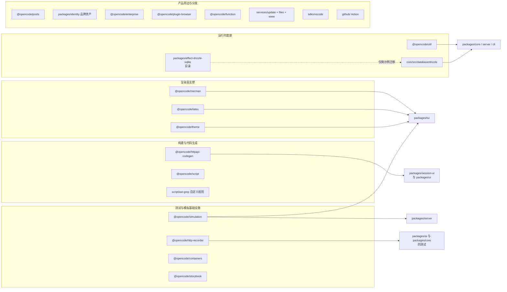
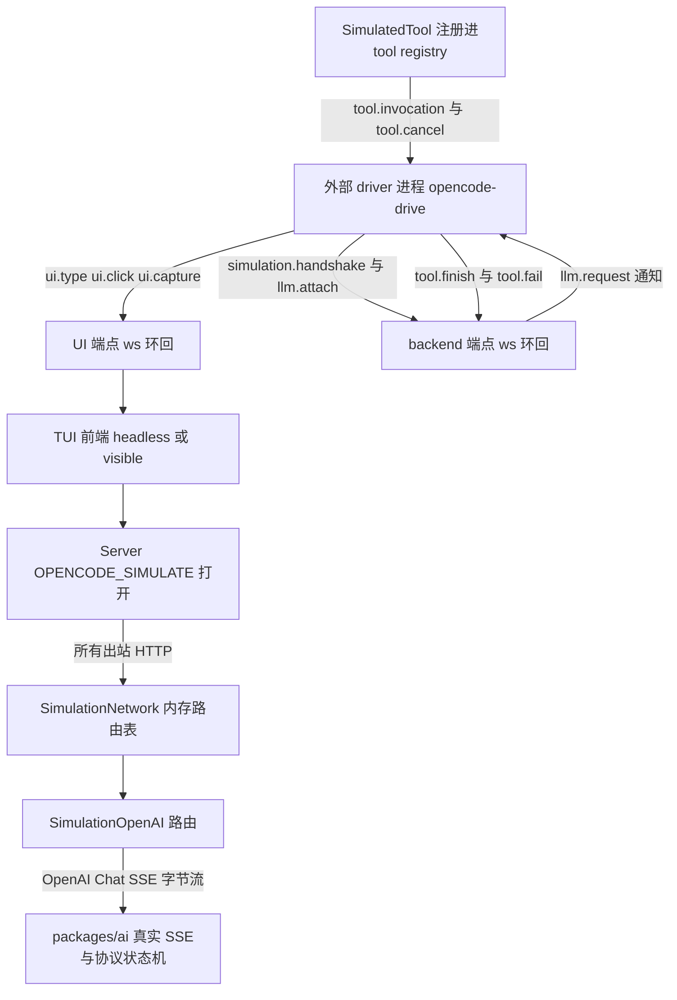
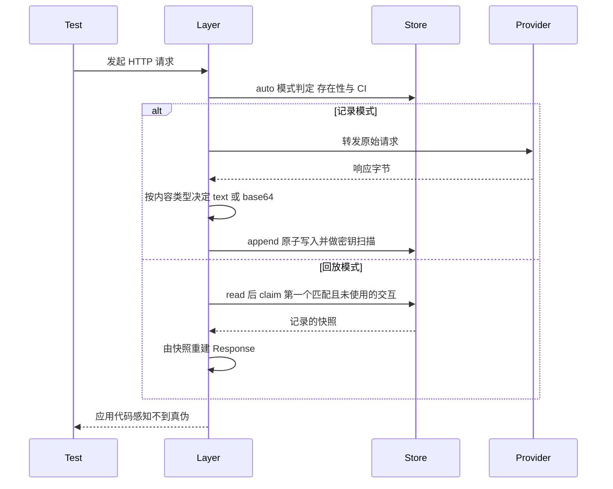

## 这批包在 monorepo 里的形状

读完主链（core / session / agent / tool / ai / schema / protocol / server / plugin / mcp / skill / acp）之后，剩下三十多个包容易让人误判：看到 `@opencode/latex` 以为它是"数学能力"，看到 `@opencode/simulation` 以为它是"模拟用户输入的小工具"。真实的轮廓是：**这些包几乎都不参与一次 prompt 从准入到执行的主链，但它们决定了这条主链能不能被验证、能不能在终端里被看见、能不能在三种运行时上跑起来。**

先把 workspace 的硬事实钉住：根 `package.json` 的 `workspaces.packages` 是四项——`packages/*`、`services/*`、`packages/console/*`、`packages/stats/*`。这意味着 `packages/console` 与 `packages/stats` 本身**不是**包，它们的 6 个和 3 个子目录才是独立 workspace；`services/` 下的三个目录是**独立部署单元**（Cloudflare Worker），不是运行时包。
[package.json:37-42]()
<!-- anchor: "workspaces": { … "packages/stats/*" -->

权威归属表也印证了分层：公开领域形状与事件载荷归 Schema，运行行为与持久化归 Core，贡献者回归护栏归根 AGENTS.md。
[specs/v2/README.md:7-14]()
<!-- anchor: Authority follows the concern: … | Contributor-critical regression guardrails      | Root [AGENTS.md](../../AGENT -->

## 归类图

五个类别，判据只有一条：**它是否出现在"prompt 准入 → 投影 → runner → 工具执行 → 事件投影"这条链上**。不在链上，就看它服务谁。



## 判据：什么算主链，什么不算

**是否被一次会话执行直接调用。** `util`、`core/src/database` 属于"主链依赖的底座"——它们不实现会话语义，但 core 的每一层都要用；`simulation`、`http-recorder` 则在主链之外，只在自己被注入时替换主链的某个节点。

**是否可在生产部署中被独立替换。** `simulation` 的全部价值在于它是**替换件**而非依赖：它替换 `HttpClient.HttpClient` 这一个节点，不改 core 的一行代码。相反 `merman` / `latex` 是被 TUI 通过插件注册进去的**消费件**。

**是否只服务开发期。** `http-recorder`、`containers`、`storybook`、`script/ast-grep`、`perf` 只在开发与 CI 期存在；`posts`、`identity`、`services/*` 只服务分发与品牌，与 Agent 能力无关。**这一类的每个包都应被当作"产品的外壳"，而不是"Agent 的能力"。**

## simulation：把整套多进程系统变成可回放对象

`simulation` 是本篇最被低估的设施。它不是"模拟一个 LLM 返回假文本"，而是**把整个 opencode 服务化运行时放进一个可被外部程序驱动、可录制、可逐帧断言的对象里**——包括 TUI 的每一个字符、每一次按键、每一次鼠标点击、每一次工具调用与每一段模型输出。它模拟的是**消费端与网络边界**，主链本身仍是真实实现。

### Drive 的两端与 manifest

包对外导出四个入口：`./backend`、`./frontend`、`./protocol`、`./recording`。一次 Drive 会话由**两个 WebSocket 端点**定义：UI 端点驱动 TUI 前端，backend 端点回答模型与工具。

端点的合法性在 schema 里就被限死：必须是 `ws://127.0.0.1:<显式端口>`，不允许多播、不允许远程主机。配置名 `OPENCODE_DRIVE` 为 `"1"` 时直接用默认端口，否则从 `$XDG_STATE_HOME/opencode-drive/instances/<name>.json` 读取实例清单。
[packages/simulation/src/manifest.ts:12-19]()
<!-- anchor: const Endpoint = Schema.String.check( … : "a loopback WebSocket endpoint with an explicit port" -->

这条约束不是洁癖：Drive 会被 CI 与本地开发同时使用，多个实例并行时端口是唯一的隔离手段；把"必须是环回 + 显式端口"写成 schema 校验，等于把"模拟环境绝不碰真实网络"变成**类型层面的承诺**。

### 模拟拓扑



### 替换点选在 `HttpClient` 与 LayerNode

Server 侧只有一个开关：`options.simulation` 为真时，**动态 import** `@opencode/simulation/backend` 并把返回的 `LayerNode.Replacements` 并进应用图层。动态 import 保证模拟代码在正常构建里根本不会被加载。
[packages/server/src/routes.ts:149-157]()
<!-- anchor: const serviceLayer = options.simulation … : build(overrides) -->

开关来自环境变量 `OPENCODE_SIMULATE`，与 TUI 侧的 `OPENCODE_DRIVE` 是两个独立开关——**服务端可以被模拟，而前端仍跑真实终端；反过来也成立**。
[packages/cli/src/server-process.ts:94-95]()
<!-- anchor: pty: { handoff }, … simulation: truthy(process.env.OPENCODE_SIMULATE), -->

替换本身是一次 `httpClient.replace(...)`，而 `SimulatedProvider.node` 被声明为 `global` 标签的全局节点，依赖 `SdkPlugins`——这正好复用了 core 的自定义 LayerNode 体系：**模拟不是一个 if 分支，而是一次在图上的节点替换**。
[packages/simulation/src/backend/index.ts:24-57]()
<!-- anchor: export const simulationReplacements: (app: { … return [httpClient.replace(networkNode)] satisfies LayerNode.Replacements -->

### 模型是路由表里的一条路由，而不是另一套机制

`SimulationNetwork` 的每次请求都先查内存路由表：命中就返回，未命中就**以传输错误失败**，错误信息是 `Simulation denied unregistered network destination`。注释写得很直白：未知目的地必须响亮失败，"so no simulation run can silently reach the real network"。
[packages/simulation/src/backend/network.ts:52-79]()
<!-- anchor: export const make = Effect.fn("SimulationNetwork.make")(function* (routes: reado … return { client, log: () => Ref.get(log) } satisfies Run -->

模拟模型只是注册在这张表里的**第一条路由**：它认领 `POST {DEFAULT_BASE_URL}{PATH}`，把 driver 下发的 item 编码成 SSE 帧，以 `data: [DONE]` 结束。关键在于注释点明的那句话——**响应字节之后的一切都是真实管线**：SSE 分帧、OpenAIChat 事件 schema、协议状态机、Lifecycle 语法全部走真实现。
[packages/simulation/src/backend/openai.ts:9-15]()
<!-- anchor: * Driver-answered OpenAI endpoint for the simulated network. … * event schema, the protocol state machine, and Lifecycle grammar. -->

这是整个设计最值钱的一点：**它不 mock 模型，它 mock socket。** 于是"模型输出很奇怪导致协议解析错了"这类 bug 在 Drive 里能复现，而用 stub 返回一个假对象则完全测不到。

### driver 在仓库之外

驱动端不是你可以在本仓库读完的代码：`script/drive/shell-output.ts` 从外部 npm 包 `opencode-drive` 导入 `OpenCodeDriver`，并以 `opencode-drive run <script>` 的形式启动一次会话；注释明确"只有对话是模拟的，shell 执行与输出读取是真的"。
[script/drive/shell-output.ts:6-12]()
<!-- anchor: // Run from the repository root with `opencode-drive run script/drive/shell-outp … keepArtifacts: true, -->

`opencode-drive` 自身的实现在本仓库内读不到——这里只留下用法示例作为证据，其**仓库外归属未确认**。可以确认的是 TUI 侧的接入点：渲染器创建时若存在 `OPENCODE_DRIVE`，就走 `Drive.create(...)`，否则创建真实终端渲染器。
[packages/tui/src/app.tsx:253-255]()
<!-- anchor: if (process.env.OPENCODE_DRIVE) { … return yield* Drive.create(options, input.app.version) -->

### TUI 侧：headless 渲染器 + 语义快照

前端有两种模式：`OPENCODE_DRIVE_RENDERER=headless` 时用 `@opentui/core/testing` 的 `createTestRenderer` 起一个真实 `CliRenderer`（屏幕缓冲在内存里），否则用可见终端并在事后按 viewport 调整尺寸。
[packages/simulation/src/frontend/simulation.ts:10-28]()
<!-- anchor: const headless = (yield* Config.string("OPENCODE_DRIVE_RENDERER").pipe(Config.wi … return renderer -->

可编程接口分三层：`capture` 返回带颜色的 span 级字符帧与图片像素（base64 RGBA），`state` 返回可聚焦/可点击元素表，`snapshot` 返回**语义快照**——应用通过 `Symbol.for("opencode.simulation.semantics")` 在 renderable 上挂一个稳定 id 与 role/label，于是点击可以表达为"点这个语义节点"而不是"点第 37 行第 12 列"。
[packages/simulation/src/frontend/actions.ts:69-93]()
<!-- anchor: * Builds the harness the simulation server drives. … screen: () => decoder.decode((Reflect.get(renderer, "currentRenderBuffer") as Re -->

协议层把能力显式枚举成 `Frontend.Capabilities` 并有握手协商，说明这套接口的消费者不假定服务端版本：`ui.click.semantic`、`ui.recording.pointer`、`ui.capture` 都是可协商能力，而不是隐含行为。
[packages/protocol/src/simulation.ts:197-215]()
<!-- anchor: export namespace Frontend { … export type Capability = (typeof Capabilities)[number] -->

### 录制：时间线与输入旁挂

录制产物是 JSONL：头部声明 `cols`/`rows`/`encoding: base64`，随后是带 `at_ms` 的 `output` 与 `resize` 事件；`Timeline` 同时伪装成 `WriteStream` 直接接管渲染器的 stdout，并实现 `getColorDepth() === 24`。**输入事件不写进同一条时间线**，而是落到同名的 `.pointers.jsonl` 侧车文件，理由是"输入与终端输出共享同一个单调时钟，旁挂文件让旧的 Drive 版本仍能读终端时间线"。
[packages/simulation/src/recording.ts:137-145]()
<!-- anchor: // Input and terminal output share one monotonic clock. A sidecar leaves … this.pointers.write(`${JSON.stringify({ atMs: this.elapsed(), action, x, y } sat -->

### 代价与边界

Drive 的所有管线都是**进程内替换**：WebSocket 控制通道是单进程内的两个端点，模型响应被缓冲后一次性编码成 SSE。因而不适合断言流式时序、取消与背压这类行为；控制通道还设了 64MB 出站上限与 256 条入站队列，超限即报错并终止连接。
[packages/simulation/src/control-server.ts:23-34]()
<!-- anchor: const maxOutboundBytes = 64 * 1024 * 1024 … const messages = yield* Queue.bounded<{ readonly socket: Socket; readonly input: -->

## http-recorder：把真实流量变成可提交的构件

`package.json` 的描述一句话说清定位：Record and replay Effect HTTP and WebSocket traffic with deterministic cassettes。它是**唯一一个同时面对"真实 provider"和"确定性断言"的包**，也是本项目测试纪律的技术支点。

### cassette 里记了什么

cassette 是一份人类可读的 JSON，顶层是 `version: 1`、可选 `metadata`、`interactions` 数组；每个 interaction 以 `transport` 作 tagged union 区分 http 与 websocket。HTTP 侧记规范化的请求快照与响应快照，非文本响应体以 base64 存。
[packages/http-recorder/src/cassette/model.ts:33-41]()
<!-- anchor: export const CassetteSchema = Schema.Struct({ … export const encodeCassette = Schema.encodeSync(CassetteSchema) -->

WebSocket 侧记的是一条**有序帧记录**：每条 interaction 可选带连接元信息（序号、URL、请求的 subprotocol、终止 close code/reason），以及 `direction`（client/server）× `kind`（text/binary）的事件序列。二进制帧无损 base64。
[packages/http-recorder/src/websocket/model.ts:19-32]()
<!-- anchor: export const WebSocketInteractionSchema = Schema.Struct({ … events: Schema.Array(WebSocketEventSchema), -->

它**不记时间**：HTTP 交互按请求开始顺序排列，WebSocket 只保序不保时序。元信息里唯一的"时间"是写入时的 `recordedAt` 审计字段。这一点后面会看到它如何换来确定性。

### 确定性来自三处收窄

**第一，JSON 规范化后比较。** 匹配键是 `method + url + 规范化 headers + 规范化 body`，JSON 对象的 key 顺序在比较前被排序，所以序列化差异不会造成假失败。
[packages/http-recorder/src/http/matching.ts:8-16]()
<!-- anchor: export const canonicalSnapshot = (snapshot: RequestSnapshot): string => … canonicalSnapshot(incoming) === canonicalSnapshot(recorded) -->

**第二，每次交互只能被认领一次，且并发按请求开始顺序落盘。** 运行时请求原子地认领"第一个未被使用的匹配项"；重复的相同请求按 cassette 顺序依次消费，这恰好把重试、轮询、缓存场景建模为确定性行为；未使用的交互在 layer 关闭时**报错失败**——防止 cassette 悄悄腐烂。
[packages/http-recorder/README.md:208-212]()
<!-- anchor: A runtime request atomically claims the first unused recorded interaction that m … Concurrent requests are recorded in request-start order even when their response -->

**第三，模式由"cassette 是否存在 + 是否 CI"决定，而不是由开发者手写开关。** `auto` 模式下：`CI` 为真强制 replay；否则 cassette 存在就 replay、不存在就 record。
[packages/http-recorder/src/replay/state.ts:5-16]()
<!-- anchor: const isCI = () => { … return (yield* cassette.exists(name)) ? "replay" : "record" -->

### 录放流程



回放不是"按顺序吐响应"：WebSocket 回放实现了一个**因果驱动循环**——遇到记录中的 server 帧就立即派发给 handler 并前进，遇到 client 帧就停下来 `Deferred.await` 应用真正写入匹配帧，然后继续。这保住了因果顺序，同时**完全不需要复现网络时序**。
[packages/http-recorder/src/websocket/recorder.ts:153-172]()
<!-- anchor: const drive = Effect.gen(function* () { … yield* drive.pipe(Effect.raceFirst(FiberSet.join(handlers))) -->

HTTP 侧还有一处细节值得学：记录模式下用一条 `Ref` 串起的 `Deferred` 链**强制按请求开始顺序完成追加**，因此并发请求即使响应乱序返回，cassette 里的顺序仍然稳定。
[packages/http-recorder/src/http/recorder.ts:102-130]()
<!-- anchor: if (mode === "record") { … }).pipe(Effect.ensuring(Deferred.succeed(completed, undefined))) -->

### 不覆盖模式与密钥扫描

`append` 先做原子写（临时文件 + rename），再落内存追加表；**没有公开的覆盖模式**——刷新 cassette 的唯一方式是先删除目标文件，理由写在 README："Deletion makes the set of recordings being refreshed visible and reviewable"。
[packages/http-recorder/src/cassette/store.ts:136-142]()
<!-- anchor: const target = pathFor(name) … Effect.orDie, -->

写入前的安全网有两层。一层是**强制的密钥扫描**：正则匹配 bearer token、`sk-`、`sk-ant-`、Google、AWS、GitHub token、私钥块，并把"看起来像凭据的环境变量值"也当作要拦截的内容；命中即 `UnsafeCassetteError`，**不替换已有文件**。
[packages/http-recorder/src/redaction/secrets.ts:3-13]()
<!-- anchor: const SECRET_PATTERNS: ReadonlyArray<{ readonly label: string; readonly pattern: … const ENV_SECRET_NAMES = /(?:API|AUTH|BEARER|CREDENTIAL|KEY|PASSWORD|SECRET|TOKE -->

另一层是**默认拒绝的脱敏策略**：请求头默认只保留 content-type / accept / openai-beta，响应头只保留 content-type，其余一律丢弃；URL 中的 username/password 与常见敏感 query 参数替换为 `[REDACTED]`，JSON body 里 `token`/`password`/`client_secret` 一类字段递归替换。
[packages/http-recorder/src/redaction/redactor.ts:8-29]()
<!-- anchor: const DEFAULT_REDACT_HEADERS = [ … "x-amz-signature", -->

连失败路径都做了脱敏：回放不匹配时抛出的传输错误用的是 `redactedErrorRequest`，即错误消息里只有脱敏后的 URL，避免把凭据带进 CI 日志。
[packages/http-recorder/src/http/recorder.ts:69-75]()
<!-- anchor: export const redactedErrorRequest = ( … reason: new HttpClientError.TransportError({ request: redactedErrorRequest(reque -->

cassette 路径本身也是安全边界：名字不允许绝对路径、Windows 绝对路径或任何 `..` 段，且解析后必须仍在 recordings 根目录内。
[packages/http-recorder/src/cassette/store.ts:53-60]()
<!-- anchor: if (!name || path.isAbsolute(name) || path.win32.isAbsolute(name) || name.split( … return target -->

### 与测试纪律串联：224 份已提交的 cassette

根 AGENTS.md 的测试纪律只有三条，其中第一条就是"Avoid mocks as much as possible"。这句话在 `ai` 包里的落地方式，就是**把真实 provider 的响应录成 224 份 cassette 提交进仓库**（其中 `ai` 包约 222 份，覆盖 40 个 provider/protocol 目录：anthropic-messages、bedrock-converse、alibaba-responses、openai-responses-websocket、gemini、cloudflare-workers-ai……；`core` 另有一份 `session-runner`）。测试因此跑的是**真实协议解析器、真实 SSE 分帧、真实请求构造**，只有 socket 对端是录下来的。
[AGENTS.md:169-171]()
<!-- anchor: - Avoid mocks as much as possible, you shouldn't be using globalThis.\* at all u … - Tests cannot run from repo root (guard: `do-not-run-tests-from-root`); run fro -->

录制入口是一个 `recordedTests(...)` 工厂：它用 `hasCassetteSync` 决定是否 `test.skip`，用 `layerFetch` + `layerWebSocketConstructor` 把两条传输通道同时接进 recorder，并在 `RECORD=true` 时**先删除旧 cassette 再录制**、同时断言 `CI` 必须未设置。
[packages/ai/test/recorded-test.ts:73-90]()
<!-- anchor: if (recording) { … }).pipe(Layer.provide(NodeSocket.layerWebSocketConstructorWS)) -->

跳过逻辑刻意做成"cassette 不存在就 skip，录制模式下缺少凭据也 skip"，而不是失败——这样 fork 出去的新 provider 测试可以先提交测试代码、由有凭据的人补 cassette。
[packages/ai/test/recorded-runner.ts:69-75]()
<!-- anchor: const recording = process.env.RECORD === "true" … return test.skip(name, () => {}, testOptions) -->

### 边界

README 自己列了 beta 期的硬伤，值得照抄进任何采纳计划的评估里：响应在录制与回放时都被缓冲，**不适合断言流式时序、取消与背压**；WebSocket 不记握手 header 与传输失败；`layerSocket` 这一层没有 URL/protocol，只能用 cassette 名 + 连接顺序做身份；cassette 格式版本 1 尚无迁移工具；只能跑 Node 22+ 与 Bun。

## latex 与 merman：同一个围栏，两套渲染栈

被渲染的对象是同一段 fenced code（` ```mermaid `、` ```latex ` / ` ```math `），但**终端与 Web 用的是两套完全不同的实现**。Web 端直接用现成库：`packages/session-ui` 依赖 `mermaid@11.17.2` 输出 SVG，`packages/ui` 依赖 `katex@0.16.47` 输出 HTML/CSS。终端侧则是自研的 `@opencode/merman` 与 `@opencode/latex`——两者的 package.json 里没有任何图表或数学库依赖。
[packages/merman/package.json:17-21]()
<!-- anchor: "dependencies": { … "string-width": "catalog:" -->

### 终端为什么不能复用 SVG 渲染器

无 DOM：mermaid.js 的产出是 SVG，而 TUI 的渲染上下文是 `@opentui/core` 的 renderable 树与字符单元。更根本的是**输出介质是等宽字符网格**：边的长度必须是整数格、线只能用 `─│┌┐└┘` 这类制表符拼、每个"像素"是一个可能占 2 列的宽字符。这不是"把 SVG 缩小"，而是另一套布局问题：字号固定为 1 格、可用宽度等于终端列数、没有抗锯齿也没有裁剪。所以答案不是"共用一套布局算法"，而是**共用输入语法与调色板抽象，各自重新求解布局**。

### latex 的盒模型：把 TeX 的基线代数搬进字符格

`@opencode/latex` 的实现非常干净：parser 产出 `MathNode` AST（row / fraction / root / scripts / delimited / matrix / brace / accent / variant / overunder / color），layout 再把 AST 折成 `Box = { width, height, baseline, cells }`——**基线是显式字段**，拼接用 `hpack` 对齐 ascent/descent，分数线的基线落在分子底部而不是分母，根号的横线用 `╭─╮│╰╯` 拼出。
[packages/latex/src/layout.ts:3-14]()
<!-- anchor: interface Box { … variant?: MathVariant -->

真正体现"这是 TeX 而不是字符画"的是**间距**：它实现了 TeX 的符号类别（ordinary / binary / relation / operator / punctuation / opening / closing），行内布局按前后类别决定是否插入一格空格，并把处于错误位置的一元运算符（如行首的 `-`）从 binary 降级为 ordinary。这正是 `a-b` 与 `a - b` 排出来不一样的原因。
[packages/latex/src/layout.ts:500-511]()
<!-- anchor: function needsMathSpace(previous: SymbolRole | undefined, current: SymbolRole |  … current === "operator" -->

它还实现了 `\limits`/`\nolimits`、`\operatorname*`、`\pmod`、`\not`（用组合字符做否定）、`\binom`、矩阵环境与 `aligned/align` 的对齐规则。Unicode 数学字母（`\mathbb`/`\mathcal`/`\mathfrak`）走码点区间映射，并为 `ℂℍℕℙℚℝℤ` 这类有专门码点的字符做例外表。
[packages/latex/src/parser.ts:311-338]()
<!-- anchor: if (/^(?:big|Big|bigg|Bigg)[lrm]?$/.test(command)) { … return { type: "text", value: `\\${command}` } -->

最后是安全阀。因为输入是**交互式与 AI 生成的**公式，解析器有三重限制：最大源长度（默认 10 万字符）、用户宏展开的最大轮数与展开后长度、最大嵌套深度（默认 256，且按是否被转义计数的括号扫描）。超限抛 `LatexParseError`，TUI 侧捕获后**原样回退到代码块渲染**，而不是让 TUI 崩掉。
[packages/latex/src/types.ts:49-60]()
<!-- anchor: * Maximum accepted input length. This guards interactive and AI-generated … strict?: boolean -->

这个回退策略是刻意的流式友好设计：公式正在从模型流出时必然是不完整的，于是"解析失败"不等于"显示错误"，而是"保留上一帧能解析的结果，否则退回原始代码块"。
[packages/latex/src/plugin.ts:4-12]()
<!-- anchor: export default Plugin.define({ … context.markdown.registerCodeBlockRenderer("math", render) -->

### merman：终端里的六种图，为什么只能自研

`merman` 支持 flowchart、state、sequence、gitGraph、gantt、timeline 六种图，入口是 `detectMermaidDiagram` 按首个有意义行的关键字分派；六条管线各自独立，但形状一致：`parser → 布局 → 绘制到字符网格 → 网格转 StyledText → 语义色板`。
[packages/merman/src/detect.ts:10-15]()
<!-- anchor: if (isMermaidFlowchartDiagram(content)) return "flowchart" … if (isMermaidTimelineDiagram(content)) return "timeline" -->
[packages/merman/src/core/mermaid.ts:14-19]()
<!-- anchor: for (const line of numberedMermaidLines(content)) { … export function firstMeaningfulMermaidLine(content: string): string | undefined  -->

**"无 DOM"只是表层原因，真正的约束是"输出介质是等宽字符网格"。** 这条约束至少改变了五处算法设计，每一处都能在代码里指认：

- **连线不能画两笔交给渲染器合并，必须自己算交叉字符。** `diagramLineGlyph(directions, cornerStyle, lineStyle)` 接收"这个格子连通哪几个方向"的集合，返回 `─│┌┐└┘├┤┬┴┼` 或加粗变体；`lineDirections` 是它的逆表，把字符还原成方向集合。gitGraph 里同一逻辑被压成一张 4 位掩码表。
[packages/merman/src/core/drawing.ts:70-112]()
<!-- anchor: function lineDirections(char: string): readonly DiagramDirection[] | undefined { … return undefined -->
[packages/merman/src/gitgraph/drawing.ts:156-175]()
<!-- anchor: function connectionGlyph({ up, down, left, right }: Connections): string { … return glyphs[mask] ?? " " -->
- **虚线不是描边样式，而是隔格填。** `drawOrthogonalPath` 用 `step % 2 === 0` 决定每个格子是否落笔，因为字符网格上不存在 stroke-dasharray。
[packages/merman/src/core/drawing.ts:276-282]()
<!-- anchor: const direction = directionBetween(from, to) … step += 1 -->
- **没有浮点坐标，全是整数格。** `SpatialIndex` 在入口就断言每个矩形的 left/top/width/height 是有限整数（宽高必须为正），正交路径只要出现一个斜向相邻点就抛 `RangeError("Spatial paths must be orthogonal")`。这条断言把"布局阶段已经对齐到格"变成了运行时可验证的不变量。
[packages/merman/src/core/spatial.ts:47-63]()
<!-- anchor: export function spatialRectSpans(bounds: Pick<DiagramBounds, "left" | "top" | "w … throw new RangeError("Spatial paths must be orthogonal") -->
- **碰撞检测不能用 AABB 或 R-tree。** `spatialRectSpans`/`spatialPathSpans` 把矩形与路径压成"逐行的 x 区间"，冲突检测再按行膨胀 clearance 逐 span 比对；`isFree`/`firstFit` 就是"候选里第一个没冲突的"。这是字符网格特有的数据结构：行是天然的分桶键。
[packages/merman/src/core/spatial.ts:233-241]()
<!-- anchor: isFree(claim: SpatialClaim, policy: SpatialCollisionPolicy = {}): boolean { … return candidates.find((candidate) => this.isFree(candidate.claim, policy)) -->
- **宽度是稀缺的整数量。** 标签宽度走 `stringWidth` 量显示列数，字素切分走 `Intl.Segmenter`；写文本时宽字素占两格、第二格写空串占位，因此"字符串长度"与"占列数"永远是两个概念。
[packages/merman/src/core/canvas.ts:150-161]()
<!-- anchor: let offset = 0 … offset += width -->

### 六条管线：从语法到网格

**flowchart。** parser 先把节点标签里的运算符掩码掉再匹配边运算符（否则 `A[--> 是箭头]` 会被误判成边），支持 `&` 分组、subgraph 栈、`~~~` 只影响排序不画线；`classDef/class/style/linkStyle` 被显式忽略，注释写着理由——"Mermaid CSS styling does not apply to terminal theme rendering"。单行超 1 万字符直接判语法错误。布局是分层：`computeRanks` 求秩，按秩分带；**横向秩间距随边标签宽度动态放大**（`horizontalRankGaps`），带内节点数超出目标宽度时折行；随后独立的 `routeFlowchartEdges` 做正交布线（总线净空 3 格、节点净空 2 格、候选枚举 1024 次上限），再进入"重路由 → 分离顶层条目 → 重算 subgraph 边界"的收敛循环，最后把负坐标整体平移并留 4 格边距。绘制顺序是刻意的：先画 subgraph 框，再画边，再画节点覆盖边，最后补画源侧连接件与 subgraph 标签；重叠的边通过 `mergeCell` 合并成 `┼` 一类交叉字符，源侧渐隐只会作用于"这条边独占"的格子。
[packages/merman/src/flowchart/parser.ts:301-302]()
<!-- anchor: // Mermaid CSS styling does not apply to terminal theme rendering. … if (IGNORED_PRESENTATION_RE.test(line)) continue -->
[packages/merman/src/flowchart/layout.ts:52-73]()
<!-- anchor: function horizontalRankGaps( … return gaps -->
[packages/merman/src/flowchart/routing.ts:43-45]()
<!-- anchor: const BUS_CLEARANCE = 3 … const ROUTING_CANDIDATE_BUDGET = 1024 -->
[packages/merman/src/flowchart/drawing.ts:214-225]()
<!-- anchor: function routeCellOccupancy(routes: readonly FlowchartEdgeRoute[]): Map<string,  … return occupancy -->
[packages/merman/src/flowchart/drawing.ts:39-53]()
<!-- anchor: function mergeFlowchartCell( … } as DiagramCanvasCell<FlowchartCellStyle> -->

**state。** parser 支持 `state "x" as y`、复合状态、`<<choice>>`、`[*]` 起止标记与 `note left/right of`；复合状态的转换端点会被**重写成内部 start/end 标记**，于是 `[*]` 的语义在 AST 层就落定，布局阶段只需要处理普通节点。布局分两条路：横向（LR/RL）走"主轴链 + 分支并入"的 `createHorizontalLayout`，纵向走秩分带，之后都进 `finalizeLayout` 做复合框扩张、注释放置与外部框分离。布线按情形分类成八种路由计划（self / horizontal-forward / top-feedback / bottom-feedback / bottom-parallel / vertical-elbow / side-parallel / vertical），反馈边按 x 区间分配上下两侧的"车道"（lane），区间交叉时换到另一侧；注释放置先试候选位，实在放不下就用 `findStateManhattanPath` 在网格上做一次目标导向 BFS（候选顺序刻意先朝目标走，再四邻扩散），并有 25 万次访问的总预算。绘制时再次合并连线字符，注释框用双线边框，连接件按"离注释的距离"套三档渐隐色。
[packages/merman/src/state/parser.ts:212-222]()
<!-- anchor: if (composites.length === 0) { … notes, -->
[packages/merman/src/state/layout.ts:57-84]()
<!-- anchor: function computeRanks(diagram: StateDiagram): Map<string, number> { … return ranks -->
[packages/merman/src/state/routing.ts:26-38]()
<!-- anchor: export type StateTransitionRoutePlan = … | (StateTransitionRoutePlanBase & { kind: "vertical" }) -->
[packages/merman/src/state/routing.ts:140-190]()
<!-- anchor: function createFeedbackAllocations( … return allocations -->
[packages/merman/src/state/search.ts:50-57]()
<!-- anchor: export function findStateManhattanPath( … ): DiagramPoint[] | undefined { -->

**sequence。** parser 把 `->>`/`-->>`/`-x`/`-)` 等运算符映射成箭头样式，解析参与者、`box` 分组、`alt/else/loop` 块与 `activate/deactivate`。布局不是秩分层，而是**以参与者中心线为骨架的横向排布**：中心点来自标签宽度与最小间距，消息、注释与 fragment 只能让两条中心线之间的距离变大，纵向按 step 高度累加；`autonumber` 会直接改写消息标签。绘制依次落参与者头、lifeline、fragment 墙、自消息回路与激活条——激活不是画新形状，而是把该列 lifeline 的 `│` 换成 `┃`。
[packages/merman/src/sequence/parser.ts:16-25]()
<!-- anchor-base64:Y29uc3QgTUVTU0FHRV9SRSA9IC9eKC4rPylccyooLS0+PnwtPj58LS14fC14fC0tXCl8LVwpfC0tPnwtPikoWystXT8pXHMqKC4rPylccyog4oCmIGNvbnN0IFVOU1VQUE9SVEVEX0JJRElSRUNUSU9OQUxfTUVTU0FHRV9SRSA9IC88PC17MSwyfT4+Lw== -->
[packages/merman/src/sequence/placement.ts:119-136]()
<!-- anchor: function visualLength(value: string): number { … return lines.map((line) => `${padding}${line}${" ".repeat(width - visualLength(l -->
[packages/merman/src/sequence/drawing.ts:52-67]()
<!-- anchor: function setArrowDepartureFade( … setCell(grid, x + direction * (step - 1), y, SEQUENCE_BORDER.horizontal, `${styl -->
[packages/merman/src/sequence/drawing.ts:278-286]()
<!-- anchor: for (const activation of plan.activations) { … return grid -->

**gitGraph。** parser 维护分支 head 与提交父指针（含 merge 的第二父）；**绘制阶段没有独立布局文件**，它直接在网格上算：每个分支一条 2 格宽的 lane，提交按顺序占行，遇到"父提交在另一条 lane"时额外插一行过渡行画岔口，连线字符由 4 位掩码表决定。这是六种图里最"就地布局"的一条，因为它只需要一维顺序 + 一维 lane。
[packages/merman/src/gitgraph/parser.ts:45-67]()
<!-- anchor: const [command = "", ...rest] = tokenize(line) … continue -->
[packages/merman/src/gitgraph/drawing.ts:51-79]()
<!-- anchor: function drawTransitionRow( … paintConnections(grid, cells, y) -->

**gantt。** parser 只接受 title/dateFormat/axisFormat 三个指令（其余显式报"not supported"），任务可从日期或 `after <id>` 起算、以 duration 结束，并保留 active/done/crit/milestone 状态。绘制把时间线性映射到一个 **24–64 列**的图表区（宽度上限由 `layoutMaxWidth` 与标签宽度共同决定），刻度从固定阶梯里选一个不小于跨度四分之一的间隔，任务有 track/block/capsule/points 等形态，里程碑退化成一个 `◆`。
[packages/merman/src/gantt/parser.ts:53-63]()
<!-- anchor: const directive = line.match(DIRECTIVE_RE) … continue -->
[packages/merman/src/gantt/parser.ts:101-116]()
<!-- anchor: function parseStart( … return Math.max(...tasks.map((task) => task!.end)) -->
[packages/merman/src/gantt/drawing.ts:36-45]()
<!-- anchor: const available = (options.layoutMaxWidth ?? 120) - labelWidth - LABEL_GAP … const grid: GanttGrid = new DiagramCanvas(labelWidth + LABEL_GAP + chartWidth, t -->
[packages/merman/src/gantt/drawing.ts:97-102]()
<!-- anchor: function tickStep(span: number): number { … return steps.find((step) => step >= span / 4) ?? steps.at(-1)! -->

**timeline。** parser 处理 period/event/section 与 `: ` 续行，事件按"冒号 + 后随空白"切分且尊重引号；绘制先分别量出左右两侧最宽文本得到列宽，中间留一条脊柱，section 与 period 用渐变色 join 接入，period 用 `●` 挂到脊柱上。
[packages/merman/src/timeline/parser.ts:57-74]()
<!-- anchor: if (line.startsWith(":")) { … currentPeriod = period -->
[packages/merman/src/timeline/drawing.ts:28-52]()
<!-- anchor: for (const entry of diagram.entries) { … const titleHeight = titleLines.length === 0 ? 0 : titleLines.length + (diagram.e -->

### 网格的三条硬约束如何渗透到实现

**宽度测量。** 显示宽度与字符数分离（宽字素、emoji、组合字符）；`setCell` 越界静默丢弃而不是抛错，`setText` 对超出画布的部分整段跳过——不截半个宽字符，避免出现"半个字"的坏帧。
[packages/merman/src/core/canvas.ts:141-150]()
<!-- anchor: setText(x: number, y: number, text: string, style?: Style, metadata?: DiagramCan … let offset = 0 -->

**超宽改向。** 目标宽度由渲染器传入 `min(options.layoutMaxWidth ?? 120, ctx.width)`，flowchart 在横向超宽时用 `RL → BT`、否则 `LR → TD` **整张重排一次**；state 更保守——两个方向各画一遍，比较实际文本宽度后取窄的那个，并在第一次绘制就撞上画布上限（25 万格，超出即抛 `DiagramCanvasSizeError`）时直接改用备用方向。[packages/merman/src/core/canvas.ts:79-86]()
<!-- anchor: if (!Number.isSafeInteger(width) || !Number.isSafeInteger(height) || width < 0 | … this.rowEnds = new Uint32Array(height) -->
[packages/merman/src/markdown.ts:279-281]()
<!-- anchor: const configuredMaxWidth = … const layoutMaxWidth = Math.min(configuredMaxWidth, Math.max(1, Math.trunc(ctx.w -->
[packages/merman/src/state/drawing.ts:204-237]()
<!-- anchor: export function drawStateDiagramGrid(sourceDiagram: StateDiagram, options: State … return fallback -->

### LaTeX 与 merman 的分工边界

两者是**并列的两个 TUI markdown 代码块渲染器**，注册点相同、算法层零共享：`@opencode/latex` 的依赖只有 `@opencode/plugin`、`@opentui/core`、`string-width`，`@opencode/merman` 在此之外只多一个 `entities`（用于 HTML 实体解码）；两个包都没有任何图表或数学库依赖。merman 注册 `mermaid` 围栏，latex 注册 `latex` 与 `math` 两个围栏。
[packages/latex/package.json:15-18]()
<!-- anchor: "dependencies": { … "string-width": "catalog:" -->
[packages/merman/src/plugin.ts:5-11]()
<!-- anchor: export default Plugin.define({ … colors: resolveOpenCodeDiagramPalette(context.theme, context.themeMode), -->

职责划分的依据是**不变量的形状**：latex 处理的是嵌在散文里的公式，坐标模型是"盒模型 + 基线"，允许一个符号向上或向下生长（分数、根号、上下标），最终要与相邻文本的基线对齐；merman 处理的是独立的图，坐标模型是"画布 + 样式/元数据"，核心难点是全局不重叠与正交通道分配，没有"基线"这个概念。两者唯一的公共层是插件注册接口、主题色板与 OpenTUI 渲染层，硬合并只会得到一个既排不好数学、也布不好图的实现。

### AI 生成内容的限制与回退阶梯

限制分三层，恰好对应三个算法阶段：

- **解析期**：flowchart 单行超过 1 万字符直接报"Flowchart statement is too long"；LaTeX 侧限制源长度 10 万字符与嵌套深度 256（按反斜杠奇偶扫描括号），并限制用户宏的展开轮数与展开后长度。
[packages/latex/src/limits.ts:3-4]()
<!-- anchor: export const DEFAULT_MAX_SOURCE_LENGTH = 100_000 … export const DEFAULT_MAX_NESTING_DEPTH = 256 -->
- **布局/布线期**：flowchart 的候选枚举有 1024 次上限；state 的曼哈顿路径搜索共享 25 万次访问预算。
- **绘制期**：字符网格 25 万格上限。

回退阶梯写在代码块渲染器里，顺序是刻意的：① 渲染失败且是 `MermaidSyntaxError` 时，若同一代码块上有类型相同的"最后一帧好结果"，直接复用它；② 否则若错误行 ≤2、或其后已无非空内容，返回 `undefined`，让上层回落成普通代码块；③ 否则把源码**截断到错误行之前**再试一次；④ 若最终是画布超限，静默回落。整套阶梯保证流式输出中途只会退化成"上一帧的图"或"普通代码块"，而不会出现报错框或空白闪烁；"最后一帧"缓存在 renderable 被销毁后用 `queueMicrotask` 清理，避免 reconciliation 期间误删刚建立的新帧。
[packages/merman/src/markdown.ts:288-322]()
<!-- anchor: } catch (error) { … function claimLastGood( -->
[packages/merman/src/markdown.ts:322-333]()
<!-- anchor: function claimLastGood( … if (cache.get(key) === claim) cache.delete(key) -->

**布局质量是被审计的，不是靠眼看的。** `scripts.audit:layouts` 跑一个 fixture 驱动的布局审计：固定视口 60/80/120 列，对每张图计算 area、route length、bends、crossings、shared route cells、overflow 六项指标，把最差样本排出来并生成带源码与渲染结果的 Markdown 报告；**存在结构性违规时脚本以非零码退出**。
[packages/merman/package.json:13-14]()
<!-- anchor-base64:ImF1ZGl0OmxheW91dHMiOiAiYnVuIHJ1biBzY3JpcHQvbGF5b3V0LWF1ZGl0LnRzIiwg4oCmICJ0ZXN0IjogImJ1biB0ZXN0IC0tdGltZW91dCAzMDAwMCAtLW9ubHktZmFpbHVyZXMiLA== -->

## effect-drizzle-sqlite：那个包名背后的真实位置

任务假设这里是"自研的 Drizzle + Effect + SQLite 集成层"。**按 v2.0.11 的磁盘内容核实，这个判断需要修正。**

### 目录现状：已是残留

`packages/effect-drizzle-sqlite/` 下没有 `package.json`、没有 `src/`，`git ls-files` 只跟踪两个文件：一个 SST 自动生成的类型声明，和一个示例迁移 `examples/migrations/20240101000000_create_users/migration.sql`——内容就是一张 4 行的 `users` 表。
[packages/effect-drizzle-sqlite/examples/migrations/20240101000000_create_users/migration.sql:1-3]()
<!-- anchor: CREATE TABLE users ( … name text NOT NULL -->

全仓库搜索 `@opencode/effect-drizzle-sqlite` / `effect-drizzle-sqlite` 只命中一处：`packages/core/test/database-drizzle.test.ts` 里一个 `mkdtemp` 的临时目录前缀。也就是说**它已是残留而不是包**：集成层全部内联在 `packages/core/src/database/drizzle/**`，历史归属不必再问。

### 真实实现在 `core/src/database/drizzle/`

集成层的真实归属是 core：`@opencode/core/database/drizzle` 导出 `EffectDrizzleSqlite`，由 `database.ts` 用来构造全局唯一的 `Database.Service`。这一套由三部分组成：

- `drizzle/sqlite-core/effect/*`——Drizzle sqlite-core 查询构建器的 **Effect 化副本**（select/insert/update/delete/query/count/raw/session/db，约 2200 行，文件头统一带 `/* oxlint-disable */`）；
- `drizzle/effect-sqlite/*`——driver 与 session，把 Drizzle 的 `EffectSQLiteDatabase` 接到 Effect 的泛型 `SqlClient` 上，并要求提供 `EffectLogger` / `EffectCache`；
- `internal/drizzle-utils.ts`——因为复制的构建器要用到 Drizzle 的私有符号，这里用 `Table.Symbol.Columns`、`ViewBaseConfig` 这类内部字段做了运行时再取。

driver 的文档注释直接写明了它的立场：**Drizzle 只依赖泛型 `SqlClient`，具体 SQLite provider 由调用方装上**（`@effect/sql-sqlite-node`、`@effect/sql-sqlite-bun` 或任何暴露 `SqlClient` 的包）。
[packages/core/src/database/drizzle/effect-sqlite/driver.ts:35-39]()
<!-- anchor: * `@effect/sql-sqlite-node`, `@effect/sql-sqlite-bun`, or another package that e … * import { SqliteClient } from "@effect/sql-sqlite-node" -->

而 opencode 实际装的三个 provider 是自己写的，通过 package.json 的 `imports` 条件导出按运行时选择：`workerd` → Durable Object SQLite，`bun` → `bun:sqlite`，`node` → **Node 22 内置的 `node:sqlite`**（不是 better-sqlite3）。
[packages/core/package.json:33-37]()
<!-- anchor: "#sqlite": { … "default": "./src/database/sqlite.node.ts" -->

### 造轮子的取舍

**现成方案差在哪。** 依赖版本是 `drizzle-orm@1.0.0-rc.5-169397b`——一个预发布版。上游在这一版里已经提供了 `drizzle-orm/effect-core`（`EffectLogger`、`QueryEffectHKT`、cache）、sqlite-core 的查询构建器基类与 `SQLiteEffectDatabase` 基类，但**没有一份可直接用的 Effect 化 sqlite 查询构建器集合**。opencode 的选择因此是"在 rc 版之上补一层"：复用上游的基类与 Effect 核心（`import { SQLiteSelectBase } from "drizzle-orm/sqlite-core/query-builders/select"`），只把 `Select/Insert/Update/Delete/Query` 这些需要返回 `Effect` 的方法重写一遍。

**换来了什么。** 三样东西：一是**类型安全**——查询方法返回 `Effect.Effect<TResult, EffectDrizzleQueryError, never>`，错误与上下文是 HKT 的一等参数，业务代码里 `yield* db.select()...` 直接是 Effect；二是**多运行时同构**——因为只依赖泛型 `SqlClient`，同一套 schema 与查询能跑在 Bun、Node、workerd 三种 sqlite 上；三是**运行时可调的 pragma 策略**——每个 provider 自己声明 `supportsTuningPragmas` 与 `supportsForeignKeyToggle`，core 只是照做，workerd 上直接跳过（Durable Object SQLite 只允许内省类 pragma，且外键本就强制开启）。
[packages/core/src/database/database.ts:31-42]()
<!-- anchor: const databaseLayer = (lock: Effect.Effect<Semaphore.Semaphore>) => … yield* db.run("PRAGMA wal_checkpoint(PASSIVE)") -->

[packages/core/src/database/sqlite.workerd.ts:12-16]()
<!-- anchor: type TypeId = typeof TypeId … // foreign keys are already enforced by default (SQLITE_DEFAULT_FOREIGN_KEYS=1). -->

**代价是什么。** 三条，而且都能在仓库里指认：

- **维护面绑定 rc 版**：复制的构建器对着 `drizzle-orm/1.0.0-rc.5` 的私有符号与内部结构（`internal/drizzle-utils.ts` 里 hand-pick 的 `Table.Symbol`），上游一改名就要跟进；文件头的 `/* oxlint-disable */` 也说明这些文件不遵守本仓库的 lint 规则。
- **生态隔离**：`drizzle-kit` 被固定在同一 rc 版本，`drizzle.config.ts` 里的 `dbCredentials.url` 还留着开发者的绝对路径，说明它只服务于本地迁移生成，不是可配置的生产入口。
- **代码重复**：约 2200 行的查询构建器是上游代码的派生，而不是组合。

**为什么还是值得。** 因为约束是"同一个存储层要在浏览器安全的 schema 包、Node CLI、Bun 单文件可执行、以及 Cloudflare Durable Object 上一致工作"。在这个约束下，"换一个 ORM"意味放弃 Drizzle 的类型推导，而"直接用 `@effect/sql`"则要在 Effect 之上重写全部查询 DSL。**在 rc 版之上补一层 Effect 化，是这三种代价里最小的一种。**

数据库 schema 的写法纪律也由静态检查守护：表定义必须用 snake_case 字段名，因此不需要把列名写成字符串——这条规则从 AGENTS.md 一路落到 ast-grep 规则 `no-drizzle-column-name`。
[AGENTS.md:147-156]()
<!-- anchor: ### Schema Definitions (Drizzle) … created_at: integer().notNull(), -->

[script/ast-grep/rules/no-drizzle-column-name.yml:1-4]()
<!-- anchor: id: no-drizzle-column-name … severity: error -->

## plugin-browser：一个容易被误读的包

名字里的 "browser" 不是"在浏览器里跑 opencode 插件"，而是**把桌面端的真实 Chromium 通过 Code Mode 暴露给服务端**。它的定位在 README 第一段就写死了：server 拥有工具、调用作用域与权限；desktop 拥有标签页、CDP、抓包、求值与截图文件；**两端互不 import 对方实现**，core 只负责注册插件。
[packages/plugin-browser/README.md:3-6]()
<!-- anchor: `@opencode/plugin-browser` exposes the desktop browser through Code Mode. … plugin. Neither endpoint imports the other's implementation. -->

所以"浏览器里缺 fs、缺子进程，API 如何裁剪"这个问题在这里不成立——缺的从来不是权限，而是**信任边界的两侧**：

- **服务端只做它该做的**：读服务端本地文件（上传路径是 server-local，5MiB 总量上限，单文件也上限 5MiB）、把回答写回 server-local 临时目录、校验桌面返回的结构化输出是否符合 `Browser.Operations` 的 schema。
[packages/plugin-browser/src/files.ts:8-41]()
<!-- anchor: export const read = Effect.fn("BrowserFiles.read")((paths: readonly string[], di … catch: (error) => failure("read", error), -->

- **桌面端只做它独有的**：CDP 操作、`/proxy` 端点把 Chromium 的 HTTP/CONNECT 代理流量（含 WebSocket）适配成 `tunnel.open/read/write/close` 的定长分片，凭 Basic 认证与 `timingSafeEqual` 校验，单附件最多 64 条连接。隧道**不按请求过滤**，因此页面流量拥有服务端主机的网络可达范围——包括其环回与局域网。
[packages/plugin-browser/README.md:84-90]()
<!-- anchor: `tunnel.open/read/write/close` relay bounded TCP chunks through the existing … page traffic has the server host's network reach, including its loopback and LAN -->

- **工具注册走统一入口**：所有浏览器操作以 `namespace: "browser"`、`permission: "browser"`、`codemode: true` 注册进工具注册表，因此权限对话、命名空间搜索与 Code Mode 全部复用主链机制，而不是自建一套。
[packages/plugin-browser/src/tools.ts:33-57]()
<!-- anchor: yield* ctx.tool … .pipe(Effect.orDie) -->

这条边界与 mcp-and-plugins 的信任模型正好构成对照：MCP 与插件讨论的是"**第三方代码能不能在你的进程里跑**"；plugin-browser 讨论的是"**你的进程能不能让另一台机器上的浏览器替它跑**"，因此它的所有返回数据都按不可信页面内容处理——README 的收尾一句话很硬："Schema validation does not make page text an instruction or grant it authority"。同一个文件还诚实标注了缺口：per-URL 与服务端文件级权限检查属于更后面的权限层，**这个基础插件层刻意不做**。

## 基础设施与产品周边：职责与边界

以下每个包的一句话职责都取自它的 `package.json` / 入口文件；标注"主链"指它是否出现在会话执行链上。

**运行时底座**

- **`@opencode/util`** —— 依赖图最底层的公共设施：`Global`（XDG 五目录 + flock，并按 `workerd` 条件切换到 tmp 根）、`effect/layer-node`（自定义 LayerNode 声明/编译/替换体系）、`effect/app-node`（`global` 与 `location` 两阶段标签）、`runtime-import` 的三运行时条件导入，以及 npm/pacote、observability/OTLP、hash、retry 等；**不属于主链，但被 core/server/cli 全体依赖**。
- **`core/src/database/{sqlite.ts,sqlite.bun.ts,sqlite.node.ts,sqlite.workerd.ts}`** —— 三运行时 SQLite provider 与 `SqlClient` 适配；**主链底座**（三运行时适配 + 运行时相关的 pragma 开关）。
- **`packages/effect-drizzle-sqlite/`** —— v2.0.11 下只剩一个示例迁移与生成的类型声明，**不是包、不在主链**；真实集成层已内联到 core。

**渲染层支撑**

- **`@opencode/merman`** —— 终端内的 Mermaid 渲染器（六种图 + 正交布线 + 字符网格 + 布局审计）；**不在主链，由 TUI 以 markdown code block renderer 插件注册**。
- **`@opencode/latex`** —— 终端内的 LaTeX 数学渲染器（自研 AST + 基线盒模型 + TeX 间距类别）；**不在主链，同样以 TUI 插件注册**，同时接 `latex` 与 `math` 两个围栏。
- **`@opencode/theme`** —— 主题的 schema 与解析层（hue/stateful color/syntax/markdown token 定义、v1 迁移、按 OpenTUI 能力展开与降级）；深挖归 tui 与 web 模块，此处只记职责：**不在主链**。

**测试与模拟基础设施**

- **`@opencode/http-recorder`** —— 录制/回放真实 Effect HTTP 与 WebSocket 流量；**不在主链，是 ai/core 测试的确定性来源**（cassette 录放 + 224 份已提交录制）。
- **`@opencode/simulation`** —— Drive 模式的 frontend/backend/协议/录制（环回端点 + LayerNode 替换 + 语义快照）；**不在主链，是替换件**。
- **`@opencode/containers`** —— 五个预构建 CI 容器镜像（base / bun-node / rust / tauri-linux / publish）及其多架构 buildx 构建脚本；目录本身没有 `package.json`，**属于 CI 资产而非包**。
  [packages/containers/README.md:3-13]()
  <!-- anchor: Prebuilt images intended to speed up GitHub Actions jobs by baking in … - `publish`: `bun-node` plus Docker CLI and AUR tooling -->
- **`@opencode/storybook`** —— UI/session-ui/app 三包的 Storybook 宿主，用 `.storybook/mocks/**` 提供 app context 替身并支持 Playwright 驱动故事；**只服务开发期**。

**构建与代码生成**

- **`@opencode/httpapi-codegen`** —— 由一份权威 `HttpApi` 反射出共享 contract，再分别 emit 零 Effect 的 Promise 客户端与 Effect 原生客户端（含流式与错误映射）；**不在主链，但它是"合约先行"的机械保证**，深挖归 server-and-protocol 模块。
  [packages/httpapi-codegen/README.md:3-7]()
  <!-- anchor: Build-time source generation for domain-oriented Promise and Effect APIs derived … ## Settled rules -->
- **`@opencode/script`** —— 发布期脚本库：校验 Bun 版本与根 `package.json` 的 `packageManager` 一致，并按环境变量决定 channel 与 version；**只在发布期存在**。
- **`script/ast-grep/`**（根级，与上一条无关）—— 用 ast-grep 自定义规则**守护架构与 Effect 惯用法**：6 条架构规则（禁用 star import、禁止 import 别名、禁止 `JSON.parse` 强转、禁止嵌套 yield 取服务、禁止 `Effect.die(new Error(...))`、禁止显式 drizzle 列名）加 10 条 Effect 化简规则（`Effect.as(undefined)`、`mapError` 代 `catch+fail`、`orElseSucceed` 代 `catch+succeed`、`andThen` 代 `flatMap+suspend`、删除恒等 pipe……），每条都有 rule-test 与快照。根脚本把扫描范围显式限定在 util/core/server/protocol/cli 五个包的 `src`。
  [package.json:21-22]()
  <!-- anchor: "lint": "oxlint", … "lint:effect-patterns": "ast-grep scan -c script/ast-grep/sgconfig.yml packages/ -->

**产品周边与分发**

- **`@opencode/function`** —— Cloudflare Worker 侧的 GitHub App 后端（Hono 路由 + Durable Object 会话同步 + `jose` 校验 OIDC/JWT 并解析 repository claim）；**服务 GitHub Action 与分享链路，不在主链**。
  [packages/function/src/api.ts:1-12]()
  <!-- anchor: import { Hono } from "hono" … Bucket: R2Bucket -->
- **`@opencode/posts`** —— Astro 博客（MDX 内容集合 + Cloudflare 适配）；**纯内容站**。
- **`packages/identity`** —— 品牌标识资产目录（SVG/PNG），**无 package.json，不是包**。
- **`@opencode/enterprise`** —— SolidStart 应用骨架，含 `src/routes/share/[shareID]` 与服务端 storage/share 模块，配套 AWS4 签名与同仓库 client/session-ui 依赖；**面向分享/协作的独立前端**。本仓库内只有 README 与路由可作依据，其对外定位未确认。
- **`@opencode/plugin-browser`** —— server/desktop 分权的浏览器工具（CDP 归桌面、文件与权限归服务端）；**不在主链**。

## packages 之外的部署单元与根级设施

**`services/`（三个独立部署单元，各自 Bun workspace）**——README 的定位一句话说清了它们与 `packages/` 的分工："Runtime packages and clients live in `packages/`"，这里是"独立部署的服务"。
[services/README.md:3-12]()
<!-- anchor: Independently deployed services supporting OpenCode live here. Runtime packages … These directories are Bun workspaces. Run package commands from each service's -->

- `services/www` —— 官网与 V2 文档站（Astro），`src/docs/` 自带文档特性、`/install` 反代安装器、`/openapi.json` 提供生成的 OpenAPI；当前部署 `base: "/v2"`。
- `services/update` —— 发布元数据与**更新选择**服务：按 channel/name/distribution 提供最新/最小版本，支持按小时配置的灰度放量（用 `CF-Connecting-IP` 的 SHA-256 做稳定分桶，未放量前回退到上一个合格版本），并为 Electron 提供 `latest*.yml` 清单；写入路径只接受 GitHub OIDC 签发的短时令牌。
- `services/files` —— R2 之上的 `/files/*` 公共文件分发 Worker：只接受 GET/HEAD/CORS OPTIONS，去掉 `/files/` 前缀并 URL 解码得到对象 key，上传走带认证的 R2 客户端而非公开 Worker。

**`script/`（根级脚本，与 `packages/script` 是两件事）**——`changelog.ts` / `raw-changelog.ts` / `release.ts` / `publish.ts` / `generate.ts` / `version.ts` / `format.ts` / `stats.ts` / `profile-typecheck.ts` / `upgrade-opentui.ts` / `duplicate-pr.ts` / `update-artifact.ts` / `sign-windows.ps1` 覆盖发版、changelog、类型检查性能剖析与 OpenTUI 升级；`script/drive/shell-output.ts` 是 Drive 的用法示例；`script/github/` 与 `script/hooks/` 是 CI 与 git hook 辅助。**这一类只服务开发与发布流程，与运行时无关。**

**`sdks/vscode/`** —— VS Code 扩展（`opencode.openTerminal` 等命令，esbuild 打包，发布脚本在 `script/release`）；**属于编辑器集成，不在主链**。

**`github/`** —— 一个 composite GitHub Action：`action.yml` 从 GitHub Release 取版本、缓存 `~/.opencode/bin`、用官方安装脚本安装，然后执行 `opencode github run`，把 model/agent/prompt/mentions/OIDC 等作为输入；配套 `index.ts` 实现 Action 侧的触发与回复逻辑。**它让 Agent 以 PR/Issue 评论为入口运行，是最"产品化"的一层。**

**`perf/`** —— 目前只有一份 `test-suite.md`：定义测试套件提速的目标、基准命令与主指标（`METRIC test_suite_seconds=<median wall clock seconds>`）。**它是性能纪律的规格，而不是代码**。

**`patches/` 与 `artifacts/`** —— `patches/` 是 30 余个 `patch-package` 风格的依赖补丁（`@ai-sdk/*`、`@modelcontextprotocol/client`、`ghostty-web`、`@npmcli/agent` 等），说明上游依赖存在必须本地修正的行为；`artifacts/` 是演示产物的落地目录（glm52-rise-video、grouped-file-diffs、tui-thinking-disclosure）。两者都**属于工程债与素材，不是能力**。

## 这些纪律如何支撑一个可长期维护的 Agent 产品

把这篇的五个类别叠起来看，规律很清楚——**平台包承担的不是功能，而是"让主链可被信任"的三种成本**：

**第一种成本是"真实但不可重复"（http-recorder）。** Agent 产品的核心风险是"行为退化"，而生成本身不可复现：provider 会变、网络会抖、时间与随机性无处不在。cassette 方案的本质是**把"真实流量"从一次性观测变成可提交的构件**，并且用三处收窄（规范化比较、一次性认领、存在性驱动的模式选择）把不确定性挤到 cassette 之外。224 份已提交 cassette 意味着这条纪律不是口号：任何一次 provider 协议改动，都会表现为一串可读 JSON 的 diff。

**第二种成本是"多进程但难断言"（simulation）。** 一个服务化 Agent 的真正复杂度在进程边界：TUI、Server、模型 socket、工具执行分处不同进程/不同 IO。Drive 的做法不是"造一个 mock 系统"，而是**保留真实实现、只替换最外层的两个边界**（`HttpClient` 节点与 `LayerNode` 替换点），再用 WebSocket 把"外部的眼睛和手"接进来——语义快照负责"看得懂"，指针与按键负责"动得了"，时间线负责"事后可回放"。同时它遵守了一条重要纪律：**未注册的网络目的地必须响亮失败**，让"模拟环境偷偷打真实网络"成为不可能。

**第三种成本是"多运行时但表现要一致"（effect-drizzle-sqlite / util / latex）。** 同一份代码要在 Bun、Node、workerd 三个 sqlite 上、在 SVG 与字符网格两种介质上、在有 home 目录与没有 home 目录两种环境上给出同一语义。做法是统一的：**把差异收敛成一个可声明的开关**——`#sqlite` 条件导出、`supportsTuningPragmas`、`#global-roots`、`#runtime-import`、`getColorDepth()`。这些开关的存在本身就是文档：读到 `supportsTuningPragmas = false` 就知道 workerd 不是"小一号的 Node"。

**最后一点是"约束要被机器执行"。** 根 `script/ast-grep` 把架构约束（哪些导入方式不允许、Effect 惯用法怎么写）变成带测试用例的静态规则，`audit:layouts` 把终端图表的观感变成面积/拐点/交叉数，`lint:effect-patterns` 把扫描范围显式限定在核心五包。这些都不是功能代码，但它们决定了**一个新贡献者三个月后还能不能改得动这个仓库**——而这正是"可长期维护"与"能跑起来"的分界。
