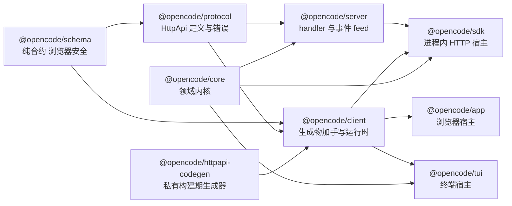
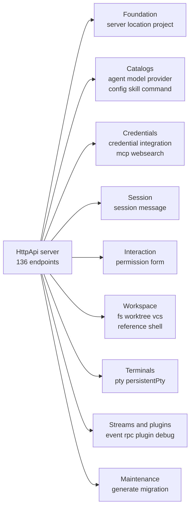
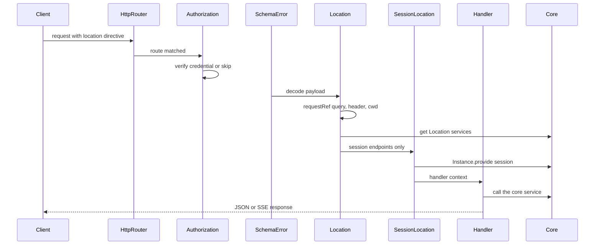
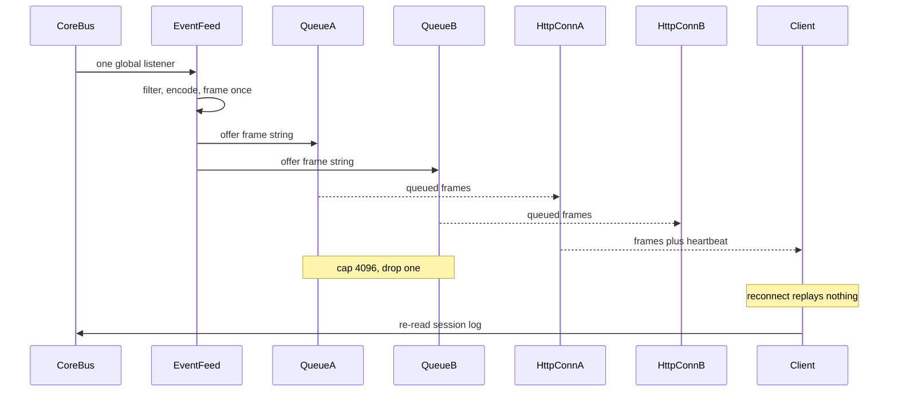

## 为什么"对外契约层"决定了整个项目的形状

一个多宿主 Agent 运行时最容易被低估的部分，是它的**对外契约**。opencode v2.0.11 同时驱动终端 TUI、浏览器 Web app、Electron 桌面端、无头 `opencode serve`，以及跑在 Cloudflare Durable Object 里的 workerd 实例——这些宿主的传输方式、生命周期、甚至是否存在 OS 进程都不同，却要求它们看到**同一套语义**。把这些宿主粘在一起的，不是一份文档，而是一份**可执行的类型定义**：`packages/protocol` 里的 Effect `HttpApi`。客户端 SDK 不是人写的，是从这份定义里**生成**的；服务端 handler 也只能实现这份定义里声明过的 endpoint。

这条链路把"改一个字段要同步改几个仓库"的经典问题变成了一个编译期与 CI 期问题。仓库根部的规则因此只有一句话的篇幅：改过公开 Protocol 或 Server 的 `HttpApi` 之后必须重新生成，且**不要直接编辑生成出来的客户端文件**。

[AGENTS.md:1-2]()
<!-- anchor: - After changing the public Protocol or Server `HttpApi`, run `bun run generate` … - Keep runtime dependencies directed from Schema to Core and Protocol, then from -->

包依赖方向也被同一份规则钉死：Schema 被 Core 与 Protocol 依赖，Core 与 Protocol 被 Server 依赖，而 **Client 运行时代码可以依赖 Schema 与 Protocol，但绝不能依赖 Core 或 Server**；`sdk` 负责把 Client、Core、Server 三者组合起来。

[AGENTS.md:1-2]()
<!-- anchor: - After changing the public Protocol or Server `HttpApi`, run `bun run generate` … - Keep runtime dependencies directed from Schema to Core and Protocol, then from -->

### 三个包，三种职责

契约层按"能否在浏览器里跑"切成两半，再按"定义还是实现"切成第三块：

- **`@opencode/schema`** 是纯合约：只有 Schema 类型与常量，依赖表里除 `effect` 与 `@standard-schema/spec` 之外什么都没有，因此可以被 Web app 直接引入而不带进 Node 能力。
- **`@opencode/protocol`** 用这些 Schema 组装出 `HttpApi`（group、endpoint、错误、中间件标识），它定义**形状**，不定义**行为**。
- **`@opencode/server`** 是实现侧：把每个 group 的 handler 接到真实服务上，并提供中间件层。
- **`@opencode/client`** 是生成侧：由 protocol 的 `ClientApi` 反射出 Promise 与 Effect 两套客户端，再加一层手写运行时（服务发现、重连、Solid 数据层）。

schema 的浏览器安全不是口号，而是依赖表的直接后果，也是浏览器侧包能合规引入它的前提。

[packages/schema/package.json:26-28]()
<!-- anchor: "dependencies": { … "effect": "catalog:" -->

同一条边界还有测试守着：浏览器侧的 `@opencode/session-ui` 用一条测试断言自己不 import `@opencode/core|sdk|server`，并在 `package.json` 里断言这三个包**不是**依赖项。依赖方向因此不是约定，而是会被 CI 拦下来的约束。

[packages/session-ui/src/import-boundaries.test.ts:8-18]()
<!-- anchor: test("does not import server runtime packages", async () => { … expect(dependencies["@opencode/server"]).toBeUndefined() -->

三层契约与生成管线的依赖方向（箭头指向"被依赖方"，即箭头起点 import 终点）：

一个细节值得注意：`server` 并不"拥有"路由表，它只是 **`makeDefaultApi` 的调用方之一**。protocol 里的 `makeDefaultApi` 接受三个中间件标识作为参数，返回同一个 `HttpApi` 类型；服务端把自己具体的 `LocationMiddleware` / `FormLocationMiddleware` / `SessionLocationMiddleware` 传进去，才得到可实现的 `Api`。契约不可变，接线方式可换。

[packages/protocol/src/api.ts:225-249]()
<!-- anchor: export const makeDefaultApi = < … options.sessionLocationMiddleware, -->

[packages/server/src/api.ts:6-11]()
<!-- anchor: export const Api = makeDefaultApi({ … sessionLocationMiddleware: SessionLocationMiddleware, -->

这一层同时是**测试面**：浏览器端、CLI、SDK 拿到的不是三份各自演化的类型，而是同一份 `ClientApi`。

## API 面的形状：30 个 Group、136 个 endpoint、29 个 OpenAPI tag

先把口径说清楚，因为同一个仓库里存在三套容易混淆的数字：

- **Group 声明数 = 30**：`packages/protocol/src/groups/*.ts` 共 30 个文件，每个文件导出一个 `HttpApiGroup.make("server.…")`。
- **生成的 OpenAPI tag 数 = 29**：`openapi.json` 里 tag 是按各 group 的 `OpenApi` title 注解聚合的，`MessageGroup` 显式把自己标成 `title: "session"`，于是 message 的 1 个 endpoint 与 session 的 43 个合并进同一个 tag。
- **endpoint 数 = 136**：两种独立口径互相印证——按 `packages/protocol/openapi.json` 的 `paths[*]` × HTTP 方法统计得到 136（分布在 113 条 path 上），按 `groups/*.ts` 里 `HttpApiEndpoint.<method>` 的出现次数统计同样是 136。

`MessageGroup` 的 tag 覆盖是唯一一处刻意的"合并显示"：

[packages/protocol/src/groups/message.ts:89-91]()
<!-- anchor: OpenApi.annotations({ … description: "Experimental message routes.", -->

仓库自带的审计清单也按 136 这个事实排列，尽管它的表头写着 139：表体逐行统计为 136 条 endpoint（表头数字与表体、与 v2.0.11 的生成物都不一致，且其"最后重新生成"日期 2026-09-13 早于本基线 tag 的 2026-09-20 一周）。

[V2_HTTP_API_AUDIT.md:3-5]()
<!-- anchor: **Source:** `packages/protocol/openapi.json` … **Last regenerated:** 2026-09-13 -->

按 group 的 endpoint 数（口径：各 `groups/*.ts` 中 `HttpApiEndpoint.<method>` 计数，与生成物一致）：

| Group 标识 | endpoint | 说明 |
|---|---:|---|
| `server.session` | 43 | 生命周期、prompt、revert、inbox、form、视图 |
| `server.integration` | 11 | 集成目录与连接 |
| `server.experimental` | 11 | 持久 PTY 原型（OpenAPI tag 为 `persistentPty`） |
| `server.pty` | 7 | PTY 列表、创建、WebSocket 连接与 ticket |
| `server.permission` | 7 | 会话级与已保存权限 |
| `server.mcp` | 6 | MCP server 与 resource 目录 |
| `server.vcs` | 5 | 版本控制信息 |
| `server.shell` | 5 | 后台 shell 命令 |
| `server.fs` | 4 | 文件读、列目录、写、搜索 |
| `server.worktree` | 4 | worktree 解析与生命周期 |
| `server.plugin` | 3 | 插件目录与状态 |
| `server.credential` | 3 | 凭据读写与切换 |
| `server.config` | 3 | 配置读取与写入 |
| `server.location` | 2 | location 解析与 reload |
| `server.agent` | 2 | agent 目录 |
| `server.model` | 2 | 模型目录 |
| `server.provider` | 2 | provider 目录 |
| `server.project` | 2 | 项目列表与更新 |
| `server.debug` | 2 | 已加载 location 的清单与驱逐 |
| `server.websearch` | 2 | 搜索 provider |
| `server.server` | 1 | `server.info`，返回 version/pid/urls |
| `server.message` | 1 | 会话消息投影读取 |
| `server.command` | 1 | 命令目录 |
| `server.skill` | 1 | skill 目录 |
| `server.reference` | 1 | 引用目录 |
| `server.event` | 1 | SSE 事件流 |
| `server.rpc` | 1 | 插件 RPC 调用入口 |
| `server.form` | 1 | 全局 form 列表 |
| `server.generate` | 1 | 无状态文本生成 |
| `server.migration` | 1 | v1 迁移状态 |

endpoint 的"归属方式"比数量更有信息量。protocol 用类型把 group 分成四类：`LocationGroups`（17 个 group，逐 endpoint 挂 location 中间件）、`SessionGroups`（session + message）、`FormGroups`、`MixedMiddlewareGroups`（permission，前一半用 location、后一半用 session 中间件）。

[packages/protocol/src/api.ts:225-249]()
<!-- anchor: export const makeDefaultApi = < … options.sessionLocationMiddleware, -->

按领域聚类看这 136 个 endpoint：

### 审计留下的收敛痕迹

这份 136 endpoint 的表面是**收敛过的**，审计文件把处置决定写成了可追溯的记录：`POST /api/plugin/await-activation` 被判定 Remove，理由是"activation 时序是服务端内部问题，目录读取应保持非阻塞"；`GET /api/health` 与 `GET /api/server` 被 Merge 成 `GET /api/info`，就绪状态改为由 HTTP 状态码承载；`GET /api/project/current` 因与 `Location.Info.project` 重复而删除。

[V2_HTTP_API_AUDIT.md:44-47]()
<!-- anchor: ### [x] `POST /api/plugin/await-activation` … - **Notes:** Activation timing is an internal server concern. Catalog reads remain non-blocking. -->

审计的十个分组也不是代码里的 group，而是**评审视角**的聚类。这里有一处内部不一致值得记录：十组标题声明的 endpoint 数（4/16/22/12/11/13/19/12/24/6）合计 **139**，与表头一致；但按表格逐行统计只有 **136**（第 2 组 17 行、第 7 组 16 行、第 9 组 23 行），而**只有行级统计与 v2.0.11 的生成物吻合**。也就是说 139 是"分组标题"的数字，表格在逐条处置之后被改过而标题没有同步。

[V2_HTTP_API_AUDIT.md:31-40]()
<!-- anchor: - [x] Group 1: Foundation and placement (4) … - [x] Group 10: Events, RPC, and experimental operations (6) -->

## 一次 HTTP 请求如何落到具体 Location

"Location"是这套契约里最独特的概念：同一个服务进程可以同时持有多个工作目录的实例，而 endpoint 必须知道这次请求**属于哪个目录**。归属不是在 handler 里手动传参，而是由中间件链在请求进入前完成：

中间件的装配顺序写在 `createRoutes` 里：`HttpApiBuilder.layer(Api, { openapiPath: "/openapi.json" })` 上依次 provide formLocation → sessionLocation → location → authorization → schemaError → auth。也就是说**鉴权与 schema 错误转换在 location 解析之前**，而 location 解析在 handler 之前。

[packages/server/src/routes.ts:174-184]()
<!-- anchor: const api = HttpApiBuilder.layer(Api, { openapiPath: "/openapi.json" }).pipe( … Layer.provideMerge(HttpRouter.layer), -->

顺带一个常被忽略的事实：服务**自带 OpenAPI 端点**，`GET /openapi.json` 由同一个 `HttpApi` 反射而来，不需要额外维护一份手写规范。

### 归属顺序：query → header → cwd

`requestRef` 的取值优先级被刻意写成三级回退：先读 `location[directory]` 查询参数，再读 `x-opencode-directory` 请求头，最后落到 `process.cwd()`。前两级分别服务浏览器/代理场景与"在 header 里带目录"的宿主，最后一级保证任何裸请求都有归属，不会出现"无 location"的状态。

[packages/server/src/location.ts:39-40]()
<!-- anchor: export function requestRef(request: HttpServerRequest.HttpServerRequest): Location.Ref { … const query = new URL(request.url, "http://localhost").searchParams -->

解析出的 `Location.Ref` 不是拿来当参数的，而是拿来**取服务实例**的：中间件从 `LocationServiceMap` 里 `get(ref)`，把整个 effect 的依赖环境替换成该 location 的那一套。

[packages/server/src/location.ts:57-64]()
<!-- anchor: export const layer = Layer.effect( … return yield* effect.pipe(Effect.provide(locations.get(requestRef(request)))) -->

会话级 endpoint 多一层：先从路由参数里取 `sessionID`，查出会话行，再 `Instance.provide(session)`，这样 handler 拿到的实例是按会话所属 location 选出来的。

[packages/server/src/middleware/session-location.ts:16-26]()
<!-- anchor: export const sessionLocationLayer = Layer.effect( … return yield* effect.pipe(instances.provide(session)) -->

`FormLocationMiddleware` 是同一逻辑加一个临时分支：当 `sessionID === "global"` 时跳过会话行查询，直接用请求 location——为的是那些**暂时无法归属到真实会话**的 MCP elicitation。注释明确要求这条分支保持 undocumented 并在 elicitation 携带会话归属后删除，是一处有自我销毁计划的妥协。

[packages/server/src/middleware/form-location.ts:24-36]()
<!-- anchor: return FormLocationMiddleware.of((effect) => … return yield* effect.pipe(instances.provide(session)) -->

### 组级中间件的位置陷阱

Effect 的 group middleware **只作用于已经 `.add()` 进去的 endpoint**。`permission.ts` 因此在两次 `.add()` 之间插入 `.middleware(locationMiddleware)`：前半段（已保存权限）拿到 location 中间件，后半段（会话权限）改用 session 中间件。

[packages/protocol/src/groups/permission.ts:60-61]()
<!-- anchor: // Effect applies group middleware only to endpoints already added; session endpoints use session pla … .middleware(locationMiddleware) -->

`location.group` 里还有一条互补的设计：`location.get` 挂中间件，`location.reload` **不挂**。理由是 reload 要遍历所有已加载的 location，如果先 boot 调用方自己的 location，就等于"为了清点而先创建被清点对象"。

[packages/protocol/src/groups/location.ts:29-46]()
<!-- anchor: // Middleware is applied per endpoint: reload acts on every loaded location and … description: "Resolve the requested location or the server default location.", -->

### schema 失败与错误词汇表

所有 4xx/5xx 的语义都集中在 `packages/protocol/src/errors.ts` 的 tagged error 上，每个错误类用 `httpApiStatus` 注解绑定状态码；`UnauthorizedError` 即 401，客户端因此可以在不知道 handler 实现的前提下处理它。

[packages/protocol/src/errors.ts:34-44]()
<!-- anchor: export class UnauthorizedError extends Schema.TaggedError<UnauthorizedError>()( … resource: Schema.optional(Schema.String), -->

请求体不符合 schema 时不抛原始解析错误，而是由 `SchemaErrorMiddleware` 统一转成 `InvalidRequestError`：reason 被截断到 1024 字符后写进 warning 日志，日志带 `kind` 与 `reason` 两个注解。这是"错误面也是契约"的具体做法——客户端只会看到稳定形状的错误。

[packages/server/src/middleware/schema-error.ts:14-19]()
<!-- anchor: export const schemaErrorLayer = HttpApiMiddleware.layerSchemaErrorTransform(SchemaErrorMiddleware, ( … Effect.andThen(Effect.fail(new InvalidRequestError({ message: reason, kind: error.kind }))), -->

## 代码生成管线：从 HttpApi 反射到客户端源码

生成的入口是 `packages/httpapi-codegen`——一个**私有包**（不发布），只做构建期工作。它的承诺可以概括成一句：把唯一权威的 `HttpApi` 反射成共享契约，然后独立地发射 Promise 与 Effect 两套输出。

[packages/httpapi-codegen/README.md:9-15]()
<!-- anchor: - Reflect one authoritative `HttpApi` into a shared contract with `compile(Api)` … - Return Promise streams as lazy `AsyncIterable` values and Effect streams as  -->

`compile(api, options)` 是唯一的输入门：它遍历 `HttpApi.reflect` 的结果，按 `groupNames` 重命名 group、跳过 `omitEndpoints` 里的 endpoint，并在遇到"多个 success schema""需要适配器的 client middleware""输入字段冲突"等无法表达的情况时抛 `GenerationError` 而不是生成一个近似可用的客户端。

[packages/httpapi-codegen/src/index.ts:101-105]()
<!-- anchor: export function compile<Id extends string, Groups extends HttpApiGroup.Constraint>( … readonly omitEndpoints?: ReadonlySet<string> -->

两个 omit 集合值得单独看：Promise 客户端跳过 `pty.connect` 与 `persistentPty.connect`（这两个是 WebSocket 升级，不能用 fetch 表达），Effect 客户端额外跳过 `fs.read`/`fs.write`（二进制体不走统一投影）。

[packages/protocol/src/client.ts:68-69]()
<!-- anchor: export const promiseOmitEndpoints = new Set(["pty.connect", "persistentPty. … export const effectOmitEndpoints = new Set(["fs.read", "fs.write", "pty.connect", "per -->

### 生成物与手写物的分界

客户端包不是"一份生成代码"，而是**生成区 + 手写区**两块。生成区被目录和清单双重标记：`src/promise/generated/`（4 个文件）、`src/effect/generated/`（3 个文件）、`src/effect/api/api.ts`（1 个文件），三个目录各带一份 `.httpapi-codegen.json` 清单，清单内容就是该目录的文件名数组（分别是 `client-error/client/index/types`、`client-error/client/index`、`api`）。

`write()` 用这份清单做所有权管理：只删除清单里登记过、而本次不再生成的文件，路径还必须通过 `isSafeOutputPath` 检查——不能是清单自身、不能绝对路径、不能带路径分隔符。

[packages/httpapi-codegen/src/index.ts:1532-1533]()
<!-- anchor: function isSafeOutputPath(path: string) { … return path !== manifestName && !isAbsolute(path) && path !== "." -->

[packages/httpapi-codegen/README.md:29-30]()
<!-- anchor: - Commit generated source for review; CI regenerates and fails when the worktree … - Track generated files in `.httpapi-codegen.json` so regeneration removes onl -->

生成侧的接线在 `packages/client/script/build.ts`：同一个 contract 分别喂给 `emitPromise(..., { mutableOutputs: true })`（写进 `src/promise/generated`）、`emitEffectImported(...)`（写进 `src/effect/generated`）与 `emitEffectShape(...)`（写进 `src/effect/api`）。

[packages/client/script/build.ts:90-101]()
<!-- anchor: emitPromise(promiseContract, { … fileURLToPath(new URL("../src/effect/generated", import.meta.url)), -->

手写区则是客户端真正的"运行时"：服务发现与进程管理、共享 SSE 连接、重连与看门狗、RPC 适配器、Solid 数据层。生成区约 12,460 行（promise 8,547 / effect 1,570 / effect api 2,343），手写区约 3,798 行；**生成物是手写物的三倍多**，而且这还没有算上 19,168 行的 `openapi.json` 与仓库外的规范消费方。

### 为什么禁止手改生成文件

生成区的价值全在"可丢弃重生成"上，一旦有人手改，下一次 `bun run generate` 就会覆盖它，而差异会以"莫名其妙回退"的形式出现在别人的 PR 里。客户端包的 `check:generated` 因此把重生成 + `git diff --exit-code` 限定在恰好那三个生成目录上；protocol 包用另一条 `--check` 路径守住 `openapi.json`。

`openapi.json` 的生成还多做了一步**稳定性处理**：Effect 会给共享的匿名 schema 起 `Union_3` 这类按遇到顺序命名的名字，`stabilizeOpenApi` 把它们替换成内容哈希并排序 components，使无关新增不会造成全文件 diff。这是"生成物要进 code review"这一决定的前提——否则每次生成都是一次无法审阅的抖动。

[packages/protocol/script/openapi-stabilize.ts:1-2]()
<!-- anchor: // Effect gives shared anonymous schemas encounter-order names (`Union_3`). Replace those names … // with a hash of their canonical shape and sort components so unrelated additions stay local. -->

[packages/protocol/script/generate-openapi.ts:7-9]()
<!-- anchor: const document = await format(JSON.stringify(stabilizeOpenApi(OpenApi.fromApi(ClientApi)), null, 2), { … printWidth: 120, -->

### 生成物的身份标识：一个必须说清楚的细节

"生成文件带 `// Generated by @opencode/httpapi-codegen. Do not edit.` 头"这句话只对 **Effect 系**输出成立。该头注释只在 Effect 分支的渲染器里发射（TypeScript 形状、Effect 文件集、group 适配器、Effect 客户端），而 `src/promise/generated/*` 的 4 个文件**没有**这行头注释——它们的生成物身份由目录约定、`.httpapi-codegen.json` 清单与 CI 的 `git diff --exit-code` 共同界定。评价"生成物防误改"时把 Promise 输出也算进"有头部保护"是不准确的。

[packages/httpapi-codegen/src/index.ts:443-444]()
<!-- anchor: return `// Generated by @opencode/httpapi-codegen. Do not edit. … import type { Effect, Stream } from "effect" -->

### 代价与收益

代价是具体的：客户端有 12,460 行不可读、不可手改的代码；任何 endpoint 的增删都会在这三个目录里产生结构性 diff；生成器本身的 1,977 行成了必须与 Effect 的 `HttpApi` 反射 API 同步演进的依赖。收益同样是具体的：hand 写客户端时"服务端加了字段、客户端忘了加"这类错误在这一层被消灭；Promise 与 Effect 两套运行时共享同一份 contract，不会各自漂移；`sdk` 可以把同一份客户端直接指向进程内 host。

## 事件推送：单一编码 feed 与每连接独立队列

事件流是契约里唯一一条长连接，也是"事件即事实"哲学与 HTTP 世界正面相撞的地方。

上游是 Core 的 `Bus`：它区分**易失的实时通道**与**持久的有序日志**。`subscribe()` 明确写着"只给从此刻起的事件，断开期间与之前的事件都不给；需要可靠性的消费者要自己结合 `log`"，而 `log({ aggregateID, after, follow })` 提供按聚合读取的持久日志、并在 `follow: true` 时先重放再切到实时。

[packages/core/src/bus.ts:123-133]()
<!-- anchor: * Volatile live channel: every event published from now on, nothing before or … ): Stream.Stream<SubscribePayload<D>> -->

[packages/core/src/bus.ts:150-160]()
<!-- anchor: * Durable, ordered per-aggregate log read. Forked aggregates may reserve an … }) => Stream.Stream<LogItem> -->

对外暴露这一层的 endpoint 只有一个：`GET /api/event`，契约类型是 `HttpApiSchema.StreamSse({ data: EventSchema })`。它的 OpenAPI 描述把两条限制写成契约的一部分：慢消费者会**溢出并失败**，断开期间的事件**会丢失**。

[packages/protocol/src/groups/event.ts:44-51]()
<!-- anchor: HttpApiEndpoint.get("event.subscribe", "/api/event", { … "Subscribe to native events and plugin RPC events across all server locations. Volatile by contr -->

服务端没有把过滤/编码/序列化放在每个连接里，而是做了一次**编码一次、扇出多次**的改造：`EventFeed.layer` 随 handler 图构建一次，向 Core 注册**一个**全局监听器；每条公共事件只编码一次，然后把同一个不可变字符串 offer 给每个连接各自的队列。

这个决定的权威依据是仓库内的决策记录：公共事件流用"单一 Server 级编码 feed + 每连接独立有界队列"，因为共享 PubSub 的四种有界策略都无法直接表达"只淘汰慢的那个订阅者"——`bounded` 会让发布者被最慢者拖住，`dropping` 会一次性惩罚所有订阅者，`sliding` 会静默跳事件，`unbounded` 则丢掉内存上界。要实现独立淘汰就得在 PubSub 之上再写一套多播协议。

[specs/v2/event-stream-architecture.md:47-64]()
<!-- anchor: ## Delivery Law … Internal Core events, `server.connected`, and heartbeats do not consume the queue capacity. -->

容量与失败语义都能在代码里对上：每个连接一个容量 4,096 的 dropping 队列；offer 返回 false 时立刻把该队列移出订阅者集合、并以 `SubscriberOverflowError` 失败——**只杀这一条连接**，其它连接与 Core 发布都不受影响。`server.connected` 与心跳不占容量。

[packages/server/src/event-feed.ts:8-12]()
<!-- anchor: export const SubscriberCapacity = 4_096 … { capacity: Schema.Int }, -->

[packages/server/src/event-feed.ts:48-67]()
<!-- anchor: const publish = Effect.fnUntraced(function* (event: Event.Payload) { … Queue.failCauseUnsafe(subscriber, Cause.fail(new SubscriberOverflowError({ capacity }))) -->

连接侧的细节在 raw handler 里：先构造一帧 `server.connected`，再接上 feed，并用 `Stream.tick("15 seconds")` 合并出 `": heartbeat\n\n"` 注释行（注释行不是事件，只用于保活）；响应头显式设 `text/event-stream`、`no-cache, no-transform`、关闭 nginx 缓冲并加 `nosniff`。`frame()` 的实现就是 `data: <json>` 加两个换行。

[packages/server/src/handlers/event.ts:12-30]()
<!-- anchor: return handlers.handleRaw("event.subscribe", () => … "X-Content-Type-Options": "nosniff", -->

[packages/server/src/event-feed.ts:29-30]()
<!-- anchor: export function frame(event: OpenCodeEvent) { … return `data: ${JSON.stringify(event)}\n\n` -->

### 断线窗口：官方口径就是"会丢"

**这条流没有重放机制。**没有任何 `Last-Event-ID`、没有序号回退、没有服务端缓冲。连接建立前的 public 事件错过就是错过；服务端决策记录把这一点写成一致性的一部分——"注册之前的事件可能丢失，这与易失流的契约一致"。feed 在启动期还有一条保护：监听器在 feed 服务暴露之前**同步**安装，避免"启动窗口"造成额外的静默缺口。

[specs/v2/event-stream-architecture.md:124-134]()
<!-- anchor: ## Feed Lifecycle … When no HTTP subscribers are registered, the observer returns before wire encoding, so headless and -->

更严格地说，"连接期内的顺序"是保证的，"连接与连接之间的连续性"不是。因此把 `/api/event` 当成可靠的投递通道会得到错误的系统。决策记录同时强调这条改造**没有改动契约**：method、path、schema 与 wire 表示都没变，所以 OpenAPI 不变、生成的 Promise/Effect 客户端不变、TUI 的解码与重连行为不变、也不需要重新生成客户端。这是"实现可以换，契约不能动"的一个正面样本。

[specs/v2/event-stream-architecture.md:168-191]()
<!-- anchor: ## HTTP And Code Generation … - client regeneration is not required. -->

### 客户端侧：重连、看门狗与"用重读来恢复"

浏览器侧并不自动重连——生成器 README 明说两套 runtime 的流都是惰性的 `AsyncIterable`，**都不会自动重连**；重连是手写运行时的事。Solid 连接层做了三件事：一是每次收到**任意字节**（包括心跳注释）就推迟 45 秒的空闲看门狗；二是重连循环带 1 秒退避，并在连接持续超过该退避时长后把 attempt 归零；三是提供 `resync`——主动丢弃当前请求让重连循环立刻替换，用于"页面回到前台且流已静默超过 20 秒""网络恢复"这类半开连接场景。

[packages/client/src/solid/connection.ts:165-181]()
<!-- anchor: if (options.reconnect) { … await wait(reconnectDelay, controller.signal) -->

[packages/client/src/solid/connection.ts:211-216]()
<!-- anchor: // Drop the live request so the reconnect loop replaces it now instead of waiting for the idle watch … current?.abort(new Error(reason)) -->

连接层还要求第一帧必须是 `server.connected`，否则判定为"流没有正常开始"并触发重连。这一帧同时是**数据层的同步信号**：数据层的 `server.connected` 处理器会拉取活跃会话集合、location 信息、VCS 与项目列表；而 `createEffect` 在连接状态离开 `connected` 时调用 `sync.invalidate()` 把所有已缓存读标脏。也就是说，**断线后的一致性来自"重新读服务端状态"，而不是"补发丢失的事件"**。

[packages/client/src/solid/data.ts:1-4]()
<!-- anchor: // Client data layer: apply server events and cache API reads into a Solid store. … // active UI owners decide what to sync again. -->

[packages/client/src/solid/data.ts:1923-1925]()
<!-- anchor: createEffect(() => { … sync.invalidate() -->

这条分工与 session 引擎的可恢复性正好互补：`/api/event` 负责"实时性"，`session.log` 负责"可恢复性"。后者是 `GET /api/experimental/session/:sessionID/log`，用 `after` 指定独占的聚合序号、用 `follow` 决定读完就停还是续上实时，成功类型是 `SessionEvent.Durable | EventLog.Synced` 的 SSE 流。

[packages/protocol/src/groups/session.ts:723-736]()
<!-- anchor: HttpApiEndpoint.get("session.log", "/api/experimental/session/:sessionID/log", { … summary: "Read the session log", -->

因此"事件流的断线窗口"在系统层面是被**有界**的：易失流丢掉的公共事件，可以从会话级持久日志按序号重读；而这条重读能力本身也在契约里、也被生成为客户端方法，不需要宿主自己拼 HTTP。

## 授权模型：同机进程为什么不能随便调

这是本文最需要"说准"的一节，因为它的默认假设与多数本地服务相反——opencode 的本地服务**不是**默认裸奔的。

凭证的生成与存放有单一来源：service 模式下密码取 `config.password`，没有就用 `randomBytes(32).toString("base64url")` 现生成一个。

[packages/cli/src/server-process.ts:74-79]()
<!-- anchor: const password = … : randomBytes(32).toString("base64url") -->

它被持久化在 service 配置文件的 `password` 字段里，写入走"临时文件 + 0600 + rename"，并且作者刻意在注释里写明目的：**让同一个私有凭据跨重启保持稳定**，使已经发现服务的客户端不必依赖密码参数或环境变量就能重连。

[packages/cli/src/services/service-config.ts:135-142]()
<!-- anchor: export const password = Effect.fn("cli.service-config.password")(function* (value?: string) { … yield* write({ ...existing, password: next }) -->

客户端"发现"服务的唯一依据是一份**注册文件**，内容为 `{ id, version, url, pid, password }`，同样以 0600 写入并 rename；注册者每 5 秒复查一次自己是否仍是文件的所有者，被替换则自行退出。于是"谁能调用"这个问题在文件系统层就已经有一半答案：**只有能读到 0600 注册文件的用户才能拿到 url 与密码**。

[packages/cli/src/services/service-registration.ts:23-38]()
<!-- anchor: const info = { … yield* fs.writeFileString(temp, encoded, { mode: 0o600 }).pipe(Effect.andThen(fs.rename(temp, opti -->

传输层是 HTTP **Basic**，用户名固定 `opencode`，密码即上面那个凭据；客户端把 `username:password` 做 base64 后放进 `authorization` 头。

[packages/client/src/promise/service.ts:132-135]()
<!-- anchor: export function headers(endpoint: Endpoint) { … authorization: "Basic " + Buffer.from(endpoint.auth.username + ":" + endpoint.auth.password).toString("base64"), -->

服务端有两层独立的检查，这一点容易漏：

- **进程级入口**（Node/Bun 侧的 `dispatch`）在应用图尚未就绪时就先校验。未就绪时只有 `GET /api/info` 可访问且**仍需**鉴权；就绪后除带 ticket 的 PTY 连接外都必须通过 `authorizedRequest`，失败直接返回 401 与 `www-authenticate: Basic realm="Secure Area"`。也就是说"启动中"不是鉴权空窗。
- **HttpApi 中间件层**（`authorizationLayer`）在请求进入 handler 图后再次校验，失败以 `UnauthorizedError` 表达，并同样补上 `www-authenticate` 头。

[packages/server/src/process.ts:195-205]()
<!-- anchor: if (request.method === "GET" && url.pathname === "/api/info" && !ready) { … return unavailable(state) -->

[packages/server/src/middleware/authorization.ts:43-59]()
<!-- anchor: export const authorizationLayer = Layer.effect( … return yield* new UnauthorizedError({ message: "Authentication required" }) -->

凭据的携带方式有两种：标准 `Authorization: Basic …` 头，或查询参数 `auth_token`（`AUTH_TOKEN_QUERY`，值为 base64 凭据）。第二种存在的理由是浏览器场景——页面无法为 `EventSource`/其余受限请求自由设置头，于是把凭据放进 URL。这也意味着**任何能读到该 URL 的日志或截图都会泄露凭据**，属于已知的取舍而不是疏漏。

`ServerAuth.required` 的判定是"存在且非空"，所以不配置密码就等价于**完全不鉴权**——这条路径被嵌入场景显式使用：SDK 的进程内 host 走 `createEmbeddedRoutes(...)`，那里传的是 `Option.none()`，也就没有密码。

[packages/server/src/auth.ts:25-33]()
<!-- anchor: export function required(config: Info) { … Redacted.value(credentials.password) === config.password.value -->

还有一条必须点名的例外：**带 ticket 的 PTY WebSocket 连接跳过凭据校验**，因为浏览器无法为 WebSocket 升级设置请求头。补偿机制是 ticket 本身：先调用 `pty.connect.token` 领取一次性 ticket，领取请求必须带自定义头（`x-opencode-ticket: 1`，自定义头会强制 CORS 预检，从而挡住跨源页面）并通过 origin 允许列表；连接时 ticket 被消费且校验 origin，失败返回 403。

[packages/protocol/src/groups/pty.ts:9-17]()
<!-- anchor: export const PTY_CONNECT_TICKET_QUERY = "ticket" … export function hasPtyConnectTicketURL(url: URL) { -->

于是"同机任意进程能不能调"的答案是：**默认不能**。它需要同时拿到注册文件的读权限（0600）、其中的随机 32 字节密码，并正确做 Basic 编码；只有在该服务被显式以无密码方式嵌入（SDK/workerd 内嵌）时，边界才退回宿主自身的访问控制——`fetch.ts` 的注释把这一点写成明确责任：省略密码即无鉴权服务，宿主必须自己在前面加访问控制。

[packages/server/src/fetch.ts:26-34]()
<!-- anchor: * The application layer builds EAGERLY, inside the caller's `Scope`, before the handler is … * access control. -->

面向使用者的入口有三个，语义各不相同：`opencode service get password` 从配置里读出私有凭据供人工复制；`--server` 显式连接时用 `OPENCODE_PASSWORD` 环境变量构造 Basic 凭据；stdio 模式启动时会主动 `delete process.env.OPENCODE_PASSWORD`，理由是"不要把租约凭据留在工具继承的环境里"。

[packages/cli/src/services/server-connection.ts:21-39]()
<!-- anchor: export const resolve = Effect.fn("cli.server-connection.resolve")(function* (args: Args) { … return { endpoint } satisfies Resolved -->

[packages/cli/src/server-process.ts:74-79]()
<!-- anchor: const password = … : randomBytes(32).toString("base64url") -->

## 多运行时：process.ts 与 workerd.ts 的取舍

同一份 `Api` 有两个装配入口，它们的差别不在契约而在**运行时能力**。

`process.ts` 是 Node/Bun 路径：绑定真实端口，默认 `127.0.0.1`，并在启动过程中维护一个显式的状态机——starting/ready/stopping/failed，未就绪时返回 503 与 `retry-after: 1`，失败时返回 `service_failed`。它同时负责"重启连续性"：fork 一个 `resumeSuspendedSessions`，把上次未释放执行权的会话接回来。

`fetch.ts` 是与监听无关的入口：构造一个 web 标准的 `(request: Request) => Promise<Response>`，服务**同一套** HttpApi 路由却不绑端口、不拥有 listener、不安装信号处理器，供 workerd、`Deno.serve`、`Bun.serve` 或测试宿主调用。这里有一条被显式记录的实现约束：应用层必须在调用方的 `Scope` 里**急切**构建，不能改成"首个请求再懒构建"——在 workerd 上，一个中途 abort 的首请求会打断 layer 构造，并让之后每个请求都卡死。

[packages/server/src/fetch.ts:26-34]()
<!-- anchor: * The application layer builds EAGERLY, inside the caller's `Scope`, before the handler is … * access control. -->

`workerd.ts` 则是"故意残缺"的运行时画像，它把本地方案逐个替换或禁用：数据库跑在注入的 Durable Object SQLite 上；watcher 与 fff 通过既有开关关闭；pty、fff、shell-parser、photon、process-lock 这些原生模块在 `workerd` 条件下解析为惰性 stub；FileSystem/FileSystemSearch/Pty 以明确 defect 失败直到有远端沙箱接管；Snapshot 与 Vcs 退化成 no-op；配置以字符串注入（没有文件系统）；插件只支持预编译。配套的 `script/workerd-probe.ts` 用 `--conditions=workerd` 打一次 bundle，凡是静态泄漏进图的 `bun:` 内建即判定失败。

[packages/server/src/workerd.ts:24-32]()
<!-- anchor: * - Database runs on the injected `DurableObjectStorage` SQLite. … *   precompiled-only, and stdio MCP reports the same no-plane failure as Shell. -->

替换是通过 LayerNode 的 `replacements` 完成的：一组"标准替换"负责把 Database、PersistentPty、Bus、App、ModelsDev、Watcher、FileSystemSearch、Global、Config、InstructionDiscovery、ShellSelect、Mcp 等换成由 `ServerOptions` 配置的版本，随后再叠加运行时画像自己的覆盖，**后者优先**。

[packages/server/src/routes.ts:114-120]()
<!-- anchor: Database.node.replace(Database.configured(options.database)), … FileSystemSearch.node.replace(FileSystemSearch.configured({ fff: options.fs?.fff })), -->

这套设计的价值在于：多运行时没有分叉出第二份 HTTP 契约。差别被压缩成"哪些 layer 被替换、哪些能力以 defect 失败"，而 endpoint、错误词汇表、生成客户端与事件协议完全共享。`server.info` 甚至为此预留了一个语义位——`pid` 允许为 0，注释说明 0 表示该运行时没有 OS 进程身份（workerd 就是这样）。

workerd/Durable Object 画像在本基线中是否有仓库内的实际部署消费方（`packages/sdk` 暴露了 `./workerd` 与 `./workerd/effect` 两个入口，但仓库内没有其它包把 `@opencode/sdk` 列为依赖）。

## 自持 OpenAPI 与 SDK 的价值：`sdk` 与 `client` 不是一回事

`openapi.json` 是这套体系的**副产品而不是目标**：它由 `OpenApi.fromApi(ClientApi)` 反射而来，和生成的 TypeScript 客户端共享同一个 contract 对象，因此不可能与实现漂移；再由 `check:generated` 的 `--check` 模式在 CI 里比对，过期即失败。自持规范的实际收益有三个：外部工具（Postman、代码生成器、契约测试）可以零成本接入；审阅 API 变更时 diff 是语义化的（得益于匿名 schema 的内容哈希稳定化）；以及**审计可以按 endpoint 逐条给出处置决定**——仓库里那份清单正是这么用的。

`client` 与 `sdk` 的分工则是"传输"与"宿主"：

- **`@opencode/client`** 提供两套等价客户端：Promise 版用结构化类型 + 直接 `fetch`（不做运行时结构校验，换来零 Effect 依赖），Effect 版包在生成 client 之上并注入 `CurrentHeaders`。它还有手写的服务发现/启动/停止（`Service.ensure/discover/stop`）、共享 SSE 连接（一份连接扇出给多个订阅者，容量同样 4,096，并缓存 `server.connected` 供新订阅者立刻拿到）、PTY handoff 与 Solid 数据层。浏览器与 TUI 都直接依赖它。
- **`@opencode/sdk`** 不引入网络跳：它用 `createEmbeddedRoutes(...)` 在**进程内**装配同一套路由，再用 `ManagedRuntime` 承载，最后把一个 web 标准 `fetch` 交给生成的客户端。于是 `OpenCode.make({ baseUrl: "http://opencode.local", fetch: host.fetch })` 这一行就把"本地 HTTP 服务"替换成了"函数调用"，同时不改变任何 endpoint 语义。

[packages/sdk/src/promise.ts:33-54]()
<!-- anchor: export async function create(options: CreateOptions = {}, embed: EmbeddedHost.EmbedOptions = {}): Pr … const client = OpenCode.make({ baseUrl: "http://opencode.local", fetch: host.fetch }) -->

embed host 的构建也顺带回答了"谁来恢复"：`ManagedRuntime` 装配路由后立刻 `runFork` 一次 `resumeSuspendedSessions`，注释强调这次扫尾在没有挂起会话时是 no-op、且由 runtime 拥有 fiber 因此不会拖慢启动——与 Node 侧的重启连续性共用同一个恢复入口；默认数据库是 `:memory:`。

[packages/sdk/src/internal/host.ts:34-56]()
<!-- anchor: const runtime = ManagedRuntime.make( … const transport = OwnedFetch.make(handler, runtime.dispose) -->

[packages/sdk/README.md:3-3]()
<!-- anchor: In-process OpenCode host for Promise and Effect applications. The SDK executes Server's assembled HT -->

`client` 的生成物因此可以同时服务"跨进程"与"同进程"两种拓扑，且两种拓扑下**客户端代码是同一份生成代码**——这正是"定义即契约，客户端是生成物"的最终收益。

`packages/client/README.md` 有"构建编译器读取 `@opencode/server/api`"之类的表述，而实际的 `packages/client/script/build.ts` 与 `src/contract.ts` 都是从 `@opencode/protocol/client` 取 `ClientApi`；README 与脚本之间的这处不一致需要确认是哪一侧过时。

### 一份契约还顺带定义了测试平面

protocol 里除了 `HttpApi` 还有一份**独立**的模拟契约：`simulation.ts` 用 JSON-RPC 2.0 加握手（角色、协议版本、能力列表三方校验）定义前端与后端两套 `RpcGroup`，让 TUI 测试可以注入 LLM 分块与工具事件。它不参与代码生成，也不在 `openapi.json` 里。

[packages/protocol/src/simulation.ts:680-690]()
<!-- anchor: export const BackendRpcs = RpcGroup.make( … request("tool.fail", { payload: Backend.ToolFailParams, success: Backend.Ok }), -->

同一个包因此承载了两种"对外契约"：一种给真实宿主（生成客户端、可反射成 OpenAPI），一种给测试宿主（RPC、不生成）。区分它们的标准不是技术栈，而是**契约的消费者是谁**。

## 收束：合约先行 + 代码生成

回到贯穿本模块的那条哲学。opencode 把"会话是可恢复的长执行"这一目标，在对外契约层翻译成了三条可检查的规则：

一是**定义先行**：`packages/protocol` 是唯一权威，`packages/sdk` 与 `packages/server` 都只是它的调用方与实现方，连 `openapi.json` 都是它的投影。谁改契约，谁就必须重新生成——这条规则被写进了仓库根的 AGENTS.md，也被 CI 的 `git diff --exit-code` 强制执行。

二是**边界可检验**：Schema 只依赖 `effect`，因此浏览器侧能安全引入；`session-ui` 用测试断言自己不 import Core/Server；Client 运行时代码被禁止依赖 Core/Server。分层不是文档里的图，而是测试与依赖表。

三是**易失与持久分工明确**：`/api/event` 明说会丢、慢消费者会被踢，承担实时性；`session.log` 承担可恢复性；数据层在重连时把缓存整体标脏并重读。把"事件推送"和"事件溯源"分开表达，是"事件即事实"在 HTTP 上的正确投影——事实在持久日志里，推送只是它的一次性视图。

代价同样清楚：12,460 行生成代码不可读，1,977 行生成器必须跟随 Effect 的反射 API，`openapi.json` 19,168 行进 review，Promise 输出连"禁止手改"的头注释都没有。但换来的是一件事——当一个 Agent 运行时要在 TUI、浏览器、桌面、无头服务和 Durable Object 五个宿主上保持一致语义时，**唯一需要保持一致的东西只有一份 `HttpApi`**。
