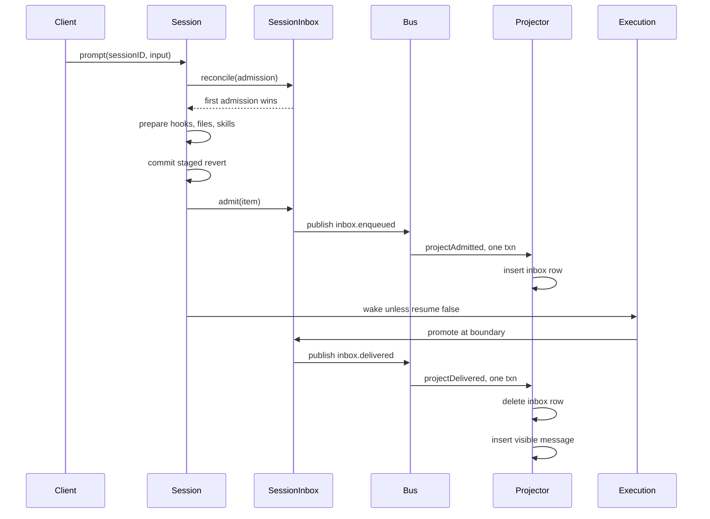
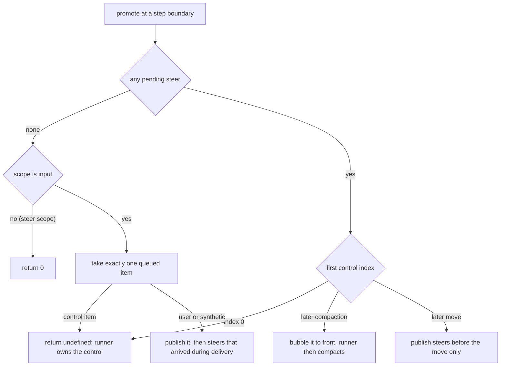
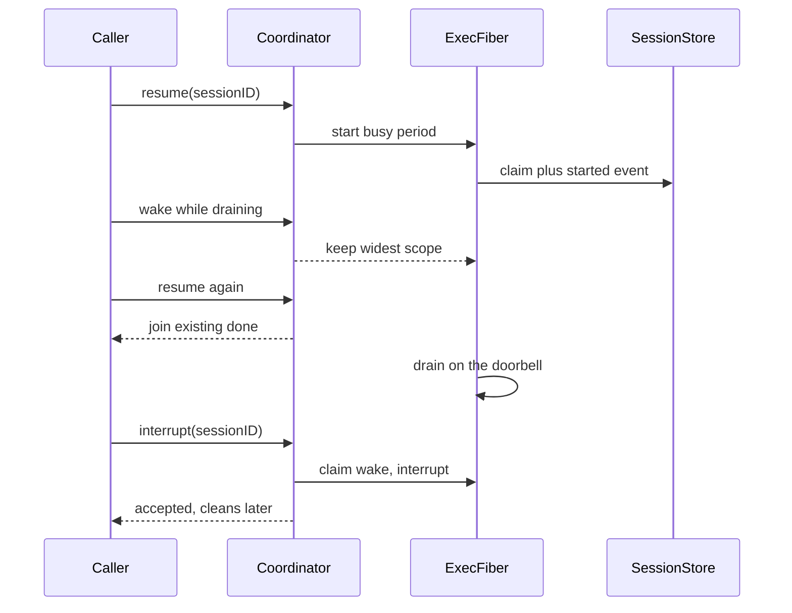
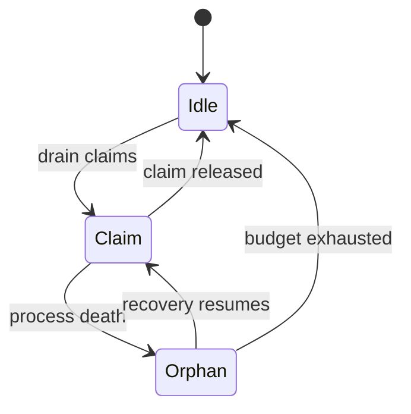
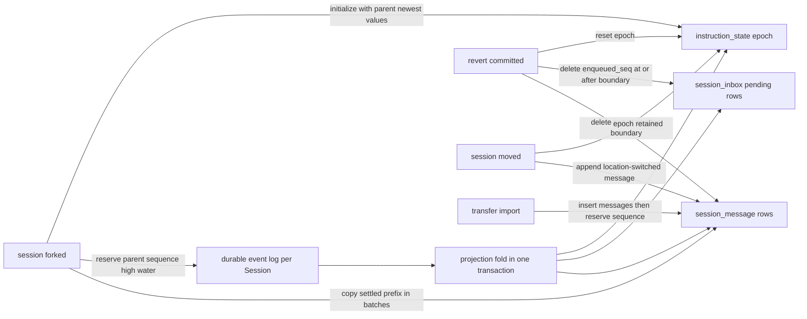

opencode v2 把「一次对话」建模成一条按 Session 分片的**只追加 durable event log**，其余一切会话状态——transcript、待处理输入队列、指令基线、计费累计——都是对这条日志的投影。本模块进入事实来源层：先看日志里记什么、不记什么，再看输入如何被准入（admit）、投递（deliver）、提升（promote），然后看进程内执行权如何被协调与崩溃恢复，最后看四个会话级派生操作如何改写历史。

作者在仓库根 `AGENTS.md` 里亲笔写下这套契约，本文的每一节都先引它、再用源码核实。

## 事实层：以 Session 为聚合根的事件日志

事件按 **aggregate** 分片。`Event.durable(...)` 声明一个事件类型属于哪个聚合字段与哪个 schema 版本，Session 事件统一以 `sessionID` 为聚合，因此同一 Session 的所有事实落进同一条有序日志，并天然获得全序——这是后面 inbox 顺序、revert 边界、fork 拷贝边界都依赖的基石。[packages/schema/src/event.ts:30-56]()
<!-- anchor: export type DurableDefinition< … > = DurableDefinition<Type, DataSchema> | EphemeralDefinition<Type, DataSchema> -->

落库由两张表承担：`event_sequence` 保存每个聚合的当前水位 `seq` 与可选的 `owner_id`，`event` 保存事件行本身，并用 `(aggregate_id, seq)` 唯一索引保证同一聚合内不会出现两个第 N 号事实。[packages/core/src/event/sql.ts:4-24]()
<!-- anchor: export const EventSequenceTable = sqliteTable("event_sequence", { … index("event_aggregate_type_seq_idx").on(table.aggregate_id, table.type, table.s -->

真正把「投影」与「事实」绑成原子的是 Bus 的提交路径：在一个 `behavior: "immediate"` 的 SQLite 事务里，依序完成「算出 seq → 跑完该事件类型注册的全部 projector → 跑可选 commit 钩子 → upsert 水位 → 插入事件行」。所以**投影不是事后异步追平，而是与事实同事务写下的**；反过来，本地 commit 钩子只允许挂在 durable 事件上，否则直接 `die`。[packages/core/src/bus.ts:400-431]()
<!-- anchor: for (const projector of list) { … return { aggregateID, seq, event: committed, route } -->

投影表由此分化为四类：`session_v2`（会话聚合行：placement、agent/model、计费累计、claim 列）、`session_message`（按 `seq` 排序的 transscript，唯一索引 `(session_id, seq)`）、`session_inbox`（**只含未消费**的工作项）、以及 `instruction_state` / `instruction_entry` / `instruction_blob`（指令基线与内容寻址值）。职责边界在 spec 的权威表里写得很清楚：公共领域形状与 durable event payload 归 `packages/schema`，运行时行为与持久化归 `packages/core`。[specs/v2/README.md:9-14]()
<!-- anchor: | Concern                                         | Owner                        … | Contributor-critical regression guardrails      | Root [AGENTS.md](../../AGENT -->

durable 与 ephemeral 的划分不是文档约定而是类型系统的一部分：`Event.durable` 产出带 `durability: "durable"` 与 `{aggregate, version}` 的定义，`Event.ephemeral` 产出 `durable?: never` 的定义，二者的联合被 `Event.inventory` 去重（同 type 保留更高版本）。Session 的公开清单 `Definitions` 与内部清单 `DurableDefinitions` 就是在这套机制上分流的。[packages/schema/src/session-event.ts:645-703]()
<!-- anchor: export const Definitions = Event.inventory( … ...Definitions.filter((definition) => definition.durability === "ephemeral"), -->

### 为什么不是"每次变更存全量快照"

若每次变更写一份会话全量快照，读路径会变成 O(1)：取最新快照即可，schema 演进也只是加字段。opencode 放弃这条路的理由有三层，且都能在源码里找到代价的落点：

- **写放大与事实冗余**：快照会把「未变的旧事实」反复重写，而事件日志只写增量。代价转移到投影侧：事件类型的每一条都必须有 projector 覆盖，`SessionMessageUpdater` 用 `Match.discriminatorsExhaustive("type")` 把这份义务变成**编译期错误**，漏一个事件类型就编译不过。[packages/core/src/session/message-updater.ts:78-86]()
<!-- anchor: const project = pipe( … Schema.decodeUnknownSync(Schema.Array(SessionMessage.AssistantContent))(event.da -->
- **schema 演进必须靠版本而不是覆写**：`Tool.Success`、`Tool.Failed`、`Deleted`、`Forked`、`InstructionsUpdated` 都以 `version: 2` 注册，`EventTable.type` 存的是 `versionedType(type, version)` 而非裸 type，因此旧日志仍能被旧定义解码；再配合 `message.content.updated` 这类「只供回放」的事件保留，历史日志的可重放性被显式维护。[packages/schema/src/session-event.ts:645-703]()
<!-- anchor: export const Definitions = Event.inventory( … ...Definitions.filter((definition) => definition.durability === "ephemeral"), -->
- **派生状态必须自证**：既然读者拿到的可能是「折叠到一半」的投影，投影器就被允许补全派生字段。agent/model 切换事件里的 `previous` 是可选的，缺失时投影器**回头读当前会话行**推导出来，而不是要求事件发布方必须带全。[packages/core/src/session/message-updater.ts:90-114]()
<!-- anchor: "session.agent.selected": (event) => … time: { created }, -->

这也是 AGENTS.md 那条规则的操作含义：记录不可约的新事实，其余由有序历史折叠得到；当消费者需要自包含视图时，**在投影与读模型里补**，而不是让事件重复携带。[AGENTS.md:180-181]()
<!-- anchor: - Keep durable events minimal: record irreducible new facts and do not repeat st … - Keep durable prompt admission separate from model execution. `Session.prompt(. -->

## 事件粒度：durable 只覆盖"模型可见跨度"

日志的粒度选择最能体现"不可约事实"这条规则。三类东西被刻意分开：

**第一类：durable 的终止边界。** 流式片段的收尾事件承载**完整值**，是可重放的边界。文本生成的 `Text.Ended` 带整段 `text`，而同一条流的 `Text.Delta` 只是 `ephemeral`。[packages/schema/src/session-event.ts:396-419]()
<!-- anchor: // Stream fragments are live-only; Text.Ended is the replayable full-value bound … export type Ended = typeof Ended.Type -->

**第二类：ephemeral 的流式增量。** `Text.Delta`、`Reasoning.Delta`、`Tool.Input.Delta`、`Tool.Progress`、`Compaction.Delta`、`UsageUpdated`、`session.status` 全部只活在实时流里，既不入日志也不承诺回放。spec 把这条写成了对外契约："Live-only text, reasoning, tool-input, and compaction deltas are intentionally absent from replay."[specs/v2/session.md:106-112]()
<!-- anchor: ## Durable Events Are Session-Scoped … There is no separate finite Session-history endpoint. Request/response consumers -->

**第三类：自包含的终止事实。** 工具终态事件不允许投影器回头翻实时进度历史：`Tool.Success.content` 被声明为 `NonEmptyArray(Content)`，`Tool.Failed` 也是「一个 error + 最终的部分进度快照」，投影只做直接拷贝。这条约束的收益是**回放确定性**——终态的语义不依赖任何 ephemeral 通道。[packages/schema/src/session-event.ts:522-559]()
<!-- anchor: /** Canonical terminal success: one non-empty model representation plus optional … export type Failed = typeof Failed.Type -->

由此得到 AGENTS.md 对"durable 记录覆盖面"的精确表述：一步（step）的 durable 记录只覆盖**模型可见跨度**，而不是物理调用全过程。[AGENTS.md:188-189]()
<!-- anchor: - Keep delivery vocabulary explicit. Prompts steer by default. At safe step boun … - One step is one logical LLM call; its durable record covers only the model-vis -->

| 状态 | 有 durable row | 只活在投影/事件里 |
|------|----------------|-------------------|
| 会话 transcript | `session_message`（按 `seq`） | assistant 内容片段由多条事件折叠 |
| 待处理输入 | `session_inbox`（消费即删） | 已投递的原文只在事件 payload 与 message 行 |
| 计费累计 | `session_v2.cost/tokens_*` | 单步用量在 `Step.Ended`，压缩用量另存 `usage.recorded` |
| 指令基线 | `instruction_state.current_values` | 变更正文内容寻址在 `instruction_blob` |
| 执行中标记 | `session_v2.time_suspended`（claim） | 活跃忙碌期只存在于进程内 Map |

这张表里有两处"明知可派生却仍落库"的选择，值得单独说明。**计费累计**是聚合查询（统计页、会话列表排序）的热路径，每次现场对全部 step 求和不可接受，于是投影器在 `Step.Ended`/`Step.Failed` 时增量累加到 `session_v2`，再用一个 ephemeral 的 `UsageUpdated` 通知 UI 刷新——**写路径付一次，读路径免费**。**压缩用量**更微妙：它既写内部的 `session.usage.recorded`（统计的唯一账本），又在 `Compaction.Ended` 里重复一份 cost/tokens，理由是前者"never reaches clients"。[packages/schema/src/session-event.ts:597-614]()
<!-- anchor: export const Ended = Event.durable({ … export type Ended = typeof Ended.Type -->

代价是显式的：同一个数字有两处真源，必须靠"同事务投影"而不是靠约定来保持一致。

## 准入与投递：prompt 先落库，执行只是建议

AGENTS.md 把这条定为不可动摇的分离：durable 的 prompt 准入与模型执行分开——`Session.prompt(...)` 先发布 `session.inbox.enqueued`，其投影插入一行 durable `session_inbox`，然后才调度**建议性的** `SessionExecution.wake(sessionID)`（除非 `resume: false` 要求只准入）。投递发布 `session.inbox.delivered`，其投影在同一事务里消费掉 inbox 行并插入可见消息。[AGENTS.md:180-181]()
<!-- anchor: - Keep durable events minimal: record irreducible new facts and do not repeat st … - Keep durable prompt admission separate from model execution. `Session.prompt(. -->

`Session.prompt` 的实际链路严格按这个顺序：先 `reconcile` 做幂等判断（命中就直接返回既有条目，连 prepare 都不做），再在可中断区里跑 `SessionPrompt.prepare`（插件 hook → 附件物化 → skill 解析），**prepare 成功后才**提交已暂存的 revert，最后 `admit`，并按 `resume !== false` 决定是否 wake。[packages/core/src/session/session.ts:139-169]()
<!-- anchor: const prompt = Effect.fn("Session.prompt")((sessionID: SessionSchema.ID, input:  … return admitted -->

这个顺序有两处刻意设计。其一，**幂等判断在 prepare 之前**：spec 明确要求"retry reconciliation happens before prompt preparation, so an already-admitted input skips hooks and attachment resolution"，避免了重试时重复触发插件与重复读盘。[specs/v2/session.md:43-45]()
<!-- anchor: Location services are acquired only when an operation needs them. In particular, … `servicesFor` selects instance services from the saved placement. Each instance  -->

`prepare` 本身不发布任何东西：它把提交的输入变成 `SessionInbox.Item`（`user` 类型 + payload + delivery），交付给同一进程内的准入结构。[packages/core/src/session/prompt.ts:37-50]()
<!-- anchor: return yield* Effect.gen(function* () { … delivery: request.input.delivery ?? "steer", -->

准入由 `SessionInbox.admit` 完成：先 `reconcile`，未命中才 `bus.publish(InboxEnqueued)`，并用 `effect.map` 把已提交事件的 `created` 时间戳与 payload 组装成返回值。[packages/core/src/session/inbox.ts:169-201]()
<!-- anchor: const admit = Effect.fn("SessionInbox.admit")(function* <Type extends Item["type … return admitted -->
投影侧 `projectAdmitted` 做两件事：检查该 ID 是否已经是可见消息（是则 `die` 冲突），否则插入 inbox 行，并把 `enqueued_seq` 设为 **`event.durable.seq`**——待处理队列因此直接复用事件日志的全序，不需要另一套序号。[packages/core/src/session/inbox.ts:277-316]()
<!-- anchor: export const projectAdmitted = Effect.fn("SessionInbox.projectAdmitted")(functio … if (!stored) return yield* Effect.die(new LifecycleConflict({ id: request.id })) -->

投递侧则是一次「消费 + 落地」：`projectDelivered` 用 `DELETE ... RETURNING` 拿走那一行（拿不到就 `die` 冲突），随后在**同一事件事务**里把它插成可见消息；`compaction` 与 `move` 是控制项，被消费但**不产生 transcript 消息**。[packages/core/src/session/inbox.ts:320-335]()
<!-- anchor: * Consume one pending row at promotion. The row's content feeds the projected … return fromRow(deleted) -->
投递事件的投影注册在 projector 侧，所以"删行"与"插消息"和事件行写入共用同一个事务，投递过程不存在中间态。[packages/core/src/session/projector.ts:601-620]()
<!-- anchor: yield* bus.project(SessionEvent.InboxDelivered, (event) => … time: { created: DateTime.makeUnsafe(event.created) }, -->

### 为什么 `session_inbox` 只存未消费的工作

因为「已被准入的输入」这一事实已经完整存在于两个地方：durable 事件 `session.inbox.enqueued` 的 payload，以及投递后生成的可见 message 行。若 inbox 保留已消费行，同一事实就有三份副本，且必须回答"哪份是权威"。[AGENTS.md:180-181]()
<!-- anchor: - Keep durable events minimal: record irreducible new facts and do not repeat st … - Keep durable prompt admission separate from model execution. `Session.prompt(. -->

投递即删除带来两个直接推论，都能在源码里验到：

- **重试对账不得不从投影消息反查**。当 inbox 行已被消费，`reconcile` 只能落到 `promotedFromMessage`：按 ID 读 `session_message`，校验 `session_id` 与 `user|synthetic` 类型后，把消息重新组装成等价的 `User`/`Synthetic` 条目。[packages/core/src/session/inbox.ts:113-142]()
<!-- anchor: const promotedFromMessage = Effect.fn("SessionInbox.promotedFromMessage")(functi … return yield* new LifecycleConflict({ id }) -->
- **回放要从日志重建队列**。`projectAdmitted` 在回放时会重新插入那一行；这也是为什么 revert 的投影必须**同样**删除 `enqueued_seq >= boundary` 的 inbox 行，否则"回放事件日志"与"当前投影"会在这一点上分叉。[packages/core/src/session/projector.ts:749-758]()
<!-- anchor: yield* db … .pipe(Effect.orDie) -->

### `resume: false`（admit-only）到底有什么用

它把「把这件事记进对话」与「让模型开始干活」解耦，语义是**调度而非持久性**：`false` 记录输入但不调度执行。[specs/v2/session.md:11-14]()
<!-- anchor: `resume` controls scheduling, not durability: … - `false` records the input without scheduling execution. -->

- **shell 完成通知**：用户 shell 立即后台启动，完成或启动失败的通知以 `resume: false` 准入——不能让一条"命令结束了"逼停/唤醒一个本来空闲的会话。[packages/core/src/session/session.ts:173-215]()
<!-- anchor: const shell = Effect.fn("Session.shell")(function* ( … yield* Fiber.join(running) -->
- **重启恢复通知**：恢复扫描先把 shell 结果落地，且注释直言"Restart notices must not revive idle owners of long-lived shells".[packages/core/src/session/execution/restart.ts:126-128]()
<!-- anchor: // Restart notices must not revive idle owners of long-lived shells. … resume: false, -->
- **父会话已被恢复占用的 subagent 完成通知**：`resume` 只在父会话正被恢复扫描接管时才显式传 `false`，避免与恢复自己的续跑抢同一次 drain。[packages/core/src/session/subagent-completion.ts:20-44]()
<!-- anchor: export const deliver = Effect.fnUntraced(function* ( … if (input.notificationID) yield* jobs.completeBackground(input.notificationID) -->

还有一处更细腻的抑制条件：`Session.synthetic` 在会话存在**已暂存 revert** 时不 wake，因为一旦投递新输入就会提交 revert 并截断历史。[packages/core/src/session/session.ts:283-305]()
<!-- anchor: const admittedInput = { … return admitted -->

## 幂等与冲突：ID 就是幂等键

这是 AGENTS.md 里写得最密的一条，逐句都能对到实现。[AGENTS.md:182-182]()
<!-- anchor: - Reusing a Session ID adopts the existing Session. Reusing a user or synthetic  -->

**复用 Session ID = 采用既有 Session。** 创建路径先查存储，命中即原样返回，不再发布 `session.created`；并发创建时若投影竞争失败，同样以既有身份胜出。[packages/core/src/session.ts:246-249]()
<!-- anchor: create: Effect.fn("Session.create")(function* (input) { … if (recorded) return recorded -->

**复用 user/synthetic inbox item ID：Session 与 type 都匹配时幂等，先到者胜，重试的 payload、metadata、delivery 全部被忽略。** 实现是 `reconcile` 的两级查找——先找 pending 行，再找已投递的投影消息——命中后要求类型匹配，且**compaction 不参与这类幂等**（永远冲突）。返回的是既有条目本身，因此调用方拿回的是首到者的 payload 与 delivery，而不是本次请求的。[packages/core/src/session/inbox.ts:154-166]()
<!-- anchor: /** First admission wins for matching Session and type, without preparing a new  … return existing -->

**跨 Session 或跨 type 复用必须失败。** 同一条查找里 `matches` 同时比较 `sessionID` 与 `type`，任一不符就抛 `LifecycleConflict`；`promotedFromMessage` 也对 `row.session_id` 与消息类型做同样校验。[packages/core/src/session/inbox.ts:69-73]()
<!-- anchor: function matches<Type extends Item["type"]>( … return stored.sessionID === request.sessionID && stored.type === request.type -->

这里的工程手法值得单独记一笔：在**投影器内部**抛出的 `LifecycleConflict` 是通过 `Effect.die` 的 defect 通道向上穿透的，从而中止整个 SQLite 事务（`bus.publish` 之后用 `catchDefect` 把它翻回来）。`admit` 因此不需要显式互斥锁，而是靠「唯一 ID + 事务中止 + 事后重读」实现先到者胜；只有 pending 行的变更命令（cancel/steer/queue）、`promote` 与 `admitCompaction` 才包在按 Session 的 `KeyedMutex` 里串行化。[packages/core/src/session/inbox.ts:191-196]()
<!-- anchor: Effect.catchDefect((defect) => … : Effect.die(defect), -->

**控制项保持各自的冲突语义。** compaction 是"每会话至多一个待处理"的单飞语义：同 ID 同会话同类型的重试幂等；同 ID 但类型不符、或该 ID 已成为可见消息则冲突；若已存在别的待处理 compaction，则**返回那一个**而不是报错（调用方因此能感知正在排队的压缩）。[packages/core/src/session/inbox.ts:204-224]()
<!-- anchor: const admitCompaction = Effect.fn("SessionInbox.admitCompaction")(function* (inp … item: { type: "compaction", payload: {}, delivery: Delivery.make(input.delivery) -->
move 相反：每次移动请求都用新铸的 ID 准入，因此多个移动可以排队，而"立即生效"路径会一次性取消全部待处理 move 项，避免旧目标的移动在新目标之后落地。[packages/core/src/session/move.ts:135-141]()
<!-- anchor: const cancellations = (yield* SessionInbox.moveIDs(database.db, input.sessionID) … return yield* bus.publishAll([first, ...cancellations.slice(1), moved]) -->

**错误翻译是分层的**：inbox 层只抛 `LifecycleConflict`，Session 层把它翻成操作专属错误（`PromptConflictError` / `SyntheticConflictError` / `CompactionConflictError` / `InboxConflictError`），并且 pending 变更的翻译**先验证 Session 存在**，避免把"会话不存在"误报成"条目冲突"。[packages/core/src/session/session.ts:103-115]()
<!-- anchor: const mutatePending = ( … return yield* new InboxConflictError({ sessionID, inboxID }) -->
四类错误的形状也说明了各自的粒度：prompt 与 synthetic 冲突按消息 ID 报，compaction 按 input ID 报，pending 变更按 inbox ID 报。[packages/core/src/session/error.ts:62-71]()
<!-- anchor: export class PromptConflictError extends Schema.TaggedError<PromptConflictError> … inputID: SessionMessage.ID, -->

行为契约已有专门测试守着，例如"同一 ID 复用于不同文案时保留首到者"、"复用于不同 delivery 时保留 `steer`"、"并发精确重试只产生一个 `enqueued` 事件"。[packages/core/test/session-prompt.test.ts:678-698]()
<!-- anchor: it.effect("keeps the first admission when one ID is reused with a different prom … expect(yield* admittedCount).toBe(1) -->

## 投递词表：steer、queue 与安全边界

投递模式只有两个值：`steer` 与 `queue`，`steer` 是默认。[packages/schema/src/session-inbox.ts:11-12]()
<!-- anchor: export const Delivery = Schema.Literals(["steer", "queue"]).annotate({ identifie … export type Delivery = typeof Delivery.Type -->
默认值在三个入口用同一种写法（`input.delivery ?? "steer"`）落地：prompt 的插件 hook 输入、slash command 执行、以及 move 准入。所以"默认 steer"是入口约定，而不是投递器的兜底。[packages/core/src/session/command.ts:11-30]()
<!-- anchor: export const execute = Effect.fn("SessionCommand.execute")(function* (input: { … skills: input.skills, -->

AGENTS.md 用三句话规定全部语义：**steer 默认；安全 step 边界上 steer 中的 compaction 优先（到第一个 steered move control 为止），其余 steer 保序；空闲边界 steer 优先，否则恰好一条 queued item 在 runner 重新评估 continue 之前投递。** 同一段还规定 inbox 项可在 queue 与 steer 之间被取消或修改，以及提升新用户输入会重置所选 agent 的 step 配额、一批 steer 只重置一次。[AGENTS.md:188-189]()
<!-- anchor: - Keep delivery vocabulary explicit. Prompts steer by default. At safe step boun … - One step is one logical LLM call; its durable record covers only the model-vis -->

spec 的表述略简（"Delivery stops before a compaction or move control item"），**没有写 compaction 会前移**；以 AGENTS.md 与源码为准。[specs/v2/session.md:16-23]()
<!-- anchor: Delivery is explicit: … Manual compaction and Session movement use the same inbox as control items. Each -->

### `promote` 的判定树

一切收敛在 `SessionInbox.promote(db, bus, sessionID, scope)`，`scope` 只有 `"input"`（空闲边界，允许顺带取一条 queued）与 `"steer"`（工作中边界，只碰 steer）两档。[packages/core/src/session/inbox.ts:44-48]()
<!-- anchor: * Which pending input `promote` may consume: "steer" promotes steers only (a ste … export type Promotable = "input" | "steer" -->

1. 取全部待处理 steer（按 `enqueued_seq` 排序）。若有 steer，或 `scope === "steer"`，就进入 steer 分支——**不会**顺带取 queued。
2. `pendingSteers` 在排序后做一次局部重排：若**第一个**控制项是 compaction 且不在首位，就把它 **`unshift` 到最前**；move 不重排，因为它会改变上下文对应的 Location，压缩不得跨越它。[packages/core/src/session/inbox.ts:533-548]()
<!-- anchor: const pendingSteers = (db: DatabaseService, sessionID: SessionSchema.ID) => … return rows -->
3. 在（可能已重排的）序列里找第一个控制项下标：为 0 就直接返回 `undefined`，把边界**交给 runner** 去压缩或移动，而不是在这里投递。
4. 因此 compaction 的"提到最前"是一个**推迟**而不是抢跑：压缩之前到达的 steer 会留到检查点之后再逐字投递，不会被并进摘要；只有 move 作为非首位控制项时，本函数才会投递它之前的那批 steer。
5. 只有 `scope === "input"` 且没有任何 steer 时，才取**恰好一条** queued item（`limit(1)`）；若它本身是控制项同样返回 `undefined`。投递完这一条后，再投递"在投递期间新到达的 steer"（同样止于第一个控制项），然后返回总条数。

判定树的这五步全部实现在同一个函数里；返回 `undefined` 与返回 `0` 的区别正是"控制项接管了这个边界"与"确实没有可投递项"。[packages/core/src/session/inbox.ts:496-527]()
<!-- anchor: export const promote = Effect.fn("SessionInbox.promote")(function* ( … (yield* publish(db, bus, sessionID, control === -1 ? arrivedSteers : arrivedStee -->

"投递期间新到达的 steer"不是防御性代码，而是真实竞态窗口：`promote` 在发布每一条 `inbox.delivered` 时都会 await，期间其他 fiber 完全可以准入新 steer，因此必须重新查询一次，否则这些 steer 会等到下一个边界、违反"steer 优先"的承诺。

### runner 如何消费这套词表

runner 的边界循环先做一次**只读预判** `nextPromotable`（steer 优先，否则在 `"input"` 档下取一条 queued），据此决定是否要处理控制项；只有 compaction 才会被立即消费并触发一次压缩，move 则会关闭 model transport、发布 `inbox.delivered` 与 `session.moved`，然后以 `Moved` 结果返回、切换到目的地 Location 继续。[packages/core/src/session/runner/llm.ts:70-113]()
<!-- anchor: const advanceToStep = Effect.fn("SessionRunner.advanceToStep")(() => … if (!session) return yield* Effect.die(new Error(`Session not found: ${sessionID -->

投递本身随后发生，且 `scope` 会随边界性质收窄：进入边界或非续跑时用调用方给的 `promotable`，续跑中的 step 边界一律退化为 `"steer"`。紧接着是最关键的一行——只要本批投递条数大于 0，就把逻辑 step 计数重置为 1。这就是"提升新用户输入会重置 step 配额、**一批 steer 只重置一次**"的实现：重置绑定在"本批是否有投递"这个布尔量上，而不是每条输入各自的来源。[packages/core/src/session/runner/llm.ts:162-181]()
<!-- anchor: const ready = yield* restore( … if (ready) return ready -->

同样的重置还出现在下一轮边界判定里：非续跑且下一条待投递项不是 steer（即控制项或 queued）时，`entering = true` 且 `step = 1`——空闲边界一旦接受新工作，配额从零开始。[packages/core/src/session/runner/llm.ts:105-107]()
<!-- anchor: if (!continuing && pending?.delivery !== "steer") { … step = 1 -->

`nextPromotable` 的"steer 优先、否则一条 queued"也是中立的查询原语，除了 runner 预判之外，还被执行层用于中断后的续跑决策。[packages/core/src/session/inbox.ts:407-423]()
<!-- anchor: export const nextPromotable = Effect.fn("SessionInbox.nextPromotable")(function* … return queued ? fromRow(queued) : undefined -->

### 边界之间还能改主意

因为待处理项在投递前是 durable 行，客户端可以在它落地之前改变主意：`cancel`、`steer`、`queue` 三个命令各自发布一个 durable 事件，投影分别删除行、把 `delivery` 从 queue 改 steer、或反向改回。三者都用"按当前值匹配"的 UPDATE/DELETE 条件实现乐观并发：条件不匹配即 `die`，翻译为 `InboxConflictError`——例如对一条已经是 steer 的项再调 `steerInbox` 就会冲突。[packages/core/src/session/inbox.ts:357-382]()
<!-- anchor: const projectDelivery = Effect.fn("SessionInbox.projectDelivery")(function* ( … to: input.delivery, -->

wake 策略在这一层也是显式的：**只有 steer 会在成功变更后唤醒执行**，queue 与 cancel 不会。这条不对称正是"queue 表示'待会儿再说'"的含义。[packages/core/src/session/session.ts:120-137]()
<!-- anchor: const inbox = Effect.fn("Session.inbox")(function* (sessionID: SessionSchema.ID) … Effect.uninterruptible, -->

中断后的续跑同样遵守这套词表。`interrupt(resume: true)` 先做一次 `nextPromotable(..., "input")`：只有当下一条是 steer、或是一个控制项（compaction/move）时，才以 **steer 档** 唤醒协调者；若下一条只是 queued prompt，则什么都不做——它必须等下一次真正的空闲边界。注释把理由写得很直白：steer 属于本次被打断的意图，queued prompt 属于下一轮。[packages/core/src/session/execution.ts:156-176]()
<!-- anchor: interrupt: (sessionID, options) => … awaitIdle: coordinator.awaitIdle, -->

## 执行权：process-global 的 SessionExecution

`SessionExecution` 是**进程级单例**（global node，依赖 Store/Instance/Bus/Database/Job），接口只以 Session ID 编址，方法集极小：`active`、`isActive`、`resume`、`wake`、`interrupt`、`awaitIdle`。[packages/core/src/session/execution.ts:18-43]()
<!-- anchor: export interface Interface { … readonly awaitIdle: (sessionID: SessionSchema.ID) => Effect.Effect<void> -->

**为什么不接受 Layer 注入 Session ID。** Effect 的 Layer 是"每个图编译一次"的构造单元，若把 Session ID 装进 Layer，就必然需要 LayerMap 做"一会话一 Layer"的缓存，让会话生命周期与资源缓存生命周期纠缠，并让 `forSession(id)` 这种廉价句柄被迫保留整个实例图。spec 明确定下反面："the lower factory does not introduce a second service or a Layer per Session ID"，句柄只保留 ID，**不缓存投影、不固定 runner**；获取或丢弃句柄既不启动也不中断执行。[specs/v2/session.md:25-29]()
<!-- anchor: ## Session Operations Own Admission Policy … The host acquires `Session.make` once within its host `Scope`, then selects ID-b -->

于是"会话属于哪个目录/工作区"变成每个 drain 开始时才解析的**数据**，而不是绑定在服务上的依赖。执行层先 `store.get(sessionID)` 拿到会话，再用 `instances.provide(session)` 进入其 Location 图运行 runner；而 `Instance` 的实现正是 `provide: (session) => Effect.provide(locations.get(session.location))`——即 AGENTS.md 所说的"通过 `SessionStore` 加 `LocationServiceMap.get(session.location)` 发现 placement，且只在 drain 开始时发生"。[packages/core/src/effect/app-node-builder.ts:8-19]()
<!-- anchor: const instances = makeGlobalNode({ … deps: [LocationServiceMap.node], -->
这也是作者要求"每个 Layer 都不得接收 Session ID"的实际收益：一旦 Session ID 进入 Layer，placement 就成了编译期常量，正在移动的会话无法在下一次 drain 换图。[AGENTS.md:186-186]()
<!-- anchor: - Keep local Session drains process-local until clustering is implemented. `Sess -->

> 规格漂移：`specs/v2/session.md` 写作 `Session.make((ref) => locations.get(ref))` 并直呼"At drain start it … enters its Location through `LocationServiceMap`"；而 v2.0.11 的 `Session.make()` 不接受参数，placement 解析发生在 `Instance` 这个 global node 内部（它声明依赖 `LocationServiceMap.node`），执行层拿到的是可被全局替换的 `Instance.Service`。行为一致，标识符已过时——README 也预先声明历史文档可能使用废弃名称。[specs/v2/README.md:16-16]()
<!-- anchor: Current specifications explain cross-module contracts without copying exact type -->

### 协调者：一个忙碌期 = 一个 fiber

`SessionRunCoordinator` 是泛型的「按 key 串行、跨 key 并发」结构：每个 key 至多一个 `Execution`，它代表**一个忙碌期**——从第一次 wake 起，一直 drain 到该 key 真的要空下来为止。门铃是 `pendingWake`，用来补上"最后一次资格检查"与"进入空闲"之间无法原子的缝隙。[packages/core/src/session/run-coordinator.ts:33-46]()
<!-- anchor: * One execution is a busy period for one key: one fiber that drains from the fir … interruptionReason?: Reason -->

四条规则对应四个方法：

- **显式 resume 合并**：`run` 发现已有忙碌期就 `Deferred.await(execution.done)`；若该忙碌期正在停止（`stopping`），则先等它清理完再重试，因为"停止中的执行拒绝加入者"。
- **wake 合并**：忙碌期内多次 wake 只累积一个 `pendingWake`，且**保留更宽的 scope**——`"input"` 吞并 `"steer"`，因为空闲语义包含工作语义。[packages/core/src/session/run-coordinator.ts:136-144]()
<!-- anchor: const wake = (key: Key, scope: Promotable = "input") => … start(key, false, scope) -->
- **不同 Session 并发**：执行存在 `Map<Key, Execution>` 里，没有全局串行点。
- **中断即"认领门铃"**：`interrupt` 把 `stopping` 置位、把已有 `pendingWake` 清空（这些 wake 属于被打断的意图），再 fire-and-forget 地 `Fiber.interrupt(owner)`；**调用方立即得到"已接受"而不是"已清理完"**。[packages/core/src/session/run-coordinator.ts:147-166]()
<!-- anchor: const interrupt = (key: Key, reason?: Reason): Effect.Effect<boolean> => … return true -->

清理期到达的 wake 属于**新**准入，会在 `settle` 时另起一个继承其 scope 的后继忙碌期，而不是被丢掉；同理，如果门铃在 drain 循环已决定结束之后才响，`settle` 也会启动后继。这个"门铃跨执行存续"的机制是 `wake` 可以廉价而安全的原因。[packages/core/src/session/run-coordinator.ts:114-119]()
<!-- anchor: // A doorbell that survives the execution loop (rung after the loop decided to e … Deferred.doneUnsafe(execution.done, exit) -->

drain 循环本身用 trampoline（`Effect.yieldNow` + 递归）避免同步自唤醒把栈撑爆，并让 `owner` 在 drain 可能同步结束之前先被赋值。[packages/core/src/session/run-coordinator.ts:74-82]()
<!-- anchor: const loop = (key: Key, execution: Execution<E, Reason>, force: boolean): Effect … return Effect.yieldNow.pipe(Effect.andThen(loop(key, execution, false))) -->

## write-ahead claim：恢复标记，不是所有权

忙碌期开始时，执行层发布的不是普通事件，而是一个**带 commit 钩子**的事件：`session.execution.started` 与 `store.claim(sessionID)` 在同一事务提交。反向的各个终态各自决定是否附带 `release` 钩子。[packages/core/src/session/execution.ts:79-88]()
<!-- anchor: // Write-ahead claim: starting records the durable intent that a turn is in flig … commit: () => store.release(sessionID), -->

claim 写的是 `session_v2.time_suspended`（列名是历史遗留）与 `resume_attempts`。claim 的 UPDATE 带 `isNull(time_suspended)` 守卫，所以重复 claim 是零行 no-op；它还把 `time_updated` 固定为原值——**claim 记账不算用户活动**，会话排序不会因此跳动。release 则把 claim 清空并把 `resume_attempts` 归零，这两件事与终态事件原子发生。[packages/core/src/session/store.ts:205-215]()
<!-- anchor: claim: Effect.fn("SessionStore.claim")(function* (sessionID) { … .pipe(Effect.orDie) -->
落到表结构上，claim 只是一个 nullable 时间戳加一个计数器，"是否被执行认领"不需要额外的状态列或状态机。[packages/core/src/session/sql.ts:63-67]()
<!-- anchor: time_compacting: integer(), … resume_attempts: integer().notNull().default(0), -->

终态到 claim 的映射有四种，唯一的差别是是否附带 release 钩子：

- **成功** → 发布 `execution.succeeded` + release。
- **用户中断** → 取消该会话的 Job，发布 `execution.interrupted{reason: "user"}` + release。
- **失败** → 发布 `execution.failed` + release。
- **关闭中断（shutdown）** → 发布 `execution.interrupted{reason: "shutdown"}`，**不带 release 钩子**，claim 被刻意保留。

四条终态在同一处收敛：`settled` 钩子把 claim 的释放或保留与 durable 终态事件绑定，再发布 lifecycle 事件，最后才让 joiners 拿到退出结果。[packages/core/src/session/execution.ts:114-147]()
<!-- anchor: const coordinator = yield* SessionRunCoordinator.make<SessionSchema.ID, SessionR … releaseOnCommit(sessionID), -->

`shutdown` 这个 reason 不是显式传进来的，而是**默认值**：当退出原因是中断且无人标注 reason 时，`terminal()` 就记 `"shutdown"`。[packages/core/src/session/execution.ts:51-56]()
<!-- anchor: export function terminal(exit: Exit.Exit<void, SessionRunner.RunError>, reason?: … return { type: "failed" as const, error: toSessionError(failure) } -->

**为什么 shutdown 要保留 claim 而进程死亡同样保留：** 两者在数据库里留下的是同一个签名——一个没有终态的 claim。作者把这个性质写成不变量："recovery is a property of the database, never of a shutdown hook that may not run"。既然恢复不依赖任何关闭钩子，就没有必要（也没有理由）区分优雅退出与 SIGKILL。[packages/core/src/session/execution.ts:79-88]()
<!-- anchor: // Write-ahead claim: starting records the durable intent that a turn is in flig … commit: () => store.release(sessionID), -->

保留 claim 还要配合**不闭合这一轮**：`execution.interrupted{shutdown}` 的投影只清掉 assistant 的 retry 状态，**不追加 idle 标记**；而 `idle` 消息正是"本轮 turn 结束"的标记。于是重启后的续跑是同一轮 turn 的继续，而不是新的一轮。[packages/core/src/session/message-updater.ts:144-146]()
<!-- anchor: // Shutdown keeps the execution claim and the resumed drain continues the turn. … event.data.reason === "shutdown" ? clearCurrentRetry : idle("interrupted"), -->
`idle` 的定义同样把这条关系写成规范：标记之后的所有 step 属于同一轮，因此"没有 idle 标记"就等于"这一轮还没结束"。[packages/schema/src/session-message.ts:284-293]()
<!-- anchor: * Marks the Session going idle: every step since the previous marker belongs to … }).annotate({ identifier: "Session.Message.Idle" }) -->

### 启动恢复如何消费 claim

扫描的输入是**顶层** claim（`time_suspended` 非空且 `parent_id` 为空）；子会话的 claim 由 Job 记录单独负责，`releaseChildClaims` 会清掉那些不属于可恢复后台任务的孤儿 claim。[packages/core/src/session/store.ts:194-202]()
<!-- anchor: listSuspended: Effect.fn("SessionStore.listSuspended")(function* () { … Effect.map((rows) => rows.map((row) => row.sessionID)), -->

每个被认领的会话在真正 resume **之前**先 `countResume` 递增一个**durable** 计数器——顺序很重要：如果续跑途中再崩，这一次尝试已经被记下，预算无法被绕过。超过上限（默认 10 次）就不再续跑，而是发布一个 `execution.failed{type:"aborted"}` 终态并附带 release，让 claim 与计数器一起清空。未超限则先**直接发布**一条 durable synthetic 续跑指令（`The server restarted while you were working…`，不经 Session 门面因此不会自行 wake），再由扫描显式 `resume` 它。[packages/core/src/session/execution/restart.ts:77-97]()
<!-- anchor: const prepareResume = Effect.fnUntraced(function* (sessionID: SessionSchema.ID)  … return true -->

扫描的主体分两趟：先按"shell 先于 subagent"的顺序恢复后台任务的完成通知（保证子会话发出第一次模型请求之前，shell 结果已经落地），再对仍然空闲的 claimed 顶层会话逐个 `resume`，最后清空本地 `suspended` 快照。[packages/core/src/session/execution/restart.ts:191-229]()
<!-- anchor: return Service.of({ … suspended.clear() -->

调用点是托管 server 的启动路径，注释把所有权讲得很清楚：重启连续性由托管 server 承担，因为没有关闭钩子参与。[packages/server/src/process.ts:249-254]()
<!-- anchor: * The managed server owns restart continuity: at boot it resumes Sessions whose  … yield* Effect.forkScoped(restart.resumeSuspendedSessions) -->

### 恢复标记的边界：不是 ownership、不是 fencing、不是 exactly-once

这一节的措辞是作者刻意留出的防线，也是本模块最容易被误读的地方：

- **本地 drain 保持进程内，直到引入集群。** 协调者只知道本进程的 `Map`；"谁能执行这个 Session"没有任何跨进程裁决。[AGENTS.md:186-186]()
<!-- anchor: - Keep local Session drains process-local until clustering is implemented. `Sess -->
- **恢复是 at-least-once，不是 exactly-once。** 恢复扫描把每个孤儿 claim 的 owner 视为已死；这个假设由托管 server 协议保证（后继进程只在确认前一个进程死亡后才被拉起，注册锁一次只准入一个托管 server，未注册的共享数据库进程从不扫描）。但"没有并发 drain"不等于"外部副作用只发生一次"——崩溃点若落在工具副作用之后、终态之前，恢复无法判断它是否已经生效。[packages/core/src/session/execution/restart.ts:47-61]()
<!-- anchor: * Recovery for orphaned executions. Claims are written at turn start by … * own start-up. -->
- **claim 是恢复标记，不是集群所有权或 fencing。** 它不携带 owner 租约、不参与仲裁、也不阻止第二个进程自行 drain；它唯一的作用是让下一次启动知道"有一轮没走完"。spec 与 AGENTS.md 都保留了这条边界声明，并明确"事件回放所有权与 Session 执行所有权是分离的两件事"。[specs/v2/session.md:114-118]()
<!-- anchor: ## Recovery Boundaries Stay Explicit … Event replay ownership is separate from Session execution ownership. Local execu -->

`active` 只是**本进程当前忙碌期**的快照——durable 执行事件与 claim 是历史与恢复记录，不构成"该进程还活着"的证明。[specs/v2/session.md:53-68]()
<!-- anchor: ## Execution Is Process-Local … Execution commits a write-ahead claim when a process-local busy period starts. S -->

最后一个与执行权相邻的机制是 Location 图的回收：位置服务在空闲超时后被逐出，但逐出前会先以 `reason: "inactivity"` 中断**该目录上的**活跃执行（并等待清理），因为"失效只解绑缓存条目，借用者仍持有旧图"。若清理期间有新工作接管了该图，则重新计时而不是逐出。[packages/core/src/location-activity.ts:52-79]()
<!-- anchor: if (expired.length === 0) return … directory: entry.ref.directory, -->

### 执行权与事件外推的分工

执行权留在进程内，而事件的**对外**分发走的是另一条明确划界的路径：Core 拥有事件语义、发布、持久化、类型化观察、durable log、回放与事务化投影；Server 拥有公共事件筛选、线上编码、有界连接投递与订阅者生命周期。公共 HTTP 事件流采用"一次编码 + 每连接独立队列"的决策，理由是共享 PubSub 的四种有界策略都无法直接表达"独立订阅者失败"。[specs/v2/event-stream-architecture.md:25-29]()
<!-- anchor: Core owns event meaning, publication, persistence, typed observation, durable lo … Protocol continues to own the `OpenCodeEvent` SSE contract. Generated Promise an -->
这条分工与本文主题的交点是：**投影的原子性由 Core 的事务保证，而"谁在看"完全不影响事实写入**——慢订阅者可以溢出断开，事件与投影依然按序提交。

## 会话派生：revert / fork / transfer / move

四个操作都会触碰事件历史或指令纪元，但手法完全不同。

### revert：先暂存，提交时才截断

revert 分成两拍。**stage** 不改写历史：它算出边界之后的文件差异、把工作区恢复到原始快照，再把 `{messageID, snapshot, files}` 写进会话行（`revert` 列）——此刻历史仍然完整。[packages/core/src/session/revert.ts:23-58]()
<!-- anchor: export const stage = Effect.fn("SessionRevert.stage")(function* (input: { … }).pipe(instances.provide(input.session)) -->
**commit** 则是纯粹的宣告：它只发布 `revert.committed{to}`，把真正的工程量留给投影。[packages/core/src/session/revert.ts:78-82]()
<!-- anchor: export const commit = Effect.fn("SessionRevert.commit")(function* (bus: Bus.Inte … to: session.revert.messageID, -->

真正的截断发生在投影里，而且是**删除式投影**：删掉 `seq >= boundary` 的全部消息、删掉 `enqueued_seq >= boundary` 的全部待处理项、清空会话行上的 revert、并 `InstructionState.reset`（下一轮重新建立指令基线）。[packages/core/src/session/projector.ts:731-765]()
<!-- anchor: yield* bus.project(SessionEvent.RevertEvent.Committed, (event) => … yield* InstructionState.reset(db, event.data.sessionID) -->

这是"只追加日志"叙事里必须诚实交代的一处：**投影不是单调增长的 fold，而是带撤回的 fold**。日志保留全部原始事件，"历史被截断"本身也是一条可重放的事实，因此从零回放仍会得到与当前一致的投影。代价是每个投影器都必须处理删除语义（例如 fork 拷贝时必须显式跳过未终止的 assistant/shell/compaction 行）。

提交时机也经过设计：`Session.prompt` 在 prepare 成功之后、admit 之前提交暂存的 revert；`Session.compact` 同样先提交再准入压缩。[packages/core/src/session/session.ts:158-159]()
<!-- anchor: // Commit a staged revert only after preparation succeeds, before admitting new  … if (session.revert) yield* SessionRevert.commit(bus, session) -->

### fork：拷贝已结算前缀，但采用父级最新指令

`Session.fork` 只拷贝到边界为止的**已结算**历史，却把父会话**当前最新**的指令值与指令条目快照作为子会话的初始基线。理由写在代码注释里：拷贝下来的历史可能含有"冻结的指令更新文本"，而新基线已经反映了它们。[packages/core/src/session.ts:324-340]()
<!-- anchor: const sessionID = SessionSchema.ID.create() … ...inherited, -->

投影侧 `projectFork` 是四个操作里最重的一段：新建会话行时复制 placement、agent、model、metadata、permission 与版本，标题按 `(fork #N)` 递增；随后分批（每批 500）拷贝父级消息，用 `msg_<forkedEventID>_<父seq>` 生成新消息 ID，并跳过仍处于 running 的 assistant/shell/compaction。拷贝完成后必须**保留父级序列水位**（`Bus.reserveSequence`），否则子会话后续事件的 `seq` 会与拷贝进来的行撞车；指令状态则在**本事件自己的 seq** 上初始化。[packages/core/src/session/projector.ts:106-145]()
<!-- anchor: const projectFork = Effect.fn("SessionProjector.projectFork")(function* ( … const copiedSeq = copied?.seq -->
拷贝完成后紧接的两步决定了子会话还能不能继续追加事件：抬高父级序列水位，并在本事件自己的 seq 上初始化指令状态。[packages/core/src/session/projector.ts:223-225]()
<!-- anchor: if (copiedSeq !== undefined) yield* Bus.reserveSequence(db, event.data.sessionID … yield* InstructionState.initialize(db, event.data.sessionID, event.durable.seq,  -->

### transfer：导出投影，导入消息行

transfer 的两个方向刻意不对称。**export** 读的是投影（会话行 + 已结算消息），可选做脱敏（标题、metadata、路径、prompt 文本、tool 输出、压缩摘要等全部替换为 `[redacted:kind:id]` 占位）。[packages/core/src/session/transfer.ts:57-62]()
<!-- anchor: export: Effect.fn("SessionTransfer.export")(function* (input) { … return input.sanitize ? sanitize(data) : data -->

**import** 发布的是一个正常的 `session.created`，但带上 commit 钩子：在同一事务里把消息按 `seq = index + 1` 插入、`reserveSequence` 抬高水位、并把 cost/token 累计与时间戳写回会话行。已存在的 Session ID 直接报 `ImportConflictError`。[packages/core/src/session/transfer.ts:89-150]()
<!-- anchor: yield* bus … : Effect.die(defect), -->

这里有一条重要限制：**事件日志不是传输格式**。导入产生的是"一条 created 事实 + 一批消息行"，而不是原会话的事件历史，因此导入会话的日志无法重放出原会话的逐步过程。这是"投影可导出、日志不可搬运"的直接后果，也是序列水位必须显式抬高（而不是重排）的原因。

### move：用一个控制项把位置变更推到安全边界

move 不直接改会话行，而是把目标位置包装成 `move` 类型的 inbox 控制项（默认 steer），由 runner 在安全边界消费：关闭 model transport → 同一批发布 `inbox.delivered` 与 `session.moved` → 以 `Moved` 结果返回，执行层随即在目的地 Location 上继续 drain。[packages/core/src/session/move.ts:119-152]()
<!-- anchor: const item = SessionInbox.Item.make({ … yield* execution.wake(input.sessionID) -->

投影侧分成两处：`projector.ts` 的 `session.moved` 投影更新会话行的目录/子路径/项目/工作区；消息流里那条 `location-switched`（带 `previous`）则由 `message-updater.ts` 的同一事件分支追加，使"这次移动发生在哪一步之后"成为可读事实。[packages/core/src/session/projector.ts:466-480]()
<!-- anchor: yield* bus.project(SessionEvent.Moved, (event) => … .pipe(Effect.orDie) -->
消息侧的投影同时负责补 `previous`：它读当前会话行的位置，因此"从哪移到哪"不需要移动事件自己携带。[packages/core/src/session/message-updater.ts:118-129]()
<!-- anchor: "session.moved": (event) => … time: { created }, -->

有一个立即生效的旁路：当源 Location 已不可用、会话空闲、且位置未被并发改动时，move 会取消所有待处理 move 项并直接发布 `session.moved`，跳过边界等待——否则用户会卡在"无法进入旧目录、也无法离开"的死局里。[packages/core/src/session/move.ts:126-141]()
<!-- anchor: Effect.gen(function* () { … return yield* bus.publishAll([first, ...cancellations.slice(1), moved]) -->

### 指令纪元的四种处置

把四个操作对指令纪元的影响并排看，规则非常整齐。本文只覆盖纪元这一侧的持久化边界——谁推进它、谁清零它、谁继承它；指令源本身的组合、比较与渲染不在会话引擎的职责内：

- **move 保留**纪元：目的地的指令变化因此表现为**按时间顺序的增量更新**，而不是"整份基线被换掉"。
- **committed revert 清除**纪元：`InstructionState.reset` 之后，下一个边界重新采集一份完整基线。
- **fork 采用父级最新值**作为基线，即使拷贝的消息历史止于更早的边界。
- **完成压缩移动**纪元：`compaction.ended` 的投影把纪元起点推进到该事件的 `seq`。[packages/core/src/session/projector.ts:702-705]()
<!-- anchor: yield* bus.project(SessionEvent.Compaction.Ended, (event) => … yield* InstructionState.advanceEpoch(db, event.data.sessionID, event.durable.seq -->

## 术语纪律：step、turn、"provider turn"

作者给这套词汇划了硬边界：**一步（step）是一次逻辑 LLM 调用**，它的 durable 记录只覆盖模型可见跨度；**禁止写 "provider turn"**，也**禁止**用裸 "turn" 指单次调用——"turn" 被保留给未来的 assistant-turn 单位，即"从 prompt 被提升起，到会话即将空闲为止的全部 step"。[AGENTS.md:188-189]()
<!-- anchor: - Keep delivery vocabulary explicit. Prompts steer by default. At safe step boun … - One step is one logical LLM call; its durable record covers only the model-vis -->

这条纪律不是命名偏好，而是对**一层物理调用与一层逻辑调用之间不可通约**的承认。一个逻辑 step 内部可能有多次物理尝试：通用重试、continuation 被拒后的一次全上下文重建、不完整流的续跑、以及一次溢出触发的压缩重建；它们共享逻辑 step 编号，不额外消耗 agent 的 step 配额。[specs/v2/session.md:70-80]()
<!-- anchor: ## One Step May Have Several Physical Attempts … After a local outcome, continuation reloads projected history and begins a new S -->

于是三个词在账本上承担三件不同的事：**物理尝试**决定 usage 归属与重试预算，**逻辑 step**决定 step 配额与事件边界，**turn**决定"空闲/未完成"的历史切分。若把它们混称 "turn"，`session.retry.scheduled`、`Step.Ended`、`session.execution.*` 与 `idle` 标记之间的关系就无法无歧义地描述。

"turn" 的定义在代码里已经落地为可观测边界：`idle` 消息标记"自上一个标记以来的所有 step 属于同一轮，包括忙碌期 steer 进来的 prompt"，但**关闭中断不写这个标记**，因为续跑仍在同一轮之内。[packages/schema/src/session-message.ts:284-293]()
<!-- anchor: * Marks the Session going idle: every step since the previous marker belongs to … }).annotate({ identifier: "Session.Message.Idle" }) -->
面向用户的 diff 用同一套边界回答"一轮改动了哪些文件"：从最后一次 idle 之后的第一个 user 消息，到下一个 idle 标记为止，因此忙碌期 steer 进来的 prompt 归属同一轮；跨 Location 的区间被显式拒绝而不是算错。[packages/core/src/session/diff.ts:24-36]()
<!-- anchor: * Diff the files changed by the turn containing a user message. A turn runs from … * range spanning a location switch is rejected rather than diffed wrongly. -->

## 连回全局设计哲学

**事件即事实。** durable 事件只记不可约的新事实：流式增量是 ephemeral，终态边界自包含，派生视图在投影里补全，计费这类聚合视图明知可派生也显式增量落库并说明理由。事实与投影在同一个 immediate 事务里提交，因此"日志是唯一真源"不是口号，而是可以被持久事件日志回放验证的不变量——`session.log` 这个实验性端点就是按聚合序列读取 durable 日志并可选续流。[packages/core/src/bus.ts:400-431]()
<!-- anchor: for (const projector of list) { … return { aggregateID, seq, event: committed, route } -->
对外读取也遵循同一条分层：协议层只声明"按聚合序列读、可选续流"的契约，筛选与编码由 Server 负责。[packages/protocol/src/groups/session.ts:736-738]()
<!-- anchor: summary: "Read the session log", … "Experimental durable session event log. Reads events after an exclusive aggrega -->

**准入与执行分离。** 输入先成为 durable 的待处理事实，再在安全边界被提升为模型可见消息；`wake` 是建议性的、可合并的、可被中断认领的；执行权只在进程内，崩溃后的连续性来自 write-ahead claim 而不是队列可靠性。这条分离让"用户按了发送"与"模型开始工作"成为两个可分别失败、分别恢复的阶段：准入失败是冲突（ID 语义），执行失败是一个可恢复的终态。

**策略与引擎分离。** 投递词表（steer/queue、compaction 优先、恰好一条 queued、step 配额重置）是 runner 的策略；wake 合并、忙碌期生命周期、claim 的写入与释放是协调者/执行层的引擎职责。会话派生操作则全部收敛为"发布事实 + 投影改写"，revert 的截断、fork 的拷贝与序列保留、transfer 的水位抬高、move 的位置切换都无需为每个操作发明一套运行时机制。

最后，spec 的权威表把这种分层固化成了职责约定：公共形状与 durable payload 归 Schema，运行时行为与持久化归 Core，回归护栏归仓库根的 AGENTS.md。[specs/v2/README.md:9-14]()
<!-- anchor: | Concern                                         | Owner                        … | Contributor-critical regression guardrails      | Root [AGENTS.md](../../AGENT -->
