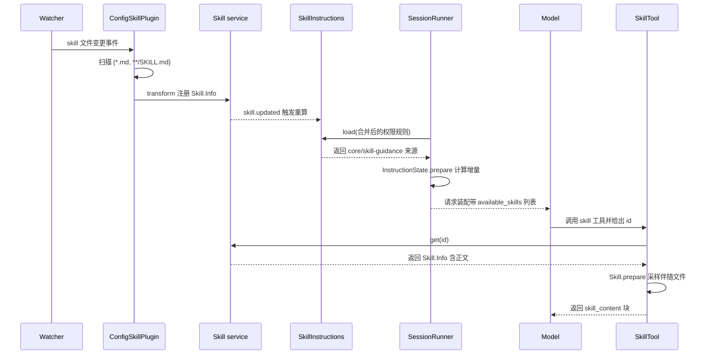
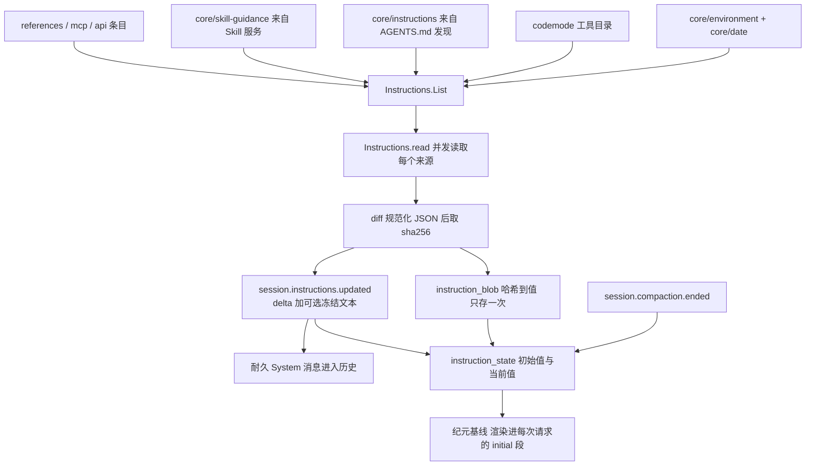
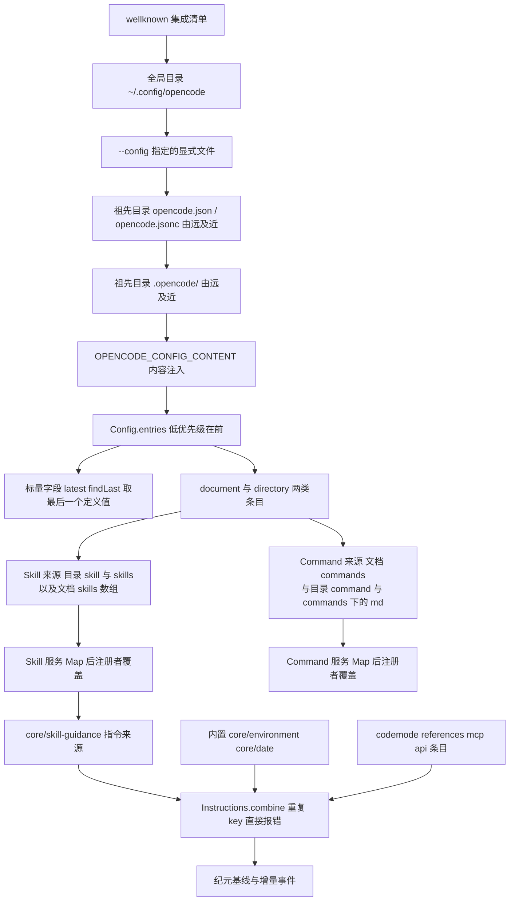

## 根因：进入上下文的字节，由谁在什么时刻决定

编码 Agent 的上下文只有两个来源：用户当轮说的话，和工程替它预先放好的东西。后者才是"这个项目的规矩"——代码风格、验证命令、领域约定、某个框架的坑。这类知识有三个互相拉扯的约束：它必须**在模型作答前就位**（否则模型会用通用直觉写出不符合本仓库习惯的代码）；它必须**可复现**（同一个 checkout、同一个问题，模型看到的知识应当一致，否则 bug 无法复盘）；它又必须**廉价**（一个 monorepo 的知识远超上下文预算）。

opencode 的答案是把"知识进入上下文"拆成三个互不相同的动作：**发现**（哪些知识存在、在哪里）、**加载**（把内容读成结构化值，常驻内存但不进上下文）、**注入**（在什么时刻把多少字节放进模型可见的位置）。本篇沿着这条主线，先讲 Skill 的磁盘形态与发现顺序，再讲指令的分层与增量代数，然后是承载这一切的配置系统与自定义命令，最后回答"为什么不做一个大 RAG"。

## Skill 在磁盘上的形态

### 两种布局与 id 的推导

一个 skill 不是一份文档，而是一个**目录 + 一份被声明的 Markdown**。扫描器在每个源目录里只匹配两个模式：顶层的 `*.md` 与任意层级的 `SKILL.md`。解析时 id 的推导规则取决于命中的是哪种：如果文件就在源目录顶层且不叫 `SKILL.md`，id 是去掉扩展名的文件名；否则 id 是文件所在目录的名字。这解释了两条并存的社区约定：`skills/<id>/SKILL.md` 目录式技能，和 `skills/<id>.md` 单文件技能。

[packages/core/src/config/plugin/skill.ts:120-137]()
<!-- anchor: const files = yield* fs … skills.push(parsed.skill) -->
[packages/core/src/config/plugin/skill-file.ts:40-53]()
<!-- anchor: const id = … content: markdown.content, -->

frontmatter 只接受三个字段：可选的 `name`（缺省时用 id）、可选的 `description`、以及任意形状的 `metadata` 包。真正参与行为的开关藏在 metadata 里——`opencode/autoinvoke` 被读成布尔值，且宽容地接受字符串 `"true"` / `"false"`，因为 frontmatter 是 YAML，作者很容易写成带引号的字符串。

[packages/core/src/config/plugin/skill-file.ts:9-14]()
<!-- anchor: const Frontmatter = Schema.Struct({ … const decodeFrontmatter = SchemaParser.decodeUnknownResult(Frontmatter) -->
[packages/core/src/config/plugin/skill-file.ts:21-32]()
<!-- anchor: const metadataBoolean = (metadata: unknown, key: string) => { … return undefined -->

注意 frontmatter 的结构与 skill body 是分开存放的：`content` 只有正文（frontmatter 被解析器剥掉），而 `path` 保留原始文件绝对路径。这个"路径而非内容"的保留是后续两件事的基础：注入时告诉模型"相对路径以此为基准"，以及按路径去重、按路径做增量 diff。

### 资源的伴随发现

`Skill.prepare` 在把 skill 交给模型前做一次非常克制的补充扫描：只有当这份 skill 的文件名恰好是 `SKILL.md` 时，才扫描它所在目录的 `**/*`，把除自身以外的文件**排序后取前 10 个**写进 `<skill_files>` 列表；单文件式 skill 得到空列表。这既给了模型"这里还有可读的脚本与参考文件"的指针，又用一个硬上限防止某个塞了几百个文件的 skill 目录把上下文吃掉。注入文本里明确写着 `Note: file list is sampled.`，是对这个上限的诚实交代。

[packages/core/src/skill.ts:55-68]()
<!-- anchor: export const prepare = Effect.fn("Skill.prepare")(function* (fs: FSUtil.Interface, … output: toModelOutput(skill, files), -->
[packages/core/src/skill.ts:36-52]()
<!-- anchor: export const toModelOutput = (skill: Info, files: ReadonlyArray<string>) => { … ].join("\n") -->

### 真实例子：本仓库自用的 skill

源仓库（opencode 自身）在 `.opencode/skills/` 下放了四个项目级 skill：`effect`、`opencode-dev`、`rtl-aware-development`、`sample-skill`。它们是同一个仓库存放"给人看"和"给 Agent 看"两种文档的分界样本。以 `sample-skill` 为例，它只声明 `name` + `description`，正文分 `When To Use` / `Workflow` / `Example Response Style` 三段，description 刻意写成**触发条件**（"当用户说到 sample skill、skill demo，或问一个 opencode SKILL.md 该怎么组织时"）而不是功能摘要——因为这段文字是模型唯一能看到的选型依据。

[.opencode/skills/sample-skill/SKILL.md:2-3]()
<!-- anchor: name: sample-skill … description: Use when the user says sample skill, skill demo, or asks how an openco -->

`effect` 这个 skill 则展示了"知识只在被触发时才付代价"的实际收益：它的正文要求先去 `.opencode/references/effect` 查真实的 Effect v4 源码，而不是凭记忆作答。这段要求本身会改变 Agent 的行为，但它对绝大多数与此无关的会话零成本——因为它不在上下文里。

[.opencode/skills/effect/SKILL.md:12-17]()
<!-- anchor: Use the current Effect v4 source, not memory or older Effect v2/v3 examples. … 4. Prefer answers and implementations backed by specific source files or nearby -->

### frontmatter 的宽容解析

Markdown frontmatter 由 gray-matter 解析，但外面套了一层 Fallback：当标准 YAML 解析失败时，`sanitize` 会把"值里含未加引号的冒号"的行重写成 YAML 块标量再试一次。这条兼容路径的注释直说是为了别的编码 Agent——它们接受这种非标准写法，文件因此能在多个工具间共享。这是一个典型的"合约宽松、语义收紧"取舍：解析宽容，但解码成 `Skill.Info` 时仍然要求字段类型正确，解析不出来的文件被静默跳过（`_tag: "Skipped"`）而不是让整次扫描失败。

[packages/core/src/config/markdown.ts:20-35]()
<!-- anchor: // Other coding agents accept unquoted colons in frontmatter values. Retry … return content.replace(frontmatter, () => result.join("\n")) -->
[packages/core/src/config/plugin/skill-file.ts:16-19]()
<!-- anchor: export type ParseResult = … | { readonly _tag: "Skipped"; readonly reason: "frontmatter"; readonly issue: SchemaIssue.Issue } -->

## 发现有源：skill 从哪些根来

**目录源的构造。** Skill 的来源不是一份硬编码目录表，而是从 `Config.entries()` 里**推导**出来的。对每个 `directory` 类型的配置条目，贡献两个候选目录 `<dir>/skill` 与 `<dir>/skills`；对每个 document 条目，把 `skills` 配置项里的路径（相对路径按该配置文件所在目录解析，`~/` 展开到 home）加进来。同一来源用 `equals`（按 type + path/url）去重，首次出现的位置保留。

[packages/core/src/config/plugin/skill.ts:85-102]()
<!-- anchor: for (const directory of directories) { … return result -->
[packages/schema/src/skill.ts:15-18]()
<!-- anchor: export const DirectorySource = Schema.Struct({ … }).annotate({ identifier: "Skill.DirectorySource" }) -->

把来源绑在"配置条目"而非"固定路径"上，换来的是：**用户配置里的 `skills` 数组、`.opencode/` 目录约定、以及 `--config` 指定的额外配置，走的是同一条发现路径**，不需要三套代码。代价是发现顺序变成配置顺序的函数，必须显式规定谁覆盖谁。

### 优先级：后注册者胜出

刷新时把全部来源扫成一个 `Map<Skill.ID, Skill.Info>`，`set` 的天然语义就是**后者覆盖前者**。由于 `sources()` 是按配置条目从低优先级到高优先级的顺序构造的，最终结果就是"高优先级条目里的同名 skill 赢"。

[packages/core/src/config/plugin/skill.ts:151-157]()
<!-- anchor: yield* FiberMap.clear(watches) … loaded.skills = Array.from(skills.values()) -->

更完整的三段优先级还要加上**注册顺序**。内置 skill（`opencode`、`report` 两份嵌入式文档）由 `pre` 阶段的插件注册；兼容来源（`~/.claude/skills`、`~/.agents/skills`）与配置来源由 `post` 阶段的插件注册，且兼容插件排在配置插件之前。插件监督器按 `pre → 外部包 → post` 的顺序激活，而 State 变换严格按注册顺序执行，所以最终的覆盖链是：**内置 < `~/.claude`|`~/.agents` < 项目/全局 `.opencode` 与配置**。项目里放一个 id 为 `opencode` 的 skill 就能盖掉内置的那份。

[packages/core/src/plugin/supervisor.ts:91-95]()
<!-- anchor: const ordered = [ … ...post.filter((plugin) => enabled.has(plugin.id)), -->
[packages/core/src/plugin/internal.ts:244-261]()
<!-- anchor: const post = [ … ] as const satisfies readonly InternalPlugin[] -->
[packages/core/src/state.ts:172-192]()
<!-- anchor: const get = () => { … return state -->

注意 MCP server 的合并用的是相反约定：它遍历配置文档时**先到者优先**（`if (editor.get(name)) continue`），因为 MCP 条目是"资源注册"而不是"声明覆盖"，重复注册应当报错而非静默改写。同一个仓库里两种合并方向并存，说明优先级不是全局规则，而是每个域的语义选择。

### 兼容源与内置源

兼容源的存在理由很实在：让从 Claude Code / Agents 生态迁移过来的项目**不重写文件就能被识别**。`config.compatibility()` 返回 `~/.claude` 与 `~/.agents` 两个根，兼容插件在各自下面找 `skills/` 目录，复用同一个 `SkillFile.parse`，因此 `SKILL.md` 与 frontmatter 的约定完全一致。

[packages/core/src/config/plugin/compatibility.ts:40-57]()
<!-- anchor: const roots = config.compatibility ? yield* config.compatibility() : { claude: [], agents: [] } … skills.splice(0, skills.length, ...loaded.values()) -->

内置源则是另一种极端：skill 内容作为构建期嵌入的字符串常量参与编译，`path` 被伪造成 `/builtin/opencode.md`。它们不经过磁盘、不经过 watcher，只经过 `ctx.skill.transform`。`report` skill 更进一步，在注册时把运行版本、channel、OS、终端、shell、已配置插件列表**快照进正文**——因为它的用途是让 Agent 生成一份可提交的缺陷报告。

[packages/core/src/plugin/skill.ts:27-43]()
<!-- anchor: yield* ctx.skill.transform((editor) => { … content: reportContent, -->
[packages/core/src/plugin/skill.ts:50-67]()
<!-- anchor: const reportContentWithDiagnostics = Effect.fn("SkillPlugin.reportContentWithDiagnostics")(function* ( … ].join("\n") -->

### 远程索引源

第三类来源是 URL。给一个基址，先拉取 `<base>/index.json`（形如 `{skills: [{name, version?, files[]}]}`）：

[packages/core/src/skill/discovery.ts:92-99]()
<!-- anchor: pull: Effect.fn("SkillDiscovery.pull")(function* (url) { … Effect.flatMap(HttpClientResponse.schemaBodyJson(Index)), -->

下载落点用内容寻址做目录名（对 base 取快速哈希），并在拼出路径后做两次目录逃逸校验：skill 名必须是安全段，解析出的 root 必须仍落在缓存根之下且不等于缓存根本身。

[packages/core/src/skill/discovery.ts:106-117]()
<!-- anchor: const sourceRoot = path.resolve(global.cache, "skills", Hash.fast(base)) … if (!FSUtil.contains(sourceRoot, root) || root === sourceRoot) { -->

单个文件还要过三道检查：相对路径安全、与索引同源、目标路径不逃出 skill 根；全部通过后才认领为来源。

[packages/core/src/skill/discovery.ts:78-86]()
<!-- anchor: const download = Effect.fn("SkillDiscovery.download")(function* (url: string, destination: string) { … Effect.logError("failed to download skill file", { url, error }).pipe(Effect.as(false)), -->

HTTP 客户端统一带瞬时错误重试（2 次、指数退避 + 抖动），并发上限是 4 个 skill / 8 个文件；而"目标文件已存在就跳过"让重复 pull 幂等。

[packages/core/src/skill/discovery.ts:69-73]()
<!-- anchor: const http = (yield* HttpClient.HttpClient).pipe( … schedule: Schedule.exponential(200).pipe(Schedule.jittered), -->
[packages/core/src/skill/discovery.ts:13-14]()
<!-- anchor: const skillConcurrency = 4 … const fileConcurrency = 8 -->

版本号变化时不做原地覆盖：先下到 `root.tmp-<uuid>`，校验通过再 rename 换名，失败则用 `root.old-<uuid>` 回滚。这使一次刷新要么完整生效、要么完全不影响已有缓存。

这一段是本模块里唯一出网的代码，也是唯一一处把"内容寻址"用在缓存目录名上的地方。

## 发现、加载、注入：三阶段为什么必须分开

### 发现：Location 作用域的可重放变换

Skill 服务本身只是一个 `Map<ID, Info>`，所有内容都由插件通过 `ctx.skill.transform` 写入；State 的读取语义是"按注册顺序重放全部变换，产出当前值"。这意味着每次读都是一次纯函数式重建，而不是对可变全局的读——**插件注销（Scope 关闭）就等于它的贡献消失**，不需要反向清理逻辑。规格文档 `specs/v2/catalog-config-plugin-lifecycle.md` 记录了当年在"Config 变换触发全量 Reload"与"可重放的 Location 作用域 Catalog 变换"之间的取舍，最终选了后者。

[packages/core/src/skill.ts:94-114]()
<!-- anchor: const state = State.create<Data, Editor>({ … notify: () => bus.publish(Skill.Event.Updated, {}).pipe(Effect.asVoid), -->
[packages/core/src/config/plugin/skill.ts:181-191]()
<!-- anchor: yield* ctx.event.subscribe().pipe( … Effect.forkScoped({ startImmediately: true }), -->

规格里选定的"Catalog 变换"在 v2.0.11 代码里并没有一个叫 `Catalog` 的服务——provider/model 目录由 `Provider`/`Model` 等各自的服务承担。实际落地的是被泛化的 `State.create` + 每域 `Editor`（Skill / Command / Agent / InstructionDiscovery / Tool / InstructionProvider 等）。设计意图（可重放、注册即贡献、随 Scope 回收、一次重建只发一个更新事件）一致，但"一个 Catalog 服务"被拆成了"每域一个 State"。这属于规格与代码的表述差异，不是行为差异。

**加载与注入的分界：**扫描阶段就把 `.md` 正文读进 `Skill.Info.content` 了。所以"按需"针对的不是磁盘 IO，而是**上下文预算**：全部 skill 的正文常驻进程内存，只有清单（id + name + description）常驻上下文。

### 注入一：guidance 摘要常驻，且只是一份"机会清单"

`SkillInstructions.load` 把当前可用 skill 投影成一条 instruction 来源，key 为 `core/skill-guidance`。它做了三层过滤：权限规则里 `deny` 的 skill 直接不可见；没有 `description` 的 skill 不可见（模型没有选型依据）；`autoinvoke === false` 的 skill 不可见。存活者按 id 排序后渲染成 `<available_skills>` 列表，并附上三句行为约定——"用 skill 工具加载"、"用户也可能直接调用，此时会以 `<skill_content>` 块出现，同一个 skill 不必重复加载"、"当前没有可用 skill"时的替代文案。

[packages/core/src/skill/instructions.ts:73-84]()
<!-- anchor: load: Effect.fn("SkillInstructions.load")(function* (permissions) { … read: Effect.succeed(available.length === 0 ? Instructions.removed : available), -->
[packages/core/src/skill/instructions.ts:25-33]()
<!-- anchor: const render = (skills: ReadonlyArray
) => … ].join("\n") -->

这里的取舍是整篇最关键的一处：**常驻的是索引，不是正文**。常驻正文的代价是 `O(全部 skill 字节数)`，一个装满领域手册的仓库会直接把上下文吃光；纯按需（连清单都不给）的代价是模型**不知道自己不知道什么**，无从发起加载。opencode 选了中间点：常驻 `O(skill 数 × description 长度)`，把正文成本推迟到真正匹配的那一刻。因此 description 的写法成了实际的性能与准确率杠杆——它必须写"何时用"而不是"是什么"。

### 注入二：正文只在被触发时进入

skill 正文进入上下文有三条**互相独立**的路径，它们都不经过"名称匹配"这种自动推断：

这里没有向量检索，也没有关键词打分：模型看到的是一份带描述的机会清单，由它自己决定是否调用工具。工具描述把这一点说得非常明确——"当手头任务与它描述匹配时，把该 skill 的指令与资源加载进当前会话"，并要求 id 必须匹配一个可用 skill 或用户显式引用的 skill。

[packages/core/src/tool/plugin/skill.ts:21-25]()
<!-- anchor: "Load a specialized skill's instructions and resources into the current conversation when the task at hand matches its description.", … "The skill ID must match an available skill or a skill explicitly referenced by the user.", -->

## 触发机制：三条注入路径

### 路径一：模型主动调用 `skill` 工具

工具执行时先过权限（`action: "skill"`、`resource: skill.id`，并把该 id 记入 `save`，于是"允许一次"可以升级为持久规则），再调 `Skill.prepare`，把 `<skill_content name="...">` 块作为工具结果返回。这条路径下 skill 正文是**工具输出**，天然带上了时间位置与因果链：模型在某一 step 的某次工具调用里读到了它。

[packages/core/src/tool/plugin/skill.ts:48-59]()
<!-- anchor: const skill = yield* skills.get(input.id) … return { name: skill.name, ...(yield* Skill.prepare(fs, skill)) } -->

### 路径二：用户显式挂载

TUI 里 `/skills` 打开选择器，选中后往输入框插入一个 `@<id>` mention；提交时它变成 prompt 的 `skills` 附件。服务端 `SessionPrompt.prepare` 把每个附件解析成完整渲染文本（`Skill.prepare` 的输出）塞回附件的 `text` 字段，于是这份 skill 正文随用户消息一起落库、一起进入模型可见历史。这条路径的关键性质是：**它在准入阶段就被渲染定型**，之后的 skill 文件变化不会追溯修改这条消息。

[packages/core/src/session/prompt.ts:61-71]()
<!-- anchor: return yield* Effect.forEach(requested, (attachment) => … text: (yield* Skill.prepare(fs, skill).pipe(Effect.orDie)).output, -->
[packages/core/src/session/runner/to-llm-message.ts:266-287]()
<!-- anchor: case "user": … case "skill": -->

### 路径三：API 直接激活

`POST /api/experimental/session/:sessionID/skill` 接受 `{id, resume?}`，发布一条**耐久事件** `session.skill.activated`，携带 id、name 与正文；投影把它变成一条 `skill` 类型的消息，渲染到模型侧时与用户消息同角色（user content）。与路径二的区别在于：它不占用用户消息、不改写 prompt 文本，而是作为独立的会话事实追加，因而在 UI 上是一张独立卡片，也能在重放时精确还原"第几步注入了哪个 skill"。

[packages/protocol/src/groups/session.ts:433-447]()
<!-- anchor: HttpApiEndpoint.post("session.skill", "/api/experimental/session/:sessionID/skill", { … description: "Activate a skill for a session by appending a skill message and resuming execution.", -->
[packages/core/src/session/session.ts:225-231]()
<!-- anchor: yield* bus.publish( … text: skill.content, -->

### `autoinvoke` 与"不要凭关键词用 skill"

`autoinvoke: false` 的语义是"从机会清单里摘掉，但用户仍可显式引用"——因为工具的输入校验要求"匹配可用 skill **或**用户显式引用的 skill"，所以这类 skill 依然可加载，只是模型无法自己发现它。这是给"我不想让模型自作主张，但我在需要时会点名"这类高度敏感技能留的开关。

与之配套的是提示词侧的约束：面向 GPT-Astra 的系统提示明确写着"不要仅凭关键词、表面相关性或它的存在就使用一个 skill；除非必要，不要重复读取会话里已有的 skill"。

[packages/core/src/plugin/system-prompt/gpt-astra.txt:7-7]()
<!-- anchor: - Do not use a skill based solely on keywords, superficial relevance, or its availability. Avoid re-reading skills already available in the conversation unless needed. -->

## 指令（Instructions）的来源分层

### 来源清单与显式组合

Skill 的清单本身只是指令体系里的一条来源。真正送进模型的是 `Instructions.List`——一个**有序的来源数组**，由 `SessionContext.select` 在一处显式列出：内置项（环境 + 日期）、Code Mode 工具目录、磁盘发现的 AGENTS.md、skill 清单、`references` 外部仓库说明、MCP 服务器说明、以及 API 托管条目。

[packages/core/src/session/context.ts:132-154]()
<!-- anchor: const loaded = yield* Effect.all( … loaded.entries, -->

**为什么不做 instruction registry**（没有 `registerInstruction(key, ...)` 这种全局注册表）：显式组合把"模型会看到哪些来源、以什么顺序"变成一段可以在屏幕上读完的代码。代价是新增来源必须改 Core；收益是三点：顺序是可字面阅读的（不存在"某个插件在我不知道的地方插了一条"）、键冲突在组合时立刻暴露（`Instructions.combine` 对重复 key 直接报 `DuplicateKeyError`）、以及**可测试性**——给定固定来源数组，渲染字节就是确定的，测试不需要跑插件系统。

[packages/core/src/instructions/index.ts:77-78]()
<!-- anchor: export class DuplicateKeyError extends Schema.TaggedError<DuplicateKeyError>()("Instructions.DuplicateKeyError", { … key: Key, -->
[AGENTS.md:191-191]()
<!-- anchor: - Keep the Instructions algebra and built-ins in `src/instructions`; keep instruction producers with their observed domains, and keep Session History selection plu -->

仓库根的 `AGENTS.md` 把这段组合逻辑称作 `loadInstructions`，但全仓库（排除 `node_modules`）没有任何名为 `loadInstructions` 的标识符，只有这一处引用；代码里的对应物是 `SessionContext.select`。这属于文档漂移，不是功能缺失。该段还提到"built-ins, discovery, guidance, and entries"四类，而代码里实际是七项（多了 Code Mode 目录、references、MCP），规格 `specs/v2/session.md` 的描述（built-ins / ambient discovery / selected-agent skill guidance / references / MCP guidance / API-managed entries）更贴近代码，但同样漏了 Code Mode。

### ambient global 与向上逐级的 project 指令

磁盘指令的发现器只认一个文件名：`AGENTS.md`。它构造两组候选：全局文件 `<global.config>/AGENTS.md`（默认开启），以及从当前 Location 目录**向上逐级到项目根或 home** 的每一层 `AGENTS.md`。向上走的实现是 `fs.up`：从 start 开始、每层检查目标文件是否存在、到 stop 停，天然产出"由近及远"的顺序。然后全局在前、项目在后拼成一个列表交给发现器，`stop` 的取值保证向上走不会越过项目边界（除非当前目录已在 home 之下，此时以 home 为界）。

[packages/core/src/config/plugin/instruction.ts:32-48]()
<!-- anchor: const start = yield* fs.resolve(location.directory) … .filter((file) => discovery.global || file !== globalFile) -->
[packages/core/src/config/plugin/instruction.ts:68-74]()
<!-- anchor: const projectSource = Effect.fn("ConfigInstructionPlugin.projectSource")(function* () { … return files.filter((file): file is InstructionDiscovery.File => file !== undefined) -->

一组来源被观察失败时的降级是**整体不可用**而非部分可用：只要有任意一个候选文件读不出来，该项目来源返回 `Instructions.unavailable`，发现器把自身标记为不可用。这是刻意的保守——一份读不到的 AGENTS.md 意味着模型可能拿不到完整规矩，与其静默少给，不如让上层知道"这次基线不完整"。

### 渲染顺序即插入顺序

发现器内部的 `files` 是 `Map<path, File>`，注释直说"Map 的插入顺序就是渲染顺序：配置先加全局、再加由近及远的项目文件"。细节上，对已存在的 path 再 `set` 一次会**保持原有的插入位置**，所以文件被重新发现不会改变渲染顺序，只有新增文件会追加到末尾。源里的注释甚至预先解释了这一点。

[packages/core/src/instruction-discovery.ts:28-36]()
<!-- anchor: // Map insertion order is render order: config adds global then nearest-to-farthest project files; … unavailable: () => void -->
[packages/core/src/instruction-discovery.ts:123-124]()
<!-- anchor: function render(files: ReadonlyArray<File>) { … return files.map((file) => `Instructions from: ${file.path}\n${file.content}`).join("\n\n") -->

### 读取路径感知的注入与去重账本

磁盘上的 AGENTS.md 与 skill 是两类不同的知识，因此走两条注入通道。AGENTS.md 的注入是**读取路径感知**的：`read` 工具在读到文件后，会从目标路径向上找同一目录链上的 `AGENTS.md`，把尚未注入过的那些作为 synthetic 消息追加进会话。也就是说，"离这份代码最近的规矩"是随着 Agent 真正去读那份代码才被拉进来的，而不是启动时全量灌入。

[packages/core/src/tool/plugin/read.ts:89-102]()
<!-- anchor: const resolved = yield* fs.resolve(result.target.absolute) … yield* sessionInstructions.load({ sessionID: context.sessionID, paths: candidates }) -->

这条通道最容易出错的地方是重复注入与丢失再注入，代码用两只手同时抓：一个是**同 step 并发去重**的内存 claim（同一 Session/path 在飞行中的加载只发起一次），另一个是**跨 step 的持久账本**——扫描模型可见历史里所有 synthetic 消息的 `metadata.instruction.paths`。注释解释了为什么必须两者都有：内存 claim 只活到加载结束，而持久账本是"唯一留存的分录"，所以当某条 synthetic 因为 compaction 或 revert 从可见历史中消失时，对应路径会被**重新发现并再次注入**，而不是永久静默丢失。

[packages/core/src/session/instructions.ts:47-53]()
<!-- anchor: const claimed = yield* Ref.modify(inFlight, (map) => { … return [newlyClaimed, next] -->
[packages/core/src/session/instructions.ts:100-107]()
<!-- anchor: return Effect.gen(function* () { … Option.getOrUndefined(Schema.decodeUnknownOption(InjectedMetadata)(message.met -->

### 配置 `instructions` 字段的现状

`opencode.jsonc` 的 schema 里有 `instructions: string[]`，注释写作"提供 ambient instructions 的额外路径或 URL"，normalize 也把它完整解码进文档，v1 迁移同样把它带过来。但 v2.0.11 里**没有任何运行时代码消费这个字段**：磁盘指令发现器只认 `AGENTS.md` 与全局文件，不看配置。这很可能是尚未接线的遗留（或 v1 兼容期的过渡态），而不是被刻意废弃——因为 schema 注释仍然面向用户。使用它目前不会报错，也不会有任何效果。

[packages/schema/src/config.ts:84-92]()
<!-- anchor: skills: Schema.String.pipe(Schema.Array, optional).annotate({ … description: "Additional paths or URLs supplying ambient instructions", -->
[packages/core/src/config/normalize.ts:222-223]()
<!-- anchor: const instructions = decodeList(input.instructions, Schema.String, ["instructions"], diagnostics, decodeEncoded) … if (instructions.length || Array.isArray(input.instructions)) encoded.instructions = instructions -->

## 指令代数：值增量，而不是文本拼接

### 规范 JSON 与内容哈希

每条来源都有一个 key（`Schema` 约束为 `namespace/name` 形状，`core/*` 保留给内置、`api/*` 留给 API 托管条目）与一个 codec。读取时把值编码成**规范 JSON**（对象键递归排序、数组保序），再取 sha256 作为 64 位十六进制哈希。所以"值"在系统里的表示是一个哈希，值本身只存一份。

[packages/schema/src/instruction.ts:5-20]()
<!-- anchor: export const Key = Schema.String.check(Schema.isPattern(/^[a-z0-9][a-z0-9._-]*\/[a-z0-9][a-z0-9._/-]*$/)).pipe( … export const Delta = Schema.Record(Schema.String, Schema.Union([Hash, Removed])) -->
[packages/core/src/instructions/index.ts:243-251]()
<!-- anchor: function canonical(value: Schema.Json): string { … return JSON.stringify(value) -->

`diff(observed, previous)` 的产物是一个 `Delta`（key → 新哈希，或字面量 `"removed"`）加一组本次新出现的 blob。相较"把渲染好的文本当作状态"，这套代数换来三件事：跨会话去重（同一个 AGENTS.md 内容只存一份）、增量可比（两次观测之间只传变化的 key）、以及**重放不依赖外部环境**（重放时只需 delta + blob，不需要重新读盘）。

[packages/core/src/instructions/index.ts:143-158]()
<!-- anchor: const blocked = previous ? [] : observed.flatMap((entry) => (isUnavailable(entry.value) ? [entry.key] : [])) … return Effect.succeed({ delta, blobs }) -->
[packages/core/src/instructions/index.ts:194-204]()
<!-- anchor: export function hash(value: Schema.Json) { … return result -->

### 读取结果的三种形态

一次读取有三种结果：具体的值、`unavailable`（暂时读不到，保留旧值）、`removed`（观察到了"存在但值没了"，例如文件被删）。后两者用**单例对象的引用相等**判别，而不是结构比较——因为合法的 JSON 值完全可能长得像 `{}`。这个区分支撑了很不同的行为：`unavailable` 只在建立初始基线时阻塞（`InitializationBlocked`，让上层把已准入的输入继续挂起，而不是带着不完整基线开跑），`removed` 则是一条正常的变更。

[packages/core/src/instructions/index.ts:19-25]()
<!-- anchor: /** The read failed temporarily; the stored value stands. */ … export type Removed = typeof removed -->
[packages/core/src/instructions/index.ts:233-240]()
<!-- anchor: // Reference-equality guards: `A` in a typed source may itself be JSON shaped … return value === removed -->

### 三态渲染

每条来源实现三个渲染函数：`initial`（基线）、`changed`（相对上一次的增量）、`removed`（撤销声明）。渲染器返回 `undefined` 表示"无法渲染"，该来源被跳过——这是为"历史值在新版本里已不可解码"留的逃生门。渲染文本不允许为空，否则直接抛错：一条渲染成空串的"更新"会让模型以为收到了信息。

[packages/core/src/instructions/index.ts:33-39]()
<!-- anchor: export interface Source { … readonly removed: (previous: Schema.Json) => string | undefined -->

三类来源的增量风格很不一样，值得对照：AGENTS.md 的变更渲染成 **unified diff**（用 `diff` 库的 `createPatch`，上下文 3 行），只有当 diff 比"全文重述"更长时才退化为重述；skill 清单的变更在有增无删或有删无增时只列变化项，其余情况整表重述并声明"此列表取代此前的可用 skill 列表"。

[packages/core/src/instruction-discovery.ts:127-148]()
<!-- anchor: function renderUpdate(previous: ReadonlyArray<File>, current: ReadonlyArray<File>) { … ].join("\n\n") -->
[packages/core/src/skill/instructions.ts:35-57]()
<!-- anchor: const update = (previous: ReadonlyArray
, current: ReadonlyArray
) => { … ].join("\n") -->

## 指令纪元：一次存储、按需补差

**一次存储，两处引用。** 值通过 `instruction_blob(hash → value)` 存一次，且写入用 `commit` 与事件发布同事务；`instruction_state` 每 Session 一行，保存 `epoch_start`、`through_seq`、`initial_values`、`current_values`。查询时 `initial_values` 提供**本次请求的基线**，`current_values` 提供**增量比较的参照**。契约说得很清楚：blob 值只存一次，被投影出来的 `instruction_state` 行才是边界处理的正常来源。

[packages/core/src/session/instruction-state.ts:165-172]()
<!-- anchor: export const initial = Effect.fn("InstructionState.initial")(function* ( … const blobs = yield* loadBlobs(db, Object.values(state.initial_values)) -->
[packages/schema/src/instruction.ts:13-18]()
<!-- anchor: export const Values = Schema.Record(Key, Hash) … export const removed = Removed.make("removed") -->

**为什么冻结渲染文本。** 更新的耐久事件里可以带一个 `text` 字段，注释写明它是"在发出时冻结的、给模型看的时序更新"。冻结的理由写在 `commit` 里：**以后再渲染需要当初那些 Location 作用域的指令来源**，而会话可能已经迁到别的目录、来源已经不存在了。这与整个 v2 的"重放一致性"目标是同一件事——历史消息必须能被重建成与当初逐字节相同的请求，因此不能把"渲染"这种依赖外部环境的动作推迟到重放时。

[packages/schema/src/session-event.ts:260-267]()
<!-- anchor: schema: { … text: Schema.String.pipe(optional), -->
[packages/core/src/session/instruction-state.ts:44-58]()
<!-- anchor: if (!observation.initial && Object.keys(observation.delta).length === 0) return … commit: () => insertBlobs(db, observation.blobs), -->

基线**不带** text：它只通过 `metadata.instructions.initial = true` 标记，而共享的消息更新器在 `text === undefined` 时直接返回，因此基线永不成为历史消息——它每次请求由存储值重新渲染，天然跟随纪元。后续增量则被投影成一条 `system` 类型的耐久消息，渲染路径与 TUI 完全一致（服务端投影器和客户端共用同一个 `SessionMessageUpdater`）。

[packages/core/src/session/message-updater.ts:147-157]()
<!-- anchor: "session.instructions.updated": (event) => { … "session.instructions.updated": (event) => { -->

### 纪元推进：compaction 移动、move 保留、revert 清空、fork 继承

`advanceEpoch` 把 `epoch_start` 与 `through_seq` 都设为 compaction 结束事件的序号，并把 `current_values` 复制为新纪元的 `initial_values`。语义是：压缩之后，"基线"就等于压缩那一刻的当前值——因为压缩摘要被明确要求**不要**复述 AGENTS.md 之类的设置（"下一个 agent 会另行收到这些内容的最新版本"），基线必须由存储值重新提供。

[packages/core/src/session/instruction-state.ts:139-153]()
<!-- anchor: export const advanceEpoch = Effect.fn("InstructionState.advanceEpoch")(function* ( … .pipe(Effect.orDie) -->
[packages/core/src/session/compaction.ts:366-366]()
<!-- anchor: "Summarize only what the user and the assistant said and did. Leave out instructions and setup the assistant was given rather than told by the user: repo -->

投影侧的接线同样直白：`Compaction.Ended` 的处理链末尾追加一次 `advanceEpoch`，`InstructionsUpdated` 的处理链则是"先写入消息，再应用 delta 到 `current_values`"。顺序不能反——先 apply 会让渲染用的 previous 变成新值。

[packages/core/src/session/projector.ts:666-668]()
<!-- anchor: yield* bus.project(SessionEvent.InstructionsUpdated, (event) => … yield* run(db, event) -->
[packages/core/src/session/projector.ts:705-705]()
<!-- anchor: yield* InstructionState.advanceEpoch(db, event.data.sessionID, event.durable.seq) -->

fork 的语义则是**继承而不重算**：投影 fork 事件时先把父会话的消息按边界批量复制过去，再复制 API 托管条目，最后用事件里携带的 `instructions` 值 `initialize` 新会话的状态——即"即使复制的历史停在更早的边界，子会话也采用父会话最新的指令值"。这一条与"每次请求都按当前值渲染基线"是自洽的：基线永远来自最新存储值，历史消息只负责承载增量叙述。

[packages/core/src/session/projector.ts:224-225]()
<!-- anchor: if (event.data.instructions) … yield* InstructionState.initialize(db, event.data.sessionID, event.durable.seq, event.data.instructions) -->

### API 托管条目是可写的第三类来源

除了"读磁盘"和"读服务"之外，还有一类由 API 写入的会话级来源：`instruction_entry` 每行一个 `key → JSON value`，键约束为无斜杠的小写标识符，渲染时统一加 `api/` 前缀（命名空间由构造保证）。单值上限 256 KiB，超限返回 413。它的渲染刻意保持"机制中立"——模型只看到 `<context key="...">` 块，看不到它是通过什么接口附加的；只有时序性的更新与移除才带叙述文本。

[packages/core/src/session/instruction-entry.ts:88-102]()
<!-- anchor: // Rendering stays mechanism-neutral: the model sees session context, not how … removed: () => `The context under "${entry.key}" no longer applies. Disregard it.`, -->

边界处理的一次调用点很集中：runner 在准备上下文时执行一次 `InstructionState.prepare`，注释点明"被阻塞的初始基线必须让已准入的输入继续挂起"——这就是"准入与执行分离"在指令系统里的落点，指令同步是**输入提升为模型可见之前**的一道闸门。

[packages/core/src/session/runner/llm.ts:198-200]()
<!-- anchor: const selected = yield* context.select(sessionID) … yield* InstructionState.prepare(db, bus, selected.instructions, sessionID) -->

## 配置系统

### 优先级阶梯

`Config.entries()` 的返回数组顺序就是优先级顺序，组装点把所有来源摆在一处并配了一句注释："全局条目在显式与 direct 文件之下；项目目录排在它们之上"。

[packages/core/src/config.ts:220-236]()
<!-- anchor: // Global entries sit below explicit and direct files; project … ...content, -->
[packages/protocol/src/groups/config.ts:7-19]()
<!-- anchor: export const ConfigGroup = HttpApiGroup.make("server.config") … "Return configuration documents and discovery sources for the requested location, from lowest to highest priority.", -->

发现层负责把"候选路径"排成同样的序。它从当前目录向上走（`fs.up`，最近优先），每层按固定顺序生成五个候选：`.claude`、`.agents`、`.opencode`、`opencode.jsonc`、`opencode.json`；随后把整张表 `toReversed()`，于是**由远及近**，最近的项目目录排在最后（最高优先级）。全局目录、`~/.claude`、`~/.agents` 不参与向上走，而是单独作为最低优先级的前缀；`options.global === false` 会同时排除它们，并额外把落在这些根之下的路径从项目走查里剔除。

[packages/core/src/config/discovery.ts:33-61]()
<!-- anchor: const directories = … .map(({ item }) => item) -->
[packages/core/src/config.ts:45-53]()
<!-- anchor: export const Options = Schema.Struct({ … export type Options = typeof Options.Type -->

配置面由 `Options` 的三个开关切开：`project: false` 直接跳过向上走查，`global: false` 跳过全局三根，`file` 指定显式文件，`content` 直接注入一段 JSON 文本（常用于测试与嵌套调用）。更重要的是"发现是否发生"本身可以被宿主关掉：嵌入式实例把 `Config` 与 `InstructionDiscovery` 一并替换成 `configured({ project: false, global: false })`，注释把边界说得最清楚——读取文件仍然注入嵌套的 `AGENTS.md`，因为"那是会话期上下文，不是启动期的人口普查"。

[packages/core/src/instance.ts:142-145]()
<!-- anchor: const vanillaReplacements: LayerNode.Replacements = [ … InstructionDiscovery.node.replace(InstructionDiscovery.configured({ project: false, global: false })), -->
[packages/core/src/instance.ts:128-130]()
<!-- anchor: // Use-triggered behavior also stays: reading a file still injects nested … // population. -->

### 条目顺序即优先级，消费方各自决定合并方向

`Config.latest(entries, key)` 的实现是 `findLast`——取最后一个定义了该字段的 document，也就是最高优先级。但它只是一个便利函数，真正决定合并语义的是各域插件：标量字段用它（shell、formatter、tool_output、websearch、snapshots）；map 型字段按序遍历文档并 `set`（provider、mcp、commands、agents、skills），因此也是后者胜；而 policy 明确反向——`toReversed()` 之后 `findLast`，"用户全局策略优先于仓库里的策略"，用于 deny 判定。

[packages/core/src/config.ts:22-25]()
<!-- anchor: export function latest<K extends keyof Info>(entries: readonly Entry[], key: K): Info[K] | undefined { … ?.info[key] -->
[packages/core/src/config/plugin/policy.ts:15-27]()
<!-- anchor: const policies = () => … if (policy?.effect === "deny") providers.remove(record.provider.id) -->

大多数配置插件根本不写 reload 逻辑，而是复用一个 25 行的 `ConfigEntryObserver.observe`：读一次当前条目、订阅 `config.updated`、并在**第二次读**之后才返回，以关掉"第一次读与订阅建立之间"的竞态窗口。这个竞态极其真实——文件可能恰好在两次操作之间被改动。

[packages/core/src/config/plugin/entry-observer.ts:12-24]()
<!-- anchor: const loaded = { entries: yield* config.entries() } … return loaded -->

### 变量替换

配置文本在解析前经过一次字符串替换：`{env:VAR}` 取值顺序是"调用方提供的 env → 进程环境 → 空串"，因此缺失变量不会报错而是退化为空。`{file:path}` 把文件内容**按 JSON 字符串转义后**插入（先 `JSON.stringify` 再剥掉首尾引号），所以多行文件可以安全地嵌进 JSON 字符串值；路径以 `~/` 开头会展开到 home，相对路径按配置文件所在目录解析，缺失文件默认报错（可用 `missing: "empty"` 改为空串）。另外，如果 `{file:` 出现在以 `//` 开头的行里，会被原样保留——给"注释掉的示例"留了一条路。

[packages/core/src/config/variable.ts:26-33]()
<!-- anchor: /** Apply {env:VAR} and {file:path} substitutions to config text. */ … return yield* substituteFiles(input, text) -->

### 热重载与生效范围

改配置**不需要重启**，而且生效范围是 **per-Location**，不是全局。Config 本身是 Location 作用域节点，每个 Location 各自跑发现、组装与 watch 计划；重载时它会**先重新发现、再重新加载、再对账 watch 集合**，最后只在条目真的变了（`isDeepStrictEqual` 短路）才发布 `config.updated`。watch 计划同时覆盖目录与"父目录 + 文件名"两种粒度：目录用于 `.opencode/` 这类会新增文件的根，父目录 entries 用于 `opencode.json` 这类可能被删除重建的单文件——注释说明了原因：为每个根保留父级 watch，删除/重建才可观测。

[packages/core/src/config.ts:265-276]()
<!-- anchor: const reload = Effect.fn("Config.reload")( … yield* bus.publish(Event.Updated, {}) -->
[packages/core/src/config/watch.ts:8-35]()
<!-- anchor: export function plan(sources: ConfigDiscovery.Sources) { … names: [...new Set(files.map((file) => path.basename(file)))].toSorted(), -->

各域插件的响应模式高度一致：收到 `config.updated`（或 `config.changes()` 过滤出的相关路径）后重建自己的 State 并 `reload()`。skill 与命令两条链路还多一层文件级 watcher（`.opencode/skills/**` 与 `.opencode/command(s)/**`），带 100ms debounce 合并编辑器保存产生的突发事件；skill 插件还会在 `config.updated` 时重读配置条目再刷新，因此"改 `opencode.jsonc` 里的 `skills` 数组"同样即时生效。

[packages/core/src/config/plugin/skill.ts:171-178]()
<!-- anchor: const updates = yield* PubSub.subscribe(changes) … yield* refresh() -->

**配置能写在 markdown 里吗。** 不能作为主配置。`opencode.json` / `opencode.jsonc` 是唯一的主配置载体（JSONC，允许注释与尾逗号，用 `jsonc-parser` 解析，`config.update` 用 `modify`/`applyEdits` 做保形补丁）。Markdown + frontmatter 是 **agent / command / skill 三类"定义文件"** 的载体：agent 从 `{agent,agents}/**/*.md` 与 `{mode,modes}/*.md` 读取 frontmatter 作为配置、正文作为 `system` 提示；command 从 `{command,commands}/**/*.md` 读取 frontmatter 作为元数据、正文作为模板；skill 从 `{*.md,**/SKILL.md}` 读取同样的三段 frontmatter。三者共用同一个 `ConfigMarkdown` 解析器。

[packages/core/src/config/plugin/agent.ts:21-26]()
<!-- anchor: const legacySources = [ … const sourceDirectories = ["agent", "agents", "mode", "modes"] as const -->

顺带一个可观察的后果：`agent` 目录下的一个 markdown 文件会被解码成一份 **Config.Document**，于是它和 `opencode.jsonc` 出现在同一个 `entries()` 数组里、参与同一套优先级与 `latest()` 折叠。这就是"配置发现"和"定义文件发现"能共用一套排序的原因。

**配置面的宽度。** 配置 schema 拆成 19 个文件、按域独立演进：`agent` / `command` / `compaction` / `experimental` / `formatter` / `lsp` / `mcp` / `media` / `model` / `plugin` / `policy` / `provider` / `reference` / `shell` / `tool-output` / `warming` / `watcher` / `websearch` / `worktree`，顶层再挂 `$schema`、`shell`、`model`、`default_agent`、`update`、`share`、`enterprise`、`username`、`permissions`、`agents`、`snapshots`、`skills`、`commands`、`instructions`、`references`、`plugins`、`providers`、`experimental` 等字段。`skills`、`commands`、`instructions` 三个字段是本篇的主角：它们都是"往发现面加料"的入口，而不是直接的运行时行为开关。

[packages/schema/src/config.ts:84-92]()
<!-- anchor: skills: Schema.String.pipe(Schema.Array, optional).annotate({ … description: "Additional paths or URLs supplying ambient instructions", -->

## 自定义命令

### 命令是什么，它和 skill、agent 的关系

命令是一个**命名入口 + 一段模板 + 一个执行策略**。`Command.Definition` 只有 name、可选 description、以及一个 `execute(invocation)`；invocation 携带 sessionID、prompt 载荷与投递方式（`steer` / `queue`）。它的实现体几乎总是"把模板展开成 prompt 文本，然后调 `ctx.session.prompt`"——所以命令不产生新的模型调用路径，它只是**塑造一次用户输入**。

[packages/core/src/command.ts:16-30]()
<!-- anchor: export interface Invocation { … add: (definition: Definition) => void -->
[packages/core/src/command.ts:57-63]()
<!-- anchor: const state = State.create<Map<string, Definition>, Editor>({ … notify: () => bus.publish(Command.Event.Updated, {}).pipe(Effect.asVoid), -->

三者的分工可以这样理解：**agent 决定"谁来回答"**（模型、系统提示、权限、步数上限），**command 决定"用户想干什么"**（一次被结构化的输入），**skill 决定"回答时手里有什么知识"**。命令甚至可以在展开时顺带指定 agent / model，或者把这次执行降级成一个 subagent 任务——这些都是 prompt 载荷上的字段。

[packages/schema/src/config/command.ts:7-12]()
<!-- anchor: export class Info extends Schema.Class<Info>("Config.Command")({ … subagent: Schema.Boolean.pipe(optional), -->
[packages/core/src/config/plugin/command.ts:72-98]()
<!-- anchor: yield* ctx.command.transform((editor) => { … if (subagent ?? commandAgent?.mode === "subagent") { -->

**命令的来源与命名。** 四条来源汇入同一个 `Map<name, Definition>`：内置 `init`（引导生成 AGENTS.md）与 `review`（代码审查）在 `pre` 阶段注册；MCP prompts 以 `<server>:<prompt>` 的净化名注册，随 `Mcp.PromptsChanged` 事件重算；配置文档里的 `commands` map 直接贡献；目录里的 `command` / `commands` 下任意层级的 `*.md` 按**相对路径去扩展名**命名，因此 `command/session/clear.md` 得到 `session/clear`。由于 `editor.add` 是按 name `set`，同名的后注册者覆盖前者。

[packages/core/src/plugin/command.ts:28-41]()
<!-- anchor: yield* ctx.command.transform((editor) => { … .pipe(Effect.asVoid), -->
[packages/core/src/config/plugin/command.ts:156-164]()
<!-- anchor: const files = yield* fs … Effect.orElseSucceed(() => undefined), -->
[packages/core/src/plugin/command.ts:104-110]()
<!-- anchor: function mcpCommandName(server: string, prompt: string) { … return value.replace(/[^a-zA-Z0-9_-]/g, "_") -->

**命令如何被触发。** CLI/TUI 侧的斜杠命令最终落到 `SessionCommand.execute`：先从插件激活完成的 Location 上取到 `Command.Service`，再按名字执行。HTTP 侧有对应端点 `POST /api/session/:sessionID/command`，描述为"立即执行一个斜杠命令回调"。注意工具、skill、command 三者在这里统合：**用户敲 `/name` → 找到 Definition → 展开模板 → 走与普通 prompt 完全相同的准入管线**（`session.inbox.enqueued` → 投递 → 模型可见），所以命令天然继承幂等、投递模式、以及"prompt 先持久化再执行"的全部性质。

[packages/core/src/session/command.ts:20-32]()
<!-- anchor: const instances = yield* Instance.Service … delivery: input.delivery ?? "steer", -->
[packages/protocol/src/groups/session.ts:413-428]()
<!-- anchor: HttpApiEndpoint.post("session.command", "/api/session/:sessionID/command", { … description: "Execute a slash command callback immediately.", -->

**模板求值。** 模板支持四种占位与插值：`$1..$N` 位置参数（最后一个吃掉剩余全部，避免参数被截断）、`$ARGUMENTS`（整体替换、可多次出现）、`${path}`（内置命令用它注入项目目录）、以及 `` !`cmd` `` shell 插值。shell 插值的实现细节值得一看：并发上限 2、合并 stdout/stderr 后解码为 utf8、用带超时与 `stdin: "ignore"` 的进程执行，失败时错误信息包含原始命令原文——因为这类插值是把**本地命令输出直接拼进 prompt**，出错必须可定位。真实用例可见本仓库的 `.opencode/command/`：`commit.md` 声明 `subtask: true` 与模型选择，`learn.md` 的正文教 Agent 把会话中的非显然知识回写到最近的 `AGENTS.md`，`translate.md` / `spellcheck.md` 则依赖 `.opencode/glossary/` 下的术语表。

[packages/core/src/config/plugin/command.ts:189-213]()
<!-- anchor: function evaluateTemplate( … : withArguments.trim() -->
[.opencode/command/learn.md:2-2]()
<!-- anchor: description: Extract non-obvious learnings from session to AGENTS.md files to build codebase understanding -->
[.opencode/agent/triage.md:2-8]()
<!-- anchor: mode: primary … "github-triage": true -->

## 为什么不直接做 RAG

**结构化发现换来了什么。** **可预测**：同一个 checkout、同一份配置，指令集合与渲染字节完全确定。没有 embedding 版本、没有索引新鲜度、没有 top-k 的随机性。渲染文本里逐条写着 `Instructions from: <绝对路径>`，模型可以据此去读原文件。

**可版本化**：知识以文件形式存在于仓库里，随 git 一起 review、一起 diff、一起回滚。`.opencode/skills/`、`.opencode/command/`、根 `AGENTS.md` 的每次改动都是一次可审计的提交，而不是一次索引重建。

**可审计与可重放**：指令值被内容寻址（sha256 + blob），变更以耐久事件形式记录 key 与哈希，渲染文本在发出时冻结。因此"第 7 步时模型看到的规矩是什么"是可以从事件日志精确重建的——这正是 `instruction_blob` / `instruction_state` / `session.instructions.updated` 这套三件套存在的理由。若检索依赖一个会漂移的索引，"重放"就只能近似。

**增量可比**：发现是读文件，所以能对同一路径做前后 diff，把 `AGENTS.md` 的变化渲染成 3 行上下文的 unified diff，而不是把整份文件重新塞一遍。RAG 的检索结果是片段集合，天然没有"这条知识相对上次变了什么"的概念。

**零索引成本**：没有额外的构建步骤、没有向量库、没有 embedding 计费。这在客户端/服务端分离、随时可能新开一个目录的 Agent 场景里很关键——`fs.up` 加几个 `readFile` 就是全部开销。

**代价。** **覆盖面受限于"有人写了文件"**。知识必须落在约定位置（`AGENTS.md` 或 `SKILL.md`）或被显式配置，否则 Agent 无从知晓。RAG 理论上能从未整理的语料里捞东西——但代价是捞到的东西没有稳定可引用的句柄，而编码 Agent 恰恰需要"这个结论来自哪个文件的哪一行"。

**依赖描述质量**。skill 能否被用上，几乎完全由 `description` 决定（还要过 `autoinvoke` 与权限两道闸）。索引是常驻的机会清单，选型是模型的事，没有召回率保障。

**规模受上下文预算限制**。清单常驻意味着 skill 数量 × 描述长度的线性成本；几百个 skill 时，光是清单就会变成噪声。

**这套取舍在 opencode 里如何被补偿。** 三个补偿机制值得单独指出。其一，**索引常驻而正文按需**——用 `O(skill 数)` 的常驻成本换来"模型知道自己不知道什么"，这是结构化路线对 RAG 召回问题最接近的替代。其二，**references 与 websearch**：外部仓库（git 或本地目录）以命名引用的形式进入指令面，本仓库的 `.opencode/opencode.jsonc` 就声明了 `effect` 与 `opencode-local` 两个引用——跨仓知识用"声明 + 按需读取"处理，而不是向量化。其三，**工具化的检索**：仓库语料本身由 `grep` / `glob` / `read` 覆盖，语义检索在这里是重复建设且provenance更差。

因此"不做大 RAG"不是技术能力问题，而是**把不确定性放在哪一层**的选择：opencode 把不确定性留给模型（是否调用某个 skill），而不留给基础设施（这次检索会返回什么）。

## 连回设计哲学

这一模块几乎是 v2 全部设计哲学的缩影。

**事件即事实**：指令值不存渲染文本，存内容哈希；变更不存状态，存 delta 事件；渲染出的时序文本只在必须跨环境重放时才冻结进事件。凡是可以由有序历史折叠出来的东西，都不重复存——`instruction_state` 是投影，不是事实。

**准入与执行分离**：指令同步发生在模型可见消息被提升之前（`InstructionState.prepare` 在每次上下文准备时执行一次），而且"初始基线被阻塞"会**阻止输入提升**而不是带着半份规矩开跑。知识就位与模型执行是两道相邻但独立的闸门。

**Global / Location 两阶段部署**：`SkillDiscovery` 是 Global 节点（远程索引缓存落在进程级 `Global.cache`），而 `Skill`、`Config`、`Command`、`InstructionDiscovery`、`InstructionState`、`InstructionEntry` 都是 Location 作用域——每个工作目录各自发现自己的规矩，各自维护自己的纪元，彼此不共享可变状态。

**合约先行**：技能的形状在 `packages/schema/src/skill.ts` 里定义，指令的键与哈希形状在 `schema/src/instruction.ts` 里定义，对外只暴露 `skill.list` / `command.list` / `config.get` 三个只读端点。Server 侧 handler 各只有几行，因为语义早已沉淀在合约与 Core 里。

**策略与引擎分离**：发现策略（扫哪些目录、认哪个文件名、谁覆盖谁）住在可读的配置插件里；重放引擎（`State.create` 的按序变换 + Scope 回收）住在通用基础设施里。于是"改优先级"是改插件，"改重放语义"是改 State——两者不会互相绑架。

最后一点也许最值得带走：**这套系统把"项目知识"当成了工程产物而非检索结果**。它要求人把非显然的东西写下来、放在能被发现的地方，然后用确定性的机制把它送到模型面前。这既是它的上限（没写就没有），也是它能在长会话、可中断、可重放的 Agent 运行时里立得住的原因。
