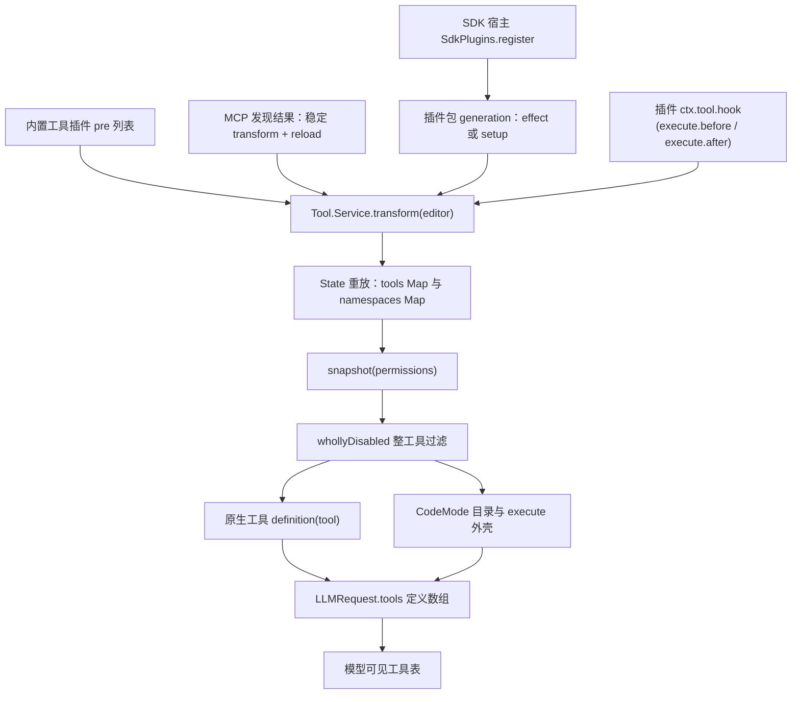
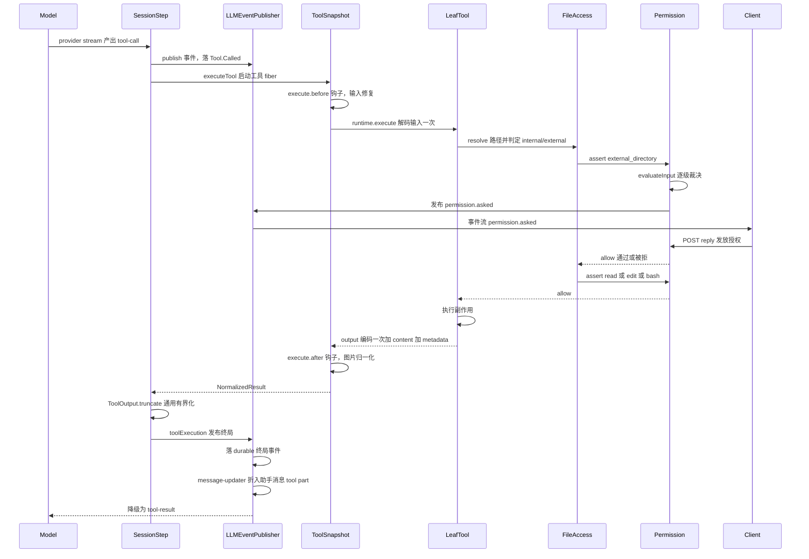

## 行动面的四个边界

模型产出一次工具调用之后，系统要连续穿过四个边界：**注册边界**（这个工具是谁提供的、叫什么名字、对模型可见吗）、**校验边界**（参数是否合法、返回值是否合法）、**授权边界**（这次副作用是否被允许）、**回注边界**（结果以什么形态回到上下文、超出的部分去哪）。这四个边界各自有唯一归属，并且刻意不互相重复。

把工具层说成"一堆 JSON Schema 加几个 handler"是看不到设计的。opencode 的关键判断是：**工具是 Agent 唯一能改变真实世界的通道，因此它的每一条不变式都必须是可命名、可校验、可持久化的。** 仓库里作者亲写的 v2 规格正是用 "outcome laws"（结果不变式）来表述这一层的：

工具构造、注册、执行与结果不变式的语义总纲写在 `specs/v2/tools.md`，其权威归属声明为"公开领域形状归 `packages/schema`、运行时行为归 `packages/core`"。[specs/v2/README.md:9-14]()
<!-- anchor: | Concern                                         | Owner                        … | Contributor-critical regression guardrails      | Root [AGENTS.md](../../AGENT -->

这条分界线在代码里就是：`packages/schema/src/tool.ts` 只放 `Info`/`Context`/`Result`/`Content` 这些纯数据类型与合约，`packages/core/src/tool.ts` 与 `packages/core/src/tool/runtime.ts` 放注册、校验、执行与归一化。下面四节分别对应这四个边界。

## 一份结构，三种来源

### 内置工具：一张编译期常量列表

内置工具不是"自动扫描目录发现的"，而是一份显式有序的常量数组。`patch` 排在编辑类工具之前，紧跟着的注释解释了顺序为什么重要——prompt 渲染必须在 patch 插件完成编辑工具选择之后：

内置插件按 `pre` / `post` 两段装配，工具类插件（`Patch`、`Edit`、`Glob`、`Grep`、`OpenCodeTools`、`Question`、`Read`、`Shell`、`Skill`、`Subagent`、`WebFetch`、`WebSearch`、`Write`）全部在 `pre` 段，`ToolInputRepairPlugin` 则是 `pre` 段的第一个。[packages/core/src/plugin/internal.ts:226-241]()
<!-- anchor: // Render model prompts after the patch plugin selects the available editing too … WarmingPlugin.Plugin, -->

顺序即语义：输入修复插件最先注册 `execute.before` 钩子，因此它总能在任何其它钩子之前改写模型传进来的原始参数。

### MCP：一个稳定 transform 加一次 reload

MCP 工具不逐个注册。整个 MCP 只贡献**一个**注册变换，变换体读取"当前已发现工具"这个可变源；工具列表变化时只更新源并 `reload()`，而不是在变换顺序末尾重新注册一遍。这样做的直接后果是：**MCP 刷新不会把优先级挤到后面插件的上面**。

MCP 工具的模型可见名由服务名与工具名经字符清洗后拼接，服务名成为注册表 namespace（对应 CodeMode 里的 `server.tool` 路径段）。[packages/core/src/tool/mcp.ts:16-17]()
<!-- anchor: export const namespace = (server: string) => server.replace(/[^a-zA-Z0-9_-]/g, " … export const name = (server: string, tool: string) => `${namespace(server)}_${to -->

首次发现与后续刷新走两条不同路径：首次加锁后一次性 `editor.add` 全部工具，之后只保留"重新读目录 + reload"这条协调路径。[packages/core/src/tool/mcp.ts:36-47]()
<!-- anchor: // Register once after initial discovery; only subsequent updates need a debounc … input: (tool.inputSchema ?? { type: "object", properties: {} }) as JsonSchema.Js -->

刷新是**防抖**的，因为 MCP server 会成批广播工具变更，而每次读取都拉回整个目录。注释里把两段流分开：总线订阅保持急切，只有已经打开的滑动订阅被防抖 100ms。[packages/core/src/tool/mcp.ts:124-143]()
<!-- anchor: const reconcile = lock.withPermit( … Effect.forkScoped({ startImmediately: true }), -->

### 插件与 SDK：宿主注入的 generation

外部插件包由 `PluginModule.load` 解析入口（本地目录或 npm 包），用 `Schema.decodeUnknownEffect(Module)` 校验"默认导出必须带 id 且带 effect 或 setup 函数"，再包装成统一的 `Generation`。[packages/core/src/plugin/module.ts:107-116]()
<!-- anchor: const value = (yield* Schema.decodeUnknownEffect(Module)(loaded.module).pipe( … const plugin = "effect" in value ? value : PluginPromise.fromPromise(value) -->

嵌入式宿主（`@opencode/sdk`）则通过一个进程级的注册表把插件交给应用加载器：`SdkPlugins.register` 写入带自增 revision 的 generation，并发布一个"无位置"的更新事件，让所有已启动的 Location 在下一次装载时重新读取共享存储。每个宿主全局层持有私有存储，Location 图通过 Effect 的记忆化复用它，因此不同宿主彼此隔离。[packages/core/src/plugin/sdk.ts:22-40]()
<!-- anchor: readonly register: (plugin: Plugin) => Effect.Effect<void> … all: () => [...plugins.values()], -->

插件作者看到的注册能力被刻意收窄成 `ToolEditor`：`list`/`get`/`namespace`/`add`/`update`/`remove`，以及 `execute.before`/`execute.after` 两个钩子。它拿不到内部注册表，也拿不到执行器。[packages/plugin/src/effect/tool.ts:8-18]()
<!-- anchor: export interface ToolEditor { … remove(id: string): void -->

### 汇聚点：Location 作用域的注册表

三条来源最终都写成 `Tool.Service.transform(editor => ...)` 调用：

内置工具、插件工具与 MCP 工具都通过 `Tool.Service.transform` 把**完整的工具对象**加进 editor；一个工具可以声明 namespace（把直接模型名压平成 `<namespace>_<tool>`），并且默认落入 CodeMode（`codemode` 默认 true，`codemode: false` 才留在 provider 原生工具表上）。[packages/core/src/tool/AGENTS.md:33-33]()
<!-- anchor: Built-ins, plugins, and MCP install tools through `Tool.Service.transform`, addi … Built-ins, plugins, and MCP install tools through `Tool.Service.transform`, addi -->

注册状态用共享 `State` 表达：每次变换都被捕获成一段可重放的 transform，`reload()` 在不改变注册优先级的前提下从捕获的源数据重建。语义上有三条硬保证——**同一有效名下最新注册获胜**、`update`/`remove` 只按有效名寻址且更新失败时保留旧定义、**关闭一次注册只移除它自己并露出被它覆盖的上一层**。[packages/core/src/tool/AGENTS.md:37-42]()
<!-- anchor: The service uses shared `State` to replay synchronous transforms in registration … - Each model request captures the effective definitions and executors it adverti -->

在 `packages/core/src/tool.ts` 里，这段语义由 `State.create` 的 editor 回调逐条落地：`add` 先算有效名再落 Map，`update` 强制回写原 name/id 与 namespace（防止插件借 update 改名或改命名空间绕过寻址），`remove` 直接删 key。[packages/core/src/tool.ts:166-205]()
<!-- anchor: editor: (editor) => ({ … editor.tools.delete(id) -->

`snapshot(permissions)` 是"注册表 → 模型可见工具表"的唯一出口，它做三件事：按 `whollyDisabled` 过滤掉整工具被拒的工具、把工具拆成"原生直出（`codemode: false`）"与"CodeMode 工具"两组、并按名排序后生成惰性的 `ToolDefinition`。CodeMode 目录（catalog）按 `data` 与工具名集合做记忆化，避免每一步都重渲染大目录。[packages/core/src/tool.ts:225-256]()
<!-- anchor: snapshot: Effect.fn("Tool.snapshot")((permissions) => … ...(codeModeCatalog === undefined ? {} : { codeModeCatalog }), -->

注意这里的过滤判定：整工具禁用只在"该 action 的最后一条匹配规则资源为 `*` 且效果为 deny"时成立。这是**目录可见性**，不是执行授权——AGENTS.md 把这一点写成了明确的分工声明。

### 规格与实现的命名差异

`specs/v2/tools.md` 描述的注册 API 是 `tools.register({ read, write, grep })`（记录键即名字、平台归一化后派生有效名、把 `execute` 名留给 CodeMode）。[specs/v2/tools.md:62-73]()
<!-- anchor: The record key is the authored name. Registration normalizes it before deriving  … Registration replaces unsupported name characters with `_` and reserves `execute -->

代码里的对应物是 editor 命令式 API 加 `effectiveName`/`normalizedName`：非 `[A-Za-z0-9_-]` 字符替换成 `_`，声明了 namespace 时再拼成 `<namespace 的 . 换成 _>_<name>`。[packages/core/src/tool/runtime.ts:274-279]()
<!-- anchor: export const normalizedName = (tool: Tool.Info) => tool.name.replace(/[^a-zA-Z0- … : `${tool.options.namespace.replaceAll(".", "_")}_${normalizedName(tool)}` -->

语义保证（最新获胜、作用域关闭露出上一层、首次请求捕获执行器）三者一致，差别只在 API 形态：规格用一次性 record 注册，代码用可增量编辑的 editor 加 `State` 重放。另外规格里 `Tool.Context` 的调用标识字段写作 `callID: string`、权限 source 也写 `callID`，而代码统一用带品牌的 `id: Tool.CallID`——这条命名差异在比读规格与代码时容易踩空。[packages/schema/src/tool.ts:14-20]()
<!-- anchor: export interface Context { … readonly progress: (update: Metadata) => Effect.Effect<void> -->

## 定义以什么形态存在，以及"只校验一次"落在哪里

### 三种 schema 方言，一个规范化出口

工具定义同时接受三类 schema：Effect `Schema.Codec`、任意 `StandardSchemaV1`、以及裸 JSON Schema。[packages/schema/src/tool.ts:44-52]()
<!-- anchor: export type ValueSchema<A = unknown> = Schema.Codec<A, any> | StandardSchemaV1<a … : unknown -->

刻意保留三种方言，是因为来源不同：内置工具是 Effect 原生 codec（能同时给出输入解码与输出编码两个方向）；插件可能用 Zod（Zod v4 的 `$ZodType` 通过 `~standard` 与 JSON Schema 双接口接入）；MCP 与清单类动态工具只有运行期 JSON Schema。规格把这条约束讲得更直白：**schema 转换不能要求服务**，输入输出 codec 必须自包含。[specs/v2/tools.md:27-27]()
<!-- anchor: Input and output codecs are self-contained. Schema conversion cannot require ser … Input and output codecs are self-contained. Schema conversion cannot require ser -->

`definition(tool)` 是唯一把三者压成同一种模型面形态（`ToolDefinition`，含 name/description/inputSchema/可选 outputSchema）的地方。[packages/core/src/tool/runtime.ts:20-25]()
<!-- anchor: export const definition = (tool: Tool.Info<any, any>): ToolDefinition => ({ … ...(tool.output === undefined ? {} : { outputSchema: outputJsonSchema(tool.outpu -->

### 注册处校验一次：形状与可转换性

注册时只做一次校验，做的事是"这个工具**能不能**变成合法定义"：name 必须匹配 `^[A-Za-z0-9_-]{1,64}$`，`codemode: false` 的工具不得占用 `execute` 这个保留名，namespace 的每个 `.` 分段都要合法，最后尝试构造一次 `ToolDefinition`——失败就把完整 schema 错误格式化成 `RegistrationError` 记录进 `errors`，并在 `notify` 里打成日志后**跳过**这次注册（而不是抛出去中断整批装载）。[packages/core/src/tool.ts:304-320]()
<!-- anchor: function registrationError(tool: Tool.Info) { … return Result.isFailure(result) ? result.failure : undefined -->

这就是"在拥有该值的边界只校验一次"的第一半：**schema 是否可被模型消费，在注册边界问一次**。此后注册表不再重复检查定义形状。

### 执行处校验一次：输入解码与输出编码

执行时的 `execute(tool, input, context)` 只做四件事，每一步都恰好一次：

输入侧先 `decodeInput`（内部把 Effect Schema、Standard Schema、以及"裸 JSON Schema 先转成 AST 再 decode"三条路统一到 `validateInput`），失败时把最多 5 条 issue 渲染成模型可直接照做的 remediation 文本（含 `path: message` 列表与原始参数 JSON，并以"Update the arguments and call the tool again."收尾）。[packages/core/src/tool/runtime.ts:62-98]()
<!-- anchor: const decodeInput = (tool: Tool.Info<any, any>, value: unknown) => … return `Invalid arguments for tool "${tool}":\n${details.join("\n")}\n\nArgument -->

然后调用实现体，并用一层 `mapError` 把**任何外来错误**收敛成 `Tool.Error`。这段注释是全文件里最重要的一段 Why：工具实现声明的是 `Tool.Error`，但插件在运行期可以抛任意东西；外来类型化错误会穿过下游所有 `catchTag("Tool.Error")` 让这次调用永远无法结算，所以"声明的合约在不可信边界被强制执行"。同一段注释明确豁免了两类信号——**用户拒绝以 defect 形式穿过、中断不是错误，两者都不碰**。[packages/core/src/tool/runtime.ts:28-58]()
<!-- anchor: export const execute = (tool: Tool.Info<any, any>, input: unknown, context: Tool … ...(result.metadata === undefined ? {} : { metadata: result.metadata }), -->

输出侧按声明情况分叉：没声明 `output` 时若实现却返回了 output 就 `Effect.die`（合约违约，属缺陷）；声明了却没返回就报 `Tool.Error`；声明了则 `encodeOutput` 一次。整段逻辑的正向收益是规格里那条 law：**声明的 output 就是 CodeMode 拿到的那个机器值，且它必然已经过输出 schema 校验**。[specs/v2/tools.md:169-171]()
<!-- anchor: - **Single execution:** `Tool.make(config)` can execute only `config.execute`. … - **Canonical representation:** a completed call has exactly one stored model re -->

### 为什么不做重复防御性校验

因为校验的**归属**被明确切开了：types 到注册为止，之后注册表不携带生产者泛型。AGENTS.md 的原话是"类型安全在注册处结束，注册表在运行期校验模型输入与声明的输出，不应把生产者的 schema 泛型带进存储或执行"。[packages/core/src/tool/AGENTS.md:8-9]()
<!-- anchor: - The heterogeneous Core registry deliberately erases registered definitions to  … - Executors return model content and metadata alongside declared machine output. -->

所以 `Tool.Info` 在注册表里就是 `Tool.Info<any, any>`：存储层是不做类型断言的异构 Map。代价是编译期类型安全在注册后归零，收益是插件、MCP、清单工具可以共用同一条运行期通路，而"校验一次"的成本只付一次。反向的选择（把生产者 schema 泛型一路带进存储、每个消费点再断言一次）会把每个新增工具来源都变成对注册表类型的入侵——这是被明确拒绝的方案。

### 为 provider 做的 JSON Schema 归一化

模型面 schema 不是直接吐 Effect 的 JSON Schema 输出，而是过一层归一化：展平不冲突的 `allOf`（`{type:"integer", allOf:[{minimum:0}]}` → `{type:"integer", minimum:0}`，仅在不会覆盖关键字时）、把命名的局部 `$ref` 内联展开以便 provider 直接收到完整嵌套 schema（递归引用保持不动，否则展开不终止），最后在不再残留 `#/$defs/` 引用时删掉 `$defs`。[packages/core/src/tool/runtime.ts:172-185]()
<!-- anchor: const toJsonSchema = (schema: Schema.Top): JsonSchema.JsonSchema => { … return dropDefinitionsIfResolved(inlineLocalReferences(normalized)) as JsonSchem -->

理由写在注释里：Effect 产出的 JSON Schema 合法，但**部分推理 provider 处理得很差**。这是"合约先行"哲学在模型边界上的必要妥协——schema 的权威定义只有一份，面向 provider 的编码可以再压一遍。

## 权限模型：action × resource × effect

### 裁决单元

裁决单元是三元组 `{ action, resource, effect }`，其中 effect 只有 `allow | deny | ask` 三种取值；规则集就是 `Rule[]`。[packages/schema/src/permission.ts:55-65]()
<!-- anchor: export const Effect = Schema.Literals(["allow", "deny", "ask"]).annotate({ ident … export const Ruleset = Schema.Array(Rule).annotate({ identifier: "Permission.Rul -->

`action` 是工具（或子系统）的语义名（`read`、`edit`、`bash`、`skill`、`subagent`、`external_directory`、`question`、`webfetch`……），`resource` 是被裁决的具体对象（路径、命令、URL、模式、agent id）。二者都按通配模式匹配，匹配器把 `*` 展开成 `.*`、`?` 成 `.`，反斜杠统一成 `/`，并对"以 ` .*` 结尾"的模式做可选后缀特殊处理。[packages/core/src/util/wildcard.ts:3-13]()
<!-- anchor: export function match(input: string, pattern: string) { … return new RegExp("^" + escaped + "$", process.platform === "win32" ? "si" : "s" -->

还有一个关键的记录：每次授权请求都携带 **Source**，而 Source 目前只有一种形态——`{ type: "tool", messageID, id }`。也就是说授权请求永远可以追溯到"哪条助手消息里的哪次工具调用"。[packages/schema/src/permission.ts:16-23]()
<!-- anchor: export const Source = Schema.Union([ … export type Source = typeof Source.Type -->

### 规则从哪来，谁覆盖谁

裁决函数是最简单的"最后匹配者获胜"：把传入的所有 ruleset 展平，从后往前找第一条 action 与 resource 都匹配的规则；**一条都没匹配到时的默认效果是 `ask`**。[packages/core/src/permission.ts:88-94]()
<!-- anchor: return ( … effect: "ask", -->

默认 allow 的反面代价太高（任何新工具都会静默放行），默认 deny 的可用性代价太高（工具直接不可用且模型无法自救），因此默认落到 `ask`：让人类当默认策略。

规则的**优先级顺序**由 `evaluateInput` 固定下来，这是本节的核心：

1. 先算 `configured` 规则集 = agent 的 permissions 与 session 的 permissions 拼接。agent 不存在时回落到一条全 deny（防止"没有 agent 就等于无策略"）。[packages/core/src/permission.ts:19-19]()
<!-- anchor: const missingAgentPermissions: Permission.Ruleset = [{ action: "*", resource: "* … const missingAgentPermissions: Permission.Ruleset = [{ action: "*", resource: "* -->
2. 先只对 `configured` 判 deny：任一 resource 被判 deny，整个请求立即 deny（**deny 短路，不给 saved 或钩子翻盘的机会**）。
3. 再把 saved 规则追加在后面（因此 saved 只能放宽到 ask/allow，覆盖不了 deny），对每个 resource 求 effect；只要有 `ask` 就整体 `ask`，否则 `allow`。
4. 最后触发 `permission.evaluate` 钩子，钩子拿到最终 event 并**可以改写 effect 与 message**。[packages/core/src/permission.ts:148-188]()
<!-- anchor: const savedRules = Effect.fnUntraced(function* () { … return { effect: event.effect, message: event.message, rules: all } -->

钩子给了配置策略一个不做规则拼接就能强拒的入口：仓库级/用户级 `experimental.policies` 里 `action: "permission"` 的条目按 `${action}:${resource}` 复合串匹配，命中 deny 就把 effect 改成 deny 并附上"Blocked by configuration policy"。[packages/core/src/config/plugin/policy.ts:29-41]()
<!-- anchor: yield* ctx.permission.hook("evaluate", (event) => … event.message = "Blocked by configuration policy" -->

配置策略的优先级在代码里是显式的：**用户全局策略优先于仓库里写的策略**（policies 先反序再 `findLast`）。[packages/core/src/config/plugin/policy.ts:20-27]()
<!-- anchor: yield* ctx.provider.transform((providers) => { … if (policy?.effect === "deny") providers.remove(record.provider.id) -->

agent 的默认权限集回答了"开箱即用的安全姿态"是什么：全 allow，但 `external_directory` 是 ask，`*.env` 与 `*.env.*` 的 read 是 ask，`*.env.example` 的 read 是 allow。[packages/schema/src/agent.ts:38-52]()
<!-- anchor: statics(() => ({ … { action: "read", resource: "*.env.example", effect: "allow" }, -->

这段的耐看之处在于它把"安全默认"表达成**同一条规则语言里的例外**，而不是硬编码的特判。唯一的环境文件豁免（`.env.example`）必须排在两条 ask 之后才能生效——这正依赖"最后匹配者获胜"的顺序语义。

这些规则在会话装载时就已经影响可见性：`SessionContext.select` 把 agent 权限与 session 权限合并后，同一份合并结果同时用于工具快照、skill 说明与 MCP 说明。工具表与会话指令因此不会出现"工具说能用、说明里说被禁"的撕裂。[packages/core/src/session/context.ts:131-140]()
<!-- anchor: const permissions = Permission.merge(agent.info.permissions, session.permissions … entries: entries.load(sessionID), -->

### saved：被记住的授权

用户在交互里点"always"时，落到一张项目级的表：`permission`，列为 `project_id / action / resource`，并有 `(project_id, action, resource)` 唯一索引——重复授权由数据库去重，应用层因此可以直接 `onConflictDoNothing`。[packages/core/src/permission/sql.ts:7-19]()
<!-- anchor: export const PermissionTable = sqliteTable( … (table) => [uniqueIndex("permission_project_action_resource_idx").on(table.proje -->

`saved.add` 会把请求里 `save` 数组的每个资源展开成一行独立记录，空数组直接跳过。[packages/core/src/permission/saved.ts:63-77]()
<!-- anchor: const add = Effect.fn("PermissionSaved.add")(function* (input: AddInput) { … .pipe(Effect.orDie) -->

`saved` 的读取被折算成 effect 恒为 allow 的规则（因为能被记住的只有放行），并追加在 configured 之后——这就是它在优先级链里"只能放宽、不能收紧"的结构性原因。[packages/core/src/permission.ts:148-151]()
<!-- anchor: const savedRules = Effect.fnUntraced(function* () { … action: item.action, -->

### ask 的往返

`ask`（给调用方只返回一个 request id 与 effect，不等待）与 `assert`（等待人类决定）共用同一个 pending 表。`create` 在 `Effect.uninterruptible` 里完成三件事：建 `Deferred`、把 pending 项放进内存 Map（重复 id 直接 die）、发布 `permission.asked` 事件；发布失败时回滚 Map 项。[packages/core/src/permission.ts:204-227]()
<!-- anchor: const create = (request: Request, agent?: Agent.ID) => … if (result.effect === "ask") yield* create(value, input.agent) -->

`assert` 的分叉是整层最锋利的地方：

- `deny` → 抛类型化的 `BlockedError`（带相关规则、permission、resources），模型可见。
- `allow` → 直接返回。
- `ask` → 建 pending，然后 `restore(Deferred.await(...))`。等待期间**可以被中断**（`restore` 恢复了可中断性），但 `Deferred.fail(DeclinedError)` 被显式转成 `Effect.die`。[packages/core/src/permission.ts:231-253]()
<!-- anchor: const assert = Effect.fn("Permission.assert")((input: AssertInput) => … Effect.catchTag("Permission.DeclinedError", (error) => Effect.die(error)), -->

那个 `die` 是"缺陷隧道"（defect tunnel），注释把它讲透了：叶子工具普遍用 `mapError` 包住整个执行，如果把"用户说不"当普通错误，它就会被某个叶子转成模型可见的工具输出——模型会以为"用户拒绝"只是一条普通结果然后继续干。所以拒绝必须以**绕过所有 mapError 的 defect** 形态向上飞，直到 `SessionModelRequest.executeTool` 用 `catchCauseFilter` 把它捞回成类型化失败。但"**带反馈的拒绝**"（`CorrectedError`）故意保持类型化，好让叶子把它转成 `ToolFailure` 让模型带着反馈继续。[packages/core/src/session/model-request.ts:349-363]()
<!-- anchor: // Permission.assert and the question tool throw declines as defects so tools ca … (decline) => Effect.fail(decline), -->

`reply` 是往返的另一端，它有四种原子行为：**reject** 把该请求 fail 成 `CorrectedError`（带 message）或 `DeclinedError`，并**级联拒绝同一 session 下所有 pending 请求**；**always** 且请求带 `save` 时先写 saved，再成功放行，并**追溯扫描 pending 表**，把因这条新 saved 规则变成 allow 的其它请求一并放行；**once** 只放行当前这一条。[packages/core/src/permission.ts:265-302]()
<!-- anchor: const reply = Effect.fn("Permission.reply")((input: ReplyInput) => … yield* Deferred.succeed(existing.deferred, undefined) -->

"always 后追溯放行"意味着 saved 的效果不是等下一次请求才生效，而是立刻回头解开已经排队的同类请求；"reject 级联"则避免了用户拒一次之后还要逐条点掉剩下九条同类弹窗。

跨进程那一跳由事件与 HTTP 两端组成：`Permission.Event.Asked` / `Replied` 是 **ephemeral**（不持久化、不重放）事件，payload 分别是完整 Request 与 `{sessionID, requestID, reply}`。[packages/schema/src/permission.ts:44-53]()
<!-- anchor: const Asked = ephemeral({ type: "permission.asked", schema: Request.fields }) … export const Event = { Asked, Replied, Definitions: inventory(Asked, Replied) } -->

客户端侧（TUI）就是这么活的：收到 `permission.asked` 就往 `state.permissions` 推一条并用工具来源渲染成弹窗，收到 `permission.replied` 按 requestID 移除并重算阻塞态。回话走 HTTP `POST /api/session/:sessionID/permission/:requestID/reply`，payload 是 `{decision, message}`。[packages/protocol/src/groups/permission.ts:117-135]()
<!-- anchor: HttpApiEndpoint.post("session.permission.reply", "/api/session/:sessionID/permis … .annotateMerge(OpenApi.annotations({ title: "permission", description: "Experime -->

`message` 字段就是 `CorrectedError.feedback` 的来源：**拒绝还能带一句纠正意见**，这是"让模型带着人的反馈继续"和"让模型以为工具失败了"之间的分界线。

### 一次工具调用的完整判定顺序

把上面所有环节串起来看，一次调用的顺序是固定且单向的。注意两点非平凡之处：**外部目录授权先于工具自身的授权**（read/edit/write 的 resource 只有在路径解析完才存在，而路径是否越界是更粗粒度的边界）；**权限裁决发生在副作用之前、执行之后**（`shell` 是在解析完命令、检查完工作目录类型才 spawn）。

### 为什么权限不散落在每个工具内部

答案的一半在 AGENTS.md 的分工声明里，另一半在文件访问的设计里。

分工上，注册表**刻意不依赖 Permission.Service，也不做任何执行授权**；注册选项里可以挂一个 permission action，但那"仅仅用于整工具定义过滤"。紧接着一句更关键：**工具过滤是目录可见性，不是执行授权；一次调用只要走到执行，就仍然执行被捕获工具自己的叶子策略。**[packages/core/src/tool/AGENTS.md:52-54]()
<!-- anchor: The registry has no `Permission.Service` dependency and performs no execution au … Tool filtering is catalog visibility, not execution authorization. A call still  -->

为什么这比"注册表统一授权"更好：**授权所需的 resource 只有叶子知道**。`read` 的 resource 是"解析后的 Location 相对路径或绝对外部路径"，`shell` 的 resource 是"shell 解析器扫出来的若干命令"，`subagent` 的 resource 是"agent id"，而 `webfetch` 的 resource 是 URL。如果注册表要统一裁决，它就得先实现四种解析——那就等于把这些工具的知识搬进内核，插件自定义工具也再没有机会参与。

于是实际落地的形态是"**统一入口、分散解析**"：所有叶子都调用同一个 `Permission.Service.assert`，传同一个 Source 形状（`{type:"tool", messageID, id}`），因此裁决语义、saved 记忆、ask 往返、deny 短路全在**一个**地方；但每个叶子自己负责把 domain 输入解析成 resource。AGENTS.md 用一句话规定了这段代码的写法：叶子拥有解析、权限与副作用顺序。[packages/core/src/tool/AGENTS.md:19-29]()
<!-- anchor: Location-scoped built-in layers acquire `Permission.Service` and every other req … Leaves own resolution, permission, and side-effect ordering. Translate only expe -->

文件访问把这一模式形成为一个可复用的中间层，这是"分散解析"能做到不重复的关键。`FileAccess.resolve` 做词法解析并判定目标是否落在 Location 目录或项目 worktree 内；落在外面时不直接拒，而是携带一个 `externalDirectory` 描述（包含授权边界的目录、`<dir>/*` 形式的 resource、以及项目根下的 save 模式）。[packages/core/src/file-access.ts:99-128]()
<!-- anchor: const resolve = Effect.fn("FileAccess.resolve")(function* (input: ResolveInput)  … } satisfies Target -->

`authorizeExternal` 把多个外部目录**按 resource 去重后批量**请求一次 `external_directory` 授权——批量是必要的，否则 patch 一个跨三个外部目录的变更会弹三次窗。[packages/core/src/file-access.ts:131-145]()
<!-- anchor: const authorizeExternal = Effect.fn("FileAccess.authorizeExternal")(function* ( … ...(metadata === undefined ? {} : { metadata }), -->

`authorizeRead` 则固化了"**先外部目录、后 read**"的两级顺序，并且允许"文件名纠正"场景复用已批准的目录授权（补充说明里写明：复用的是目录批准，被纠正的文件仍要过自己的 read 规则）。[packages/core/src/file-access.ts:150-166]()
<!-- anchor: const authorizeRead = Effect.fn("FileAccess.authorizeRead")(function* ( … return target -->

两级设计的好处可以从反面看出，`read` 工具的重试路径正是它的实例：首次读取 NotFound 时，它用 `alternatePath` 在同一目录里找"去掉不换行空格后同名"的唯一文件（macOS 截图与从网页复制的文件名常见），找到后调用 `authorizeRead(alternate, context, { siblingOf: requested })`——因为目录相同，目录级授权不重复问，只有文件级 read 规则重跑一遍。[packages/core/src/tool/plugin/read.ts:55-105]()
<!-- anchor: const requested = yield* access.authorizeRead(input.path, context) … Effect.catchDefect(() => Effect.void), -->

## 执行与错误传播

### tool/runtime.ts 的职责边界

`tool/runtime.ts` 只有四类导出：`definition`（定义投影）、`execute`（单次执行 + 双向编解码）、`normalizeContent`/`stringify`（内容归一化）、`normalizedName`/`effectiveName`（命名）。它**不**知道权限、不知道事件、不知道会话，也不做任何 IO。

这是刻意的：真正的执行边界是 `Tool.Snapshot.execute`。AGENTS.md 把它命名为"本地执行边界"，并明确"通用输出有界化由 Session runner 在执行之后施加"——也就是说 runtime 不负责上下文预算。[packages/core/src/tool/AGENTS.md:58-60]()
<!-- anchor: Built-ins return complete tool responses. `Tool.Snapshot.execute` is the local e … Producer capture remains local to producers. Shell stores combined process outpu -->

三层职责因此是清晰的三明治：**runtime 做编解码，Snapshot.execute 做钩子与错误收敛，runner 做预算与持久化**。

`Snapshot.execute` 这层的逻辑值得逐条看：先构造统一 Context（把 `call.id` 包成品牌化的 `Tool.CallID`），再触发 `execute.before` 钩子（**钩子可以改写 input，而且改写后的 input 才是真正被解码的那个**），然后用请求捕获的 definitions 做别名解析，最后分派到三选一：CodeMode 的 `execute`、直出工具、或"该工具本次请求不可用"的显式错误。[packages/core/src/tool.ts:263-282]()
<!-- anchor: execute: Effect.fnUntraced(function* (input: Parameters<Snapshot["execute"]>[0]) … message: `No tool named "${name}" is currently available. Please use a tool from -->

"请求捕获的 definitions"这一条对应规格里的 law `Captured execution`：每次模型请求捕获它当时广告出去的有效定义与执行器，之后的重载与 dispose 只影响之后的快照。这正是"改名/移除后旧调用还能自洽地报错而不是执行错工具"的原因。

### 四类终局

一次工具调用在 v2.0.11 里只会落到四类终局之一，而这个分类是全层最需要说清的部分：

- **成功**：返回归一化的 `content`（非空）+ 可选 `metadata` + 可选 `output`。`output` 只流向 CodeMode，不进入持久化事件。
- **`ToolFailure`（期望内的模型可见失败）**：叶子把它当作正常返回值交给模型自纠。注意在代码里 `ToolFailure` 就是 `Tool.Error` 的子类，两者的 tag 一致，因此下游只需 `catchTag("Tool.Error")`。[packages/ai/src/schema/errors.ts:162-170]()
<!-- anchor: * Failure type for tool execute handlers. Handlers must map their internal … export class ToolFailure extends Tool.Error {} -->
- **用户拒绝 / 问题被取消**：以 defect 形态穿到 `SessionModelRequest.executeTool`，再由 runner 结算成"工具被拒"的终局事件（见下）。
- **中断与缺陷**：不走工具结果通道，按 runner 的运行期失败策略处理；规格明确"广泛地 catch cause 是无效的，因为它会吞掉中断与缺陷"。[specs/v2/tools.md:156-165]()
<!-- anchor: ## Failures Preserve Interruptions … Tools translate only errors they deliberately classify as recoverable. Broad cau -->

在 `step.ts` 里，每个本地调用是一个独立的 scoped fiber，其结算逻辑是一个扁平的管道：执行 → `toolOutput.truncate` → `publisher.toolExecution` → 若抛 `Tool.Error` 则 `publisher.failTool`。**注意 `Tool.Error` 在 fiber 内就被消化掉了**，所以工具出错不会拖垮这一步。[packages/core/src/session/runner/step.ts:117-133]()
<!-- anchor: if (event.type !== "tool-call" || event.providerExecuted) return … Effect.ensuring(publisher.flush()), -->

fiber 结束后按 Exit 分类：`Cause.isFailReason` 里剩下来的只有 declines（拒绝/取消），`Cause.hasInterrupts` 表示中断，`Cause.isDieReason` 收集成第一个 die cause 作为"意外失败"。`classifyToolExits` 的文档注释一句话概括了这套设计："Tool.Error 在每个 fiber 内结算；只有用户拒绝留在类型化错误通道里。"[packages/core/src/session/runner/step.ts:280-303]()
<!-- anchor: /** Tool.Error settles in each fiber; only user declines remain in the typed err … return { interrupted: causes.some(Cause.hasInterrupts), declines, failure } -->

拒绝的最终呈现也在 step 这一层被润色成人话，而且对 `subagent` 有特判——把子会话 id 附到消息里，好让模型即使被拒也知道刚才是谁被拒了。[packages/core/src/session/runner/publish-llm-event.ts:327-343]()
<!-- anchor: const failTool = Effect.fnUntraced(function* (id: string, error: SessionError.Er … return true -->

另外，"工具被禁用"也是一个显式终局，而不是静默省略：达到最大步数后 `toolChoice` 变成 `"none"`，此时再来的调用会被结算成一条明确错误"Tools are disabled after the maximum agent steps"。[packages/core/src/session/runner/step.ts:88-98]()
<!-- anchor: const executeTool = (call: ToolCall) => { … progress: (update) => publisher.progress(call.id, update), -->

### 与本层相邻但不属于本层的执行器

`packages/ai/src/tool-runtime.ts` 里另有一个 `ToolRuntime.dispatch`：它把单次调用解成"错误时先发 `tool-error` 再发 `type:"error"` 的 `tool-result`"。[packages/ai/src/tool-runtime.ts:36-41]()
<!-- anchor: return decodeAndExecute(tool, call).pipe( … Effect.succeed(result(call, { type: "error", value: failure.message }, failure.e -->

但在 v2.0.11 的 `packages/*/src` 里搜不到生产调用点（只有 `packages/ai/test/tool-runtime.test.ts` 与 `packages/ai/src/index.ts` 的再导出）。core 的会话主链用的是 `Tool.Snapshot.execute` + `tool/runtime.ts`，因此读这一层时不要把 `ai/tool-runtime.ts` 误当成主链。

同理，任务清单里提到的 `tool-error.ts` 在 core 下并不存在；同名的 `packages/codemode/src/tool-error.ts` 是 CodeMode 解释器自己的 `ToolError`（tag 为 `ToolError`，与 schema 的 `Tool.Error` 不同），属于 CodeMode 那条链，不在本文主线内。[packages/codemode/src/tool-error.ts:3-7]()
<!-- anchor: /** Tool failure reported as `ToolFailure`. */ … cause: Schema.optionalKey(Schema.Defect()), -->

## 结果回注：工具结果在事件流里是什么

### 从执行返回到 durable 事件

工具结果**不直接进消息**，而是先变成事件。本地执行的终局由 `toolExecution` 发布，它是唯一的"本地调用成功"出口，并且有三重守卫：必须有对应的 Tool.Called、名字必须一致、且不能重复结算；内容为空直接 die。发布出来的 `SessionEvent.Tool.Success` 携带 `content` 与可选 `metadata`。[packages/core/src/session/runner/publish-llm-event.ts:556-573]()
<!-- anchor: /** Publishes one canonical terminal event for a locally executed tool call. */ … executed: tool.providerExecuted, -->

工具结果在事件流里的位置因此可以一句话说清：**它是 `session.tool.success` / `session.tool.failed` 这两条 durable 事件**，成功事件里恰好存一份非空模型表示加可选 metadata，失败事件里恰好存一个错误加至多一份最终局部快照。规格把这条写成了 `Canonical representation` law。[packages/schema/src/session-event.ts:522-559]()
<!-- anchor: /** Canonical terminal success: one non-empty model representation plus optional … export type Failed = typeof Failed.Type -->

"事件自包含"这一点有实际含义：失败事件的注释明确"投影永不伸手进 ephemeral 的 progress 历史"，也就是说 `Tool.Progress`（ephemeral）只是给 UI 的实时刷屏，一旦结算，模型和重放看到的都只有那一条自足事件。

### 投影：事件 → 助手消息的 tool part

工具状态机有四个状态：`streaming`（只有原始输入字符串）→ `running`（解析后的 input + metadata）→ `completed`（content + metadata）或 `error`（error + 可选 content + metadata）。[packages/schema/src/session-message.ts:125-158]()
<!-- anchor: export interface ToolStateStreaming extends Schema.Schema.Type<typeof ToolStateS … export type ToolState = ToolStateStreaming | ToolStateRunning | ToolStateComplet -->

投影是**直接拷贝**，注释也是这么说的："终局工具事件是自包含的；投影是一次直接拷贝，永不伸手进 ephemeral 的 progress 历史。"所有非法状态转移都被守卫拒掉（例如 `Tool.Success` 只接受当前处于 `running` 的 part）。[packages/core/src/session/message-updater.ts:339-353]()
<!-- anchor: // Terminal tool events are self-contained; projection is a direct copy and … ...(event.data.metadata === undefined ? {} : { metadata: event.data.metadata }), -->

这也是"事件即事实"在这层的具体形态：模型可见的工具输出**不是**执行器的返回值被谁顺手存下来的，而是从 durable 事件折出来的 message part；执行期的 progress 与流式输入增量都是 ephemeral，掉电后不影响重建。

### 降级为 provider 消息

回注的最后一步发生在构造下一个请求时：`toLLMMessage` 把 `completed` 的工具 part 降级成 `ToolResultPart`——单个 text part 会压成 `{type:"text"}`，多 part 则保留成 `{type:"content"}`；`error` 则带上 `resultType: "error"` 与错误对象。[packages/core/src/session/runner/to-llm-message.ts:125-150]()
<!-- anchor: const toolResult = (tool: SessionMessage.AssistantTool, providerMetadata: Provid … providerMetadata, -->

这里有一层容易被忽略的"provider 元数据作用域"逻辑：call 侧的 providerState（Gemini 的 thought signature、OpenAI 的加密推理）与 result 侧的 providerResultState 分属不同作用域——**call 侧只允许产生它的那个模型重放，result 侧在同一 provider 内可以跨模型重放**。工具结果因此不只是文本，还带着"这段元数据在什么情况下还能用"的信息。[packages/core/src/session/runner/to-llm-message.ts:184-205]()
<!-- anchor: const reuseToolProviderMetadata = … : undefined, -->

### 空结果与缺失结果的收尾

两条"历史整洁性"的守则是靠在 AI 包里的 `normalizeToolHistory` 兜住的，而不是靠每个生产者自律：若助手消息带 tool-call 但下一个非工具消息之前没有对应的 tool-result，就在此插入一条 `resultType:"error"`、payload 为 `Tool result missing` 的合成结果；空字符串的 text/error 结果被替换成 `(no tool output)`；全为空的 content 结果也被替换。[packages/ai/src/tool-history.ts:6-33]()
<!-- anchor: export function normalizeToolHistory(messages: ReadonlyArray<Message>) { … : normalized -->

为什么必要：多数 provider 会把"tool-call 后缺 tool-result"当作协议错误直接 400。让历史在发送前自愈，比要求每一个可能失败的路径都记得补一条结果要可靠得多。

## 输出治理：上下文预算的实际抓手

### 通用截断：tool-output.ts

默认限额很直白：2000 行、50 KiB，超出部分落盘，保留 7 天，目录名 `tool-output`。[packages/core/src/tool-output.ts:13-16]()
<!-- anchor: export const MAX_LINES = 2_000 … export const DIRECTORY = "tool-output" -->

`truncate` 的开销优化藏在第一行：`result.metadata?.truncated !== undefined` 就直接返回，**已经声明过截断状态的结果不会被二次测量**（`read` 等工具会主动写 `metadata.truncated`）。真正的有界化只处理 text part（file part 原样保留），按行取到上限为止。[packages/core/src/tool-output.ts:65-96]()
<!-- anchor: const truncate = Effect.fnUntraced(function* (result: Result) { … let remaining = kept.join("\n").length -->

被砍掉的部分不丢：整段原文写入 `$DATA/tool-output/tool_<升序 id>`，在截断处插入一条自带"删了多少单位 + 全文路径"的 marker，并在 metadata 里补 `truncated: true` 与 `outputPath`。[packages/core/src/tool-output.ts:91-120]()
<!-- anchor: const file = path.join(directory, Identifier.ascending("tool")) … metadata: { ...result.metadata, truncated: true, outputPath: file }, -->

落盘失败是**运行期失败而不是静默降级**：`fs.writeFileString` 上是 `Effect.orDie`——宁可让这次调用失败，也不发布一个"看起来完整但信息已丢"的成功。这正是规格那条"如果完整保留失败，执行应当运行期失败而不是发布有损成功"的实现。[specs/v2/tools.md:152-152]()
<!-- anchor: After tool execution, the registry bounds the model content sent to the provider … After tool execution, the registry bounds the model content sent to the provider -->

**规格与实现的一处实质出入**：规格说默认切法是"保留头与尾、省略标记放中间"（head-plus-tail split），而 `truncate` 的实现只保留前 `maxLines` 行、把 marker 追加在末尾，**没有保留尾部**。[packages/core/src/tool-output.ts:76-90]()
<!-- anchor: const kept: string[] = [] … const unit = hitBytes ? (removed === 1 ? "byte" : "bytes") : removed === 1 ? "li -->

对构建日志、测试输出这类"结论在尾部"的场景，头尾切分明显更好；对 `read` 这类已经自带分页的工具，头部优先更符合"从头往后读"的语义。实现选择了后者，spec 描述的是前者。

清理是每小时一次的 scoped 循环任务，用 `FileRetention.cleanup` 按 mtime 与 7 天 cutoff 比对后删除。[packages/core/src/tool-output.ts:36-44]()
<!-- anchor: const cleanup = Effect.fn("ToolOutput.cleanup")(function* (fs: FSUtil.Interface, … RETENTION, -->

`FileRetention.cleanup` 本身是个与工具无关的通用能力：接受文件列表与保留期，并发 8 逐个 stat，超期就删且失败忽略（清理不能反过来变成故障源）。[packages/core/src/file-retention.ts:6-22]()
<!-- anchor: export const cleanup = Effect.fn("FileRetention.cleanup")(function* ( … { concurrency: 8, discard: true }, -->

配置面刻意做得很小：`tool_output` 只暴露 `max_lines` 与 `max_bytes` 两个正整数。[packages/schema/src/config/tool-output.ts:6-9]()
<!-- anchor: export class Info extends Schema.Class<Info>("Config.ToolOutput")({ … max_bytes: PositiveInt.pipe(optional), -->

配置到运行期的路径是通过 `ConfigEntryObserver` 观察配置项并触发 `output.reload()`，再在 transform 里把值搬进 editor——因此**改配置会重放已注册的变换**，而不是就地改一个全局变量。[packages/core/src/config/plugin/tool-output.ts:14-21]()
<!-- anchor: const loaded = yield* ConfigEntryObserver.observe(config, ctx.event, output.relo … ...(configured.max_bytes === undefined ? {} : { maxBytes: configured.max_bytes } -->

### 生产者自有的限额

关键分工是"生产者与注册表各有各的限额，且生产者的损失必须自己如实报告"。[specs/v2/tools.md:148-150]()
<!-- anchor: ## Producers And The Registry Own Different Limits … Producers may cap capture or spool data before a complete tool result exists. Fo -->

落在代码里的三个实例：

- `read` 自带分页：2000 行 / 50 KiB 上限，单行截到 2000 字符，媒体摄取上限 20 MiB（区分"文本分页"、"媒体 base64"、"目录列表"三种返回形态）。[packages/core/src/tool/read-filesystem.ts:14-21]()
<!-- anchor: export const MAX_READ_LINES = 2_000 … export const MEDIA_MIMES = new Set(["image/png", "image/jpeg", "image/gif", "ima -->
- `read` 的媒体分支**先看 MIME 再决定**是否整体读入：命中媒体类型且超过摄取上限就直接报 `MediaIngestLimitError`，否则整文件 base64 返回 `encoding: "base64"` 的 file content。[packages/core/src/tool/read-filesystem.ts:136-148]()
<!-- anchor: const media = Mime.detect(first.bytes) … mime: media, -->
- `webfetch` 有自己的一套：HTTP body 收集器按 `content-length` 预检、超限立刻失败，读取时按需扩容且绝不超过上限。[packages/core/src/tool/http-body.ts:4-14]()
<!-- anchor: export const collectBoundedResponseBody = ( … if (declaredSize !== undefined && declaredSize > maximumBytes) return yield* Eff -->

`webfetch` 的转换结果上限 5 MiB，markdown 转换器自己再留 64 KiB 余量给结构（围栏、表格分隔）——即"内容字节"与"总字节"是两个预算。[packages/core/src/tool/html-markdown.ts:50-53]()
<!-- anchor: export const MAX_MARKDOWN_BYTES = 5 * 1024 * 1024 … export function convertHTMLToMarkdown(html: string) { -->

`shell` 则是"生产者把完整输出存在自己的 backing file、只把有界尾部交给模型"的样板：捕获时读最近 `maxBytes` 的一段、按行裁到 `maxLines`、截断时拼上"全文在 `<file>`"的 notice，并让 `metadata.truncated` 如实反映。`shell` 的读取路径是**倒着取**（`latest.size - maxBytes`），也就是尾部优先——这正好说明"头还是尾"取决于工具语义，无法用一条通用策略覆盖。[packages/core/src/shell.ts:226-246]()
<!-- anchor: const result = Effect.fn("Shell.result")(function* (started: Shell.Info) { … return { info, capture } -->

### 图片预算：另一条独立的闸门

工具输出里的图片不参与上面的字节截断（file part 被原样保留），而是由请求构造阶段的 `boundImages` 单独管：统计所有消息里的 image 字节，超过 **25 MiB 触发**、压到 **15 MiB 目标**为止，被移除的图片换成一段明确的占位文本。[packages/core/src/session/model-request.ts:134-155]()
<!-- anchor: export const boundImages = (messages: LLMRequest["messages"]) => { … if (imageBytes <= IMAGE_BYTES_TRIGGER) return messages -->

占位文本的措辞值得抄下来，因为它同时在防幻觉：`[This image was removed to reduce the request size and is no longer visible. Do not make claims about its contents from memory. ...]`——它明确要求模型**不要凭记忆断言被移除图片的内容**。[packages/core/src/session/model-request.ts:43-44]()
<!-- anchor: const IMAGE_REMOVED = … "[This image was removed to reduce the request size and is no longer visible. Do -->

方向是**从后往前保留、从最早的图片开始丢弃**（`imageBytes - removed > IMAGE_BYTES_TARGET` 才继续删），近似于"最近看过的图更重要"。

### 取舍：截断丢信息 vs 撑爆上下文

这套机制里没有"无损"选项，只有把损失**显式化**：截断必须留下可读的 marker 与全文路径，metadata 里的 `truncated` 必须如实，落盘失败必须报错。真正的取舍被推到工具设计层：`read` 用 offset/limit 把"读多少"变成模型的显式决定（描述里甚至建议"宁可一次读大块，也别很多次小切片"），`grep`/`glob` 用 `limit + 1` 探测溢出再回退一格汇报"结果被截断，请缩小路径或模式"。

抽象成原则：**通用层只保证上界，工具层负责让模型能自己把损失补回来。** 前者便宜且不可协商，后者昂贵但可协商——把两者混成一层，就会得到"每个工具都要自己实现一套截断"或者"通用层必须理解 grep 语义"这两种都不好的结果。

## 文件变更的影响面

`write`/`edit`/`patch` 三个变更工具的共同点比看上去多：都声明 `permission: "edit"`（因此共享同一个授权 action，saved 记忆在它们之间通用）、都以 `save: ["*"]` 请求"记住这个文件的编辑许可"、都在授权请求里带上 `metadata.files` 的 diff 预览以便弹窗能展示将要发生什么。[packages/core/src/tool/plugin/write.ts:71-87]()
<!-- anchor: const target = yield* access.resolve({ path: input.path, kind: "file" }) … const result = yield* fileMutation.writeTextPreservingBom({ target, content: inp -->

`edit` 的顺序尤其能说明问题：先做输入合法性检查（oldString === newString 直接拒、oldString 为空提示改用 write）、解析并授权路径、读原文件、在 `exact → unicode 归一化 → 整行 trimEnd + 换行风格归一` 三级匹配里选第一个有命中的策略、生成 diff 预览、**然后**才请求授权，最后才写。[packages/core/src/tool/plugin/edit.ts:176-203]()
<!-- anchor: const preview = … content: Bom.join(replaced, original.bom || replacementBom), -->

"先算结果、再问许可、最后落笔"是这段的核心：人类在弹窗里看到的 diff 就是即将写入的那个 diff，而不是一个近似预测。

写入本身走 `FileMutation`，它提供的不只是写文件，而是三件在并发下才显现价值的事：**按解析后路径的进程内串行化**（`withLock` 对多个目标去重、排序后从右往左嵌套，避免了多文件编辑的锁顺序死锁）、**BOM 语义归一**（保留既有 UTF-8 BOM、且最多输出一个 BOM）、以及"读-算-写"作为一个不可中断事务被锁住。[packages/core/src/file-mutation.ts:31-41]()
<!-- anchor: export interface Interface { … ) => Effect.Effect<WriteResult, Environment.WrongKind | Environment.Failed> -->

跨 Location 图共享锁是显式处理的：`transactionLocks` 是模块级（不是 layer 级）的 keyed mutex，注释写明原因是"让不同 Location 图中指向同一文件的变更互相串行"。同时诚实地标注了边界：**锁是进程内的，只串行协作的 opencode 变更，外部写入仍可能竞争。**[packages/core/src/file-mutation.ts:59-78]()
<!-- anchor: /** Share transaction locks across Location graphs that address the same file. * … locks.withLock(target.absolute)(Effect.uninterruptible(effect)) -->

`edit` 与 `patch` 都显式使用这个锁：`edit` 把整段执行包在 `fileMutation.withLock([...])` 里（用解析后的绝对路径，而不是模型给的相对路径）；`patch` 则先解析完所有 hunk 收集全部锁目标，再一次性锁住。[packages/core/src/tool/plugin/edit.ts:213-213]()
<!-- anchor: fileMutation.withLock([FileAccess.resolvePath(location.directory, input.path)]), … fileMutation.withLock([FileAccess.resolvePath(location.directory, input.path)]), -->

`patch` 的授权请求是三个变更工具里信息最全的：一次 assert 覆盖全部目标（去重后的 resource 列表）、metadata 里同时给 `filepath`、拼接后的统一 diff 文本、以及结构化的 `files` 数组。[packages/core/src/tool/plugin/patch.ts:196-207]()
<!-- anchor: yield* permission.assert({ … source, -->

### 变更之后：为什么必须碰 Snapshot

变更工具本身并不知道快照的存在——`write.ts`/`edit.ts` 里那几行 `TODO: Add snapshots / undo after design exists` 是这一层的诚实印记。[packages/core/src/tool/plugin/write.ts:41-44]()
<!-- anchor: /** Deferred write UX integrations remain visible at the model-facing seam. */ … // TODO: Add LSP notification and diagnostics after LSP runtime exists. -->

真正拍快照的是 **step 边界**，而不是工具：一次 attempt 开始时捕获一张，结束时再捕获一张，两张不同才去算变更文件列表，然后一起塞进 `Step.Ended`（或 `Step.Failed`）。捕获是同 step 内的粗粒度操作，因此工具不需要知道快照，也无法影响快照粒度。[packages/core/src/session/runner/step.ts:218-243]()
<!-- anchor: const record = publisher.record() … files, -->

这样做的好处是"回滚粒度 = 步骤粒度"，与"事件即事实"一致：可回滚的单位恰好是可重放的单位。快照本身是内容寻址的 git tree，存放在全局数据目录下按 project id 与 worktree 哈希分桶的独立仓库里，源仓库只作为 seed 与 ignore 规则来源；未跟踪文件也有 2 MiB 的大小门槛。[packages/core/src/snapshot.ts:117-131]()
<!-- anchor: const capture = Effect.fn("Snapshot.capture")(function* () { … Effect.catch((cause) => Effect.logWarning("failed to capture snapshot", { cause  -->

回滚侧只暴露精确的按路径恢复：`restore` 接收"项目相对路径 → 快照 id"的映射，"不在映射里的路径不受影响，在映射里但目标树中不存在的路径会被删除"。[packages/core/src/snapshot.ts:196-200]()
<!-- anchor: const restore = Effect.fn("Snapshot.restore")(function* (input: RestoreInput) { … .restore({ repository: repo.snapshotRepository, files: yield* plan(repo.worktree -->

这也解释了为什么 `read` 的一致性不需要额外机制：文件变更先落盘、再由 step 边界的快照记录，而 `read` 每次都重新从文件系统取内容——不存在"读了缓存里的旧版本"这条路径。快照与 `revert` 的衔接（会话如何把一次或多次 step 的文件影响回退）属于会话引擎的职责，这里只交代"哪个边界产出了可回退所需的事实"。

### 尚未闭合的部分

`FileMutation` 文件末尾留了四条 TODO，它们标出了这一层当前的缺口：watcher/文件编辑事件、快照与 undo（已由 step 边界部分补上）、LSP 通知与诊断收集、多文件事务/回滚（patch 目前是顺序应用并在失败时如实汇报"失败前已完成的部分"）。[packages/core/src/file-mutation.ts:129-134]()
<!-- anchor: // TODO: Publish watcher/file-edit events after watcher integration exists. … // TODO: Define crash recovery and idempotency for side effects between Tool.Cal -->

最后那条 TODO 是最有分量的一条：`Tool.Called` 已持久化、而副作用已发生、终局事件尚未落盘之间的窗口，目前没有崩溃恢复与幂等定义。这也与会话规格的声明一致——"崩溃恢复不保证 provider 请求或工具副作用恰好一次"。[specs/v2/session.md:116-116]()
<!-- anchor: An advisory wake is not itself crash recovery. Crash recovery is driven by a wri … An advisory wake is not itself crash recovery. Crash recovery is driven by a wri -->

## 内置工具的设计取舍

### read：分页、行号前缀与 AGENTS.md 注入

`read` 的参数只有一个 `path` 加 `offset`/`limit`，但它承担了四种语义（文本文件、媒体、目录列表、以及"未找到时的纠正"）。参数设计的关键取舍是**把行号放进模型内容而不是文件内容**：返回的每一行前缀是 `<1-based 行号>: <内容>`，工具描述里明确说明"前缀只用于引用，不属于文件内容"——这就避免了"模型把行号复制进 edit 的 oldString"这个经典事故，代价是模型必须在 edit 时主动剥掉前缀。[packages/core/src/tool/plugin/read.ts:44-44]()
<!-- anchor: "Read the contents of a file or directory. Supports text files, images, and PDFs … "Read the contents of a file or directory. Supports text files, images, and PDFs -->

更值得看的是读取成功之后的副作用：向上走到 Location 根（不含）发现所有 `AGENTS.md`，把它们作为 **durable synthetic instructions** 注入会话。注释解释了三个细节：目录列表从目录自身开始走、文件从 dirname 开始走；Location 根的那份由 core 初始指令提供，因此被 dirname 过滤掉以免重复；外部目录读取不触发发现。整段被 `catch/catchDefect` 包住——**发现失败永远不能让读取失败**。[packages/core/src/tool/plugin/read.ts:82-105]()
<!-- anchor: // After a successful read, discover nearby AGENTS.md walking up to the Location … Effect.catchDefect(() => Effect.void), -->

这是"工具不只是取数据、还能把上下文一起搬进来"的最清晰例子：与其在会话启动时盲目递归扫描所有目录级约定，不如在模型真的读了某个目录下的文件时按需加载。

### shell：PTY、命令级权限与后台作业

`shell` 是唯一一个"参数不是权限对象"的工具——它收的是整条命令字符串，而权限裁决的对象是**解析出来的若干命令**。`prepare` 的流程因此比别的工具长：解析 `cwd` → 扫描命令（含目录引用）→ 批量请求外部目录授权 → 对解析出的每条命令请求 `bash` 授权（resource 与 save 都按命令给），**最后**才校验工作目录的类型。[packages/core/src/tool/plugin/shell.ts:115-151]()
<!-- anchor: const prepare = Effect.fn("ShellTool.prepare")(function* (invocation: ShellCreat … return timeout -->

工作目录校验被刻意放在授权之后，注释给了原因："批准的生命周期可以长于目录本身，所以要在 spawn 之前立刻校验。"这条看似琐碎的顺序其实回答了一个通用问题：**授权是对"当时看到的资源"的授权，资源状态可能在人类思考期间改变，因此必须在最后一刻重新确认。**[packages/core/src/tool/plugin/shell.ts:142-150]()
<!-- anchor: // Approval can outlive the directory, so validate immediately before spawning. … return timeout -->

前台/后台的分叉在结果形态上就可见：前台默认 120 秒超时（`timeout: 0` 表示关闭），后台默认无超时；后台立即返回 `{status: "running", shellID}` 并附上全文路径，同时注册一个"完成后自动通知"的 fiber，把完成结果通过 `sessions.synthetic` 作为一条新的输入项注入——这也解释了为什么后台 shell 结果在消息降级时会被特殊跳过（它已经作为 inbox 项进过一次上下文了）。[packages/core/src/tool/plugin/shell.ts:246-264]()
<!-- anchor: if (input.background === true) { … return yield* Deferred.await(settled) -->

模型的"别轮询"行为约束被写进了工具描述与后台指令里（"你会被自动通知……除非用户明确要求，不要轮询；反复 sleep 再读输出文件不是有用的工作"）。把行为规范放进工具描述而不是系统提示，是因为**它只在模型真的用了这个工具时才相关**，放在定义里可以随工具可见性一起被裁剪。[packages/core/src/tool/plugin/shell.ts:25-26]()
<!-- anchor: const BACKGROUND_INSTRUCTION = … "You will be notified automatically when the command finishes. The notification  -->

### subagent 与 skill：把"派发"和"技能"也做成工具

`subagent` 的设计核心是**深度与身份的双重约束**：先沿 `parentID` 链向上数深度，超过 `experimental.subagent_depth`（默认 1）就拒绝并明确告知如何放开；再检查目标 agent 的模式（primary 不能当子代理），再请求 `subagent` 权限（resource 是 agent id）。[packages/core/src/tool/plugin/subagent.ts:117-151]()
<!-- anchor: let current = parent … .pipe(Effect.mapError((error) => new ToolFailure({ message: `Subagent denied: ${ -->

深度限制放在工具里而不是会话创建里，是因为"能否派发"是**调用方的属性**（当前会话的嵌套层级），而不是子会话的属性。

`subagent` 工具的描述是**动态生成的**：会话上下文钩子按"非 primary、非 hidden、且当前 agent 权限下 `subagent:<id>` 不为 deny"筛出可用子代理，拼成 `Available subagents:` 列表追加到描述后面。也就是说**权限不仅过滤工具，还过滤工具描述里的选项**——模型看不到它无权派发的 agent，于是不会浪费一次注定被拒的调用。[packages/core/src/tool/plugin/subagent.ts:271-295]()
<!-- anchor: const hook = (event: SessionHooks["context"]) => … ].join("\n") -->

签名里的那句"如果用户点名了一个不在可用列表里的子代理名，它们多半说的是一个模型：选一个合适的 agent 并把名字从 `model` 参数传进去"是一个很有意思的提示工程细节——它把最常见的误用（把模型名当 agent 名）在参数描述层就引导到正确参数上。

`skill` 则是把"技能"这个本来属于提示词层的东西**工具化**：一次调用只收一个 skill id，然后 `skills.get` → 权限 `skill:<id>` → `Skill.prepare` 读取技能目录与内容，把 `output` 直接当成模型内容返回。子会话的 `skill` 内容因此通过工具结果进入上下文，而不是通过系统提示。[packages/core/src/tool/plugin/skill.ts:46-66]()
<!-- anchor: execute: (input, context) => … metadata: { name: output.name, directory: output.directory }, -->

这样做的直接好处是**按需加载**：一个知识库里可能有几十个技能，但只有被真正调用的那个会把正文放进上下文。代价是多一次工具调用往返。

### 编辑三件套：按模型切换 patch 与 edit/write

最反直觉的一处设计在这里：`patch`、`edit`、`write` 不会同时出现在模型面前。一个会话上下文钩子在每次请求时按模型 id 做二选一——模型 id 含 `gpt-` 且不含 `oss`、不含 `gpt-4` 时删除 `edit` 与 `write`（只留 `patch`），否则删除 `patch`。[packages/core/src/tool/plugin/patch.ts:296-309]()
<!-- anchor: const hook = (event: SessionHooks["context"]) => … yield* ctx.session.hook("generate", hook) -->

被放弃的替代方案是"全都给模型，让它自己选"：工具越多，模型选错工具、混用风格、把 `patch` 的格式喂给 `edit` 的概率越高，而且这些工具的 schema 会长期占用工具表预算。按模型族切换是一种**用工程知识替代模型判断**的取舍——它对训练分布敏感（依赖模型 id 命名），但它把不确定性从运行期挪到了发布期。

## 工具输入修复：为弱模型补一层宽松解析

`tool-input-repair` 是一个只挂在 `execute.before` 上的插件，因此它对所有工具、所有来源（含 MCP 动态工具）一律生效，且**总在其它钩子之前**。

它的适用条件写得非常克制，注释里逐条列出了它只处理哪些形状：字符串化的根对象或嵌套对象、闭合对象里的多余键、可选字段的 `null` 或 `{}` 占位、数字与布尔的字符串形式、可空字段、字符串化数组或"单项包装"、位置元组、类型化字典、嵌套字段与局部引用，深度上限 6。[packages/core/src/plugin/tool-input-repair.ts:7-16]()
<!-- anchor: // Repairs apply only when the input schema unambiguously supports them: … // - Nested fields and local references: { items: [{ count: "2" }] } -> { items: -->

它的目标是"**只在 schema 能无歧义地支持这种修复时才动手**"，实现里对应几条强约束：只处理 `type: "object"` 的根 schema、跳过 CodeMode 的 `execute` 外壳（它由每次快照临时构造、查不到注册）、并且把"schema 是否含组合/枚举/常量/引用/可空"作为是否敢猜的前提——只有"裸单类型属性"才被认为可证明地拒绝 `null` 与 `{}`。

看一段最能说明保守程度的代码：只有 `declared && !required.includes(key) && plain && (current === null || placeholder)` 四条同时成立，才会把可选字段的 `null`/`{}` 删掉；否则原样保留。[packages/core/src/plugin/tool-input-repair.ts:107-126]()
<!-- anchor: if (!declared && schema.additionalProperties === false && !patterned && !compose … return next -->

代价与边界：

- **代价**：它是一层"猜"，因此必须把猜测限制在能证明无歧义的情况，否则会把"模型的确想传 `null`"改成"字段缺失"，从而静默改变语义。所有判断都只在 JSON Schema 层做、不触达实现，这也是它能对所有工具来源统一生效的原因。
- **边界**：它**不修语法错误**。模型产出无法解析的 JSON 时，走的是完全不同的路径——`tool-input-error` 事件落到 `failMalformedToolInput`，结算成 `executed: false` 的错误"Tool call arguments were malformed JSON and were not executed. Retry with valid JSON."。[packages/core/src/session/runner/publish-llm-event.ts:300-322]()
<!-- anchor: const failMalformedToolInput = Effect.fnUntraced(function* (event: { … executed: false, -->

这条分界很清晰：**schema 不匹配是可通过宽松解析补偿的（语义歧义可控）；语法不成立是不可补偿的（没有可依赖的解释）。** 前者交给修复插件，后者直接把球踢回给模型要求重写。

输入修复必须发生在解码之前，而它确实如此——`Snapshot.execute` 先触发 `execute.before`，把（可能被改写的）input 交给 `runtime.execute` 解码。[packages/core/src/tool.ts:271-276]()
<!-- anchor: const event = yield* beforeExecute(input.call.name, input.call.input, context) … const name = requested?.name ?? event.tool -->

## 连回设计哲学

这一层是六条全局哲学里四条的直接投影，而且投影得相当干净：

**事件即事实**：工具终局是 durable 事件（`session.tool.success` / `session.tool.failed`），模型可见的输出是从事件折出来的 message part，执行期的 progress 与流式 input 增量是 ephemeral。投影是"直接拷贝"，因此"模型看到的工具结果"与"重放得到的工具结果"必然一致——不需要第二条真相来源。

**准入与执行分离**：权限是准入，工具是执行。`ask` 的往返是在**副作用之前**插入一次人类准入；拒绝以 defect 穿越整层，正是为了让"准入被否决"不能被错误处理的中间层降级成普通结果。这一点与 inbox 的"先持久化、在安全边界才提升为模型可见消息"是同一套思路的两种应用。

**Effect-TS 全量编排**：权限的 pending 表是 `Deferred` + `Map`，ask 的等待用 `restore` 恢复可中断而拒绝用 `die` 形成缺陷隧道，文件事务用 keyed mutex 的 `withLock` 包住 `uninterruptible`，输出清理用 `Stream` + `Schedule.spaced` 的 scoped fiber。这些不是风格选择，而是"中断、拒绝、失败必须是三种可区分信号"这个约束的落地方式。

**合约先行**：工具与权限的公开形状全在 `packages/schema`（`tool.ts`、`permission.ts`、`session-event.ts` 里的 Tool 命名空间），运行时行为全在 `packages/core`，与 `specs/v2/README.md` 的权威归属表一致。类型安全在注册处结束、运行期在拥有该值的边界只校验一次，是这一分层能承受"三种 schema 方言 + 三种工具来源"而不失控的原因。

**与相邻两层的衔接**：工具层对循环层只暴露一个契约——`Tool.Snapshot`（定义数组 + 一个 `execute`），因此 runner 可以完全不知道权限、MCP、插件的存在；工具结果对循环层的身份就是**事件流里那条 `session.tool.success` / `session.tool.failed`**，runner 靠它判定本步是否需要继续（`needsContinuation` 只看是否存在未由 provider 执行的已调用/已结算工具）。而对会话层，工具层贡献的是 `Step.Ended` 上那份快照与变更文件列表——可回退所需的全部事实，都由工具副作用在 step 边界被记录下来。
