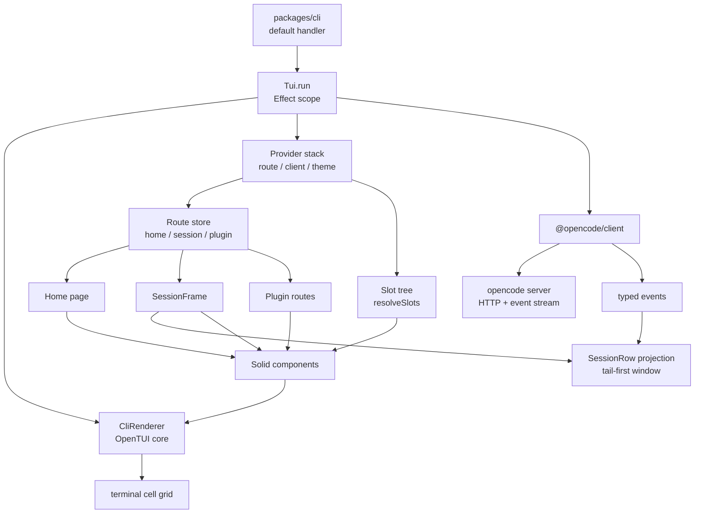
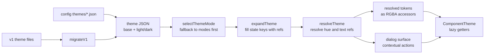
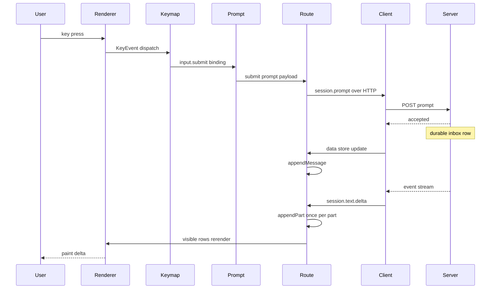

# opencode 终端界面深读

README 的头图就是终端界面，这不是装饰：opencode 把 TUI 当作**主产品入口**，而不是"给 CLI 套个进度条"。它有自己的路由、插件宿主、主题令牌体系、文本编辑器语义、故事书与仿真驱动；同时它又刻意不做领域逻辑——会话、工具、权限、持久化的真源全在 server/core 侧。本文只回答一个问题：在"字符网格 + 没有 DOM"的约束下，这套前端是如何被组织成一个可长期维护的应用的。

## 渲染底座：OpenTUI 的渲染器 + SolidJS 的响应式

底座结论必须来自依赖清单，而不是旧文档的记忆：`packages/tui` 直接依赖 `@opentui/core`、`@opentui/keymap`、`@opentui/solid`，以及 `solid-js`、`effect`、`fuzzysort`、`string-width`、`opentui-spinner`；这些版本统一由根 `package.json` 的 catalog 锁定为 0.5.10（`opentui-spinner` 为 0.0.7），并通过根脚本 `upgrade-opentui` 整体升级。也就是说：**渲染底座是 OpenTUI，组件模型是 SolidJS 的 JSX，没有自研 ANSI 渲染器**。

[packages/tui/package.json:79-103]()
<!-- anchor: "dependencies": { … "uqr": "0.1.3" -->

[package.json:55-57]()
<!-- anchor: "@opentui/core": "0.5.10", … "@opentui/solid": "0.5.10", -->

入口只有两行公开面：`run` 与日志 provider 从 `index.tsx` 导出，`runtime.tsx` 只再导出一个路径格式化函数——说明"运行时"这个词在本包里不是一个大模块，而是一组 provider。真正的装配体是 `app.tsx`。

[packages/tui/src/index.tsx:1-2]()
<!-- anchor: export { run, type TuiInput } from "./app" … export { LogProvider, useLog, type LogLevel, type LogSink, type LogTags } from "./context/log" -->

[packages/tui/src/runtime.tsx:1-1]()
<!-- anchor: export { abbreviateHome } from "./util/path-format" -->

装配流程是 Effect 风格的一段 scoped 代码：先解析 config，再构造 SDK client、探测 location、收集本地插件目录，然后**创建渲染器**。渲染器配置直接暴露了这个前端的产品取向：`targetFps: 60`（终端里维持动画帧率）、`useKittyKeyboard`（开启 kitty 键盘协议）、`useMouse` 由配置决定、`exitOnCtrlC: false`（Ctrl-C 由应用自己解释为中断/复制，而不是退出）、`externalOutputMode: "passthrough"`（外部进程写 stdout 时透传）。

[packages/tui/src/app.tsx:233-245]()
<!-- anchor: const options = { … } satisfies CliRendererConfig -->

渲染器有三种来源，优先级清晰：终端交接（更新预检复用同一个 renderer）、`OPENCODE_DRIVE` 下的仿真驱动、以及正常 `createCliRenderer`。把"驱动"做成可替换的 renderer 来源，是后面能在无头仿真里跑真实 UI 的关键。

[packages/tui/src/app.tsx:253-255]()
<!-- anchor: if (process.env.OPENCODE_DRIVE) { … return yield* Drive.create(options, input.app.version) -->

状态更新**不需要显式 invalidation**：组件用 `createSignal`/`createStore`/`createMemo`/`createEffect`，OpenTUI 的 Solid 绑定把 renderable 属性接到 getter 上，帧循环按 60fps 重绘被触碰的节点。极少数动画信号刻意用 `{ equals: false }` 关掉去重，让每帧写入都生效；动画本身不是 CSS 过渡，而是自定义 Renderable 在 `renderSelf` 里直接写单元格。

[packages/tui/src/ui/animation.ts:54-63]()
<!-- anchor: export function createAnimatable<T extends AnimatableTarget>( … const [value, setValue] = createSignal(clone(initial), { equals: false }) -->

[packages/tui/src/component/tab-pulse.tsx:750-756]()
<!-- anchor: declare module "@opentui/solid" { … extend({ tab_pulse: TabPulseRenderable }) -->

**与 Web 端有没有共享组件？** 答案是没有组件级复用，而这恰恰是设计选择而非疏忽。Web app（`packages/app`）从 `@opencode/ui` 引入 427 处 DOM 组件（Select、Switch、Tabs、Button…）；TUI 对 `@opencode/ui` 的唯一引用是音频资产（`@opencode/ui/audio/*.mp3`），组件本身一个都没用。跨渲染目标真正被共享的是**契约**：`@opencode/schema` 的公开形状、`@opencode/theme` 的令牌 schema 与解析、`@opencode/plugin/tui` 的插件契约。组件不共享，因为它们各自的宿主原语完全不同——一个渲染 DOM，一个渲染字符网格；强行抽象只会得到一个谁都不好用的中间层。

## 应用骨架：一个 provider 栈、一个路由值、一个退出闩

`Tui.run` 的可读结构是：资源获取（renderer / clipboard，都是 `acquireRelease`）→ 注册 finalizer 集合 → 一个 `Latch` 作为关闭信号 → `render(() => <Providers><App/></Providers>, renderer)` → 等待 latch → 在 renderer 销毁后把 epilogue 与退出原因写回 stdout/stderr。把"最后一句话"放在渲染器销毁**之后**打印，是因为终端此时已恢复，任何先前写入都会被备用屏缓冲吞掉。

[packages/tui/src/app.tsx:288-292]()
<!-- anchor: yield* Effect.tryPromise(async () => { … await render(() => { -->

provider 栈的顺序就是依赖顺序：日志/退出/epilogue → 应用元信息 → 路径 → 存储 → 生命周期 → 终端环境 → 启动参数 → 剪贴板 → 命令行参数 → 配置 → 键位 → toast → 路由 → 客户端 → 权限 → 数据 → location → 会话标签 → 终端会话 → 主题 → 本地选择 → 草稿 → 对话框 → 频率/历史 → prompt 引用 → 编辑器 → 注意力 → 更新通知 → 面板 → 插件 → `App`。读这个嵌套列表本身就是文档：路由需要客户端，客户端需要配置，主题需要 renderer 与配置，插件需要上述全部。

[packages/tui/src/app.tsx:292-296]()
<!-- anchor: await render(() => { … <LogProvider log={log}> -->

整条链路的形状如下：入口在 CLI 侧解析出 endpoint，TUI 侧只负责把 renderer、provider 栈与数据连接装配起来，页面与组件都向下收敛到同一个渲染器，向上收敛到同一个 server。

启动期还有三个仅由环境变量驱动的开关，它们把"产品行为"与"开发/测试行为"隔离开：`OPENCODE_STORY` 把初始路由指向插件 `opencode.storybook`（值为 `1` 开索引，其余值开对应故事），`OPENCODE_ROUTE` 直接注入一个 JSON 路由，`OPENCODE_FAST_BOOT` 跳过启动加载页；`OPENCODE_DRIVE` 则换成仿真 renderer。

[packages/tui/src/app.tsx:340-351]()
<!-- anchor: <TuiStartupProvider … : { story: process.env.OPENCODE_STORY }, -->

整个 UI 被一个 `ErrorBoundary` 包住，回退界面是 `ErrorComponent`（并单独提供剪贴板，让用户能复制崩溃信息）；插件另有自己的边界，一个插件抛错只会变成一条 toast，不会带走应用。

## 路由与页面：三个 tag，而不是一张路由表

路由没有路径、没有 history 栈、没有路由库：`Route` 就是 `home | session | plugin` 的判别联合，`navigate()` 是 `setStore(reconcile(route))`——**切换页面等于替换一个带 tag 的值**。shell 用 `<Switch>` 按 tag 分支；session 分支外面套了一层以 `sessionID` 为 key 的 `<Show>`，于是"换标签页"= 整棵 `SessionFrame` 卸载重建。

[packages/tui/src/context/route.tsx:7-27]()
<!-- anchor: export type HomeRoute = { … export type Route = HomeRoute | SessionRoute | PluginRoute -->

[packages/tui/src/context/route.tsx:29-42]()
<!-- anchor: export const { use: useRoute, provider: RouteProvider } = createSimpleContext({ … setStore(reconcile(route)) -->

[packages/tui/src/app.tsx:1345-1366]()
<!-- anchor: <Switch> … </Switch> -->

这个 keyed 重建是性能上的必要（不活跃的会话不保留 renderable），但会丢掉组件内状态，于是**状态被刻意外置**：prompt 组件在 mount 时按 `sessionID` 取回模块级草稿、在 `onCleanup` 存回；表单用同样的按 id 模块级 Map 保住"答了一半的提问"；每个会话的滚动锚点存在标签上下文里，重建后按边界 id 恢复；数据层用 `createSessionRetention` 只保留当前 root、所有打开的标签 root 与最近 3 个 root，其余 `session.evict`。

[packages/tui/src/component/prompt/draft-stash.ts:1-16]()
<!-- anchor: import type { PromptInfo } from "../../prompt/history" … export function saveDraft(sessionID: string | undefined, entry: DraftEntry) { -->

[packages/tui/src/routes/session/form.tsx:54-57]()
<!-- anchor: // Holds in-progress answers per form across FormPrompt remounts, since the … const drafts = new Map<string, FormDraft>() -->

[packages/tui/src/context/session-retention.ts:14-39]()
<!-- anchor: createEffect(() => { … untrack(() => roots.forEach((root) => input.session.evict(root))) -->

页面只有三类：Home（logo、prompt、footer 插槽、全局 elicitation 表单）、Session（`SessionFrame` 组合转录区、右侧边栏/面板/终端、composer 与权限提示）、Plugin（插件注册的任意页面，如 diff 查看器、统计、storybook）。标签栏有横向/纵向两种形态，纵向宽度可拖拽并持久化；宽度不足时自动退回横向，全屏面板出现时隐藏标签。

[packages/tui/src/app.tsx:1336-1343]()
<!-- anchor: <Show when={verticalTabsVisible()}> … <SessionTabs /> -->

**被放弃的替代方案**是常规路由器 + 组件内状态。代价对比很清楚：路由器能免费得到返回栈与深链接，但会诱导把"输入中"的状态留在会被卸载的组件里；opencode 选择"路由极小 + 状态外置"，换来的是标签切换可预测、组件可随时销毁。代价是草稿 Map 没有驱逐策略，长进程会缓慢累积。

## 数据来源：TUI 连的是 server 协议，不是 core 运行时

TUI 不自己跑 agent：CLI 的默认命令处理器先 `ServerConnection.resolve(...)` 拿到 endpoint（必要时启动后台服务、处理版本不匹配重启），再把 `endpoint` 与可选的 `reconnect/restart` 能力连同 updater、包管理器适配器一起交给 `run({...})`。

[packages/cli/src/commands/handlers/default.ts:31-46]()
<!-- anchor: const server = yield* ServerConnection.resolve({ … Effect.promise(() => preflight.fail("OpenCode update could not start the new background service")), -->

[packages/cli/src/commands/handlers/default.ts:67-80]()
<!-- anchor: yield* run({ … : undefined, -->

TUI 内部把连接收敛成一个 provider：`createClientConnection(api, { reconnect, onEvent, log })` 负责事件流的连接/重连状态，事件被转成一个全局 emitter，`useEvent().on(type, ...)` 给出按 `OpenCodeEvent` 判别联合收窄的类型安全订阅。

[packages/tui/src/context/client.tsx:25-36]()
<!-- anchor: const connection = createClientConnection(api, { … events.emit(event.type, event) -->

[packages/tui/src/context/event.ts:9-23]()
<!-- anchor: export function useEvent() { … return client.event.on(type, (event) => { -->

这个边界有权威表述：HTTP 操作与传输错误归 Protocol/Server，公共领域形状与 durable event payload 归 Schema，运行时行为与持久化归 Core。TUI 消费的正是"已组装的 HttpApi 生成的客户端"，因此它是 **HTTP + 事件流的进程外消费者**，即便默认部署里 server 由同一个 CLI 进程就近拉起。唯一一处 `@opencode/core` 导入是 `dialog-worktree-name.tsx` 里的 `Slug`（纯命名工具，无 Effect 服务），属于边界上的合理便利，而不是依赖倒置。

[specs/v2/README.md:7-13]()
<!-- anchor: Authority follows the concern: … | Runtime behavior and persistence                | [Core](../../packages/core/src)                                                            | -->

由此决定的失败模式是显式的、有位置感的：连接断开时不会立刻糊满屏幕，而是按状态给不同宽限期（初次连接 5s、重连 1s）后弹出 `Reconnecting` 覆盖层，并提供"重启服务"命令；会话同步失败则弹 toast 并把当前标签关闭或退回 Home，而不是留下一个空壳转录区；服务重启成功后事件流通过重连循环重新挂上，UI 无需重建。

[packages/tui/src/app.tsx:1287-1303]()
<!-- anchor: createEffect(() => { … ).unref() -->

## 主题令牌：把颜色语义化，组件只认角色

仓库根 AGENTS.md 把主题纪律写成硬规则：**按语义角色选令牌，不按当前颜色**；不得使用原始 `theme.hue` 值，也不得借用不相关的语义令牌凑外观；`text.feedback`/`background.feedback` 只用于结果与状态反馈，表单控件文本、序号与选中标记用 `formfield` 状态，动作用 `action` 状态；若某个语义角色没有令牌，就扩展 schema、默认值、解析与类型，而不是"用最像的那个"；改动公共令牌面时必须同时验证内置亮/暗默认与自定义主题回退路径。

[AGENTS.md:23-28]()
<!-- anchor: ## TUI Theme Tokens … - When changing the public theme token surface, verify the built-in light and dark defaults and the custom-theme fallback path in addition to the affected TUI component. -->

这套令牌的**定义**在 `packages/theme`（纯合约 + 纯解析，浏览器安全，不依赖 Solid），**运行时**在 `packages/tui/src/theme`（发现、注册表、系统调色板生成、V1 兼容）。从文件到组件之间是一条纯函数流水线：

schema 先立语义轴：色相基色与 `accent/interactive/neutral` 别名、动作变体（primary/secondary/destructive）、交互状态（disabled/pressed/focused/selected/hovered）、反馈种类（error/warning/success/info）、语法与 Markdown 令牌；颜色值只允许十六进制、`transparent` 或 `$` 引用。

[packages/theme/src/tui/schema.ts:6-27]()
<!-- anchor: export const BaseHue = Schema.Literals(["gray", "red", "orange", "yellow", "green", "cyan", "blue", "purple"]) … export type FeedbackKind = Schema.Schema.Type<typeof FeedbackKind> -->

关键在于"完整定义"与"模式覆盖"的区分：`ThemeTokensDefinition` 每个字段都可选（作者只写差异），而 `ThemeDefinition` 用 `Complete...` 变体要求令牌齐全——**缺令牌是类型/解码错误，不是运行时随机色**。主题文件本身是 `base` + `light`/`dark` 至少其一的联合体，于是"只有暗色主题"在类型上就不可表达为合法状态。

[packages/theme/src/tui/schema.ts:194-203]()
<!-- anchor: const ThemeTokensDefinition = Schema.Struct({ … export type ThemeTokensDefinition = Schema.Schema.Type<typeof ThemeTokensDefinition> -->

[packages/theme/src/tui/schema.ts:290-301]()
<!-- anchor: export const ThemeDocument = Schema.Union([ … dark: ModeDefinition, -->

解析分三步：`expandTheme` 先把缺失的状态键补成指向 `base` 的引用（例如 `$hovered` 缺省即 `$text.action.primary.base`），`resolveTheme` 再把 `$hue.*`/`$text.*` 引用解析为 `RGBA` 并检测循环引用，最后为 `@dialog` 表面生成一份**上下文视图**——把覆盖层与基础主题合并后，动作颜色按"表面状态 → 表面 base → 基础状态 → 基础 base"的优先级兜底，保证弹窗不会继承错位的交互色。

[packages/theme/src/tui/resolve.ts:55-66]()
<!-- anchor: function resolveExpandedTheme(definition: ThemeDefinition): ResolvedTheme { … return view(base) -->

[packages/theme/src/tui/resolve.ts:81-89]()
<!-- anchor: function contextualize(base: ThemeTokensDefinition, override: ThemeTokensDefinition) { … } as ThemeTokensDefinition -->

模式选择与回退是显式的三层：`selectThemeMode` 在请求的模式不存在时退回该文档声明的第一个模式；`loadTheme` 在选中的主题名不存在时退回内置 `opencode`；注册表 `listThemes` 的优先级是"内置默认 < 插件安装 < 自定义文件 < 生成的系统主题"，`system` 再退到 `system → opencode`。

[packages/theme/src/tui/select.ts:8-16]()
<!-- anchor: export function selectThemeMode( … return { theme: mergeTheme(document.base, selected) as ThemeDefinition, mode: selectedMode } -->

[packages/tui/src/context/theme.tsx:405-409]()
<!-- anchor: function loadTheme(source: ThemeDocumentSource, name: string, requested: "dark" | "light") { … return { modes, mode, theme: resolveThemeDocument(document, mode) } -->

[packages/tui/src/theme/index.ts:30-40]()
<!-- anchor: function listThemes(): Record<string, ThemeDocumentSource> { … system: systemTheme ?? themes.system ?? themes.opencode, -->

自定义主题从配置目录的 `themes/*.json` 发现；文件既可以是 V2 文档，也可以是 V1 的 `{ defs, theme }` 形态——`parseTheme` 按是否含 `theme` 字段分流：V1 走 `migrateV1`（把旧色板反推成色相刻度与语义令牌），V2 直接解码。仓库自身的 `.opencode/themes/mytheme.json` 正是 V1 形态的真实用例，而内置 v2 主题（`theme/assets/v2/opencode.json`）展示的写法是通篇 `$hue.*`/`$text.*` 引用，几乎没有裸十六进制。

[packages/tui/src/theme/index.ts:58-65]()
<!-- anchor: export function parseTheme(source: ThemeDocumentSource, name = "theme") { … return document -->

组件层拿到的是一个惰性视图 `ComponentTheme`：所有令牌都是 getter，因此主题切换只需替换源信号；`surface(name)` 按需创建并缓存上下文主题，避免每个弹窗重复解析。

[packages/tui/src/theme/component.ts:5-9]()
<!-- anchor: export function createComponentTheme( … ): ComponentTheme { -->

[packages/tui/src/theme/component.ts:41-45]()
<!-- anchor: surface(name: SurfaceName) { … surfaces.set(name, created) -->

**为什么必须语义化**：组件里写 `theme.text.feedback.error.base` 而不是 `theme.hue.red.200`，意味着换主题、微调色阶、甚至整体反转明暗都不需要改组件；反过来，如果允许"借用最像的令牌"，令牌体系就会退化成一组别名，主题作者无法安全地重新着色，AGENTS.md 那条"先扩展 schema"的规则正是为了防止这种腐化。系统主题生成还体现了同一哲学：从终端 16 色调色板按亮度派生灰阶、用 tint 混出 diff 背景，而不是硬编码颜色。

[packages/tui/src/theme/system.ts:4-8]()
<!-- anchor: export function terminalMode(colors: TerminalColors): "dark" | "light" | undefined { … return 0.299 * r + 0.587 * g + 0.114 * b > 0.5 ? "light" : "dark" -->

## 会话渲染：投影 + 增量 + 尾部优先窗口

转录区不是"消息组件树"，而是一条**扁平投影**：`reduceSessionRows` 把消息折叠成 `SessionRow[]`（message / part / compaction-queued / assistant-footer / turn-usage 等），再交给通用的"嵌套路径分组器"把相邻同类项折叠成组——生产规则（哪些工具算 exploration、reasoning 如何成组）留在会话侧，分组引擎本身与业务无关。

[packages/tui/src/routes/session/rows.ts:279-320]()
<!-- anchor: export function reduceSessionRows(messages: SessionMessageInfo[], inputs = new Set<string>(), turnTokens = false) { … const ordinals = { text: 0, reasoning: 0 } -->

[packages/tui/src/routes/session/grouping/tree.ts:17-25]()
<!-- anchor: export function groupEntries<Entry, Kind extends string>( … return result -->

实时追加**不重跑整个折叠**：订阅表只把"改变行结构"的事件映射为 `appendMessage`/`appendPart`，而 token 级 `text.delta`/`reasoning.delta` 直接改客户端消息 store，由已挂载的文本组件响应式取到；`appendPart` 依赖 `hasPart` 短路，保证每个 part 只追加一次。昂贵的 `reduce()` 只在连接/会话切换、revert 边界、待处理集合与消息签名变化时执行。

[packages/tui/src/routes/session/rows.ts:215-227]()
<!-- anchor: const subscriptions = [ … data.on("session.model.selected", message), -->

把一次输入从按键到流式回显串起来看，TUI 只在这条链路上承担两件事：把按键转成一次提交，把事件映射成窗口内的行。

渲染是"尾部优先窗口"：初始只挂载最新 40 行（`TRANSCRIPT_TAIL_ROWS`），向上/向下各以 60 行（`TRANSCRIPT_BACKFILL_CHUNK`）增量补挂；真正渲染的切片是 `rows.slice(hidden(), visibleEnd())`，`<For>` 只遍历这个切片。滚动条贴底时窗口跟随追加，离开底部则钉住视口并保存"边界消息 id + 屏幕 y"锚点，重建后按锚点恢复。

[packages/tui/src/routes/session/index.tsx:384-391]()
<!-- anchor: // Tail-first transcript mounting: only the newest rows mount when the session opens. Older rows … const visibleRows = createMemo(() => rows.slice(hidden(), visibleEnd())) -->

[packages/tui/src/routes/session/index.tsx:405-418]()
<!-- anchor: const revealOlderRows = (scrollBy = 0) => { … return true -->

[packages/tui/src/routes/session/index.tsx:1282-1329]()
<!-- anchor: <scrollbox … </scrollbox> -->

[packages/tui/src/routes/session/index.tsx:1310-1318]()
<!-- anchor: <For each={visibleRows()}> … </For> -->

窗口化带来一个必须显式处理的矛盾：消息跳转要"走到"未曾挂载的行。`ensureAllRows` 因此成为逃生舱——一次性挂满全量（并发调用合并进一个待续列表），跳转后插入一块测量的底部留白让最后一条消息也能顶到视口上方，并且只在两帧布局稳定后才滚动；历史分页则用"记录滚动高度差再补偿"的单飞（single-flight）策略，避免抢占式重排。

[packages/tui/src/routes/session/message-navigation.ts:18-47]()
<!-- anchor: export function findMessageBoundary(input: { … return visible.findLast((child) => child.y < input.scrollTop) ?? null -->

性能上还有几处刻意的"反直觉"设计：转录行组件不允许自己调用 `useTerminalDimensions()`（每次调用注册一个 resize 监听），而要通过 `render-context` 读取共享尺寸；宽度与高度分别 memo，使仅高度变化不惊动宽度读者；`<For>` 依赖行对象身份，投影用 `reconcile`，因此只有真正变化的行重渲染。

[packages/tui/src/routes/session/render-context.tsx:13-17]()
<!-- anchor: * Shared reactive terminal size. Transcript-row components must read this … terminal: { width: number; height: number } -->

权限请求不是独立弹窗，而是**行模型里的排序**：`partitionPending` 把被权限阻塞的工具子节点稳定地移到所属分组的末尾，同时用配色标记该行处于待批准；权限提示本身在 composer 位置替换输入框（第一个请求 → 表单 → location 缺失 → 正常 prompt），autoaccept 模式则是一个"每个未确认请求只回一次"的 effect，失败会回滚标记。composer 采用开放注册表：每个标签自己 `register/unregister`，各自用 `active` 门控可见性，因此新增标签或加一个"只看运行中"的过滤不需要改动 shell。

[packages/tui/src/routes/session/permission.tsx:113-138]()
<!-- anchor: export function PermissionPrompt(props: { request: PermissionRequest; directory?: string }) { … .reply({ sessionID: props.request.sessionID, requestID: props.request.id, decision: value, message }) -->

[packages/tui/src/routes/session/composer/index.tsx:44-106]()
<!-- anchor: export function Composer(props: ComposerProps) { … { bind: "ctrl+c", title: "Close composer", group: "Composer", run: close }, -->

跨标签还有一层节流：非可见标签的预取延迟 300ms 才发起，保证可见会话先拿到连接槽位。

[packages/tui/src/context/session-tabs.tsx:280-293]()
<!-- anchor: const timer = setTimeout(async () => { … }, TAB_PREFETCH_DELAY) -->

## 终端里做流式 UI 的硬约束

终端流式渲染的难点与浏览器完全不同，代码里的补偿点就是证据清单：

- **宽度不是字符数**。CJK、emoji、组合字符的显示宽度必须按"字形簇 + East Asian Width + emoji 呈现"计算，所有截断预算按**单元格**而非 code unit 走；文件路径截断还要保 basename、处理盘符/UNC/file URL。
- **ANSI 会污染测量**。宽度计算与文本归一化前都要剥离转义序列（`strip-ansi`），否则长度与剪贴板文本都会错位。
- **部分行与不完整 Markdown**。文本 part 在消息未完成时以 `streaming` 状态渲染，代码围栏与半截标记要在流中就被合理呈现，而不是等结束再一次性替换。
- **光标与转义序列的所有权**。应用不手写转义：网格、光标、备用屏由 renderer 负责；应用侧只做少量有语义的控制（窗口标题、背景色、调色板探测），且这些探测被刻意排在"第一帧可见输出之后"，避免与帧写入交织。
- **重排代价高**。窗口化、两帧延迟滚动、resize 时清空消息导航状态，都是在避免"布局未稳定就测量/滚动"的抖动；选择区域存在时重置窗口会被抑制，以免用户选中内容在流式追加中失效。

## feature-plugins：宿主暴露的不是组件，而是插槽边界

内置 feature 插件列表本身就是"UI 由什么构成"的答案：home footer、prompt footer、prompt `btw`、侧栏 context/mcp/footer、通知、插件管理、统计、merman、latex、diff viewer——以及**仅在 `OPENCODE_STORY` 下注册的 storybook**。

[packages/tui/src/plugin/builtins.ts:15-30]()
<!-- anchor: export const builtins = [ … DiffViewer, -->

宿主与插件之间的公共面不是"组件注册表"而是**插槽树**：路径绝对、点分、`SlotMap` 明确列出（`app`、`home.footer`、`prompt.footer`、`session.composer.top`、`session.panel`、`sidebar.content`…），且注释直接声明"路径与输入是文档化 API：粗粒度、数量少、跨宿主重构保持稳定"。每个路径发布一个响应式输入（实例身份 + 客户端本地状态），而不是让插件去 SDK 里捞上下文。

[packages/plugin/src/tui/context.ts:181-203]()
<!-- anchor: * The host UI's slot tree. Every path is one slot: a named boundary a plugin … export type SlotPath = keyof SlotMap -->

放置语义有五种（prepend/append/before/after/replace），并且 `replace` 的写法在类型上与其他四种互斥（`?: never`），把"两个放置键"变成编译错误而不是静默优先级。解析策略集中在 `resolveSlots` 这个**纯数据变换**里：同目标最后一个启用者胜出；祖先级 replace 吞掉其后代 replace（层级优先于时间线）；目标消失时增量声明降级到最近的幸存祖先（用 append，使嵌套挂载的瞬态不会实例化任何东西），而被抑制的声明会被记录而不是静默丢弃。

[packages/tui/src/plugin/structure.ts:60-97]()
<!-- anchor: export function resolveSlots<Render>(input: { … boundaries.set(path, winner) -->

组件侧同样克制：`<Slot>` 用引用计数登记路径（同一路径可被多标签各挂一份），用按桶浅比较的 memo 让"别处的声明变化"在本槽位成为 no-op，并在挂载时断言路径确实扩展自父路径（错误只可能由宿主代码触发），每个声明都被 `PluginBoundary` 包住，崩溃变成一条 toast。

[packages/tui/src/plugin/render.tsx:85-120]()
<!-- anchor: export function Slot<Path extends SlotPath>(props: SlotProps<Path>) { … </PluginBoundary> -->

[packages/tui/src/plugin/context.tsx:505-526]()
<!-- anchor: // Claims come back in enable order: registration-store key order across … const resolved = createMemo(() => resolveSlots({ paths: new Set(Object.keys(mounted)), claims: claims() })) -->

插件生命周期被组织成"解析 → 比较 → 交换"的世代模型：先折叠出期望世代（只导入新增或变更的源），世代不变则是 no-op，只重启有差异的插件；导入失败保留上一个可用版本，setup 失败同样回滚并标注"上一版本仍在运行"，失败目标与 npm 失败会被记忆以免每次 watch 事件都重装。热重载的监听器专门处理了真实编辑器的保存方式（重命名替换 inode 会杀死直接文件监听，因此监听父目录并按 basename 过滤；符号链接还要监听真实路径；暂时不存在的目标进入轮询集合）。

[packages/tui/src/plugin/watch.ts:16-30]()
<!-- anchor: export function createSourceWatcher(onChange: () => void) { … const arm = (target: string, retry: boolean) => { -->

[packages/tui/src/plugin/watch.ts:88-97]()
<!-- anchor: const dispose = () => { … poll.unref() -->

插件的 markdown 扩展也走了同一条纪律：代码块渲染器按语言注册，只有在"有效处理器集合"浅比较变化时才重建，因为改 `renderNode` 会让 OpenTUI 销毁并重建所有 Markdown 块。

[packages/tui/src/plugin/markdown.ts:5-16]()
<!-- anchor: export function createMarkdownRenderer( … Object.keys(renderers()).length === 0 ? undefined : createMarkdownCodeBlockRenderer(renderers()), -->

merman 与 latex 就是普通内置插件，分别把 `mermaid` 与 `latex`/`math` 注册为代码块渲染器，并从 `context.theme`/`context.themeMode` 取色——**它们与核心仓库其他包共用同一套语义令牌**，因此图表配色会随主题切换。

[packages/merman/src/plugin.ts:5-11]()
<!-- anchor: export default Plugin.define({ … colors: resolveOpenCodeDiagramPalette(context.theme, context.themeMode), -->

[packages/latex/src/plugin.ts:4-12]()
<!-- anchor: export default Plugin.define({ … context.markdown.registerCodeBlockRenderer("math", render) -->

## storybook 为什么长在 TUI 里面

storybook 是一个注册了 route 与命令面板条目的内置插件：`Story` 的契约被明确写成"一次全屏、fixture 驱动的真实生产组件仿真"，故事自己占满整屏（含 footer）并把 escape 绑回索引页；路由注册为 `storybook`，命令面板获得"打开 storybook"与"打开某个故事"两条命令。

[packages/tui/src/feature-plugins/system/storybook/index.tsx:11-20]()
<!-- anchor: * A story is a full-screen, fixture-driven simulation of a real production component. Stories own … const stories: Story[] = [mermanLayoutsStory, sessionTabsStory, sessionLocationMissingStory, oneCellSpinnerStory] -->

[packages/tui/src/feature-plugins/system/storybook/index.tsx:129-140]()
<!-- anchor: export default Plugin.define({ … context.ui.slot({ append: "app", render: () => <Commands context={context} /> }) -->

它被内嵌而不是外挂，是因为**终端的渲染真相只存在于终端里**：宽度断点、CJK 宽度、动画帧、键位作用域、主题令牌在某一亮度下的实际对比度，都无法用截图或 Web 渲染来等价替代。让故事渲染**真实生产组件 + 真实令牌 + 真实键位**，而不是维护一份"视觉副本"，正是根 AGENTS.md 那条纪律的落地方式：副本一定会漂移，而"真实组件 + fixture"不会——组件改了，故事立刻跟着变；如果它变丑了，说明真实 UI 变丑了。故事还承担了回归叙事的职责（mermaid 布局、标签页、单格 spinner、location 缺失态都有独立故事），并且只在 `OPENCODE_STORY` 下注册，正常启动没有额外 route 与命令。

## mini：同一套 core 的第二种终端前端

`packages/tui/src/mini` 不是 TUI 的裁剪版，而是**第二个前端入口**：`runMiniFrontend` 直接进入 `runInteractiveDeferredMode`，把终端、SDK、目标会话与"创建会话"回调交给它；CLI 侧只做宿主。两者共用同一套 OpenTUI `CliRenderer`，差别在**渲染器配置**：完整 TUI 走默认备用屏并 `externalOutputMode: "passthrough"`，mini 走 `screenMode: "split-footer"` + `externalOutputMode: "capture-stdout"`——在主屏上渲染，转录内容因此成为真实、可搜索、可复制、退出后仍在的滚动历史，代价是滚动区**只能追加、永不重绘**。

[packages/tui/src/mini/index.ts:1-10]()
<!-- anchor: import { runInteractiveDeferredMode, type RunDeferredInput } from "./runtime" … return { exitCode: 0 } -->

[packages/cli/src/mini.ts:33-39]()
<!-- anchor: export async function runMini(input: MiniCommandInput) { … const directory = localDirectory() -->

[packages/tui/src/mini/types.ts:3-13]()
<!-- anchor: // Direct mode uses a split-footer terminal layout: immutable scrollback for the … //         → OpenTUI split-footer renderer writes to terminal -->

[packages/tui/src/mini/runtime.lifecycle.ts:157-172]()
<!-- anchor: const renderer = await createCliRenderer({ … clearOnShutdown: false, -->

"只能追加"这个约束决定了 mini 的全部渲染结构。它分两层：已完成的条目编译成静态快照交给滚动区写入；**只有正在流式的那一条**保留一个活动 surface（持有 `Text`/`Code`/`Markdown` renderable），按 `commitRows(start, end)` 渐进提交，条目结束后销毁 surface，行即变为不可变的终端历史。唯一被反复重绘的区域是底部固定高度的 footer（由 Solid 树渲染），高度按活动视图/路由动态申请。

[packages/tui/src/mini/scrollback.surface.ts:248-273]()
<!-- anchor: private async flushActive(done: boolean, trailingNewline: boolean): Promise<bo … active.rendered = true -->

[packages/tui/src/mini/scrollback.surface.ts:333-353]()
<!-- anchor: private async finishActive(trailingNewline: boolean): Promise<StreamCommit | u … return active.rendered ? active.commit : undefined -->

由此派生出一套"提交边界"纪律：流式期间只提交到 `height - 1` 行（最后一行可能因换行重排），Markdown 只提交稳定的顶层块，图片走独立路径（解码失败退化为"无预览"文案）。节流也不是定时器，而是结构性的：同一身份的连续进度块被字符串拼接合并进一个队列槽，一次微任务排空并用 `flushing` 链保证顺序，最终由渲染器的目标/最大帧率兜底。

[packages/tui/src/mini/scrollback.surface.ts:371-392]()
<!-- anchor: private async writeImage(commit: StreamCommit): Promise<void> { … content: body.content + (image.image ? "" : "\nNo preview"), -->

颜色也只能在写入时定稿：因为滚动区不可重新着色，mini 用 `getPalette({ size: 256 })` 探测后把非精确颜色按 Oklab 最近邻量化到终端 256 色，同时保留"默认前景/背景"语义；探测失败时回退到进程内缓存的上一次调色板，而不是编造一份（否则会把不可变历史重新映射到无关的 ANSI 配色）。最后一档降级是 mono：全前景主题、非 ASCII 全量转写、关闭 kitty 键盘与图片预览——是一套并行的渲染策略，而不是一个颜色开关。mini 还把"工具怎么显示"抽成公共模块供非交互 `run` 复用，避免交互与非交互两条输出路径的展示漂移。

[packages/tui/src/mini/theme.ts:111-125]()
<!-- anchor: function map( … return value.a === 0 || value.intent !== "rgb" ? value : nearestIndexed( -->

[packages/tui/src/mini/verbosity.ts:9-41]()
<!-- anchor: const presets = { … return { ...presets[level] } -->

宿主接口刻意做成"能力清单"（stdin/stdout、读文件、开编辑器、信号、启动计时、JSONL trace），使进程与会话相关的事留在 CLI，终端相关的事留在 TUI，mini 运行时因此可以脱离 CLI 单独测试。mini 读取 OpenTUI 私有字段来计算提交边界（如 `_blockStates`），属于版本脆弱点，靠锁定 0.5.10 与整体升级脚本来管理。

## 终端能力探测与降级

- **键盘**：默认启用 kitty 键盘协议；即使开着协议，仍要为"非拉丁键名 + 拉丁 base 布局的 Ctrl+C"做 `baseCode` 兜底，说明协议实现差异被当作常态而非例外处理。
- **鼠标**：由配置开关，VCS 与标签拖拽、右键菜单都建立在它之上；禁用后这些能力退回键盘路径。
- **真彩/明暗与调色板**：主题模式先问 renderer（`waitForThemeMode(1000)`，超时退回 `dark`），调色板探测通过 `getPalette({ size: 16 })`，且必须在第一帧之后（`CliRenderEvents.FRAME` + 延迟）才能进行；探测结果只接受同时具备默认前景/背景（或索引 0/7）的"可用调色板"，并缓存到 storage 供下次冷启动先用；OSC 997 序列与 `SIGUSR2` 都能触发刷新，刷新按 250ms/1000ms 两段延迟做去抖。
- **剪贴板**：同时挂宿主剪贴板与终端剪贴板，写时发往"所有可用目标"，读时只接受 `image/png` 与 `text/plain`，并对超限、超时、失败分别抛出可读错误；OpenTUI 拒绝 NUL，因此在写入前剔除。
- **音频**：懒创建 `Audio`，失败即降级为 `null`（只打 debug 日志），声音文件按事件名逐个走"用户覆盖 → 内置"的候选链。
- **注意力（通知/声音）**：按窗口焦点与请求的 `when` 条件跳过（`focused`/`blurred`/`always`），焦点未知时明确返回 `focus_unknown` 跳过原因，而不是猜。
- **自动编辑器**：优先 `VISUAL`/`EDITOR`，无则静默跳过；打开外部编辑器时挂起 renderer、清空当前渲染缓冲，退出后清屏、恢复并请求重绘。

[packages/tui/src/util/string-width.node.ts:9-24]()
<!-- anchor: export function stringWidth(value: string) { … return total + 1 -->

[packages/tui/src/clipboard.ts:13-17]()
<!-- anchor: export function createTuiClipboard(renderer: RendererClipboardBoundary): OwnedClipboardService { … terminal: createRendererClipboardAdapter(renderer), -->

[packages/tui/src/clipboard.ts:53-61]()
<!-- anchor: async write(text) { … throw new Error(`Clipboard write failed (host: ${result.host.status}, terminal: ${result.terminal.status})`) -->

[packages/tui/src/attention.ts:78-82]()
<!-- anchor: function focusSkip(when: AttentionWhen, focus: FocusState) { … if (when === "focused" && focus === "blurred") return "blurred" -->

[packages/tui/src/attention.ts:104-106]()
<!-- anchor: function soundCandidates(name: AttentionSoundName) { … (item, index, list): item is string => typeof item === "string" && list.indexOf(item) === index, -->

[packages/tui/src/audio.ts:7-19]()
<!-- anchor: function getAudio() { … return null -->

[packages/tui/src/editor.ts:14-40]()
<!-- anchor: export async function openEditor(input: { value: string; renderer: CliRenderer; cwd?: string; stdin?: EditorStdio }) { … input.renderer.requestRender() -->

图片与图形协议（kitty/iTerm graphics）没有手写实现：完整 TUI 只在预览组件层决定"何时展示"，mini 则在流式路径里等待图片解码、按 surface 宽度与剩余终端高度做适配，解码失败退化为"无预览"文案——协议本身由 OpenTUI 的 image renderable 负责。

## 编辑器集成：从"打开 $EDITOR"到读取 IDE 选区

编辑器集成有两条正交路径。第一条是"把内容拿出去改"：写临时 markdown → 挂起 renderer → `spawn($EDITOR, file)`（Windows 走 shell）→ 读回内容 → 清理并恢复。第二条是"把当前选区拿进来"：通过 `~/.claude/ide/*.lock` 发现 IDE 的 WebSocket 端口（按工作区路径打分、按 mtime 决胜），或直接读取 Zed 的 SQLite。

[packages/tui/src/editor-zed.ts:41-64]()
<!-- anchor: export async function resolveZedSelection(dbPath: string, cwd = process.cwd()): Promise<ZedSelectionResult> { … const text = -->

`editor-zed` 解决的是一个具体问题：**Zed 不暴露"当前选区"的公开接口，但它的状态就在本地 SQLite 里**。因此实现以只读方式打开 Zed 数据库，按 workspace 路径打分选出与当前目录最相关的活动 editor，读取 selection 的字节区间，再优先用数据库中的 `contents`、否则回退读 buffer 文件，最后把 UTF-8 **字节偏移**转换成字符串索引与 1 基的 line/character 位置。路径探测按 `OPENCODE_ZED_DB` → macOS Application Support → Linux XDG 顺序找第一个存在的文件。

[packages/tui/src/editor-zed.ts:219-233]()
<!-- anchor: function utf8ByteOffsetToStringIndex(text: string, byteOffset: number) { … return text.length -->

[packages/tui/src/editor-zed.ts:187-194]()
<!-- anchor: export function resolveZedDbPath() { … return candidates.find((item) => isFile(item)) -->

这也是"终端应用必须尊重既有生态"的一例：用户不会为了配合一个 TUI 去改变编辑器工作流，所以集成方向是 TUI 去适配 IDE，而不是反过来。

## 运行时适配：`.bun` / `.node` 双实现的意义

`packages/tui/package.json` 的 `imports` 映射把四个能力声明成运行时条件解析：`#string-width`、`#zed-sqlite`、`#attention-sounds`、`#runtime-plugin-support`，各自给出 `bun`/`node`/`default` 目标。这不是"多打包一份"，而是**同一份源码在不同运行时下必须换实现**的四类真实差异：

[packages/tui/package.json:57-76]()
<!-- anchor: "imports": { … "default": "./src/plugin/runtime-plugin-support.node.ts" -->

- 宽度测量：Bun 用原生 `Bun.stringWidth`；Node 用 `string-width` + `Intl.Segmenter` 字形簇 + `get-east-asian-width` + emoji 呈现判定，修正"文本呈现的 emoji 不该算 2 格"这类错误。
- SQLite：Bun 用 `bun:sqlite`（`editor-zed-sqlite.bun.ts` 一行再导出 `Database`）；Node 用 `node:sqlite` 的 `DatabaseSync` 包出同样的 `query().all()/get()/close()` 形状（`editor-zed-sqlite.node.ts`），使 `editor-zed.ts` 完全无感。
- 音频资产：Bun 用打包器的 `import ... with { type: "file" }` 得到路径；Node 用 `createRequire().resolve` 并在打包环境下尊重 `OPENCODE_NODE_ASSETS_DIR`。
- 运行时插件支持：Bun 走 `ensureRuntimePluginSupport` 注册 `@opencode/plugin/tui` 的运行时组件，Node 侧为空实现（该能力仅在 Bun 下生效）。

**这层适配的代价**是被测路径翻倍、`#` 别名难以静态追踪；收益是同一套 UI 代码能在 `bun` 与 `node` 两个宿主下运行，并且每个差异都被收进一个 1~26 行的文件里，而不是散落在 UI 逻辑里做 `if (isBun)`。

## 开发期工具：devtools、仿真与可验证性

`DevTools` 是一个极小的全局注册表：`register({ id, title })` 返回 `set(key, value)`，任何人（如主题性能、会话行数）都能把自己的指标挂到调试栏，而不需要一个中心化清单。

[packages/tui/src/devtools/index.ts:15-24]()
<!-- anchor: export function register(input: { id: string; title: string }) { … set(key: string, value: Value) { -->

仿真侧提供的是"**给真实 renderable 打语义标签**"的能力：`SimulationSemantics.bind` 把一个语义节点定义挂到 OpenTUI renderable 上（通过 `Symbol.for` 约定的键），使 `OPENCODE_DRIVE` 下的仿真前端能在不读像素、不猜坐标的前提下驱动与断言真实 UI。

[packages/tui/src/simulation/semantics.ts:1-12]()
<!-- anchor: import type { Renderable } from "@opentui/core" … export const SimulationSemantics = { bind } -->

配置面本身也被 schema 化：UI 能改的东西（主题、键位、插件顺序、leader、滚动、注意力、diff、终端、prompt、会话、标签、实验开关）都在 `Info` 里声明并有 description，其中 `experimental` 是 `Record<string, boolean>`——这正是 AGENTS.md 里"实验框架是永久基础设施，注册表为空是刻意为之"的类型基础；`packages/tui/AGENTS.md` 明确要求即使注册表为空也不能删掉注册表、对话框、设置持久化与入口。

[packages/tui/src/config/index.tsx:66-77]()
<!-- anchor: export const Info = Schema.Struct({ … description: "Ordered plugin enablement directives and external package declarations", -->

仓库自身的 `.opencode/tui.json` 只有一行 `$schema`，是"默认值全在代码里、用户文件只写差异"的现场证据——schema 化配置 + 可选字段让"零配置"和"深度定制"走同一条读写路径（写入走带文件锁的 `host.update`，失败以 toast 呈现）。

[.opencode/tui.json:2-2]()
<!-- anchor: "$schema": "https://opencode.ai/tui.json" -->

[packages/tui/AGENTS.md:1-6]()
<!-- anchor: # TUI Experiments … - Do not remove or simplify away the reusable Experiments infrastructure because the registry is empty. An empty registry is intentional and ready for future experiments, not dead code. -->

Tree-sitter 语法高亮的解析器清单走配置常量（`parsers-config.ts`：python/rust/go/cpp/csharp/bash/c/c++ 等的 wasm 与查询 URL，markdown/js/ts 用 OpenTUI 内置），把"高亮能力"变成可审计的数据而不是散落的加载逻辑；`logo.ts` 则把 logo 当作纯常量资产，启动路径上不做任何运行时测量或栅格化。

[packages/tui/src/parsers-config.ts:1-6]()
<!-- anchor: export default { … parsers: [ -->

## 回到全局设计哲学

TUI 是这个项目里"事件即事实"的最直观体现：**它几乎没有自己的真相**。会话内容来自 server 事件流，标签页状态可由 root 折叠派生，未读由服务端时间戳派生，上下文用量由消息列表折叠而来，主题是 schema 的纯函数——UI 只保留"不属于任何别的层"的东西：草稿、滚动锚点、焦点与插槽声明。这解释了为什么窗口化、增量追加与 `reconcile` 能成立：如果 TUI 自己也在维护一份可变真源，任何切片渲染都会立刻变成一致性噩梦。

它也复述了"准入与执行分离"：prompt 的草稿、`@` 提及、粘贴折叠都只是**客户端的准入准备**，提交后由 server 的 durable inbox 接管；UI 从不假设自己提交的东西立刻成为模型可见消息，因此流式回来的一切都当作投影增量处理。Effect 的作用止于边界（CLI 用 Layer 提供能力，TUI 用 `run()` 消费一个 scoped 执行），合约先行则体现在它只依赖 schema/protocol/theme/plugin 这些**契约包**——甚至在 427 处 Web 组件复用与 0 处跨端组件复用之间，选择了用契约而非组件来共享行为。最后，`feature-plugins` 的插槽解析与"策略/引擎分离"同构：`resolveSlots` 是纯策略（可测试的数据变换），`<Slot>` 只是引擎（渲染桶）；主题同理，schema 与 resolve 是策略，组件只读结果。一个字符网格上的前端，最终被组织成了和它的服务端一样的东西：**少量不可约的事实 + 大量可推导的视图**。
