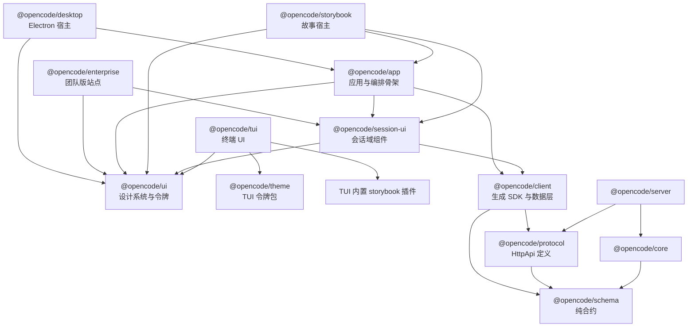
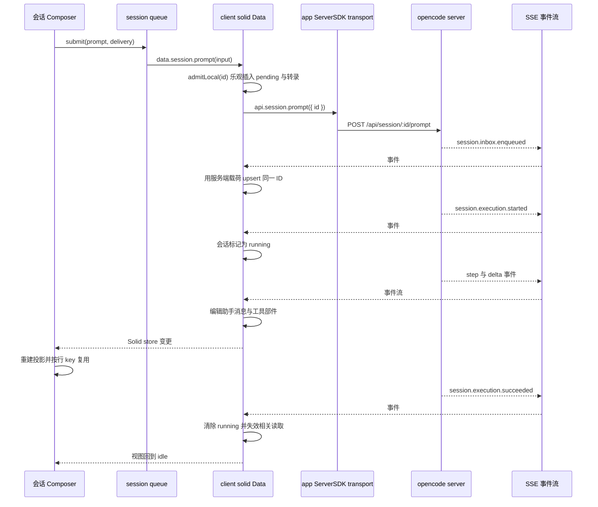

## 结论先行：共享的是语义，不是像素

对外主张是"终端 + Web + 桌面三端共享同一套 core 语义"。把代码摊开看，这句话要拆成两层，而两层的答案并不相同。

**共享的是语义层——真的共享。** 所有图形前端和终端都只通过 `@opencode/client`（由 `@opencode/protocol` 生成的 SDK）说同一套 HTTP/SSE 协议，读写同一套 `session` / `message` / `event` 结构。会话的"真相"在服务端，客户端拿到的是一串事件和一个可重放的消息列表。

**共享的不是渲染层——只在 Web 前端族内部共享。** 终端 UI（`packages/tui`）与 Web/桌面**不共享组件**：TUI 对 `@opencode/ui` 的依赖仅剩音效资源，令牌则走另一个包 `@opencode/theme`。[packages/tui/src/attention-sounds.bun.ts:2-6]()
<!-- anchor: import defaultSoundPath from "@opencode/ui/audio/bip-bop-01.mp3" with { type: "file" } … import subagentDoneSoundPath from "@opencode/ui/audio/yup-01.mp3" with { type: "file" } -->

而 Electron 桌面端与 Web **共享整个应用外壳**——桌面端不是"另一份前端"，而是把 `packages/app` 的 `AppInterface` 挂到一个不同的 `Platform` 实现上。[packages/desktop/src/renderer/desktop-app.tsx:118-143]()
<!-- anchor: return ( … </Show> -->

这个不对称是整个模块最重要的发现：**"多前端"的复用边界画在协议与领域语义上，而不是画在组件上**；组件复用只在"都能跑 Solid + DOM"的宿主之间成立。

## 图形前端的分层

### app：应用与编排骨架

`@opencode/app` 是唯一一个"完整应用"包，它的公开面只有三个导出，其中两个是渲染入口、一个是路由预加载。[packages/app/src/index.ts:1-3]()
<!-- anchor: export { AppBaseProviders, AppInterface, preloadRoute } from "./app" … export { ServerConnection } from "./runtime/server/registry" -->

真正给桌面端用的是 `./desktop` 这个子导出面：它把命令系统、布局路由、语言、平台、SDK 上下文、草稿持久化、WSL/SSH、更新器一起交出去，等于把"一个宿主需要注入和消费的一切"显式列成清单。[packages/app/src/desktop.ts:1-24]()
<!-- anchor: export { AppBaseProviders, AppInterface, preloadRoute } from "./app" … export { type UpdaterPlatform, type UpdaterState } from "./shell/updates/types" -->

`app` 的 Web 依赖只有 `@opencode/client`、`@opencode/schema`、`@opencode/session-ui`、`@opencode/ui`、`@opencode/util` 五个 workspace 包，**没有任何 core/server 依赖**。[packages/app/package.json:58-72]()
<!-- anchor: "dependencies": { … "@pierre/trees": "1.0.0-beta.4", -->

这是一条硬边界：前端拿到的是协议契约，不是领域内核——它不能在浏览器里"顺手"调用 core 服务来推导状态，只能消费服务端投影并通过事件送过来的结果。

### session-ui：会话域组件，只认合约不认 store

`@opencode/session-ui` 是"会话"这个领域的组件层。它最关键的架构决策是**把数据来源抽象成一个 props 化的 Provider，而不是直接读某个 store**：宿主传入 `data`（agent/provider/session/session_status/session_diff）、`directory`、`sessionID`，以及 `shellRunning`、`shellOutput`、`onNavigateToSession`、`onSessionHref` 这几个回调。[packages/session-ui/src/context/data.tsx:43-67]()
<!-- anchor: export const { use: useData, provider: DataProvider } = createSimpleContext({ … shellOutput: props.shellOutput, -->

入口组件收到的是一份自足的文档模型：会话 ID、消息数组、状态、diff 列表。[packages/session-ui/src/document.ts:1-7]()
<!-- anchor: import type { FileDiffInfo, SessionMessageInfo, SessionStatus } from "@opencode/client/promise" … diffs: FileDiffInfo[] -->

时间线于是成了一个**纯函数**：文档进、行出。行的种类被建模成 Effect 的 `Data.TaggedClass` 联合（TurnGap / UserMessage / Shell / Notice / TurnDivider / AssistantPart / Thinking / Error / Retry），每种行有稳定的 `key`，用于跨重算做增量复用。[packages/session-ui/src/timeline/timeline-row.ts:25-57]()
<!-- anchor: export namespace TimelineRow { … ref: PartRef -->

行的"显示策略"另抽成一份预设表（`everything` / `detailed` / `compact` / `quiet` / `text-only`），每个预设决定 shell、edit、thinking、subagents、notices、tools 六类内容是"独立成行 / 归组 / 隐藏"，以及详情默认展开还是收起。[packages/session-ui/src/timeline/detail.ts:17-26]()
<!-- anchor: export const timelinePresets = [ … tools: { placement: "separate" }, -->

组件本体只做两件事：建投影、按 key 渲染行。[packages/session-ui/src/timeline/session-timeline.tsx:20-25]()
<!-- anchor: export function SessionTimeline(props: SessionTimelineProps) { … shellToolDefaultOpen: () => props.shellToolDefaultOpen ?? false, -->

**为什么要把会话 UI 从通用 UI 里拆出来？** 三个理由，都能在代码里找到痕迹：

其一，**可被别的宿主复用**。`session-ui` 的依赖列表里只有 `@opencode/client`、`@opencode/ui`、`@opencode/util` 三个 workspace 包——连 `@opencode/schema` 都不直接依赖。[packages/session-ui/package.json:64-70]()
<!-- anchor: "dependencies": { … "@shikijs/stream": "catalog:", -->

这使得 `packages/enterprise` 可以直接挂载会话 UI，而不必拖进 `app` 的全部外壳。其二，**边界可测**——`import-boundaries.test.ts` 把"前端不得依赖服务端运行时"写成 CI 断言，这条约束只有在存在一个独立包时才谈得上被测试。其三，**通用 UI 不该知道"会话"是什么**——把领域词汇留在 `session-ui`，`ui` 才能保持成一套可以用在设置页、控制台、营销页的纯设计系统。

### ui：设计系统与令牌的合并体

`@opencode/ui` 同时承担了"设计系统"和"Web 令牌源"两个角色。它的子路径导出面就是它的能力目录：`context`（dialog / file / i18n / marked / helper）、`theme`、`styles`、`icons`、`forms`、`data-display`、`feedback`、`layout`、`navigation`、`overlays`、`typography`、`hooks`。其中 `context` 是一个直接聚合四个子模块的桶文件。[packages/ui/src/context/index.ts:1-4]()
<!-- anchor: export * from "./helper" … export * from "./i18n" -->

令牌层不是一份 CSS 变量清单，而是**可编程的主题引擎**：颜色空间转换（hex ↔ oklch ↔ rgb）、色阶生成（`generateScale` / `generateNeutralScale` / `generateAlphaScale`）、分辨率无关的 `fitOklch`、以及把主题 JSON 编译成 CSS 的 `themeToCss`。[packages/ui/src/theme/index.ts:34-36]()
<!-- anchor: export { resolveThemeVariant, resolveTheme, themeToCss } from "./resolve" … export { applyTheme, loadThemeFromUrl, getActiveTheme, removeTheme, setColorScheme } from "./loader" -->

主题集合以 JSON 形式存在（`themes/*.json`，oc-2、catppuccin、dracula、gruvbox、tokyonight 等数十种），由 `import.meta.glob` 在构建期收集，因此加一个主题只需要丢一个 JSON 文件。[packages/ui/src/theme/context.tsx:26-37]()
<!-- anchor: function getFiles() { … return ids -->

这里有一个值得注意的演进痕迹：主题变量存在**两套命名**（v1 的 `--background-base` 与 v2 的 `--v2-*`），并且 v2 有一层语义映射把原语色阶绑到 agent 角色上（plan / build / explore / review / writer 各有 solid / border / background 三态）。[packages/ui/src/theme/v2/mapping.ts:6-17]()
<!-- anchor: const lightAgentTokens: Record<string, V2ColorValue> = { … "v2-agent-writer-solid": ref("v2-purple-700"), -->

**权衡**：把令牌做成可运行时解析的引擎（而不是静态 CSS），代价是启动时要跑色阶计算；但收益是桌面端能在**渲染器存在之前**就用同一套解析逻辑算出窗口背景色，避免白屏闪烁。

### theme：不是 Web 的令牌包（一次必要的纠偏）

初看包名很容易把 `packages/theme` 当成"tokens 层"，但事实是：它的导出面只有 `./tui` 与 `./tui/v1`，依赖是 `@opentui/core`。[packages/theme/package.json:19-29]()
<!-- anchor: "./tui": "./src/tui/index.ts", … "effect": "catalog:" -->

也就是说，**`theme` 是终端渲染目标的令牌包，与 Web 主题无关**；Web 的令牌住在 `@opencode/ui/theme` 与 `@opencode/ui/styles`。这个反直觉的划分恰恰印证了前面那条结论：两个渲染目标（DOM 与终端）连"颜色令牌"都没能合并，能合并的只有语义。

顺带一提，`packages/identity` 里没有任何代码，只有 logo 位图与 SVG——它是一份品牌资产包，不是服务。

### 分层与依赖方向

依赖方向是严格单向的：`app → session-ui → ui`，`desktop → app`，`storybook → {app, session-ui, ui}`。没有反向边，也没有跨到 `core`/`server` 的边。

## 用测试守护架构边界

`packages/session-ui/src/import-boundaries.test.ts` 是这个模块里最值得借鉴的一个文件。它只有 51 行，却把"架构约束"变成了 CI 会拦下来的断言。

它用一条正则定义了**禁止出现的 import 目标**：`@opencode/core`、`@opencode/sdk`、`@opencode/server` 及其任意子路径。[packages/session-ui/src/import-boundaries.test.ts:4-33]()
<!-- anchor: const forbidden = /["']@opencode\/(?:core|sdk|server)(?:\/[^"']*)?["']/ … expect(exports["./timeline"]).toBe("./src/timeline/session-timeline.tsx") -->

扫描方式是"把整个 src 目录的每个 .ts/.tsx 文件读成文本再正则匹配"，用 Effect 的 `forEach` 以并发 8 跑完，并把违反的文件相对路径收集起来。[packages/session-ui/src/import-boundaries.test.ts:38-50]()
<!-- anchor: async function findViolations(pattern: RegExp) { … return matches.filter((path) => path !== undefined) -->

它一共强制了四类规则，每一类都有明确的架构意图：

**规则一：不许 import 服务端运行时包。** 这是"前端只消费协议"的硬约束。如果某天有人图省事在会话组件里 `import { Session } from "@opencode/core"`，构建可能仍然过（因为 monorepo 里包就在旁边），但测试会在评审阶段失败。

**规则二：不许在 package.json 里声明服务端运行时依赖。** 这条比规则一更狠——它把约束提到了**依赖图**层面。只查 import 是不够的，因为一个未使用的依赖声明会污染所有下游宿主的安装体积与版本解析。[packages/session-ui/src/import-boundaries.test.ts:4-33]()
<!-- anchor: const forbidden = /["']@opencode\/(?:core|sdk|server)(?:\/[^"']*)?["']/ … expect(exports["./timeline"]).toBe("./src/timeline/session-timeline.tsx") -->

**规则三：不许出现旧会话边界的遗留物。** 它用一个"防回归词表"扫描 `SessionV1`、`session-v1`、`legacy-message`、`legacy-message-values`。这是**迁移完成度**的守卫：v2 把消息模型换掉之后，二进制的旧概念不该以任何形式重新长回来。

**规则四：公开导出面必须是"当前会话文档面"。** 它断言 `./actions`、`./document`、`./message`、`./message-part`、`./timeline`、`./timeline/projection` 六个子路径各自指向确切文件。这是**对外 API 快照测试**——重构内部文件布局时，只要动了公开面就会被提醒。

**为什么这个做法值得抄？** 因为架构文档会腐化，口头约定会遗忘，而"包依赖方向"这种约束**用编译器通常表达不出来**：TypeScript 的 project references 管不了"同仓库但方向错误"的 import；linter 的 `no-restricted-imports` 要为每个包单独配置，还容易被 `// eslint-disable` 绕过。写成测试后，约束是**可执行**的、失败信息直接给出**违反的文件列表**、加新规则的成本只是**一行正则加一个 test**，而且能同时覆盖 `import` 语句与 `package.json` 声明两个层次，堵住"声明了但不 import"的漏网情况。

**代价**：文本正则扫描不理解语法，理论上会误伤注释与字符串字面量。这个文件自己就活在这个风险里——它扫描时排除了自己（`files.filter((path) => path !== import.meta.path)`），否则它自己写的 `forbidden` 正则就会自匹配。这是一个诚实的取舍：用极低的实现成本换取了绝大部分守卫效果，剩下的边角由 code review 兜底。

## app 的架构骨架

### 组合根：两层 Provider

应用启动分成两个可分离的 Provider 栈，这个切分让桌面端与 Web 端各自决定"谁来提供平台"。`AppBaseProviders` 负责与宿主无关的一切：主题、语言、i18n 桥、错误边界、TanStack Query 客户端、WSL 与 SSH 上下文、对话框、文件组件替换点。[packages/app/src/app.tsx:59-98]()
<!-- anchor: export function AppBaseProviders( … </MetaProvider> -->

注意里面的细节：主题应用后会回调 `window.api?.setTitlebar?.()`——Web 端与桌面端共用同一段代码，通过**可选链**吸收宿主差异，而不是分支。

`AppInterface` 负责路由与数据：`ServersProvider`（多服务器注册表）→ `SettingsProvider` → 动态 Router，root 组件里再叠 `TabsProvider` / `GlobalProvider` / `CommandProvider` / `HighlightsProvider`。代码注释解释了为什么视觉布局放在 router root 而不是页面组件里：**布局要跨路由保持挂载**，草稿路由与会话路由只覆盖其下的"服务端绑定数据 Provider"。[packages/app/src/app.tsx:100-137]()
<!-- anchor: export function AppInterface(props: { … </ServersProvider> -->

这是性能决策而非风格偏好：会话路径是 `/server/:serverKey/session/:id`，若布局随路由重建，切换会话会重建整个壳层（侧边栏、标签、终端）。Web 入口则自己拼装平台实现并把服务器连接注入进去。[packages/app/src/entry.tsx:74-103]()
<!-- anchor: void loadInitialLocale().then((locale) => { … </PlatformProvider> -->

### runtime/ 与 servers/ 的分工

这两个目录名字容易混，职责其实很清楚：

- **`runtime/`** 是"应用运行在什么之上"：平台能力（文件选择、剪贴板、通知、外部链接）、持久化（草稿、命名空间存储、schema）、i18n、以及**服务端会话数据层**（`runtime/server/`）。
- **`servers/`** 是"连到哪些服务端"：`registry`（连接列表）、`connect`（连接向导 UI）、`ssh`、`wsl` 三种接入方式的实现与上下文。

`runtime/server/` 是整个骨架里最密的部分，内部又分三层。**`client.tsx`** 把一条连接变成一个 SDK 上下文：transport（带请求队列的 fetch 加 `OpenCode.make`）、pty 客户端、连接状态机、事件总线。[packages/app/src/runtime/server/client.tsx:86-99]()
<!-- anchor: const events = createOpenCodeEventSource() … if (message !== "event stream disconnected") return -->

**`data.ts` 与 `sync.tsx`** 构成数据层：`createData` 是 `@opencode/client/solid` 提供的"事件投影 + 缓存读取"层，`sync.tsx` 在它之上叠加应用级的 query/path/config 同步、目录子 store 管理、MCP 与 worktree 失效。[packages/app/src/runtime/server/sync.tsx:227-245]()
<!-- anchor: const unsub = serverSDK.event.listen((event) => { … if (event.type === "config.updated" || event.type === "agent.updated") queue.push(key) -->

**`runtime.tsx`** 是 `GlobalProvider` 全局单例层：服务器健康探测、模型偏好持久化、通知协调器，以及**按服务器实例化的 controller 映射**；`current.tsx` / `scope.ts` / `refcount.ts` 则把"当前服务器"与"当前目录"变成可消费的上下文并管理实例生命周期。[packages/app/src/runtime/server/runtime.tsx:104-137]()
<!-- anchor: function createServerController( … const notification = createServerNotificationState({ sdk, data, key: connKey, coordinator: notificationCoordinator }) -->

### 一个前端，多个 server

`createServerController` 是"多服务端"这个主张的落点。它有一条清晰的资源生命周期：`createMemo` 遍历服务器列表**确保**每个连接都有 controller（`createRoot` 挂到 Global 的 owner 下），`createEffect` 反向遍历已建 controller，发现某个 key 不在列表里就 `dispose` 并清理。[packages/app/src/runtime/server/runtime.tsx:104-137]()
<!-- anchor: function createServerController( … const notification = createServerNotificationState({ sdk, data, key: connKey, coordinator: notificationCoordinator }) -->

这段代码里有个值得单独讲的细节：controller 被包在 `createRoot` 里并显式挂到 Global 的 owner 上，原因写在注释里——`Global provider requires a Solid owner`。Solid 的响应式作用域默认随组件销毁，而"服务端连接"必须活过任何单个组件的生命周期，`createRoot` 是把手动生命周期管理交给代码的唯一手段。

"当前服务器"则由路由参数解析，而不是全局选中态。[packages/app/src/shell/routes/routes.tsx:34-58]()
<!-- anchor: export function AppRoutes() { … </Route> -->

路由形状 `/server/:serverKey/session/:id` 把"哪台机器"写进了 URL，于是浏览器前进/后退天然正确、桌面端多窗口可以各停一台服务器、分享链接天然带上下文。

**隔离靠 key 的组合**。`scope.ts` 用 `\0` 作为分隔符把"服务器 scope + 路由 key"压成一个带 brand 的字符串，并提供前缀匹配（`ScopedKey.prefix`）用于批量失效；本地服务器还会被规范化成常量 `"local"`。[packages/app/src/runtime/server/scope.ts:19-25]()
<!-- anchor: export const ServerScope = { … ) as ServerScope -->

**为什么用 `\0` 而不是 `:` 或 `/`？** 因为服务器 URL 和目录路径里都可能出现冒号（`http://`）与斜杠（Windows 路径、URL 路径），只有空字节不可能合法出现在用户输入里。代码甚至在 `fragment()` 里主动抛错来防御——这是"用一个不可能的值做分隔符"的经典手法。

**并发也有上限**。浏览器对单 origin 只允许六条连接，而事件流会长期占住一条，因此 `requestQueueLimit = 4`，并且把 `/api/vcs`、`/api/worktree` 这类慢接口隔离成 `requestQueueSlowLimit = 2`，避免挂载会话时的小请求排在 git 操作后面。[packages/app/src/runtime/server/request-queue.ts:1-8]()
<!-- anchor: type Entry = { method: string; url: string; at: number; slow: boolean } … // Endpoints that shell out to git or walk the filesystem take seconds on a large repository. They -->

这段注释里的因果链很完整：*六条连接 → 事件流占一条 → health 探测独占 fetch → 用户请求必须留余量*。这不是过度设计，是把浏览器约束显式建模。

### workspaces：目录是工作区，也是缓存键

`workspaces/` 的模型是四层的：**服务器** → **project（worktree 根）** → **worktree / sandbox（同一仓库的其他检出）** → **directory（具体工作目录）**。`inventory.ts` 是这个模型的读写面：project 元数据到达时不带 worktrees，需要单独拉一份 inventory 来补齐；读取走缓存（`staleTime: Infinity`），只有在显式刷新或收到 `worktree.updated` 事件时才重新列举。[packages/app/src/workspaces/inventory.ts:29-47]()
<!-- anchor: export function createWorktreeInventory(input: { … gcTime: Infinity, -->

"目录相等"这件事被单独抽成 `pathKey`：把反斜杠统一成正斜杠、去掉尾部斜杠、给盘符补一个尾斜杠（`C:` → `C:/`），并保留根路径 `/`。[packages/app/src/workspaces/path-key.ts:19-23]()
<!-- anchor: const value = isWindowsPath(path) ? path.replaceAll("\\", "/") : path … return trimmed as PathKey -->

**为什么不用字符串比较？** 因为 Windows 上同一个目录可能有多种写法（`C:\a\b`、`C:/a/b`、`C:/a/b/`），而它被用作跨服务器、跨会话的**缓存键与持久化键**；键一旦不稳定，用户就会看到"同一个目录被列出两次"的诡异 bug。这类"规范化函数加 brand 类型"的组合，是把领域不变量从约定变成类型的标准做法。

### 壳层与状态

`shell/` 是路由器之外的"应用 Chrome"：标题栏、布局、标签、命令面板、通知、更新提示、错误页、调试面板。布局状态是单实例 store，持久化到平台存储，键是 `SessionStateKey`（服务器 scope 加路由），并带滚动位置持久化与按 server 分组的会话标签。[packages/app/src/shell/state/layout.tsx:1-20]()
<!-- anchor: import { createStore, produce, reconcile } from "solid-js/store" … import { requireServerKey } from "@/shell/routes/session" -->

注意这条来自 `AGENTS.md` 的硬性约定：**优先 `createStore` 而不是多个 `createSignal`**。在这份骨架里它被贯彻得很彻底——布局、标签、会话数据、队列、工具展开状态全部是 store；`createSignal` 只出现在局部、单值的场景。[packages/app/AGENTS.md:12-16]()
<!-- anchor: - `opencode dev web` proxies `https://app.opencode.ai`, so local UI/CSS changes … - Open `http://localhost:4444` to verify UI changes (it targets the backend at `http://localhost:4096`) -->

同一个 `AGENTS.md` 还规定了两件对性能敏感的事：改动会话或时间线代码前**必须记录生产基准**并在改动后对比；以及**绝不重启应用或 server 进程**（调试约定）。前者解释了 `package.json` 里为什么有 `bench:tabs`、`bench:entry`、`test:stability` 这一整套基准脚本。[packages/app/AGENTS.md:4-8]()
<!-- anchor: - Before changing session or timeline code, record a production benchmark baseline and compare it after the change. … - NEVER try to restart the app, or the server process, EVER. -->

## 与协议层的关系

### 生成 SDK，不是手写客户端

前端消费的是**生成的** SDK：`packages/client/src/promise/generated/client.ts` 是一个 2202 行的生成文件，里面把每个 API 的 method、path、query、body、成功码、声明状态码都写成了数据表。

事件订阅就落在一张表里：`GET /api/event`，`successStatus: 200`，通过 `sse<T>()` 变成一个 `AsyncIterable`。[packages/client/src/promise/generated/client.ts:1637-1639]()
<!-- anchor: subscribe: (requestOptions?: RequestOptions): AsyncIterable<EventSubscribeOutput> => … { method: "GET", path: `/api/event`, successStatus: 200, declaredStatuses: [400, 401], empty: false }, -->

生成器在 `packages/httpapi-codegen`，`packages/client` 的 `check:generated` 脚本会重新生成并 `git diff --exit-code`——**生成物与定义不同步就构建失败**。这是"合约先行"哲学在前端侧的落地方式。

`solid/` 目录是手写的**适配层**（不生成）：`data.ts` 把事件流与 API 读取投影进一个 Solid store，`connection.ts` 是连接状态机，`pty.ts` 给终端用。

`data.ts` 开头的注释把整个数据层的设计意图讲透了：*优先做直白的投影；被失效的读取要串行重放，避免旧响应覆盖新响应；重连时使缓存失效，由活跃的 UI owner 决定重新同步什么*。[packages/client/src/solid/data.ts:1-4]()
<!-- anchor: // Client data layer: apply server events and cache API reads into a Solid store … // active UI owners decide what to sync again. -->

"由活跃 owner 决定同步什么"是个重要的**懒同步**立场：重连后不盲目重取全部数据，否则一个有 50 个后台会话的用户会在重连瞬间打出 50 个请求。

### 实时更新走事件流（SSE），不是轮询

事件流是 SSE：`GET /api/event`，`text/event-stream`，服务端每 15 秒写一个 keepalive 注释。客户端围绕这个协议写了三层处理：事件先进 `pending` 数组，再用 `flushInterval`（app 里是 16ms）批量 flush 并用 `batch()` 包住，把一次事件风暴折成一次渲染。[packages/client/src/solid/connection.ts:106-115]()
<!-- anchor: if (first.value.type !== "server.connected") … setConnection({ status: "connected", attempt: 0, error: undefined }) -->

一个**空闲看门狗**默认 45 秒无字节就判定流已死并重连，页面回到前台时改用更短的 20 秒阈值来识别"设备睡眠后的半开连接"；另有最近 50 条连接状态变迁记录供诊断面板使用。[packages/client/src/solid/connection.ts:219-241]()
<!-- anchor: if (options.pageLifecycle) { … void start() -->

这个设计的价值在于：SSE 的半开连接（TCP 还活着但对端已死）是浏览器里最难发现的故障之一，`fetch` 会一直挂着不报错；把"有字节"作为存活证据（keepalive 也算），是把不确定性显式化为可判定的超时。

### 一次会话在前端的完整数据流

### 乐观准入：本地 ID 与持久回声的对账

这条链路上最精妙的机制在 `prompt()` 里，它是"事件即事实"哲学在**客户端**的镜像实现：客户端先**自己铸造一个消息 ID**，把提示词乐观地插进本地转录（`admitLocal`），再带着这个 ID 发 POST 给服务端。[packages/client/src/solid/data.ts:1544-1582]()
<!-- anchor: prompt(input: SessionPromptInput & { gate?: Promise<unknown>; prepare?: () => Promise<unknown> }) { … throw error -->

关键在于**服务端准入是按 ID 幂等的**，所以当 `session.inbox.enqueued` 事件回流时，客户端只需用服务端载荷 **upsert 同一个 ID**，乐观行就被"转正"成持久行——不需要"删掉临时的再插入真的"这种容易闪烁的两步操作，重试也不会双份准入。回滚同样保守：只有"这次调用自己乐观插入的、且服务端尚未确认的"（`fresh && outbox.delete(id)`）才会被撤回，任何别的东西都是服务端状态，客户端不动它。[packages/client/src/solid/data.ts:1544-1582]()
<!-- anchor: prompt(input: SessionPromptInput & { gate?: Promise<unknown>; prepare?: () => Promise<unknown> }) { … throw error -->

两个细节体现了克制：**文件与 skill 故意不进乐观行**，因为它们的持久形态（内容、mime、解析结果）由服务端加载，等回声 upsert 时再填；**`gate` 参数**让"对还在创建中的会话发 prompt"先等创建完成，避免用一个还不存在的 sessionID 去写 inbox。

事件回流后的 store 更新集中在 `handleEvent`，它对不同事件类型选择不同策略：有些是**直接增量修改**（如 `vcs.branch.updated` 只改一个字段），有些是**失效 + 重取**（`agent.updated`、`command.updated`、`skill.updated`），有些是**快照重建**（会话激活列表用 `reconcile` 做结构化 diff，保住未变对象的引用）。[packages/client/src/solid/data.ts:593-610]()
<!-- anchor: function handleEvent(event: OpenCodeEvent) { … setStore("session", "active", reconcile(Object.fromEntries(snapshot))) -->

**权衡**：增量修改最快但要求客户端复制服务端语义（容易漂移）；失效重取最稳但请求多。这份代码的选择是"字段级更新用增量，集合级更新用重取"，并用 `reconcile` 在重取路径上保住引用相等，让下游 memo 不必重算。

### 会话 UI 与 app store 的接缝

`session-ui` 不认识 app 的 store，所以 app 写了一个适配组件：把 app 的 `data.session.list()` 与状态映射成 `SessionSummary[]` 与 `session_status` 字典，再把 `shellRunning`、`shellOutput`、`navigateToSession`、`sessionHref`、`readLocalImage` 一起注入。[packages/app/src/shell/routes/session-ui-provider.tsx:59-72]()
<!-- anchor: return ( … </DataProvider> -->
这段适配只有几十行，却换来了 `session-ui` 的完全解耦：宿主可以是 Web app、桌面端、团队版站点，甚至 SSR 页面。**这是"共享语义"能落地的最小成本结构**——契约放在被复用方，适配放在使用方。

超长文件可以用 `File` 组件的替换点注入（`FileComponentProvider`），这也是为什么 `session-ui` 里能出现"读文件"却不依赖任何文件系统实现。[packages/session-ui/src/file-presentation.ts:1-15]()
<!-- anchor: export type PresentationFileDiff = { … mimeType?: string -->

## 桌面端：同一套 app，另一个 Platform

### 先看结论：桌面端就是 app

`DesktopApp` 的 import 清单本身就是证据：它从 `@opencode/app/desktop` 拿 `AppBaseProviders`、`AppInterface`、`preloadRoute`、`PlatformProvider`、`ServerConnection`、`useCommand`、`useTabs`、`useLanguage`、`useSsh`、`useWslServers`，然后自己提供三样东西：`Platform` 实现、内存路由、以及 sidecar 初始化数据。[packages/desktop/src/renderer/desktop-app.tsx:118-143]()
<!-- anchor: return ( … </Show> -->

渲染器的平台实现文件第一行就是"把 app 的 Platform 接口实现出来"。[packages/desktop/src/renderer/platform/index.ts:1-20]()
<!-- anchor: import { ServerConnection, type Platform, type UpdaterPlatform } from "@opencode/app/desktop" … ): Platform { -->

而 `Platform` 这个接口就是宿主差异的**全部**清单：外部链接、本地路径打开、原生选择器、剪贴板、存储实现、草稿存储、更新器、fetch 覆盖、默认服务器读写、WSL/SSH、缩放、全屏、菜单动作、浏览器面板。绝大多数成员都是可选的。[packages/app/src/runtime/platform/platform.tsx:33-40]()
<!-- anchor: type PlatformBase = { … /** Open a local path in a local app (desktop only) */ -->

**设计点评**：用一个"宽而可选"的接口 + 联合类型区分 `web` / `desktop`（后者多一个 `windowID` 与必需的目录选择器），而不是给每个平台做一套抽象。代价是接口很长、可选成员多（调用点都要 `?.`）；收益是**新增平台能力时不需要改抽象层**，只需加一个可选方法。对于一个只有两个平台、且一个平台是另一个超集的项目，这个取舍是划算的。

### 三进程与安全边界

Electron 侧严格遵守 `AGENTS.md` 的两条规矩：渲染器**只能**调用 `src/preload` 暴露的 `window.api`；主进程的 IPC handler 集中注册在 `src/main/ipc.ts`。[packages/desktop/AGENTS.md:4-6]()
<!-- anchor: - Renderer process should only call `window.api` from `src/preload`. … - Avoid FS operations where possible. For any desktop persistence prefer sqlite in most cases, as performance and EPERM and many other things, especially on windows can be quite painful. Using anything other than sqlite should come with strong reasons. -->

窗口的 `webPreferences` 三个开关全在安全侧：`contextIsolation: true`、`nodeIntegration: false`、`sandbox: true`。[packages/desktop/src/main/windows/appearance.ts:36-40]()
<!-- anchor: webPreferences: { … sandbox: true, -->

除了标准三件套，主进程还自己加了两道防线：**导航策略**（`setWindowOpenHandler` 与 `will-navigate` 都只允许"渲染器自己的 URL"留在窗口内，其他一律 `preventDefault` 并交给系统浏览器）与**凭据注入**（sidecar 的 HTTP Basic 凭据**不进入渲染器**，而由主进程在 `onBeforeSendHeaders` 里注入，且只给"顶层 frame 且是渲染器 URL"的请求加 Authorization）。[packages/desktop/src/main/windows/security.ts:34-51]()
<!-- anchor: export function wireRendererHeaders(win: BrowserWindow) { … callback({ requestHeaders: details.requestHeaders }) -->

凭据注入的注释把威胁模型写得很清楚：同一 session 里的 webview 或嵌入页面也能访问同一个 loopback origin，不能继承这份权限；接口类型也复述了这条不变量——*sidecar 密码从不跨入渲染器*。[packages/desktop/src/shared/ipc-contract.ts:1-3]()
<!-- anchor: // The sidecar password never crosses into the renderer; the main process adds it to sidecar requests. … url: string -->

**为什么这一点值得强调？** 因为 Basic 凭据一旦进渲染器，任何 XSS 或恶意插件都能拿走它，而它保护的是一台能读写用户文件系统的本地服务。把它留在主进程并只对可信 frame 注入，等于把"凭据"从"渲染器的一个变量"降级为"网络栈的一个副作用"。

### preload 暴露的桥

`preload/index.ts` 只有 29 行，暴露面被刻意压到极小：把主进程发来的 `MessagePort` 转交给渲染器（**这是 RPC 通道的握手，不是 RPC 方法列表**）、转发拖拽取消事件、从启动参数解析 `bootstrap` 并在页面运行前发起一次 storage 快照请求（让壳层首帧就能读到已持久化的值），最后用 `contextBridge.exposeInMainWorld("electron", {...})` 暴露 `windowID`、`bootstrap`、`storageSnapshot`、`getPathForFile`。[packages/desktop/src/preload/index.ts:24-28]()
<!-- anchor: contextBridge.exposeInMainWorld("electron", { … getPathForFile: (file: File) => webUtils.getPathForFile(file), -->

真正的"大量 IPC 方法"不走 `contextBridge` 逐条暴露，而是走 `MessageChannelMain` 端口加 Effect RPC，主进程侧把 handler 按域分层合并成一个 RPC server。[packages/desktop/src/main/ipc.ts:33-42]()
<!-- anchor: windowHandlers, … Layer.provideMerge(IpcServerProtocolLive), -->

取舍很清楚：`contextBridge` 逐方法暴露会让 preload 变成一份必须与渲染器类型同步的清单；RPC-over-MessagePort 则让**同一份 Effect RPC 契约**（`src/shared/ipc-rpc/*`：app / browser / events / files / menu / ssh / storage / updater / window / wsl）同时用于两端，类型与实现自动对齐。

### 桌面端自己那份 SQLite

桌面端有**自己的一份** SQLite，与 core 的会话库无关，schema 只有三张表：`document(key, value)` 存提示词草稿与历史（键是 `${storage}:${key}`）；`blob(id, data, touched_at)` 存按内容哈希引用的图片与文本块（`touched_at` 支持"最近用过的 blob 不被回收"的 GC 策略）；`state(name, key, value, updated_at)` 存渲染器通过 `platform.storage(name)` 持久化的一切（`name` 保留成它原来那个 `.dat` 文件的拼写，好让 app 的迁移与别名逻辑原样继续工作）。[packages/desktop/src/main/storage/schema.ts:1-28]()
<!-- anchor: import { blob, integer, primaryKey, sqliteTable, text } from "drizzle-orm/sqlite-core" … (table) => [primaryKey({ columns: [table.name, table.key] })], -->

迁移用 drizzle-kit 生成：`dialect: "sqlite"`，schema 指向 storage/schema.ts，输出到 storage/migration。[packages/desktop/drizzle.config.ts:3-6]()
<!-- anchor: export default defineConfig({ … out: "./src/main/storage/migration", -->

生成物不是运行时读 SQL 文件，而是被编译成 TypeScript 字面量数组，随主进程一起打包。[packages/desktop/src/main/storage/migration.gen.ts:1-14]()
<!-- anchor: // Generated by scripts/migration.ts from src/main/storage/migration. Do not edit. … "CREATE TABLE `state` (\n\t`name` text NOT NULL,\n\t`key` text NOT NULL,\n\t`value` text NOT NULL,\n\t`updated_at` integer NOT NULL,\n\tCONSTRAINT `state_pk` PRIMARY KEY(`name`, `key`)\n);", -->

**为什么桌面端要有第二份数据库？为什么不用 core 那份？** 这是整个模块里最容易被误解的地方。理由有三：**数据归属不同**（core 库存"会话是什么、发生过什么"，是**领域事实**；桌面库存"窗口上次滚到哪、草稿写了一半、上次选的主题、哪个 blob 还没被引用"，是**宿主偏好与渲染态**——把后者塞进 core 会污染领域库，也会让跨前端共享会话变得不可能，终端不该看到"窗口滚动位置"）；**进程与生命周期不同**（core 库由 server 进程持有，可能是远程机器、WSL 里的 sidecar 或 Docker，而渲染器需要**同步**读设置才能首帧渲染正确主题，跨进程同步读不可能）；以及 **`AGENTS.md` 的明确要求**。[packages/desktop/AGENTS.md:4-6]()
<!-- anchor: - Renderer process should only call `window.api` from `src/preload`. … - Avoid FS operations where possible. For any desktop persistence prefer sqlite in most cases, as performance and EPERM and many other things, especially on windows can be quite painful. Using anything other than sqlite should come with strong reasons. -->

最后一条是**来自踩坑的约定**：在 Windows 上，用文件存状态意味着要处理杀毒软件锁文件、路径长度、原子替换失败、EPERM 重试，而 SQLite 把这些问题一次性解决。另一个细节体现了兼容意识：`state` 表的注释特意说明"`name` 仍按它原来那个 `.dat` 文件来拼写"——桌面端从"每个命名空间一个文件"迁到 SQLite 时故意保留了旧的命名空间字符串，让 app 侧的重定位与别名逻辑一行都不用改。这种"数据结构变了但键的语义不变"的手法，在长期维护的桌面应用里非常实用。

### 自带 server 还是连 CLI：sidecar 模式

答案是：**桌面端自带一份 CLI 二进制，把它当后台服务拉起来**。

`BackgroundService.connect` 的流程是：解析出捆绑的 CLI → 用 `@opencode/client/service` 的 `ensure({ command: [...cli.command, "serve", "--service"] })` 拉起服务 → 从返回结果里取 URL 与 basic auth 密码。[packages/desktop/src/main/service/background-service.ts:30-67]()
<!-- anchor: const connect = Effect.fn("BackgroundService.connect")(function* (mode: "initial" … return ready -->

CLI 的解析有两层：打包后从 `process.resourcesPath` 找 `opencode-cli`（Windows 上是 `.exe`），开发期则直接 `bun run --cwd <dir> src/index.ts`。[packages/desktop/src/main/service/desktop-cli.ts:78-87]()
<!-- anchor: const resolveBundledCli = Effect.fn("DesktopCli.resolveBundled")(function* (isolated … return { version, binary, command: [binary] } -->

启动期还有一个专门的优化：注释说明"对 200MB 的二进制跑 `--version` 在启动路径上要花约 400ms（更新后首次启动因为杀毒扫描要几秒）"，所以构建期就把版本号写在可执行文件旁边，直接读文件而不是 exec。[packages/desktop/src/main/service/desktop-cli.ts:78-87]()
<!-- anchor: const resolveBundledCli = Effect.fn("DesktopCli.resolveBundled")(function* (isolated … return { version, binary, command: [binary] } -->

另有一条"尽早可用"路径：如果探测发现一个**已经兼容的服务**，就直接采用它，同时仍在后台异步跑一次 `ensure()` 以完成终端移交等副作用。[packages/desktop/src/main/service/background-service.ts:30-67]()
<!-- anchor: const connect = Effect.fn("BackgroundService.connect")(function* (mode: "initial" … return ready -->

连回全局设计哲学：这正是"**服务化运行时**"的部署形态——**桌面端不是特权的内嵌引擎，而是一个恰好把 server 放在本机的客户端**，连的仍然是 HTTP + SSE，走的仍然是同一份协议。于是"桌面端能连远程 server""Web 端能连桌面端启动的 server"都不需要额外代码，因为它们本来就是同一件事；`isLocal` 只是把 `localhost` / `127.0.0.1` / sidecar base 变体识别出来，用来决定要不要走某些本机专用的 UI 路径。[packages/app/src/runtime/server/runtime.tsx:104-137]()
<!-- anchor: function createServerController( … const notification = createServerNotificationState({ sdk, data, key: connKey, coordinator: notificationCoordinator }) -->

## 官网、控制台、统计后台：Agent 运行时之外的三条边

这一节是本篇最需要保持清醒的地方：`console` / `stats` / `web` / `posts` / `services` **都不属于 Agent 运行时**。它们不参与会话执行，不持有会话事件，是产品周边。把它们和运行时混在一起讨论，会得出"opencode 是 SaaS"的错误结论——它是本地优先的工具，外加一组可选的账号与分发服务。

### 部署与技术栈以配置为准

部署定义在根 `sst.config.ts`：SST（Ion 之外的新版 SST）配置 `home: "cloudflare"`，AWS 与 Stripe 作为附加 provider。[sst.config.ts:3-9]()
<!-- anchor: export default $config({ … home: "cloudflare", -->

`run()` 里按条件装载各基础设施模块：`infra/stage.ts`、`infra/app.ts`、条件性的 `infra/lake.ts` 与 `infra/stats.ts`、`infra/console.ts`、`infra/enterprise.ts`，生产环境再加 `infra/monitoring.ts`。beta stage 只部署一个 WebApp。这是个**分 stage 的最小部署图**，不是一堆并行服务；具体到各包：

- **官网文档**（`packages/web`）：Astro 5 + Starlight + Solid islands，`output: "server"`，Cloudflare adapter（`imageService: "passthrough"`），`base: "/docs"`。[packages/web/astro.config.mjs:13-18]()
<!-- anchor: export default defineConfig({ … imageService: "passthrough", -->

- **控制台**（`packages/console`）：`app` 是 SolidStart + Nitro 跑在 Cloudflare Workers，带 Stripe 计费、openauth 认证 worker、Upstash Redis、R2 bucket 与邮件集成。[infra/console.ts:11-42]()
<!-- anchor: const cluster = planetscale.getDatabaseOutput({ … port: 3306, -->

- **一个诚实的注脚**：控制台依赖的 `@solidjs/start` **不是正式版本，而是一个 pkg.pr.new 预览构建**（catalog 里直接写 URL：`@solidjs/start: "https://pkg.pr.new/@solidjs/start@dfb2020"`）。这是"押注未发布上游"的典型取舍——换来的是框架侧未合并 PR 里的能力，代价是供应链可复现性依赖该预览 URL 长期存活。[package.json:106-112]()
<!-- anchor: "@solidjs/router": "1.0.0", … "vite-plugin-solid": "2.11.10", -->

- **统计后台**（`packages/stats`）：`app` 是 SolidStart 站点，`core` 是 Effect 服务 + Drizzle schema + 迁移，`server` 是可部署的 Lambda 入口与 Dockerfile。[packages/stats/README.md:1-7]()
<!-- anchor: # OpenCode Stats … - `app`: SolidStart frontend/site. -->

- **博客**（`packages/posts`）是 Astro + MDX，`build` 后跑 `prepare-cloudflare`，`deploy` 走 `wrangler deploy`；**企业/团队站点**（`packages/enterprise`）是 SolidStart + Cloudflare 并把存储适配器切到 R2，它是 **`session-ui` 的第一个非 app 消费者**——同一个会话 UI 组件层被两个不同产品复用，正是当初拆分会话 UI 的收益兑现。

### 四个容易被当成同一个东西的名字

这一节先立一个警告：`packages/web`、`services/www`、`packages/console`、`infra/console.ts` 在讨论里经常被混为一谈，但它们在代码里是**四个不同的层**。

| 名字 | 是什么 | 部署 / 归属 |
|---|---|---|
| `packages/web` | Astro + Starlight 文档站，正文在 `src/content/docs/<locale>/*.mdx` | 挂到 `docs.<domain>` |
| `services/www` | **独立部署**的官网/V2 文档服务，文档前端完全自有 | 自己的 Wrangler 配置，`base: "/v2"` |
| `packages/console` | 控制台**应用**（账号/计费/密钥的 UI 与服务），本身没有根 `package.json`，是子包的容器目录 `{app,core,function,mail,resource,support}` | 产品代码 |
| `infra/console.ts` | 控制台的 **SST 基础设施定义**（PlanetScale 库、认证 Worker、Stripe 产品与价格、日志与统计 Worker） | 随 `sst deploy` 执行 |

`packages/web` 的部署归属可以直接从基础设施代码读出来：`sst.cloudflare.x.Astro("Web", { domain: "docs." + domain, path: "packages/web" })`。[infra/app.ts:53-55]()
<!-- anchor: new sst.cloudflare.x.Astro("Web", { … path: "packages/web", -->

它确实是 Astro，配置里开着 server 输出与 Cloudflare adapter。[packages/web/astro.config.mjs:13-18]()
<!-- anchor: export default defineConfig({ … imageService: "passthrough", -->

而 `packages/console` 是应用，不是基础设施——它的 `app` 子包有自己的包名和版本。[packages/console/app/package.json:2-3]()
<!-- anchor: "name": "@opencode/console-app", … "version": "2.0.11", -->

真正做部署的是 `infra/console.ts`：它建 PlanetScale 库、认证 Worker、Stripe 产品与价格。[infra/console.ts:11-42]()
<!-- anchor: const cluster = planetscale.getDatabaseOutput({ … port: 3306, -->

顺带把 `packages/app` 的部署也说清楚：它作为**静态站点**发布。[infra/webapp.ts:1-4]()
<!-- anchor: export function createWebApp(domain: string) { … path: "packages/app", -->

**为什么值得单列这张表？** 因为混淆会产生两个相反的误判：把 `packages/console` 当成基础设施（以为开源仓库只有部署脚本、没有控制台实现），或把 `packages/web` 与 `services/www` 当成同一个站点（以为只有一套文档前端）。事实是：**控制台的实现是完整开源的，而文档前端在 v2.0.11 这个切面上同时存在两套**——Starlight 版有 18 个 locale。[packages/web/src/i18n/locales.ts:1-26]()
<!-- anchor: export const docsLocale = [ … export type Locale = (typeof locale)[number] -->

### app 与 session-ui 的边界

这条边界值得用一句话钉死，因为它是整个前端分层里唯一"有争议"的一条：

- **`packages/app` 拥有"编排"**：多服务器注册与连接、路由与标签、平台能力、持久化、i18n 装载、命令系统、更新提示。
- **`packages/session-ui` 拥有"会话域的呈现"**：消息与工具渲染、时间线投影与预设、diff 与行评论、文件展示、附件打开。

两者之间的通道只有两个，都是显式契约：**数据进**——app 把 store 投影成 `SessionDocument`（消息、状态、diff）加上 `directory` / `sessionID` / `shellRunning` / `shellOutput` 注入 `DataProvider`；**动作出**——session-ui 通过 `SessionUserActions` 回调 `openAttachment` 与 `revert`。[packages/session-ui/src/context/data.tsx:43-67]()
<!-- anchor: export const { use: useData, provider: DataProvider } = createSimpleContext({ … shellOutput: props.shellOutput, -->

动作接口本身小到可以一眼看完，这正是"边界清晰"的证据：会话 UI 只需要宿主告诉它"用户想打开这个附件""用户想回滚到这个消息"，其余全部自理。[packages/session-ui/src/actions.ts:1-21]()
<!-- anchor: import type { PromptFileAttachment } from "@opencode/client/promise" … revert?: (input: { sessionID: string; messageID: string }) => Promise<void> | void -->

接缝由 app 侧的适配组件实现，它也是唯一知道"app 的 store 长什么样"的地方。[packages/app/src/shell/routes/session-ui-provider.tsx:59-72]()
<!-- anchor: return ( … </DataProvider> -->

### services/ 与 packages/ 的区别

`services/README.md` 用一张表把边界说清了：`services/` 下是**独立部署的服务**，`packages/` 下是**运行时包与客户端**。[services/README.md:3-9]()
<!-- anchor: Independently deployed services supporting OpenCode live here. Runtime packages … | [`updates`](./updates) | Release metadata and update selection  | `publish.yml`, Wrangler      | -->

三个 service 分别是：`www`（官网与 V2 文档，Wrangler + `deploy-www.yml`）、`updates`（发布元数据与更新选择，带自己的数据库迁移）、`files`（`/files/*` 的公开制品分发，R2 + Worker）。

**这里必须澄清一个容易混淆的点**：`services/www` 与 `packages/web` 是两回事。根 `package.json` 里 `dev:www` 指向 `services/www`，而 `services/www/AGENTS.md` 明确写着"这是一个标准 Astro 站点，前端完全自有；文档特性自包含在 `src/docs/` 下；**不要引入文档前端框架**"。[services/www/AGENTS.md:5-9]()
<!-- anchor: - This is a standard Astro website with a fully owned frontend. … - Keep the installer route dynamic and `public/openapi.json` generated from `packages/protocol/openapi.json`. -->

也就是说：仓库里同时存在一套 Starlight 文档（`packages/web/src/content/docs`，18 个 locale）和一套自有文档前端（`services/www/src/docs`），部署路径也不同（`docs.<domain>` 与 `services/www` 的 `base: "/v2"`）。这是迁移期的正常形态，但解读时必须分开讲，不能笼统说"官网用 Astro"。

### 数据库与数据边界：什么必须离开用户机器

这是本篇最有价值的取舍讨论。把三份数据库放在一起对比，边界立刻清晰：

| 数据库 | 位置与技术 | 里面是什么 |
|--------|-----------|-----------|
| core 会话库 | 用户机器（SQLite），server 进程持有 | 会话、消息、事件——**领域事实** |
| desktop 本地库 | 用户机器（SQLite），主进程持有 | 草稿、blob、窗口/主题状态——**宿主偏好** |
| console 库 | PlanetScale（MySQL/Vitess） | account / user / workspace / billing / key / model / provider / referral / benchmark |
| stats 库 | PlanetScale（MySQL/Vitess） | model_stat / provider_stat / geo_stat 三张**聚合**表 |

console 与 stats 的 schema 用的是 `drizzle-orm/mysql-core`，连接凭据来自 SST 的 `Linkable`（`Resource.Database` / `Resource.StatsDatabase`）。[packages/console/core/drizzle.config.ts:4-16]()
<!-- anchor: export default defineConfig({ … rejectUnauthorized: false, -->

工作区表本身就是"什么必须上云"的答案：slug、name、region、是否被封禁、是否被某个模型供应商风控标记。[packages/console/core/src/schema/workspace.sql.ts:4-16]()
<!-- anchor: export const WorkspaceTable = mysqlTable( … (table) => [uniqueIndex("slug").on(table.slug)], -->

**必须离开用户机器的数据，只有三类：**

1. **身份与支付**。账号、工作区、订阅、API key。这些无法本地化——它们的意义就在于跨设备、可计费、可撤销。
2. **风控与合规标记**。`is_blocked`、`is_flagged_by_anthropic`、`is_flagged_by_openai` 这类字段天然需要服务端裁决。
3. **聚合遥测**。注意 stats 的表名全是 `*_stat`，粒度是 `(grain, period_key, dataset, tier, client, source, provider, model)`，指标是 tokens / cost / requests 的汇总。[packages/stats/core/src/database/schema.ts:1-27]()
<!-- anchor: import { bigint, char, datetime, decimal, index, int, mysqlTable, uniqueIndex, varchar } from "drizzle-orm/mysql-core" … index("idx_leaderboard_tokens").on(table.grain, table.period_key, table.dataset, table.tier, table.total_tokens), -->

**统计后台刻意不存原始事件。** 它的数据来源不是客户端上报的逐条记录，而是数据湖：`stat-sync` 从 Athena 查询一段窗口的聚合结果，再 upsert 进三张 stat 表；查询窗口以 ISO 周对齐、带 5 分钟摄取延迟补偿和一个 2 小时的增量回看窗口（保证跨周边界那一趟失败后还能补算）。[packages/stats/core/src/stat-sync.ts:1-14]()
<!-- anchor: import { DateTime, Effect } from "effect" … const DISPLAY_WINDOW_MS = 56 * 86_400_000 -->

数据湖本身是 AWS S3 Tables 上的 Iceberg 表，字段里能看出它记录的是一次次**推理请求**的可观测性数据（tokens 分项、cost 分项、TTFB、错误码、provider/model、workspace/user_id），而不是用户的代码或会话内容。[infra/stats.ts:107-137]()
<!-- anchor: const cluster = planetscale.getDatabaseOutput({ … export const database = new sst.Linkable("StatsDatabase", { -->

**这对"本地优先"意味着什么？** 三点。**其一，"不出机器"指的是会话与代码，不是"零网络"**：会话、消息、事件、文件内容、diff 都留在本地（或用户自己选的远程 server 上），网络只承载模型推理请求（这是功能本身）、身份/计费、以及聚合后的用量与性能数据。**其二，遥测的粒度设计就是隐私设计**：stats 只存周/日粒度的 `(provider, model, client, source)` 聚合值，它**结构上无法**回答"某个用户在某个时间点写了什么"，即使库泄露，能做的最多是"某个模型某天被用了多少次"——用聚合作为唯一持久形态，是比"我们会脱敏"更强的保证。**其三，两份 SQLite 的划分让"退出云端"成为可能**：如果用户从不登录，console 的表根本不存在，core 与 desktop 的库照常工作，`workspace` / `account` 只是**可选的附加项**而非运行时前置条件。

**被放弃的替代方案**是把统计也做成"客户端直报原始事件 + 服务端聚合"：会得到更细的实时数据与更简单的链路，代价是把用户的完整请求日志搬到云端。这个项目选了更慢、更粗、但更难滥用的那条路。

## VS Code 扩展：第四个前端，走的是终端

`sdks/vscode` 是一个真实的 IDE 客户端，与 Web / Electron / 终端并列，但它的集成方式完全不同：它**不消费协议 UI**，而是启动一个终端里的 CLI，然后把上下文送进去。[sdks/vscode/src/extension.ts:45-65]()
<!-- anchor: async function openTerminal() { … terminal.sendText(`opencode -->

机制是：随机挑一个高端口，以环境变量 `_EXTENSION_OPENCODE_PORT` 与 `OPENCODE_CALLER=vscode` 创建终端，然后 `sendText("opencode --port <port>")`。

真正有意思的是"共享语义"在这里的表现形式：扩展不是通过 SDK，而是通过 **CLI 暴露的本地 HTTP 端点**与正在运行的会话交互——它 `fetch` 到 `http://localhost:<port>/app` 来让 CLI 打开 Web UI，`fetch` 到 `/tui/append-prompt` 把"当前文件 + 行号"作为引用插入提示词。所以 `@File#L37-42` 这种引用能被 CLI 理解，是因为它走的是同一套提示词附件语义。

**这条支线为什么重要？** 因为它证明"多前端共享同一套 core 语义"的复用策略是**分层的**：VS Code 扩展是**最薄**的一层（借宿主的终端与 CLI 的本地端口，零 UI 复用、零渲染复用，但复用附件/提示词语义）；TUI 是**中等**的一层（自己实现全部渲染，共享协议与领域语义，共享音效资产与独立的令牌包）；Web / 桌面是**最厚**的一层（共享整个应用外壳、会话组件、设计系统）。

三层的复用深度不同，但**共享的语义核心完全相同**——这就是"服务化运行时"的杠杆所在：语义一旦归纳干净，复用深度可以按宿主能力自由选择，而不必为每个前端重写一遍会话。

## 跨四种渲染目标做组件故事

组件可见性由四套并行的机制承担，因为四个渲染目标的宿主环境差异太大：

**Web 故事宿主**：`packages/storybook` 是一个独立的 Storybook 10（`storybook-solidjs-vite`），它把三个包的 story 一起收进来——`ui/src`、`session-ui/src`、`app/src`。[packages/storybook/.storybook/main.ts:26-29]()
<!-- anchor: stories: [ … "../../app/src/**/*.stories.@(js|jsx|mjs|ts|tsx)", -->

它最值得借鉴的部分是**用 Vite alias 把 app 的重依赖替换成 mock**：`@solidjs/router` → `mocks/solid-router.tsx`，`@/runtime/server/global-sync`、`@/runtime/server/sync`、`@/runtime/server/client`、`@/runtime/platform/platform`、`@/providers/catalog/providers` 等各自指向 `mocks/app/context/*`。[packages/storybook/.storybook/main.ts:38-48]()
<!-- anchor: { find: "@solidjs/router", replacement: path.resolve(mocks, "solid-router.tsx") } … { find: /^@\/runtime\/server\/client$/, replacement: path.resolve(mocks, "app/context/server-sdk.ts") }, -->

这是"让 UI 叶子组件在没有真实 server 的情况下可渲染"的标准做法：不在组件内部写 `if (import.meta.env.STORYBOOK)` 分支（那会污染产品代码），而是在**构建配置层**替换模块。代价是每个新引入的重依赖都要补一条 alias，收益是产品代码零污染。

**会话故事夹具**：`session-ui` 自己的 `storybook/` 目录提供了一整套命名场景（空会话、流式、思考、压缩中/失败/取消、权限待批、提问待答、子代理、Web 研究、终端通过与失败、多文件补丁、恢复、重试、回滚、大数据量……），并且这些夹具是从 `storybook` 子路径公开导出的——故事夹具本身也是**公开 API**，好让 Storybook、Playwright 组件测试与 app 的 e2e 共享同一批场景。[packages/session-ui/src/storybook/index.ts:1-41]()
<!-- anchor: export { … export { CurrentSessionProviders, CurrentSessionTimelineStory } from "./current-session-story" -->

**终端内的 storybook**：TUI 把这套思路推到了极端——storybook 是**跑在 TUI 内部的一个 feature plugin**，通过命令面板注册 `app.storybook` 与 `app.storybook.<id>` 命令打开，故事列表就是一个数组常量。终端 UI 本身就是一门可以自举的语言，所以组件故事可以作为"一个页面"运行在真实渲染器里，而不是只能在浏览器里预览。[packages/tui/src/feature-plugins/system/storybook/index.tsx:20-43]()
<!-- anchor: const stories: Story[] = [mermanLayoutsStory, sessionTabsStory, sessionLocationMissingStory, oneCellSpinnerStory] … props.context.ui.dialog.clear() -->

**桌面端**没有独立 Storybook，它复用 `packages/storybook` 的配置（`@opencode/app` 的 story 也在扫描范围内）——视觉与 Web 端同源，差异集中在平台能力而不是像素。

所以"跨四种渲染目标做组件故事"的准确版本是：**两种渲染目标各有一套故事机制（DOM 侧一个 Storybook、终端侧一个内置插件），桌面端复用 Web 侧，四个目标共享的是场景定义（在会话 UI 层）而不是故事文件**。TUI 与 Web 的故事不能共享，原因和组件不能共享一样：一个是单元格网格，一个是 DOM。

## i18n：三份词表与一次运行期合并

多语言在这个项目里是**三套独立的机制**，共用一份"英语是唯一真源"的纪律。

**纪律先行，写在 AGENTS.md 里。** 四个包的 `AGENTS.md` 都用了几乎相同的段落：绝不硬编码用户可见英文；新功能只加英文键，非英文键留空让运行期回退；计数敏感文案只能走 `plural(baseKey, count, params)`，**禁止**在调用点选择 `.one`/`.other` 这类复数类别；迁移既有文案时逐字节保留英文原文。翻译验证要求交叉对照 CLDR 复数数据与各语言官方语言机构词典。[packages/session-ui/AGENTS.md:1-5]()
<!-- anchor: ## Localization … - Render count-sensitive copy through `i18n.plural(baseKey, count, params)`. Never select or pass `.zero`, `.one`, `.two`, `.few`, `.many`, or `.other` variants to `i18n.t(...)`; `pluralForm(...)` is reserved for components that animate individual grammatical forms. -->

这条纪律的形态是把**复数机制**收进共享 API，而不是留给调用点：`ui` 里的 `pluralCategory(locale, count)` 用一个带上限（32 条）的 `Intl.PluralRules` 缓存解析类别，`pluralKey(key, category)` 拼出 `key.category` 查找键——"该用哪个复数形式"这个决策只在这一处发生；并且有一份**永远可用的英语回退**（找不到键用英文词表，连英文也没有就退回 `key.other`）。[packages/ui/src/context/i18n.tsx:24-36]()
<!-- anchor: const rules = new Map<string, Intl.PluralRules>() … return `${key}.${category}` as UiI18nPluralLookupKey -->

回退表本身就是一份完整的英语实现，所以任何语法错误都不会让界面彻底失去文案。[packages/ui/src/context/i18n.tsx:48-63]()
<!-- anchor: const fallback: UiI18n = { … const Context = createContext<UiI18n>(fallback) -->

**三份词表**：`packages/app/src/runtime/i18n/`（应用文案，60+ 语言、约 71,000 行，`en.ts` 1513 行是基准，本质是**数据**不是逻辑）、`packages/ui/src/i18n/`（组件文案，60+ 语言、约 12,900 行），以及官网/控制台各自独立的一份（Starlight 的 `i18nLoader` 加 `content/i18n/*.json`）。其中 **app 与 ui 的两份在运行期合并成一份**：`base` 是 `flatten({ ...en, ...dict })`（app 的 en 与 ui 的 en 合并），每个语言用 `merge()` 同时 dynamic import 两份字典再展开。[packages/app/src/runtime/i18n/language.tsx:71-79]()
<!-- anchor: const base = flatten({ ...en, ...dict }) … zht: () => merge(import("@/runtime/i18n/zht"), import("@opencode/ui/i18n/zht")), -->

也就是说，**词表不是同一份，但通过"app 键空间 + ui 键空间"的无冲突合并，运行时表现为同一份**。取舍在于：拆开维护让 `ui` 不必依赖 app 的键空间（保住设计系统的独立性），合并放在应用层（只有应用知道两份都要用）。`desktop-native` 则是另一份**受控子集**：主进程的原生菜单与对话框只消费一个更小的 bundle，按 `nativeT(...)` 取值，键空间与语言列表都是 Web 端的子集。

**TUI 完全没有 i18n**：`packages/tui` 里没有 i18n 目录、没有翻译文件。所以"官网 20+ 语言 README、Web/桌面 60+ 语言词表"与"TUI 仅英文"是同时成立的现实。

**官网的语言处理是请求级的另一套逻辑**：中间件先从 cookie 读 `oc_locale`，再按 `Accept-Language` 排序匹配，命中非英语就 302 到 `/docs/<locale>/`，同时把 `/docs/en/...` 规范化成 `/docs/...` 并回写 cookie。[packages/web/src/middleware.ts:80-93]()
<!-- anchor: export const onRequest = defineMiddleware((ctx, next) => { … return redirect(ctx.url, `/docs/${locale}/`) -->

语言映射表还刻意做了别名（`zh` → `zh-cn`、`zht` → `zh-tw`、`no`/`nn` → `nb`、`br`/`pt` → `pt-br`，`en` → `root`）。[packages/web/src/i18n/locales.ts:1-26]()
<!-- anchor: export const docsLocale = [ … export type Locale = (typeof locale)[number] -->

**一条值得记下的经验**：把 `en` 映射到 `root` 而不是 `/en/`，让英语 URL 保持最短（`opencode.ai/docs/`），代价是语言映射必须显式处理 `en → root` 这个不对称——这是纯 SEO/可分享性驱动的决策。

## 回到设计哲学：服务化运行时如何让多前端共享同一套语义

把这一整篇的观察收敛回项目的第一原理——**durable event log 是唯一事实来源，模型执行只是由事件投影驱动、可重放的步骤**——会发现前端模块的每个设计选择都是这句话的推论：

**因为事实在事件流里，前端就只能是投影器。** `session-ui` 的时间线是把 `SessionDocument` 折成行的纯函数，`TimelineRow` 用 `Data.TaggedClass` 做稳定行标识；`client/solid/data.ts` 的 `handleEvent` 是一条"事件类型 → 更新策略"分派表。前端不持有领域状态，只持有投影缓存——所以**任何前端都能从零重放出同样的界面**，这也是 `session-ui` 敢把数据来源完全外置成 props 的底气。

**因为准入与执行分离，客户端才能做乐观 UI 而不破坏事实。** 服务端先把 prompt 落成 durable inbox 行再唤醒执行，客户端于是可以自己铸 ID、乐观插入、等回声 upsert；这套对账成立的前提只有一个——"服务端准入按 ID 幂等"，这是准入/执行分离的直接红利，而不是前端的技巧。**因为合约先行加代码生成，多前端不必各自适配协议**：前端拿到的是从 `protocol` 生成的 SDK（`check:generated` 保证它不漂移）加一层手写的 Solid 适配，协议一变所有前端同时获得新能力。

**因为服务化运行时，桌面端可以只是"另一张脸"。** 它不内嵌引擎：捆绑 CLI、把 `serve --service` 当 sidecar 拉起、拿 URL 与密码，然后渲染与 Web 端**完全相同**的应用外壳，自己那份 SQLite 只存宿主偏好，从不复制会话事实。

**最后，复用边界被画在了正确的位置。** `import-boundaries.test.ts` 用 51 行的测试把"前端不得依赖 core/sdk/server"变成 CI 门禁，`session-ui` 则把数据来源外置成 `DataProvider`。于是"多端共享同一套语义"在代码里有了确切含义：**协议与事件语义真共享，Web 前端族的像素有条件共享，终端渲染目标独立**。承认第三点比宣称"四处全共享"更有说服力——它解释了为什么 `theme` 会分裂成两个包，也解释了为什么 TUI 的 storybook 必须住在 TUI 里面。
