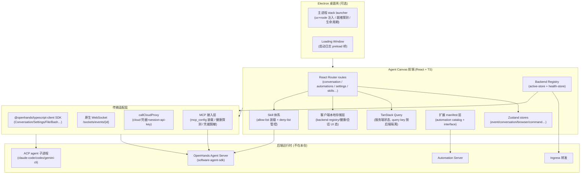

# OpenHands Agent Canvas

> 本解读按 **ai-agent ⊗ TypeScript 前端 ⊗ 可部署服务** 规格产出（回落 `_default.md`，无独立 TS 前端类型规格）。基于 `@openhands/agent-canvas`，本文档自 v1.15.0（commit `150e76046`）**增量至 v1.16.0 release（`64c126965`）+ main@`226a6d2e6`**（含 1.17.0 前已并入的 Canvas Extensions 等新能力）。本版增量：新增 **ACP 协议深度解读**（[`acp-protocol.md`](acp-protocol.md)）与 **Canvas Extensions 扩展前端**两个新关注面，增补 automation value statements / run fan-out 限流、pin home route、workspace mode 记忆等新能力；跨版本变更汇总见 [`CHANGELOG.md`](CHANGELOG.md)。

## 根因

OpenHands 从单一的全栈 agent 运行时拆分后，变成"**运行时**与**控制台**解耦"的生态。Agent Canvas 解决的根本问题是——**当你的 coding agent 可以是多个（本地 OpenHands、Claude Code、Codex、Gemini，或云端/远程/ACP），如何用一块前端把所有这些后端统一成"一个开发控制中心"来启动、切换、监控和自动化它们**。它本身不执行 agent 动作、不提供沙箱、不承载执行凭据，而是把底层多协议后端翻译成一套一致的用户界面，并把这些控制能力从单机扩展到桌面、云端接入与自动化编排。

## 概览

Agent Canvas 是一个 **React + TypeScript** 的桌面/Web 前端（`@openhands/agent-canvas`），README 自述为 "self-hosted developer control center for coding agents and automations"。它连接一个或多个 Agent Server 后端（REST + WebSocket），可经 Electron 包成桌面应用，并挂接 Automation Server 做定时/事件触发自动化。前端负责渲染会话/终端/浏览器/文件/设置/自动化 UI、管理前端状态与多后端本地元数据、翻译 UI 动作成 Agent Server API。

**边界**（`docs/architecture.md`）：绝不执行 agent 动作、不提供沙箱隔离、不承载 LLM 凭据执行，也不在无 automation 后端时跑自动化——它只做编排与呈现，执行完全交给外部后端 `[docs/architecture.md:14-19]()`。
<!-- anchor: Agent Canvas is not responsible for: … - Running scheduled or event-triggered automations without an automation backend. -->

| 核心能力 | 说明 |
|---|---|
| 多后端连接与切换 | 一个 UI 注册/切换多个 local/cloud 后端，`?backend=` 直达；fallback 语义保证 GUI 服务不断链 |
| 第三方 agent 抽象 | 统一 OpenHands 与 ACP agent（Claude Code / Codex / Gemini），收敛成统一 StartConversationPayload；provider 注册表 / 模型解析 / 凭据 / 探测见 [`acp-protocol.md`](acp-protocol.md) |
| Canvas Extensions 扩展 | local 后端扩展市场：`canvas-extension.json` manifest、页面贡献挂载、agentServer 代理请求 |
| 实时会话流 | 原生 WebSocket 拉取事件，REST 历史 + `resend_mode='since'` 增量续接，握手 watchdog + 并联心跳保活 |
| BYO Model / LLM Profiles | 任意 LLM 提供商可配；LLM profiles 的 query key 掺入 `backend.id`+`orgId` 按后端隔离 |
| **Skill 技能体系** | 显式 allow-list 装载目录技能 + deny-list 管控自建技能；`disabled_skills` 下推后端排除注入 |
| **MCP 外部能力接入** | mcp_config 管理、marketplace 目录、凭据加密脱敏、健康/连通性分级探测 |
| 自动化工坊 | 定时 (cron) / 事件 (webhook) 触发 agent 运行的自动化编排，run 实时 phase 展示 |
| 运行时服务注入 | 把后端可达的 runtime services 塞进新会话 system_message_suffix |
| 桌面打包交付 | Electron 内置本地后端栈（uv/node），免 Docker 分发 |
| 客户端状态持久化 | 后端注册表/健康/会话 UI 状态的本地分层存储，读强写弱防篡改 |

**技术栈一览**：React 18 + React Router 7（file-based routing）、Zustand（本地状态，含 persist 中间件）、TanStack Query v5（服务端状态，query key 掺入 `backend.id`+`orgId`）、`@openhands/typescript-client`（Agent Server SDK）、原生 WebSocket、Monaco/xterm、Tailwind CSS v4 + HeroUI、i18next、Electron + electron-builder（桌面）、MSW（mock 模式）、Vitest + Playwright（测试）。

## 架构总览



**模块职责映射**（关键目录）：

```
src/
├── api/                    服务适配层（backend-registry / agent-server / automation / mcp / acp / skills / cloud）
│   ├── backend-registry/   多后端注册表：active-store + storage + health-store
│   ├── agent-server-adapter.ts   请求载荷归一 + runtime-services 注入 + disabled_skills 下推
│   ├── automation-service/ Automation Server 通信
│   ├── mcp-service/ + mcp-health/  MCP server 管理与健康探测
│   ├── acp-service/        ACP 登录态探测（借 agent-server bash 跑 CLI）
│   └── cloud/              OpenHands Cloud 代理调用
├── stores/                 Zustand 状态（event 枢纽 / conversation / browser / command…）
│                            + persist 中间件本地持久化（sidebar/home/pinned…）
├── utils/conversation-local-storage.ts   会话 UI 状态的本体 sanitize 持久化
├── components/             路由与功能 UI（会话/浏览器/文件/终端/后端/自动化/设置/skills/mcp）
├── hooks/                  React Query hooks（query / mutation）+ 草稿持久化
│                            + query/use-skill-enablement 等关注面 hook
├── contexts/               全局上下文（active-backend / conversation-websocket…）
├── manifests/              扩展 manifest 准入校验与派生逻辑（automation catalog）
├── constants/acp-providers.ts    ACP provider 注册表 + 凭据解析
├── routes/skills-settings.tsx / mcp-settings.tsx    Skill/MCP 设置页
├── types/                  action/observation/automation/mcp-server 等类型与类型守卫
├── routes/                 页面级路由组件
└── utils/                  websocket-url、handle-event-for-ui、skill-enablement、mcp-redact 等纯逻辑
electron/
├── main.mjs                Electron 主进程：栈启动器 + 窗口管理器 + 优雅关闭
├── preload.cjs             仅加载窗的 IPC 白名单桥（contextBridge，CJS on purpose）
├── loading.html            后端就绪前的原生进度屏（自包含 token + 日志文本插入）
└── electron-builder.config.mjs   打包：asar:false + node_modules 瘦身 + extraResources
docker/  helm/  bin/  scripts/    容器/Helm 部署、CLI launcher、本地栈启动脚本
```

## 子文档索引

- [`backend-control-plane.md`](backend-control-plane.md) — 多后端管理：注册/切换/健康探测与 ACP/OpenHands 抽象、working_dir 作用域与版本断言
- [`realtime-session.md`](realtime-session.md) — 实时会话流：REST+WS 组合续接、握手 watchdog 与并联保活、事件→UI 渲染
- [`automations.md`](automations.md) — 自动化编排：Automation Server 契约、manifest/catalog、触发与 run 实时 phase
- [`skills-system.md`](skills-system.md) — Skill 技能体系：显式 allow-list 装载、deny-list 管控、disabled_skills 下推、迁移机制
- [`mcp.md`](mcp.md) — MCP 外部能力接入：mcp_config、marketplace、凭据加密脱敏、健康分级探测
- [`acp-protocol.md`](acp-protocol.md) — ACP 协议接入：provider 注册表单一数据源、配置流到子进程、模型解析优先级与 Gemini 特例、凭据体系、登录态探测、命令编辑、错误码
- [`electron-desktop.md`](electron-desktop.md) — Electron 桌面交付：主进程栈启动、运行时自包含、Windows/Linux 打包、进程生命周期
- [`client-storage.md`](client-storage.md) — 客户端存储层：本地元数据分层持久化、读强写弱、sanitize 校验与演进

## 核心模块导读

| 模块 | 定位 | 深度阅读 |
|------|------|----------|
| **Backend Registry** | 多 local/cloud 后端注册、持久化、active 选择与健康状态机；本地存储键读强写弱契约 | [`backend-control-plane.md`](backend-control-plane.md) / [`client-storage.md`](client-storage.md) |
| **Agent Server 适配层** | 把多协议后端收敛成统一 StartConversationPayload，并注入 runtime services 与 disabled_skills | [`backend-control-plane.md`](backend-control-plane.md) / [`skills-system.md`](skills-system.md) |
| **实时会话传输** | 原生 WebSocket 的 URL 构建、握手 watchdog、并联 keepalive、增量续接与事件分发 | [`realtime-session.md`](realtime-session.md) |
| **事件 → UI 渲染** | action→observation 归一化、流式增量合并、按类型路由到卡片/专用可视化器 | [`realtime-session.md`](realtime-session.md) |
| **Automation Service** | Automation Server REST 契约、dispatch/run/export、run 实时 phase | [`automations.md`](automations.md) |
| **Automation 触发与运行** | schedule(event) 触发、run 状态轮询、健康度派生、manifest 准入 | [`automations.md`](automations.md) |
| **Skill 体系** | allow-list 装载目录技能、deny-list 管控自建技能、disabled_skills 下推、迁移 | [`skills-system.md`](skills-system.md) |
| **MCP 接入** | mcp_config 装载、marketplace、凭据脱敏、健康分级探测 | [`mcp.md`](mcp.md) |
| **ACP 协议接入** | 把 Claude Code/Codex/Gemini CLI 收编成统一载荷：注册表、模型解析、凭据、探测、命令编辑 | [`acp-protocol.md`](acp-protocol.md) |
| **Electron 主进程** | 桌面栈启动编排、uv/node 运行时注入、两阶段就绪、进程树优雅关闭 | [`electron-desktop.md`](electron-desktop.md) |
| **Electron 打包** | asar:false + node_modules 瘦身 + Windows npm 修复 + Linux .deb | [`electron-desktop.md`](electron-desktop.md) |
| **客户端存储** | 后端/健康/会话 UI 态的分层持久化、sanitize 校验、明文 key 边界 | [`client-storage.md`](client-storage.md) |

## 设计亮点

- **多后端"只换客户端、不动页面"**：active backend 的 id + orgId 被编进 React Query 的 query key，后端切换即视为全新 query 自动 refetch，无需全局 invalidate（`src/contexts/active-backend-context.tsx:112-118`）——见 [`backend-control-plane.md`](backend-control-plane.md)。
- **健康探测做成失败封顶状态机**：连败 5 次即 `disabled` 并持久化，刷新不复活，只能靠编辑凭据恢复——防止低频后端反复拖慢 UI（`src/api/backend-registry/health-store.ts:46-63`）。
- **握手 watchdog 兜底挂起握手**：浏览器不会自动超时 `CONNECTING`，且 Chrome 按 host 串行握手，一个挂起握手会阻塞同源所有 socket（`src/utils/websocket-handshake.ts:5,17-26`）——见 [`realtime-session.md`](realtime-session.md)。
- **Skill 从"全开目录"改"显式 allow-list"**：杜绝目录新增 skill 隐式推给所有用户（`src/api/agent-server-adapter.ts:774-778`），配合 deny-list 只管自建技能的双列表裁决——见 [`skills-system.md`](skills-system.md)。
- **MCP 凭据"永不明文、三层脱敏"**：浏览器通常不持明文（Fernet token 往返），显示层用占位符回填真实密文做连通测试（`src/api/mcp-service/mcp-redacted-credentials.ts:66-75`）——见 [`mcp.md`](mcp.md)。
- **manifest 作为"安全收纳层"**：automation 模板由 `@openhands/extensions` 包下发，宿主先准入校验（version 精确匹配 + 命令白名单）再派生行为，不盲目信任外部数据（`src/manifests/manifest-validation.ts:576-592`）——见 [`automations.md`](automations.md)。
- **桌面形态"免 Docker + 运行时自包含"**：Finder 启动的 .app 拿不到用户 PATH，故把 uv/node 打包进 resources 并前置 PATH（`electron/main.mjs:142-151`）——见 [`electron-desktop.md`](electron-desktop.md)。
- **读取端永远防御、写入端静默吞错**：localStorage 是 user-writable，健康/会话态全部读强校验（防手改 `-1` 推翻失败封顶），写侧 try/catch 静默（`src/api/backend-registry/health-storage.ts:31-39`）——见 [`client-storage.md`](client-storage.md)。
- **前导倒逼后端接口演进**：版本探测 + 最低兼容版本断言，前端可预先拦截不兼容的 Agent Server（`src/api/agent-server-compatibility.ts:293-318`）。
- **外部 agent 收编的"配置即协议"**：Canvas 不 spawn ACP 子进程，只把 `acp_command`/`acp_model`/凭据配成统一载荷交给 agent-server；provider 数据镜像自 SDK、Canvas 只补 UI 字段，避免双份维护——见 [`acp-protocol.md`](acp-protocol.md)。
- **扩展即"页面贡献 + host 代理"**：Canvas Extensions 让第三方以 `canvas-extension.json` 声明页面，运行时由 host 提供 `registerPage` 与 `agentServer.request` 代理，扩展不接触凭据（`src/types/canvas-extension.ts:87-89`）。

<!-- anchor:     request: <T = unknown>( …     ) => Promise<T>; -->

## 不足与风险

- **本仓仅前端**：真正 agent 执行/沙箱/LLM 流程在外部 `software-agent-sdk`，单独解读看不到 agent 运行环路全貌，也看不到 skill 在后端如何被注入系统提示词的最终形态。
- **多 agent 协议抽象依赖订阅源**：automation 模板与 skill 目录来自已发布 npm 包，宿主对 catalog 结构高度耦合，包升级可能破坏承载 UI 或引入未经检测的新 skill。
- **本地直跑风险高**：`npm run dev` 让 agent 直连本机文件系统，桌面形态免 Docker 意味着没有容器根文件系统隔离（agent-server 直接操作 `~/.openhands/...`），文档明确提示仅限可信环境；本地后端的 apiKey 明文进 localStorage，是本地单用户模型接受的取舍。
- **ACP 登录态探测脆弱**：无专用端点，靠借 agent-server bash 跑 CLI 命令分类回退 "unknown"（`src/api/acp-service/acp-service.api.ts:86-98`）。
- **Canvas Extensions 仅 local**：扩展查询门控 local 后端，cloud 后端无此能力、旧后端 404 时管理页降级为"不支持"，扩展无法跨后端复用 `[src/hooks/query/use-canvas-extensions.ts:13-27]()`。

<!-- anchor:   const connectionRevision = active.backend.connectionRevision ?? 0; …     refetchOnWindowFocus: true, -->

## 可借鉴的设计

- **query key 掺入"资源身份"实现切换即重建**：把 `backend.id`/`orgId`/`connectionRevision` 塞进 query key，天然按后端隔离缓存——可迁移到任何多租户/多实例前端，避免手写失效调用。
- **读强写弱 + 防篡改校验**：localStorage 读取边界逐字段校验（防手改推翻 disable），写入 try/catch 静默——"易损存储靠读取端防御"可复制。
- **声明式扩展 + 本地准入**：外部包给模板，宿主侧做 version 精确匹配 + 字段收集 + 错误映射的 manifest 层，实现"可插拔 UI"而不失控。
- **allow-list/deny-list 双列表裁决**：公开目录用 allow-list（新增默认关），自建内容用 deny-list（出现即开）——平衡"默认从严"与"存量感知"，可迁移到任何插件/能力装载系统。
- **桌面栈 launcher 复用**：desktop/`npm run dev`/Docker 共用同一套 `scripts/dev-with-automation.mjs`，差异只在入口参数；主进程 `import()` 复用而非另写一遍，单点维护栈逻辑。
- **把工程史沉淀成注释与防御代码**：Electron-as-Node 失败、PATH 陷阱、Windows npm 遮蔽都写在 docstring 里，下次触雷的人直接读到原因。

## 总结

Agent Canvas 的价值不在于它是某个 agent 的界面，而在于它把"**驱动多个异构 coding agent**"这件事收敛成单一的开发控制台：backend-registry 管连接、WebSocket/Query 管实时态、Skill allow-list 管能力装载、MCP 管外部工具接入、manifest 管扩展、automation 管触发、客户端存储管本地元数据、Electron 管桌面交付。它清楚地划出前端与后端的边界，也示范了一个"壳类产品"如何靠读强写弱校验、显式 allow-list、凭据脱敏这类静态防御，在易损的浏览器存储、不可信的桌面工具链与持续演进的后端协议上保持可控——这也是理解整个 OpenHands 生态的关键切入口。
