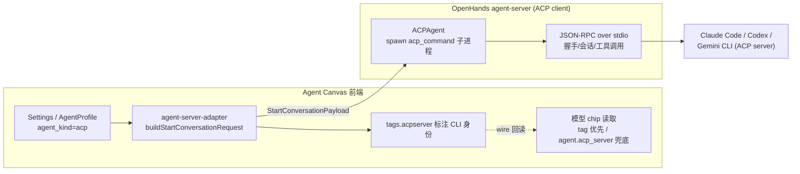
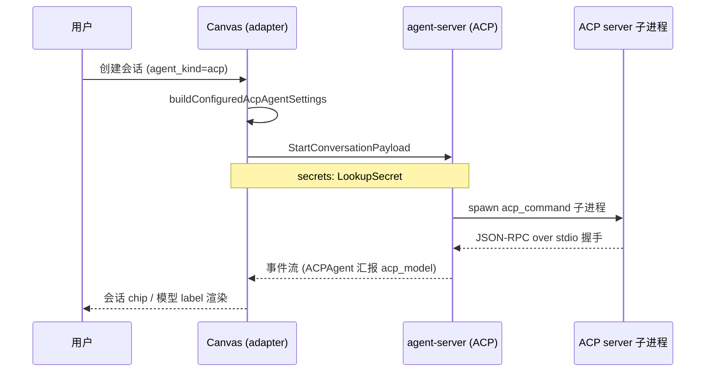
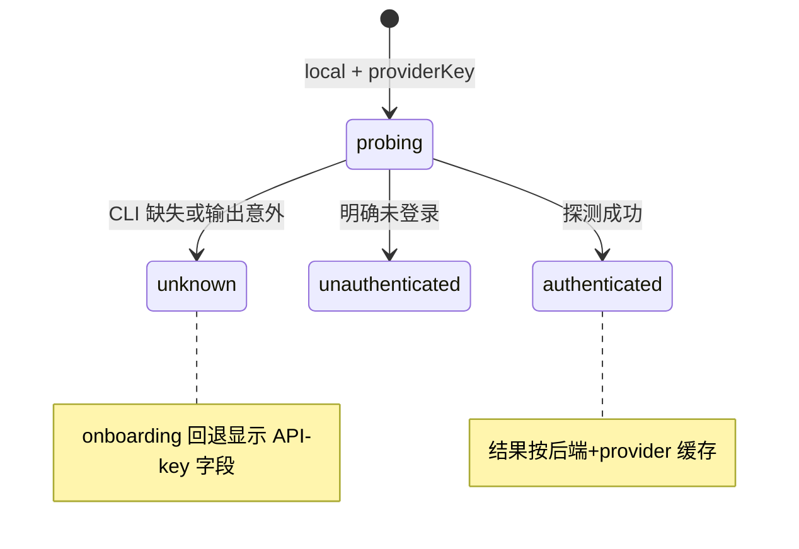

# ACP 协议接入（Agent Client Protocol）

> 关注面子文档：OpenHands Agent Canvas 接入 ACP 协议、驱动外部 coding agent 的完整消费链。承接 README 主文档与 [`backend-control-plane.md`](backend-control-plane.md)「多协议抽象」章节——后者是控制面视角，本文聚焦 ACP 一条线的深度解构：协议定位、provider 注册表、配置流、模型解析、凭据体系、登录态探测、命令编辑与错误码。

## 根因

OpenHands 生态里已经存在 Claude Code、Codex、Gemini CLI 这些**成熟且各自有主见的 coding agent**。控制中心与其重造 agent，不如把它们收编。ACP（Agent Client Protocol，Zed 提出的开放协议）提供了一条"像 LSP 之于编辑器"的通道：agent 以 JSON-RPC over stdio 服务的方式暴露能力，客户端驱动它而无需知道 agent 内部实现。

Canvas 的 ACP 角色极其克制：**Canvas 不是 ACP client，agent-server 才是**。Canvas 只把"用哪个 CLI、传什么参数、跑哪个模型"配成统一载荷，spawn 子进程、JSON-RPC 握手全在 agent-server（SDK 的 `ACPAgent`）侧。这条边界决定了本仓 ACP 代码的形态——没有协议编解码，只有**配置编排、状态探测与呈现**。`AgentKind` 只有 `"openhands" | "acp"` 二元 `[src/types/settings.ts:110]()`，注释明确 ACP 时 LLM/condenser 设置失效、凭据走 `request.secrets` 而非 per-agent env `[src/types/settings.ts:103-110]()`。

<!-- anchor: * - ``"acp"``: the conversation is driven by an external ACP subprocess … export type AgentKind = "openhands" | "acp"; -->

## 协议定位：wire 形态的 agent 二元

### conversation 的 agent 判别

`buildStartConversationRequest` 靠 `isAcpAgent` 读 `agent_kind` 一眼判断是否走 ACP 分支 `[src/api/agent-server-adapter.ts:816-818]()`。

<!-- anchor: function isAcpAgent(settings: Settings): boolean { …   return agentSettings.agent_kind === "acp"; -->

随后 `buildConfiguredAgentSettings` 按 ACP / OpenHands 分派到两个 builder，产出**同构的 StartConversationPayload** `[src/api/agent-server-adapter.ts:979-986]()`。

<!-- anchor: function buildConfiguredAgentSettings( …     : buildConfiguredOpenHandsAgentSettings( -->

### wire 上的 ACPAgent 与 acpserver tag

会话建立后，ACP 身份是**双层标注**：SDK 侧 Pydantic discriminator 给 `agent.kind === "ACPAgent"`（模型活在子进程里、经 `acp_model` 汇报）`[src/api/agent-server-adapter.ts:82-87]()`。

<!-- anchor:      * Pydantic discriminator from the SDK union: ``"ACPAgent"`` for ACP CLI …     acp_model?: string | null; -->

Canvas 侧再打 `tags.acpserver` 标注 CLI 身份（`claude-code`/`codex`/`gemini-cli`）`[src/api/agent-server-adapter.ts:449]()`。

<!-- anchor: export const ACP_SERVER_TAG_KEY = "acpserver"; -->

读取端 `toAppConversation` 按"tag 优先、`agent.acp_server` 兜底"解析——profile 启动不会打 tag，只读 tag 会把模型挑选择器丢掉、退化成一个通用 "ACP" chip（#1571/#3692）`[src/api/agent-server-adapter.ts:331-339]()`。

<!-- anchor:   const isAcp = info.agent?.kind === "ACPAgent"; …   const acpServer = isAcp -->

## provider 注册表：单一数据源，不手维护

内建 ACP provider（`claude-code` / `codex` / `gemini-cli`）的**显示名、启动命令、模型列表、默认模型**全部来自 `@openhands/typescript-client` 的 ACP 注册表——它是 Python SDK `openhands.sdk.settings.acp_providers` 的生成镜像。Canvas 的 `ACP_PROVIDERS` 只是用 `ACP_PROVIDER_UI` 给每个 provider **加两个 UI 字段**（icon + onboarding 描述文案）后重新包装 `[src/constants/acp-providers.ts:151-163]()`。

<!-- anchor: export const ACP_PROVIDERS: ACPProviderConfig[] = Object.entries( …     default_model: info?.default_model ?? undefined, -->

这是有意的**单一数据源决策**：模型列表和启动命令一旦在 SDK 演进，Canvas 不必同步手改（关闭 agent-canvas#740）；代价是 UI 与上游注册表强耦合——上游改名/删 provider，Canvas 端只在渲染时优雅回退。`custom` preset（`ACP_CUSTOM_PRESET_KEY`）是兜底，让用户手写任意 ACP stdio 命令 `[src/constants/acp-providers.ts:169]()`。

注册表还隐含一条**安全告诫**：`npx -y @openai/codex acp` 看起来可行但根本不是 ACP server——codex CLI 没有 `acp` 子命令，无 TTY 环境下直接报错并**静默挂死 agent-server 的握手**，必须用 `@agentclientprotocol/codex-acp` 包装器 `[src/constants/acp-providers.ts:86-90]()`。

<!-- anchor:    * NB: ``npx -y @openai/codex acp`` looks plausible but is **not** an …    * ``@agentclientprotocol/codex-acp`` (the codex ACP wrapper) instead. -->

## 配置流：从 Settings 到 ACP 子进程

### 载荷构建的 ACP 专用分支

`buildConfiguredAcpAgentSettings` 是 ACP 配置流的枢纽 `[src/api/agent-server-adapter.ts:843-909]()`：

<!-- anchor: function buildConfiguredAcpAgentSettings( …   return payload; -->

- **转发白名单**：遍历 SDK 的 `ACP_SETTINGS_KEYS`，把 `acp_command` / `acp_server` 等逐字段搬运进 payload；`acp_model` 单独处理（见下）；**`acp_env` 已废弃**——provider 凭据改走 `request.secrets`，绝不经 env 通道 `[src/api/agent-server-adapter.ts:866-878]()`。

<!-- anchor:   for (const key of ACP_SETTINGS_KEYS) { …       payload[key] = value; -->

- **空命令回退**：`resolveAcpCommand` 对空/缺省 `acp_command` 回退到注册表的 `default_command`，保证无配置也能拉起 provider `[src/api/agent-server-adapter.ts:827-841]()`。

<!-- anchor: function resolveAcpCommand(agentSettings: SettingsRecord): unknown { …   return provider ? [...provider.default_command] : cmd; -->

- **mcp_config 共享转发**：`mcp_config` 是 OpenHands/ACP 共享字段，ACP 子进程也能连用户配的 MCP server；仅当真有 server 才带上 `[src/api/agent-server-adapter.ts:881-887]()`。

<!-- anchor:   // ``mcp_config`` is a shared field (not in ACP_SETTINGS_KEYS): forward it …     payload.mcp_config = mcpConfig; -->

### 两个互斥的启动源

`agent_settings` 与 `agent_profile_id` 是**互斥的 agent 来源**：走 profile 时服务端纯按存储 profile 解析 agent，客户端塞进 `agent_settings` 的富化（exec 工具集、公开 skill、`RUNTIME_SERVICES` 后缀）一概不生效 `[src/api/agent-server-adapter.ts:1122-1145]()`。这解释了后面"模型切换"的复杂度——home 页写 `agent_settings.acp_model` 对一个 active profile 的启动毫无作用。

<!-- anchor:     // ``agent_profile_id`` and ``agent_settings`` are mutually exclusive agent …       : { agent_settings: agentSettings }), -->

### ACP 会话不注册 client tools

`client_tools` 只有 OpenHands 会话才挂 Canvas UI tool / child-conversation tool；ACP 会话为空数组——外部 agent 不需要 Canvas 注入的客户端工具 `[src/api/agent-server-adapter.ts:1153-1154]()`。

<!-- anchor:       launchAgentKind === "openhands" …        ? [CANVAS_UI_CLIENT_TOOL, LAUNCH_CHILD_CONVERSATION_CLIENT_TOOL] -->

`secrets_encrypted` 也区分对待：ACP 默认不强制 cipher（凭据走 `LookupSecret` 而非加密字段），仅当 `mcp_config` 里有 Fernet token 才开 `[src/api/agent-server-adapter.ts:1183-1195]()`。

<!-- anchor:   // ``secrets_encrypted`` makes the agent-server decrypt request secrets at …     payload.secrets_encrypted = true; -->

## 模型解析：四级优先级与 Gemini 特例

### 四级候选链

`resolveEffectiveAcpModel` 把"当前该显示哪个模型"收敛成一条候选链：**SDK 运行时字段（`current_model_name`/`current_model_id`）→ 用户配置的 `acp_model` → 旧 SDK 的 `agent.llm.model` → provider 注册表默认** `[src/constants/acp-providers.ts:48-65]()`。

<!-- anchor: export function resolveEffectiveAcpModel(inputs: { …   return inputs.providerDefault ?? null; -->

其中 `acp-managed` 是旧 SDK 发的哨兵值，在每一级都被过滤；而 `"default"` **不是**占位符——claude-agent-acp 0.44+ 把它当真实可选模型上报 `currentModelId`，必须像普通模型一样展示 `[src/constants/acp-providers.ts:16-33]()`。

<!-- anchor: // NB: ``"default"`` is NOT a placeholder. claude-agent-acp 0.44+ exposes …   return trimmed; -->

### 为什么 Gemini 的默认模型要特判

注册表的 `default_model` 不能无脑用：gemini-cli 不配模型时回退到内部预览 flash——在无预览权限的 Vertex 项目上 404；而显式钉 `*-flash` 也没用，gemini-cli 生成时会把 flash id **重新解析成它当前的默认 flash**。唯一"钉得住"的是非 flash id，故 Canvas 用命名常量 `gemini-2.5-pro` 覆盖 Gemini，其余 provider 保留注册表默认 `[src/constants/acp-providers.ts:296-306,324-329]()`。

<!-- anchor:  * Vertex AI-safe ``acp_model`` for Gemini. … export const ACP_VERTEX_SAFE_MODEL = "gemini-2.5-pro"; -->

### 模型切换：会话内 live、首页写 profile

`useSwitchAcpModel` 区分两种语义 `[src/hooks/mutation/use-switch-acp-model.ts:48-100]()`：

<!-- anchor: export const useSwitchAcpModel = () => { …         return; -->

- **会话内**：`POST /api/v1/app-conversations/{id}/switch_acp_model` 做**原地热切**（cloud 走 `callCloudProxy`）`[src/api/conversation-service/agent-server-conversation-service.api.ts:954-966]()`，不动用户保存的默认。

<!-- anchor:   static async switchAcpModel( …       return; -->

- **首页**：没有会话，就把选择持久化成"下次启动的默认"。但目标不是 `agent_settings`——前面说过 profile 启动忽略它——而是**写入 active ACP AgentProfile**；仅当 profile 列表解析不到 active ACP profile 才回退到 legacy 的 `agent_settings_diff`（#16523）`[src/hooks/mutation/use-switch-acp-model.ts:62-100]()`。

<!-- anchor:       // Home page: resolve the active profile from the shared query cache …         return; -->

模型 UI 的上下文由 `useAcpModelContext` 统一判定"当前会话是 ACP / 首页配置是 ACP"，并据此决定模型控件链接去 Agent 设置还是 LLM 设置——内联与溢出两种形态不漂移 `[src/hooks/use-acp-model-context.ts:41-48]()`。

<!-- anchor:   const isActiveAcpConversation = conversation?.agent_kind === "acp"; …   const isAcpContext = isActiveAcpConversation || isHomeAcp; -->

## 凭据体系：秘密名即环境变量名

### 一致性命中

`ACPProviderSecretField.name` 同时是**全局 secret 名**和 **agent-server 注入 ACP 子进程的环境变量名**——两者一致，保存的 secret 才能真正到达 provider CLI `[src/constants/acp-providers.ts:178-200]()`。`secret: true` 渲染为掩码输入，同时充当"这是真凭据"的标记：onboarding 必填判断里 base URL 或 GCP 标量不算数，只有 `secret` 字段能认证。

<!-- anchor: export interface ACPProviderSecretField { …   hint_values?: Record<string, string>; -->

### 容器化部署的凭据盲区

`ACP_RESERVED_CREDENTIALS` 收集注册表之外、但**容器化 agent-server**（无宿主登录态）认证 ACP CLI 所需的凭据：Codex 的 `CODEX_AUTH_JSON` 文件内容、Claude 的 `CLAUDE_CODE_OAUTH_TOKEN`、Gemini 的 `GOOGLE_APPLICATION_CREDENTIALS_JSON` + Vertex project/location/flag `[src/constants/acp-providers.ts:219-221]()`。它们没有 registry env 条目，因为这是**部署关注点**而非模型注册表字段——文件类凭据走 SDK 的 `acp_file_secrets` 物化到磁盘（cloud 后端目前消费不了，agent-canvas#1016）。

<!-- anchor:   codex: [ …       name: "CODEX_AUTH_JSON", -->

`getAcpProviderSecrets` 的字段序是**订阅/Vertex 凭据 → API key → 可选 base URL**：对 ACP provider，订阅/OAuth 是主认证路径，API key 是回退 `[src/constants/acp-providers.ts:359-384]()`。

<!-- anchor: export function getAcpProviderSecrets( …   return fields; -->

### 互斥凭据的运行时陷阱

`ACP_CREDENTIAL_CONFLICTS` 专门处理"两套凭据同时存在会互相拆台"的情况：Claude 的 OAuth token 直连 Anthropic，若同时设了 `ANTHROPIC_API_KEY`（优先）或 `ANTHROPIC_BASE_URL`（代理 bearer 到拒绝端点），token 会在运行时被静默绕过/失效——UI 在 onboarding 提前警告 `[src/constants/acp-providers.ts:271-276]()`。

<!-- anchor: const ACP_CREDENTIAL_CONFLICTS: Record<string, Array<[string, string]>> = { …     ["CLAUDE_CODE_OAUTH_TOKEN", "ANTHROPIC_BASE_URL"], -->

## 登录态探测：无专用端点，借 bash

ACP provider 是否已登录**没有专用探测端点**。`AcpService.getAuthStatus` 的做法是借现有 agent-server bash 端点，跑 provider 自己的状态命令并分类输出 `[src/api/acp-service/acp-service.api.ts:70-74]()`：

<!-- anchor: const ACP_AUTH_PROBES: Record<string, AcpAuthProbe> = { …     classify: classifyClaude, -->

- `claude auth status --json` → 读 JSON 的 `loggedIn`（不读退出码，登出时 CLI 非零退出）
- `codex login status` → 合并 stdout+stderr 匹配 "logged in"/"not logged in"
- Gemini 无状态命令 → 直接 `test -f ~/.gemini/oauth_creds.json`

三者归一为 `authenticated / unauthenticated / unknown` 三态；CLI 未安装、输出意外、bash 调用失败一律 `unknown`——onboarding 宁可回退显示 API-key 字段，也不误报"已登录" `[src/api/acp-service/acp-service.api.ts:100-106]()`。

<!-- anchor:   static async getAuthStatus(server: string): Promise<AcpAuthStatus> { …     return probe.classify(out); -->

探测只对 **local 后端**启用（CLI 与凭据文件只在用户本机标准路径可靠），且 `staleTime: Infinity` + `gcTime` 15 分钟——探测会跑子进程，同一 provider 每后端只探一次，关闭再开超过 15 分钟才重探（登录态可能已变）`[src/hooks/query/use-acp-auth-status.ts:60-88]()`。

<!-- anchor: export function useAcpAuthStatus( …     refetchOnMount: false, -->

## acp_command 编辑：argv tokenizer，不是 shell parser

Settings → Agent 的文本框让用户写一行人类可读命令（如 `bash -c "echo hello world"`），Canvas 要把它转成 `string[]` 交给 `acp_command`。**为什么自研 tokenizer 而不用 `shell-quote.parse`**：后者把 `?`、`*`、`$VAR`、重定向当 shell 语法解析成非字符串 AST 节点，过滤掉字符串会**静默吞掉整个 argv token**——典型事故是一个带 query string 的 URL：`node acp.js --endpoint https://example.com/acp?tenant=abc` 里的 `?tenant=abc` 被当成 glob，URL 直接消失 `[src/utils/acp-command.ts:29-35]()`。

<!-- anchor-base64:ICogICAgIG5vZGUgYWNwLmpzIC0tZW5kcG9pbnQgaHR0cHM6Ly9leGFtcGxlLmNvbS9hY3A/dGVuYW50PWFiYyDigKYgICogdmFuaXNoZXMuIFRoZSBhZ2VudC1zZXJ2ZXIgdGhlbiBzcGF3bnMgYSBicm9rZW4gY29tbWFuZCBhbmQgdGhlIHVzZXI= -->

核心前提：**spawn 侧没有 shell**（`subprocess.create_subprocess_exec` 直接拿 argv 数组），所以只需要 argv 风格的分词 + 引号/转义处理，任何非空白字符都原样入 token `[src/utils/acp-command.ts:65-148]()`。

<!-- anchor: export function parseCommand(value: string): string[] { …   return tokens; -->

反向 `formatCommand` 只在 token 含 shell 危险字符或为空时做引号，其余（含 `@`、`/`、`=`）原样回显——否则 `npx -y @org/pkg` 会渲染成 `\@org/pkg` 这种敌意可读性 `[src/utils/acp-command.ts:176-188]()`。

<!-- anchor: export function formatCommand(command: readonly string[]): string { …     .join(" "); -->

## 错误码 → UI 恢复动作

SDK 的 ACPAgent 把错误编码在 `ConversationErrorEvent.code` 上，Canvas 侧只做 **code → 文案/动作**映射 `[src/utils/acp-error-codes.ts:8-17]()`：

<!-- anchor: export const ACP_AUTH_REQUIRED_CODE = "ACPAuthRequired"; …   UsagePolicyRefusal: I18nKey.CHAT_INTERFACE$AGENT_ERROR_MESSAGE, -->

- `ACPAuthRequired` → 专属标题 + **re-auth 恢复动作**（唯一触发 re-auth 的码）
- `ACPSpawnError` / `ACPInitError` / `ACPPromptError` / `UsagePolicyRefusal` → 共用通用 "Agent error" 标题，细节走 detail 文案

## 全局关联与权衡

ACP 接入是控制中心"壳类产品"哲学在**外部 agent 收编**上的落点：Canvas 不重造 agent，而是把异构 coding agent 的差异（命令、模型、凭据、登录态）全部**收敛进配置层**——注册表给默认、adapter 给载荷、bash 探测给状态、tokenizer 给可编辑性。由此换来的收益是**一个 UI 驱动多种 agent**，代价则集中在几处：

- **探测脆弱**：登录态靠借 bash 跑 CLI 状态命令、按输出猜三态，无专用端点，`unknown` 兜底是常态而非例外。
- **两套启动源的撕裂**：`agent_profile_id` 与 `agent_settings` 互斥，导致首页模型切换要解析 profile、失败即拒绝（#16523），比单路径复杂。
- **容器/云的凭据盲区**：文件类凭据（Codex auth.json、Vertex SA）依赖 `acp_file_secrets` 物化，cloud 后端消费不了（#1016）；`acp_isolate_data_dir` 也因 SDK 未暴露而未启用（#1019）——并发同 provider 会话可能竞争同一个 HOME。
- **上游耦合深**：provider 数据、错误码、`ACP_SETTINGS_KEYS` 全部镜像自 SDK，升级 SDK 必须同步回归 ACP 会话，否则新 provider/新字段会悄悄漂移。

这正是理解 OpenHands 生态"运行时与控制台解耦"的关键切入口：ACP 让"控制台"不必拥有一等 agent 也能交付完整编码体验，而代价——探测、凭据、启动源的复杂性——被刻意留在了适配层而非塞给用户。
