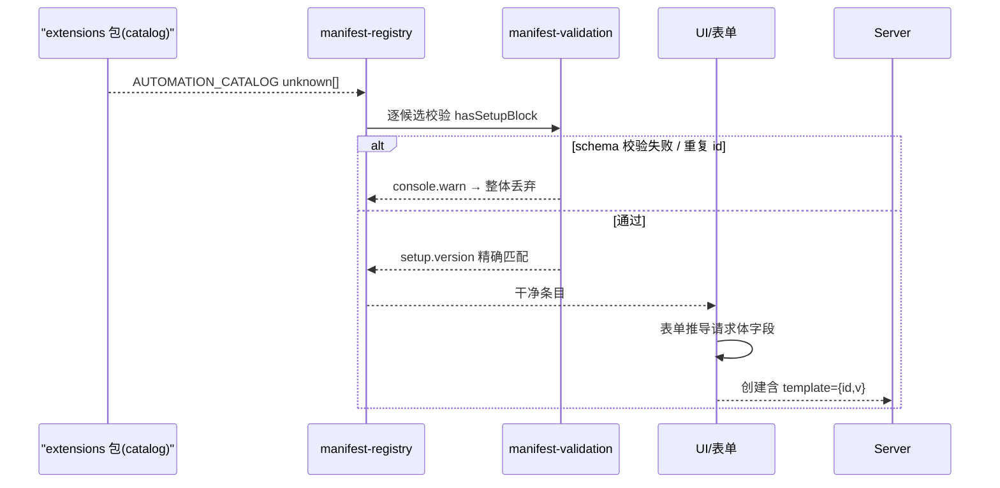
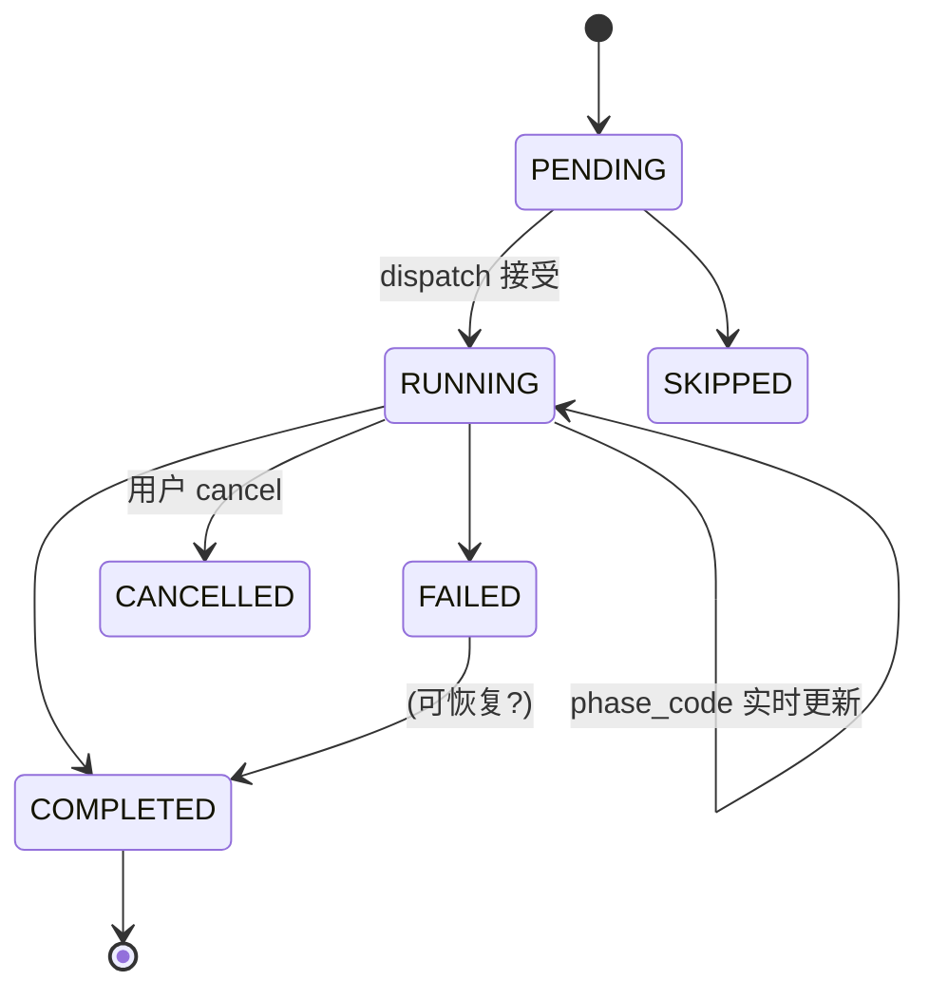

# 自动化编排（Automations）

> 关注面子文档：OpenHands Agent Canvas 的自动化工坊——Automation Server 契约、manifest 安全收纳层、触发与 run 实时 phase。承接 README 主文档。

## 根因

自动化的本质是**让 agent 运行不再依赖人盯着页面触发**：定时（cron）或事件（webhook）触发一次 agent 运行。困难在于"触发的 agent 运行怎么被编排、怎么监控、怎么安全地由外部包扩展"。Agent Canvas 把自动化做成了**宿主 + 外部 manifest**的解耦：宿主只做准入校验与派生行为，模板由已发布 npm 包下发。

## Automation Server 契约：哑客户端 + 中间人

前端对 Automation Server 是**哑客户端**：base path `/api/automation`，REST 端点路径由外部 interface manifest 声明（`getAutomationEndpoint`），本地走 sidecar、云端走 cloud proxy，鉴权用 `X-Session-API-Key` `[src/api/automation-service/automation-service.api.ts:50,274-301,428-443]()`。端点路径不写死，从 interface manifest 解析 + `{id}` 编码 `[src/manifests/automation-interface.ts:133-143]()`。

两端路由：本地经 `localAutomationAxios` 拦截器每次解析当前活跃后端并注入 header `[src/api/automation-service/automation-service.api.ts:83-111]()`；云端经 `callCloudProxy`（避免 gzip body 被 JSON 序列化破坏，upload 直连 host）`[src/api/automation-service/automation-service.api.ts:634-660]()`。

## manifest 安全收纳层：外部包 → 宿主校验 → 派生行为

manifest 是**外部仓库（`@openhands/extensions`）声明的指令数据**，宿主不信任它，把"准入校验"当**信任边界**而非便捷检查——不 defer 给随包 schema，而是宿主自持校验规则。

- **来源**：catalog 作为 `unknown[]` 传入（故意不信同包类型）`[src/manifests/manifest-sources.ts:18-20]()`
- **收纳（registry）**：逐候选先 `hasSetupBlock` 再 `validateSetupEntry`，失败 `console.warn` 后**整体丢弃**（不渲染半成品），重复 id 也拒 `[src/manifests/manifest-registry.ts:25-46]()`
- **准入校验**：`setup.version` 必须精确等于宿主 `SETUP_VERSION`，否则 fail-closed（不认识就拒而非照今天规则乱解）`[src/manifests/manifest-validation.ts:576-592]()`
- **关闭集白名单**：命令只许安全字符且逐词禁绝对路径/`..`（防逃出解压目录）`[src/manifests/manifest-validation.ts:165-178]()`；字段名、trigger 单种、repo-picker 事件源、占位符只许已知 namespace、copy 禁 markup `[src/manifests/manifest-validation.ts:25-49]()`
- **派生行为**：请求体完全由主/表单推导（name、trigger、repos、prompt），条目只声明"差异"，镜像 `extensions` 侧 reference 实现 `[src/manifests/automation-setup.ts:185-347]()`
- **template provenance（本版新增）**：创建时把 `{id, version, config}` 作为 `template` 发送，服务端识别"同一条目再次 setup"复用已有 automation；prompt 条目取顶部 `version`，bundle 条目取 `setup.bundle.version` `[src/manifests/automation-setup.ts:236-246,314-318]()`
- **preset_metadata（增量新增）**：`Automation` 新增 service-owned 的 `preset_metadata`（preset 状态原样回传，GUI 只读其中 template provenance 块，且必须经 `automation-catalog` 的 guarded helper 读、不直接摸裸字段）`[src/types/automation.ts:47-52]()`

<!-- anchor:    * Service-owned preset state, returned verbatim. The GUI reads only the …   preset_metadata?: Record<string, unknown> | null; -->

### manifest 声明的 dashboard 指标：名字封闭、实现唯一

dashboard 卡片的 metric / filter / sort 名字由 interface manifest 声明成 **closed sets**（如 `OVERVIEW_METRICS` = automations / needs-attention / total-runs / average-duration）`[src/manifests/types.ts:339-345]()`。

<!-- anchor: /** Values this host computes over the loaded automations and their runs. */ … ] as const; -->

而每个名字的**唯一实现**全部集中在 `automation-insights.ts`——其余 manifests 只做组合、不做业务，避免"同一指标在 dashboard 与 detail 各算一份"漂移 `[src/manifests/automation-insights.ts:5-13]()`。

<!-- anchor:    * The interface manifest's dashboard surface names metrics, filter predicates, …    * and durations consider only COMPLETED and FAILED runs — a cancelled or -->

派生统计遵守一条**"可知道才说"纪律**：`completedTotal` 优先用 automation service 1.9.0 起上报的 `status_counts`（lifetime 计数，不受分页影响、sparse——无 run 的状态不出现 key）`[src/types/automation.ts:126-131]()`。

<!-- anchor:    * Lifetime run counts by status, unaffected by pagination. Sparse — a …   status_counts?: Partial<Record<AutomationRunStatus, number>>; -->

服务端不报时，仅当样本恰好覆盖全历史（`total ≤ 样本长度`）才用样本计数，否则置 `null`——"不知道就是不知道，绝不猜" `[src/manifests/automation-insights.ts:94-100]()`。

<!-- anchor:   let completedTotal: number | null; …     completedTotal = null; -->

## 触发与运行状态机

### run ENUM 状态机 + 可实时更新的 phase

run 表面是 ENUM `PENDING/RUNNING/COMPLETED/FAILED/CANCELLED/SKIPPED`，叠加一层**可实时更新的 phase**（code+label+updated_at，服务端可逐步写入）`[src/types/automation.ts:66-73,99-113]()`。

**"该不该展示 phase"派生**：只有 `PENDING/RUNNING/FAILED` 值得展示（完成/取消/跳过没内容）`[src/components/features/automations/detail/run-phase.tsx:17-25]()`。**"该不该展示 age"**：只有仍在途的才展示 age，age 唯一作用是分离"在跑 vs 卡住"；失败态显示 age 会退化成第二时间戳 `[src/components/features/automations/detail/run-phase.tsx:35-42]()`。

**phase→文本唯一入口**：已知 code 走翻译表（queued/sandbox_provisioning/...），未知 code 用作者 label、再兜底 raw code；用 `Object.hasOwn` 防 `toString` 原型污染 `[src/components/features/automations/detail/run-phase.tsx:65-102]()`。

### 健康度派生

`checkHealth()` 5s 超时 fail-fast `[src/api/automation-service/automation-service.api.ts:762-787]()`；`useAutomationHealth` 30s stale、失败不重试（立即展示错误态）`[src/hooks/query/use-automation-health.ts:7-14]()`；`automations-list` 先 gate health 再拉 automation 列表——`isBackendHealthy` 为 false 就跳 `BackendNotConfigured` 而非拉列表 `[src/routes/automations-list.tsx:131-133,350-358]()`。

### run 摘要聚合与 fan-out 限流

home/dashboard 的每次展示会对**每个 automation 各发一个 runs 请求**——全量 fan-out 能耗尽 automation service 的连接池（约 15 连接，池满后 30s 超时卡死所有请求），因此用全局共享的 FIFO 信号量 `automationRunRequestsLimiter` 把并发压在 3 个；排队中若 query 被取消（观察者卸载）则直接让位、不占网络 `[src/hooks/query/concurrency-limiter.ts:48-55]()`。

<!-- anchor:  * Shared by every per-automation runs query: the dashboard and home page each … export const automationRunRequestsLimiter = new ConcurrencyLimiter(3); -->

轮询策略随之收紧：15s 间隔（刻意慢于详情页 3s——每 automation 一请求的 fan-out 下，全 in-flight 时请求率与一个打开中的详情页相当）`[src/hooks/query/use-latest-automation-runs.ts:14-18]()`。

<!-- anchor:      * Poll interval while a run is non-terminal. Deliberately slower than the 3s …      * same request rate as one open detail page. -->

`staleTime` 60s、`retry: false`（服务不健康时沉降为 "unknown" 而非猛刷）、`refetchOnWindowFocus: false`，只在**最近一次 run 非终态**时继续轮询，让 status/conversation_id 变化无需手动刷新 `[src/hooks/query/use-latest-automation-runs.ts:67-83]()`。

<!-- anchor:       staleTime: 60 * 1000, …         return isInFlight ? IN_FLIGHT_POLL_INTERVAL_MS : false; -->

health 派生在摘要基础上收口：disabled 一律判 disabled（不管历史）；摘要未决（loading/error/无 summary）判 unknown 不妄言；其后才由最近一次 run 定夺（FAILED→failing、PENDING/RUNNING→running、终态→healthy）`[src/manifests/automation-insights.ts:128-145]()`。

<!-- anchor: export function deriveAutomationHealth( …   return "healthy"; -->

## 全局关联与权衡

自动化的编排哲学是"**宿主只编排、模板只声明差异、服务端保持续**"：请求体完全由当前表单推导，manifest 条目只声明与基准的差异 + template provenance 指纹（id/version），使服务端能识别"同一模板再次安装"并复用，避免重复创建。这与控制面"隔离不确定性"同源：前端不解析执行细节，只做准入校验、派生行为和 run phase 呈现；真正执行是 Automation Server + agent-server 的事。代价是对已发布 manifest 结构高度耦合，包升级可能破坏承载 UI。
