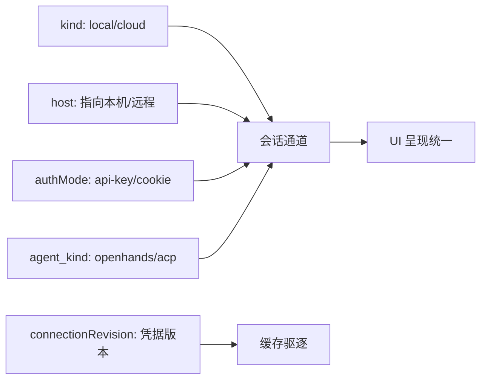
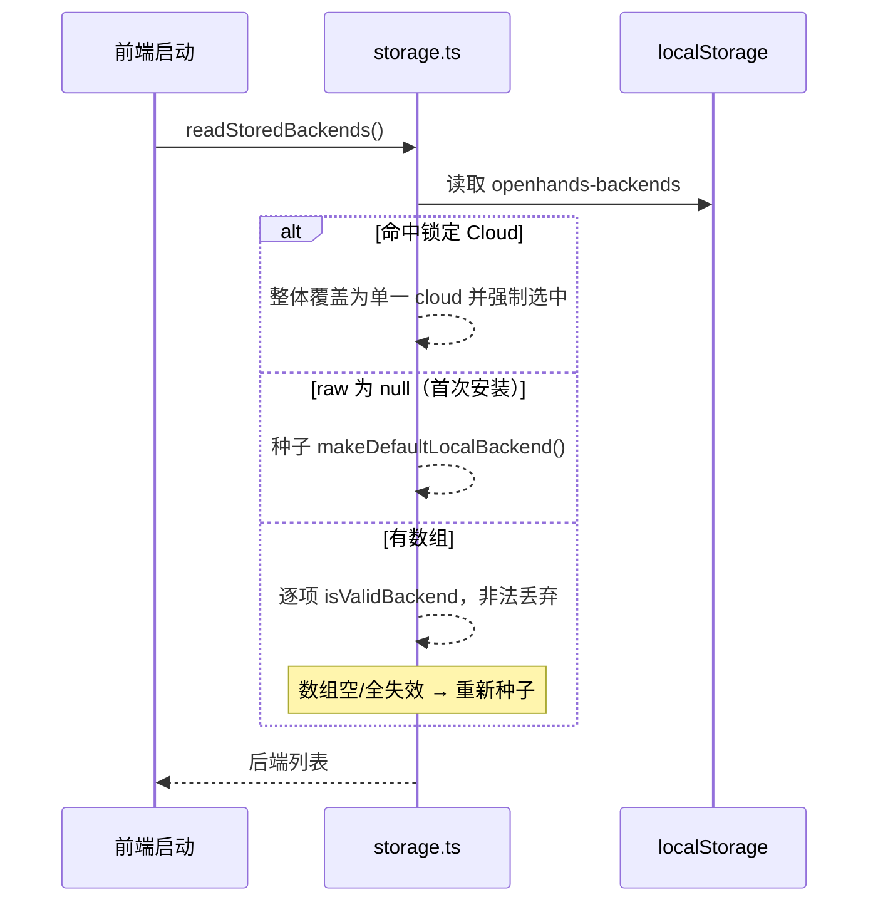
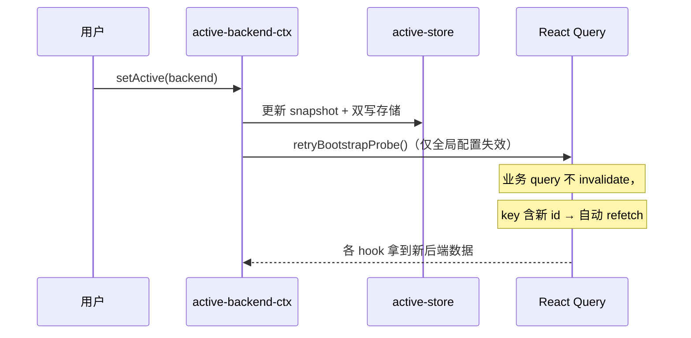
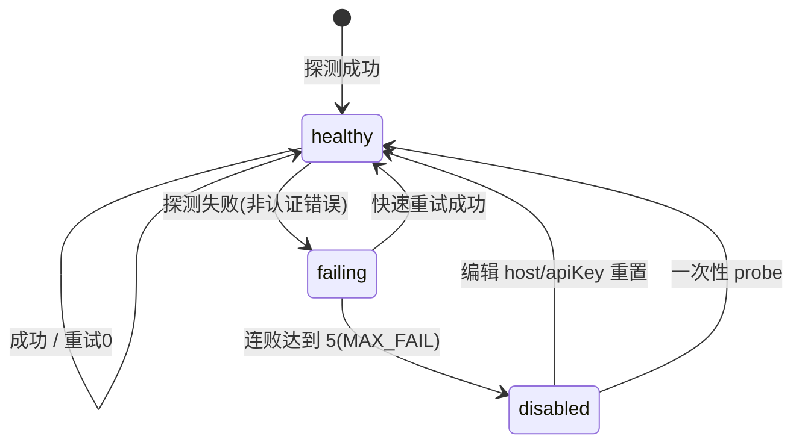

# 多后端控制面（Backend Control Plane）

> 关注面子文档：OpenHands Agent Canvas 如何把多个 local/cloud/remote/ACP 后端统一成一套管理界面。承接 README 主文档；核心链路命中强制图位均以 Mermaid 承载。

## 根因

多后端的本质困难不是"连接多个服务器"，而是**在不重写页面的前提下，让整套 UI 的状态与缓存跟着当前后端走**。Agent Canvas 的解法是把"当前是哪台后端"抽象成唯一全局状态，并用 **query key 掺入后端身份标识**让 React Query 在切换时自动重建缓存——这是整个控制面的心脏。

## 后端类型模型：三轴合一

底层 `BackendKind` 只有 `"local" | "cloud"` 两种 `[src/api/backend-registry/types.ts:1]()`，不存在独立的 `remote` 枚举。所谓 remote 后端是"kind 仍为 local、但 host 被编辑成远程地址"的变体；ACP 也不是 Backend 上的区分，而是 conversation 的 `agent_kind` 决定。

**三轴合一**：
- **kind**（通道/协议）= `local | cloud`
- **host**（连哪里）= 可指向远程
- **authMode**（如何鉴权）= `"api-key" | "cookie"` `[src/api/backend-registry/types.ts:2]()`

关键洞见：`default-local` 后端的 host 可被编辑成 remote，但稳定 id 仍叫 `default-local`，所以一切按 host 匹配而非 id 的逻辑（如 served-origin 判定、版本缓存失效）都必须用 host `[src/api/agent-server-config.ts:226-243]()`。

## 注册、持久化与选中优先级

### 本地存储双 key + 防御性校验

注册表拆成"后端数组"（`openhands-backends`）+"当前选中"（`openhands-active-backend`）两个独立 key `[src/api/backend-registry/storage.ts:13-14]()`。读取时经过多层 guard：锁定 Cloud 覆盖 > 首次安装种子 > 已存数组，且每个后端都要过 `isValidBackend` 运行期校验（id/name/host/apiKey 类型、kind/authMode 枚举、connectionRevision 非负整数）`[src/api/backend-registry/storage.ts:104-149,16-40]()`。

### 选中态是 tab 作用域的

**active 优先读 sessionStorage、仅新 tab/旧数据兜底 localStorage**——避免刷新 tab A 采纳 tab B 的后端；写入时双向镜像 `[src/api/backend-registry/storage.ts:205-219,221-243]()`。

### URL 作为"自描述链接"

新 tab（cmd/ctrl+click）不继承 sessionStorage，可能落到错误后端的 localStorage 兜底。URL 带上 `?backend=<id>&org=<orgId>` 让新 tab 落地正确后端并被持久化 `[src/api/backend-registry/url-selection.ts:17-18,58-77]()`；id 不在注册表则忽略回退。

## active 全局状态与 React Query 无缝失效

### 单例快照 store

`active-store.ts` 是模块级单例（顶层 `let snapshot` + listeners Set），React 侧 `useSyncExternalStore` 把它桥进组件 `[src/api/backend-registry/active-store.ts:116-122,128-130,180-185]()`。

### query key 掺入"资源身份" = 零手动 invalidate

核心机制：绝大多数业务 query 把 `backend.id` + `orgId` 编进 query key，切换即产生全新 key → React Query 视为新查询自动 refetch，无需 `invalidateQueries`。三类 key 掺入层级：

1. 大多数业务 query：`backend.id` + `orgId`（如 settings `[src/hooks/query/use-settings.ts:133-143]()`、sub-conversations、secrets）
2. 极少数（cloud current user id）再加 `connectionRevision`——凭据版本号 `[src/hooks/query/use-cloud-current-user-id.ts:64-72]()`
3. health 检测直接掺入 `b.host` + `b.apiKey`——编辑连接即 re-key

`setActive` 中明确注释"不 blanket invalidate，因 query key 已含 backend.id+orgId" `[src/contexts/active-backend-context.tsx:112-118]()`。

切换后端时手动失效的**唯一**触发点：`retryBootstrapProbe()` = 清服务器信息缓存 + invalidate 单个全局配置 query `[src/contexts/active-backend-context.tsx:82-87,108-110,135]()`。

### 删除/切换的 fallback 语义

active 被移走不是落到空，而是 fallback 到**首个健康本地后端 → 首个本地后端 → backends[0] → NO_BACKEND sentinel** `[src/api/backend-registry/active-store.ts:42-62]()`。NO_BACKEND 永不持久化，调用方须先 `isNoBackend()` 判断 `[src/api/backend-registry/active-store.ts:29-39]()`。

## 健康探测：失败封顶状态机

### 30s 轮询 + 三态健康判定

`use-backends-health.ts` 对每个后端发一个 React Query：local 探测 `GET /api/settings`（验 key）+ `/server_info`（验版本下限），cloud 探测 `GET /api/keys/current`（cookie 则 `getCloudOrganizations`）`[src/hooks/query/use-backends-health.ts:34,90-134]()`。30s 间隔的原因在注释里：每 tick 一个后端消耗两次顺序请求，需避开浏览器 HTTP/1.1 连接池竞争。

### 连败 5 次永久 disable，且持久化

核心安全不变量：**失败封顶**。每次失败 `consecutiveFailures` +1，封顶 `MAX_CONSECUTIVE_FAILURES = 5`，达顶即 `disabled: true` `[src/api/backend-registry/health-storage.ts:10]()`。disabled 后 hook 停轮询 `refetchInterval: false`，**且状态持久化在 localStorage 跨刷新存活**——恢复只能靠编辑 host/apiKey（`resetBackendHealth`）或 Manage Backends 的一次性 `probeDisabledOnce` `[src/hooks/query/use-backends-health.ts:243-252,295-310]()`。

### 快速重试 + 第二成功入口

单次探测内置 2 次快速重试（300ms），但**认证类失败（401/缺 key/logged out）不重试**；重试放 queryFn 内而非 React Query 层，避免错误封顶过快触发 `[src/hooks/query/use-backends-health.ts:140-162]()`。`query-client-config` 的 QueryCache `onSuccess` 也调用 `recordBackendSuccess`——"任意带 backendId meta 的成功查询即点亮 health"的第二入口 `[src/query-client-config.ts:34-40]()`。

## 多协议抽象：把 ACP/OpenHands 收敛成统一载荷

前端不直接 spawn ACP 子进程。`buildStartConversationRequest` 按 `isAcpAgent(settings)`（读 `agent_settings.agent_kind`）分派到 ACP/OpenHands 两个 builder，产出的都是**同构的 StartConversationPayload**——工作目录、MCP config、secrets 都以此统一字段塞进 payload，由 agent-server 侧解析成子进程 `[src/api/agent-server-adapter.ts:816-819,843-909,911-991,1085-1168]()`。

### ACP 身份标注：tag + agent.kind 双保险

ACP 会话在 wire 上是 `agent.kind === "ACPAgent"`（SDK discriminator），再打 `tags.acpserver` 标注 CLI 身份 `[src/api/agent-server-adapter.ts:331,339-341,449]()`；适配层读取时"tag 优先、agent.acp_server 兜底"，避免 profile 启动没 tag 时丢失模型挑选择器。

### ACP 登录态探测：借 agent-server bash

ACP provider 是否需要登录没有专用端点，靠 `AcpService.getAuthStatus` 通过 BashClient 执行 provider 状态命令（`claude auth status --json` / `codex login status` / Gemini 查 credentials 文件）并分类 `[src/api/acp-service/acp-service.api.ts:70-84,99-108]()`；仅限 local 后端（CLI 与凭据在本机），无法分类回退 "unknown"。

### LLM Profiles（BYO Model）：query key 掺入后端身份

README 自述的 "Bring your own model" 能力由 `use-llm-profiles` 承载——它把 `backend.id` + `orgId` 编进 query key，防止切换后端时 profile 缓存串扰（README 自述能力点经源码探测属实：`use-llm-profiles.ts:17` 的 queryKey 与 adapter 中读取 runtime model 字段、按 `agent_kind` 门控模型挑选择器的逻辑一致）`[src/hooks/query/use-llm-profiles.ts:13-17]()`。这与控制面"切换即重建缓存"是同一套哲学的又一落点。

## 运行时服务注入与命令执行

### runtime_services → system_message_suffix

多后端/部署模式下，"哪些服务从沙箱可达"由 `/server_info.runtime_services` 上报（agent 视角 URL），adapter 渲染成 `<RUNTIME_SERVICES>` 块经 `system_message_suffix` 注入，避免 agent 猜 URL（尤其 automation 后端跨 dev 模式端口不同）`[src/api/agent-server-adapter.ts:134-157,221-306,790-813]()`。

### 运行时命令执行：class 静态分派

`AgentServerRuntimeService` 封装"在 agent-server 上执行 bash/下载文件"。local 直接用 SDK typed client，cloud 因 `*.prod-runtime.all-hands.dev` 禁浏览器 CORS，走 `callCloudProxy`（hostOverride + session key）服务端跳转 `[src/api/runtime-service/agent-server-runtime-service.ts:24-58,70-93]()`。

## working_dir 作用域：按 served-origin host 匹配

前向依赖核心洞见：**working_dir 必须按 host 作用域化**。烧入的 `VITE_WORKING_DIR` 是"serving host 文件系统上的绝对路径"，只有 serve 该前端的那台后端可用；`isServedOriginHost` 按 host 字符串（非 id）判断，因为 `default-local` 的 host 可编辑 `[src/api/agent-server-config.ts:190-243]()`。是 served-origin → 绝对路径；否则 → relative default `workspace/project/<hex>`，由 agent-server 侧 `GET /api/file/home` 锚定到该后端自己 home 下可写路径。写入会话时 `workspace: { kind: "LocalWorkspace", working_dir }` `[src/api/agent-server-adapter.ts:1009-1014]()`。

## 版本探测与兼容硬断言

`assertAgentServerVersionIsSupported` 是硬闸门：取 `server_info.version`（无则回退 `sdk_version`）→ 归一到 `{major,minor,patch,prerelease}` → 对 `defaults.json` 的 `compatibility.minimumAgentServer` 做 semver 比较 → 低于下限抛 `AgentServerUnsupportedVersionError`，无法解析抛 `AgentServerUnknownVersionError`，失败即清缓存 `[src/api/agent-server-compatibility.ts:176-203,243-271,273-291,293-318,320-400]()`。服务器 info 带 host 缓存，切换/重试按 host 比对失效。此外按 `/server_info.usable_tools` 决定是否注入 browser/task 工具（不支持的过滤掉），形成"能力探测-注入"闭环 `[src/api/agent-server-compatibility.ts:34-39,149-155]()`。

## 全局关联与权衡

控制面的统一哲学是**"把不确定性隔离在适配层"**：前端只认"当前后端 + query key 身份"，协议/鉴权/作用域差异全部沉到 `backend-registry`、`agent-server-adapter`、`agent-server-compatibility` 里。由此换来的收益是——UI 层几乎不关心"我在连哪台、什么协议"，切后端自动重建缓存；代价是适配层复杂且上游耦合深（catalog 依赖 npm 包、ACP 探测靠 bash 借道），这正是本仓"壳类产品"的本质：价值在编排与防御，不在执行。
