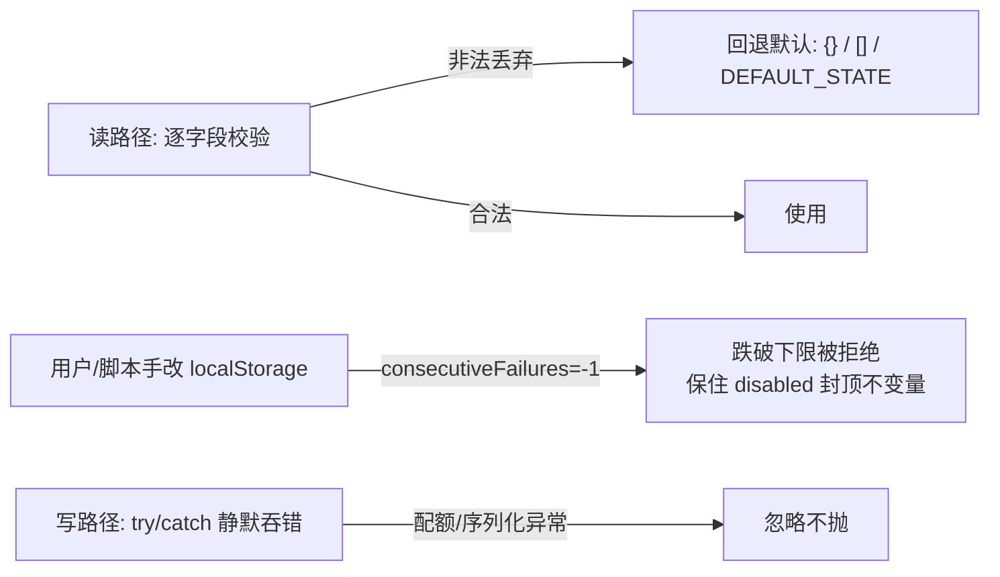

# 客户端本地存储层（Client Storage）

> 关注面子文档：OpenHands Agent Canvas 的客户端本地元数据分层持久化。核心是"读强写弱 + 防篡改校验"的本地存储防御哲学。承接 README 主文档。

## 根因

Agent Canvas 是"壳类产品"，大量状态（后端注册表、健康、会话 UI 态）依赖 `localStorage` 这类**用户可写、易损坏、天然不安全**的浏览器存储。根本困难不是"存什么"，而是**如何在一个可能被用户/脚本手改、可能被旧版本遗留字段污染、可能触发配额异常的存储上，保证业务不变量不被破坏**。答案是一套统一的"读强写弱"防御哲学。

## 分层与持久化键

localStorage 分三层，各层键、读写目标、生命周期不同：

| 层 | 键 | 生命周期 / 目的 |
|---|---|---|
| 后端注册表 | `openhands-backends`、`openhands-active-backend` `[src/api/backend-registry/storage.ts:13-14]()` | 后端列表跨会话持久；active 选择是 **session 级**（见下） |
| 健康状态 | `openhands-backend-health` `[src/api/backend-registry/health-storage.ts:3]()` | 失败封顶是**跨页面刷新**的（"状态在 localStorage"）`[src/api/backend-registry/health-store.ts:43-44]()` |
| 会话 UI 态 | `conversation-state-${conversationId}`、`pending-task-draft-${taskId}` `[src/utils/conversation-local-storage.ts:14-17]()` | 按会话粒度；临时 `task-` ID 不落盘 |

另加 Zustand persist 层：`openhands-sidebar`（sidebar 折叠态）、`pinned-conversations`（置顶）、`home-store`（最近仓库/上次 provider）`[src/stores/sidebar-store.ts:15-30]()`、`[src/stores/pinned-conversations-store.ts:87-93]()`、`[src/stores/home-store.ts:60-63]()`；均用 `createJSONStorage` + `partialize` 只挑要持久化的字段。增量又新增两个 UI 偏好键：`oh:pinned-home-route:<backend>:<org>`（固定首页侧栏页）与 `openhands-last-local-workspace-mode`（上次本地 workspace 选择），见下。

### Pin 首页路由：按后端作用域的"可重入"存储

`usePinnedHomeRoute` 把"用户固定的首页侧栏页"存在 `oh:pinned-home-route:<backendId>:<orgId>` 下——**key 掺入后端身份**，理由在注释里：pin 可能指向只在该后端存在的表面（如 `/automations` 依赖该部署的 interface manifest），共享 key 会让一台后端的 pin 把另一台的 `/` 重定向 `[src/hooks/use-pinned-home-route.ts:19-29]()`。

<!-- anchor:  * The pin is stored per backend + org: it may reference a surface that only …  return `${PINNED_HOME_ROUTE_KEY}:${backendId}:${orgId ?? "-"}`; -->

读取侧两道防御（与"读强"一脉相承）：
- **pinnable 校验**：只有 `/customize` 与"有 automation interface 时的 automations 列表"可 pin；`/` 本身永不可 pin——否则 pin 自身形成重定向环 `[src/hooks/use-pinned-home-route.ts:39-43]()`

<!-- anchor: export function isPinnableRoute(path: string): boolean { …   return false; -->

- **非法 pin 忽略不清理**：读路径对 `JSON.parse` 失败、非字符串、不可 pin 的旧值一律返回 "no pin"，但**不主动清除**——它可能在切回对应后端后重新变有效（如 automations interface 回归）`[src/hooks/use-pinned-home-route.ts:51-56]()`。

<!-- anchor:  * Synchronous pin read for route loaders (no React context). Reads the key …  * automations interface returning after a backend switch back). -->

### 本地 workspace 模式的记忆

`openhands-last-local-workspace-mode` 记住上次本地 workspace 选择（`local_repo | new_worktree`），下次进入 home 恢复。它是"读强写弱"的微缩样板：读侧逐字段校验 + try/catch + 非法回退 `DEFAULT_WORKSPACE_MODE` `[src/utils/workspace-mode.ts:14-21]()`，写侧同样 `try/catch` 静默吞错——注释直说 "Ignore storage failures; the selector still works for this render"。

<!-- anchor: export function readStoredLocalWorkspaceMode(): WorkspaceMode { …     return isWorkspaceMode(stored) ? stored : DEFAULT_WORKSPACE_MODE; -->

### Active backend 的 tab 作用域

`readStoredActiveBackend` 先读 `sessionStorage`，没有才回退 `localStorage`；写时**同时镜像两个**。Why："Active backend 是 tab 作用域的，刷新 tab A 不会收养 tab B 的后端" `[src/api/backend-registry/storage.ts:205-219,221-243]()`。

## 读强写弱：防篡改校验的核心

### 健康层最典型

`isValidEntry` 注释直说 "localStorage 是用户可写的" `[src/api/backend-registry/health-storage.ts:27-31]()`——`consecutiveFailures` 必须是 0..5（`MAX_CONSECUTIVE_FAILURES`）的整数，一条被手改成 `-1` 的记录**永远到不了上限、会废掉整个 disable 机制**，大数值只刷脏 UI `[src/api/backend-registry/health-storage.ts:31-39]()`。`readStoredHealth` 读时逐项校验、丢弃非法项，异常 catch 返回 `{}` `[src/api/backend-registry/health-storage.ts:41-59]()`。写侧 `recordBackendFailure` 用 `Math.min(count+1, MAX)` 硬夹顶，到顶即 `disabled:true` `[src/api/backend-registry/health-store.ts:46-63]()`；成功探活即清除该 entry `[src/api/backend-registry/health-store.ts:70-74]()`。

### 统一模式

所有 read 都是 `try{...}catch{回退默认/空}`，非法即丢回默认（健康→`{}`、backends→`[]`、会话态→`DEFAULT_CONVERSATION_STATE`）；写侧 `writeStoredBackends`/`writeStoredHealth` 的 `catch{}` 连同注释 "ignore quota / serialization errors" 静默吞掉 `[src/api/backend-registry/storage.ts:95-102]()`、`[src/api/backend-registry/health-storage.ts:61-75]()`；storage 层抽象也把 `write/read/removeStorageItem` 全 try/catch 吞错 `[src/api/backend-registry/storage.ts:174-203]()`。会话态 `setConversationState` 失败仅 `console.warn` 不抛 `[src/utils/conversation-local-storage.ts:275-277]()`。

## sanitize 校验逻辑（conversation-local-storage.ts）

`sanitizeStoredState` `[src/utils/conversation-local-storage.ts:106-205]()` 是"读强"的核心实现：
- **selectedTab**：先用显式 denylist `REMOVED_CONVERSATION_TABS`（`{"editor","served","app","vscode"}`）剥掉 Files refactor 中被删的 tab + 旧值 `"changes"`（映射为 `"commits"`），再校验 `VALID_CONVERSATION_TABS`。故意用 **denylist 而非 whitelist**，因为 `unpinnedTabs` 是 `string[]`，子会话 tab id 等合法任意 key 也要保留 `[src/utils/conversation-local-storage.ts:88-102,111-124]()`
- **unpinnedTabs**：仅剥 `changes` + removed tabs，不做全 whitelist `[src/utils/conversation-local-storage.ts:126-133]()`
- **unpinnedOverviewSections / unpinnedOverviewGitParts**：逐个经 `VALID_CONVERSATION_OVERVIEW_SECTIONS/GIT_PARTS` whitelist 过滤 `[src/utils/conversation-local-storage.ts:135-151]()`
- **类型强校验**：`filesTabContentViewMode` 仅接受 `{"rich","plain"}`（非法值删除→回落到 typed default）；`rightPanelShown`/`filesTabTreeVisible` 必须 boolean；`filesTabOpenPaths` 必须 Array（只留非空 string 项）；`filesTabSelectedPath` 必须 string `[src/utils/conversation-local-storage.ts:158-202]()`。注释明确"TS 帮不上忙——值来自 `JSON.parse(localStorage.getItem(...))`，运行时是 unknown" `[src/utils/conversation-local-storage.ts:154-157]()`

`getConversationState` 的组装 = `{...DEFAULT_CONVERSATION_STATE, ...sanitizeStoredState(parsed)}`，即先取默认、再让 sanitized 旧值覆盖 `[src/utils/conversation-local-storage.ts:231-249]()`。

两个会被 sanitize 拦下的字段设计洞察：
- **rightPanelShown 被"接受但静默忽略"**——右侧抽屉设计为每次 reload 默认关闭，只在本次会话保持打开（存 Zustand 内存态）；旧构建写入该字段，现版本读时不弹掉它 `[src/utils/conversation-local-storage.ts:26-35]()`
- 会话 ID 为 `""` 或 `task-*` 时**整体跳过持久化**，但 hook 仍当内存态用 `[src/utils/conversation-local-storage.ts:224-226,402-410]()`；跨标签同步靠 `storage` 事件（同 tab 内部用自定义 `conversation-state-updated` CustomEvent）`[src/utils/conversation-local-storage.ts:360-400]()`

## 全局关联与权衡

客户端存储的统一哲学是"**读取端代用户防御、写入端对自身惩罚**"：localStorage 用户可写，所以读侧逐字段校验（健康 `-1` 会被拒、旧 tab 被剥、类型非法被落默认）；写侧对配额/序列化异常静默（不值得为一个缓存态打断用户）。这套"读强写弱"直接保护了业务不变量——`MAX_CONSECUTIVE_FAILURES` 失败封顶机制就是靠读侧拒绝篡改值才保住。它与控制面（健康探测封顶）、桌面（宁缺不发崩溃包）、Skill（默认从严）的"信任显式、拒绝静默失败"一脉相承，是壳类产品在易损浏览器存储上维持可控的根基。
