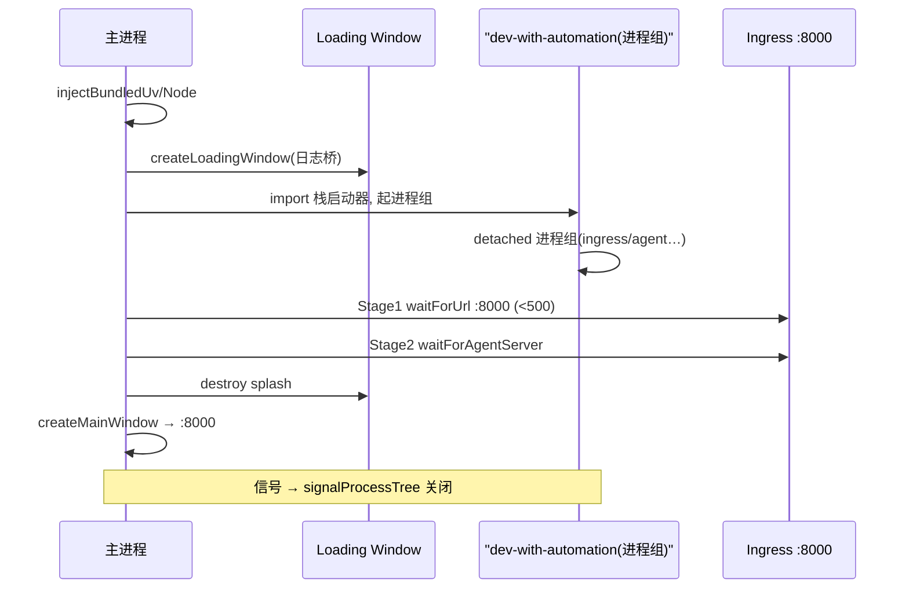
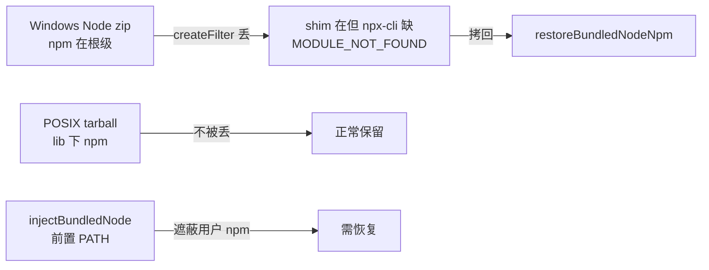

# Electron 桌面交付（Desktop Distribution）

> 关注面子文档：OpenHands Agent Canvas 的 Electron 桌面形态。核心是"免 Docker + 运行时自包含"的栈启动编排、Windows/Linux 打包差异化处理与进程生命周期。承接 README 主文档。

## 根因

桌面版要把**整个后端栈（agent-server + automation + ingress + static）当作"本地进程组"塞进一个 Electron 壳**，而不是容器。这带来两个根本困难：① Finder 启动的 .app 拿不到用户 shell 的 PATH（后端脚本找不到 node/uv）；② Electron-as-Node 对 stdio MCP 不可靠。解法是把真正运行时打包进 extraResources 并前置 PATH。

## 为什么免 Docker + 运行时自包含

1. **Finder 启动的 `.app` 拿不到用户 PATH**。macOS 从 Dock/Finder 启动的 GUI 进程 PATH 只有 `/usr/bin:/bin`，Homebrew/nvm/asdf 装的 node、uv 全不可见。`injectBundledNode()` 注释点明两条断链：后端脚本 `node scripts/ingress.mjs` 找不到 node 静默失败；stdio MCP（Slack/GitHub/Figma）用 `command: "npx"`，缺 npx 让 SDK 报 `error_kind: "connection"`，界面表现 "Could not reach the server" `[electron/main.mjs:142-151]()`。

2. **Electron-as-Node 被否决**。先试了 `ELECTRON_RUN_AS_NODE=1` 包装 npx 修 ENOENT，但引入新失败：stdio MCP 经包装 spawn 的进程在 JSON-RPC 握手前就 `McpError: Connection closed`——Electron 的 stdin/stdout 语义和原生 node 不同。最终方案是"带真正 Node 运行时作为 extraResource（`scripts/download-node.mjs`），把它的 bin 目录前置进 PATH" `[electron/main.mjs:153-162]()`。同理 uv/uvx 也打包进 `resources/bin/` 后注入 PATH `[electron/main.mjs:100-124]()`。

**免 Docker 的根因**：栈通过 `uvx` 按需拉 Python + `openhands-agent-server` from PyPI（`waitForAgentServer` 注释"首次启动 uvx 要下载 Python 工具链并安装 PyPI 依赖，慢网络上要几分钟" `[electron/main.mjs:253-258]()`）。桌面版刻意不依赖 Docker daemon，把"运行时"当作可下载的前置资源——Node 固定 22.x 匹配 Electron 42 内置 Node `[scripts/download-node.mjs:60]()`，uv 从 GitHub releases 下载对应当前平台/架构 `[scripts/download-uv.mjs:13-15]()`。

## 主进程启动序列 + 两阶段就绪

`app.whenReady()` 启动序列 `[electron/main.mjs:653-718]()`：

1. 设 `nativeTheme.themeSource = "dark"`、macOS 显式设 dock 图标 `[electron/main.mjs:654-663]()`
2. **注入** `injectBundledUv()` + `injectBundledNode()` 前置进 PATH；再 `uvxAvailable()` 探测，bundled 缺失时弹原生错误框并 `app.quit()` `[electron/main.mjs:665-677]()`
3. `createLoadingWindow()` 建无边框 loading 窗（`frame:false`，`contextIsolation:true`，仅挂 preload）`[electron/main.mjs:313-352]()`
4. `startStack()` 通过 `pathToFileURL` 把 `dev-with-automation.mjs` 作为 ESM 动态 `import()` 进来，用 `staticMode:true, skipNpmCheck:true, agentServerReadyTimeoutMs:10min` 调用 `main()` `[electron/main.mjs:613-649]()`
5. **两阶段就绪轮询**：Stage1 `waitForUrl("http://localhost:8000")` 只确认 ingress 绑定；Stage2 `waitForAgentServer("http://localhost:8000/server_info")` 要 200 或 401（agent-server 真实响应）`[electron/main.mjs:235-247,260-283]()`；注释明确这是**绕过 startStack 内部等待、从 8000 端口端到端重探**，防用户在两进程绑定间隙关掉 splash 的竞态 `[electron/main.mjs:689-695]()`
6. 两阶段 ready 后 `createMainWindow()`：销毁 splash、show+maximize 主窗、`loadURL("http://localhost:8000")`（走 ingress）`[electron/main.mjs:374-379,372]()`
7. **失败态**：catch 里拼 summary（提示释放 8000/18000/18001 端口）、写 bootLog、展开 loading 窗为 failure 态并显示可读日志，而非直接弹框退出——因为 Finder 启动时 stdout/stderr 进 `/dev/null`，没有这个 console 用户只会看到 "timed out" `[electron/main.mjs:697-717]()`

## 启动日志管道

主进程维护有界环形缓冲 `bootLog`（上限 2000 行）`[electron/main.mjs:439-476]()`，页面 `did-finish-load` 后回放整批再流式 push `[electron/main.mjs:336-348]()`；`sanitizeLogLine` 剥 ANSI CSI 转义并折叠 `\r` 进度回显为最终帧 `[electron/main.mjs:450-464]()`。IPC 只对 loading 窗口开启（`isLoadingWinEvent` 校验 sender）`[electron/main.mjs:510-518]()`。

## IPC 白名单桥（preload）

`contextBridge.exposeInMainWorld("desktopBoot", {...})` 只暴露 5 个方法：`onLogBatch`/`onFatal`/`setDetailsExpanded`/`copyLogs`/`quit` `[electron/preload.cjs:13-31]()`。**CJS on purpose**：sandboxed preload 不能用 ESM `[electron/preload.cjs:9]()`。renderer 端所有 DOM 写入用 `textContent`，日志行被视为不可信进程输出、绝不解析为 HTML `[electron/loading.html:274-279]()`，DOM 行数也封顶 2000 与主进程缓冲一致 `[electron/loading.html:288-290]()`。

## 打包策略：asar:false + node_modules 瘦身

### 为什么 asar:false

`dev-with-automation.mjs` 会把 `scripts/`、`build/` 当子进程启动，必须是磁盘真实文件，不能进 asar 单文件包 `[electron-builder.config.mjs:308-310]()`。

### node_modules 瘦身（最精妙的设计）

即便 `electron/package.json` 零依赖，electron-builder 的 "search for node modules" 从 app 根向上跑到项目根 `npm list`，会把整个 hoisted 树（~342 目录 / ~600MB）全拷进去，且**无法在 config 里关掉**（app-builder-lib 硬编码）。解法是 `afterPack` 钩子：`rm -rf` 掉 `Resources/app/node_modules/`，再按 `RUNTIME_PACKAGES = ["sirv","httpxy"]` 及其传递依赖广度优先倒回 ~200KB 闭包 `[electron-builder.config.mjs:8-34,64-186]()`。`restoreRuntimeNodeModules` 对缺失包直接 throw，宁可构建失败也不发崩溃的 DMG。

### extraResources 布局

`resources/bin/`→`<Resources>/bin/`（uv 双二进制）、`resources/node/`→`<Resources>/node/`（Node 发行版）`[electron-builder.config.mjs:347-359]()`。`directories.app:'electron'`，用 `electron/package.json`（`"main":"main.mjs"`）做清单，绕开根 package.json 的 `main` `[electron-builder.config.mjs:296-306]()`；版本号用 `extraMetadata` 从根注入 `[electron-builder.config.mjs:292-294]()`。

## Windows/Linux 打包的差异化处理

### Windows：附带 bundled Node 的 npm

app-builder-lib 的 `createFilter()` 对 **根级 `node_modules`** 无条件返回 false，early before 任何 filter 匹配 `[electron-builder.config.mjs:193-206]()`。Windows 的 Node zip 把 npm 放 `<root>/node_modules/npm`，恰好命中此规则被丢弃；POSIX tarball 放 `<root>/lib/node_modules/npm`（非根级）所以一直没暴露。症状：`<Resources>/node/` 有 `node.exe` + `npm.cmd` shim，但 shim exec 的 `node_modules\npm\bin\npx-cli.js` 不存在——所有 `npx -y <pkg>` spawn 死 `MODULE_NOT_FOUND`，且 `injectBundledNode` 前置 PATH 会遮蔽用户自己的 npm。`restoreBundledNodeNpm` 从 `resources/node/node_modules` 拷回、再做最终 `npm-cli.js` 存在性校验（缺失即 throw）`[electron-builder.config.mjs:219-252]()`。

### Linux .deb installer

`linux.target` 同时产出 AppImage + deb（x64）`[electron-builder.config.mjs:427-431]()`；deb 必须设置 `maintainer`，否则 fpm 报错 `[electron-builder.config.mjs:434-437]()`。universal DMG 有架构警示：uv/node extraResources 只按构建主机架构下载，universal 其余架构会带错运行时，故不建议分发 universal `[electron-builder.config.mjs:372-377]()`。

## 进程生命周期与优雅关闭

`scripts/dev-with-automation.mjs` 是优雅关闭枢纽：
- **信号监听**：`SIGINT`、`SIGTERM`、`SIGHUP` 三路都绑到 `shutdown` `[scripts/dev-with-automation.mjs:1095-1097]()`
- **进程树信号**：POSIX 服务 `detached:true` 自成进程组，`process.kill(-pid)` 杀整组（覆盖 `launcher→uvx→python agent-server`、`npm→sh→Vite` 链），3 秒后仍活再 SIGKILL，然后 shutdownHooks + exit `[scripts/dev-process-utils.mjs:85-129,24-34]()`、`[scripts/dev-with-automation.mjs:1070-1093]()`

**Electron 侧对 Windows 特殊处理**（`before-quit`）`[electron/main.mjs:720-768]()`：服务进程 `detached:true` 默认熬过父进程死亡。首次 `before-quit` `preventDefault()` 后 `process.kill(process.pid,"SIGTERM")` 触发 dev-with-automation 的 handler 杀子进程。**Windows 没有真 POSIX 信号**：`process.kill(pid,"SIGTERM")` 会终止自身却不跑 "SIGTERM" 监听，跳过清理、把 8000/18000/18001 上的子进程变孤儿，故用 `process.emit("SIGTERM")` **在进程内**跑同一 handler `[electron/main.mjs:753-757]()`，配 6 秒强制退出安全网 `[electron/main.mjs:763-767]()`。

## 全局关联与权衡

桌面交付的统一哲学是"**把运行时当作可移植的前置资源，而不是假设环境存在**"：Finder PATH 不存在的洞用打包运行时补，Electron-as-Node 的手握手洞用真 Node 补，Windows npm 遮蔽的洞用恢复钩子补，deb 缺 maintainer 的洞用构建期断言补——每处失败都以"宁缺不发崩溃包"为底线（restore 缺失即 throw）。这与控制面"读强写弱"、Skill"默认从严"的安全观一脉相承：都信任显式、拒绝静默失败。代价是打包复杂度高，且 runtime 架构与构建主机绑定（universal 受限）。
