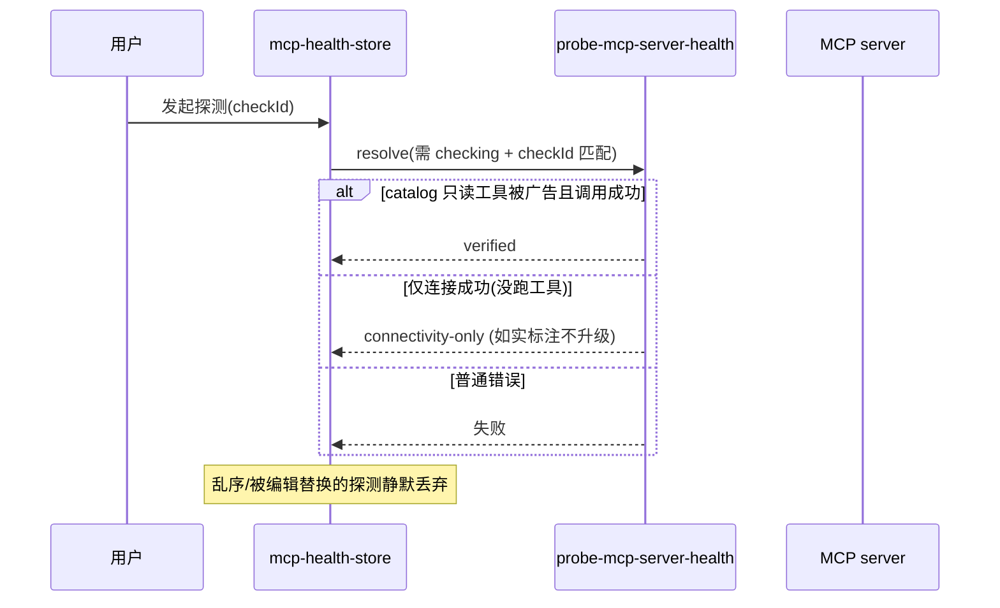
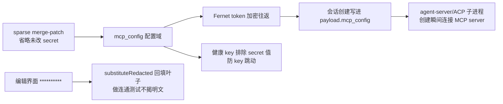

# MCP 外部能力接入（MCP Integration）

> 关注面子文档：OpenHands Agent Canvas 的 MCP 接入——server 管理、marketplace、凭据加密脱敏闭环、健康分级探测。承接 README 主文档。

## 根因

MCP（Model Context Protocol）让 agent 能调用外部工具服务。Agent Canvas 需要把"配置了哪些 MCP server、凭据放哪、通不通"这件事管起来，同时严守**安全底线**：凭据永不明文暴露、健康探测不把旧的或过期的结论当新鲜、连通测试要真实走凭据又不揭明文。

## server 形态与增删编辑

**三种 transport**：`sse | stdio | shttp` `[src/types/mcp-server.ts:11]()`。`MCPServerConfig` 含可选 `enabled`，**缺省即启用**、仅显式 `false` 才禁用，保证存量配置不受影响 `[src/types/mcp-server.ts:24-28]()`；禁用是"从 agent 眼里撤掉但仍保留在 mcp_config 与其 secrets" `[src/routes/mcp.tsx:78-81]()`。

编辑链路：
- 编辑器产出 → `buildMcpServerPatch` 生成 **sparse merge-patch**，脱敏占位符是显示层、绝不是 mutation 输入 `[src/utils/mcp-config.ts:314-318]()`
- 重命名用 `buildRenameMcpConfigPatch` 产出 `{oldKey: null, newKey: ...}` 原子替换 `[src/utils/mcp-config.ts:407-428]()`

## 健康探测设计：freshness/竞态防护

### 纯内存 store，刻意不持久化

`mcp-health-store` 是**纯内存**的 store：健康结论只在探测当下新鲜，页面重载即重置回 "unchecked"，而不是复活可能过期的 "healthy" `[src/api/mcp-health/mcp-health-store.ts:7-13]()`。

### checkId 防乱序

探测结果带 `checkId`，`resolveMcpHealthCheck` 只接受仍处于 `checking` 且 checkId 匹配的写入——慢的旧探测永不覆盖新结果，乱序/编辑中被替换的探测被静默丢弃 `[src/api/mcp-health/mcp-health-store.ts:43-59]()`。

### 两种真实状态：verified vs connectivity-only

`interpretMcpTestResponse` 区分**两种真实状态**——只有 catalog 声明的只读探测工具被广告**并且调用成功**才是 `verified`；连接成功但没跑工具只是 `connectivity-only`，如实标注、绝不静默升级 `[src/api/mcp-health/probe-mcp-server-health.ts:38-72]()`。

### 检测错误消息：auth 失败嗅探

后端对 hosted 服务只能归类 `connection`/`unknown`，但用户真正需要的是"凭据错误"指引。前端用保守的 auth 失败正则（401/403/unauthorized/forbidden/invalid token...）把 connection/unknown 嗅探成 `credentials` 类 `[src/api/mcp-health/probe-mcp-server-health.ts:16-23,51-58]()`。

## 凭据存储与三层脱敏（安全观）

- **凭据存于 `mcp_config` 的 auth/env/headers 叶子**；**加密设置会以 Fernet token 往返**（`fetchSettingsFromApi("encrypted")`），所以浏览器通常不持有明文——明文值只在服务端解密 `[src/api/mcp-service/mcp-redacted-credentials.ts:66-75]()`
- **三层脱敏**（`redactMcpSecrets`）`[src/utils/redact-mcp-secrets.ts:110-130]()`：
  1. 按 server 配置收集已知秘钥值，**最长值优先**替换（避免短秘钥先替换导致长秘钥被截断）`[src/utils/redact-mcp-secrets.ts:91-102]()`
  2. Bearer 前缀 + 通用 token 形状（GitHub PAT、Slack xox、Linear、JWT）兜底，捕获浏览器从未见过的明文 `[src/utils/redact-mcp-secrets.ts:18-31]()`
- **回填机制**：编辑界面只看得到 `**********` 占位。探测/测试前 `substituteRedactedMcpCredentials` 递归把占位替换成已存储的加密叶子，让连通测试真实走一遍凭据、但不暴露明文；持久化永远走 sparse patch、省略未改的 secret `[src/utils/mcp-config.ts:314-318]()`

**健康 key 排除 secret 值**：`getMcpServerHealthKey` 只用结构性字段 + env/header 的**键名** + auth 策略，因为同一凭据在安装时是明文、红态设置里是 `**********`、测试请求里是密文——任一种都会让 key 跳动 `[src/utils/mcp-server-health-key.ts:9-17]()`。结构变更产生新 key、让旧健康记录孤儿化而非误归属 `[src/utils/mcp-server-health-key.ts:18-41]()`。

## Marketplace 形态

- **形态是构建期 npm 包内嵌目录**：`INTEGRATION_CATALOG`（来自 `@openhands/extensions/integrations`），前端 `getMcpMarketplaceCatalog` 过滤出"可本地 MCP 安装"的条目 `[src/utils/mcp-marketplace-utils.ts:110-114]()`
- 条目类型 `IntegrationCatalogEntry` 带 `connectionOptions`（provider + transport）。只有 `provider === "mcp"` 且有 transport 的才算本流程可装 `[src/utils/mcp-marketplace-utils.ts:30-37]()`
- **OAuth 安装边界**：只有由 MCP server 自身 initiate 的 OAuth（fastmcp、无 authorizationUrl/tokenUrl）才可本地安装；指定 provider OAuth 端点的条目走 hosted integration-auth 流程、不应暴露为本地静态 MCP `[src/utils/mcp-marketplace-utils.ts:45-64]()`

**凭据校验**（credential validation）：GitHub/Linear/Slack 这类 hosted 服务的凭据只在 tool 调用时才验证，列表工具任何凭据都能成功。每种类型配一个只读 `toolCall` + `interpret` `[src/utils/mcp-credential-validation.ts:22-26]()`。`getMcpServerConfigForValidation` 通过 `findCatalogEntryForServer` 把 server 匹配回 marketplace 条目 `[src/utils/mcp-credential-validation.ts:91-99]()`。**NoData 技巧**：GitHub `get_me`、Linear `list_teams`、Slack `slack_list_channels`（limit 1），Slack 只把 5 种明确 auth 错误码当作凭据坏，`missing_scope` 证明 token 已认证 → 不能归为凭据无效 `[src/utils/mcp-credential-validation.ts:33-39,52-84]()`。

## MCP 配置如何进 agent 上下文

- **MCP 配置存于 `settings.mcp_config`，由 `agent_settings.mcp_config` 承载** `[src/types/settings.ts:141]()`
- 会话创建时，mcp_config 被**原样写进 agent-server 请求的 `payload.mcp_config`**，让 agent-server（或 ACP 子进程）在会话创建瞬间连接已配置的 MCP server `[src/api/agent-server-adapter.ts:881-888]()`；空/畸形值被丢弃而非发送 `mcp_config: {}` `[src/api/agent-server-adapter.ts:885-887]()`
- **ACP 也吃这套配置**：这就是为什么 `/mcp` 路由没有像 `/settings` 那样加 ACP guard——mcp_config 被转发给 ACP 子进程 `[src/routes/mcp.tsx:33-37]()`；且 ACP 是唯一强制开启 `secrets_encrypted` 的例外 `[src/api/agent-server-adapter.ts:1183-1195]()`
- **与内部工具的关系**：`client_tools`（Canvas UI / launch child conversation）是**顶层 client tool**，走 profile-launch 路径也生效 `[src/api/agent-server-adapter.ts:1128-1134]()`；MCP 是独立的 agent-visible 配置域，与 client tools 分离

## 全局关联与权衡

MCP 的统一哲学是"**配置域的边界即安全边界**"：凭据、健康、marketplace、上下注入在四条各自封闭、但共享"不揭明文/不信任过时结论/结构变更即隔离"三条纪律的链路里闭环。它属于纯编排（真正连接 MCP server 的是 agent-server/ACP 子进程），前端只做配置治理与状态呈现——与 Skill 体系"前端做策略、后端做注入"的分工一致。代价是对 hosted 服务的凭据只能嗅探不能确证，且依赖 catalog 与 marketplace 结构高度耦合。
