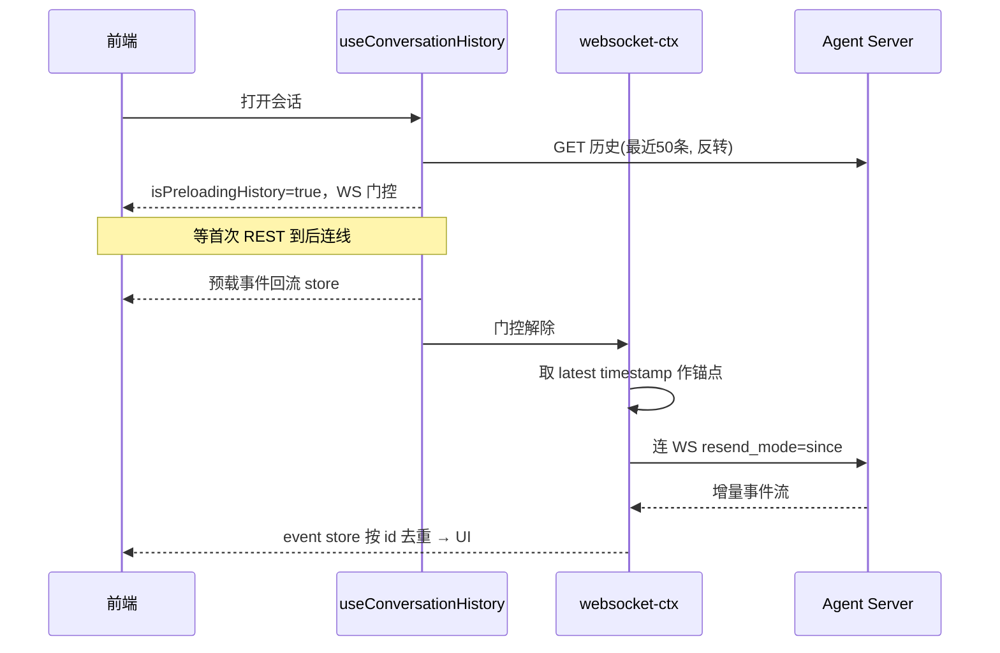
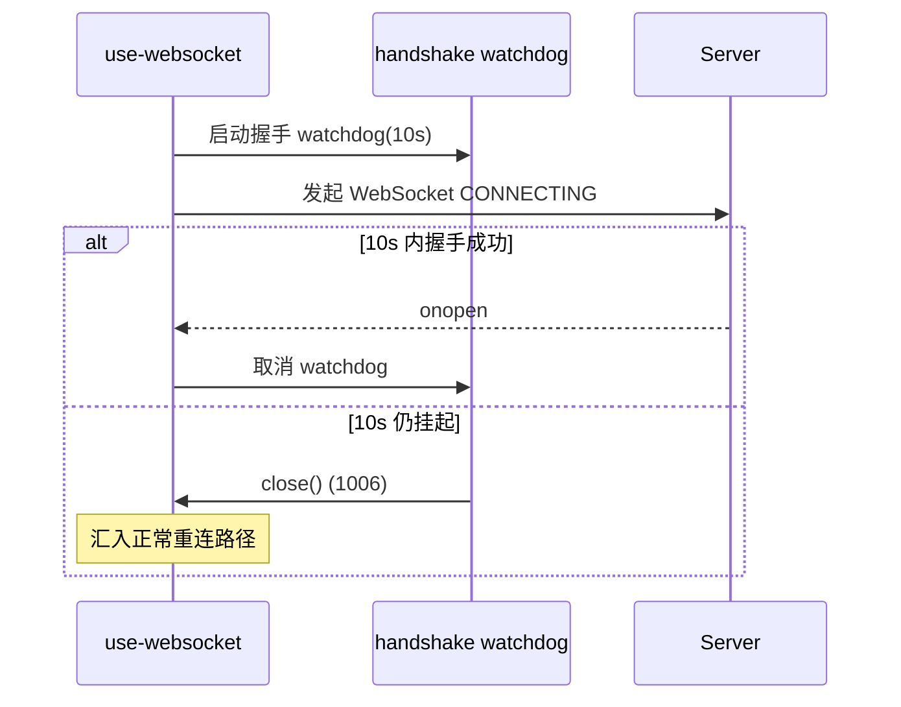
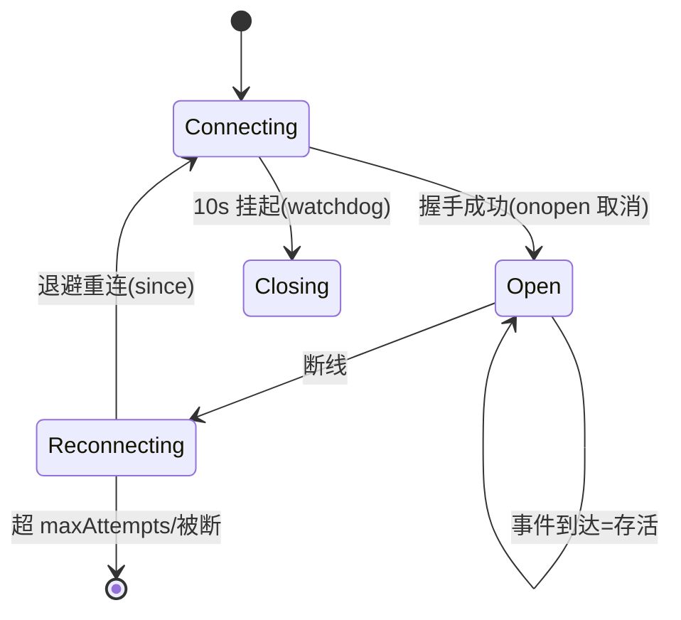
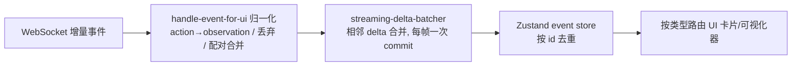

# 实时会话流（Realtime Session）

> 关注面子文档：OpenHands Agent Canvas 如何用"REST 历史 + WebSocket 增量"组合续接实时会话，以及本版本新增的握手 watchdog 与并联 keepalive 加固。承接 README 主文档；核心链路以 Mermaid 承载。

## 根因

实时会话流的核心矛盾是**既要历史完整可回溯，又要当前增量低延迟，还不能重放、重复或丢事件**。Agent Canvas 的解法是：**WS 不是历史源**——先 REST 拉历史落库，再用 WebSocket 从断点增量续接。

## 全生命周期：REST 历史 + WS 增量组合

关键点：
- 首次 REST 预载最近 50 条并反转成时间正序 `[src/hooks/query/use-conversation-history.ts:10,53-65]()`
- **WS 门控**：`isPreloadingHistory` 为 true 时 `wsUrl` 返回 null，等首次 REST 到后才连线 `[src/contexts/conversation-websocket-context.tsx:392-400]()`
- **续接锚点**：从 REST 最新事件 timestamp 取 `initialAfterTimestamp` `[src/contexts/conversation-websocket-context.tsx:368-373]()`
- **增量 vs 全量**：有锚点 → `{resend_mode:'since', after_timestamp}`；无锚点（新会话）→ `{resend_mode:'all'}` `[src/contexts/conversation-websocket-context.tsx:971-973]()`
- **断线重连后用 since 从上次锚点续，重复事件按 id 去重**（replay 事件跳过，因副作用非幂等）`[src/contexts/conversation-websocket-context.tsx:556-568]()`

**反向续接（更旧）**：列表页分页按键集游标 `next_page_id`；会话内更旧历史由滚动触发单独 query，30s 轮询保持列表新鲜 `[src/hooks/query/use-paginated-conversations.ts:35-45,68-71]()`。

## 握手 watchdog：兜底挂起握手（本版加固）

浏览器不会自行超时 `CONNECTING`，且 Chrome 按 host 串行握手——**一个挂起握手会阻塞同源所有后续 socket**。`startHandshakeWatchdog` 在 10s 内仍 `CONNECTING` 就主动 `close()`（触发自身 1006 close，汇入正常重连路径）`[src/utils/websocket-handshake.ts:5,17-26]()`；每次 connect 启动、`onopen` 时取消 `[src/hooks/use-websocket.ts:61-67]()`。

## 跨 refetch 保活：拒绝被替换 socket 的迟到事件

本版本的核心 keepalive 洞见："**keepalive 不是周期 ping/pong，而是事件存活证明 + 防连接受害**"。三项配合：

1. **握手 watchdog**（见上）：兜底挂起握手。
2. **拒绝被替换 socket 的迟到事件**：`WeakSet` 记录"允许重连"的实例，过一个 socket 替换，晚到的旧 close/error 不会覆盖新 socket 的 OPEN 态 `[src/utils/use-websocket.ts:105-108,142-151]()`。
3. **事件到达 = 存活证明**：delta 到达即清 `connection` 类错误（连通恢复）；普通事件同样清 connection 类错误、但保留 sticky 的 `conversation` 类错误（如错 key）`[src/contexts/conversation-websocket-context.tsx:166-179,210-214]()`。

特别地，background refetch 决不拆掉活 socket：门控只看 `isPending` 不看 `isFetching`，注释明确这是对 "refetch→teardown→reconnect→refetch" 风暴的修复 `[src/contexts/conversation-websocket-context.tsx:380-391]()`。

## 断线重连策略

指数退避 `1s·2^n` 封顶 `30s`，**每跳加至多 30% 随机抖动**，让主/规划两条并联 socket 不步调一致地齐刷服务端 `[src/hooks/use-websocket.ts:19-20,128-132]()`。重连受三重约束：选项开启、实例仍在 `allowedToReconnectRef`（`WeakSet`，disconnect/unmount 先删除）、未超 `maxAttempts`；拆线先置 `shouldReconnectRef=false` 再 `close()`，让 onclose 看到标志 `[src/hooks/use-websocket.ts:116-121,164-187]()`。

## 事件 → UI 渲染管线

流式增量归一化跨层完成：`action→observation` 替换、FinishObservation/ThinkObservation 丢弃、ACP tool 的 started/terminal 配对合并成一卡 `[src/utils/handle-event-for-ui.ts:348-448]()`；相邻 delta 合并、**每帧最多一次 store commit**，主与规划各持独立 batcher 防串流 `[src/utils/streaming-delta-batcher.ts:36-75]()`、context `[src/contexts/conversation-websocket-context.tsx:549-554]()`。

## 全局关联与权衡

实时链路的统一哲学是"**REST 负责权威、WS 负责新鲜、去重负责幂等**"：REST 保证历史完整，WS 的 `since` 增量保证低延迟且不重放，event store 按 id 去重兜底重连和 refetch 的重复。本版本加固把重心从"如何流畅渲染"转向"如何在高并发并联 socket 与后台 refetch 下不被打断"——握手 watchdog 防挂起阻塞、WeakSet 防旧 socket 覆盖新态、事件作为存活证明。这与控制面的"隔离不确定性"哲学同源：前端只信事件与锚点，把断连、乱序、重复的复杂性交给底层三层兜底。
