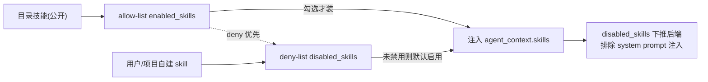
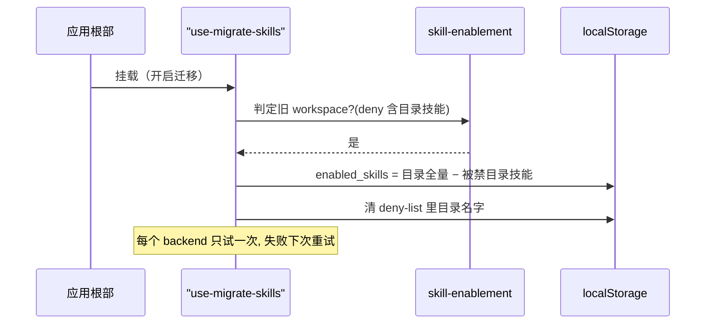

# Skill 技能体系（Skills System）

> 关注面子文档：OpenHands Agent Canvas 的 Skill 装载机制。核心是 v1.15 引入的**显式 allow-list** 取代全开目录、deny-list 只管自建技能、`disabled_skills` 下推后端的双列表裁决。承接 README 主文档。

## 根因

coding agent 的技能（skill）是"装进 agent 大脑的指令包"。难点在于**默认策略**：目录公开技能该让 agent 默认全部装载吗？v1.15 之前是全开目录（deny-list 拦截禁用项），但这带来一个隐患——目录里*未来新增的每个 skill* 都会因 deny-list 拦不到而自动进入所有人的系统提示词，等于隐式推送新技能。v1.15 改成**显式 allow-list**：只有用户勾选的目录技能才装载，新加入目录的技能默认关闭。

## 双列表裁决：allow-list 装公开、deny-list 管自建

这套设计的灵魂是**两个持久化列表的职责划分** `[src/utils/skill-enablement.ts:22-33]()`：

- `enabled_skills`（allow-list）— 只管辖 **bundled catalog** 的公开技能
- `disabled_skills`（deny-list）— 只管 **用户/项目自建 skill**（这些 skill 出现即应默认开启，所以用禁用清单表达"我关了它"）

**裁决规则**：deny-list 优先于 allow-list；目录技能必须同时在 allow-list 里才算启用，非目录技能只要不进 deny-list 就默认启用 `[src/utils/skill-enablement.ts:49-59]()`。

### 一个关键边界：本地后端专属

**allow-list 只对本地后端生效**。云后端（cloud）不读 `enabled_skills`，它从服务端自己的目录创建会话、仍由 deny-list 管控 `[src/hooks/use-skill-enablement.ts:18-33]()`；判定信号是 `usesCatalogAllowList = backend.kind !== "cloud"` `[src/hooks/use-skill-enablement.ts:39]()`。

## 启用/禁用状态：单一共享源 + 去重

`useSkillEnablement` 是唯一读写两组列表的共享 hook，避免不同 UI 表面（卡片/详情/自动化）写出的偏好互相看不到 `[src/hooks/use-skill-enablement.ts:76-160]()`。它带"成员变化去重"：`withMembership` 只替换实际改变的数组引用，`snapshot` 序列化后比对，未变化就跳过 save 调用 `[src/hooks/use-skill-enablement.ts:59-74]()`。

## 注入 agent 上下文的机制

`buildAgentContext` 完成装载：

- **目录 skill** 经 `buildBundledSkills()` 转成 agent_context 的 `skills` 条目，填充 `is_agentskills_format: true` `[src/api/agent-server-adapter.ts:742-748]()`，并按 `isSkillEnabled(skill.name)` 过滤装载
- **用户/项目自建 skill** 是 opt-out（只按 `disabledSkillNames` 排除），因为它们是用户写的、始终开启 `[src/api/agent-server-adapter.ts:779-788]()`
- **会话开场消息按目录技能名调用会跳过配置**：`skill.name === invokedCatalogSkill` 直接装载，仅本次会话生效 `[src/api/agent-server-adapter.ts:784-787]()`；配合 `findInvokedCatalogSkill`——因为目录 24 个斜杠命令里 18 个属于默认关闭的 skill，若不禁用"自动带入"，自动化卡片发的命令就是"没有它后端指令" `[src/utils/skill-enablement.ts:112-124]()`

## disabled_skills 下推后端

前端通过 `load_public_skills: false` + `load_user_skills: true` + `load_project_skills: true` 把后端定位为"只自动装载 user/project skill"；为了让后端的 system prompt 也不注入这些被禁技能，必须在 payload 里把 deny-list 一起发给后端——新增的 `disabled_skills: disabledSkills` 就是这个下推 `[src/api/agent-server-adapter.ts:802-809]()`。

## 分类、作用域与安装流程

### 分类与作用域

9 个 facet 类别，`other` 兜底表示"未分类"；过期 bundled catalog 可能带本构建不认识的类别，`getSkillCategory` 一律降级为 `other` 而不渲染不可用的 facet 值 `[src/utils/skill-category.ts:21-31,60-68]()`。

作用域 `project | personal | public` 三级 `[src/utils/skill-scope.ts:3-9]()`。判定基于 SDK 报告给前端的 `skill.source` 路径特征：`.agents/skills/`、`.openhands/skills/`、`.openhands/microagents/` 三个目录标记是识别 legacy 技能的关键——`.openhands/microagents/` 是改名前目录，SDK 仍兼容加载并把其作为 source 回报，保留 marker 才能避免把 legacy 技能误判为 public `[src/utils/skill-scope.ts:11-19]()`。

### 获取/安装

- **公开技能不走网络**：直接从 npm 包 `SKILLS_CATALOG` 构建期快照 `[src/api/skills-service.ts:42-45]()`；本地(user/project)技能才问 agent-server，`load_public: false` 避免重复 `[src/api/skills-service.ts:46-57]()`
- **安装流程是 agent 在会话中用自带 add-skill skill 完成**：fetch_skill.py 成功会打印 `✅ Successfully installed '<name>' to <workspace>/.agents/skills/<name>`，前端 `detectSkillInstalls` 从 bash observation 事件里正则抓这个 marker 识别安装事件 `[src/utils/skill-install-events.ts:13-20]()`；且 SDK 只在会话开始装载一次 skill，会话中装的技能要等下一会话才生效 `[src/utils/skill-install-events.ts:22-27]()`

## 迁移机制：从全开目录搬到显式 allow-list

`useMigrateEnabledSkills` 一次性把 workspace 从"全开 deny-list 模式"搬进"显式 allow-list"：

- 在**应用根部**运行（root-layout 挂载），而非 Customize 页——因为迁移前 resolver 会回落到 curated 默认集，会静默丢掉旧 workspace 开过的目录技能 `[src/hooks/use-migrate-enabled-skills.ts:11-17]()`
- **判定旧 workspace 的锚点**：deny-list 里出现目录技能——只有旧 workspace 才会把目录技能关进 deny-list `[src/utils/skill-enablement.ts:74-78]()`
- **迁移产物**：旧 workspace → `enabled_skills = 目录全量 − 被禁目录技能`；全新 workspace → `DEFAULT_ENABLED_SKILL_NAMES` 推荐集；同时把 deny-list 里的目录名字清掉（否则残留 deny 条目会在用户重新打开技能时 veto 掉它）`[src/utils/skill-enablement.ts:80-87]()`
- 每个 backend 只试一次（ref 防 save 后 refetch 重入），失败静默、下次加载重试 `[src/hooks/use-migrate-enabled-skills.ts:25-42]()`

## 全局关联与权衡

Skill 体系的统一哲学是"**默认从严 + 存量感知**"：公开目录用 allow-list（新增默认关，防隐式推送），自建内容用 deny-list（出现即开，用户写了就该用）。这套双列表裁决也贯穿到迁移（新旧模式平滑）、注入（disabled_skills 下推后端）与边界（cloud 不适用 allow-list）三处。它不属于"执行"而是"编排"——真正把 skill 注入系统提示词的是后端 SDK，前端只负责裁决哪些技能被装载/排除。这种"前端做策略、后端做注入"的分工，正是壳类产品与 agent 运行时解耦的又一实例。
