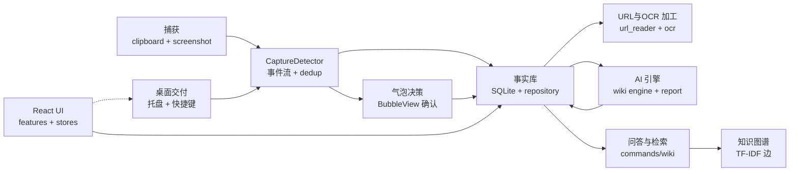
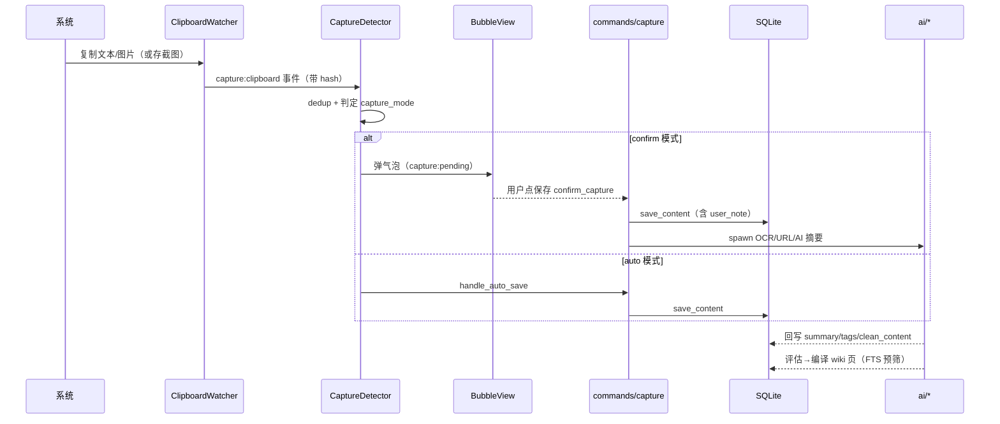

# openwiki-km：把剪贴板变成自维护个人知识库的 Tauri 桌面应用

> **本解读按 ai-agent 类规格产出（主类型 ai-agent ⊗ 副类型 framework/Tauri，且为可部署桌面产品）。** 项目本体为 kdsz001 / OpenWiki（v0.3.23，Tauri 2 + React，MIT）。注意区分：本仓库另有 `ai-agent/openwiki/`（langchain-ai 的 CLI 文档代理），二者同名不同物，本解读针对 kdsz001 的桌面端。

## 根因

个人知识管理（PKM）最难的不是"收藏"，而是"**收藏后不回看**"。剪贴板复制、截图、收藏链接是一瞬间的冲动，可它们大多成为无人问津的数字坟场。OpenWiki 解决的根本问题是：**让收藏成为一条持续运转的自动闭环——你只做"决定保留"，系统负责把草稿级内容沉淀成可检索、可回顾、可被 AI 持续梳理的活知识库，并周期性反哺给你"你最近在关注什么"的洞察**。

它把三类工具的能力折叠进一个常驻桌面应用：
- **采集端**（剪贴板管理器 / 截图工具）：自动捕获文本 / 图片 / URL，识别来源应用。
- **知识端**（Wiki / 笔记 / 收藏夹）：捕获内容被 AI 编译成带链路的知识图谱页面。
- **洞察端**（周报 / 注意力分析）：周期性地告诉你信息消费习惯，并把"觉得有用 / 划走"的反馈反哺回未来的周报。

这三层的连接点是一个**本地优先的 SQLite 事实库**——所有数据在自己电脑上，AI 只做瞬时加工不持有数据（详见 [data-model.md](data-model.md)）。

## 概览

OpenWiki-km 是面向 macOS / Windows 的常驻型桌面应用。它监控剪贴板与系统截图目录，捕获内容后弹出一个"气泡"窗口，由你主动决定保留与否；保留的内容进入本地 SQLite 库，后台自动做 OCR、URL 抓取、AI 摘要，并把能组成知识的内容编译成 Wiki 页面（概念 / 实体 / 主题），页面间由标签 TF-IDF 建立知识图谱边。知识库支持问答侧栏与健康检查；每周生成一份"注意力分析"周报，通过点赞 / 划走学习你的兴趣偏好。

### 核心能力清单

| 能力 | 定位 | 支持形态 |
|---|---|---|
| 剪贴板捕获 | 500ms 轮询 arboard，先图后文，内容哈希去重 | 轮询 + 事件发布（`capture:clipboard`） |
| 截图捕获 | `notify` 监听系统截图目录，文件名识别，200ms 防抖 | 文件监听 + `capture:screenshot` |
| 来源应用检测 | macOS `osascript` / Windows 前台窗口，归类 `source_app` | 平台双实现 |
| 保留 / 丢弃决策 | 气泡窗口"你决定"，倒计时默认动作，或 Cmd/Ctrl+Shift+C 快存 | `confirm_capture` / `dismiss_capture` |
| URL 全文抽取 | WeChat / X / YouTube / GitHub / Reddit / 小红书专 reader + 通用 Jina Reader + headless 兜底 | `url_reader.rs` 平台分派 |
| OCR | macOS Vision（预编译 Swift helper）/ Windows Runtime，多语言 + 长图分片 | `ocr.rs` + `resources/openwiki_ocr.swift` |
| 敏感信息过滤 | 正则集（API Key / 私钥 / JWT 等），命中跳过入库（opt-in） | `sensitive_filter.rs` |
| AI 知识库 | 评估 → 两阶段编译（FTS 预筛 + create/update 决策 + 执行），TF-IDF 建图 | `ai/wiki_engine.rs` |
| 知识问答侧栏 | 查询改写 → FTS 预筛 → AI 语义挑页 → 注入全文作答 + 引用推断 | `commands/wiki.rs` |
| 注意力分析 | 15 天窗口生成 7 大板块习 Read 报告，状态机管理 | `ai/attention_analyzer.rs` |
| 周报 + 偏好学习 | 周报预筛自动流水线，like/dismiss 调 `user_preferences` 权重 | `report_generator.rs` + `preference_engine.rs` |
| 多 AI 提供商 | Anthropic / OpenAI / Gemini / OpenRouter / DashScope / MiniMax / DeepSeek / Custom / Ollama / LM Studio，API Key + OAuth 双通道 | `AnalysisProvider` 分发 |
| 桌面交付 | 双窗口 + 托盘 + 全局快捷键 + 开机自启 + 自动更新 | Tauri 2 + 插件 |
| MCP 对接 | 向 Claude Desktop / OpenClaw 注入 `mcp-server-sqlite-npx`，开放 SQLite 查询 | `commands/mcp.rs` |
| 敏感配置加密 | AES-256-GCM，主密钥以 `0600` 落盘到应用数据目录 | `secure_store.rs` |

### 技术栈一览

| 层 | 选型 |
|---|---|
| 语言 / 运行时 | Rust（edition 2021）+ React 19 / TypeScript（Vite 6） |
| 桌面壳 | Tauri 2（macOS / Windows），`macos-private-api` + 托盘 |
| 存储 | `rusqlite`（bundled）SQLite，WAL，FTS5（含 CJK 自定义分词） |
| 剪贴板 / 截图 | `arboard`（轮询） + `notify`（目录监听） |
| URL / 文档抽取 | `reqwest` plus Jina Reader（`r.jina.ai`）+ Python `markitdown`；OCR 用 macOS Vision Swift helper |
| AI 调用 | `reqwest` 直连各提供商 REST / SSE（Anthropic / OpenAI 兼容 / Gemini / Ollama） |
| 前端 | React + zustand + framer-motion + d3-force（图谱）+ react-markdown + i18next |
| 加密 | `aes-gcm`/`rand`（API Key 落盘加密） |
| 自动更新 / 自启动 | `tauri-plugin-updater` / `tauri-plugin-autostart` |

## 架构

三条主执行路径——采集捕获、AI 编译知识、洞察回顾——汇聚在一个 Rust 进程内，共享单一 SQLite 事实库与统一的 Tauri command 层：

**目录职责映射：**

| 目录 | 职责 | 关注面 |
|---|---|---|
| `src-tauri/src/capture/` | 捕获链路：剪贴板轮询、截图监听、URL 抽取、OCR、敏感过滤、图片生命周期 | [capture-pipeline](capture-pipeline.md) |
| `src-tauri/src/storage/` | SQLite 事实库：17 个迁移、`repository.rs`、WAL + FTS5(CJK) | [data-model](data-model.md) |
| `src-tauri/src/ai/` | AI 引擎：wiki 编译、注意力分析、周报、偏好学习、多提供商抽象 | [ai-engines](ai-engines.md) |
| `src-tauri/src/`（lib/commands/secure_store/automation/scheduler） | 桌面壳：command 层、双窗口、托盘、快捷键、安全存储、MCP | [desktop-mcp](desktop-mcp.md) |
| `src/` | React 前端：features（wiki / content / digest / spotlight / settings）+ zustand stores + services | — |

## 启动与捕获闭环链路

应用启动 `lib.rs` 编排：初始化 DB（跑迁移）→ 注册全局快捷键 → 启动捕获检测器 → 后台更新 / OCR helper / 周报调度（详见 [desktop-mcp.md](desktop-mcp.md)）。核心的采集→保留→加工→沉淀链路用图承载：

## 核心模块导读

| 模块 | 一句话定位 | 深读 |
|---|---|---|
| **SQLite 事实库** | WAL + FTS5(CJK 分词) 的本地优先存储，`repository.rs` 单一 struct 承载所有读写 | [data-model](data-model.md) |
| **采集链路** | 剪贴板 500ms 轮询 → 气泡"你决定" → URL 平台分派 + OCR + 敏感过滤 | [capture-pipeline](capture-pipeline.md) |
| **AI 引擎** | `AnalysisProvider` 统一多提供商；wiki 两阶段编译；注意力 7 板块报告；like/dismiss 偏好学习 | [ai-engines](ai-engines.md) |
| **桌面交付 / MCP / 安全** | 双窗 + 托盘 + 快捷键 + AES-GCM 安全存储 + 向 Claude 注入 MCP server | [desktop-mcp](desktop-mcp.md) |

## 设计哲学：让用户只做"决定"，我负责"沉淀"

贯穿全项目的一条主线是**把用户的心智成本压到最低**：复制时你不必想着"归类保存"，气泡只问一句"要不要留"；留下之后，去重、OCR、URL 抽取、AI 摘要、wiki 编译、图谱建边、周报回顾全部自动发生。AI 的能力被谨慎地用在"加工"上，而"怎么存、存哪里"由确定性很强的 SQLite schema 决定（[data-model.md](data-model.md) 迁移即决策文档）；隐私上敏感开关 opt-in、URL 外发默认可关（[capture-pipeline.md](capture-pipeline.md) 隐私节）。它不追求"让 AI 写得更多"，而是追求"让 AI 把素材加工成你能长期回顾的知识"。

## 子文档索引

- [`data-model.md`](data-model.md) — 本地优先 SQLite 事实库：WAL、运行时幂等迁移、FTS5 的 CJK 分词修复、内容↔wiki 的关联取舍
- [`capture-pipeline.md`](capture-pipeline.md) — 采集链路：剪贴板轮询 → 气泡决策 → URL 平台分派 → OCR → 敏感过滤，及隐私开关设计
- [`ai-engines.md`](ai-engines.md) — AI 引擎：多提供商 `AnalysisProvider` 抽象、wiki 两阶段编译、注意力分析 7 板块、偏好学习
- [`desktop-mcp.md`](desktop-mcp.md) — 桌面交付与安全：双窗口/托盘/快捷键/自启/更新、AES-GCM 密钥存储、MCP 注入

## 同类定位对比

| 项目 | 形态 | 核心差异 |
|---|---|---|
| **OpenWiki-km** | 桌面 PKM 应用 | 采集 + AI 知识库 + 注意力周报闭环一体，本地优先 SQLite，like/dismiss 反哺 |
| Paste / CleanClip / Maccy | 剪贴板管理器 | 只做"复制历史 + 搜索"，不做 AI 沉淀与知识图谱、无条件回顾 |
| Obsidian + 插件 | 笔记 + 二跳联动 | 手动维护为主，AI 依赖第三方插件，无"捕获→自动编译"的自动闭环 |
| Memos / Outline | Web 笔记 / wiki | 侧重手动录入与团队协作，无明显剪贴板自动捕获与注意力分析 |

## 可借鉴的设计

1. **"只问一句要不要"的最小决策面**（[capture-pipeline.md](capture-pipeline.md)）：切换捕获与"决定保留"的界面成本，把"收藏"从有意识动作降为肌肉记忆；倒计时默认动作 + Cmd+Shift+C 快存覆盖两种使用人格。
2. **FTS5 用自定义 `cjk_seg()` 分词**（[data-model.md](data-model.md)）：`unicode61` 把中文连续序列当单 token 导致召回为零，用注册的 SQLite 标量函数在写入与查询两侧同时切词，幂等、迁移可重建——是"产品要中文但检索栈默认英文优化"的通用解法。
3. **`AnalysisProvider` 统一多提供商抽象**（[ai-engines.md](ai-engines.md)）：把同一份 AI 任务（周报 / 注意力 / wiki）在 Anthropic / OpenAI 兼容 / Ollama / Gemini 之间一键切换，本地 provider 用信号量串行化——是"用户自带 Key 且要本地模型"场景可复制的分层。
4. **局部唯一索引当分布式抢锁原语**（[data-model.md](data-model.md)）：`wiki_compile_log` 用 `WHERE status='compiling'` 的部分唯一索引，靠 INSERT 撞约束实现"同一内容同时只有一个编译任务"——无事务、无 Lua 脚本的轻量互斥。
5. **认知反哺闭环**（[ai-engines.md](ai-engines.md)）：like / dismiss 累加 `user_preferences` 权重，再注入下周周报 prompt——让洞察系统随用户反馈自我校正，而非一次性生成。

## 不足与风险

- **剪贴板 500ms 轮询 + 单线程读**：相比系统级监听更耗电且有竞态窗口；图片 / 文本序列在极短间隔内交换时可能漏检或误判（[capture-pipeline.md](capture-pipeline.md)）。
- **WAL 开启但未设 `busy_timeout`**：高并发写时可能直接 `SQLITE_BUSY`；`repository.rs` 全库无显式事务（隐式自动提交），FTS 与主表一致靠 DB 触发器兜底（[data-model.md](data-model.md)）。
- **DB 层 / Rust 模型层偶有漂移**：如 `locale` 列已建（迁移 013）但 `CapturedContent` 结构体未映射该字段，存在隐性盲区（[data-model.md](data-model.md)）。
- **MCP 是"注入现成 server"而非自研协议**：依赖 `npx mcp-server-sqlite-npx` 与 Node 环境，能力边界受限于该 server（只读 SQLite），扩展性有限、Node 缺失则不可用（[desktop-mcp.md](desktop-mcp.md)）。
- **URL 抽取强依赖第三方**：Jina Reader 与 Google Translate 默认开启、外发完整 URL 与正文，依赖 README 与设置透明披露来换取兼容性（[capture-pipeline.md](capture-pipeline.md)）。

## 总结

OpenWiki-km 用"常驻采集 + 本地优先数据库 + AI 沉淀 + 周期回顾"把个人知识管理从"囤积"变成了"复利"。它的产品设计（只让你决定保留）与工程实现（WAL/FTS/多提供商/偏好学习）是同一条主线的两面：**用户只做价值判断，系统负责让这份判断长期产生价值**。它处理 C 端 PKM 而不是企业级协作，因此在本地优先、隐私开关、跨提供商弹性上做得比自托管 wiki 更贴近个人场景——这是它区别于记事本与团队知识库的位置。
