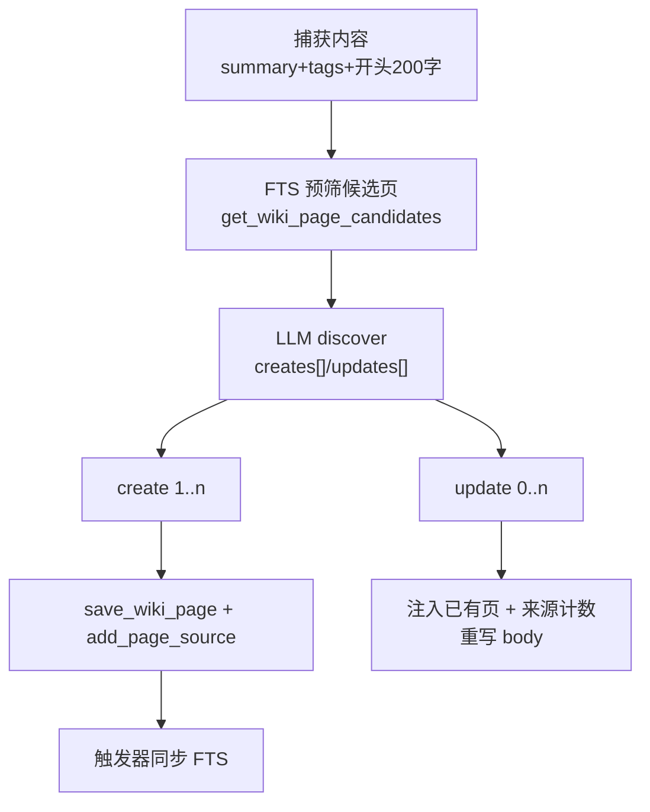
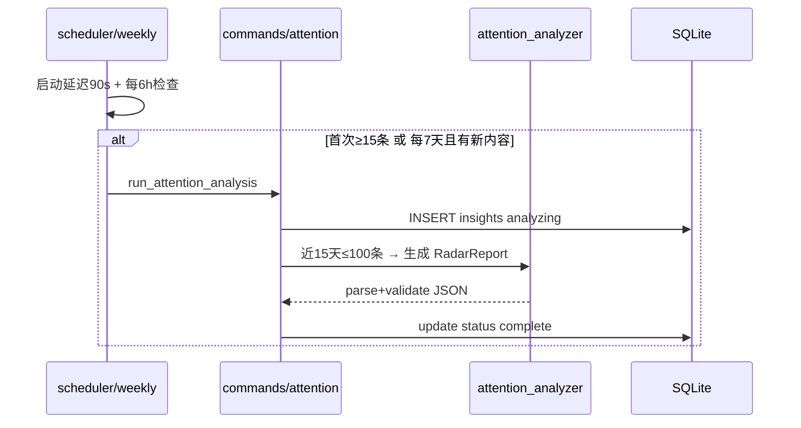

# OpenWiki-km AI 引擎：把素材加工成可回顾的知识

> 关注面子文档，配合 [README](README.md) 阅读。结论速览：AI 层用 `AnalysisProvider` 把同一份任务在多提供商间一键切换；wiki 用「FTS 预筛 + AI 两阶段编译」把多条收藏沉淀成一页；注意力分析用 15 天窗口生成 7 大板块报告；like/dismiss 通过 `user_preferences` 权重反向校准未来周报。它是"AI 只做加工、确定性归系统"的体现。

## 多提供商抽象：`AnalysisProvider` 统一分发

所有 AI 任务（注意力、周报、wiki、问答）最终都收敛到一个枚举 `AnalysisProvider` + 分发的 `call_analysis_api`（[src-tauri/src/ai/attention_analyzer.rs:574-619]()）。它把 9 种提供商折叠成三类调用通道：

<!-- anchor: pub enum AnalysisProvider { … _ => AnalysisProvider::Anthropic, -->

- **Anthropic**：`api.anthropic.com/v1/messages`，`x-api-key` + `anthropic-version`（[src-tauri/src/ai/attention_analyzer.rs:819-858]()）。
- **OpenAI 兼容组**（OpenAI / OpenRouter / DashScope / MiniMax / DeepSeek / Custom / LM-Studio）：统一 `/v1/chat/completions` + `Bearer`（[src-tauri/src/ai/attention_analyzer.rs:859-984]()）。
- **Ollama**：原生 `/api/chat`，`think:false` 禁 Qwen 推理、`format:"json"` 语法约束（[src-tauri/src/ai/attention_analyzer.rs:726-818]()）。

Gemini 与 Codex 是**独立通道**（不兼容 OpenAI / Anthropic）：`gemini_api.rs` 直连 `cloudcode-pa.googleapis.com` 并手解 SSE 流、剥离 `thought` 字段；`codex_api.rs` 直连 `chatgpt.com/backend-api/codex/responses` 解析 `output.text.delta` SSE（分别为 [src-tauri/src/ai/gemini_api.rs:7-117]() / [src-tauri/src/ai/codex_api.rs:6-89]()）。

设计取舍很清晰：**以 OpenAI 兼容为最大公约数，把边缘协议（Ollama 的原生 API、Gemini/Codex 的 SSE）抽出独立分支**。好处是新增一个"兼容 provider"只需加一个枚举值 + 一个 base_url；代价是 Anthropic 与 Gemini 的强特征（如 Claude 的 thinking、Gemini 的流式多模态）在这一层被抹平，只能走各 provider 的最小公分母。**本地 provider 用信号量 `local_provider_gate` 串行化**（[src-tauri/src/ai/attention_analyzer.rs:11-14]()），避免本地显存 / 推理排队被多任务打爆。

Key 管理统一在 `app_settings`：按 `ai_provider` 取 `ai_api_key_{provider}`，回退 legacy `ai_api_key`，再回退 `ai_custom_base_url`（[src-tauri/src/commands/capture.rs:1968-1987]()）。OAuth（OpenAI / Gemini）走 PKCE 授权码，token 持久化到 DB 并带 5 分钟自动续期（[src-tauri/src/ai/oauth.rs:353-431]() / [gemini_oauth.rs:424]()）。

## Wiki 编译：评估 → 两阶段 discover/execute

Wiki 引擎的核心算法是`compile_content`：**一条内容决定创建 1 页、更新 0 多页**，把"多条收藏聚合成一页知识"变成现实（[src-tauri/src/ai/wiki_engine.rs:296-557]()）：

1. **评估 `assess_content`**：判断内容是否有知识价值，返回 `(should_compile, knowledge_score)`（[src-tauri/src/ai/wiki_engine.rs:254-292]()），`score<0.5` 跳过（[src-tauri/src/ai/wiki_engine.rs:569-636]()）。
2. **Stage 1 发现 discover**：用新内容自身 summary+tags+开篇 200 字做 **FTS 预筛**取候选页（[src-tauri/src/ai/wiki_engine.rs:329-334]()），无结果回退全量索引；再让 LLM 产出 `creates` / `updates` 两个数组（[src-tauri/src/ai/wiki_engine.rs:355-364]()）。
3. **Stage 2 执行 execute**：逐条 create/update 单独调 LLM 生成页面 body；**update 时注入已有页正文 + active/stale 来源计数**做多来源聚合（[wiki_engine.rs:378-461/488-509]()）。

**图谱边是确定性的**：`link_pages_by_shared_tags` 用页面 tags 的 TF-IDF 余弦相似度建 `similar` 边（TOP_K=8、阈值 0.3），并**明确不再处理 AI 生成的边**（[wiki_engine.rs:755-907/452-457]()）。理由：让 LLM 生成图谱关系不可复现、随模型漂移，而标签相似度可稳定复现；代价是只有"标签层面"的相似，语义更深的关联丢失。

Prompt 设计强化图谱质量：页面分 concept/entity/source/comparison/overview 五类；标签规则要求 3-5 个、必须含**具体名词**、禁泛词（如 "AI"）（[src-tauri/src/ai/wiki_prompts.rs:101-296]()）。

## 知识问答：查询改写 → FTS 预筛 → AI 语义挑页 → 注入作答

`wiki_ask` 是典型的三段式 RAG（[src-tauri/src/commands/wiki.rs:129-371]()）：

1. **查询改写 `rewrite_query`**：把多轮 / 口语化问题提炼成 FTS 关键词，并 `sanitize_keyword_output` 处理工具调用污染（[commands/wiki.rs:775-785/387-439]()）。
2. **FTS 候选预筛**：`get_wiki_page_candidates` 取前 100 候选项，多级 fallback（[src-tauri/src/commands/wiki.rs:205-231]()）；配合 `time_filter` 解析"最近 N 天"做时间窗口过滤（[src-tauri/src/commands/wiki.rs:193-198]() / [src-tauri/src/ai/time_filter.rs:39-152]()）。
3. **AI 语义检索 `retrieve_relevant_pages`**：从候选池挑 0-10 页 id（[src-tauri/src/commands/wiki.rs:788-812]()）。
4. **作答**：注入对话上下文（16000 字预算）+ 相关页全文（8000 字预算）+ 候选页概览，LLM 作答（[commands/wiki.rs:256-282/514-532]()）。
5. **引用推断**：按标题在答案中出现的强度倒推引用页 `infer_cited_page_ids`（[src-tauri/src/commands/wiki.rs:600-715]()）——不额外追问"引用了谁"，而是从输出里反查，省一次 LLM 往返、更鲁棒。

## 注意力分析：15 天窗口 → 7 大板块报告 → 状态机

注意力分析把"你最近在关注什么"变成结构化洞察。`RadarReport` 定义了 7 大板块（外加 topic_cloud / verdict / footer，实为嵌套 11 段报告体，[src-tauri/src/ai/attention_analyzer.rs:53-193]()）：at_a_glance、info_diet、subconscious（潜意识模式）、graveyard（收藏坟场 + 重读推荐）、blind_spots、actions、heatmap。**整个报告以 `analysis_json` 整块 JSON 落库**（多版本用 `is_current`，[src-tauri/src/storage/migrations/005_add_attention_insights.sql:1-12]()），而非拆 7 维列——理由：报告结构随版本演进频繁，用 blob 省去每加一维就跑一次迁移；代价是无法直接用 SQL 对子板块查询。

执行编排（`commands/attention.rs:169-462`）：取近 15 天、上限 100 条内容，先落一条 `analyzing` 记录，后台 spawn 分 provider 调用（OpenAI 走 Codex、Google 走 Gemini、DashScope 走 SSE），强制 JSON + 校验（`validate_radar_report` 检查空列表 / action.ref 非空，[src-tauri/src/ai/attention_analyzer.rs:478-518]()），通过后 `update_insight_status("complete")`。`get_attention_insights` 是一个状态机：判 `no_api_key / not_enough_content / analyzing(卡死超时重置) / fresh / stale`（[src-tauri/src/commands/attention.rs:25-154]()）。

调度器 `scheduler/weekly.rs`：首篇需攒够 15 条（`FIRST_TRIGGER_MIN_ITEMS=15`），之后每 7 天且有新内容才刷新（[src-tauri/src/scheduler/weekly.rs:41-53]()）。

## 偏好学习：like/dismiss 反哺兴趣向量

`preference_engine` 把用户的"价值判断"转成机器可用的信号：标记 `interested`/`bookmarked` 时 `weight += 1.0`、`dismissed` 时 `-0.5`，并从文本提取关键词逐词更新 `user_preferences`（[preference_engine.rs:176-227/279-330]()）。`get_preference_summary` 取 top-10 正权重主题注入周报 prompt，让下周报告偏向用户确实关心的话题（[src-tauri/src/ai/report_generator.rs:208-209]()）——这是"AI 会越用越懂你"的闭环。

周报生成 `generate_weekly_report` 是一条 10 步流水线（[src-tauri/src/ai/report_generator.rs:179-413]()）：取近 7 天内容 → 读偏好 → 智能预筛（`content_filter.rs` 的 5 因子重要性评分 + n-gram Jaccard 去重 + 类型平衡上限 50 条，[src-tauri/src/ai/content_filter.rs:34-287]()）→ 按重要性动态截断建摘要 → 组 prompt → 多 provider 调 AI → 解析 JSON → 本地计算活跃统计 → 落库。

## 与 ai-agent 关注面的对应

按 ai-agent 类型规格审视，OpenWiki-km 的"智能"是**流水线而非经典 Agent 循环**，多数关注面以投影形式存在：

- **记忆机制**：无显式 agent memory 层；最接近的是"知识库即长期记忆"（captured content + wiki_pages 的结构化沉淀）与 `user_preferences` 兴趣向量（短期偏好记忆）。分层记忆 / compaction 等概念不适用——数据由确定性 schema 而非 LLM 维护。
- **工具调用**：无 LLM 工具协议；AI 只消费 `repository.rs` 提供的确定性查询（FTS 预筛、候选池），"工具"是 URL reader / OCR 等采集侧能力。工具调用的重试 / 权限 / 结果回注无对应概念。
- **主 Agent 循环 / Skill 体系**：**该方向不适用**——没有感知-推理-行动循环，也没有 Skill 概念；wiki 编译与问答是"两阶段 / 三段式"确定性编排，非 Agent 循环。
- **会话 / 任务状态**：`wiki_chat_sessions/messages` 与 `attention_insights.status` 状态机承担（详见 [data-model.md](data-model.md)）。
- **MCP / Runtime**：MCP 见 [desktop-mcp.md](desktop-mcp.md)；Runtime 由 Tauri command 层承接（DB + Repository 贯穿、请求同步串行化）。

## 与整体设计哲学

AI 引擎严格遵循"**AI 只做加工、确定性归系统**"：图谱边由 TF-IDF 确定性生成、报告整块落库加状态机管理、偏好用显式权重累加而非"模型自我总结"。最关键的是**所有 AI 产出都可复现、可追溯**（wiki 的 compile_hash、attention 的 is_current 版本链、user_preferences 的权重量化）——这保证了「回顾」这个产品核心不会因模型漂移而失真。
