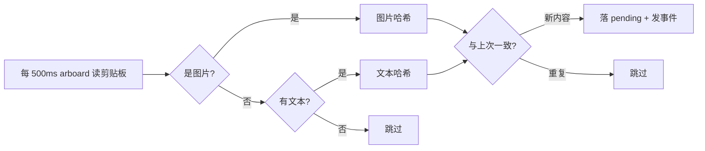
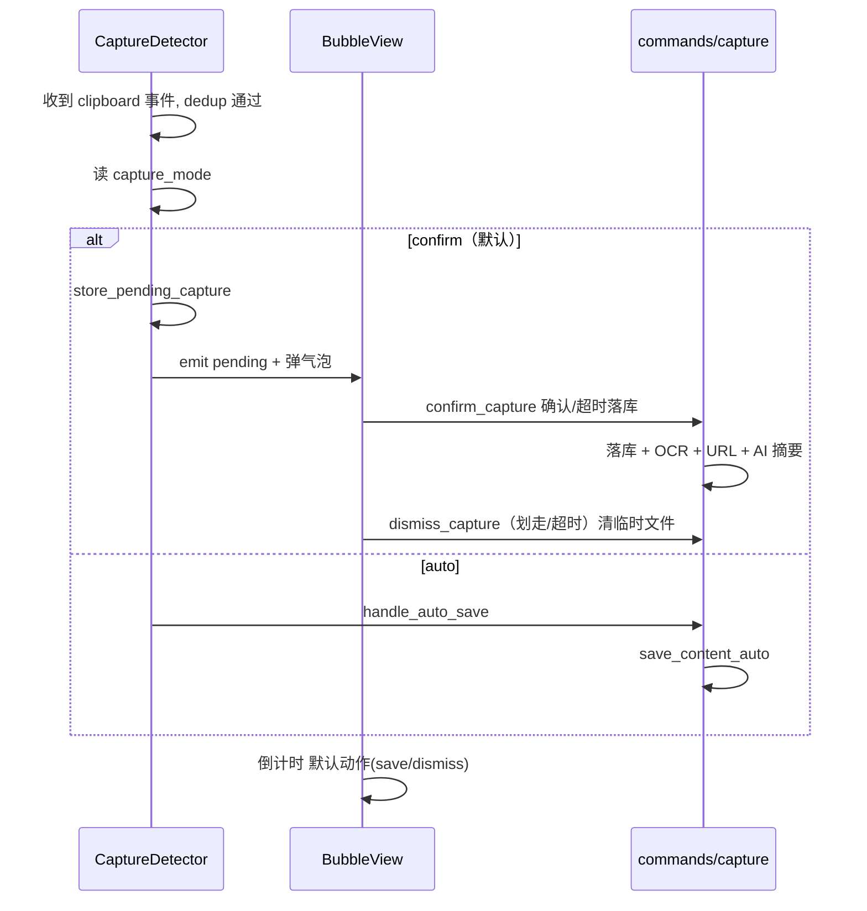

# OpenWiki-km 采集链路：从复制到"你决定保留"

> 关注面子文档，配合 [README](README.md) 阅读。结论速览：采集 = 剪贴板 **500ms 轮询**（非系统插件）+ 截图**目录监听**，触发后进入"气泡决策"；归档时做类型的确定性判定（URL / 图片 / 文本），再串起 URL 平台分派、OCR、敏感过滤；隐私外发默认开启但独立可关。

## 采集触发：两种"捕获"各有各的技术选型

**剪贴板用轮询而非监听**（[src-tauri/src/capture/clipboard.rs:108-238]()）。`ClipboardWatcher` 起一个独立线程，每 500ms 用 `arboard` 读一次剪贴板，**先试图片、再试文本**：

<!-- anchor: pub fn start(&self, app: AppHandle) { … std::thread::sleep(Duration::from_millis(interval)); -->

为什么要轮询而不是用 Tauri 的 `clipboard-manager` 插件事件？因为**必须拿到图片像素**去生成缩略图并做哈希去重，而插件只给文本/统一数据抽象；轮询 + `arboard::get_image()` 才能拿到尺寸与像素。代价是 500ms 常驻轮询的功耗，这是"简单可靠优先"的取舍。去重靠内容哈希（[src-tauri/src/capture/clipboard.rs:328-346]()），**同样的内容只弹一次气泡**。

**截图用文件系统监听**而非轮询：`ScreenshotWatcher` 用 `notify` 监听系统截图目录，读到 `screenshot / Screen Shot / 截屏 / 屏幕截图` 前缀文件名后发 `capture:screenshot` 事件，且 200ms 防抖避免半写状态误触发（[src-tauri/src/capture/screenshot.rs:66-144]()）。

## 判定与决策：类型判定 + "你决定保留"

入库前的**类型判定**是确定性的：剪贴板内容先被判定为 Text/Image/Url/Mixed，其中 URL 由 `detect_url()`（`http(s)://` 开头且无空白/换行）判定（[src-tauri/src/capture/content.rs:18-27]()），在 `save_content_auto_in` 中归为 `ContentType::Url`（[src-tauri/src/commands/capture.rs:678-695]()）。

"你决定保留"是产品核心。`capture_mode` 决定行为（[src-tauri/src/capture/detector.rs:783-836]()）：

- **confirm（默认）**：只把 pending 数据存在内存 `AppState`，弹气泡，等用户拍板（[src-tauri/src/capture/detector.rs:802-833]()）。**确认 `confirm_capture`**（[src-tauri/src/commands/capture.rs:1436-1505]()）才真正落库，并连锁触发 OCR / URL 抓取 / AI 摘要；**取消 `dismiss_capture`**（[src-tauri/src/commands/capture.rs:1542-1559]()）清 pending 并删临时图片——"不保留就不产生任何痕迹"。
- **auto**：`handle_auto_save` 直接落库（[src-tauri/src/capture/detector.rs:835]()）。
- **快存入口**：`Cmd/Ctrl+Shift+C` 触发 `spotlight` 窗口（见 [desktop-mcp.md](desktop-mcp.md)），用户手动粘贴或输入后 `save_spotlight_content`（[src-tauri/src/commands/capture.rs:866-921]()）。

## URL 加工：平台分派 + Jina 通用抽取 + 隐私开关

URL 是链路里最"重"的一环，`url_reader.rs`（2175 行）按主机分派专 reader，通用内容走 Jina Reader（[src-tauri/src/capture/url_reader.rs:113-213]()）：

| 目标 | 实现 |
|---|---|
| WeChat `mp.weixin.qq.com` | 直抓 HTML + 反爬页检测 `is_wechat_antibot`（[src-tauri/src/capture/url_reader.rs:218-341]()） |
| X / Twitter | fxtwitter API（[src-tauri/src/capture/url_reader.rs:345-453]()） |
| YouTube | InnerTube 字幕（[src-tauri/src/capture/url_reader.rs:623]()） |
| GitHub | 读环境变量 `GITHUB_TOKEN` 调 API（[url_reader.rs:455/1769]()） |
| Reddit / 小红书 | JSON API / SSR（[url_reader.rs:553/974]()） |
| 知乎等反爬 | headless WebView + 注入 JS 抽取（[src-tauri/src/capture/url_reader.rs:1188]()） |
| **通用** | Jina Reader `r.jina.ai`，头 `X-Return-Format: markdown`（[src-tauri/src/capture/url_reader.rs:1029-1056]()） |

**两处隐私开关**把"外发什么"摆到明面（对应 README 的 network transparency 声明）：

- **`use_jina_reader`**：关闭后不发完整 URL 到 `r.jina.ai`，转而直抓 HTML / 浏览器（[src-tauri/src/capture/url_reader.rs:170-185]()）。
- **`translate_foreign_content`**：中文 UI 且内容非中文时，把外文正文发 Google Translate 并双语呈现（[url_reader.rs:77-98/1304-1460]()）。

两者**默认开启**（后端读取 `!= Some("false")` 视为真，前端 store 默认 `true`，见 [src/stores/settingsStore.ts:327-330]()），但独立可关、落库在 `app_settings`。设计权衡：自由关闭换取通用抽取能力与多语言可读性，代价是外发依赖第三方——项目用 README + Settings 里显式的中文说明（"会把完整 URL 发给 r.jina.ai"）补偿透明性。此外 `url_reading_enabled` 是 URL 抓取总开关（[src-tauri/src/capture/detector.rs:310-331]()）。

## 图片 / OCR / 敏感过滤

- **图片生命周期**：剪贴板图片先落 `.pending` PNG（[src-tauri/src/capture/clipboard.rs:47-78]()），入库时移动/复制到 `captures/` 并生成缩略图（[src-tauri/src/commands/capture.rs:601-658]()）；`image_lifecycle.rs` 启动时清孤儿 pending，`image_orphans.rs` 提供孤儿隔离/恢复（[image_orphans.rs:140/250/332]()）。
- **OCR**：macOS 用**预编译的 Swift helper**（`resources/openwiki_ocr.swift`，Vision `VNRecognizeTextRequest`，`zh-Hans/zh-Hant/en-US` 三语言，长图按 >2000px 分片），Windows 用内嵌 PowerShell 走 WinRT OCR（[src-tauri/src/capture/ocr.rs:133-255]()）。helper 在构建期编译打包为 Tauri 资源，用户无需 Xcode（[src-tauri/src/lib.rs:75-84]()）。
- **敏感过滤**：正则集覆盖 API Key / AWS / GitHub / Slack / 私钥 / JWT 等（[src-tauri/src/capture/sensitive_filter.rs:6-31]()），`handle_auto_save` 命中则跳过入库（[src-tauri/src/capture/detector.rs:222-245]()）。**默认关闭**（`sensitive_filter_enabled` 需显式开启，[src/stores/settingsStore.ts:403]()）——这是个值得注意的取舍：默认开会有"误伤正常内容"风险，默认关则敏感内容可能被入库，作者选择了"功能优先、用户自选"。

## 与整体设计哲学

采集链路的每个决策都服务于"**把收藏动作压到最小、把决定权完全交还用户**"：类型判定要确定性（避免把非 URL 当 URL）、去重要前置（避免重复气泡）、"不保留就不留痕"（`dismiss` 清临时文件）、隐私外发显式可分开关。它证明了"好体验 = 把正确的决定在正确的时刻交给正确的人"，而不是让用户做更多事。
