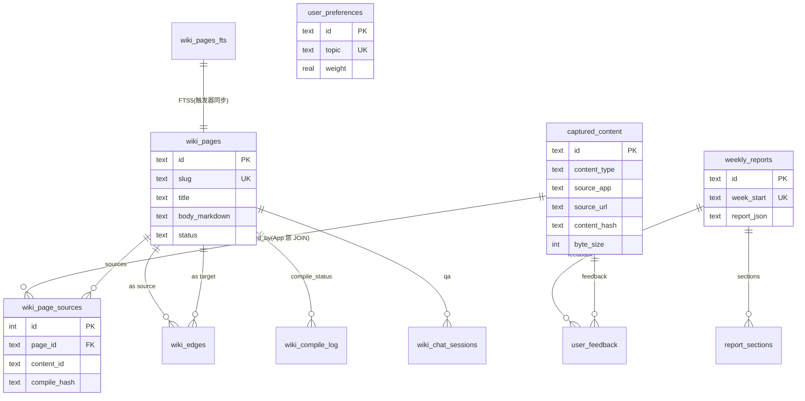
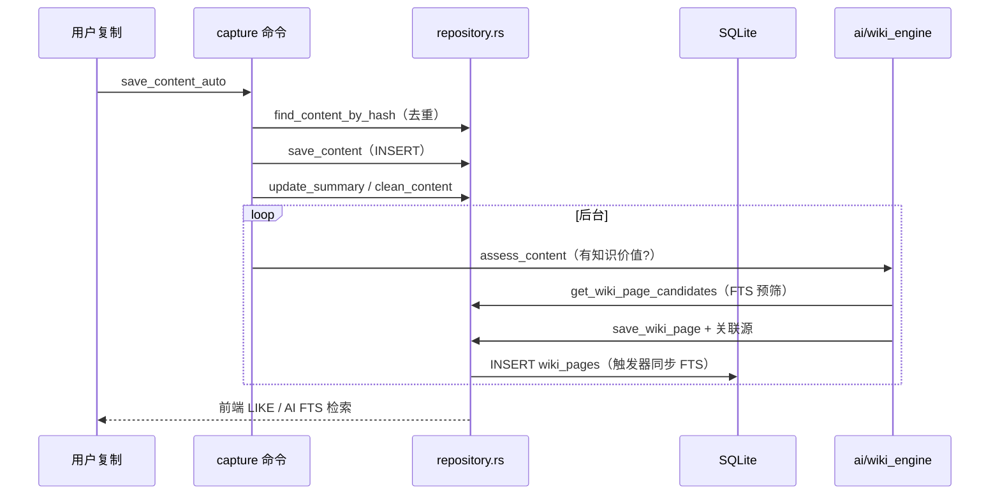

# OpenWiki-km 数据模型：本地优先的 SQLite 事实库

> 关注面子文档，配合 [README](README.md) 阅读。结论速览：OpenWiki 用**单一 SQLite 文件 + WAL + FTS5**承载"采集 → AI 沉淀 → 回顾"的全部状态；迁移是**运行时幂等探测**（非版本号 / 迁移表）；FTS 用自定义 `cjk_seg()` 修好中文检索。

## 存储选型与理由

OpenWiki 选择 "**本地优先、单文件 SQLite**"，而不是托管数据库或自建服务。三个原因：

- **产品形态**是常驻桌面应用，单机隐私优先（README 明言 `Privacy first — all data stored in local SQLite database`）。选 SQLite 等于把"零运维、零账户、数据完全在自己机器上"固化进架构，而非交给云。
- **读写并发量极低**：单用户、低频点击，几乎都是单写者。SQLite 的锁模型在此时没有竞争压力，却换来零部署复杂度。MySQL/Postgres 对这个场景是明显过度设计。
- **契合 AI 加工的数据形状**：内容、wiki 页、报告多为"一条记录 + 一段长文本（raw_text / body_markdown / analysis_json）"，关系型足够表达，且 SQL 让 `repository.rs` 里的各种过滤（时间窗、类型、FTS 召回）非常直接。

代价也被坦然接受：没有了服务端，跨设备同步 / 多端并发只能靠用户自己备份；全库只有一个 `Mutex<Connection>` 串行化访问，天然是单写者模型（[src-tauri/src/storage/database.rs:80-83]()）。

<!-- anchor: let db = Database { … db.run_migrations()?; -->

打开库时显式 `PRAGMA journal_mode=WAL; PRAGMA foreign_keys=ON;`（[src-tauri/src/storage/database.rs:77]()）——WAL 让读不阻塞写、崩溃恢复更安全；外键开在 `wiki_page_sources.page_id→wiki_pages` 等需要级联删除的关系上。**注意未设 `busy_timeout`**，高并发写会直接 `SQLITE_BUSY`，是本设计一个潜在风险点。

<!-- anchor: conn.execute_batch("PRAGMA journal_mode=WAL; PRAGMA foreign_keys=ON;")?; -->

## 实体关系总览

核心实体：`captured_content`（收藏主表）→ 派生出两条支线——**AI 加工支线**（`wiki_pages` / `wiki_page_sources` / `wiki_edges` / `wiki_compile_log` / `wiki_chat_*`）与**回顾支线**（`weekly_reports` / `report_sections` / `user_feedback` / `user_preferences`）。`app_settings` 是全局 KV。FTS5 虚拟表 `wiki_pages_fts` 与 `wiki_pages` 靠触发器同步。

**关键关联取舍**：`wiki_page_sources.content_id→captured_content` **刻意不加 DB 外键**，只在 App 层 JOIN（[src-tauri/src/storage/repository.rs:2922-2926]()）。理由：`captured_content` 用 `is_deleted` 软删而非物理删，若加 `ON DELETE` 外键，软删后源关系也会被误级联清掉；App 层关联让"内容被标记删除时仍保留其 wiki 关系"，以便未来恢复。

<!-- anchor: let url_subq = "(SELECT cc.source_url FROM wiki_page_sources wps \ … ORDER BY wps.contributed_at DESC LIMIT 1)"; -->

## 核心表设计

11 张物理业务表 + 1 张 FTS5 虚拟表 + 1 张 KV 表。逐表字段与约束如下（精确 schema 以迁移文件为准）。

### captured_content —— 收藏主表（迁移 001 / 演进 002 004 006 007 009 012 013 017）

职责：所有一键收藏的原始载体。`content_type` 为 Text / Image / Url / Mixed（[src-tauri/src/storage/models.rs:5-10]()）；`is_deleted` 软删；AI 加工结果逐步回写进演进列。

<!-- anchor: pub enum ContentType { … Mixed, -->

schema 见 [src-tauri/src/storage/migrations/001_initial.sql:3-23]()：

<!-- anchor: CREATE TABLE IF NOT EXISTS captured_content ( … CREATE INDEX IF NOT EXISTS idx_content_hash ON captured_content(content_hash); -->

| 字段 | 类型 | 约束 | 说明 |
|---|---|---|---|
| id | TEXT | PK | UUID |
| content_type | TEXT | NOT NULL | Text/Image/Url/Mixed 枚举 |
| raw_text | TEXT | | 文本或 URL 原文 |
| image_path / thumbnail_path | TEXT | | 图片落盘路径与缩略图 |
| source_app / source_bundle_id / source_url | TEXT | | 来源应用 / bundle / URL |
| captured_at | TEXT | NOT NULL | 捕获时间 |
| content_hash | TEXT | NOT NULL | 去重指纹 |
| is_deleted | INTEGER | NOT NULL DEFAULT 0 | 软删标志 |
| user_note | TEXT | (002) | 用户附加笔记 |
| digest / digested_at / digest_action | TEXT | (004/007) | "消化"三件套 |
| summary / tags | TEXT | (006) | AI 摘要与标签 |
| wiki_compile_hash / wiki_assessed_hash | TEXT | (009) | 编译 / 评估指纹 |
| clean_content | TEXT | (012) | 清洗后正文 |
| locale | TEXT | (013) | 语言（**注：Rust 结构体未映射**） |
| category | TEXT | (017) | AI 归属笔记本，NULL=未分类 |

索引：captured_at / type / source / hash（[src-tauri/src/storage/migrations/001_initial.sql:20-23]()）。

### wiki_pages / wiki_page_sources / wiki_edges / wiki_compile_log —— 知识库支线（迁移 008）

`wiki_pages` 是知识库页面主体（concept/entity 等 `page_type`），`slug` 唯一且前端用 `page_id` 前 8 位做冲突后缀（[src-tauri/src/ai/wiki_engine.rs:421-430]()）；`wiki_page_sources` 记录"哪个收藏促成了哪一页"（`compile_hash` 去重，`source_status` 标记 active/stale 供 `needs_recompile` 判断）；`wiki_edges` 存知识图谱边，`UNIQUE(source,target,relation)` 去重（[src-tauri/src/storage/migrations/008_add_wiki.sql:38-48]()）；`wiki_compile_log` 靠 `WHERE status='compiling'` 的**部分唯一索引**做编译抢锁（[src-tauri/src/storage/migrations/008_add_wiki.sql:64-65]()）。

**wiki_pages**（schema 见 [src-tauri/src/storage/migrations/008_add_wiki.sql:4-22]()）：

| 字段 | 类型 | 约束 | 说明 |
|---|---|---|---|
| id | TEXT | PK | UUID |
| title | TEXT | NOT NULL | 页面标题 |
| slug | TEXT | UNIQUE | 语义 id，冲突时追加 page_id 前 8 位 |
| page_type | TEXT | DEFAULT 'concept' | concept/entity/source/comparison/overview |
| body_markdown | TEXT | | 页面正文 |
| summary / tags | TEXT | | 摘要与标签 |
| status | TEXT | DEFAULT 'active' | active / needs_recompile |
| confidence | REAL | | 编译置信度 |
| source_message_id | TEXT | (011) | Q&A 消息去重 |
| locale | TEXT | (013) | 语言 |

**wiki_page_sources**（schema 见 [src-tauri/src/storage/migrations/008_add_wiki.sql:24-35]()）：

| 字段 | 类型 | 约束 | 说明 |
|---|---|---|---|
| id | INTEGER | PK AUTOINCREMENT | |
| page_id | TEXT | FK→wiki_pages ON DELETE CASCADE | 页面 |
| content_id | TEXT | **无 DB 外键** | 收藏 id，App 层 JOIN |
| compile_hash | TEXT | | 去重指纹 |
| source_status | TEXT | | active / stale |

**wiki_edges** 存图谱边，`UNIQUE(source,target,relation)` 去重；**wiki_compile_log** 用 `WHERE status='compiling'` 部分唯一索引做编译互斥（[src-tauri/src/storage/migrations/008_add_wiki.sql:38-65]()）。

### weekly_reports / report_sections / user_feedback / user_preferences —— 回顾支线（迁移 001）

`weekly_reports.week_start` 唯一确保每周只一份；`report_sections.content_ids` 存关联收藏 ID 的 JSON 数组；`user_feedback` 记录 like/dismiss/bookmark；`user_preferences` 是**增量兴趣向量**——`weight` 随反馈累加（interested +1.0、dismissed -0.5，详见 [ai-engines.md](ai-engines.md) 的偏好学习节），`occurrence_count` 递增，`topic` 唯一（[src-tauri/src/storage/migrations/001_initial.sql:65-73]()）。

**user_preferences**（schema 见 [src-tauri/src/storage/migrations/001_initial.sql:65-73]()）：

| 字段 | 类型 | 约束 | 说明 |
|---|---|---|---|
| id | TEXT | PK | UUID |
| topic | TEXT | UNIQUE | 兴趣主题 |
| weight | REAL | NOT NULL DEFAULT 0 | 增量权重（interested +1.0 / dismissed -0.5） |
| occurrence_count | INTEGER | NOT NULL DEFAULT 0 | 出现次数 |
| last_updated | TEXT | DEFAULT now | 更新时间 |

### attention_insights / wiki_chat_* / app_settings / wiki_pages_fts

- `attention_insights`：注意力报告，`analysis_json` **整块 JSON blob 存储**（非拆成 7 维列），多版本用 `is_current` 标记（[src-tauri/src/storage/migrations/005_add_attention_insights.sql:1-12]()）。

**attention_insights**（schema 见 [src-tauri/src/storage/migrations/005_add_attention_insights.sql:1-12]()）：

| 字段 | 类型 | 约束 | 说明 |
|---|---|---|---|
| id | INTEGER | PK AUTOINCREMENT | |
| analysis_json | TEXT | NOT NULL | 整块 AI 报告 JSON（嵌套 11 段体） |
| status | TEXT | DEFAULT 'pending' | analyzing / complete / error |
| window_start / window_end | TEXT | | 分析时间窗 |
| content_count / model_used | INTEGER/TEXT | | 统计与模型 |
| is_current | INTEGER | | 多版本链标记 |

- `weekly_reports`（[src-tauri/src/storage/migrations/001_initial.sql:25-38]()）：`week_start` 唯一，`report_json` 整块存周报内容。
- `wiki_chat_sessions` / `wiki_chat_messages`：多轮问答，`turn_index` 与 `source_mode`（ai_only 等）记录检索上下文来源。
- `app_settings`：全局 KV。敏感键（`ai_api_key*` / OAuth token）经 [desktop-mcp.md](desktop-mcp.md) AES-GCM 加密后再写，读时解密（[src-tauri/src/storage/repository.rs:1175-1212]()）。
- `wiki_pages_fts`：**contentless** FTS5 虚拟表，只存索引列 + `page_id UNINDEXED`，正文在主表（[src-tauri/src/storage/migrations/014_add_wiki_fts.sql:14-21]()）。

## CJK 检索修复：`cjk_seg()` 分词（迁移 014→015）

这是最有价值的演进点。FTS5 默认 `unicode61` 对中文**连续序列当单个 token**：`整理设计风格` 被索引成一个巨型 token，`搜"设计"` 因 token 不等永远不命中（[src-tauri/src/storage/migrations/015_wiki_fts_cjk_segment.sql:3-14]()）。

<!-- anchor-base64: LS0gUHJvYmxlbTogdGhlIHVuaWNvZGU2MSB0b2tlbml6ZXIgdHJlYXRzIGV2ZXJ5IGNvbnRpbnVvdXMgQ0pLIHNlcXVlbmNlIOKApiAtLSBtYXRjaGluZyBhZGphY2VudCB0b2tlbnMgY29ycmVjdGx5Lg== -->

修复：注册一个 SQLite 标量函数 `cjk_seg()`，在相邻 CJK 表意字符间插入空格（幂等，支持扩展 B~F 区，[src-tauri/src/storage/database.rs:18-35]()），写入与查询**两侧同时切词**，于是 `整理设计风格`→`整 理 设 计 风 格`，就能命中 `设 计`。

<!-- anchor: pub fn cjk_segment(input: &str) -> String { … prev_cjk = cur_cjk; -->

迁移 015 重建 FTS 表并把全部列过 `cjk_seg()`，由触发器同步保持索引新鲜（[src-tauri/src/storage/migrations/015_wiki_fts_cjk_segment.sql:41-72]())。

<!-- anchor-base64: Q1JFQVRFIFRSSUdHRVIgd2lraV9wYWdlc19mdHNfaW5zZXJ0IOKApiBFTkQ7 -->

查询侧在 `build_fts_match` 对查询词做同样变换（[src-tauri/src/storage/repository.rs:2777-2797]()）。

<!-- anchor: fn build_fts_match(query: &str) -> String { … phrases.join(" OR ") -->

## Schema 演进策略：运行时幂等探测

OpenWiki **不用 `user_version`，也不用迁移表**，而是"每次启动跑一遍、每段用幂等探测决定是否执行"（`database.rs:run_migrations`，[src-tauri/src/storage/database.rs:108]()）：

- 加列类（`ALTER ADD COLUMN`）：先 `pragma_table_info` 查列是否存在，不存在才 `execute_batch`。
- 建表 / 触发器类：先查 `sqlite_master`。
- 部分迁移（007/009/012/016）没有独立 `.sql` 文件，直接在 `database.rs` 内联执行。
- **降级而非失败**：FTS5 不可用时 `match Err` 分支回退到 LIKE 检索，不让启动失败。

这套方案的好处是**可重复跑**（幂等）、对异常启动友好；代价是没有严格的版本编号可回滚、也不记录迁移历史，演进决策只能靠 `database.rs` 里详尽的注释当"文档"（014/015 迁移文件本身就是最好的决策说明）。

## 读写主链路

数据从"用户复制"到"被 AI 检索召回"经过一条清晰的落库链（各步落点见 [capture-pipeline.md](capture-pipeline.md)）：

两条检索并存且刻意分离：**前端 UI 搜索走 `search_wiki_pages`（LIKE）**，**AI 问答走 `get_wiki_page_candidates`（FTS5 + `cjk_seg`）**（[src-tauri/src/storage/repository.rs:1689]() 与 [src-tauri/src/storage/repository.rs:2893]()）。理由：UI 搜索要简单、可解释、低延迟；AI 检索要召回强、能承载语义预筛，各自剥离互不拖累。

## 与整体设计哲学

这份 schema 是"**用户只做决定，系统负责沉淀**"的直接体现：所有 AI 加工产物（摘要、wiki 页、报告、偏好）都有确定性落点，可重复采集、可去重、可回滚（软删 + source_status）。迁移即决策文档、检索即取舍镜像——数据层没有引入任何"AI 生成的运行时状态"，只有结构清晰的事实库，这正是一条"让 AI 加工可预测、可验证"的稳线。
