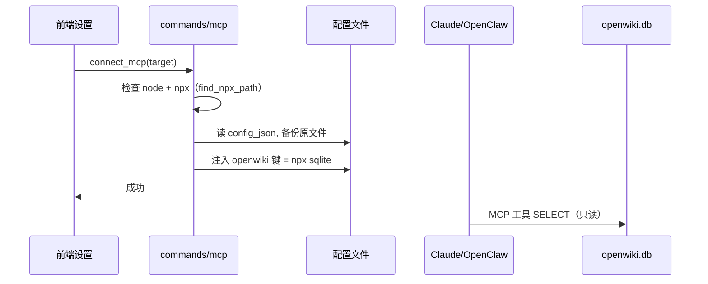

# OpenWiki-km 桌面交付 / MCP / 安全

> 关注面子文档，配合 [README](README.md) 阅读。结论速览：Tauri 2 双窗口（main + spotlight）+ 托盘 + 全局快捷键 + 开机自启 + 自动更新构成"常驻后台"体验；API Key 用 AES-GCM 本地密钥盘加密；MCP 采用"向 Claude Desktop 注入现成 `mcp-server-sqlite-npx`"而非自研协议。

## 桌面壳：把 App 做成"关不掉但有托盘"的常驻工具

OpenWiki 的产品形态是"**关窗仍运行**"。三个机制共同构成：

- **双窗口**：`main`（1200×850 透明主窗）+ `spotlight`（520×80 无边框透明、`alwaysOnTop`、`skipTaskbar` 的快捷捕获窗），都在 `tauri.conf.json:13-40`。`spotlight` 失焦自动隐藏（[src-tauri/src/lib.rs:108-114]()）。
- **拦截关闭**：`CloseRequested` 事件里 `prevent_close() + win.hide()`，即"点 X 只是隐藏"；再由托盘兜底恢复（[src-tauri/src/lib.rs:117-134]()）。
- **系统托盘**：`setup_tray` 建 Show / Generate Report / Quit 三项菜单（[src-tauri/src/lib.rs:600-630]()）。

**全局快捷键在代码里注册而非 config**：`CmdOrCtrl+Shift+Y` 显示主窗、`CmdOrCtrl+Shift+C` 触发 spotlight 捕获（[src-tauri/src/lib.rs:47-66]()）。`trigger_spotlight_capture`（[src-tauri/src/lib.rs:348-400]()）模拟 `Cmd+C` → 读剪贴板 → 定位前台 app → emit `spotlight:content-ready` → 光标所在屏居中显示 spotlight。选择在代码注册而非 tauri.conf.json，是为了能 `.with_handler` 接入应用逻辑（指定打开哪个窗口、走哪条捕获路径）；代价是快捷键不再纯声明式、被静态 CSP / config 管理。

**生命周期**：`run` 回调处理 macOS `Reopen`（Dock 点击恢复主窗，配合 `suppress_reopen_until` 抑制重复弹窗，[lib.rs:316-339/571-598]()）。macOS 用 `window-vibrancy` 做 spotlight 毛玻璃（NSVisualEffectMaterial::HudWindow，[src-tauri/src/lib.rs:94-100]()）。

## Command 层与前端：Tauri IPC 的薄调度

`lib.rs` 注册约 70 个 command，覆盖 capture / storage / report / preferences / digest / mcp / datahub / attention / oauth / wiki / update / automation（[src-tauri/src/lib.rs:224-313]()）。前端 React 通过 `invoke` 调这些 command，zustand stores（contentStore / wikiStore / settingsStore）管理本地 UI 状态，services 封装 IPC 调用。**command 层是纯适配器**：不承载业务逻辑，只做"前端可调用的函数签名 ↔ 后端 Repository / AI 引擎"的映射，让业务集中在 Rust 侧、便于确定性测试。

## 安全：AES-GCM 本地密钥盘加密

敏感配置（API Key / OAuth token）不是明文入库，而是 `encrypt_secret` 用 AES-256-GCM 加密、输出 `owenc:v1:{nonce_b64}:{cipher_b64}` 前缀格式落盘（[src-tauri/src/secure_store.rs:38-55]()），读取时 `decrypt_secret` 逆向（[src-tauri/src/secure_store.rs:57-83]()）。主密钥 `load_or_create_master_key` 首启从 `OsRng` 生成 32 字节写到 `<AppData>/com.openwiki.app/secure-store.key`，Unix 下以 `0o600` 权限落盘（[src-tauri/src/secure_store.rs:95-153]()）。

设计权衡：**不用 Tauri 的强隔离密钥链 / Keychain，而是自管密钥文件**。好处是跨平台行为一致（macOS 与 Windows 共享一套代码）、不绑系统密码框交互时机；代价是密钥保护依赖文件权限（`0600`），比系统 Keychain 的访问控制弱一档——这是"简单 + 跨平台一致"换来的取舍。`is_secret_setting` 判定哪些 key 是敏感项（`ai_api_key*` / OAuth token，[src-tauri/src/secure_store.rs:15-20]()）。

## MCP：注入现成 server，而非自研协议

OpenWiki 不是 MCP server，也不是 MCP client——它是**"MCP 配置注入器"**：把第三方 `mcp-server-sqlite-npx` 写进 Claude Desktop / OpenClaw 的配置文件，让这些主机能以 MCP 工具查询 OpenWiki 的 SQLite 库（[src-tauri/src/commands/mcp.rs:24-35]() 数据流注释）。

- **目标**：`McpTarget` 枚举覆盖 Claude（`~/Library/Application Support/Claude/claude_desktop_config.json`）与 OpenClaw（`~/.openclaw/openclaw.json`，[src-tauri/src/commands/mcp.rs:39-73]()）。
- **注入**：`connect_mcp` 先备份 config，再向 `mcpServers.openwiki` 写入 `<npx> -y mcp-server-sqlite-npx <db绝对路径>`（[src-tauri/src/commands/mcp.rs:254-345]()）；`disconnect_mcp` 只移除本键、保留其他条目（[src-tauri/src/commands/mcp.rs:348-370]()）。
- **Node 依赖**：`is_node_installed` / `find_npx_path` 探测并回退常见路径、nvm（[src-tauri/src/commands/mcp.rs:93-171]()）——Node 缺失则功能不可用，是硬前置。

**取舍**：自研 MCP server 能精确控制开放面，但要维护协议传输、权限、schema 描述；而注入现成 `mcp-server-sqlite-npx` 几乎零自研代码、天然只读（安全兜底）。代价是能力边界被这个 server 锁死——**OpenWiki 只能开放"纯 SQLite 查询"，且依赖宿主应用（Claude Desktop）对 MCP 的加载**，无法向 MCP 暴露 OCR / AI 摘要 / 图谱等自家能力。这个选择契合"本地优先、让数据可被外部查询"的产品目标，但扩展性有限。

## 自启 / 更新 / 后台自动化

- **开机自启**：`tauri_plugin_autostart`＋`MacosLauncher::LaunchAgent`（[src-tauri/src/lib.rs:41-44]()），且默认开启——`apply_default_autostart_once` 用 `autostart_default_applied` 标志位首次自动 enable（[src-tauri/src/lib.rs:402-438]()），前端 `autostartService` 可控。
- **自动更新**：`tauri-plugin-updater`（[lib.rs:45]()），feeds 指向 GitHub latest.json（[src-tauri/tauri.conf.json:75-82]()）；`update/mod.rs` 启动 3s 后拉 manifest、尊重 `check_enabled`、跳过 `dismissed_version`、emit `update-available`（[src-tauri/src/update/mod.rs:85-128]()）。
- **后台自动化汇总**（`lib.rs:186-220`）：捕获检测器 → 更新检查 → automation 权限守卫 → insight 周报调度；启动 5s 后重建 wiki 图谱 TF-IDF 边（[src-tauri/src/lib.rs:167-184]()）。
- **macOS 权限**：`entitlements.plist` 含 JIT / unsigned-executable、network.client/server、files.user-selected、apple-events（automation）（[src-tauri/entitlements.plist:5-22]()）——`automation/mod.rs` 守卫 Apple Events 自动化权限（macOS `System Events`），首启用 `probe_status` 探测、弹窗引导用户去系统隐私面板授权（[automation/mod.rs:97-221/265-301]()）。

## 与整体设计哲学

桌面交付层把"常驻后台"做成可靠体验：托盘 + 快捷键 + 自启保证工具随时可用、隐藏式关闭避免误退。MCP 与安全存储则延续"**本地优先 + 最小惊讶**"——数据留在本机（AES 落盘加密）、对外只开放只读 SQLite 查询（注入 server）、所有外发（Jina/翻译）可显式关闭。它不追求把自家完整能力暴露给外部，而是克制地守住"本地事实库可被查询"这一个口子，让信任与隐私成为产品基调。
