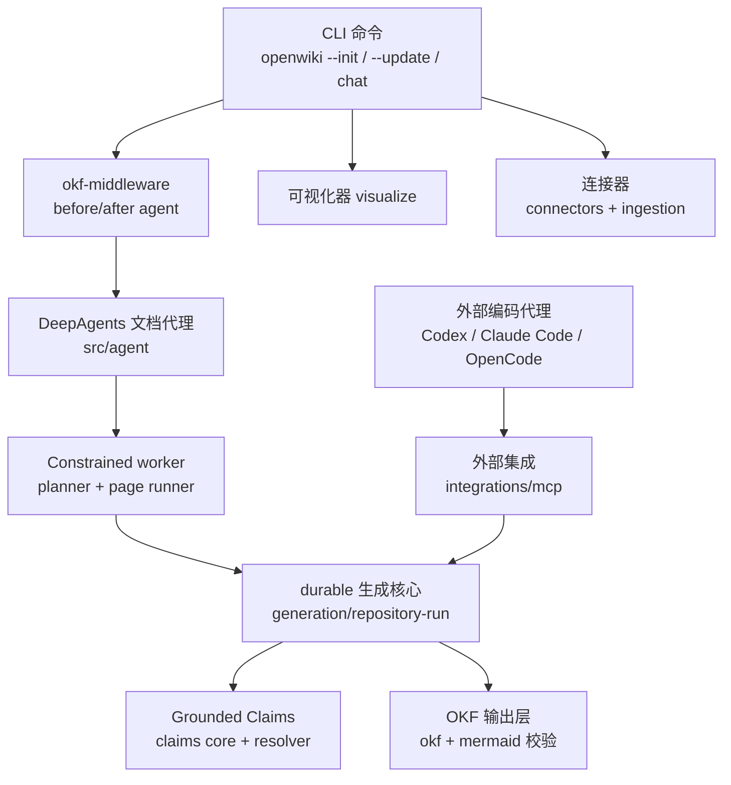
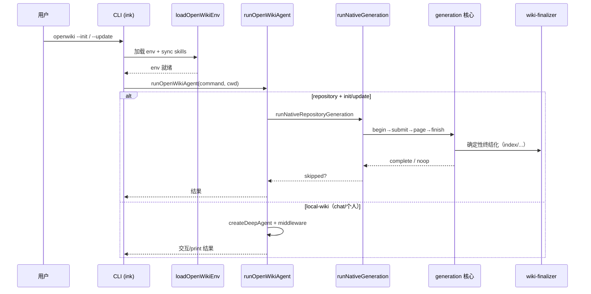

> **本解读按 ai-agent 类规格产出。** 项目本体为 langchain-ai / openwiki（DeepAgents 驱动的文档生成代理）。

# openwiki：让 wiki 自维护的 DeepAgents 文档代理

## 根因

AI 为代码库/wikis 写文档不难，难的是**让文档在源码不断演进时长期保持准确、可验证、且随变更自动更新**。传统一次性生成的工具产出的文档会立刻过时，且无法证明"文档里每句话对应源码的哪一段"。openwiki 解决的根本问题是：**用 agent 自动生成并持续维护一份带可验证出处、可机器校验、可增量更新的 wiki**——把"写文档"从一次性人工/脚本产物，变成随源码演进而自维护、让人和 agent 都能信任的活资产。

它围绕两个核心张力展开的解法：**既要给 agent 充分的读写自由度，又要保证产出的结构（OKF 格式）和可信度（Grounded Claims）确定性收敛**。为此把 openwiki 定位为**编排层**而非"又一个文档生成脚本"：研究和写作可由 agent（甚至外部编码代理）完成，但生命周期、证据跟踪、格式校验、终结化这些"确定性"职责由 openwiki 严格掌控——"让程序验证，不让 agent 自证"。

## 概览

openwiki 是 langchain-ai 出品的 CLI，基于 **Deep Agents（DeepAgents.js）** 构建。它读取你的源码或个人知识源，综合出一份带链接的 Markdown wiki（遵循 Google OKF v0.2 格式），并在每次变更时通过 `--update`（或 CI 调度）保持更新。它有两种模式：**code**（默认，为当前仓库生成 wiki）与 **personal**（个人知识脑，接入 Notion/Gmail/Slack/X 等 9 种连接器）。

它是 **langchain 官方生态的亲儿子**，天生与 DeepAgents、LangGraph、LangSmith 深度绑定——这既是它能力强大的来源，也是它与纯"自研 agent"工具的分野。

### 核心能力清单

| 能力 | 定位 | 支持形态 |
|---|---|---|
| Agent 撰写文档 | DeepAgents 文档代理，计划→分页→提交 → 终结化 | native worker + 外部 MCP host 双驱动 |
| 双模式 | code（仓库）/ personal（个人知识脑） | `openwiki --init` / `openwiki personal --init` |
| 13 个模型提供商 | OpenAI/Anthropic/Gemini/Bedrock/Copilot/OpenRouter/OpenAI 兼容网关等 | env 配置 + 向导 |
| 编码代理集成 | 装进 Codex/Claude Code/OpenCode，复用宿主模型与工具 | MCP 五操作协议 |
| **Grounded Claims** | 每条事实命题绑定可重定位、可验证版本的源码证据 | `.claims/` sidecar + 证据解析器 |
| 9 个内置连接器 | Custom MCP/Notion/Slack/Gmail/X/Web Search/HN/LangSmith/git | personal 摄取 + code 模式 LangSmith 增强 |
| 交互可视化器 | 节点图 + 实时 Markdown 阅读器 | 本地服务 / `--export` 静态站点 |
| 自更新 | 通过 GitHub Actions/GitLab CI/Bitbucket 定时拉起 | 文档变更即开 PR |
| OKF v0.2 输出 | 可移植知识格式 + 校验 Mermaid 图 | 每 wiki 都是 OKF bundle |
| Mermaid 校验 | 坏图降级为 text + 自修复注释 | 权威 mermaid / 保守启发式双模 |

### 技术栈一览

| 层 | 选型 |
|---|---|
| 语言/运行时 | TypeScript（ESM）/ Node ≥22 / pnpm |
| Agent 编排 | **DeepAgents** 1.12 + LangGraph（`@langchain/langgraph-checkpoint-sqlite` SqliteSaver） |
| LLM 封装 | `@langchain/{openai,anthropic,google,aws,openrouter}` + Vertex SDK |
| MCP | `@modelcontextprotocol/sdk`（stdio server + client） |
| CLI/UI | ink（React 终端渲染）+ React 18 |
| 存储 | 文件系统为主（`openwiki/` 全量 wiki + `.run.json` + `.claims/` sidecar）+ LangGraph SQLite checkpoint（会话态） |
| 校验 | zod（协议/schema）+ mermaid/jsdom（图校验，optional）+ vitest |
| 遥测 | posthog-node（匿名聚合） |
| 数据模型探测 | 核心状态为**文件系统侧车 JSON + OKF 文档格式**，非关系型表；SQLite 仅承载 LangGraph 会话 checkpoint（见下方「存储形态」说明） |

## 架构

三条主执行路径最终汇聚到同一个 durable 生成核心：

**目录职责映射：**

| 目录 | 职责 | 关注面 |
|---|---|---|
| `src/agent/` | DeepAgents 文档代理编排、双 worker、终结化 middleware、`runOpenWikiAgent` 入口 | [page-job-architecture](page-job-architecture.md) |
| `src/generation/` | **durable 生成核心**：`.run.json`、begin→finish 生命周期、page-job 队列 | [page-job-architecture](page-job-architecture.md) |
| `src/claims/` | **Grounded Claims**：证据重定位协议、两阶段原子对账、sidecar 持久化 | [claims-system](claims-system.md) |
| `src/integrations/` | 编码代理 MCP 五操作协议、事务性安装器、三宿主 config 适配 | [mcp-integration](mcp-integration.md) |
| `src/okf/` + `src/mermaid/` | OKF v0.2 输出（frontmatter/provenance/索引）+ Mermaid 校验降级 | [okf-format](okf-format.md) |
| `src/cli/` | Ink 终端 UI、run-log、命令路由、启动流程 | — |
| `src/connectors/` | 9 个数据源连接器（MCP/Notion/Gmail/Slack/X/WebSearch/HN/LangSmith/git）、OAuth | — |
| `src/setup/` | 首次引导、凭据向导、提供商选择 | — |
| `src/visualize/` | 节点图可视化器（本地服务 + 静态导出） | — |

## 存储形态与数据模型判定

按「数据模型主动探测」扫描 `*.sql` / `migrations/` / models 实体：**均未命中**。openwiki 的核心状态不是关系型表，而是三层文件系统编排：

1. **wiki 本体**：`openwiki/` 目录下的 Markdown（OKF v0.2 文档）。
2. **可恢复运行态**：`openwiki/.run.json`（page-job 队列、source fingerprint、prepared 快照）+ `.last-update.json`。
3. **证据对账簿**：`openwiki/.claims/` 每页一个 JSON sidecar（pageVersion hash + Claims + verification）。

SQLite 仅由 LangGraph 内部 `SqliteSaver` 用于会话 checkpoint 持久化（chat 模式），非 openwiki 自定义表结构。因此本解读**不产出独立 `data-model.md`**，而是把"文件系统 + 文档格式"这套状态管理分别纳入 [page-job-architecture](page-job-architecture.md)（`.run.json` durable 态）与 [claims-system](claims-system.md)（`.claims/` sidecar 对账簿）叙述。

## 启动与生成链路

CLI 入口在 `runOpenWikiAgent`，先判定输出模式与命令：仅当 `outputMode === "repository"` 且命令为 init/update 时走**仓库生成路径**（native worker 驱动 durable 核心）；否则走 **local-wiki 路径**（DeepAgents 单图 + middleware）（[src/agent/index.ts:178-230]()）。
<!-- anchor: const isRepositoryGeneration = … debugFetchCapture.restore(); -->

## 核心模块导读

| 模块 | 一句话定位 | 深读 |
|---|---|---|
| **Grounded Claims** | 让每条文档命题绑定到可重定位、可验证版本的源码证据，增量更新时自动识别失效命题并驱动修复 | [claims-system](claims-system.md) |
| **page-job 架构** | 把长时 LLM 生成组织成 `.run.json` durable 有序队列，崩溃可续跑、源码漂移自动失效重规划 | [page-job-architecture](page-job-architecture.md) |
| **编码代理集成 / MCP** | 五操作 MCP 协议把"研究写作"外包给外部编码代理，openwiki 保留 durable 校验与终结化权威 | [mcp-integration](mcp-integration.md) |
| **OKF 输出 + Mermaid 校验** | 把自由 Markdown 规整成机器可验证、渲染安全的 OKF v0.2 wiki，坏 Mermaid 图降级自修复 | [okf-format](okf-format.md) |

## 子文档索引

- [`page-job-architecture.md`](page-job-architecture.md) — durable 生成核心：`.run.json` 可恢复队列、finish 最后删、两次指纹闭合竞态、"证明持久才前进"
- [`claims-system.md`](claims-system.md) — Grounded Claims：证据重定位协议、两阶段原子对账、sidecar 持久化、preflight/runtime 双层校验
- [`mcp-integration.md`](mcp-integration.md) — 编码代理 MCP 五操作协议、事务性安装器 + SkillReceipt、错误 bounded
- [`okf-format.md`](okf-format.md) — OKF v0.2 输出：frontmatter 校验、provenance 精确声明、分层验证、Mermaid 校验降级自修复

## 同类定位对比

| 项目 | 形态 | 核心差异 |
|---|---|---|
| **openwiki** | CLI 文档代理 | 强调**自维护 + 可验证**：Grounded Claims 证据版本跟踪 + OKF 可移植格式 + 外部编码代理集成；DeepAgents 官方生态 |
| deepwiki-open | 单次文档生成 | 一次性产出，不强调增量更新与证据版本跟踪 |
| WeKnora | RAG 知识平台 | 偏向量检索与工具链；openwiki 偏结构化 wiki 文档 + 请求驱动生成 |
| docs 生成脚手架（如 typedoc/generouted） | 静态文档 | 从类型定义确定性生成，无 LLM 事实命题，无证据跟踪 |

## 可借鉴的设计

1. **"镜像式窄协议"**（[mcp-integration](mcp-integration.md)）：把内部 durable 核心的原子操作精炼成 5 个 MCP 工具暴露给外部编码代理，实现"研究外包、校验自留"——协议是核心的薄镜像，单一事实来源。迁移到任何"把能力外包给更强 agent"的场景。
2. **"证明持久才前进"的背书式状态推进**（[page-job-architecture](page-job-architecture.md)）：任何状态推进前先证明"内容 + 证据 + 元数据"三者一致且已落盘，否则不宣称完成。迁移到长任务/分布式工作流的可靠性设计。
3. **"body 变了才 stamp"的诚实 provenance**（[okf-format](okf-format.md)）：用内容 hash（而非"run 到过"）判断是否推进 `generated.at`，拒绝假新鲜度——任何需要"谁、何时真的改了内容"的审计场景都适用。
4. **"歧义即弃"的确定性证据解析**（[claims-system](claims-system.md)）：证据重定位多候选时返回 null 而非猜测，宁缺勿错绑——比"尽力匹配"更利于信任系统。

## 不足与风险

- **强绑定 langchain/DeepAgents 生态**：深度集成 `@langchain/*`、LangGraph、LangSmith，若生态演进/项目活跃度变化，迁移成本高。
- **单 run 独占**：durable 核心同一仓库同一时间只支持一个 resumable run，MCP host 与 CLI 同时跑会互斥（详见 [page-job-architecture](page-job-architecture.md)）。
- **弱依赖的渲染安全盲区**：不装 mermaid 依赖时用保守启发式，存在漏检窗口，靠文档诚实标注补偿（详见 [okf-format](okf-format.md)）。
- **process 内所有权**：Claims 的 `claimOwners` 是 run 级内存态，跨 run id 唯一性无数据库级约束兜底（详见 [claims-system](claims-system.md)）。

## 总结

openwiki 把"AI 写文档"从一句口号做成了可以长期信赖的工程：**以 durable 可恢复的生成核心为骨架，以 Grounded Claims 可验证证据为血肉，以 OKF 可移植格式为对外契约，并把最强能力（研究写作）外包给外部编码代理而把确定性权威牢牢握在自己手里**。它不执着于"让 agent 写得更多"，而是执着于"让 agent 写出的东西可被证明、可被修复、可随源码演进"——这正是它区别于普通文档生成工具的根因所在。
