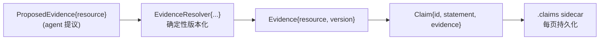
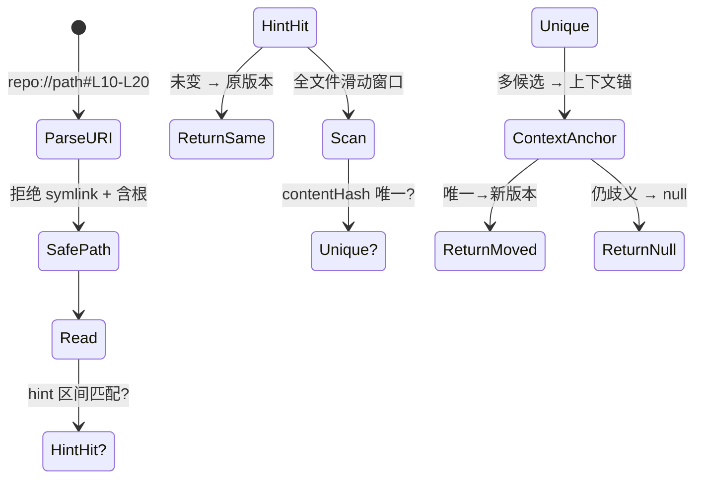
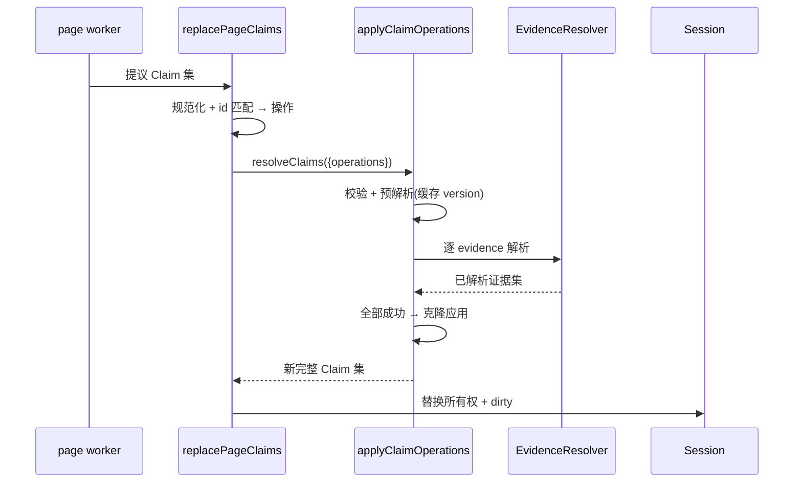
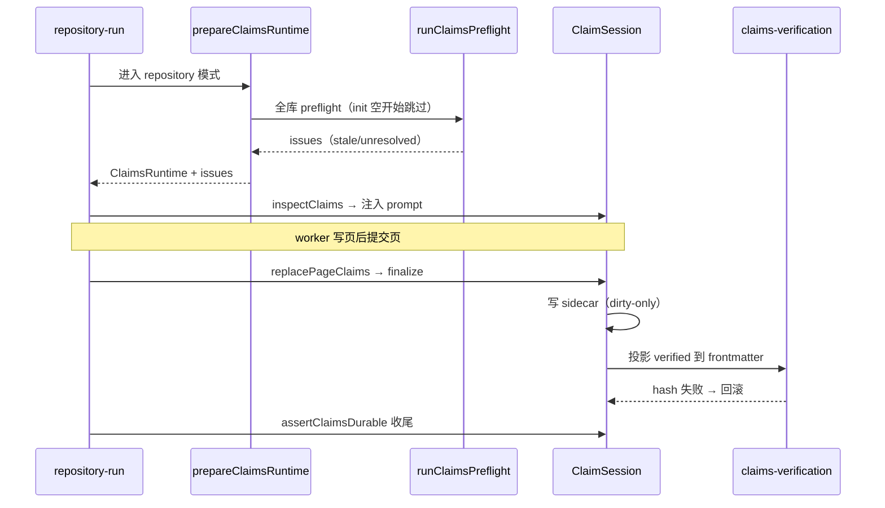

# Grounded Claims：让文档命题可回溯到版本化源码证据

## 根因

LLM 生成的文档天然有"语言上自信、事实上可能过时"的问题。文档是静态的，源码是动态的：当源码演进，文档里"该函数返回 X"这类实质性命题会突然为假，而 agent 无法感知——除非每次变更都全量重读源码比对。openwiki 的 Grounded Claims 系统解决的就是这个根本矛盾：**让文档里每一条实质性命题（claim）都绑定到一组可重定位、可验证版本的源码证据，从而在增量更新时自动识别哪些命题已失效（stale）或已消失（unresolved），再驱动页面修复**。

这呼应了整个项目"让程序验证，不让 agent 自证"的设计哲学：agent 可以自由地写正文，但每条事实必须提供一个"程序可以独立复检的版本化出处"。

## 核心抽象：三条数据类型

Claims 的核心模型刻意保持最小化，只分三层：

- `Evidence`——证据 = 稳定资源身份 `resource` + 不透明版本 token `version`（[src/claims/core/types.ts:4-14]()）。
<!-- anchor: export interface Evidence { … version: string; -->
- `Claim`——一条原子事实命题 = 稳定 id + statement + 证据列表（[src/claims/core/types.ts:19-34]()）。
<!-- anchor: export interface Claim { … evidence: Evidence[]; -->
- `ProposedEvidence`——agent 提交证据时**只给资源、不给版本**（[src/claims/core/types.ts:39-44]()）。
<!-- anchor: export interface ProposedEvidence { … resource: string; -->

关键在于第三条：**版本号永远不由模型提供**。这是防自证漏洞的根因性设计——版本是"这条证据已被核实"的身份凭据，若 agent 能写任意 version，就等价于能伪造"已核实"。版本一律由 `EvidenceResolver.resolve` 对源码内容哈希确定性产出（[src/claims/core/types.ts:152-164]()）。
<!-- anchor: export interface EvidenceResolver { … ): Promise<ResolvedEvidence | null>; -->

## 重定位协议：不做行号，做内容指纹

`Evidence` 的 version 不是裸 hash，而是一个自带"重定位元数据"的封装：`repo-lines-v1:sha256:<contentHash>:<base64url-metadata>`，metadata 含选中行数、首/末行 hash、前/后各至多 3 行上下文 hash。版本里塞上下文锚点，就是为了解决**重定位**问题：当源码行移动、插入、删除时，`repo://src/foo.ts#L40-L82` 这类引用要能自动跟随到新位置。

`resolveLineRangeEvidence` 是重定位的入口（[src/claims/evidence/repository/resolver.ts:294-318]()），其流程是三层递进的唯一性约束：
<!-- anchor: function resolveLineRangeEvidence( … return { -->

1. **位置命中**：先用 URI 里的行号 hint + 行数构造候选区间，若首末行 hash + contentHash 与先前版本全匹配，直接返回原版本（未变）。
2. **移动命中**：hint 失效则全文件滑动窗口，按首末行 hash 预筛、contentHash 精确匹配；`matchingSpans.length === 1` 才接受；多候选则用前后 3 行上下文锚点进一步唯一化。
3. **歧义即弃**：任何仍产生多个候选的场景返回 `null`，而不是猜测——**错绑证据比缺失证据更危险**，错绑会产出"看起来已核实、实际引错地方"的假信任。

为什么用"行 hash + 上下文锚"而非"行号稳定"或"全文模糊 diff"？权衡：行号脆弱、受其他部分插删影响；全文模糊 diff 不可控且可能误配。用哈希做三层唯一性约束，让重定位"确定性、可复现"——同输入必同输出，且语言无关（不做语法解析，对任意源码/配置/markdown 都成立）。代价是：选中区段被整段重构（head/tail/上下文全变）时恢复能力有限，会被保守地弃为新解释。

安全边界同样在解析层收紧，四处防线都在 `resolve` 入口同步生效：

- 拒绝 `.openwikiignore` 排除路径（[src/claims/evidence/repository/resolver.ts:195-199]()）。
<!-- anchor: if (this.openWikiIgnore.ignores(parsed.path)) { … `Evidence path is excluded by .openwikiignore: ${parsed.path}`, -->
- 拒绝符号链接（[src/claims/evidence/repository/resolver.ts:205-210]()）。
<!-- anchor: if (metadata.isSymbolicLink()) { … if (!metadata.isFile()) { -->
- realpath 与 `isPathInside` 双向校验防别名穿越（[src/claims/evidence/repository/resolver.ts:213-223]()）。
<!-- anchor: const realRootDir = await this.getRealRootDir(); … `Evidence path traverses a symbolic link or filesystem alias: ${parsed.path}`, -->
- root containment 防路径逃逸（[src/claims/evidence/repository/resolver.ts:255-268]()）。
<!-- anchor: private resolveSafePath(relativePath: string): string { … return absolutePath; -->

> 证据身份在 `resource.ts` 进一步规范化：`repo://` 格式解析拒绝 `.git`、`openwiki/`、Windows 盘符、控制字符，并做**往返校验**（format 后再 parse 必须还原），保证身份唯一稳定（[src/claims/evidence/repository/resource.ts:47-85]()）。
<!-- anchor: export function formatRepositoryEvidenceResource( … export function parseRepositoryEvidenceResource( -->

## 两阶段原子对账：全数成功或全数不落地

页面提交时，agent 为该页提出完整的 Claim 集，`applyClaimOperations` 在**一个 batch 内**对 add/confirm/update/retract 四类操作做"先校验+预解析、后应用"的两阶段处理（[src/claims/core/mutations.ts:45-129]()）：
<!-- anchor: export async function applyClaimOperations( … return cloneClaims(working); -->

1. **校验阶段**：先全局校验输入 claims（id 唯一、statement 非空、evidence 非空且不重复（[src/claims/core/mutations.ts:174-194]()）；再校验操作 batch（同 id 只能被 target 一次、必须存在于现有集合（[src/claims/core/mutations.ts:63-99]()）。
<!-- anchor: function validateClaims(claims: readonly Claim[]): void { … `Claim ${claim.id} repeats evidence ${evidence.resource}`, -->
<!-- anchor: for (const operation of input.operations) { … for (const [index, operation] of input.operations.entries()) { -->
2. **预解析阶段**：遍历所有 add/update/confirm，调用 resolver 解析证据并缓存版本（隔离于 `resolvedByOperation` 映射（[src/claims/core/mutations.ts:78-97]()）。
<!-- anchor: for (const [index, operation] of input.operations.entries()) { … resolvedByOperation.set(index, await resolveEvidence(proposed, resolver)); -->
3. **应用阶段**：全部解析成功后才在克隆的工作副本上 add（分配 `claim_`+UUID 新 id）、retract（splice 删除）、update/confirm（局部改写）——（[src/claims/core/mutations.ts:99-128]()）。
<!-- anchor: for (const [index, operation] of input.operations.entries()) { … return cloneClaims(working); -->

拆两阶段的核心理由：**解析可能做文件 IO（慢、可能失败），应用是纯内存**。若边解析边改，中途失败会留下半应用态；拆开后"batch 全成功或全不成功"天然成立。配套 `cacheEvidenceResolver` 让同 resource 在一次 batch 内只解析一次（[src/claims/core/resolver-cache.ts:12-27]()），避免重复读文件读到不一致中间态。
<!-- anchor: export function cacheEvidenceResolver( … return pending; -->

页面级对账在 `page-jobs.ts` 的 `replacePageClaims`：对页面完整 Claim 集做 diff——id 复用且完全一致则 confirm，id 复用但有变化则 update，无 id 的全新则 add，**现有但未提交的 claim 自动 retract**（省略即撤回）。

## 持久化与预检：sidecar 侧车 + preflight/runtime 双层

### sidecar：对账簿与正文解耦

Claims 不强塞进 Markdown frontmatter，而是每页旁路存一个 `.claims.json` 侧车（`CLAIMS_DIRECTORY = ".claims"`（[src/claims/brains/code/paths.ts:7-11]()）。侧车含 schemaVersion、pageVersion（该页 Markdown 的 sha256）、完整 claims、可选 verification 事件（[src/claims/brains/code/types.ts:26-51]()）。写入用"临时文件 + rename"原子替换。
<!-- anchor: export const CLAIMS_DIRECTORY = ".claims"; … * Markdown basenames excluded from factual claim persistence. -->
<!-- anchor: export interface PageClaims { … verification?: ClaimsVerificationEvent; -->

**为什么用 sidecar 而非内嵌 frontmatter？** 权衡：内嵌会耦合"agent 维护的正文"与"OpenWiki 机器拥有的对账状态"，一改正文就碰 claims，冲突面大；sidecar 让两者分离——正文只承载最终 `verified`/`sources` 投影，对账簿承载全部可变状态，便于用 schemaVersion 演进而不污染正文。代价是双份状态要同步，用 pageVersion hash 做一致性锚。

### 权限模型：全局所有权 + per-page 串行

`ClaimSession` 用 `claimOwners` map 维护 claim id → 页面 的全局唯一归属（防跨页交叉引用），并用 per-page 互斥队列串行化同页并发 mutation（[src/claims/brains/code/session.ts:175-183]()）。删除页面时 `recordDeletion` 自动撤其 sidecar。这保证"稳定 id 对应稳定页"，配合 `assertClaimOwnershipAvailable` 在所有权层面拒绝重复。
<!-- anchor: async resolveClaims(input: ResolveClaimsInput): Promise<ResolveClaimsResult> { … await previousMutation; -->

### preflight：不制造工作，只暴露问题

`runClaimsPreflight` 在每次 repository run 开始时扫全库侧车，对每条 claim 的每条 evidence 调 resolver 对比版本，产出**确定性排序**的 `stale`（证据版本变了）与 `unresolved`（证据消失）issue 列表（[src/claims/brains/code/preflight.ts:36-114]()）。设计上关键的一点是：**preflight 只产出 issue，不自动创建 agent 工作**——它把"哪些页面需要修"暴露给 planning，由 planner 决定是否补做，而不是越权直接修。
<!-- anchor: export async function runClaimsPreflight( … (left.claimId ?? "").localeCompare(right.claimId ?? "") -->

### finalize 严格门控

`prepareClaimsRuntime` 组装 store + resolver + session，并绑定 `finalize`（[src/claims/brains/code/runtime.ts:64-102]()）。finalize 一旦出现任何 warning 就抛 `ClaimsPersistenceError` 使 run 失败（[src/claims/brains/code/runtime.ts:137-141]()）——"没写全就当作没成功"，绝不宣称完成未持久化的 Claim。
<!-- anchor: export async function prepareClaimsRuntime( … return buildClaimsRuntime(session, preflight.issues, store, onWarning); -->
<!-- anchor: if (warnings.length > 0) { … `Claims finalization was not fully durable: ${warnings.join("; ")}`, -->

## 关键设计决策

**决策一：版本由 resolver 算法决定，模型永不提供版本。** 版本是"证据已核实"的身份凭据，交给模型会引入自证漏洞。用内容 sha256 作版本保证"同内容同版本、内容变版本必变、跨机器可复现"。替代方案（mtime、模型自报）皆不可取/可伪造。

**决策二：歧义即弃，绝不猜。** 重定位任何多候选场景返回 null。错绑证据比缺失证据危险（它制造假信任）。代价是偶尔过度保守——大段重排的源码会被弃为 unresolved，由 agent 下一轮修。

**决策三：两阶段原子对账 + per-phase resolver cache。** 先全量解析、后统一应用，让失败原子性天然成立；cache 只限定单次 batch，避免跨新鲜度边界拿旧版本。替代（数据库事务、不 cache）要么引入外部依赖、要么 IO 重复读到不一致中间态。

**决策四：进程内全局所有权 + per-page 串行互斥。** agent 在多个 worker 页间并发，若 id 只在单页唯一会撞。串行化放慢并发但保证"稳定 id 对应稳定页"。替代（全局自增 id）破坏"id 稳定承载命题"语义。

## 亮点与权衡

**亮点**：①版本锚定+重定位一体，能区分"过时/消失"并在移动后自动跟随；②信任分层清晰（模型提议 → 核心校验 → resolver 判版本 → store 安全持久化），每层只信下层已证事实；③安全边界强（symlink/越界/往返校验、危险路径拒绝）；④确定性收敛（issue 排序、source 去重排序、claim 去重皆可复现，no-op 检测也先过 claims 校验）。

**可改进点**：①重定位对大段重排保守，可能频繁 unresolved 需 agent 反复重写证据；②sidecar 双状态同步的"信息性漂移"语义边界模糊；③`claimOwners` 是 run 级内存态，跨 run id 唯一性无数据库级约束兜底；④错误分类偏粗，边界类错误多抛 `ClaimSessionError`，诊断依赖 message 文本而非类型。
