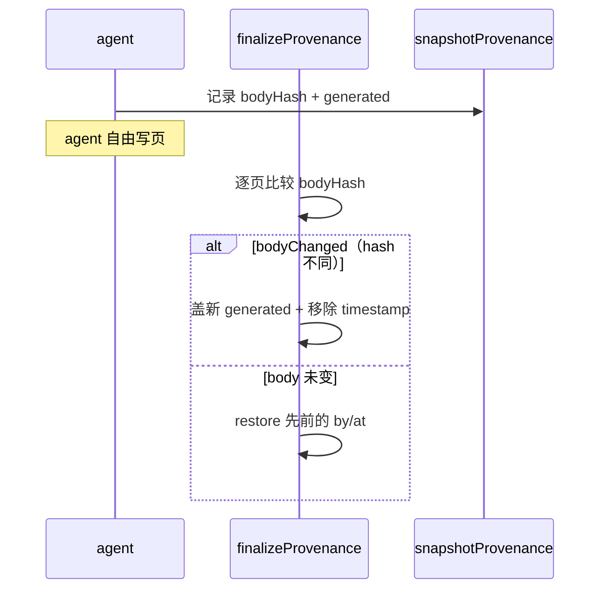
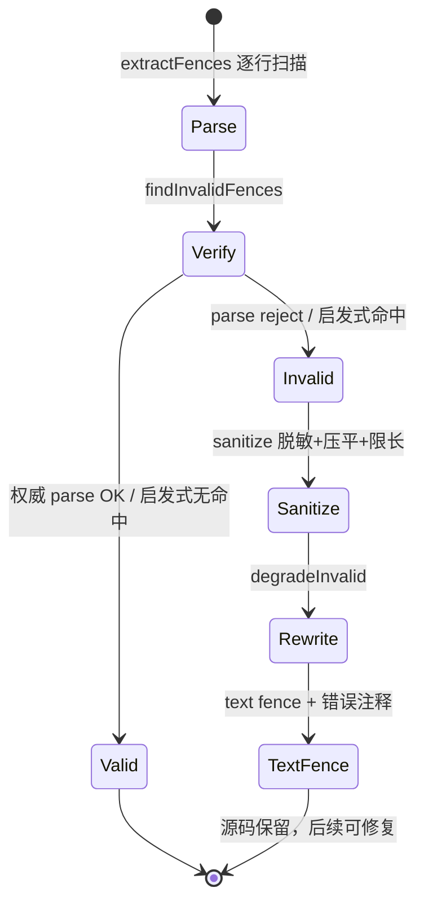

# OKF 输出与 Mermaid 校验：让自由 Markdown 变成可验证、渲染安全的 wiki

## 根因

agent 写下的自由 Markdown 有三个固有缺陷：**无状态**（无法判断"这页是 agent 改的还是人改的"）、**无节制**（无法判断何时该重写/过期）、**不可信**（无法区分"机器验证过的事实"与"agent 自说自话"）。如果这些元数据散落在日志里，下游工具（索引器、渲染器、翻页工具）无法机器读取。

`src/okf/` + `src/mermaid/` 是 openwiki 输出阶段的**确定性收尾层**：它们把 agent 的自由输出，规整成**机器可读、可验证、渲染安全**的最终 wiki。这是"让程序验证，不让 agent 自证"哲学的最后一环——agent 可以自由写正文，但每页的格式契约、出处、验证状态、渲染安全都由确定性代码（非 LLM）来写与校验。

一句话划分：`src/okf/` 是"让 wiki 可移植、可验证"的硬件，`src/mermaid/` 是"让 wiki 别渲染爆炸"的安全网。

## OKF frontmatter 校验：严格起点、宽容主体

`validateOkfFrontmatter` 是纯函数校验（[src/okf/frontmatter.ts:110-181]()），设计要点：
<!-- anchor: export type FrontmatterValidation = … return issues.length === 0 ? { valid: true } : { issues, valid: false }; -->

- **严格起点**：以 `---` 开头、必须有闭合 `---`；YAML 解析收紧 `maxAliasCount`、`schema: "core"`、`uniqueKeys`（防别名炸弹与重复键）。
- **`type` 是唯一必填**。其余字符串字段只在存在时校验非空（[src/okf/frontmatter.ts:150-167]()）。
<!-- anchor: if (!Object.hasOwn(fields, "type")) { … Object.hasOwn(fields, "tags") && -->
- **provenance/trust/lifecycle 家族只验形状、容忍额外键**，让 producer 扩展字段在往返中存活。
- **时间戳必须带显式 UTC 偏移**，且校验真实日历成分（月 1-12、闰年天数、时分秒范围）——不接受"正则像但不存在"的时间。
- `verified` 同时接受"单个 mapping"与"列表"，当作单元素列表读（兼容 SPEC §5.2 单验证者写法）。

openwiki 选择**遵守一个外部规范**（OKF v0.2 SPEC）而非发明私有格式，换取 wiki 的跨工具可移植性——这直接呼应"wiki 可移植到任何 OKF-aware 工具"的产品定位。代价是需跟随外部字段命名、兼容 v0.1 遗留（`timestamp` 被 `generated.at` 取代但仍容忍）、需为"代码怎么确定性写出合法 YAML"投入大量精确实列化助手。

## provenance 精确声明：为什么 body 变了才 stamp

`finalizeGeneratedProvenance`（[src/okf/generated-provenance.ts:162-199]()）的用法：
<!-- anchor: export async function finalizeGeneratedProvenance( … * Reads one required concept as UTF-8-compatible text. -->

1. 在 agent 运行**前**，`snapshotGeneratedProvenance` 对所有概念页记录 `bodyHash`（SHA-256 of body，排除 frontmatter）与先前的 `generated` 事件。
2. 运行**后**，对每页比较 hash。**只有 `bodyChanged`（bodyHash 不同）的页面才被盖新的 `generated: {by, at}` 并移除旧 `timestamp`**（[src/okf/generated-provenance.ts:178-184]()）。
<!-- anchor: const bodyChanged = … "timestamp", -->
3. **未变动的页面**：不推进时间戳，而是"归还"运行前快照的 `generated` 事件（若 agent rewrite 删掉/改坏它会被恢复）；之前没 stamp 的保持不 stamp（`restoreGeneratedEvent`）。

为什么"body 变了才 stamp"？因为 `generated.at` 语义 = "内容真实被本次 producer 改写的时间"。"body 没变却推进 at"会制造**假新鲜度**，破坏 lifecycle/stale 判定的准确性。用 body hash 而非文件 mtime 做判据，则把"重写但内容相同"的回写也排除在重 stamp 之外——内容同即等同，provenance 诚实。`hashConceptBody` 有意**保留空白**，让任何正文变化（含空白）都推进事件。

## 分层验证：非 openwiki 事件保留

`synchronizeClaimsVerification`（[src/okf/claims-verification.ts:31-54]()）把 durable Claims 侧的 verification 事件投影为 OKF `verified` frontmatter。设计关键：
<!-- anchor: export async function synchronizeClaimsVerification( … return changes; -->

- 先读当前 `verified` 事件，按 actor 过滤：**只丢弃 `openwiki/` 前缀的事件**，人/进程/其他 producer 的验证事件原样保留。
- 再并入 durable 层本页最新 machine 验证事件。
- 只有当内容实质改变或非 canonical 列表形式时才写；返回改动面的原始 Markdown → 便于 sidecar hash 刷新失败时事务回滚（`rollbackClaimsVerification`（[src/okf/claims-verification.ts:59-67]()）。
<!-- anchor: export async function rollbackClaimsVerification( … await store.writeMarkdown(page, original); -->

这是**分层信任**的体现：代码只接管自己（`openwiki/*` producer family）的验证记录，绝不抹掉人类或其他工具的信任标记。若把 `verified` 整体当无主数据重写，会丢失人工背书——那正是信任分层试图防止的事。

## Mermaid 校验：权威/启发式双模 + 降级自修复

### 为什么需要校验与降级

**LLM 生成图的能力是概率性的**，生成的 Mermaid 语法可能非法；而 wiki 渲染器遇到一个坏图往往整页崩溃。一套 wiki 有大量图，人工逐个盯不现实。因此需要无人值守的自动修复阶段：在渲染前发现坏图，并把"坏图"转化为"可显示的错误说明"而非空白的失败块。

### 双模校验

`mermaid` 与 `jsdom` 是 optional peer dependencies（[src/mermaid/validate.ts:51-55]()）。`loadMermaid()` 惰性加载：装了就走权威 parser（`mermaid.parse`），没装用 `heuristicError` 保守启发式。启发式**只标记高置信错误**（如保留字、label 内分号），明确"宁可漏检也不误降级"——生产不装 mermaid 依赖时有一段安全盲区，文档诚实标注了"装 mermaid = 校验强度升级"。
<!-- anchor: * `mermaid` and `jsdom` are optional peer dependencies. When present, callers … * or it may evaluate before the DOM shim runs. -->

### 失败降级 + 自修复

`degradeInvalidMermaidFences` 对每个失败 fence，重写为 `text` fence 保存图源码，并在其上方插入一行 HTML 注释携带原始 parser 错误（[src/mermaid/validate.ts:173-200]()）。这样：①图源码不丢（转 text 保留 body）；②不再以坏 `mermaid` fence 出现（不破坏渲染）；③错误就地可检索——后续 run 能读到注释里的诊断并修复它。
<!-- anchor: export async function degradeInvalidMermaidFences( … return { content: lines.join("\n"), degraded: errors.length }; -->

- **匿名化**：parser 错误先过 `sanitizeDiagnosticText`（全库 secret-redaction 边界），再压平到一行、只保留 location 与诊断、去掉 caret-underline 噪声、折叠 `--`（防终止 HTML 注释）并限长 400（`sanitizeMermaidError`（[src/mermaid/validate.ts:215-226]()）。错误被当作 debug 诊断，不能泄漏任何密钥。
<!-- anchor-base64:ZXhwb3J0IGZ1bmN0aW9uIHNhbml0aXplTWVybWFpZEVycm9yKGVycm9yOiB1bmtub3duKTogc3RyaW5nIHsg4oCmIHJldHVybiBtZWFuaW5nZnVsLnJlcGxhY2VBbGwoIi0tIiwgIi0iKS5zbGljZSgwLCA0MDApIHx8ICJ1bmtub3duIGVycm9yIjs= -->
- **自底向上写回**：重写时倒序遍历，保证行索引在 splice 后仍然有效（[src/mermaid/validate.ts:183-197]()）。
<!-- anchor: // Rewrite bottom-up so that earlier line indices stay valid as lines are splice … `${fence.indent}${fence.marker}`, -->

## 关键设计决策

**决策一：为什么用 OKF 而非自定义格式。** 互操作投资：wiki 输出可被任何 OKF-aware 工具消费，而非锁定在私有格式。代价是需跟随外部 SPEC 字段命名/形状、需兼容 v0.1 遗留、需投入大量精确实列化助手。替代方案（私有元数据扩展字段）更省事，但放弃可移植性，与产品定位冲突。

**决策二：为什么"body 变了才 stamp"。** 准确表达"谁、何时真的改了内容"。可为"run 到过"盲目 stamp（简单但产生假新鲜度、破坏 stale 判定）；也可只按 is_new 判定（漏掉 in-place 修改）。选 hash-based diff 的代价是每次 run 对全 wiki 多一次 hash 快照与比较——但与 index/mermaid 既有全量扫描共用遍历，边际成本低；换来"重写但内容相同 = 无变化"的诚实语义。

**决策三：为什么降级而不是报错。** 坏 Mermaid 图有两种处置：抛错中断 run，或降级继续。openwiki 选降级，Why：①agent 输出是概率性的，一次坏图不该让整个 run 报废；②图源码是可保留资产，转 text + 注释比丢弃信息更利于下轮自修复；③错误注释就地落盘构成"待办清单"。代价只是"坏图不渲染成图"，换来 run 健壮性与自我修复循环。

**决策四：为什么保留非 openwiki 验证事件。** `verified` 承载"这个事实被谁/什么验证过"的信任记录，openwiki 只能声明自己有权利处置 `openwiki/*` 这一段。整体重写会抹掉人类背书，破坏信任分层。代价是投影逻辑更复杂，换来"机器验证补齐但绝不越权删除他人证据"的语义正确。

## 亮点与问题

**亮点**：①诚实 provenance——hash-diff 判"真实变化"才 stamp，拒绝假新鲜度，未变页面归还先前事件且从未 stamp 就不 stamp，天然幂等；②容错安全网——mermaid 双模保持低依赖启动、降级保源码 + 就地注释自修复、DOM 只在需要时注入、jsdom 缺席自动落回；③精确实列化、零 diff 噪声——frontmatter 写入按字节编辑原始块而非整体重渲染，保留 producer 扩展字段，无变化文件 byte-for-byte 不变；④事务性 Claims 投影——sidecar hash 刷新失败可回滚。

**可改进点**：①启发式漏检风险——不装 mermaid 依赖时有一段安全盲区（文档已诚实标注）；②时间戳显式偏移硬约束可能误伤部分 producer 产出（校验器不"智能宽容"）；③`generated` 事件 producer actor 强校验非空是显式 fail-fast，需确认所有调用路径都传入非空。
