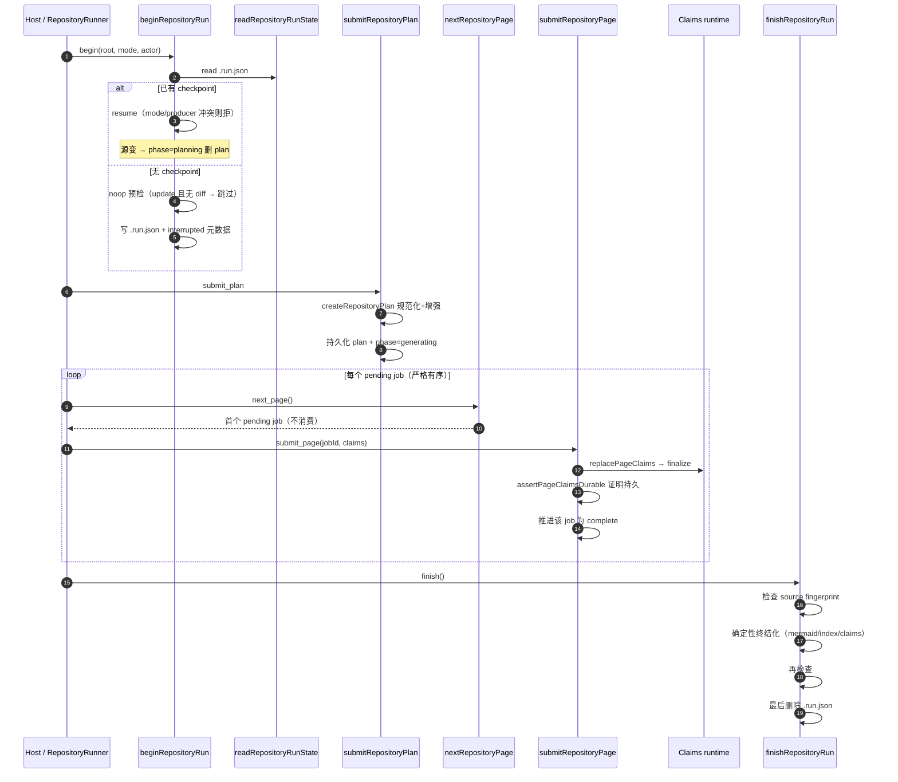
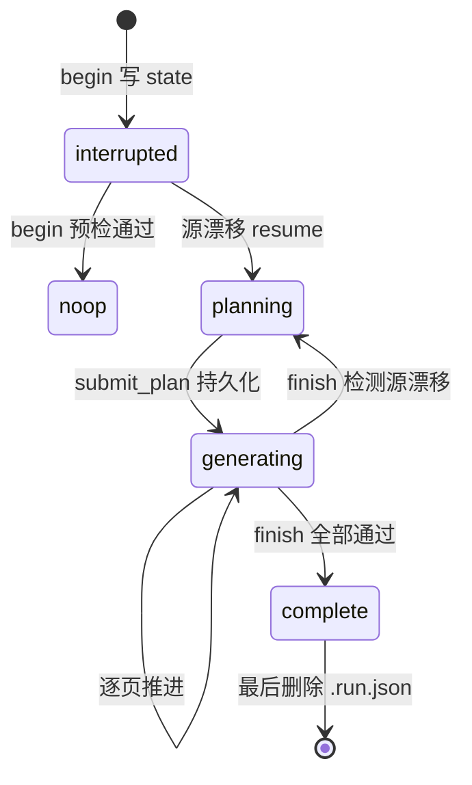

# 分页任务架构：把长时 LLM 生成变成可恢复的有序队列

## 根因

生成长 wiki 相比常规单次 LLM 调用，有两个致命困难：**长时失败**（几十个页面的生成远超单次进程/单次调用的可靠生命周期，崩溃、断网、模型超时频繁）和**增量更新**（`update` 不能重头再算，需基于上次成功状态做 diff，且要与"无变更则跳过"的 noop 结合）。

page-job 架构解决的根本问题是：**把一次 LLM 长生成拆成可单点持久化的有序子任务队列，使每一步进展都由磁盘可见状态表征，崩溃后由下一个进程按同一状态续跑**——而不是重新生成。这是全项目 durable 设计的基石：CLI/native 路径与 MCP host 路径最终都汇聚到这个唯一的持久化核心 `generation/repository-run.ts`。

## begin → plan → page 迭代 → submit → finish：完整生命周期

一次仓库 wiki 生成被组织成严格串行的五阶段协议。CLI native worker 和外部 MCP host 各自驱动这同一条生命周期，但最终都只调用这同一个 durable 核心。

## `.run.json`：唯一 durable checkpoint

整个生命周期只信任**一个**持久化状态文件 `openwiki/.run.json`（`REPOSITORY_RUN_STATE_BASENAME`（[src/generation/run-state.ts:11-15]()）。所有内存态都以它为唯一权威源——进程本地 `ActiveRepositoryRun.state` 的注释明确"Current authoritative state, replaced only after persistence succeeds"，内存态永远追认已落盘态，绝不抢先。
<!-- anchor: * Basename of the one durable repository-generation checkpoint. … export const REPOSITORY_RUN_STATE_BASENAME = ".run.json"; -->

`.run.json` 承载：runId、mode、phase（planning|generating）、sourceFingerprint（计划所依赖源码的 SHA-256（[src/generation/run-state.ts:161-163]()）、actor（跨 resume 稳定的 producer/model 身份）、initialPages/requiredRewritePages（更新/语言切换的事前快照）、beforeContentSnapshot/preparedWiki（确定性终结化所需 pre-run 快照）、plan。
<!-- anchor: * SHA-256 identity of the source input for the active plan. … sourceFingerprint: string; -->

配套一个 `.strict()` 的 zod schema：字段增减即拒载——这是"拒绝静默丢弃可恢复工作"的防御（malformed 时抛 `invalid_state` 而非默默清空（[src/generation/run-state.ts:304-314]()）。
<!-- anchor: } catch (error) { … throw error; -->

写入用"同目录临时文件 `wx` + rename 原子替换"（[src/generation/run-state.ts:322-340]()）：进程崩溃不会留下半截 JSON，因此读态能从"完整态或 null"两种结果确定地恢复。
<!-- anchor: export async function writeRepositoryRunState( … await rm(temporary, { force: true }).catch(() => undefined); -->

> 注：`phase` 二值 planning|generating 是持久语义；interrupted/noop/complete 是 `.last-update.json` 元数据状态，二者配合观之。

## 可恢复性与竞态收口

### finish 最后删除

`.run.json` 先写后删，删除放 `finishRepositoryRun` **最后一步**（[src/generation/repository-run.ts:1051-1055]()），注释明示 "Delete this LAST"。失败链上任何一步失败，文件仍在 → 下一次 begin 能重建现场重试。**删除是最终一次性承诺**，一旦删了就不能回退；后删使 `.run.json` 成为"陈旧但完整"的恢复磁带。
<!-- anchor: // Delete this LAST. If anything above fails, begin() can reconstruct and retry. … return { status: "complete" }; -->

### 两次 source fingerprint 闭合 check/use 竞态

finish 是确定性、可长时的操作窗口（终结化含索引/校验/渲染），单次入口检查无法保证"入口记的版本 = 出口用的版本"。因此 finish **开始时检查一次**（[src/generation/repository-run.ts:1004-1004]()）。
<!-- anchor: await requireStableSourceFingerprint(run); … await requireStableSourceFingerprint(run); -->
完成全部确定性终结化后**再检查一次**（[src/generation/repository-run.ts:1040-1040]()）。
<!-- anchor: await requireStableSourceFingerprint(run); -->
与此同时注释明示 "Close the check/use race"（[src/generation/repository-run.ts:1038-1040]()）。
<!-- anchor: // Close the check/use race: source must remain unchanged across the entire … await requireStableSourceFingerprint(run); -->
若中途源码漂移，`requireStableSourceFingerprint` 会把 phase 重置回 planning、删除旧 plan，抛 `conflict`，由上层重新 begin + 提交替换 plan（[src/generation/repository-run.ts:1062-1080]()）。
<!-- anchor: async function requireStableSourceFingerprint( … "Repository source changed during this OpenWiki run. The old plan was invalidate -->

### "证明持久才前进"

每页提交 `submitRepositoryPage` 只允许**当前第一个 pending job**（禁止跳页/乱序），且推进前完成严格的持久化证明：

1. 必须是当前 pending job；
2. 页面已可写、frontmatter 合法；
3. `replacePageClaims` 对账 claims；
4. `claimsRuntime.finalize` + `assertPageClaimsDurable` 证明持久化；
5. 才在 `.run.json` 推进该 job 为 complete。

`assertPageClaimsDurable`（[src/generation/repository-run.ts:825-905]()）把**持久化的 claim、页面 Markdown 字节 hash、验证事件投影、会话投影**四者逐一比对，任一不符即抛 retry 语义错误——"不持久则不宣称成功，未持久不推进队列"。
<!-- anchor: async function assertPageClaimsDurable( … * Narrows one frontmatter value to a complete verification event. -->

## 必做 job 增强：让"agent 忘做"不可能

planner 提议的 plan 不被原样接受，而是被 `createRepositoryPlan` 规范化 + 增强（[src/generation/page-jobs.ts:105-110]()）：
<!-- anchor: export function createRepositoryPlan( … ): RepositoryRunPlan { -->

- **Claims 预检补齐**：把 preflight 产出的 `GroundingIssue` 按页聚合，为漏了这些页的 planner 自动插入 reconcile-claims job（[src/generation/page-jobs.ts:238-272]()）。
<!-- anchor: function addRequiredClaimIssueJobs( … pagePaths.add(page); -->
- **语言重写补齐**：语言变更时对存量页插入 rewrite job（[src/generation/page-jobs.ts:282-305]()）。
<!-- anchor: function addRequiredRewriteJobs( … pagePaths.add(page); -->
- quickstart 页强制存在、禁止删除、固定排最后（因为它是导航综合页）。

这套"计划性补偿"让 plan 无论 agent 是否记全，都保证覆盖必须修的页面。

## 关键设计决策

**决策一：为什么用 `.run.json` 文件，而非数据库。** openwiki 产出"开放可读的 Markdown wiki"，产物本身是文件；引入 DB 带来部署运维负担，违反单目录自包含。单文件 checkpoint 意味着同一时刻只支持一个 resumable run（resume 时 mode/producer 冲突即拒），但换来讲状态全量可见、可 git 追踪、可人工删除。

**决策二：为什么 finish 最后才删 `.run.json`。** 把"整条失败链上任何一步失败都保持可换 resume"作为不变式——删除是最终承诺。若开头就删，崩溃会变成"状态已清但未真正完成"的不一致。

**决策三：为什么 agent 图不持久化，只靠 `.run.json`。** LangGraph/DeepAgents 本就擅长 checkpoint 图状态，这里刻意不复用 agent checkpointer：worker 每次都 fresh process，agent 内存态（工具调用历史、思考链）不持久，只持久**语义结果**（plan 队列 + 每页完成的 claim/内容）。原因：①持久 agent 内部态膨胀难演进；②语义 checkpoint 让 MCP host（无 LangGraph 依赖的外部驱动）也能接管；③崩溃恢复只需"重做当前 pending 页"，无需重放整个 agent 对话。

**决策四：为什么两次 fingerprint 检查而非一次锁。** finish 是确定性的长窗口，单次入口检查无法闭合 lookup 与 use 之间的竞态。两次检查把竞态收口到"若中途漂移 → 失效 + 下次 begin 重规划"，无需文件锁/全局互斥（指纹比对天然幂等且无需协调）。

## 亮点与问题

**亮点**：①"证明持久才前进"贯彻到页粒度（claim 持久化 + 三方一致性证明后才标记 complete）；②必做 job 把"agent 忘做"变成不可能；③MCP/native 唯一核心，transport 无关、协议与实现解耦干净；④错误编码化（invalid_input/invalid_state/conflict/not_found），既驱动 native worker 的"修正后重试"ToolMessage，也映射成 host 错误。

**可改进点**：①单 run 独占，同一仓库同一时间只能一个 run，MCP host 与 CLI 同时跑会互斥；②原子性靠纪律而非机制——持久化证明发生在 `.run.json` 推进之前，两者间仍有崩溃窗口（依赖幂等可重试的 retry 语义兜底）；③checkpoint 是单体 JSON，大 wiki 会整文件重写，write 放大；④`PageJob` 完成即永久，无完成后的再校验场。
