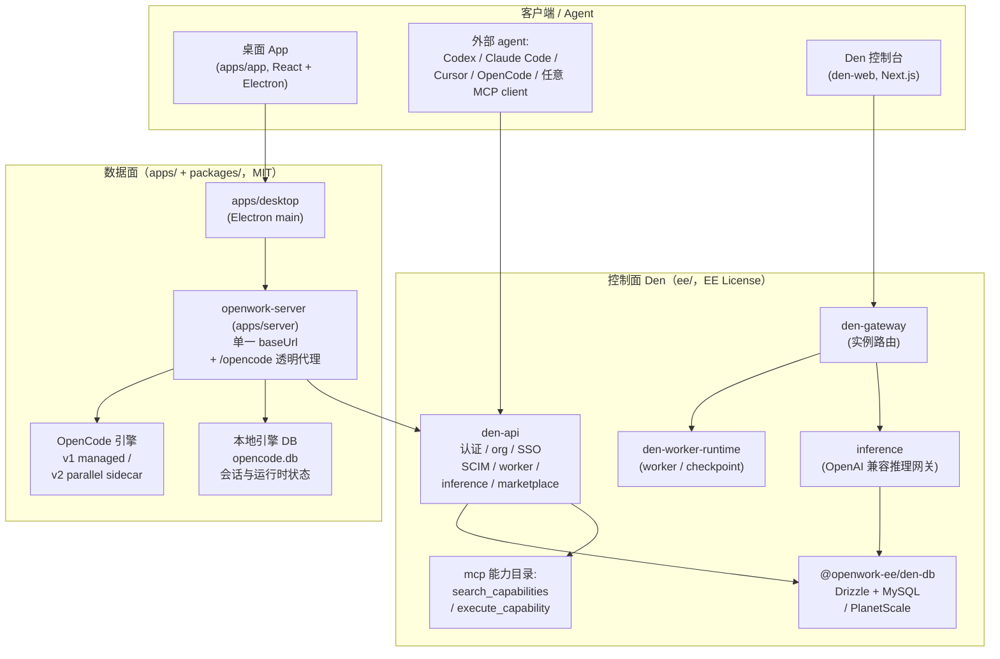

# OpenWork

> **本解读按 `ai-agent` 类规格产出**（主类型 ai-agent，鉴权/多服务控制面等作为关注面覆盖）。源码根：`/Users/morehao/Documents/study/ai-agent/openwork`（本地克隆，pnpm monorepo，v0.18.44）。

OpenWork 是一个开源、免费的桌面应用（macOS/Windows/Linux），用于**分享 AI 工作流**，是 Claude Cowork / Codex 的开源替代。它最核心的主张是：**把同一套 skills、plugins、MCP 连接、已连接的 Google Workspace / Microsoft 365 能力，通过一个 MCP 注入面复用到任意 agent harness**（Codex / Claude Code / Cursor / OpenCode 等）——"创建一次、处处复用"。桌面 App 是可选工作区，不是必需（`[README.md:5-7]()`）；面向组织时叠加 **OpenWork Den** 企业控制平面。
<!-- anchor: Add one OpenWork MCP to Codex, Claude Code, Cursor, or another compatible agent and reuse the same skills, MCPs, and connected … The desktop app is there when you want a dedicated workspace, but it is not required. You can use OpenWork from the ag -->

## 子文档索引

- [`mcp-injection.md`](mcp-injection.md) — MCP 两工具伞契约 + 能力目录 + MCP Apps 注入层（项目核心卖点）
- [`den-control-plane.md`](den-control-plane.md) — Den 多服务控制平面 + 推理供应 + 多云 provisioner + checkpoint
- [`data-model.md`](data-model.md) — den-db 数据模型：Drizzle + MySQL 96 迁移，ER 图 + 五要素
- [`agent-runtime-server.md`](agent-runtime-server.md) — 引擎运行时（OpenCode v1/v2）集成 + 会话状态 + Server 单一 baseUrl 透明代理
- [`skills-plugins.md`](skills-plugins.md) — Skill + Agent 插件（Anthropic 兼容）体系 + marketplace 分配 + 能力注入
- [`deployment-evals.md`](deployment-evals.md) — 部署形态（桌面/自托管/Helm 云）+ 证据卷轴 evals 质量体系

## 根因：把"本地优先、面向单机的 agent 引擎"改造成"可复用、可治理、可分享的共享能力面"

OpenWork 的链条起点是一个**面向单机、默认无鉴权的本地 agent 引擎进程**（OpenCode）。它要兑现"本地优先、云端就绪、一处复用"的产品主张，必须回答三个架构问题：**谁来统一管理引擎的启动与生命周期**、**谁来把引擎的裸 HTTP 能力改造成带鉴权/权限分层/可统一审计的共享服务面**、**谁来让组织级的 skills / plugins / 连接的第三方服务能以最小契约跨 agent 复用**（`[README.md:5-7]()` / `[README.md:27-29]()`）。
<!-- anchor: Add one OpenWork MCP to Codex, Claude Code, Cursor, or another compatible agent and reuse the same skills, MCPs, and connected … The desktop app is there when you want a dedicated workspace, but it is not required. You can use OpenWork from the ag -->
<!-- anchor: The OpenWork MCP brings your assigned skills, plugins, MCP connections, Google Workspace, and Microsoft 365 capabiliti … It exposes two tools: `search_capabilities` finds what you can use, and `execute_capability` runs it. After adding the MCP, your c -->

这一改造分三面落地，构成全项目的架构主线：

1. **Agent 运行时**（`apps/`、`packages/`）——桌面/服务端拉起并掌控引擎进程，维护会话状态，是"本地优先、文件留本地"的执行面。
2. **Server 数据面**（`apps/server`）——用**一个 baseUrl** 同时承载私有 API 与 `/opencode/*` 引擎透明代理，把引擎收敛成唯一入口，隐藏多套地址。
3. **Den 控制面**（`ee/`）——当需要团队/组织级能力时叠加：多服务（den-api / den-gateway / den-worker-runtime / den-web / inference）共享一套 MySQL 数据模型（`@openwork-ee/den-db`），并用**恰好两个 MCP 伞工具**把能力注入任意 agent，同时经 marketplace 分配 skills/plugins、供推理、设桌面策略（`[README.md:70-76]()`）。
<!-- anchor: OpenWork Den is the control plane for managing OpenWork across a team or organization. … - Import Agent Plugins or Anthropic-compatible plugins and make their supported -->

> **Licensing 变化（相比早期版本）**：本仓库采用目录切分授权（类 GitLab）——`ee/` 之外 MIT，`ee/`（Den 控制面）为 [OpenWork EE License](ee/LICENSE) 的 source-available 授权（≤5 人组织免费、30 天全规模免费评估、开发/测试免费，每个 ee/ 发布两年后转 MIT）；早期版本维持原 FSL-1.1-MIT（`[README.md:82-87]()`）。
<!-- anchor: This repository uses a directory-split license, similar to GitLab: … Versions released before this license was adopted remain under their original license (FSL-1.1-MIT). See [pricing](https://openworklabs.com/pr -->

## 架构总览

> 关键连线语义：`HARNESS → API` = 外部 agent 经 `/mcp/agent` 仅触达两工具（`search_capabilities` / `execute_capability`）；`DENWEB → GATE` = 控制台经 `/api/den/*` 走实例路由；`SERVER → API` = worker 回连 / heartbeat；`GATE → INF` = 推理请求经网关供应；`SERVER → ENG/LOCALDB` = 数据面拉起引擎并直写会话态。

## 核心能力清单

| 能力 | 说明 | 深度文档 |
|------|------|---------|
| 跨 Agent 工作流复用 | 一个 MCP 面（`search_capabilities` + `execute_capability`）复用同一套能力，工具面永不增长 | [`mcp-injection.md`](mcp-injection.md) |
| 能力目录 + MCP Apps | 能力经目录注册检索；MCP Apps（`io.modelcontextprotocol/ui`）注入宿主 | [`mcp-injection.md`](mcp-injection.md) |
| 组织控制平面 | 多服务控制面：worker 生命周期、checkpoint、多云 provisioner | [`den-control-plane.md`](den-control-plane.md) |
| 推理供应 | OpenAI 兼容推理网关 + 成员/团队可用的模型 provider + 限流 | [`den-control-plane.md`](den-control-plane.md) |
| 企业数据模型 | Drizzle + MySQL 约 96 迁移 + 20+ schema，多服务共享单库 | [`data-model.md`](data-model.md) |
| 引擎运行时 | OpenCode v1 托管 + v2 parallel sidecar（provider 热注入、默认关） | [`agent-runtime-server.md`](agent-runtime-server.md) |
| Server 数据面 | 单一 baseUrl 透明代理 + 鉴权分层 + CORS / 审计 | [`agent-runtime-server.md`](agent-runtime-server.md) |
| Skill + Agent 插件 | Anthropic 兼容插件导入归一 + marketplace 发布/分配 | [`skills-plugins.md`](skills-plugins.md) |
| 可拆离交付 | 桌面 / 自托管 / Helm 云三形态 | [`deployment-evals.md`](deployment-evals.md) |
| 证据驱动测试 | evals 证据卷轴 + demo driven development | [`deployment-evals.md`](deployment-evals.md) |

## 技术栈一览

| 层 | 技术 |
|----|------|
| 桌面 | Electron（apps/desktop）、React + Vite（apps/app），shadcn/ui (Base UI)、Tailwind、TanStack Query、Zustand、Zod |
| 服务端 | Node/Bun、`node:http`、`@opencode-ai/sdk`；MCP（server 端管理）、Better-Auth |
| 控制面 | Hono（den-api）、Next.js（den-web）、Daytona/Render 等 provisioner、OpenRouter 等推理网关 |
| 数据 | Drizzle ORM + MySQL / PlanetScale（ee/packages/den-db），本地引擎 SQLite，Redis（diagnostics） |
| 编排 | pnpm monorepo + turbo；`evals` 独立 workspace（Testkit 断言） |
| 部署 | electron-builder（多 flavor）、Docker、Kubernetes Helm（openwork-ee Chart） |

## 核心模块导读

| 模块 | 职责 | 深读 |
|------|------|------|
| MCP 注入面（ee/apps/den-api/src/mcp） | 两工具伞契约、能力目录、外部 MCP/marketplace/native/mcp-apps | [`mcp-injection.md`](mcp-injection.md) |
| Den 控制平面（ee/apps/den-* + inference） | 多服务控制面、worker 编排、checkpoint、多云部署、推理供应 | [`den-control-plane.md`](den-control-plane.md) |
| 数据模型（ee/packages/den-db） | 共享 MySQL 数据层，约 96 迁移 + 20+ schema | [`data-model.md`](data-model.md) |
| Agent 运行时 + Server（apps/desktop + apps/server） | 拉起/掌控引擎（v1/v2）、会话状态、单一 baseUrl 透明代理、鉴权 | [`agent-runtime-server.md`](agent-runtime-server.md) |
| Skill + 插件体系（apps/server + den-api mcp） | skill 发现/注入、Anthropic 兼容插件导入、marketplace 分配 | [`skills-plugins.md`](skills-plugins.md) |
| 部署 + 测试（packaging + evals + Helm） | 三部署形态 + 证据卷轴 evals | [`deployment-evals.md`](deployment-evals.md) |

## 可借鉴的设计

- **两工具伞契约**：把"一能力一工具"导致的工具面爆炸收敛为"搜索伞 + 执行伞"两个原语，作为跨 agent 复用的唯一闸口——能力目录增长不必改协议（[`mcp-injection.md`](mcp-injection.md)）。
- **单一 baseUrl + 透明代理**：把引擎裸进程收敛成"一个带鉴权/审计/统一 CORS 的入口"，同时保住流式语义（[`agent-runtime-server.md`](agent-runtime-server.md)）。
- **低频写状态机 + 高频无状态转发**：控制面把"写事务/组织上下文"收敛到一个进程（den-api），其余只读/转发，用共享 MySQL 单一 schema 胶合；checkpoint 让容器不可持久变成状态可迁移（[`den-control-plane.md`](den-control-plane.md)）。
- **server-consumption first**：消费 OpenWork server 面、不发明平行行为——"OpenCode 能做的 OpenWork 都有"（AGENTS.md）。
- **证据卷轴（evidence tape）**：用"截图 + 愿景模型分级断言"把"改对没改坏"固化成可回放、可贴 PR 的证据，以"Passed 需每个 claim 有可观察断言"为铁律（[`deployment-evals.md`](deployment-evals.md)）。

## 不足与风险

- **引擎直写 `opencode.db` 的 schema 强耦合**：会话/消息落到引擎自有 SQLite，引擎升级即可能 break（[`agent-runtime-server.md`](agent-runtime-server.md)）。
- **两工具即单一缺口放大**：所有能力经一个 `execute_capability` 执行闸，任何分支授权疏忽都会横向放大到所有能力源（[`mcp-injection.md`](mcp-injection.md)）。
- **共享单库的演进成本**：den-api / inference / worker 直接 import 同一份 den-db schema，跑 migration 必须多服务齐步、顺序部署（[`den-control-plane.md`](den-control-plane.md)）。
- **目录切分授权带来的边界**：`ee/` 为 source-available，自托管部署 Den 需订阅（≤5 人/30 天评估除外）——"免费"与"可审计可自托管"并存，但生产使用有门槛（`[README.md:82-87]()`）。
<!-- anchor: This repository uses a directory-split license, similar to GitLab: … Versions released before this license was adopted remain under their original license (FSL-1.1-MIT). See [pricing](https://openworklabs.com/pr -->

## 总结

OpenWork 的根因是"把面向单机的无鉴权 agent 引擎，改造成可复用、可治理、可分享的共享能力面"：Agent 运行时（[`agent-runtime-server.md`](agent-runtime-server.md)）是执行底座，Server 数据面（[`agent-runtime-server.md`](agent-runtime-server.md)）把引擎收敛成单一 baseUrl，Den 控制面（[`den-control-plane.md`](den-control-plane.md)` + [`data-model.md`](data-model.md)）提供组织级多租户底座与推理供应，MCP 两工具 rail（[`mcp-injection.md`](mcp-injection.md)` + [`skills-plugins.md`](skills-plugins.md)）让能力能以最小契约跨 agent 复用。整套设计以 **ejectable（可拆离）** 与 **server-consumption first（消费控制面、不发明平行行为）** 两个不变式贯穿。它最大的价值不在聊天 UI，而在"引擎—数据面—控制面—agent"四层之间清晰而务实的边界切分，以及把"能力注入"与"质量自证"做成可持续演进的一等公民。
